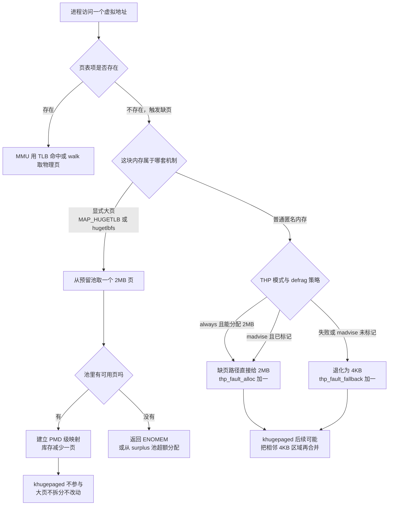
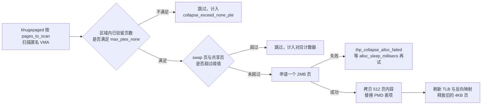
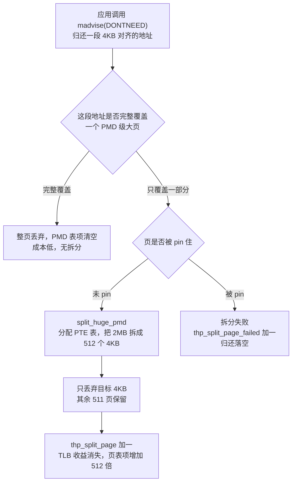
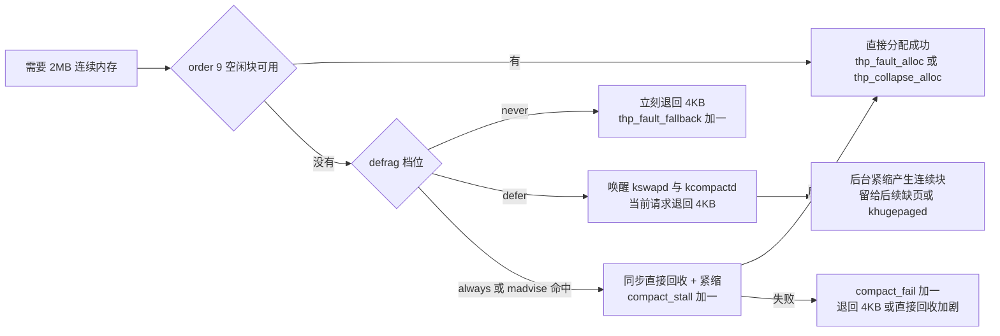

# 大页内存 HugePage：TLB Miss的终极解法

**摘要：**

一台 128GB 的数据库服务器，Buffer Pool 吃掉大半内存，CPU 使用率不算高，压测的 QPS 却上不去，`perf stat` 里 `dTLB-load-misses` 占访存的比例远超预期——这类现场通常不是代码写错了，而是地址翻译跟不上访存节奏。本文从一次访存的翻译动作讲起，把四级页表的 walk 成本、TLB 的容量约束与 2MB 页把覆盖范围抬高 512 倍的算术摊开，再分别拆解两套常被混为一谈的机制：**显式大页（HugeTLB）**靠预分配的页池换来确定性，代价是预留、NUMA 规划与不可回收；**透明大页（THP）**靠缺页路径与 khugepaged 换来零改造，代价是分配延迟、内存放大与拆分开销。文章给出两者的选择判据表、同一台机器上两套机制争抢 order 9 连续块的连带影响、`/proc/meminfo` 与 `/proc/vmstat` 的读数口径、khugepaged 的调参代价、THP 与 `madvise(DONTNEED)` 的交互（Redis 的 COW 降本优化因此在 THP 下失效）、内存碎片如何让 2MB 分配失败，以及几个真实反例的判据与处置。文中所有数字都标注了量级口径或示例推算，避免被当成基准数据。结论落在权衡上：大页买到的是地址翻译的摊销，不是免费的带宽。

---

## 第 1 章 地址翻译的两道关口

CPU 执行一条 `mov` 指令时，第一条微操作不是取数据，而是把一个虚拟地址翻译成物理地址。翻译由 MMU 完成，它面前只有两样东西可用：一张贴在桌边的便签，和一本要翻好几层目录才能查到词条的大字典。便签是 **TLB**，大字典是**多级页表**。理解大页为什么有用，只需要看清这两样东西的容量与成本差了多少个数量级。

### 1.1 页表是一本四层目录的字典

x86-64 的虚拟地址是 48 位（五级页表下 57 位），切成五段：每 9 位查一级目录，最后 12 位是页内偏移。每张页表占 4KB，正好装 512 个 8 字节表项，所以索引宽度是 9 位，`9 × 4 + 12 = 48` 就是四级页表自洽的全部原因。

| 层级 | 表名 | 索引位宽 | 单个表项覆盖的范围 | 表本身大小 |
| :--- | :--- | :--- | :--- | :--- |
| 第 1 级 | PML4（页全局目录） | 9 bit | 512GB | 4KB |
| 第 2 级 | PDPT（页上级目录） | 9 bit | 1GB | 4KB |
| 第 3 级 | PD（页中间目录） | 9 bit | 2MB | 4KB |
| 第 4 级 | PT（页表） | 9 bit | 4KB | 4KB |

第四列是全篇的伏笔：一个 PMD 表项天然覆盖 2MB，一个 PUD 表项天然覆盖 1GB。硬件大页恰好是这两个尺寸，不是内核挑的，而是页表索引宽度决定的——2MB 大页的本质是让页表在第三级停下，整张 PTE 表省掉；1GB 大页让页表在第二级停下。硬件只支持这两种粒度，6.7 之后内核提供的 16KB、32KB、64KB 等 mTHP，都是软件在这一层之外的近似。

一次命中要求四级全部走完，每级读一次内存。这四张表本身也是普通内存页，会进 CPU cache，命不中就要多走一次内存，所以 walk 的成本跨度极大：四级表项都在 L1 或 L2 cache 里，二三十个周期就能结束；一路走到 DRAM，单次访存按百纳秒计，四层串行就是几百纳秒。虚拟化再翻一倍，因为客户机的遍历还要经过宿主的第二层翻译。

### 1.2 TLB 之所以存在，是因为 walk 太贵

TLB 是 MMU 内部的一张全相联或组相联缓存，缓存的是"虚拟页号到物理页号"的映射，命中时只花一到两个周期，比 walk 便宜两个数量级。它的容量与 CPU 微架构强绑定，各代产品差异不小，但量级稳定：

| TLB 层级 | 4KB 页的典型条目数 | 备注 |
| :--- | :--- | :--- |
| L1 dTLB | 64 左右 | 每核私有，只服务数据访问 |
| L1 iTLB | 64 到 128 | 每核私有，只服务取指 |
| L2 TLB（STLB） | 1536 到 3072 | 每核私有，指令与数据共享，是全篇的瓶颈所在 |
| L1 dTLB 的 2MB 条目 | 32 左右 | 大页条目单独占坑，比 4KB 条目少一半 |

TLB 未命中之后，硬件并不会立刻让流水线停住，现代 CPU 会并行发出多个**页表遍历**请求，也会缓存中间层结果（page-walk cache）。这些机制把平均成本压下来，但压不掉本质：只要工作集显著大于 TLB 覆盖范围，miss 就会变成常态，而每次 miss 都要占用一个页表遍历器，与数据访存抢内存带宽。这就是为什么大内存应用在没有大页时，会莫名其妙地出现"CPU 不满、内存带宽不满、但就是慢"的形态。

### 1.3 512 倍是怎么算出来的

把 1536 条 L2 TLB 条目当作容量，两种页大小下的覆盖范围如下。这组数字是示例推算，实际容量随 CPU 型号变动，但比例关系不变：

| 页大小 | TLB 条目数 | 可覆盖的虚拟地址范围 | 相对 4KB 页的倍数 |
| :--- | :--- | :--- | :--- |
| 4KB | 1536 | 6MB | 1 倍 |
| 2MB | 1536 | 3GB | 512 倍 |
| 1GB | 1536 | 1.5TB | 262144 倍 |

`1536 × 4KB = 6MB`，`1536 × 2MB = 3GB`，`3GB ÷ 6MB = 512`。这个 512 不是笔者的修辞，而是页大小比值本身：2MB 除以 4KB 等于 512，在 TLB 条目数不变的前提下，覆盖范围必然按同样的倍数放大。换一个更贴切的说法：一张 A4 纸只能盖住桌面的一角，换成一张 512 倍的桌布，同样的张数就能盖满整间屋子。

但覆盖范围不等于命中率。假设工作集 64GB、访问完全随机、每次落在新的 2MB 区域：1536 条 2MB 条目只覆盖 3GB，命中率不到 5%，看上去仍几乎每访存都 miss。收益不在这里，而在 miss 的频率——4KB 页下每访问 4KB 就有一次潜在 miss，2MB 页下每访问 2MB 才有一次，单位字节的 miss 次数下降 512 倍；把 64GB 全量扫一遍，4KB 页约 1677 万次 walk，2MB 页约 3.3 万次。这个比值由页大小决定，与 TLB 容量无关。

由此可以推出两个推论，后文反复用到。其一，大页对顺序或块状访问的收益最大，因为局部性本来就存在，大页只是把已有的局部性折算成更少的 walk；对完全随机的小粒度访问，收益退化为"每 2MB 省 511 次 walk"，仍然可观但不再神奇。其二，工作集一旦超过 TLB 覆盖范围，命中率的高低由访问模式而非页大小决定，所以调优之前必须先测 miss 率，而不是先改配置。

### 1.4 为什么不是所有页都用大页

既然 2MB 页处处更优，为什么不干脆取消 4KB 页。原因有三条，每一条都在后文的取舍里出现。

第一是**内部碎片**。大页的最小分配单位就是页本身，一个只被写了一个字节的 2MB 区域也要占满 2MB 物理内存。微服务容器里一个堆 80MB 的进程，用 2MB 页最坏要浪费近 2MB，比例不高；但一个 300KB 的小对象占满 2MB，浪费率就超过八成。

第二是分配难度。2MB 连续物理内存在系统跑久了之后并不好找，伙伴系统需要 order 9 及以上的空闲块，而长期运行的系统里高 order 块往往被 4KB 分配打碎。碎片与伙伴系统的机制见 [[02 物理内存管理：Buddy System 与 Slab 分配器的设计哲学]]，此处只需记住结论：大页的分配成功率随时间下降，这是显式大页必须预分配、THP 必须紧缩的根本原因。

第三是时机。页表在哪一级停下，决定了这个页能不能被拆开、能不能被局部回收、能不能 swap。2MB 页一旦映射，任何只涉及其中一小段的操作（部分 `munmap`、部分 `mprotect`、小粒度 `madvise(DONTNEED)`）都先要把大页拆成 512 个 4KB 页，拆本身要分配页表、改反向映射、刷 TLB，成本不小。

---

## 第 2 章 两套机制，不是一个功能

Linux 里说"用大页"，指的是两条互不相通的路径。一条叫**显式大页（HugeTLB）**，管理员预留一批页，应用通过 `mmap` 或共享内存显式申领；另一条叫**透明大页（Transparent Huge Pages，THP）**，内核在缺页或后台扫描时自作主张地把 4KB 页拼成 2MB 页，应用一行代码都不用改。它们都叫 hugepage，都用 2MB，都为了 TLB，但除此之外几乎没有任何共同点，把两者混着讲，后面的坑一个都避不开。

### 2.1 分野在哪里

一句话概括：显式大页把决定权交给管理员与应用，THP 把决定权交给内核。决定权在谁手里，直接决定了不确定性由谁承担。

显式大页的页池是"库存"，数量由 `vm.nr_hugepages` 写死，页从伙伴系统里被切出来之后就只归大页子系统调度，不再参与常规的内存分配、回收与 swap。应用要用的每一页都从库存里取，库存不够就是 `ENOMEM`，失败发生在明确的时刻、有明确的原因，这条链路是可预测的。

THP 的页是"临时凑的"，缺页时内核看情况分配一个 2MB 页，成功就用、失败就退 4KB；已经映射成 4KB 的区域由 `khugepaged` 后台线程慢慢合并。分配的时刻由访问行为触发，能否成功取决于当时的碎片状况，失败往往只在计数器里留一个增量，应用完全不知情。可预测性的差别就在这里。

### 2.2 两条路径的机制对照

下图把两条路径并排放，左边是显式大页的"先预留、后申领"，右边是 THP 的"缺页分配、后台合并"，中间的分岔点是这份内存由谁决定大小。



两条路径在物理内存上还有一个关键差别：显式大页的页一旦进池，就不在 LRU 链上，不可 swap、不可回收、不进 page cache，也不参与 `MemAvailable` 的估算；THP 的 2MB 页仍然是普通匿名页，可以被回收（先拆再回收）、可以在 4.14 之后整页换出到 swap，也可以被迁移。前者换来确定性，后者换来弹性。

### 2.3 对照表

| 维度 | 显式大页（HugeTLB） | 透明大页（THP） |
| :--- | :--- | :--- |
| 谁决定用不用 | 应用显式申领，管理员预留 | 内核按开关与访问行为自动决定 |
| 何时分配 | 预分配进池，申请时从池里取 | 缺页时分配，或 khugepaged 后台合并 |
| 支持的粒度 | 2MB、1GB（可同时存在，分池管理） | 2MB（PMD 级），6.7 起另有更小的 mTHP 尺寸 |
| 应用是否需改造 | 需要，换成 `MAP_HUGETLB` 或用 hugetlbfs | 不需要，最多加 `madvise(MADV_HUGEPAGE)` 提示 |
| 失败的表现 | 申请返回 `ENOMEM`，可观测、可重试 | 静默退化为 4KB，只在计数器里留痕 |
| 能否 swap / 回收 | 不能，池内页被永久占住 | 能，可拆可换可迁移 |
| 对内存碎片的敏感性 | 预留阶段敏感（启动时最可靠），之后无关 | 全程敏感，碎片决定 fault 与 collapse 的成败 |
| 典型使用者 | Oracle、PostgreSQL、DPDK、部分 JVM 显式大页 | 通用 JVM 堆、大数据 executor、免改造的存量服务 |

### 2.4 两者能共存吗

能，而且互不干扰。hugetlbfs 挂载与 `MAP_HUGETLB` 的映射不经过 THP 的缺页路径，THP 的开关不会改变大页池的大小；反过来，`khugepaged` 也不扫描大页映射。内核文档的说法是，在开启 THP 的内核上使用 hugetlbfs 没有任何差别，唯一的变化是系统整体碎片会少一些。

但共存有一个很少被提及的代价：两者在抢同一种资源。显式大页预留时从伙伴系统里切走的是 order 9 的连续块，THP 缺页时想拿的也是 order 9 的连续块。一台机器上预留了几十 GB 的 2MB 大页之后，留给 THP 的连续内存变少，THP 的分配失败率会上升，`thp_fault_fallback` 与 `compact_stall` 一起变难看。混部场景里如果一边跑着要用显式大页的数据库、一边跑着指望 THP 的 JVM，两边的容量规划必须一起算，不能各算各的。

---

## 第 3 章 显式大页：确定性来自预分配

显式大页的全部性格都来自一个动作——**预分配**。理解了为什么必须提前把页从伙伴系统里拿出来，就理解了它的优点、缺点与所有运维规范。

### 3.1 池是怎么建起来的

最可靠的建池方式是内核启动参数。系统刚启动时物理内存几乎全是连续的，此时切出 order 9 的块成功率最高：

```bash
# 预留 2048 个 2MB 大页，即 4GB；默认大页尺寸也设为 2MB
# 写在 GRUB_CMDLINE_LINUX 里，因为启动阶段内存还未碎片化
hugepagesz=2M hugepages=2048 default_hugepagesz=2M

# 1GB 大页必须在启动时预留，x86 需要 CPU 支持 pdpe1gb
default_hugepagesz=1G hugepages=8

# NUMA 机器可以按节点分配，避免跨节点访问
hugepagesz=2M hugepages=0:1024,1:1024
```

运行期也能调整，接口在 `/proc/sys/vm/nr_hugepages` 与 `/sys/kernel/mm/hugepages/hugepages-<size>kB/nr_hugepages`：

```bash
# 运行期把默认尺寸的池调整到 2048 页；写入的值可能只完成一部分
echo 2048 > /proc/sys/vm/nr_hugepages
# 读回实际值：写入成功不代表全部成功，这是最容易漏掉的一步
cat /proc/sys/vm/nr_hugepages

# 按 NUMA 节点精确下发，避免默认策略在节点间乱撒
numactl --interleave=all sh -c 'echo 2048 > /proc/sys/vm/nr_hugepages_mempolicy'
```

写入 `/proc/sys/vm/nr_hugepages` 时，内核会尽力把池调整到目标值，但拿不到连续内存的节点会被静默跳过，必要时从其他节点补，补不上就停在中途。所以规范动作是写完立即读回，并在 NUMA 机器上再看一眼 `/sys/devices/system/node/node*/meminfo` 里的 `HugePages_` 行。

### 3.2 为什么必须预分配

不预分配行不行。行，但只在两种条件下成立：一是刚启动的系统，内存还没被 4KB 分配打碎；二是预留量很小，几百 MB 以内，随便哪块空隙都装得下。系统跑过一段时间之后，想临时切出几 GB 的 order 9 连续块，成功率取决于当时的高阶空闲块，内核会动用内存紧缩（compaction）去搬运页面凑出连续块，这个过程既慢又可能失败。

这里有一个值得记住的对照：显式大页的预分配与 THP 的同步紧缩，解决的是同一个问题，用了相反的思路。前者把成本挪到启动时一次性付掉，后者把成本留到每次缺页时临时付，还可能付不掉。运维上偏好前者的人，本质上是偏好"延迟可预期"；偏好后者的人，本质上是偏好"不用规划"。

1GB 大页把这个问题放大到了极端。要拿到 1GB 连续物理内存，系统必须从启动阶段就不把这些内存切碎，运行期几乎不可能凑出来，因此 1GB 池基本只能靠启动参数建立。较新的内核提供了 `demote` 接口，允许把 1GB 页拆成 512 个 2MB 页退回小尺寸池，方向是"大拆小"，解决不了"小拼大"的困难。

### 3.3 应用怎么拿到这些页

三条路，对应三种编程模型：

```c
/* 路一：匿名映射 + MAP_HUGETLB，最简单，页从默认尺寸的池里出 */
void *p = mmap(NULL, 4UL << 30, PROT_READ | PROT_WRITE,
               MAP_PRIVATE | MAP_ANONYMOUS | MAP_HUGETLB, -1, 0);
/* 需要指定尺寸时，用 MAP_HUGE_2MB 或 MAP_HUGE_1GB 与 MAP_HUGETLB 组合 */

/* 路二：System V 共享内存，跨进程共享同一批大页，Oracle 的 SGA 走这条 */
int shmid = shmget(IPC_PRIVATE, 4UL << 30, IPC_CREAT | SHM_HUGETLB | 0600);
void *q = shmat(shmid, NULL, 0);

/* 路三：memfd + hugetlb 标志，得到一个可传递的文件描述符 */
int fd = memfd_create("dbpool", MFD_HUGETLB | MFD_HUGE_2MB);
```

三条路都有共同的对齐约束：映射大小与地址必须是大页尺寸的整数倍，`munmap` 长度不足一页时内核返回 `EINVAL`。另一条容易踩的限制是 hugetlbfs 上的文件支持 `read` 但**不支持 `write`**，写入必须走映射。

hugetlbfs 是第四条路，也是唯一能让"文件"落在大页上的方式。挂载时的一组选项决定了这块文件系统能分到多少页、给谁用：

```bash
# 挂载一个 2MB 页的 hugetlbfs，限制最多使用 8GB 池，属主给数据库账号
mount -t hugetlbfs -o pagesize=2M,size=8G,uid=1001,gid=1001,mode=1770 \
      nodev /dev/hugepages

# min_size 会在挂载时就锁住一部分页，防止别的应用把池抢光
# nr_inodes 限制文件数，避免一个应用把池切成大量小文件
```

`size` 与 `min_size` 是容量治理的关键：前者封顶，后者保底。没有 `size` 限制时，任何有写权限的进程都能把整个池吃光，别的应用只能拿到 `ENOMEM`。很多人只配了 `nr_hugepages` 就以为管理完成，其实配额一层根本没设。

非 root 进程使用共享内存大页还需要一个前提：进程所在组要被写进 `/proc/sys/vm/hugetlb_shm_group`，否则 `shmget(SHM_HUGETLB)` 会被权限拒绝。容器里这条限制经常以"共享内存段创建失败"的形式出现，排查时容易误判成内核不支持大页。

### 3.4 surplus：池外的备胎

`vm.nr_overcommit_hugepages` 定义了池可以被超额借出多少页。当应用申请的页数超过 `nr_hugepages` 时，内核从普通页池里临时切出 **surplus** 页给应用用，应用释放后这些页归还普通池。

```bash
# 允许最多再借 1024 个 2MB 页（2GB）
echo 1024 > /proc/sys/vm/nr_overcommit_hugepages
```

它的价值是缓解"预留多了浪费、预留少了失败"的两难：按常规用量预留，峰值允许借。但它替代不了预留。其一，surplus 页同样要求连续物理内存，碎片化时照样借不到，而峰值时刻往往正是内存最紧张的时候。其二，把 `nr_hugepages` 调小到低于在用页数时，内核会把超出的在用页转成 surplus，即便超过 overcommit 上限也照转，此后不再允许新的 surplus，一次看似无害的缩容可能让后续申请全部失败。

surplus 的存在还让 `/proc/meminfo` 的读数变得需要解释，`HugePages_Surp` 就是它留下的痕迹，第 7 章专门拆这几个数。

### 3.5 预留的代价

预留不是免费的，代价有明确的账目。

第一笔是内存本身。进池的页从此退出常规分配，`MemFree` 与 `MemAvailable` 都会下降，内核不会因为"这些页没人用"而把它们还给 page cache。一台 256GB 的机器上预留 64GB 却只用 40GB，那 24GB 就是纯粹的死内存——既不能缓存热数据，也不能应急。

第二笔是**不可回收**。池内空闲页不能参与内存回收，内存压力上来时 `kswapd` 对它们无能为力，回收的机制见 [[05 内存回收：kswapd、LRU与直接回收的博弈]]。这意味着一旦预留过量，系统在真正缺内存时少了一块缓冲，OOM 会来得更早，判据与处置见 [[07 OOM Killer：内存耗尽时内核如何做出生死抉择]]。

第三笔是 NUMA 与热插拔的刚性。大页按节点预留，进程若被调度到另一个节点，跨节点访问的延迟优势会抵消一部分 TLB 收益；内存热插拔、内存故障隔离这些运维动作遇到大页池时也会更麻烦——池内页不是随便就能搬走的。

第四笔是容量规划的精度要求。大页只能整页分配，应用要 10MB 就得给 12MB（6 个 2MB 页），要 1GB 就得给 1GB（恰好整除）。Buffer Pool 这类固定大小的区域可以做到零浪费，而大小随负载变化的结构只能按峰值向上取整，浪费率取决于取整的粒度。

| 配置项 | 作用 | 调大的代价 | 调小的代价 |
| :--- | :--- | :--- | :--- |
| `vm.nr_hugepages` | 持久大页池的页数 | 空闲池页变成不可回收死内存，`MemAvailable` 下降 | 应用申请失败返回 `ENOMEM`，可能触发业务降级 |
| `vm.nr_overcommit_hugepages` | 允许超额借出的上限 | 峰值时刻从普通池抢页，加剧碎片与直接回收 | 峰值申请直接失败，缺少缓冲 |
| hugetlbfs 的 `size` | 该挂载点的用量上限 | 单个租户可吃光全池，其他应用被饿死 | 应用写满后 `ENOSPC`，表现像磁盘满 |
| hugetlbfs 的 `min_size` | 挂载时锁定的保底页数 | 挂载时即占住内存，空闲也退不回 | 无法保证应用启动时一定拿得到页 |
| 1GB 页的 `hugepages` | 巨大页池的页数 | 一次性吃掉大量连续内存，挤掉 THP 的空间 | 只能事后 `demote` 拆分，补不回来 |

---

## 第 4 章 透明大页：把决定权交给内核

THP 的出发点是消除显式大页的两个门槛：应用改造与人工规划。它让内核在背后做事，代价是把不确定性也一并接了过来。

### 4.1 三种模式与它们的真实语义

全局开关在 `/sys/kernel/mm/transparent_hugepage/enabled`，读出来是一个带方括号的三选一列表：

```bash
cat /sys/kernel/mm/transparent_hugepage/enabled
# always madvise [never]   ← 方括号里是当前值
```

| 模式 | 缺页路径的行为 | khugepaged 的行为 | 适用判断 |
| :--- | :--- | :--- | :--- |
| `always` | 所有匿名缺页都尝试给 2MB，失败按 `defrag` 策略决定是否同步紧缩 | 扫描全部匿名 VMA，主动合并 | 适合大堆、长生命周期、能接受尾延迟抖动的服务 |
| `madvise` | 只有 `madvise(MADV_HUGEPAGE)` 标记过的区域才尝试 | 只扫描被标记的区域 | 适合可改造或可协商的应用，是多数发行版的稳妥选择 |
| `never` | 不尝试，全部 4KB | 线程不启动 | 适合 Redis 这类 fork 敏感、小粒度归还内存的服务 |

两个细节常被忽略。其一，从 6.7 起 THP 支持多尺寸（**mTHP**），开关变成了按尺寸分目录的 `/sys/kernel/mm/transparent_hugepage/hugepages-<size>kB/enabled`，每个尺寸可以取 `always`、`madvise`、`never` 或 `inherit`，`inherit` 表示跟随顶层开关；6.1、6.6 这类较早的 LTS 只有顶层一个开关，PMD 级 2MB 是唯一选择。其二，把 `never` 写进所有开关并不等于"系统里绝不会有透明大页"，因为 `madvise(MADV_COLLAPSE)` 会绕过这些开关强行合并——这是 6.x 的行为，正好构成第 12 章的一个反例。

进程层面还有两条更细的控制：`prctl(PR_SET_THP_DISABLE)` 让整个进程不用 THP（Redis 的 `disable-thp` 走的就是这条），`madvise(MADV_HUGEPAGE)` 与 `MADV_NOHUGEPAGE` 控制具体地址范围。前者对 `madvise` 模式与 `always` 模式都有效，后者只对 `madvise` 模式与 `defrag` 的 `madvise` 档有意义——在 `always` 下标记 `MADV_NOHUGEPAGE` 也能拦住，但很多应用并不知道要标。

### 4.2 缺页路径：一次 2MB 的分配

普通匿名缺页时，内核会走 `do_huge_pmd_anonymous_page()`：先尝试分配一个 2MB 页，成功就建立 PMD 级映射，一次缺页把 512 个页的映射全部建立好；失败则退回 4KB 路径，`thp_fault_fallback` 加一。如果读缺页且开启了 `use_zero_page`，内核会把这个区域映射到共享的大零页，一次也不分配物理内存，直到有写操作才真正分配。

这条路径有三笔成本。一是分配，2MB 连续页比 4KB 难拿得多。二是清零，2MB 的清零按内存带宽算在百微秒量级（量级判断）；4KB 只有它的 1/512，但要缺页 512 次，总成本仍是 2MB 更低，这是一次大额付款优于 512 次小额付款的道理。三是失败后的行为，`defrag` 决定就此退回 4KB，还是先做一遍紧缩再试。

### 4.3 khugepaged：迟到的合并

缺页路径只处理"新分配"的内存，已被映射成 4KB 的旧内存要靠 `khugepaged` 后台线程慢慢合并。它的工作循环是：扫描进程的 VMA，找到连续的 4KB 映射区域，从伙伴系统申请一个 2MB 页，把 512 个页的内容拷贝过去，改 PMD 表项指向新页，刷掉相关 TLB，最后释放旧的 512 个页。



合并的每一步都有代价：扫描要拿 `mmap` 锁（6.x 部分路径改成 per-VMA 锁，缓解有限），拷贝 2MB 占内存带宽，替换 PMD 要遍历反向映射并给所有缓存了这些地址的 CPU 发 TLB 失效中断。单次合并的停顿在几十微秒到毫秒级（量级判断），发生在后台线程里，却会通过锁竞争与带宽影响应用。

`max_ptes_none` 这个参数值得单独说：它限制一个 2MB 区域里允许存在多少个"空页"。默认值是 511，意味着一个 2MB 区域里只要有 1 页真正驻留，khugepaged 就有可能把它合并成 2MB，剩下 511 页全部是零填充的空位。这个默认值在最大化合并率的同时，也让内存放大变得容易——一个每 2MB 只碰一个字节的数据结构，合并后要占满 2MB。把它调成 0，就要求 512 页全部驻留才合并，内存放大消失，合并率也随之下降。

### 4.4 defrag 五档与同步紧缩

`defrag` 控制"分配不到 2MB 时要不要先紧缩内存"，它有五档，而不是常见的三档：

| 取值 | 缺页遇到分配失败时的行为 | 代价 |
| :--- | :--- | :--- |
| `always` | 同步直接回收并紧缩，直到拿到或确认失败 | 最激进的尾延迟风险，可能停顿数十毫秒 |
| `defer` | 只唤醒 `kswapd` 与 `kcompactd` 在后台准备，当前缺页退回 4KB | 当前请求快，后续由 khugepaged 补救 |
| `defer+madvise` | 标记过 `MADV_HUGEPAGE` 的区域同步紧缩，其余走 defer | 折中方案，行为依赖应用标注 |
| `madvise` | 只对标记过 `MADV_HUGEPAGE` 的区域同步紧缩 | 内核文档里标注的默认行为 |
| `never` | 不做紧缩，直接退回 4KB | 大页成功率下降 |

### 4.5 always 模式的三个代价

发行版与社区对 `always` 的态度转向保守，是因为它的代价分散且不易归因。三条主要的代价如下。

其一，分配延迟不可控。缺页路径上直接做紧缩与回收，把内存管理的抖动引入了每一次可能触发的缺页，延迟的长尾没有上界。判断方法很直接：把 `compact_stall` 的增长曲线与业务 P99 曲线对齐看，能对上就基本确认。

其二，**内存放大**。默认 `max_ptes_none=511` 加上缺页路径的直接分配，让"只碰一个字节也占 2MB"变成常态。对以密度为目标的容器平台，这等于把可调度容量的估算全部推翻。

其三，khugepaged 的常驻开销。扫描、拷贝、TLB 失效都会消耗 CPU 与内存带宽，进程数越多、VMA 越碎，扫描的无效功越多。

那什么时候 `always` 仍然合理。一是工作集大、访问密集、生命周期长的服务，比如大堆 JVM 与大数据 executor；二是对内存密度不敏感但对访问延迟敏感的离线计算；三是虚机宿主，客户机内的 THP 能让嵌套页表遍历变快，收益比裸机更明显。判断标准不是"哪个模式更先进"，而是"这份不确定性由谁承担、能不能承担"。

---

## 第 5 章 两者的取舍

前四章把两套机制各自拆完，接下来是本篇真正要交付的东西：面对一台具体的机器与一个具体的应用，依据什么判据选、选完要接受什么代价、两套机制放在一起时边界在哪里。

### 5.1 四个问题定方向

笔者习惯用四个问题把选择范围压到一个象限里，顺序不能乱，因为前一个问题的答案会取消后一个问题的必要性。

第一个问题，应用能不能改。显式大页要求应用通过特定接口申领内存，或者至少支持配置一个"用大页"的开关；THP 不需要任何改造，最多加一个 `madvise` 提示。如果应用是买来的商业软件、是十年前写死的二进制、是别人的容器镜像，显式大页这条路基本走不通，能做的只有内核层开关。

第二个问题，**尾延迟**预算有多紧。显式大页的分配在预留阶段就完成了，运行期几乎没有抖动；THP 的抖动来自缺页时的分配与 khugepaged 的合并，量级在几十微秒到几十毫秒之间。P99 在毫秒级的在线服务，与 P99 在几十毫秒的批处理，对这份抖动的容忍度差一个数量级。

第三个问题，进程会不会 fork。fork 之后的**写时复制**粒度是页，大页把复制单位从 4KB 放大到 2MB，放大倍数正好 512。Redis 这类靠 fork 做快照的服务是典型的受害者，机制细节见 [[07 RDB 持久化——快照的 fork 与 COW 机制]]。这一条的重要性排在尾延迟之前，因为它影响的不只是延迟，还有内存峰值与容器是否被杀。

第四个问题，运维愿不愿意承担预留与 NUMA 规划。显式大页需要算容量、写启动参数、按节点分配、监控池的余量；THP 只需要一个开关，代价是抖动与不可控。前者把成本放在人力上，后者把成本放在运行时上。

> [!info] 判断顺序
> 先问应用能否改造，再问尾延迟预算有多紧，最后问进程会不会 fork。三者定方向，参数调优只在方向确定之后才有意义；反过来做，就是把调参当成选型。

### 5.2 判据表

| 场景 | 推荐 | 理由 | 前提与代价 |
| :--- | :--- | :--- | :--- |
| 大内存数据库（InnoDB、PostgreSQL） | 显式大页 + THP 关闭 | Buffer Pool 是固定大小、长期驻留、访问密集的块状内存，确定性收益最大 | 需要预分配与容量规划；Buffer Pool 变更要重算页数 |
| Redis、Memcached 等 fork 快照型服务 | THP 关闭，不用大页 | COW 粒度放大 512 倍，且小粒度归还会拆页 | 关 THP 后回到 4KB，接受 TLB miss |
| 大堆 JVM、Spark executor | THP `madvise` + JVM 标记，或显式大页 | 堆是连续匿名内存，顺序访问多，TLB 收益明显 | 需要验证 GC 停顿与 `madvise` 支持 |
| 低延迟 RPC 服务（小堆、短请求） | THP `never` 或 `madvise` | 堆小、TLB 覆盖足够，抖动比收益更重要 | 无 |
| 虚机宿主 / DPDK 转发面 | 1GB 显式大页 | 大页同时减少客户机与宿主的嵌套 walk，DMA 需要固定物理页 | 启动参数预留，运行期不可补 |
| 容器平台（多租户、密度优先） | THP `madvise` | 避免 `always` 的内存放大导致密度估算失真 | 需要在容器内确认 `/sys` 只读、无法改全局开关 |
| 存量应用不可改造、又缺 TLB 收益 | THP `madvise` 作为过渡 | 零改造，先拿到大部分收益 | 用 `AnonHugePages` 核实是否真的用上了 |
| 极端内存紧张、swap 频繁 | THP `never` | 大页换出与拆分在换页压力下收益为负 | 不需要大页的一切讨论 |

这张表有两行值得单独解释。容器平台那一行的关键不是模式，而是权限：`/sys/kernel/mm/transparent_hugepage/enabled` 是宿主的全局文件，多数容器运行时以只读方式挂载 `/sys`，容器内写不进去；能在容器内做的只有进程级的 `prctl` 与地址级的 `madvise`。存量应用那一行的关键是核实：`always` 模式下应用"看起来在用大页"，但 `AnonHugePages` 可能一直是零，原因可能是分配失败、可能是地址未按 2MB 对齐、也可能是它被 `PR_SET_THP_DISABLE` 关掉了。

### 5.3 一个反直觉的结论

把两套机制放在一起看，会发现一个反直觉的结论：**确定性**不是免费的，不配置也不是免费的。

显式大页的确定性，价格是预分配、容量规划、NUMA 分布与不可回收的死内存。企业愿意付这个价格，是因为它能换来可预测的尾延迟与可核算的容量。

THP 看起来"什么都不用配"，但 `always` 本身就是一种配置，而且是一种代价不可见的配置：它把分配延迟、内存放大、拆分开销全都转嫁给了运行时，运维在监控上看不到因果，只能看到现象。所谓"发行版把默认值改成 `madvise`"，本质是把这份不可见的代价显式化——内核不再替所有应用做主，只有明确举手（`madvise`）的应用才拿到大页。

换句话说，两套机制的差别不在技术优劣，而在"不确定性由谁承担、什么时候承担、能不能被观测"。这条判断对后面所有配置项都成立，包括 `defrag`、`max_ptes_none` 与三档模式。

---

## 第 6 章 数据库与 JVM 上的真实影响

同一份内核配置，对不同技术栈意味着不同的事。这一章按栈把结论与判据摆开，重点不在最佳实践清单，而在为什么这个栈的反应与那个栈相反。

### 6.1 MySQL / InnoDB：关 THP，用显式大页

InnoDB 的 Buffer Pool 是启动时分配、大小固定、访问密集的内存，几乎是大页的理想样本：它足够大，访问有局部性，生命周期与进程一致。用上 2MB 页之后，同样容量所需的 TLB 条目数下降 512 倍，页表也从每 GB 262144 个 PTE 缩到 512 个 PMD，连 fork 与内存统计都变轻。

但 MySQL 社区对 THP 的态度是明确不建议，原因不是大页无效，而是 THP 的实现路径会带来两件事：`khugepaged` 的后台合并与缺页路径上的同步紧缩，都会在 Buffer Pool 的访问路径上引入不可预期的停顿；这些停顿与 InnoDB 自己的锁、刷脏、检查点叠加后，表现出的抖动很难归因。数据库最怕的正是那种看起来是 IO、实际是内存的抖动。

可落地的组合是：操作系统层关 THP，同时用显式大页承载 Buffer Pool。

```ini
# my.cnf：让 Buffer Pool 走显式大页，Percona Server 的对应变量是 innodb_huge_pages
[mysqld]
large_pages = ON
innodb_buffer_pool_size = 40G
```

```bash
# 预留池按 Buffer Pool 大小对齐到整页，再留重启重叠的余量
# 40GB / 2MB = 20480 页，加 5% 余量后取 21504
hugepagesz=2M hugepages=21504 default_hugepagesz=2M

# 关掉 THP，并确认 defrag 也没留在同步紧缩档
echo never > /sys/kernel/mm/transparent_hugepage/enabled
echo never > /sys/kernel/mm/transparent_hugepage/defrag
```

配置完成后的验证方式不是看参数有没有生效，而是看进程真的拿到了大页：`/proc/<mysqld>/smaps` 里 Buffer Pool 对应的映射应当出现 `KernelPageSize: 2048 kB`，同时全局的 `HugePages_Free` 应当随实例启动而下降。

### 6.2 JVM：两套大页参数不要混着用

JVM 在这件事上有两条完全独立的开关，混淆它们是最常见的错误来源。

第一条是 `-XX:+UseTransparentHugePages`，它让 JVM 在堆与代码缓存上调用 `madvise(MADV_HUGEPAGE)`，依赖内核的 THP 机制。它不需要预分配，粒度由内核决定（PMD 级即 2MB），前提是内核的 `enabled` 处于 `always` 或 `madvise`；若内核是 `never`，这个参数无效，JVM 不会因此报错。

第二条是 `-XX:+UseLargePages` 配合 `-XX:LargePageSizeInBytes`，它让 JVM 用显式大页（Linux 上走 hugetlbfs 或 `MAP_HUGETLB`），需要提前预留池，粒度由 `LargePageSizeInBytes` 指定，未指定时 JVM 取 `/proc/meminfo` 的 `Hugepagesize` 作为默认大页尺寸。

```bash
# 路线一：THP。内核 enabled 必须是 always 或 madvise
java -XX:+UseTransparentHugePages -jar app.jar

# 路线二：显式大页。必须先预留池，尺寸与池一致
java -XX:+UseLargePages -XX:LargePageSizeInBytes=2m -jar app.jar

# 两者叠加常见的做法：显式大页 + 启动时触满，把缺页成本挪到启动期
java -XX:+UseLargePages -XX:LargePageSizeInBytes=2m -XX:+AlwaysPreTouch -jar app.jar
```

`-XX:+AlwaysPreTouch` 的作用是在启动时把整个堆逐页触一遍，让所有页在启动阶段完成分配与（在 THP 下）合并。它同时解决两个问题：运行期的缺页抖动消失，大页在启动时就位；代价是启动变慢、RSS 立刻顶到堆上限、启动期的内存峰值无法回收。把它误当成"性能开关"打开、又不给容器留出启动余量，是容器化 JVM 被 OOM 杀掉的常见原因之一。

JVM 与 THP 总体偏正面，理由在访问模式：堆是按顺序分配的连续匿名内存，GC 扫描也是块状遍历，局部性好，合并成功率高；JVM 又不靠 `fork` 做快照，COW 放大那条最重的代价不存在。两个例外：GC 在局部地址范围上做 `mprotect` 或 `munmap`（早期用读写屏障实现并发的收集器是典型）会把 2MB 页拆回 512 个 4KB 页；容器里堆大小与宿主碎片不匹配时，分配成功率低于预期。

### 6.3 Redis：结论最短的一个

Redis 的结论只有一句：不用大页，关掉 THP。理由是 fork 与写时复制，以及它自己那套降低 COW 的优化在 THP 下会主动放弃——这两点分别是 [[07 RDB 持久化——快照的 fork 与 COW 机制]] 的 9.3 节与 7.5 节，机制不在本篇重复。这里只补两个常被问到的操作细节。

其一，容器里通常改不了宿主的 `/sys/kernel/mm/transparent_hugepage/enabled`，能生效的手段是进程级的：Redis 的 `disable-thp yes` 会在启动时调用 `prctl(PR_SET_THP_DISABLE, 1)`。验证要读进程自己的 `smaps_rollup`，而不是读全局开关。

其二，关掉 `enabled` 之后 `defrag` 不必再动，因为缺页路径已经不走 THP 了；但如果系统里还有别的进程需要 THP、而 Redis 只想自己不参与，那么保留全局 `always`、只用 `prctl` 关掉自己，是更合理的选择——代价是要接受 `khugepaged` 仍在为其他进程做合并带来的 CPU 开销。

### 6.4 其他栈的判据

PostgreSQL 用 `huge_pages` 的 `try/on/off` 三态把失败暴露在启动期，Oracle 的 SGA 走 `SHM_HUGETLB`，DPDK 用 1GB 页承载 DMA 缓冲，Spark 的 executor 是 JVM 那一类的放大版。判据与常见错误如下表。

| 技术栈 | 推荐配置 | 关键判据 | 常见错误 |
| :--- | :--- | :--- | :--- |
| InnoDB | 显式大页 + THP `never` | `smaps` 里 Buffer Pool 映射为 2048kB | 只配 `large_pages` 不预留，实例启动后仍走 4KB |
| PostgreSQL | `huge_pages=on` + 预留 | 启动失败比运行期退化好 | 用 `try` 却从不看日志，永远不知道没生效 |
| JVM | THP `madvise` 或显式大页，二选一 | 参数与实际机制对应 | 两个参数混用，或 `LargePageSizeInBytes` 配在 THP 路线上 |
| Redis | THP `never` 或 `prctl` 关自身 | `smaps_rollup` 的 `AnonHugePages` 为 0 | 只改全局开关，容器内实际没生效 |
| DPDK | 1GB 显式大页 + NUMA 绑定 | `HugePages_Free` 按节点核对 | 运行期想扩池，拿不到连续内存 |
| Spark executor | THP `madvise` | `AnonHugePages` 与 executor 数量对齐 | 开着 `always` 却按 4KB 口径算容量 |

---

## 第 7 章 把 /proc/meminfo 读对

大页相关的排障，一半的误判来自读错了数。`/proc/meminfo` 里与 HugePage 相关的字段一共有六行，加上三行 THP 统计，语义各不相同。

### 7.1 六个字段的准确语义

| 字段 | 含义 | 常见误读 |
| :--- | :--- | :--- |
| `HugePages_Total` | 当前池中的大页总数，含 surplus | 以为它等于 `nr_hugepages` |
| `HugePages_Free` | 池中尚未分配的页数，含已被预留但未触碰的页 | 把 `Free` 当成"能不能再分配" |
| `HugePages_Rsvd` | 已被应用承诺使用、但尚未发生缺页的页数 | 忽略它，导致算错可用量 |
| `HugePages_Surp` | 池中超出 `nr_hugepages` 的页数 | 忽略它，误判预留是否够用 |
| `Hugepagesize` | 默认大页尺寸（kB），通常是 2048 | 在配了 1GB 池的机器上拿它算 1GB 页 |
| `Hugetlb` | 所有尺寸大页占用的总内存（kB） | 用 `Total × Hugepagesize` 代替它，混用尺寸时算错 |

由这几个定义可以直接推出三个算式，排障时非常有用：

```text
在用页数   = HugePages_Total - HugePages_Free
可再分配页 = HugePages_Free - HugePages_Rsvd
配置的池量 = HugePages_Total - HugePages_Surp
```

第一个算式回答"应用到底占了多少页"，第二个回答"新进程还能拿到多少页"（已被预留但没触碰的页不能给别人），第三个回答"我配的 `nr_hugepages` 到底是多少"。三个数一起看，能覆盖绝大多数现场。

`Hugetlb` 与 `Total × Hugepagesize` 的差别在同时配了 2MB 与 1GB 池的机器上会非常明显：`Total` 与 `Hugepagesize` 只描述默认尺寸，1GB 池的占用只体现在 `Hugetlb` 里。只看前两行就断言"大页没被用"，是混用尺寸场景里的经典误判。

### 7.2 Surp 大于零意味着什么

`HugePages_Surp` 大于零只有三种成因，每种对应不同的处置。

第一种是超额借出。`nr_hugepages` 预留不足，应用申请时内核从普通池临时切了 surplus 页顶上。这说明预留量算少了，处置是加大预留并重启应用，而不是继续依赖 overcommit。

第二种是缩容造成。把 `nr_hugepages` 调到低于当前在用页数时，内核会把超出的在用页转成 surplus，此后不再允许新的 surplus 分配。这是一种"看起来只是改了个数字、实际把借页通道关掉了"的副作用，缩容之后应用的下一次申请可能直接失败。

第三种是释放延迟。应用退出后 surplus 页归还普通池需要时间与条件，短期内读数仍可能是正数。这种是暂时的，观察一个采样周期即可排除。

判断方法很简单：把 `Total - Surp` 与配置文件里的 `nr_hugepages` 对照。若相等，说明 Surp 来自超额借出或缩容；若不等，说明配置文件与实际生效值不一致，去查启动参数是否被忽略。

### 7.3 THP 的三行统计

`AnonHugePages`、`ShmemHugePages`、`FileHugePages` 描述三处不同的透明大页：匿名内存、shmem（含 tmpfs 与共享匿名映射）、文件页。三者不能相加，因为覆盖的地址空间类型不同；`AnonHugePages` 按内核口径只统计 PMD 级，这是历史原因造成的命名偏差，它本该叫 `AnonHugePmdMapped`。6.7 之后的 mTHP 不完整计入这个字段，判断 mTHP 要看按尺寸分目录的 `stats`。

```bash
# 全系统的 PMD 级匿名大页用量
grep AnonHugePages /proc/meminfo
# 单进程的用量，比全局数字有用得多
grep AnonHugePages /proc/$(pgrep -f mysqld)/smaps_rollup
# 是否为该进程启用过大页提示（THPeligible 为 1 表示可合并）
grep -E 'THPeligible|KernelPageSize|MMUPageSize' /proc/<pid>/smaps_rollup
```

`smaps_rollup` 是 4.14 之后才有的聚合文件，读一次就能拿到汇总，成本远低于逐段读 `smaps`。内核文档明确提示频繁读 `smaps` 有开销，在监控采集里用 `smaps_rollup` 更合适。

### 7.4 vmstat 里的判读信号

`/proc/vmstat` 的计数器把 THP 的成败拆得很细，排障时按下面的对应关系读：

| 计数器 | 什么时候加一 | 排障含义 |
| :--- | :--- | :--- |
| `thp_fault_alloc` | 缺页时成功拿到 2MB | 缺页路径成功，数值应与大页用户增长同步 |
| `thp_fault_fallback` | 缺页时拿不到 2MB，退回 4KB | 碎片或内存压力的直接证据 |
| `thp_collapse_alloc` | khugepaged 合并成功 | 后台合并的产出 |
| `thp_collapse_alloc_failed` | khugepaged 合并时分配失败 | 后台也没拿到连续块，碎片已很重 |
| `thp_split_page` | 整个大页被拆回小页 | 应用在局部归还或回收发生，收益被抵消 |
| `thp_split_pmd` | PMD 拆成 PTE 表 | `mprotect`、`munmap` 局部操作的痕迹 |
| `thp_deferred_split_page` | 大页进入延迟拆分队列 | 部分解除映射，内存压力下会被拆 |
| `compact_stall` | 进程为拿到 2MB 而停顿等紧缩 | 尾延迟抖动的直接来源 |
| `compact_fail` | 紧缩尝试后仍拿不到连续块 | `defrag=always` 下最坏的结局 |

读这组计数器的正确方式是看增量与比例，而不是看绝对值。`thp_fault_fallback ÷ (thp_fault_alloc + thp_fault_fallback)` 得到缺页时的失败率，长期高于某个水平就说明这块内存的分配环境不健康；`compact_stall` 在单位时间内的增量与业务延迟曲线对齐，就能把抖动归因到紧缩上。

### 7.5 一条现场诊断序列

把前面的口径串成一条可以照着敲的序列，顺序从全局到进程、从配置到行为：

```bash
# 1. 全局池：配了多少、用了多少、有没有超额
grep -E 'HugePages|Hugetlb|Hugepagesize' /proc/meminfo

# 2. 每个尺寸的实际池，确认 1GB 池是否被漏看
for d in /sys/kernel/mm/hugepages/hugepages-*; do
  echo "$d: $(cat $d/nr_hugepages) persistent, $(cat $d/free_hugepages) free, $(cat $d/surplus_hugepages) surplus"
done

# 3. THP 当前模式与 defrag 档位（方括号是生效值）
cat /sys/kernel/mm/transparent_hugepage/enabled
cat /sys/kernel/mm/transparent_hugepage/defrag

# 4. THP 的成功与失败比例，判断碎片是否已成问题
grep -E 'thp_(fault|collapse|split)|compact_' /proc/vmstat

# 5. 目标进程真的拿到大页了吗（显式大页看 KernelPageSize，THP 看 AnonHugePages）
grep -E 'KernelPageSize|MMUPageSize|AnonHugePages|THPeligible' /proc/<pid>/smaps_rollup

# 6. khugepaged 干了多少活，扫描是否跟得上
cat /sys/kernel/mm/transparent_hugepage/khugepaged/pages_collapsed
cat /sys/kernel/mm/transparent_hugepage/khugepaged/full_scans
```

第 5 步是最重要的一步。前四步只能说明"系统具备条件"，第 5 步才能说明"这个进程真的用上了"。两者的差别，正是大页排障里最常见的那半个小时的来源。

---

## 第 8 章 khugepaged 的代价与调参

`khugepaged` 是一个常被当作"内核自己的事"而忽略的线程。它的行为有明确的节律与成本，理解这两点才能在抖动出现时知道该动哪个旋钮。

### 8.1 扫描的节律

默认参数下，它每次扫描 `pages_to_scan` 个页（默认 4096），然后睡 `scan_sleep_millisecs` 毫秒（默认 10000）。换算一下：一次扫描覆盖 4096 × 4KB = 16MB 的地址空间，每 10 秒一轮，平均每秒扫 1.6MB。

这个速度慢得出乎意料。64GB 内存的机器按数据量算，扫一遍要 64GB ÷ 1.6MB/s，约 11 小时（示例推算，忽略进程数与多线程）。这说明两件事：`khugepaged` 不是随时都在合并，对短生命周期进程几乎无用，只对长期驻留的大内存有意义；扫描速度与新分配速度脱节，快速增长的堆，后台合并永远追不上缺页分配，真正让大页生效的仍是缺页路径。

### 8.2 单次合并的同步成本

单次合并的动作并不轻，成本落在四处：`mmap` 锁（6.x 部分路径改用 per-VMA 锁）、2MB 拷贝占用的带宽、替换 PMD 后的反向映射遍历、以及给所有缓存了这些地址的 CPU 发 TLB 失效中断。四件事叠加，单次停顿在几十微秒到毫秒级（量级判断），且发生在持锁状态下；对 P99 在毫秒级的在线服务，这个量级足以在延迟图上留下毛刺。

### 8.3 参数与代价

`/sys/kernel/mm/transparent_hugepage/khugepaged/` 下的每个文件都是一个旋钮，调大调小各有代价：

| 参数 | 默认值（量级） | 作用 | 调大的代价 | 调小的代价 |
| :--- | :--- | :--- | :--- | :--- |
| `pages_to_scan` | 4096 | 每轮扫描多少页 | CPU 与带宽占用上升，锁竞争增加 | 扫描追不上分配，合并率下降 |
| `scan_sleep_millisecs` | 10000 | 两轮扫描之间睡多久 | 扫描变稀疏，长进程难以被合并 | 扫描变密，CPU 占用上升 |
| `alloc_sleep_millisecs` | 60000 | 分配失败后等多久再试 | 失败后长时间不再尝试 | 碎片环境下反复失败重试，浪费 CPU |
| `max_ptes_none` | 511 | 允许的空页数 | 内存放大，碰一字节占 2MB | 合并率骤降，接近全驻留才合并 |
| `max_ptes_swap` | 64 | 允许换入的页数 | 换页 IO 与内存占用上升 | 有 swap 的进程几乎无法合并 |
| `max_ptes_shared` | 256 | 允许的共享页数 | 共享内存多时占用上升 | fork 后共享页多，合并被拦 |
| `defrag` | 1 | khugepaged 内部是否做紧缩 | 合并动作变慢 | 碎片时合并失败率上升 |

### 8.4 判断该不该关

判断标准可以归结为一个比值：`thp_split_page ÷ (thp_fault_alloc + thp_collapse_alloc)`。这个比值长期偏高，说明应用在不断把刚合并好的页拆回去，合并的投入被浪费，此时关掉后台合并（或整个 THP）是正收益；比值很低，说明大页被稳定地使用了，`khugepaged` 的扫描成本可以接受。

第二个判断依据是 `full_scans` 的增长速度与 `pages_collapsed` 的产出。扫描轮次涨得很快、合并产出很少，说明扫描在做无效功，多半是进程多、VMA 碎、或者内存本来就在频繁变化。

---

## 第 9 章 THP 与 madvise(DONTNEED) 的交互

这一章是本篇里最容易被跳过、但在生产上最容易吃亏的一节。它解释了一个看起来矛盾的现象：THP 明明把页变大了，为什么某些应用的 TLB 收益反而被自己抵消，甚至比不开还慢。

### 9.1 两种归还语义

应用归还内存有两条路。`madvise(MADV_DONTNEED)` 表示这段地址不要了：对匿名私有映射，内核立刻丢弃页，下次访问缺页得到零页；对文件映射，丢弃的是页缓存副本，下次读重新加载。`madvise(MADV_FREE)` 表示可以先用不着、但内容还有用，内核只在内存压力下真正回收，未被回收则数据还在。

分配器选择哪一条，决定了它与大页的冲突程度。`MADV_DONTNEED` 是确定性的、立即的，因此最常被 jemalloc、tcmalloc、Go 运行时用于把空闲内存还给系统；也正是它，与大页的映射粒度天然不兼容。

### 9.2 大页上的两条路径



关键在 B 这个判断。分配器归还内存的粒度通常是 4KB 或几十 KB 的 span，几乎不可能恰好是一个 2MB 大页；于是绝大多数归还都走 D 到 E 这条路，即先**拆分**、后丢弃。拆分的成本包括分配一张 PTE 表、重建反向映射、刷相关 TLB，而收益是丢弃了 4KB——投入与产出完全不成比例。

更麻烦的是拆分之后的状态。原本一个 PMD 表项覆盖的 2MB 变成了 512 个 PTE 表项，页表内存增加 512 倍，TLB 覆盖范围退回 6MB 量级，之后 `khugepaged` 若再想把它合并回来，又要走一遍分配、拷贝、TLB 失效。合并与拆分来回拉锯，两边都在付成本。

### 9.3 Redis 的 COW 降本优化为什么失效

Redis 在 RDB 子进程里做了两处主动减负，目的是让父进程少复制页：`dismissMemoryInChild()` 在 fork 之后立刻把子进程用不着的缓冲区还给系统，`dismissObject()` 每写完一个对象就用 `madvise(MADV_DONTNEED)` 把该对象占的页从子进程映射里丢掉。页丢掉之后，父进程再写这些页时，映射计数只剩一份，内核走"改权限复用"的路径，不发生复制。

这两处优化开头的第一行判断都是"THP 开启时直接返回"。原因正是 9.2 节的机制：`MADV_DONTNEED` 在 2MB 大页上无法只丢掉对象占用的那几页，要么整页丢弃（子进程还在遍历，做不到），要么先拆分（成本高于收益，且会把大页收益一并丢掉）。于是 Redis 选择放弃优化，而不是付拆分的代价。

这就构成了 THP 对 Redis 的第三重代价：不只是"COW 粒度放大 512 倍"，还是"Redis 自己那套降低 COW 的对冲手段被关掉了"。两重代价叠加，"关掉 THP"才成为 Redis 的硬性要求，而不是某个调优建议。完整的 COW 机制与这三重代价的推导见 [[07 RDB 持久化——快照的 fork 与 COW 机制]]。

### 9.4 其他受影响的应用

这个模式不限于 Redis，凡是"大块分配 + 小粒度归还"的运行时都会撞上。

jemalloc 与 tcmalloc 在释放脏页时调用 `madvise(MADV_DONTNEED)`（或 `MADV_FREE`），粒度是页或 span 级别，THP 开启后这些归还动作会持续拆分大页。Go 运行时从 1.16 起默认用 `MADV_DONTNEED` 归还大 span，scavenger 的归还粒度同样远小于 2MB，因此 Go 服务在 THP `always` 下常见 `thp_split_page` 持续增长、`AnonHugePages` 忽高忽低的现象。

### 9.5 一条判断规则

如果你的应用满足两个条件——会做小粒度的 `madvise(DONTNEED)` 归还，且工作集大到需要 THP 来救 TLB——那么它很可能处在"THP 收益被自己抵消"的状态，此时正确的选择通常是关掉 THP，而不是继续加大合并力度。

反之，如果应用只在启动时分配、运行期不归还（数据库 Buffer Pool、预分配的缓存、固定大小的环形缓冲），THP 的收益就稳定得多，因为拆分路径基本不会被触发。这一条判断比任何参数调优都更能解释"同样的配置、不同应用、效果相反"的现象。

---

## 第 10 章 碎片：连续的 2MB 从哪来

大页的一切不确定性，最终都可以归结为一个问题：此刻能不能从伙伴系统里拿到一块连续的 2MB。这个问题在系统刚启动时几乎总是"能"，在跑了三个月的机器上则要看运气。

### 10.1 order 9 是什么

伙伴系统按 2 的幂管理空闲页，2MB 连续内存对应 **order 9**，即 512 个连续页帧。分配器只在自己管理的高阶空闲链表非空时才可能满足请求，链表为空时要么等回收与紧缩腾出空间，要么直接失败。

```bash
# 每一列是 order 0 到 10 的空闲块数量，注意 order 9 与 10 两列
cat /proc/buddyinfo
# Node 0, zone   Normal   1024  512  256  128  64  32  16  8  4  2  0

# 更细的碎片指数：值越接近 1，说明该 order 越难分配
mount -t debugfs none /sys/kernel/debug 2>/dev/null
cat /sys/kernel/debug/extfrag/extfrag_index | head
```

判读 `buddyinfo` 要看趋势而不是单次快照：order 9 长期只有一两页，意味着 THP 的同步分配基本靠紧缩，`compact_stall` 一定会涨；order 9 有几百页，说明当时的环境还算健康。这张表还能证伪：内存明明还有几十 GB 空闲与拿不到连续 2MB 并不矛盾，空闲页分散在低阶链表里。

### 10.2 碎片的四个来源

| 碎片来源 | 表现 | 对大页的影响 | 缓解方向 |
| :--- | :--- | :--- | :--- |
| 长期运行、大小混杂的分配 | 高阶链表长期枯竭 | 缺页与合并都失败，退化 4KB | 启动期预留显式大页，绕开运行期分配 |
| Page Cache 与匿名页交错 | 释放后留下空洞 | 连续块被切碎，紧缩搬不动脏页 | 控制缓存规模，或用 `compact_unevictable_allowed` 放行不可回收页 |
| 不可迁移页 | `mlock`、DMA 缓冲、pinned 页 | 紧缩无法搬动，形成永久空洞 | 把这些页集中预留，避免散落 |
| hugetlb 池自身 | 预留块把内存切成大块空洞 | 普通池剩余空间被割裂，THP 更难分配 | 按节点规划池大小，与 THP 用量一起算 |

第三行值得展开。紧缩的原理是把可迁移页搬到别处、凑出连续空间，它对付得了匿名页与文件页，对付不了被 `mlock` 锁住、被驱动 pin 住、或属于 hugetlb 池的页。这些页在地址空间里形成搬不动的钉子，连续块就绕不过去。显式大页的预留在制造钉子的同时，也正是为了在启动阶段先把钉子钉好。

第四行是混部的代价，前面已经提过，这里补一句量化直觉：一台机器上预留 64GB 的 2MB 池，等于把物理地址空间切出三十二个 2GB 的大洞，THP 想在剩下的碎片里找 2MB 连续块，成功率会明显低于纯 4KB 负载的机器。

### 10.3 三种结局

同一份内存，在碎片面前有三条路可走。



`defer` 与 `always` 的差别不只在延迟，还在谁承担失败。`defer` 把紧缩交给后台，当前请求以 4KB 快速返回，业务不受影响，但这次大页就算没了；`always` 把紧缩放在应用线程里，成功了这次有大页，失败了这个线程等了几十毫秒，还是只有 4KB。

### 10.4 紧缩不是免费的

紧缩要拷贝页、要改页表、要刷 TLB，而拷贝本身需要空闲内存作为中转，内存越紧张越难做。因此紧缩在高压力下会出现"越缺内存越难紧缩成功"的悖论，这也是 `compact_fail` 存在的意义：它告诉你系统已经进入这个状态，继续等下去不会变好。

较新的内核提供了**主动紧缩**（proactive compaction），在后台按阈值提前整理内存，而不是等到有人请求大页时才动手：

```bash
# 主动紧缩的激进度，0 表示关闭；调大会增加后台 CPU，减少分配时的停顿
cat /proc/sys/vm/compaction_proactiveness
# 是否允许紧缩搬动不可回收页（mlock 页除外），默认 1
cat /proc/sys/vm/compact_unevictable_allowed
```

这两个参数是"把碎片问题前移"的手段，代价是持续的 CPU 与内存带宽开销。它们不改变结论，只改变结论发生的时间：碎片要么在后台被持续整理，要么在业务线程里被临时整理，没有第三条路。

---

## 第 11 章 量化：四组可以算的数字

大页的收益与代价都可以算，只是多数材料只给结论不给过程。本章的四组数字都是**量级推算**，用来建立判断的尺度，不是基准测试结果。

| 量化对象 | 计算方式 | 典型量级（示例推算） | 怎么用 |
| :--- | :--- | :--- | :--- |
| TLB 覆盖范围 | 条目数 × 页大小 | 1536 × 4KB = 6MB；1536 × 2MB = 3GB | 判断工作集是否超出覆盖，比值恒为 512 |
| 单位字节的 walk 次数 | 1 ÷ 页大小 | 4KB 页每 GB 约 26 万次；2MB 页每 GB 约 512 次 | 折算 TLB miss 减少带来的周期节省 |
| 预留的浪费 | 预留量 − 实际用量 | 预留 64GB 用 40GB，24GB 不可回收 | 规划容量时把机会成本算进去 |
| 分配延迟 | 清零 + 紧缩 + 拷贝 | 清零百微秒级；同步紧缩毫秒级 | 判断尾延迟预算能否承受 |

### 11.1 把 miss 折算成 CPU

假设一个服务每秒执行一千万次数据访存，4KB 页下 miss 率 10%，每次 miss 的 walk 成本按 100 个周期估，则每秒浪费一亿个周期；按 3GHz 折算约 33 毫秒，占单核的 3.3%。换成 2MB 页，walk 次数按 512 倍下降，浪费的周期降到可以忽略。这个推算的价值不在精确，而在两个前提：miss 率必须真的高，walk 成本必须落在关键路径上。因此永远先 `perf` 测、再改配置，工具链见 [[10 内存性能分析与调优：从 free 到 perf 的工具链]]。

### 11.2 预留的浪费怎么算

显式大页的浪费有两个来源，量级不同。第一个是"留了没用"，一台 256GB 的机器预留 64GB 池、实际只用 40GB，那 24GB 既不能做 page cache 也不能应急，占机器总内存的 9.4%，且不可回收。第二个是"取整浪费"，一个需要 10MB 的结构按 2MB 页分配要占 12MB，浪费 2MB 即 20%；若按 1GB 页分配，10MB 要占 1GB，浪费率 99%。

两个来源对着不同的方向：池留多浪费内存，池留少导致失败；页选大省 TLB 但放大取整。判断的依据是应用的内存结构——固定大小的 Buffer Pool 取整浪费接近零，可以放心用大页；大小随负载浮动、粒度细碎的结构，取整浪费会吃掉 TLB 收益。

### 11.3 fork 与 COW 的 512 倍

最后这一组是 Redis 场景的核心：fork 之后写时复制的单位是页，4KB 页下改一个字节复制 4KB，2MB 页下改一个字节复制 2MB，比值 512。若一次快照期间父进程改写了 10 万个不同的页，4KB 页下多占 400MB，2MB 页下同样的写入若分布在 2MB 边界上，最坏可能触发数万个 2MB 页的复制，额外内存以十 GB 计。这个估算的两个前提——写入的页数与页的分布——正是 [[07 RDB 持久化——快照的 fork 与 COW 机制]] 里容量公式的自变量。

---

## 第 12 章 反例与边界

理论上的坑写得再多，也不如几个真实反例记得住。以下六条按现象、判据、处置排列，都是配置完成、参数看起来正确、但实际没有生效或反向生效的形态。

| 反例 | 现象 | 一句话判据 | 处置 |
| :--- | :--- | :--- | :--- |
| 设了 `nr_hugepages` 但应用没用 | 池里有大量 `Free`，应用仍慢 | `HugePages_Free` 高且目标进程 `smaps` 无 2048kB 映射 | 应用侧接入 `MAP_HUGETLB` 或 hugetlbfs，光配内核没用 |
| 把 `Surp > 0` 当"预留够用" | 峰值时申请突然失败 | `Total - Surp` 小于配置值，或 `Surp` 长期为正 | 加大预留，别依赖 overcommit 兜底 |
| `always` 造成延迟毛刺 | P99 周期性尖刺，`SLOWLOG` 无记录 | `compact_stall` 增量与延迟尖刺对齐 | 改 `madvise`，或 `defrag=defer` |
| JVM 两套参数混用 | 配了参数但没有大页效果 | `LargePageSizeInBytes` 与 `UseTransparentHugePages` 同时出现 | 二选一，THP 路线删掉尺寸参数 |
| 容器内改全局开关 | 命令成功但重启后失效 | 容器内无法持久化宿主 sysfs，`/sys` 多为只读 | 宿主侧统一配置，或进程内 `prctl` |
| 关了 THP 就以为有大页 | 关掉 THP 后 TLB miss 依旧 | `HugePages_Total` 为 0、`smaps` 无大页映射 | 显式大页要另行预留与接入 |

### 12.1 参数生效了，机制没接入

这是最常见的一种。运维把 `vm.nr_hugepages` 调到几千，`HugePages_Total` 与 `HugePages_Free` 都很好看，应用却没有变快。原因很朴素：大页池只是把页准备好了，应用不用 `MAP_HUGETLB`、不走 hugetlbfs、不开 `large_pages`，就不会从池里取页。

判据有两条，缺一不可：全局看 `Free`，进程看 `smaps`。进程侧应出现 `KernelPageSize: 2048 kB` 的映射，且 `HugePages_Free` 相对启动前有对应下降。

### 12.2 surplus 掩盖了预留不足

`nr_overcommit_hugepages` 让峰值变得平滑，代价是把失败推迟到最坏的时机。平时 `Surp` 为正、应用跑得好好的，运维就以为预留充足；等到一次内存紧张叠加一次申请高峰，surplus 页也拿不到，申请失败，业务侧看到的是"重启失败"或"启动时报内存不足"。

判断方法在第 7 章已经给过：`Total - Surp` 才是配置的池量。若它明显小于应用的峰值需求，无论 `Surp` 是多少，都说明预留不足。

### 12.3 always 的毛刺找不到凶手

`always` 的抖动不会出现在应用日志里，也不会出现在系统日志里，只出现在延迟曲线上。典型排查路径是先怀疑 GC，再怀疑锁，再怀疑 IO，最后才想到内存。可用的判据是 `compact_stall` 的增量与延迟尖刺的时间对齐，以及 `thp_fault_alloc` 在尖刺时刻的突增。

处置不是关掉 THP，而是把不确定性挪走：`defrag` 改 `defer` 或 `madvise`，让同步紧缩不再发生在业务线程里；`enabled` 改 `madvise`，让只有标记过的区域才碰运气。

### 12.4 JVM 的参数配了等于没配

形态一，同时写了 `-XX:+UseTransparentHugePages` 与 `-XX:LargePageSizeInBytes=2m`，后者只对 `-XX:+UseLargePages`（显式大页）生效，在 THP 路线上不报错也不生效，参数表看起来却很完整。形态二，写了 `-XX:+UseLargePages` 但没预留池，JVM 启动时拿不到大页，可能降级、可能直接失败。

判据是看进程实际拿到了什么：`/proc/<pid>/smaps` 里堆的映射，`KernelPageSize` 是 2048kB 说明走显式大页，`AnonHugePages` 非零说明走 THP，两个都是零说明两条路都没走通。

### 12.5 在容器里改宿主开关

容器内的 `/sys/kernel/mm/transparent_hugepage/enabled` 通常来自宿主的只读挂载，`echo` 可能返回成功却没有写入。可靠做法有两条：能改宿主就改宿主并写进基础设施配置；改不了就在进程内用 `prctl(PR_SET_THP_DISABLE, 1)` 关掉自己。

### 12.6 关了 THP，误以为有了大页

把 `enabled` 写成 `never`，THP 确实没了，但显式大页一页都没有，大页池默认是 0。照着数据库文档只做第一步（关 THP）、漏掉第二步（预留并接入大页）的机器，TLB 覆盖会安静地退回 6MB 量级。还有一处更细的边界：`never` 不阻止 `madvise(MADV_COLLAPSE)` 强行合并，全局关掉不等于系统里不会有。

### 12.7 边界：什么情况下不该用大页

四种情况，大页带来的麻烦大于收益。一是工作集小，几十 MB 的堆用 4KB 页也放得进 TLB 覆盖范围，大页只是把取整浪费引进来。二是分配模式细碎且生命周期短，大页的分配与拆分成本都付在短命对象上。三是 swap 压力大，THP 的整页换出与拆分在换页频繁时反而增加开销。四是内存极度紧张，`always` 下的紧缩与直接回收会把内存压力转成延迟压力，此时关掉 THP 反而是减压手段。

---

## 第 13 章 权衡与结论

把全篇收束成三句话。

第一，大页买到的是地址翻译的摊销，不是免费的带宽。TLB 覆盖范围按页大小成比例扩大，2MB 对 4KB 是 512 倍，这个倍数由页表结构决定，与 CPU 型号无关；收益能否兑现，取决于工作集是否超出覆盖、访问是否有局部性、walk 是否落在关键路径上。

第二，显式大页与 THP 的分野不在性能，而在不确定性由谁承担。显式大页把成本挪到启动与规划阶段，换来运行期的确定性，代价是死内存与不可回收；THP 把成本留在运行期，换来零改造，代价是分配延迟、内存放大与拆分开销。这两笔账不能互相抵消。

第三，选型的判据落在三个可观测的量上：尾延迟预算、应用可改造性、是否 fork。三者决定方向，剩下的参数调优才有意义。

至于未来，mTHP 在多尺寸上开了一个口子：16KB、32KB、64KB 的页既比 4KB 省 walk，又比 2MB 少放大，缺页与拆分的粒度也随之变细。它是否会让"关 THP 还是开 THP"这个二选一变成多选，目前仍然言之尚早，取决于分配器、运行时与内核三方是否愿意共同把粒度这件事谈清楚。

---

## 参考资料

1. Linux Kernel Documentation: [HugeTLB Pages](https://docs.kernel.org/admin-guide/mm/hugetlbpage.html)（`/proc/meminfo` 字段语义、`nr_hugepages`、`nr_overcommit_hugepages`、hugetlbfs 挂载选项）
2. Linux Kernel Documentation: [Transparent Hugepage Support](https://docs.kernel.org/admin-guide/mm/transhuge.html)（三种模式、`defrag` 五档、khugepaged 参数、`/proc/vmstat` 计数器口径）
3. Linux Kernel Source: `mm/huge_memory.c`、`mm/khugepaged.c`、`mm/hugetlb.c`、`fs/hugetlbfs/inode.c`（合并与拆分路径、surplus 与预留的记账方式）
4. Intel, *Intel 64 and IA-32 Architectures Optimization Reference Manual*（TLB 层级与页表遍历成本的量级）
5. Red Hat Enterprise Linux 9, *Monitoring and Managing System Status and Performance*：[Managing transparent hugepages](https://docs.redhat.com/en/documentation/red_hat_enterprise_linux/9/html/monitoring_and_managing_system_status_and_performance/index)（`transparent_hugepage=` 启动参数与 systemd 单元两种落地方式）
6. Redis Documentation: [Diagnosing latency issues](https://redis.io/docs/latest/operate/oss_and_stack/management/optimization/latency/)（THP 对延迟与内存的影响）
7. MySQL Reference Manual: InnoDB 与操作系统层的 THP 建议、`large_pages` 选项
8. Brendan Gregg, *Systems Performance*, 2nd Edition, Chapter 7: Memory（TLB 与页表遍历的观测方法）

---

> [!note] 思考题
> 1. 一台机器同时跑着 InnoDB 与几个大堆 JVM，数据库用显式大页、JVM 用 THP。你会怎样给两者分配连续内存，才能让 THP 的失败率不因预留而恶化？`buddyinfo` 的哪几列是你决策的依据？
> 2. 你的服务开着 `always`，P99 周期性出现 20 毫秒尖刺，`compact_stall` 与之对齐。在"改 `defrag=defer`"与"改 `enabled=madvise`"之间，你会先动哪个，怎么验证改对了？
> 3. 某应用的内存分配器用小粒度 `madvise(DONTNEED)` 归还空闲页，工作集 30GB。你怀疑 THP 的收益被自己抵消，会读哪几个计数器、看它们的什么比例来确认？
> 4. 显式大页预留了 64GB、实际用了 40GB，剩下的 24GB 为何不能还给 page cache？如果你坚持要回收，有哪些手段、各自的代价是什么？
> 5. 内核 6.7 引入的 mTHP 提供了 16KB 到 64KB 的多档尺寸。它会不会让"2MB 还是 4KB"这个二选一失去意义？在你的负载上，什么指标可以回答这个问题？
