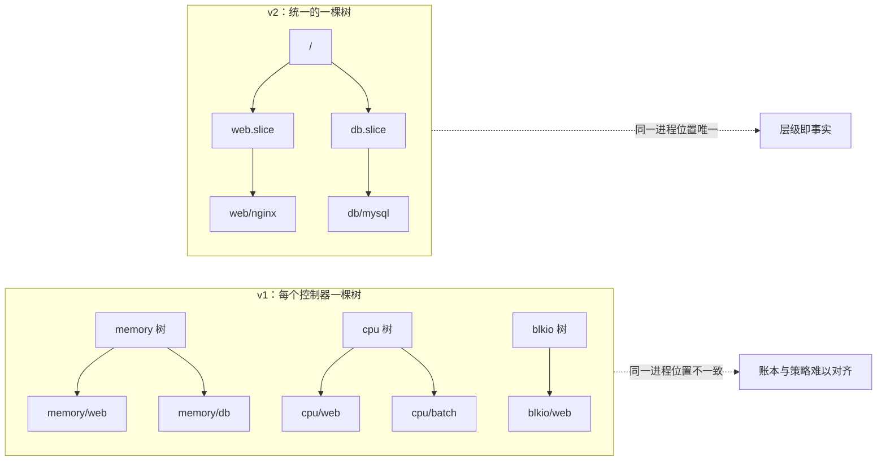
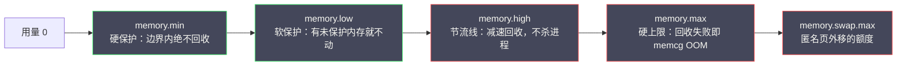
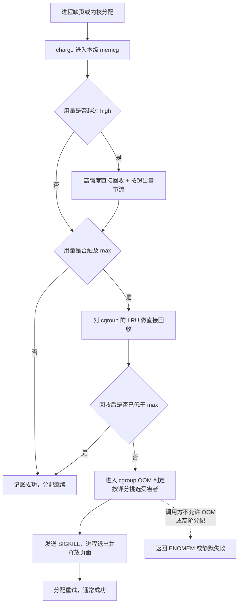

# CGroups 内存子系统：容器内存隔离的底层实现

**摘要：**

在 Kubernetes 的 Pod spec 里写下一行 `limits.memory: 1Gi`，内核中真实发生的事情，并不是给这个容器划出一块 1Gi 的独立内存，而是在一棵 cgroup 树上给某个节点挂上一个**页计数器**（page counter），此后该容器每一次缺页、每一次把文件读进缓存、每一次分配 socket 缓冲区，都要先经过这个计数器的检查与登记。这个设计的直接后果是：容器内存的"用量"与"上限"都不是单一数字，而是四档语义与三本账本的交叠。本文先把 cgroup 从 v1 的多棵树走到 v2 统一树的过程讲清，解释 v1 的 `memory.limit_in_bytes` 与 `memory.memsw.limit_in_bytes` 为什么是两本账，而 v2 用 `memory.max` 加 `memory.swap.max` 加统一的 `memory.current` 又修正了什么；随后逐档拆开 `memory.min`、`memory.low`、`memory.high`、`memory.max` 的真实语义，说明为什么被忽略的 `memory.high` 才是"优雅降级"的唯一入口。中间用一整章回答"`memory.current` 到底算不算 page cache"，因为这是"容器内存莫名上涨"这一最常见误判的源头。核心交付放在后半段：把"容器被 OOMKilled 但没超 limit"拆成五个可检验的成因，并给出 `memory.events` 这个唯一可靠的档位判据。读完应当能回答两个问题：容器到底撞上了哪一堵墙，以及为什么那堵墙不是你写在 YAML 里的那一行。

---

## 第 1 章 一次"没超 limit"的 OOMKilled

### 1.1 现场往往长这样

一个内容服务在凌晨被重启，`kubectl describe pod` 里的 terminated 段写着 `Reason: OOMKilled`、`Exit Code: 137`，节点的事件流里没有任何内存告警，容器的 limit 是 3Gi，而监看面板上那一刻的内存曲线只有 2.4Gi。值班同学的第一个反应通常是"没有超限，为什么被杀"，第二个反应是"是不是内核的 bug"。这两个反应都合理，但都错在同一个地方：把"我看到的那个数字"当成了"内核据以判定的那个数字"。

容器内存不是一个数字，而是一组互相咬合的约束。要解释一次 OOMKilled，至少要把三件事分开：被杀的那一刻，触发的到底是哪一档限制；参与判定的账本，是哪个 cgroup 层级上的哪一类内存；你读到的数值，与内核做出判定时的数值，中间隔了多久。这三件事分别对应本文的档位、账本、时刻三个维度，每一个维度上的错位都能单独制造出"没超限却被杀"的现场。

### 1.2 三个必须先分清的问题

第一个问题关于档位。cgroup v2 的内存控制器给出的是四档语义而非一个上限：`memory.min` 是硬保护、`memory.low` 是软保护、`memory.high` 是节流线、`memory.max` 是硬上限，四者之外还有 swap 侧的两档。一次 OOM 只可能由硬上限引发，但"进程死掉"却可以只由节流引发——健康检查超时、liveness 探针失败、上游连接超时被应用自己判死，都会在日志里留下与 OOM 极为相似的痕迹。

第二个问题关于账本。Kubernetes 至少有两层 cgroup：Pod 级的 slice 与容器级的 scope；v2 的 `memory.current` 又是"本级加全部后代"的层级合计，而 `memory.max` 只约束本级子树。同一个 Pod 里两个容器，一个跑了 2.8Gi、另一个跑了 200Mi，Pod 层的合计与容器层的各自上限是两套完全不同的账。

第三个问题关于时刻。OOM 的判定发生在 charge 路径上，是同步的、瞬时的；监控采样是异步的、有间隔的。更关键的是，被杀进程的页在死亡瞬间就开始释放，你事后读到的 `memory.current` 是"尸体清理之后"的数字，天然低于判定时刻。

> [!info] 核心区分
> 容器 OOM 不是"内存分配失败"，而是"分配的瞬间用量触碰硬上限，回收不成功，内核在该 cgroup 范围内挑选一个受害者并发送 SIGKILL"。分配本身在 0 阶场景下几乎总会成功，失败的是"这一页必须有人让位"这件事。这也是为什么日志里通常看不到 ENOMEM，只看到进程消失。

### 1.3 范围限定

本文以 kernel 6.x 的 cgroup v2 为主干，同时把 v1 的接口与语义作为对照讲清，因为大量存量节点仍跑在 v1 上，而排查经验往往是从 v1 时代带过来的、已经过时的经验。讨论范围限定在 memory 控制器：CPU 的带宽控制、I/O 的权重分配、cpuset 的绑定都不在本文议程内，它们的共同框架可以看 [[03 Cgroups 资源限制与控制|容器资源限制的完整框架]]。全局 OOM 的受害者选择算法属于另一条线，本文只在需要区分"容器级 OOM"与"节点级 OOM"时引用它。

---

## 第 2 章 树与开关：先看懂结构

### 2.1 从进程组到资源边界

cgroup（Control Group，控制组）不是为容器发明的。2006 年前后，Google 的 Paul Menage 等人为了让一台机器上的批处理任务与在线服务互不干扰，提出了把进程按组组织、再按组分配资源的设想，这套机制在 2008 年随 Linux 2.6.24 进入主线。它要解决的问题朴素到近乎无趣：没有分组时，一个进程能吃掉多少内存，取决于它有多贪心，而不取决于它该拿多少。

容器把这套机制从"运维工具"提升成了"隔离地基"。Docker 的 `--memory`、Kubernetes 的 `limits.memory`、systemd 的 `MemoryMax=`，最终都落成对同一个控制器的写操作。但容器又给这套机制加了两条新约束：一是生命周期极短，cgroup 的创建与销毁频率远高于传统运维场景；二是嵌套极深，一个节点上可能同时存在上千个 cgroup，层级从 `kubepods.slice` 一路排到某个容器里的某个 scope。结构上的任何含糊，在单机场景下只是"配置有点绕"，在集群场景下就会变成"账对不上"。

### 2.2 v1 的多棵树与 v2 的单棵树

v1 的默认形态是"每个控制器一棵树"，虽然允许把几个控制器共同挂到同一个层级上，但最常见的部署仍是一种资源一棵树。memory 有一棵，cpu 有一棵，blkio 有一棵，进程在每棵树上的位置互不相干：一个进程可以在 memory 树里属于 `web` 组，同时在 cpu 树里属于 `batch` 组。这种自由度在早期被视为优点——不同资源可以有不同的分组策略，但在实践中迅速演变成一致性灾难：同一个"组"在不同控制器下含义不同，用户态工具要给每个控制器单独维护一套挂载点与迁移逻辑，跨控制器的原子操作几乎无法实现。

v2 把这一切收敛成一棵树。所有控制器共享同一套层级，进程在 memory、cpu、io 上的位置永远一致；控制器要启用，必须显式写 `cgroup.subtree_control`，且只能自顶向下逐层分发。代价是灵活性，收益是可推理：看到 `/proc/<pid>/cgroup` 里那行 `0::/kubepods.slice/...`，你就同时知道了这个进程在内存、CPU、I/O 三个维度上的归属。



图里那条虚线想说的是：v1 的问题不在功能缺失，而在"同一进程在不同树上的位置可以不同"，于是任何跨资源的判断都失去共同基准。v2 并没有变得更强大，它只是把基准收成一个。

### 2.3 三条结构性约束

统一树之后，v2 加上了三条硬约束，理解它们才能读懂容器里的 `/sys/fs/cgroup`。

第一条是自顶向下分发（top-down constraint）。控制器必须由父节点写进 `cgroup.subtree_control`，子节点才能看到对应的接口文件；一个控制器不能在子树上凭空出现。这条约束保证了"越靠近根的约束越不可被绕过"：容器内即便有 root 权限，也无法解除父层给它设定的上限。

第二条是内部进程约束（no internal process）。非根 cgroup 只有在自身没有进程时，才能把域控制器继续向下分发。所以 v2 里给一个已有的 cgroup 开控制器，标准动作是先把进程挪进子 cgroup，再写 `subtree_control`；很多"配置写了不生效"的现场，根因就是这一步的顺序错了，控制器压根没被启用成功。

第三条是命名空间带来的**视图截断**。容器通常带着 cgroup 命名空间启动，`/sys/fs/cgroup` 挂载的是它自己的 cgroup 根，因此在容器里看到的 `memory.max` 是容器这一层的值，看不到 Pod 层与节点层。这条约束是"账本错位"这一整类问题的物理来源，后文第 10 章还会回到它。

### 2.4 Kubernetes 用的是 v1 还是 v2

判断一个集群跑在哪一代上，有四个从粗到细的判据，其中前两个在节点上就能做，后两个需要看集群侧的信息。

| 判据 | v1 的表现 | v2 的表现 | 说明 |
| :--- | :--- | :--- | :--- |
| 挂载类型 | `stat -fc %T /sys/fs/cgroup` 返回 `tmpfs` | 返回 `cgroup2fs` | 混合模式下根挂 tmpfs、子系统各自挂 cgroup，仍按 v1 处理 |
| 接口目录 | 存在 `/sys/fs/cgroup/memory/` 子目录 | 根下直接有 `memory.max`、`cgroup.controllers` | v2 的接口文件平铺在 cgroup 目录里，没有按控制器分子目录 |
| kubelet 版本 | 任意版本都能用 | 1.25 起 GA，1.31 起 v1 进入维护模式 | 演进方向明确，新特性只做在 v2 上 |
| 容器内视图 | 看到 `memory.limit_in_bytes` | 看到 `memory.max` | 排查时第一眼就该看这个 |

那条"1.31 起 v1 进入维护模式"值得单独强调。Kubernetes 对 cgroup v2 的完整支持在 1.25 转 GA，此后新增的资源管理能力——Pod 级资源、swap 的受控使用、memory QoS——都只做在 v2 上。一笔 v1 时代的排查经验，如果不加区分地套到 v2 节点上，最常见的错误是把 `memory.memsw.limit_in_bytes` 的算法直接搬过来，而 v2 里根本不存在这个文件。

---

## 第 3 章 v1 的两本账

### 3.1 limit_in_bytes 与 memsw.limit_in_bytes

v1 内存控制器最容易被误解的地方，是它有"两本账"：`memory.limit_in_bytes` 约束的是物理内存用量，`memory.memsw.limit_in_bytes` 约束的是"物理内存加 swap"的合计。两者的关系不是并列而是包含：swap 的实际上限等于 `memsw.limit_in_bytes - limit_in_bytes`。

这个设计有其道理。v1 的换出（swap out）在记账上不是"释放内存"，而是"把一笔账从 memory 计数器挪到 swap 计数器"，memsw 合计不变。因此单看内存账本，一个疯狂换出的容器可以永远不超 `limit_in_bytes`，却把整台机器的 swap 吃干，进而把系统拖进全局 OOM。memsw 上限就是为了堵这个洞：它约束的是"这个容器总共能占用多少内存资源"，不论这些资源此刻在 RAM 里还是在 swap 里。

内核文档给过一个很直白的例子：一台有 4G swap 的机器，某任务在 2G 内存限制下误申请了 6G，它会毫不犹豫地吃光全部 swap；把 memsw 上限设成 3G，这个误申请就只能撞墙。文档同时说明，撞上 memsw 上限时，该 cgroup 再进行换出已经没有意义，内核转而丢弃文件缓存；但全局 LRU 仍然可以从它那里换出页面，因为全局回收的职责是保住整台机器的状态，它不受单个 cgroup 意愿的约束。

> [!warning] v1 的 swap 记账并不总是开着
> v1 时代 swap 记账需要通过启动参数显式开启，很多发行版默认并未启用；在这种节点上，`memory.memsw.*` 形同虚设，你设了值也约束不到任何东西。这解释了为什么同一份配置在老机器上"管用"，换到另一批机器上就"失灵"——差异不在 YAML，而在内核启动参数。

### 3.2 use_hierarchy 的历史陷阱

v1 的层级记账曾经是可选的，`memory.use_hierarchy` 默认关闭。关闭状态下，子 cgroup 的内存用量不会汇总到父 cgroup 的计数器上，父 cgroup 设的上限对整个子树也就基本无效。这在容器编排里是致命的：节点管理进程给 `kubepods` 设了一个总量上限，以为能兜住全部容器，实际上每个容器只受自己那一层约束。

在现行内核上，这个开关已经被废弃：层级记账是默认行为且不允许关闭，向 `memory.use_hierarchy` 写 1 只是为了兼容旧脚本，写 0 会被拒绝并在 dmesg 里留下抱怨。所以这个问题在 6.x 上不再是活问题，但它是大量老排查文档的默认假设，读那些文档时要先在心里打个折。

### 3.3 soft_limit 已经是一个空壳

v1 的 `memory.soft_limit_in_bytes` 常被描述成"内存不足时优先回收超出软限制的部分"。这个描述在内核文档里已经明确作废：现行内核中写入该文件不产生任何效果，读回恒为最大值。也就是说，在一台 6.x 内核的 v1 节点上，"调一下软限制"这个动作是纯粹的无效操作，既不报错也不生效，只会让人误以为防护已经就位。

这件事的教训不在于"旧接口不能用了"，而在于软保护的语义本身很难在 v1 的框架里做对。v1 的软限制只在整个系统进入全局回收时才被参考，且参考方式是"谁超得多先回收谁"，既没有硬边界，也没有可观测的事件计数，配置是否生效几乎无法验证。v2 把软保护拆成 min 与 low 两档，配上一整套事件计数，才让"保护"变成一个可以被验证的承诺。

### 3.4 oom_control 与挂起

v1 的 `memory.oom_control` 提供了两个能力：OOM 事件通知，以及禁用 OOM 杀手。把 1 写进去之后，cgroup 内存耗尽时进程不被杀死，而是挂在 OOM 等待队列里睡眠，直到有人放宽限制、杀死其他进程或减少用量。这听起来像是"温和版"的处置方式，实际上非常危险：进程挂在不可中断的状态里，它持有的锁不会释放，整个服务可能因此死锁；这种进程连 `kill -9` 都无法立即终结，只能等内存条件改善。

这个接口在现行内核里同样已标记废弃，Docker 的 `--oom-kill-disable` 就是它的封装。把它列出来的价值在于识别一类陈旧的"最佳实践"：遇到 OOM 就关掉 OOM 杀手，等于把一次可控的局部死亡换成一次不可控的全局挂起。

### 3.5 usage_in_bytes 是模糊值

v1 的 `memory.usage_in_bytes` 文档写得很坦率：为了性能，它不保证精确，是一个"模糊值"，需要精确数字时应该去读 `memory.stat` 里的 `rss` 与 `cache`。原因是计数器采用批量更新，读数与真实用量之间存在时间窗。

这条细节对后文的"时间差"成因是直接支撑：在 v1 节点上，"监控显示没超限"这件事的可信度，本来就要比人们以为的低一档。

| v1 接口 | 语义 | 调大的代价 | 调小的代价 |
| :--- | :--- | :--- | :--- |
| `memory.limit_in_bytes` | 物理内存硬上限，超出触发 cgroup OOM | 容器更容易把节点内存吃紧张，邻居的回收压力上升 | 缓存被频繁回收，命中率与延迟一起恶化 |
| `memory.memsw.limit_in_bytes` | 内存加 swap 的合计上限 | 允许容器把 swap 当内存用，换出风暴风险上升 | 匿名页无法外移，回收只能打文件页，OOM 提前到来 |
| `memory.soft_limit_in_bytes` | 已废弃，写入无效 | 无效果 | 无效果 |
| `memory.oom_control` | 事件通知与禁用 OOM 杀手 | 无（布尔开关） | 进程挂起、锁不释放、服务死锁 |
| `memory.swappiness` | 覆盖全局 swappiness | 更激进地换出匿名页，换入延迟上升 | 设为 0 时限制回收完全禁换出，可能直接 OOM |

表格最后一行是 v1 一个反直觉的细节：全局回收时 swappiness=0 只是"尽量不换出"，而限制回收（limit reclaim）下 swappiness=0 是"绝对不换出"，这在没有文件页可回收时会直接把容器推进 OOM。同一个参数在两种回收路径上的强度不同，是 v1 时代典型的语义不一致。

---

## 第 4 章 v2 的统一账本

### 4.1 一个 current，两个方向

v2 把 v1 的**两本账**合并成一个**主计数器**，`memory.current` 表示"本级及全部后代当前占用的内存总量"，单位是字节；swap 单独用 `memory.swap.current` 表示。两个数字合起来，才等于 v1 的 memsw 用量。这个拆分比 v1 的包含关系更清晰：内存是内存，swap 是 swap，各自的墙各自设。

`memory.current` 覆盖的对象有三类：用户态内存（匿名页与页缓存）、内核数据结构（dentry、inode、内核栈、页表等）、TCP socket 缓冲区。内核文档用"虽然不完全严密，但主要的内存使用都被追踪"来描述这种覆盖度，这句限定词很重要——它承认了记账是有缝的，而缝隙正是"账对不上"的一部分来源。

### 4.2 四档与 swap 侧的两档

v2 的内存接口可以按"保护"与"限制"两组来记。保护组是 `memory.min` 与 `memory.low`，限制组是 `memory.high` 与 `memory.max`；swap 侧对应 `memory.swap.high` 与 `memory.swap.max`。

把四档摊在一条用量轴上，关系会直观得多：左侧两档管"别动我"，右侧两档管"别超我"，swap 上限则是悬在匿名页头顶的另一块天花板。



| v2 接口 | 语义 | 默认值 | 调大的代价 | 调小的代价 |
| :--- | :--- | :--- | :--- | :--- |
| `memory.min` | 硬保护，边界内任何情况下不回收 | 0 | 保护总量超过节点可回收量时，全局回收无米下锅，持续 OOM | 关键页失去保护，回收压力下先被牺牲 |
| `memory.low` | 软保护，有未保护内存时不动它 | 0 | 软保护超额，`low` 事件频繁，实际保护被摊薄 | 保护形同虚设，抖动时先丢缓存 |
| `memory.high` | 节流线，超出则限速回收，不杀进程 | max | 节流推迟，突发内存更容易直接撞上 max | 回收过于频繁，延迟毛刺与 CPU 空转 |
| `memory.max` | 硬上限，超出触发 cgroup OOM | max | 单容器可吃更多内存，节点整体 OOM 风险上升 | 缓存被反复驱逐，refault 上升，OOM 风险上升 |
| `memory.swap.max` | swap 用量硬上限，触顶后匿名页不再换出 | max | swap 被当内存用，换出风暴与 I/O 抖动 | 匿名页被钉在内存里，可回收余量只剩文件页 |
| `memory.swap.high` | swap 用量节流线，越过后所有分配被限速 | max | 节流推迟，接近"没有 swap 上限" | 提前进入节流，写 swap 的负载先变慢 |

表里 `memory.swap.high` 那一行需要单独解释一句。内核文档把它称为**有去无回的点**：它是留给用户态实现自定义 OOM 流程的信号，而不是用来管理日常换出量的旋钮；健康的负载不该撞上它。要限制日常换出，用 `swap.max`；要限制内存本身，用 `memory.max`。三者的分工混淆，是配置层面最常见的错误之一。

### 4.3 记账发生在哪

v2 的记账仍然嵌在分配路径里，只是入口比 v1 清晰。匿名页在缺页处理时记账，文件页在被加入页缓存时记账，内核对象在分配时记账，socket 缓冲区在发送队列增长时记账。取消记账对应释放：匿名页被释放或被换出、文件页被从页缓存移除、内核对象被回收。

这条路径给应用带来的开销是透明的，但它的存在解释了一个重要现象：只要一页内存还是"活着的"，它就在某个 cgroup 的账上；只要它在账上，这个 cgroup 就可能因为它而撞墙。"容器被 OOM 杀"从来不要求"容器里的进程真的在用这些页"，只要求"这些页记在它的账上"——这是第 5 章要展开的全部前提。

---

## 第 5 章 memory.current 算不算 page cache

### 5.1 算，而且是故意的

`memory.current` 包含 page cache，这不是实现瑕疵，而是**设计前提**。内存控制器要约束的是"这个组从系统里拿走了多少物理内存"，而页缓存占用的物理内存与匿名页占用的物理内存没有任何区别：它们都来自伙伴系统，都挤占其他 cgroup 的可用空间。如果页缓存被排除在外，一个只会读文件的容器就可以合法地把整台机器的内存读成自己的缓存，限制完全失效。

代价是使用者的直觉被反复挑战。一个容器的 `memory.current` 涨了 2Gi，可能只是它重新读了一遍数据集；一个容器的 `memory.current` 一直贴着上限，可能它的匿名内存只有几百兆，其余全是随时可丢的缓存。判断"会不会被杀"，看的不是 total，而是"撞墙时还剩多少可以回收"。

### 5.2 一个读文件的脚本把容器"涨"到上限

设想一个贯穿案例：内容服务容器，`memory.max` 设为 3Gi，平时 `memory.current` 稳定在 900Mi 左右。某天运维在容器里加了一个每小时执行一次的索引预热脚本，脚本会顺序读取约 6Gi 的索引文件。第一次执行时，容器内存曲线在十分钟内爬到 2.9Gi，随后趋于平稳，服务没有异常；第二天凌晨服务被杀，`OOMKilled`。

把这个案例拆开看：脚本读文件时，内核把数据页填进页缓存并记在容器账上，`current` 上涨；当用量逼近 `memory.max` 时，内核开始回收该 cgroup 的 LRU，干净的缓存页可以直接丢弃，于是涨势被压平在 2.9Gi 附近——这解释了第一天的"平稳"。第二天被杀，是因为预热脚本与业务流量峰值撞在一起：回收丢弃缓存的速率短时间跟不上读文件的速率，同时业务侧匿名内存在增长，页面来不及回收，charge 撞上上限。

如果只盯 `memory.current`，这个案例的唯一结论是"容器内存涨到了 3Gi，它确实超了"；而真正有用的结论藏在 `memory.stat` 里：`file` 项占了 2Gi 以上，`anon` 只有 700Mi，`file_dirty` 很小，`inactive_file` 很大。也就是说，被杀时容器账上大部分是"随时可以丢、但丢得不够快"的缓存，而不是"丢了也没用"的匿名内存。针对性的修法不是加 limit，而是给预热脚本加 `posix_fadvise(POSIX_FADV_DONTNEED)` 或者把它移出主容器；加 limit 只是把撞墙时间往后推了十分钟。

### 5.3 memory.stat 才说真话

v2 的 `memory.stat` 是一个平铺的键值文件，键的顺序不保证稳定，取值必须按键查而不是按行号查。诊断容器内存时，值得先看的是下面这几项。

| 现象 | `memory.stat` 证据 | 结论与下一步 |
| :--- | :--- | :--- |
| 内存持续上涨，重启后归零 | `anon` 单调增长，`file` 平稳 | 大概率匿名内存泄漏，抓堆快照或 GC 日志，不要只看 total |
| 内存涨到接近上限后走平 | `file` 占大头，`inactive_file` 大 | 缓存型增长，属于可回收部分，不必加 limit |
| 内存贴顶且延迟抖动 | `inactive_file` 小，`pgscan_direct` 增长 | 可回收余量已耗尽，正在直接回收，考虑加 limit 或降负载 |
| 内存莫名偏高，RSS 却不高 | `kernel`、`slab`、`sock` 有量 | 内核侧占用计入本级账本，查 dentry/inode、socket 缓冲 |
| 周期性地慢 | `workingset_refault_file` 持续增长 | 缓存被反复驱逐又重新读入，limit 过紧或工作集超出容量 |
| 频繁读写磁盘 | `pgmajfault` 增长 | 缺页需要 I/O，可能来自换入或缓存未命中 |

那张表的核心读法是"先把 total 拆成**可回收**与**不可回收**两堆"。`anon` 与内核对象属于不可回收或回收代价极高的一堆，`inactive_file` 属于随时可以丢的一堆，`active_file` 属于回收要付出代价的一堆。三堆的比例决定了"贴着上限"到底是安全还是危险。

### 5.4 working set 的来历

容器监控里有一个比 `memory.current` 更贴近内核判定口径的指标：**working set**，其定义是 `memory.current` 减去 `inactive_file`。减去的那部分，是"已经被 LRU 判定为不活跃、下一次回收就会优先丢弃"的缓存。剩下的部分，是"如果现在要回收，回收器需要真正动手"的量。

这个减法解释了为什么两个数字会给出相反的结论：`current` 贴着上限而 `working set` 只有一半时，容器其实还有很大的回旋余地；反过来，`current` 只有上限的七成而 `working set` 已经接近上限时，容器实际上已经在悬崖边上。Kubernetes 的驱逐判断与 cAdvisor 的指标口径都与这个定义对齐，因此排查时应以 working set 为主要参考，把 `current` 当作"最坏情况下的账本总量"。

### 5.5 页缓存到底记在谁账上

这个问题在 v1 时代有一个著名的答案：**首次触碰**（first touch）记账。谁先把文件页读进来，这页就记在谁的账上；另一个 cgroup 后续读同一个文件命中缓存时，不会被记账，等于搭了便车。v1 文档对这种不公平给了一个自然消解的机制：频繁使用共享页的 cgroup，最终会在原持有者因内存压力被回收、页面被重新读入时接过这笔账，于是账本随时间向"真实使用者"靠拢。

v2 没有发明一个"重新记账"的通用机制，它做的是承认归属不确定。内核文档的原话是：一块内存区域可能被属于不同 cgroup 的进程使用，它会被记到哪个 cgroup 是不确定的，但随着时间推移，它倾向于落到那个内存额度宽裕、回收压力小的 cgroup 上。工程上的建议也随之而来：如果某个 cgroup 扫过大量会被其他 cgroup 反复访问的内存，应该用 `posix_fadvise(POSIX_FADV_DONTNEED)` 主动放弃这些页的归属，避免它替邻居背账。

这里要纠正一个流传很广的说法：笔者不止一次看到有文章称 v2 引入了"文件页在 cgroup 间重新记账（remap）"的机制，把 v1 的不公平彻底修好了。内核文档并未描述这样的通用机制，官方给出的仍是"归属不确定加上主动放弃"这套软办法。把"v2 让共享缓存记账变公平了"当成事实去设计容量，会在多容器共享大文件的场景里踩空。

---

## 第 6 章 min 与 low：保护是相对的

### 6.1 保护值相对谁生效

理解保护档的第一步，是理解保护值不是一个绝对的门槛，而是相对于"回收的目标"生效的。内核文档的表述是：`memory.low` 与 `memory.min` 配置的保护，相对于本次回收的目标（可能是某个 `memory.max`、一次主动 `memory.reclaim`，也可能是根 cgroup 发起的全局回收）起作用。同一个保护值，面对兄弟 cgroup 竞争导致的回收时全额生效，面对祖先被回收时则会被祖先的保护值截断。

由此引出保护档最重要的一条规则：**有效边界**被祖先的配置封顶。如果父 cgroup 只允许 1Gi 的保护，子 cgroup 即便各自写了 2Gi 的 `memory.min`，能拿到的也只是按用量比例分配的那 1Gi。内核文档把这称为保护超额（overcommitment），并明确警告：把超过系统普遍可用的内存放进保护范围，是被劝阻的做法，因为它会导致持续的 OOM。

### 6.2 min 是硬保护

`memory.min` 的语义很硬：当 cgroup 的用量处于其有效 min 边界之内时，这些内存在任何情况下都不会被回收；如果系统里已经没有未受保护的可回收内存，内核不会去动受保护的页，而是直接调用 OOM 杀手。

这句话的后半段是很多人忽略的部分。min 不是"优先保留"，而是**宁杀不放**。把关键服务的 min 设得很足，等于向内核声明"缺内存的时候，请去杀别人"；如果所有人都这么声明，缺内存的时候就只能互相杀。这也是为什么内核文档对 min 的态度比 low 更严厉：low 的超额只是让保护打折，min 的超额会直接把系统推进 OOM 循环。

### 6.3 low 是软保护

`memory.low` 的语气软得多：当用量处于有效 low 边界之内时，只要系统里还有未受保护的可回收内存，这些页就不会被回收。注意状语的位置——"只要还有别的东西可以回收"是前置条件，条件不成立时，low 保护的页照样被回收，只是回收顺序靠后。

这两个档位的差异可以借一个比喻来记：min 是写进合同的保底额度，low 是口头承诺的优先权。合同要兑现，兑现不了就违约（OOM）；口头承诺要看对方手头有没有余粮，有余粮就守约，没余粮就只能爽约。

### 6.4 超过边界不是断崖

两档保护还有一个共同的细节：用量超过有效边界后，回收按超出比例逐步加压，并未一刀切。略超一点的 cgroup 承受的回收压力小，超得多的承受的压力大。这个设计避免了"刚好越过边界就雪崩"的悬崖效应，也让保护值可以设得比实际需求略低——多出来的部分不会被立刻剥夺，只是优先级下降。

### 6.5 memory_recursiveprot

默认语义下，保护值需要沿树向下显式传递：父 cgroup 设了保护，不代表子 cgroup 自动享有。v2 为此提供了一个挂载选项 `memory_recursiveprot`，语义是把 min 与 low 递归应用到整棵子树，让子树之间可以互相保护，同时保留子树内部的自由竞争。内核文档对它的评价是"这本该是默认行为"，之所以做成挂载选项，是为了不破坏那些依赖旧语义、在高层写了虚高保护值的存量配置。

### 6.6 low 事件说明承诺超额了

`memory.events` 里的 `low` 计数并不表示"low 被用到了"，它记录的是"这个 cgroup 明明处于 low 保护边界之内，却仍然被回收了"。内核文档对它的解释是：计数增长通常说明 low 边界被**超额承诺**了。这个计数是验证保护是否真的生效的唯一手段——配了 low 却看到它一直增长，说明系统里未受保护的内存不够分，保护只是纸面承诺。

### 6.7 一个常见的配错

把 min 用到极致的一种典型配法，是给节点上每个关键容器都写上 `memory.min` 等于其全量内存，理由是"这些都很重要"。这在账面上让所有人都被保护，实际效果是保护总量远超节点可回收内存，全局回收时无页可动，内核只能反复触发 OOM。更稳的做法是把 min 的总预算压到节点可回收内存的一个明确比例之内（具体比例见第 12 章的示例推算），其余部分用 low 表达优先权，把"必须保住"和"尽量保住"分开。

---

## 第 7 章 high：最被忽略的那一档

### 7.1 越过 high 时内核做什么

`memory.high` 的默认值是 max，也就是默认不启用。一旦设置，越过这条线的进程会遭遇两件事：一是被施加"重回收压力"，内核以更高优先级对该 cgroup 做直接回收；二是被节流（throttle），分配路径上插入一段与超出量成比例的惩罚性延迟。

用伪代码描述这条路径会更清楚，这里的顺序是机制示意，不是内核源码逐行对照：

```text
charge(page, memcg):
    if usage + page > high:
        reclaim(memcg, 高强度)          # 先尽量还，别急着罚
        if usage 仍然高于 high:
            sleep(与超出量成正比的时长)   # 惩罚性节流，可被致命信号打断
    if usage + page > max:
        reclaim(memcg, 极限)            # 回收不到就进入 OOM 判定
        if 仍然不足:
            memcg_oom(memcg)            # 在本 cgroup 范围内挑受害者
```

这段流程里有三个要点。其一，high 的处置发生在 max 之前，它是**减速带**而不是"墙"。其二，节流的时长随超出量增长，超得越多罚得越久，形成负反馈。其三，节流是可被打断的，进程如果收到致命信号（比如被上层判死），会从睡眠中醒来并退出——这也是为什么 high 节流的现场经常表现为"进程变慢然后退出"，而不是"进程被内核杀死"。

### 7.2 为什么是限速而不是杀

内核文档对 high 的定位写得很清楚：越过 high 永远不会调用 OOM 杀手，它的适用场景是"有外部进程在监控这个 cgroup 并据此缓解压力"。这句话把 high 的设计意图摊开了：它是给管理面争取反应时间的机制。系统发现某个容器开始超预期地吃内存，先让它变慢，管理面有一个时间窗去扩容、限流、迁移或者杀掉它；如果这段时间里没人管，用量继续涨，最终还是会撞上 max。

这解释了一个容易误读的行为：内核文档同时承认，在极端情况下用量可以越过 high。因为 high 不负责拦截，只负责减速；当分配速度快过回收速度时，越过 high 是必然的，越过的幅度取决于负载的激进程度。把 high 当成立即生效的上限，是配置层面第二常见的错误（第一常见是不设 high）。

### 7.3 代价：延迟毛刺与一个真实的翻车

high 的收益是优雅降级，代价是延迟。节流发生在分配路径上，意味着进程在申请内存时被按住了，表现为请求延迟抬升、吞吐下降、CPU 空转（进程在睡，不在算）。对一个延迟敏感的服务，把 high 设得过低，等于人为制造毛刺；对批处理任务，这种惩罚则几乎无害。

更要紧的是这条机制在早期内核上的失败模式。Kubernetes 的 Memory QoS 提案（KEP-2570）在 1.22 进入 alpha，原计划 1.28 转 Beta，最终被撤回，撤回理由写得很直白：在内核 5.9 之前，撞上 `memory.high` 的负载会卡死，而不是走向 OOM——回收速度追不上分配速度，进程停在接近零 CPU 的状态里，既不前进也不死亡。这个案例说明 high 的负反馈设计对"回收速率"这个参数高度敏感，负反馈失效时，节流就从保护变成了死锁。

### 7.4 Kubernetes 为什么不设 high

Kubernetes 至今没有默认给容器写 `memory.high`。KEP-2570 提出过用 kubelet 配置（`memoryThrottlingFactor`）把 high 推导出来，后来改成了显式 opt-in：默认不设，由运维开启；只设在容器层而不是 Pod 层，避免容器之间互相影响；Guaranteed 类型的 Pod 被豁免，因为它们本来就该拿到申请的全量。也就是说，在一个默认配置的集群里，容器内存只有"正常"与"被杀"两档，中间没有缓冲。

这件事的工程含义值得反复强调：你以为的四档语义，在 Kubernetes 默认配置下实际只有一档半。要让 high 生效，得在 kubelet 侧开启对应配置，或者用 systemd slice、cgroup 目录手工写入；仅靠 Pod 的 requests/limits 是拿不到节流保护的。

### 7.5 high 生效时看什么

判断 high 是否在工作，不要去猜延迟，直接看计数：`memory.events` 的 `high` 字段记录的是"进程因超出 high 被节流并转入直接回收"的次数；`memory.pressure` 的 `some` 与 `full` 则给出等待内存的时间占比。两者一起看，可以区分"节流在轻微发生"与"系统已经大面积等内存"。CPU 使用率不高而延迟上升，同时 high 计数在涨，是节流型故障的典型三件套。

---

## 第 8 章 max 与 memcg OOM

### 8.1 到达 max 的路径

`memory.max` 是唯一的硬上限，它的语义是：用量达到这条线且无法降低时，内核在本 cgroup 范围内调用 OOM 杀手。内核文档同时给了一句关键的限定——在某些情况下，用量可以暂时越过上限。

把这句话与 charge 路径合起来看，才能理解 OOM 的判定顺序。一次分配失败不会简单返回 ENOMEM，它沿着"回收、再试、再回收、最后挑受害者"的阶梯走完，才落到杀进程这一步：



图里那条虚线分支解释了一类"没被杀但请求失败"的现场：并非所有分配都有资格触发 OOM。内核文档明确说明，有些类型的分配不会调用 OOM 杀手——调用方可以换一种方式重试、可以返回用户态一个 ENOMEM、也可以在预读这类场景里静默忽略。真正"一定能触发 OOM"的是常规的**0 阶分配**（单个 4KB 页），而它们的行为是：除非 OOM 选中了当前任务，否则总是成功。

### 8.2 0 阶分配总是成功的含义

"常规 0 阶分配总是成功，除非 OOM 选中当前任务"这句话值得逐字读。它的意思是，在硬上限面前，内核并不选择"让这次分配失败"，而是选择"杀掉某个进程，把内存腾出来，然后让分配成功"。失败与死亡不是同义词，死亡是分配成功的前提。

这条设计有一个直接推论：容器里的应用几乎不会收到"内存不足"的返回值，它只会突然消失。这也解释了为什么大量 OOM 现场的日志里没有任何异常栈——进程没有机会写日志，它的下一次内存访问就变成了别人的内存。

### 8.3 不跨 cgroup 杀

cgroup OOM 的范围是**严格受限**的：在某个 cgroup 内触发的 OOM，不会去杀这个 cgroup 之外的进程，无论祖先 cgroup 的 `memory.oom.group` 怎么设置。这是容器隔离承诺的核心部分——一个容器的内存问题不会直接变成邻居的死亡通知。

这个承诺有一个例外值得记住：`oom_score_adj` 被设为 -1000 的任务受 OOM 保护，永远不会被选中。容器运行时与 kubelet 会用这个机制保护关键进程；反过来说，如果你在一个会发生 OOM 的 cgroup 里把所有进程都设成 -1000，OOM 就找不到受害者，最终行为会退化到挂起或反复重试，比直接死一个进程更糟。

### 8.4 oom.group：整组同生共死

`memory.oom.group` 是一个读写的单值文件，默认 0。设为 1 之后，这个 cgroup 被 OOM 杀手视为一个不可分割的工作负载：cgroup 内（含后代）的所有任务要么**一起被杀**，要么一个都不杀。

这个开关解决的是"半死"问题。一个 JVM 进程加若干辅助进程的容器，如果只杀掉主进程，辅助进程可能变成孤儿继续占着内存；如果只杀掉某个辅助进程，主进程可能因为依赖缺失而进入不可预测的状态。整组一起杀，等价于给容器一个原子的死亡语义，重启时从干净状态开始。

| 设置 | 行为 | 适用场景 | 代价 |
| :--- | :--- | :--- | :--- |
| `oom.group=0` | 只杀评分最高的单个任务 | 多进程松耦合、杀掉一个不影响其余 | 可能留下孤儿进程或半死状态 |
| `oom.group=1` | 组内全部任务一起被杀 | 容器语义、进程间强依赖的工作负载 | 一个小进程触发的 OOM 会带走整组，损失面变大 |

在 cgroup v2 节点上，容器通常被配置成整组语义（`memory.oom.group=1`），运行时与 kubelet 一起把容器当作一个不可分割的工作负载：OOM 时整组退出，kubelet 看到的是容器整体终止，按重启策略处理。这比"容器里死了一个进程但容器还在运行"要可诊断得多。

### 8.5 exit 137 的归因链

一次容器 OOM 的完整归因链是这样的：内核在 cgroup 范围内选中受害者，发送 SIGKILL；进程以信号 9 退出，退出码表现为 137；容器运行时通过 cgroup 的事件计数（v2 的 `memory.events` 里 `oom_kill` 的增长，v1 的 `memory.oom_control` 里的 `oom_kill` 计数）判定这次退出与内存有关；kubelet 从运行时拿到终止原因，写入 Pod 状态，于是 `kubectl describe` 里出现 `OOMKilled`。

这条链上有两个容易断的环节。第一，运行时能否正确归因，取决于它读的是哪个层级的计数——如果它读的是容器级 counting，而实际发生在 Pod 级，归因就会错位到某个无辜容器。第二，`OOMKilled` 这个标签本身不区分"撞了本级上限"与"被祖先层带走"，它只说"这一次退出被判定为 OOM"。所以拿到 OOMKilled 之后，第一件事不是加内存，而是去读事件的计数，确认是哪一个 cgroup 的哪一档被触发。

---

## 第 9 章 memory.events：唯一的档位判据

### 9.1 六个计数与一个附加项

`memory.events` 是一个只读的平铺键值文件，它的每个字段都是**单调递增**的计数器。判断"到底哪一档被触发"，这是唯一可靠的依据——曲线可以骗人，采样可以错过，计数器不会。

| 字段 | 精确含义 | 被触发说明什么 |
| :--- | :--- | :--- |
| `low` | cgroup 在 low 保护边界内仍被回收的次数 | low 承诺被超额，系统里未保护的可回收内存不足 |
| `high` | 因越过 high 被节流并转入直接回收的次数 | 节流线在起作用，负载正在被减速 |
| `max` | 用量即将越过 max 的次数 | 已经走到硬上限边缘，下一次回收失败就是 OOM |
| `oom` | 用量触及上限、分配即将失败的次数 | 已进入 OOM 判定流程，但未必有进程被杀 |
| `oom_kill` | 本 cgroup 内被任何 OOM 杀手杀掉的进程数 | 真的死了进程，这是 OOMKilled 的直接证据 |
| `oom_group_kill` | 整组 OOM 发生的次数 | oom.group=1 生效，且真的执行了整组击杀 |
| `sock_throttled` | 关联 socket 被节流的次数 | 网络缓冲区触发了协议层的内存压力控制 |

这张表最有用的一行是 `max` 与 `oom` 的区分。`max` 增长只说明"用量即将越过上限"，内核随后去回收，回收成功就没有下文；`oom` 增长说明"分配即将失败"，已经进入 OOM 判定；只有 `oom_kill` 增长，才意味着真的有进程死了。三个计数器依次增长，是一条完整的恶化链条；只看到 `max` 增长就断定"容器 OOM 了"，是把预警当成了结论。

### 9.2 层级性与 local

`memory.events` 的所有字段都是**层级合计**：父 cgroup 的计数包含后代发生的事件。因此在一个 Pod 的 slice 上看到 `oom_kill` 增长，不能直接判定是这个 Pod 被杀，还需要往下看是哪个容器 scope 贡献的。

如果需要区分"本级发生"与"后代发生"，读 `memory.events.local`：它的字段只统计本级，不含子树。这个文件在归因时非常有用——Pod 层 `events.local.oom_kill` 为 0 而 `events.oom_kill` 有增长，说明击杀全部发生在容器层，Pod 层只是汇总。

### 9.3 一次联合解读

把第 5 章那个内容服务的现场换一组读数，做一次完整的判读练习。假设被杀后读到：`memory.current` 为 1.1Gi、`memory.max` 为 3Gi、`memory.events` 里 `max` 增长了 4 次、`oom` 增长了 2 次、`oom_kill` 增长了 1 次，`memory.stat` 里 `anon` 为 800Mi、`file` 为 200Mi、`inactive_file` 为 50Mi。

这组数字自洽地讲了一个故事：容器的可回收余量（`inactive_file`）只剩 50Mi，匿名内存 800Mi 占了大头，硬上限 3Gi，但当前的 1.1Gi 离上限还很远。矛盾出在哪？答案在"当前"这个词上——`memory.current` 是击杀之后读的，被杀进程释放的页面已经离账。真正的判定时刻，用量贴着 3Gi，可回收的只有 50Mi 缓存，回收不动，于是 OOM。

这个练习的要点在于建立读数的顺序，而不在于算出精确值：先看 `events` 确认档位与死亡事实，再看 `stat` 确认当时可回收余量，最后才看 `current` 的量级，并且明确它是事后值。

### 9.4 三个常见误读

第一个误读是把 `max` 计数当成 OOM 次数。这两个计数之间隔着"回收是否成功"这一步，绝大多数 `max` 事件都不会走到 `oom`。

第二个误读是把 `oom` 计数当成死亡次数。`oom` 只表示进入了判定流程，判定结果可能是"杀掉一个进程"，也可能是"调用方不允许 OOM，返回 ENOMEM"，还可能因为 `oom.group` 的设置而合并成一次整组击杀。

第三个误读是忽略计数器的时间基准。这些计数从 cgroup 创建时开始累加，容器重启后归零，但 Pod 级 slice 可能跨越多次容器重启。比较"这次事故"与"上次事故"时，要用两次采样之间的增量，而不是绝对值。

---

## 第 10 章 被 OOMKilled 但没超 limit：五个成因

### 10.1 成因一：超的是 swap.max，不是 max

第一个成因出在"上限不是一本账"这件事上。v2 把内存与 swap 拆成两个计数器，`memory.max` 只管内存，`memory.swap.max` 只管 swap。当 swap 上限很小（Kubernetes 在默认不支持 swap 的节点上会把容器的 swap 上限压到接近 0）时，容器的匿名页被钉死在内存里：回收器可以把缓存丢掉，却无法把匿名页挪到 swap。

于是回收的可用余量只剩文件页。文件页一旦被压到极低，charge 就会在"看起来离 max 还有距离"的时刻走进 OOM 路径；而你在击杀之后读到的 `current`，自然低于 `max`。v1 上的等价物是 `memory.memsw.limit_in_bytes`：只调 `limit_in_bytes` 而不调 memsw，超的往往是后者。

判据：读 `memory.swap.current` 与 `memory.swap.max`，读 `memory.swap.events` 的 `max` 与 `fail` 字段（分别表示 swap 用量即将越界、swap 分配失败）。`fail` 增长说明匿名页已经无路可走，这是"内存没满但无处可去"的直接证据。

### 10.2 成因二：子 cgroup 的 limit 更小

第二个成因是**层级错位**。Kubernetes 的 cgroup 至少有 Pod 层与容器层两级，v2 里每一级的 `memory.current` 都是"本级加后代"的合计，而每一级的 `memory.max` 只约束本级子树。你比对的数字与你以为的层级，很可能不是一个。

三种具体的错位形态。一是比对对象错：拿 Pod 级合计去比容器级上限，Pod 里另一个容器吃掉了大头，被杀的却是这个簿记清白的容器，而它的自身账本在判定时刻其实已经贴顶，只是事后回落了。二是墙在更深一层：Kubernetes 只负责 Pod slice 与容器 scope 两级，容器内若还有更细的 cgroup（譬如容器里又跑了一个 systemd，或者嵌套了第二层运行时），真正被写上限、真正撞墙的是最里层，`kubectl describe` 却只告诉你这个容器死了。三是账本随特性迁移：Pod 级资源启用之后，未单独设限的容器其生效上限来自 Pod 层，运行时会把这个值同步写进容器级 cgroup，此时读容器文件得到的数字已经不再对应 YAML 里那一行，按旧习惯解读必然错位。

判据：逐层读 `memory.events`，看 `oom_kill` 的增长出现在哪一层；同时确认 Pod 级资源是否启用，以及容器内是否存在嵌套 cgroup。v1 时代还有一种历史形态：`use_hierarchy` 曾默认关闭，父层看不到子层用量，父层的上限形同虚设——现行内核已经不允许关闭层级记账，但这个记忆残留在了很多排查手册里。

### 10.3 成因三：memory.high 的节流被误读成 OOM

第三个成因是**归因错误**。进程确实"死了"，但杀死它的不是内核，而是它自己的健康检查、上游超时或者编排层的探针。high 的节流让进程变慢，慢到 liveness 探针连续失败，kubelet 重启容器；在值班记录里，这次重启很容易被写成"内存问题"甚至"OOM"。

判据非常干脆：看 `memory.events.oom_kill` 的增量。如果它纹丝不动，而 `high` 在涨，那就不是内核杀的；再去看容器的终止原因与 kubelet 事件，通常能找到探针失败或应用自行退出的记录。此外，节流型故障往往伴随 `memory.pressure` 的 `some` 明显抬升而 `full` 不高，与真正的内存耗尽（`full` 也会抬升）形态不同。

### 10.4 成因四：内核内存也记在这本账上

第四个成因是账本内容被低估。`memory.current` 覆盖的不只是匿名页与页缓存，还包括内核栈、页表、slab（dentry、inode 等）、percpu、vmalloc，以及单独列项的 socket 缓冲区。这些内存不可换出、回收代价高，在 `memory.stat` 里由 `kernel` 与 `sock` 体现。

对网络密集或文件密集的服务，这部分可以涨得相当可观：大量短连接留下的 socket 缓冲、遍历目录树撑大的 dentry 缓存、线程数增加带来的内核栈与页表开销。应用侧的 RSS 报表看不到这些，容器账本却在同步增长，于是出现"应用说自己只用了 500Mi，容器却被判定超了 3Gi"的错位。

判据：用 `memory.current` 减去 `anon` 与 `file`，差额若与 `kernel` 加 `sock` 大致相当，就说明账本里相当一部分在内核侧。这一类问题靠调 limit 解决不了根因，得回到应用：连接池、线程数、文件遍历方式。

### 10.5 成因五：判定时刻与采样时刻的时间差

第五个成因是**时间差**。OOM 判定发生在 charge 的瞬间，采样发生在采样周期上，两者之间隔着一段足以让现场消失的时间。更关键的是，被杀进程的页在退出时立刻释放，`memory.current` 会迅速回落，于是事后看到的曲线永远画不出那个峰值。

这条成因在 v1 上更容易成立，因为 v1 的 `memory.usage_in_bytes` 文档明说它是模糊值，读数与真实用量之间存在时间窗；在 v2 上，主计数器是精确的，但采样间隔、指标聚合的取点、以及"事后读数"这三重延迟依然存在。

判据：看 `memory.peak`（较新内核提供，记录历史最高用量）与 `memory.events.max` 的增长；把应用日志、内核日志与监控采样的时间戳对齐到秒级；必要时用更短的采样周期复现一次。

### 10.6 一张判据表

| 成因 | 关键证据 | 与"没超 limit"的关系 | 下一步动作 |
| :--- | :--- | :--- | :--- |
| swap.max 撞顶 | `swap.max` 小或为 0，`swap.events.fail` 增长，`anon` 占比高 | 内存账没满，但匿名页无处外移，回收余量耗尽 | 评估是否放开 swap，或降低匿名内存需求 |
| 子 cgroup 更小 | 逐层 `events` 显示击杀发生在容器 scope 或更深的 cgroup | 你比对的层级与实际判定的层级不同 | 逐层核对 `memory.max` 与 `events`，确认 Pod 级资源是否启用 |
| high 节流被误读 | `oom_kill` 无增量，`high` 在涨，`full` 压力不高 | 进程是变慢后被杀，不是被内核杀 | 查探针与超时配置，评估 high 的位置 |
| 内核内存计入 | `current` 显著大于 `anon` 加 `file`，`kernel`、`sock` 有量 | 账本里有相当比例不可回收的内核占用 | 查连接池、线程数、dentry 增长 |
| 时间差 | `memory.peak` 或 `events.max` 显示曾越界，当前值已回落 | 你看到的是尸体清理后的数字 | 缩短采样、对齐时间戳、复现峰值 |

这张表的用法是自上而下逐条排除：先用 `oom_kill` 确认是不是内核杀的，再用 `swap` 与层级确认撞的是哪一堵墙，最后用 `stat` 与 `peak` 确认账本与时刻。五条都排除之后，再考虑"确实是本级 max 被撞上"这个默认解释。

### 10.7 第六种：节点级 OOM 被记成容器 OOMKilled

还有一种不在上面五条里的情况：容器进程确实被内核杀死了，但触发的是**节点级 OOM**，而不是容器级 OOM。节点内存耗尽时，全局 OOM 杀手按整机评分挑受害者，一个恰好持有大页缓存的容器很容易中选；kubelet 看到容器以信号 9 退出，同样报 `OOMKilled`。

这种现场的判据在内核日志里：容器级 OOM 的日志会带上触发它的 memcg 路径与约束类型，节点级 OOM 没有这些标记。两种情况的处置方向完全相反——容器级要调 limit 或改应用，节点级要查是谁把节点吃满、`kube-reserved` 与 `system-reserved` 是否留够。全局 OOM 的评分与受害者选择逻辑，见 [[07 OOM Killer：内存耗尽时内核如何做出生死抉择|OOM Killer 的决策链]]。

---

## 第 11 章 反例：四个看起来对的判断

### 11.1 只看 current 判泄漏

第一个反例最常见，也最贵：把 `memory.current` 的单调上涨直接判为内存泄漏，然后开始重启、扩容、加 limit，问题在几天后原样复现。上涨的可能是**页缓存**，而页缓存上涨是文件访问的正常结果，回收压力一来就会掉下去。

正确的判断需要三样东西一起看：`anon` 是否单调增长（泄漏通常在这里）、`file` 是否占大头（缓存型增长）、以及 `workingset_refault` 是否在涨（回收是否已经把工作集打穿）。只看 total，等于把"用了多少"当成"需要多少"。

### 11.2 忘了 swap 也算

第二个反例是把 `limits.memory` 当成内存的全部上限。在 v2 里，如果 `memory.swap.max` 没被压到 0，容器可以换出，实际占用的物理内存可以低于上限而 swap 用量上升；反过来，如果 swap 被压到 0，容器的匿名内存就没有外移通道，撞墙的形态会与"有 swap 可用"时完全不同。

两种配置下的同一份 limit，故障表现可以完全相反。忽略 swap 这一维，等于只看了一半的账本。

### 11.3 不设 high 就只有两档

第三个反例是把"设了 max"当成"做了内存治理"。没有 high 的容器只有**两种状态**：正常运行与被杀。中间那段本可以用来减速、扩容、迁移的缓冲区不存在，所有内存上涨都必须以一次 OOM 收场。

这正是 Kubernetes 默认配置的现状：只写 max，不写 high。要补上这一档，需要显式的运维动作，而这一档的价值恰恰在故障发生前的几分钟里体现。

### 11.4 把 v1 的公式搬到 v2

第四个反例是公式错位。v1 里 swap 上限等于 `memsw.limit_in_bytes - limit_in_bytes`，很多脚本按这个关系推算；到了 v2，`memory.swap.max` 是独立的一档，与 `memory.max` 没有算术关系，照搬公式会算出根本不存在的约束，或者把 `memory.swap.max` 写成一个荒谬的值。

迁移期的这类错误很难在测试里暴露，因为它在"不紧张"的时候完全无害；只有内存压力上来、swap 真正参与回收时，错误才会以"回收行为与预期不符"的形式出现。

---

## 第 12 章 量化：间隔怎么定、refault 怎么读

> [!note] 口径说明
> 本章的所有数字都是示例推算，用于演示参数之间的关系，不是基准测试结论。实际取值必须由节点规格、负载画像与压测结果决定。

### 12.1 high 与 max 之间留多少

以 `memory.max` 为 2Gi 的服务为例。high 的位置决定了"开始减速"的点，它与 max 的距离决定了**缓冲带**的宽度。留得太窄，节流来不及生效就撞墙；留得太宽，节流的收益被推迟，等于没设。

一个可用的起点是把 high 放在 max 的八成附近，也就是 1.6Gi 左右。这个取值背后的推算很粗：从 1.6Gi 到 2Gi 的 400Mi，按每秒几十兆的回收速率估算，大约能提供十几秒的缓冲；这个窗口对人工介入太短，只够自动化的扩容与限流动作跑完一轮。如果负载的内存曲线是陡峭的尖峰（缓存预热、批处理启动），缓冲带要更宽，或者干脆不在这个容器上靠 high 兜底，改用上游限流。

反过来，如果服务的基线用量已经接近 max 的九成，high 设在八成意味着它长期处于节流状态，延迟会被持续拖累。这种形态说明 limit 本身偏小，调 high 只是掩盖问题。

### 12.2 min 与 low 的总预算

保护档的预算约束比限制档更硬，因为保护是零和的：被 min 保护住的内存，全局回收动不了。示例推算如下：一个 64Gi 的节点，扣掉内核与系统预留后约 56Gi 可供负载使用，把 min 的总预算控制在可回收量的两成以内（约 11Gi），剩下的优先权用 low 表达。

这个两成的比例不是定理，它的作用是强制回答一个问题：如果所有关键服务同时缺内存，节点还拿得出多少页来救场。答不出来，就说明 min 的总量已经失控。保护超额的直接信号是 `memory.events.low` 持续增长——它表示"在保护边界内仍被回收"，也就是承诺兑现不了。

### 12.3 refault 与工作集

`workingset_refault_anon` 与 `workingset_refault_file` 记录的是"被回收掉的页又被重新访问"的次数。这个计数之所以重要，是因为它衡量了回收的后悔程度：如果一个页刚被回收就又被访问，说明回收判断错了，这次回收除了带来一次 I/O 什么都没换来。

用它可以近似反推**工作集**：在一次稳定的采样窗口内，若 refault 次数对应的页量与当前缓存量相当，说明整个缓存都在被反复打穿，工作集已经超出可用容量；若 refault 只占缓存的一小部分，说明回收主要发生在冷数据上，容量是够的。示例推算：某容器 `file` 为 1Gi，十分钟内 `workingset_refault_file` 增加约 25 万次（按 4KB 页计约 1Gi），意味着这一整份缓存在这十分钟里被完整地驱逐并重读了一遍——这是"limit 太紧"的强信号，继续加负载只会让抖动加剧。

### 12.4 参数草案

| 参数 | 示例起点 | 调大的代价 | 调小的代价 |
| :--- | :--- | :--- | :--- |
| `memory.max` | 压测峰值的 1.2 倍 | 节点整体内存风险上升，邻居被挤压 | 缓存频繁驱逐，refault 上升，OOM 风险上升 |
| `memory.high` | max 的 0.8 倍 | 节流推迟，缓冲带变窄，突发直接撞墙 | 长期节流，延迟毛刺常态化 |
| `memory.min` | 关键服务的稳定工作集 | 保护总量超额，全局回收无页可动 | 关键服务在压力下先被牺牲 |
| `memory.low` | 高于 min、低于 max 的中间层 | 保护被摊薄，`low` 事件增长 | 软保护形同虚设 |
| `memory.swap.max` | 0（默认不支持 swap）或显式配额 | 换出风暴，I/O 抖动，延迟不可控 | 匿名页无法外移，回收余量枯竭 |
| `memory.oom.group` | 1（容器语义） | 无（布尔开关） | 半死状态、孤儿进程 |

这张表应当与第 10 章的判据表配合使用：先由判据表定位是哪个参数在制造问题，再用这张表评估调整的代价。任何一次调整都要同时问"调大之后谁受损"与"调小之后谁先死"，只回答一个方向的调整，通常是把问题转移给了别人。

---

## 第 13 章 落地：从裸机到 Kubernetes

### 13.1 裸机与 systemd

不用编排系统的场景下，四档语义可以直接写在 systemd 的 slice 或 service 上：`MemoryMax` 对应 `memory.max`，`MemoryHigh` 对应 `memory.high`，`MemoryMin` 与 `MemoryLow` 对应保护档，`MemorySwapMax` 对应 swap 上限。systemd 会把它们翻译成 cgroup 文件，并负责层级与启用关系。

这种配法的好处是四档齐全，坏处是没有任何东西替你兜底：容器运行时、监控、重启策略都要自己接。对一个自己写 systemd unit 的服务，这是最直接的方式；对跑在 Kubernetes 里的负载，这条路走不通，因为 cgroup 的生命周期由 kubelet 与运行时管理。

### 13.2 Kubernetes 的能力边界

Kubernetes 原生能表达的内存语义比很多人以为的窄。`resources.limits.memory` 落到容器级 `memory.max`；requests 影响调度与 QoS 分级，不直接写 cgroup 限制；swap 在默认配置下被压到接近 0；`memory.high` 默认不写；Pod 级资源是一个需要显式开启的特性，开启后才会在 Pod 层写入上限，并且只支持 v2 节点。

这带来一个现实结论：想在 Kubernetes 里用上四档语义，要么在 kubelet 侧开启对应能力（Memory QoS 的节流因子、Pod 级资源），要么用特权 sidecar 或 DaemonSet 直接写 cgroup 文件，要么接受"只有 max 一档"的现状并把监控与告警做厚。三条路都有代价，选择取决于团队愿意把复杂度放在哪一层。

容器侧的治理语义可以看 [[03 多租户隔离与资源治理|多租户与资源治理]]，本文只关心一件事：无论走哪条路，写下去的那个文件到底约束了什么。

### 13.3 监控四件套

把可观测性收敛成四个必看项，覆盖面已经够用：`memory.current` 看账本总量，working set 看不可回收部分，`memory.events` 看档位与死亡事实，`memory.pressure` 看等待内存的时间占比。四者交叉，能覆盖本文讨论的全部五类成因。

指标口径上有一个细节，笔者建议直接写进规范：`memory.current` 与 working set 的差值（也就是**可回收缓存**）应当作为常规观测项。这个差值持续收窄，是"容器即将撞墙"的早期信号，比等 current 贴顶要早得多。

### 13.4 排查清单

1. 确认 `oom_kill` 是否有增量。没有增量，先怀疑探针、应用退出与 high 节流。
2. 逐层读 `memory.events`，确认击杀发生在哪一层 cgroup。
3. 读 `memory.swap.current` 与 `memory.swap.max`，确认匿名页有没有外移通道。
4. 读 `memory.stat`，把账本拆成 anon、file、kernel、sock 四堆。
5. 读 `memory.peak` 与 `memory.events.max`，确认判定时刻是否越界。
6. 对齐内核日志与监控采样的时间戳，区分容器级 OOM 与节点级 OOM。

---

## 第 14 章 结语

cgroup 内存子系统的复杂性，来自它要同时满足两个互相拉扯的要求：既要让每个容器有自己的内存边界，又要让整台机器的内存被高效利用。v1 用两本账与多棵树逼近这个目标，v2 用一本统一账本与四档语义把它做得更可推理；但无论哪一代，容器内存都不是一个数字。

回到开篇那次"没超 limit 却被杀"的现场，可解释的路径其实就是三条：撞的不是你写的那一档（swap、层级、保护），记的不是你以为的那一类内存（缓存、内核对象），看的不是你判定时的那个时刻（事后读数、采样间隔）。这三条覆盖了绝大多数现场，剩下的可能性通常指向节点级 OOM 或应用自身的退出。

真正的工程取舍在于缓冲带的位置。只设 max 的系统没有缓冲带，所有内存问题都以死亡呈现；设了 high 的系统把一部分死亡换成了变慢，代价是延迟上的毛刺与对回收速率的依赖——KEP 那次撤回已经说明，这种依赖在旧内核上会翻车。把 min 与 low 用足的系统，则是在用全局回收的灵活性换取关键服务的确定性，兑付的代价是保护总量必须严格控制。

配置的每一档都在替别人做决定：你给这个容器多留的缓冲，是另一个容器少拿到的余量。所谓合理的内存限制，不过是把这些决定显式化、可度量、可回退而已。

---

## 参考资料

- Linux Kernel Documentation: [Control Group v2（memory 控制器接口与语义）](https://docs.kernel.org/admin-guide/cgroup-v2.html)
- Linux Kernel Documentation: [Memory Resource Controller（cgroup v1）](https://docs.kernel.org/admin-guide/cgroup-v1/memory.html)
- Linux Kernel Documentation: [PSI - Pressure Stall Information](https://docs.kernel.org/accounting/psi.html)
- Kubernetes Documentation: [About cgroup v2](https://kubernetes.io/docs/concepts/architecture/cgroups/)
- Kubernetes Enhancement Proposal: [KEP-2570 Memory QoS](https://github.com/kubernetes/enhancements/tree/master/keps/sig-node/2570-memory-qos)
- Kubernetes Enhancement Proposal: [KEP-2837 Pod Level Resource Specifications](https://github.com/kubernetes/enhancements/tree/master/keps/sig-node/2837-pod-level-resource-spec)
- Linux 内核源码：`mm/memcontrol.c`、`mm/vmscan.c`（charge 路径、high 节流、memcg OOM 判定）

---

> [!note] 思考题
> 1. `memory.high` 的节流发生在分配路径上，惩罚时长与超出量成正比。如果一个负载的分配速率恰好等于回收速率，它会长期停在这条线附近而不是继续上涨，此时该加内存还是该限流？
> 2. Kubernetes 默认不写 `memory.high`，等于放弃了"变慢"这个中间态。在你的集群里，是延迟毛刺更贵，还是 OOM 重启更贵？
> 3. `memory.min` 的保护是零和的。如果一个节点上所有关键服务都要求硬保护，你如何向业务方解释"保护总量必须有上限"这件事？
> 4. 同一个文件被多个容器共享读取，页缓存只记在首读者的账上。你会用 `fadvise` 主动放弃归属，还是接受这种不公平并把它写进容量模型？
> 5. 容器被 OOMKilled 时，`kubectl describe` 只给出一个标签，不给出层级与档位。你会把哪些计数纳入常规巡检，才能在下次事故中一分钟内定位？
