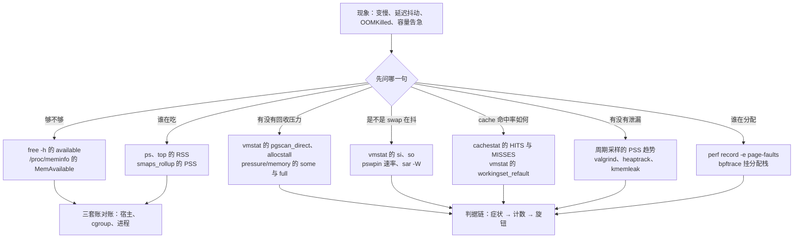
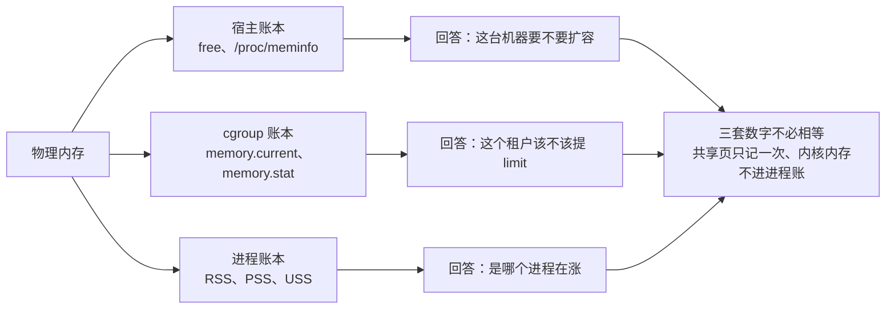
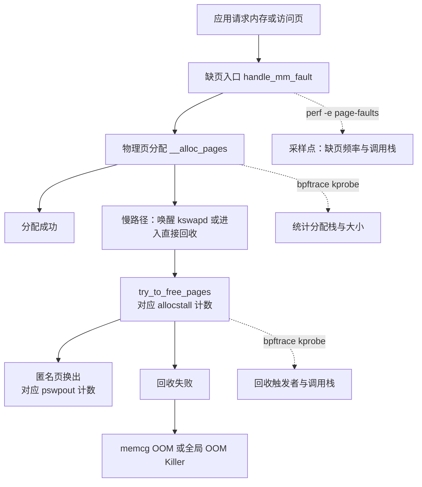
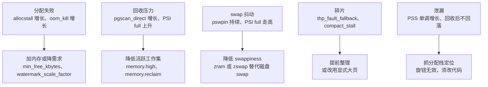

# 内存性能分析与调优：从 free 到 perf 的工具链

**摘要：**

内存排查的难点通常在于不知道手上的数字在回答哪个问题，而不在于缺工具。本文按「我想知道什么」组织，而不按工具清单组织：内存够不够、谁在吃内存、有没有回收压力、是不是 swap 在抖、cache 命中率如何、有没有泄漏、谁在分配。每一个问题给出首选命令、关键字段、读数陷阱，以及这个数字成立的前提。开头那条容器反复 OOMKilled 的事故线会贯穿全文，它同时踩中三个陷阱：用宿主的可用量判断容器的余量、用 RSS 之和估算容器占用、把被计费的缓存放进总额度里当成泄漏。贯穿全篇的结论是三套口径不可混用：`buff/cache` 可以回收，`available` 才是答案；RSS 含共享页会重复计算，PSS 与 `smaps_rollup` 才是唯一不重复的口径；容器里宿主、cgroup、进程三套账数字不同不是缺陷。读数的三条公理是口径、时点与代价，后半段据此把回收、swap、OOM、大页、cgroup 的判据压成一张「症状 → 该看哪个计数 → 该调哪个参数」的表，并给出各工具的开销量级、调优的次序纪律与两组反例清单。除内核字段语义外，文中数值均为示例推算，只用于说明量级。

---

## 第 1 章 问题的形状：工具清单为什么会失效

一台机器的 `free -h` 显示 2.1 GiB 空闲，另一台显示 58 GiB 空闲，哪一台更紧张？多数人会条件反射地选前者，但答案是前者未必更紧张：2.1 GiB 空闲之外还压着 45 GiB 的 page cache，需要时内核可以把它让出来；58 GiB 空闲的那台可能只是刚重启，业务还没热身，负载上来以后它的可用量会掉得比谁都陡。数字本身没有问题，问题在于读它的人没有先确认这个数字的口径：分母是谁、包含了什么、在哪个视角下统计。

内存工具之所以容易误用，是因为它们的名字暗示了用途，而字段的真实语义与名字有一段距离。`free` 的 `free` 列听起来像「可用内存」，实际只是「完全没被使用的内存」；`top` 的 `%MEM` 听起来像「进程占了多少机器」，实际是 RSS 与总内存之比，而 RSS 里有大量共享页；`vmstat` 的 `si`、`so` 看起来像 swap 使用率，实际是每秒换入换出的千字节数。把这些字段当名字念，几乎必然得出相反结论。

### 1.1 一次完整误判的经过

某 Java 服务跑在 `limits.memory` 为 8 GiB 的 Pod 里，两天一次 OOMKilled。值班同学的推理链是这样的：宿主机 `free -h` 显示 available 还有 120 GiB，排除机器内存不足；容器里 12 个进程的 RSS 相加只有 5.4 GiB，远低于 8 GiB，排除容器超限；于是结论是限制设小了，把 limit 调到 12 GiB，两天后依旧 OOM。

真实账面是另一回事。OOM 前的 `memory.current` 已经顶到 8 GiB，其中匿名页 4.9 GiB、被计费的 page cache 2.3 GiB、内核 slab 与页表约 0.6 GiB。RSS 相加之所以只有 5.4 GiB，原因有三层：共享的 `libjvm.so` 在 12 个进程里被各算了一遍；page cache 根本不在任何进程的 RSS 里；内核 slab 与页表同样不进进程账。三个数字都是真的，只是回答的不是同一个问题，它们分别是「机器还剩多少」「这个容器被收了多少费」「进程各自的驻留量」，把它们放在一起比较，等于拿公斤、升和摄氏度算总和。

这条事故线会在后面几个章节反复出现，因为几乎每个读数陷阱都能在它身上找到一次具体发作。

### 1.2 按问题组织，而不按工具组织

工具手册的组织方式是按工具排列：`free` 一节、`vmstat` 一节、`perf` 一节。这种组织方式便于查询，却不便于决策，因为真实场景里浮现的是问题而不是工具名，工程师需要的是一条从症状到命令的映射。本文改用问题组织：先问「我想知道 X」，再回答 X 该用哪条命令、看哪个字段、这个字段在什么前提下才可信、看错了会怎样。

按问题组织还有一个副作用：同一个工具会在多个问题下出现，而每次出现时你看到的是它不同的字段。`/proc/meminfo` 在「够不够」的问题下贡献 `MemAvailable`，在「cache 能不能回收」的问题下贡献 `Cached` 与 `Shmem`，在「有没有泄漏」的问题下贡献 `Slab` 与 `SReclaimable`。这种重复是有意的，它逼读者记住：文件是同一个，语义随问题变化。

下面这张图是全文的路由表，七个问题各自指向首选工具，再汇入两处收口：三套账的对账，以及判据链。



### 1.3 三条公理

在进入具体命令之前，先把三条贯穿全篇的公理摆出来。后面每一处陷阱，都可以归到其中一条上。

**口径**：任何一个内存数字都必须连同它的分子分母一起读。`available` 的分子是「现在就能让出来的量」，`used` 的分子是「已经被占用的量」，`RSS` 的分子是「驻留在这个进程地址空间里的页」，三者最终都会被拿去和同一个 `MemTotal` 相比，但各自的分子定义完全不同。看到数字先问「它在数什么」。

**时点**：内存指标分存量和速率两类。`swpd`、`Cached`、`memory.current` 是存量，是某一瞬间的快照；`pswpin`、`pgscan_direct`、`allocstall` 是累计计数器，只有做差分才有意义。把存量当趋势看，会得出「swap 一直在用」的假警报；把累计值当瞬时值看，会得出「直接回收从来没停过」的荒谬结论。

**代价**：观测本身有成本，而内存问题往往出现在机器最紧张的时候。`smaps` 要对每个 VMA 输出一段统计，几万个 VMA 的 JVM 读一次能让 `mmap_lock` 长时间被占，业务延迟直接体现出来；`perf` 在高频采样时自己的 buffer 也要占内存；`bpftrace` 挂在分配路径上的探针会在每一次分配时执行。选工具时先估它的开销，再看它能回答什么。

> [!warning] 生产避坑
> 三条公理里最容易违反的是「时点」。监控系统采集的 `node_vmstat_pgscan_direct` 是累计值，画成曲线永远是单调上升的直线，看不出任何事件；必须用 `rate()` 或两次采集做差，才看得见压力出现在哪一分钟。反过来说，`memory.current` 是存量，用 `increase()` 去看它只会得到噪声。

---

## 第 2 章 内存够不够：available 才是答案

### 2.1 `free` 的六个字段到底在数什么

`free` 是最古老也最容易被误读的工具，它的输出只有一行数据，却包含六个口径不同的字段。

```bash
$ free -h
               total        used        free      shared  buff/cache   available
Mem:           125.8Gi      70.9Gi     2.1Gi     1.2Gi      52.8Gi      46.8Gi
Swap:            7.8Gi     512.0Mi     7.3Gi
```

（以下各行为示例输出，数值为示例推算。）

`total` 对应 `MemTotal`，是内核可支配的物理内存，已经扣掉了内核镜像本身与少量保留区，所以它总比内存条的标称容量小一点，这是正常现象而不是硬件缺失。

`free` 对应 `MemFree`，是完全没有被任何用途占用的页。这个数字小并不代表内存紧张，因为内核的策略是把暂时不用的内存尽量拿去做缓存，空闲页留着不用才是浪费。一台跑了几天的数据库服务器 `free` 只剩几百兆，恰恰说明缓存被充分利用了。

`buff/cache` 是 `Buffers`、`Cached` 与 `SReclaimable` 的合并列（不同 procps 版本对 `SReclaimable` 的归并有细微差别），它的主体是 page cache，也就是文件内容的副本。这一列的关键性质是**大部分可回收**：当进程需要内存时，内核会把这些干净的缓存页直接丢掉，把物理页让出去。所以它更接近「暂时借给缓存的内存」，而不是「已经花掉的内存」。

`shared` 对应 `Shmem`，是 tmpfs 与 SysV 共享内存占用的量。这里有个容易踩的坑：`Shmem` 本来就已经算在 `Cached` 里面了，`shared` 列只是把它单独列出来方便观察，如果你在算「可回收缓存」时用 `buff/cache` 减去 `shared`，方向是对的；但如果以为 `shared` 是 `buff/cache` 之外的额外占用，再把它加到总占用里，就会重复计算一次。

`used` 是 `total` 减去 `free`、`Buffers`、`Cached` 之后的余量，可以粗略理解为「不可回收的那部分」。需要提醒的是，不同 procps 版本对 `used` 的算法并不统一，有的发行版直接取 `total - available`，因此这一列不适合当作判据，只能用来粗看。

`available` 对应 `MemAvailable`，是内核对「现在还能再分配多少内存而不触发交换」的估算。判断内存够不够，只认这一列。

### 2.2 `MemAvailable` 是怎么算出来的

**MemAvailable** 从内核 3.14 起出现在 `/proc/meminfo` 里，它的计算逻辑值得拆开看，因为这个逻辑决定了它在什么情况下会骗人。内核的估算大致是三步。

第一步，从空闲页出发，减掉水位线保留。`available = MemFree - 水位线对应的保留量`，也就是说空闲页里有一部分是不能动的，内核要留着应付突发分配与原子分配。

第二步，加上文件页，但只加一部分。内核把所有 zone 的 active file 与 inactive file 页加起来，再减去 `min(pagecache / 2, 水位线)`，然后才计入 `available`。折半是有意的保守设计：文件页里有一半左右是热数据，如果把它们全部算作「随时可回收」，`available` 就变成了一个理论上限，任何一次大分配都能把它吃穿。只算一半，是为了让这个数字在突发场景下仍然站得住。

第三步，加上可回收的 slab。`SReclaimable` 里的 dentry、inode 缓存同样可以在内存压力下释放，因此计入 `available`。

这套算法解释了两件事。其一，`available` 总是大于或等于 `free`，而且 `buff/cache` 越大两者差距越大，所以看到 `free` 只有 2 GiB 而 `available` 有 46 GiB 是完全正常的状态。其二，`available` 是一个**估算**而不是测量，它假定文件页真的可以被丢弃，一旦这个假定不成立，它就会高估。

### 2.3 假定失效的两种情形

第一种是 `Cached` 里混进了回收不掉的页。`Cached` 的定义是文件页总量，而 tmpfs 的页在账上属于文件页，可它没有后备存储，除非有 swap 或者文件被删除，否则内核无法把它换出去。于是一台跑着大量 tmpfs（譬如容器里的 `/dev/shm`、内存盘、某些日志缓冲）的机器，`Cached` 可以很大，`available` 也跟着很大，但真正需要内存时，能回收的远少于账面。

判断方法是把 `Shmem` 与 `Cached` 放在一起看。若 `Cached` 为 45 GiB 而 `Shmem` 为 12 GiB，真正可回收的文件缓存最多 33 GiB，再加上其中一半是热数据，实际能立刻让出来的量还要更少。这个差额在容器场景里格外常见，因为很多运行时默认把 `/dev/shm` 开成 64 MiB 到若干 GiB 的 tmpfs。

第二种是脏页太多。脏页必须先写回磁盘才能回收，而写回受磁盘带宽限制，所以当 `Dirty` 与 `Writeback` 很高时，`available` 虽然把文件页算了进去，实际回收速度却跟不上分配速度，表现出来的就是明明 `available` 还有几个 G，直接回收照样频繁发生。这时该看的不是 `available`，而是 `Dirty` 与 `Writeback`，以及第 4 章的回收计数。

### 2.4 正确的使用率与监控口径

内存使用率应该用 `(total - available) / total` 计算，而不是 `used / total`，更不是 `free / total`。用 `free / total` 算出来的曲线在缓存多的机器上会长期贴着 100%，任何基于它的告警都会变成噪声，这也是很多监控系统内存告警形同虚设的原因。

告警阈值按经验取：`available` 低于总内存 10% 时给预警，低于 5% 时给严重。但阈值之外还要看趋势，`available` 从 40% 掉到 12% 用了三个月，这个斜率比任何单点阈值都有信息量。

| 字段 | 真实语义 | 常见误读 | 正确用法 |
|---|---|---|---|
| `total` | 内核可支配物理内存 | 与内存条标称容量不符即认为有硬件问题 | 作为所有比例的基数 |
| `free` | 完全未被使用的页 | 小即内存不足 | 基本不用，只作参考 |
| `buff/cache` | 缓存占用量，主体可回收 | 已花掉的内存 | 与 `Shmem` 对比，估算真实可回收量 |
| `shared` | tmpfs 与 SysV 共享内存 | `buff/cache` 之外的额外占用 | 从缓存中识别不可回收的部分 |
| `used` | `total` 减去 `free` 与缓存 | 判断够不够的依据 | 粗看即可，各版本算法不一 |
| `available` | 可再分配而不触发交换的估算量 | 与 `free` 混为一谈 | 判断够不够的唯一字段 |

`free` 还有两个实用参数：`-w` 把 `buffers` 与 `cache` 拆成两列，便于区分块设备缓冲与文件缓存；`-s N` 按秒数滚动输出，比 `watch free` 更干净，因为后者会清屏并丢失历史。`-c N` 限定输出次数，方便写进脚本。

### 2.5 容器里这一章全部作废

容器内执行 `free`，读到的是宿主机的 `/proc/meminfo`，除非挂载了 `lxcfs` 一类的视图重写层。这意味着容器里的 `available` 是整台机器的可用量，与这个容器的 limit 毫无关系。一个 limit 为 2 GiB 的容器，在 128 GiB 的宿主机里看到的 `available` 可能是 90 GiB，而它自己距离 OOM 只剩 300 MiB。容器场景该看什么，见第 5 章。

---

## 第 3 章 谁在吃内存：RSS 的重复计算与 PSS 的真相

### 3.1 四个口径

进程内存有四个常用口径，它们回答的问题完全不同，混用是这一领域最常见的错误来源。

| 口径 | 含义 | 是否重复计算 | 适合回答 |
|---|---|---|---|
| VSZ | 虚拟地址空间大小 | 不适用（根本不含物理页） | 地址空间是否异常、`max_map_count` 是否够 |
| RSS | 驻留物理内存页总量 | 是，共享页在每个进程各算一次 | 进程是否在涨、OOM 评分基础 |
| PSS | RSS 按共享比例分摊 | 否，同一页分摊后求和等于实际 | 一组进程真实占用多少 |
| USS | 只属于该进程的私有页 | 否，且不含任何共享 | 泄漏排查、单进程独占成本 |

VSZ 与物理内存的关系最弱。一个映射了 100 GiB 文件的进程可以只有几十兆 RSS，因为映射只是登记了地址范围；反过来，一个 VSZ 只有几百兆的进程也可能占满内存，因为它频繁分配匿名页。用 VSZ 判断内存占用，等于用房产证面积判断屋里住了几个人。

RSS 的问题在于共享。动态库、共享内存、mmap 的只读文件、`fork` 之后尚未写入的页，都会出现在多个进程的 RSS 里。RSS 的设计目的不是「统计占用」，而是「判断这个进程的驻留集有多大」，后者服务于换页决策，前者服务于容量规划，两者不是一回事。

**PSS** 是唯一不重复的口径。它的定义是：私有页全额计入，共享页按共享者数量均摊。一个 150 MiB 的 `libjvm.so` 被 12 个进程映射，每个进程的 PSS 里这一项只有 12.5 MiB，12 个进程加起来正好 150 MiB。

USS 是 `Private_Clean + Private_Dirty`，只算独占页。它通常比 PSS 更小，因为把共享部分完全排除了。判断泄漏时 USS 最干净，共享库的波动不会污染曲线。

### 3.2 一个具体的数值差

假设 12 个 JVM 进程在同一个容器里，每个进程 RSS 都是 450 MiB：其中 150 MiB 是共享的 `libjvm.so` 与 glibc，300 MiB 是各自独立的堆与元空间。RSS 相加得 5400 MiB，而这 12 个进程的真实物理占用是 12 × 300 + 150 = 3750 MiB，PSS 之和也正好是 3750 MiB。误差 1650 MiB，约 44%，这个量级足以把「limit 是不是设小了」的判断完全带偏（示例推算，比例随共享库大小变化）。

如果这 12 个进程分布在多个容器里，共享库仍然只有一份物理页，但 cgroup 的记账方式会让情况更复杂：一个文件页只会被记到首次把它读进来的那个 memcg 上，其他 cgroup 的进程映射它时不再重复计费。于是各容器 `memory.current` 之和会小于「各自真实占用」之和，因为共享的那部分只落在了一个容器账上。这不是记账错误，是记账规则。

### 3.3 `smaps` 与 `smaps_rollup`

`/proc/<pid>/smaps` 是进程内存最详细的视图，按 VMA 分段输出 `Rss`、`Pss`、`Shared_Clean`、`Shared_Dirty`、`Private_Clean`、`Private_Dirty`、`Referenced`、`Anonymous`、`AnonHugePages`、`Swap`、`SwapPss`、`Locked` 等字段。

```bash
# 汇总一个进程的 RSS、PSS、USS
awk '/^Rss:/{rss+=$2} /^Pss:/{pss+=$2} \
     /^Private_Clean:/{uss+=$2} /^Private_Dirty:/{uss+=$2} \
     END{printf "RSS=%d MiB PSS=%d MiB USS=%d MiB\n", rss/1024, pss/1024, uss/1024}' \
     /proc/$(pgrep -f java | head -1)/smaps
```

这个读法在小进程上没问题，在大进程上有代价：`smaps` 要为每个 VMA 生成一段统计，读取时内核需要逐段遍历，几万个 VMA 的 JVM 读一次可能耗费数百毫秒到数秒（量级判断，取决于 VMA 数量）。更麻烦的是读取期间 `mmap_lock` 会被持有，同一个进程里正在做 `mmap` 或 `brk` 的线程会被阻塞，表现为业务延迟毛刺。这也是为什么「排查内存问题反而把业务搞挂」在实践中确实发生过。

内核 4.14 起提供了 `/proc/<pid>/smaps_rollup`，把全部 VMA 的统计预先汇总成一段，读取只需一次线性遍历，开销比 `smaps` 低一到两个数量级（量级判断）。它的字段包含 `Rss`、`Pss`、`Pss_Anon`、`Pss_File`、`Pss_Shmem`、`Shared_Clean`、`Shared_Dirty`、`Private_Clean`、`Private_Dirty`、`Referenced`、`Anonymous`、`AnonHugePages`、`Swap`、`SwapPss`、`Locked`。日常监控与容器核算应该用这个文件。

```bash
# 容器内核算一组进程的真实占用：PSS 加总
for p in $(pgrep -f java); do
  awk -v p=$p '/^Pss:/{s+=$2} END{printf "%d %d\n", p, s}' /proc/$p/smaps_rollup
done | awk '{sum+=$2} END{printf "container PSS = %.1f MiB\n", sum/1024}'
```

`Pss_Anon`、`Pss_File`、`Pss_Shmem` 这三个拆分字段在容器核算时特别有用：`Pss_Anon` 是匿名页分摊，决定了容器 OOM 的主要风险；`Pss_File` 是映射文件页的分摊；`Pss_Shmem` 是 tmpfs 与共享内存的分摊，这部分通常是回收不掉的。

### 3.4 `top` 的 `%MEM` 与 `ps` 的 RSS

`top` 的 `%MEM` 用 `RES / MemTotal` 计算，`RES` 就是 RSS。于是它继承了 RSS 的全部缺陷：多个进程共享同一个库时，每个进程的 `%MEM` 都包含了这份库，把 12 个进程的 `%MEM` 相加会得到一个超过 100% 的荒谬结果。这不是 `top` 的 bug，它只是没有承诺过「加总有意义」。

`ps aux` 的 `RSS` 列在 Linux 上以 KiB 为单位，`ps -o rss,vsz,comm` 更便于脚本处理。要注意 `pgrep -f java` 可能返回多个 PID，直接塞进 `perf -p` 或 `cat /proc/$(pgrep java)/smaps` 会变成语法错误或只采样到第一个进程，这是现成脚本里最常见的失效方式。

`ps_mem` 是按命令行聚合的第三方脚本，它的主口径是私有内存，并把共享部分单列，因此比「RSS 相加」靠谱得多。它的价值在于快速给出「哪个服务占得最多」的排序，局限在于它仍然依赖对 `/proc` 的遍历，在几十个进程的机器上可以接受，在上千进程的节点上会明显变慢。

### 3.5 不在 RSS 里的那部分

进程账本漏掉的不只是共享页的分摊问题，还有一整块完全不进进程账的内存。

内核 slab 是最大的一块。dentry、inode 缓存、网络栈的 socket 缓冲、各种内核对象都从这里分配，它们由内核代表进程持有，但不计入任何进程的 RSS。一台跑了很久的文件服务器，`Slab` 达到几十 GiB 很常见，其中 `SReclaimable` 部分可以回收，`SUnreclaim` 部分回收不掉，会一直占着。

页表是第二块。每映射一个 4 KiB 页就要若干字节的页表项，一个占 200 GiB 的 JVM 进程，单是页表就可能达到数 GiB（示例推算，随大页使用情况变化）。`/proc/meminfo` 的 `PageTables` 记录全系统页表占用，`smaps` 里不体现，但 OOM 评分会把它算进去。

内核栈是第三块。每个线程一份，默认 16 KiB，线程数上万的进程光内核栈就有数百兆。

还有 socket 缓冲、`vmalloc` 分配、`percpu` 区域、大页预留池。这些加起来在普通服务上可能只占几个百分点，但在网络密集或文件密集的负载上可以达到总内存的两成以上。用 RSS 之和做容量规划，系统性低估是必然的。

### 3.6 OOM 评分用的是 RSS

第 7 章会详细展开，这里只留一个接口：内核的 `oom_badness()` 以 RSS、swap 中的页数、页表占用为基础计算分数，再乘以 `oom_score_adj` 的缩放因子。所以 RSS 在这里确实是正确的口径，因为 OOM 关心的是「杀掉这个进程能腾出多少物理页」，共享页被多次计入反而符合「杀掉它可能释放的页」的直觉。同一个 RSS，在容量规划里是错的，在 OOM 评分里是对的，口径的正确性取决于用途。

---

## 第 4 章 有没有压力：从「用了多少」到「回收有多费劲」

### 4.1 利用率与饱和度

内存是少数几个必须把利用率和饱和度分开看的资源。CPU 的利用率和饱和度可以近似统一（跑满就是饱和），内存不行：利用率 95% 的机器可能毫无压力，因为可回收缓存撑得住；利用率 60% 的机器也可能天天直接回收，因为那 60% 全是不可回收的匿名页与大页。

这就是为什么只看 `available` 不够。`available` 回答的是「还剩多少」，它不回答「为了腾出空间，代价有多大」。后一个问题的答案在回收计数器与 PSI 里。

### 4.2 `/proc/vmstat` 的回收计数器

```bash
$ grep -E '^(pgscan|pgsteal|allocstall|pgmajfault|pgfault|compact_stall|thp_fault_fallback)' /proc/vmstat
pgfault            892341567
pgmajfault            128934
pgscan_kswapd      120345678
pgscan_direct        2345678
pgscan_direct_throttle  91234
pgsteal_kswapd     118900000
pgsteal_direct       2100000
allocstall            82341
compact_stall         12043
thp_fault_fallback     5678
```

这些是自启动以来的累计值，必须做差分。一个能直接用的脚本如下：

```bash
# 对比 5 秒窗口内的增量：直接回收、分配停顿、主缺页、THP 回退
snap() { grep -E '^(pgscan_direct|allocstall|pgmajfault|thp_fault_fallback) ' /proc/vmstat; }
snap > /tmp/vmstat.a; sleep 5; snap > /tmp/vmstat.b
awk 'NR==FNR{a[$1]=$2; next} {printf "%-20s %10d / 5s\n", $1, $2-a[$1]}' /tmp/vmstat.a /tmp/vmstat.b
```

`pgscan_kswapd` 与 `pgsteal_kswapd` 是后台回收的行为。它们增长说明内核在提前整理内存，这在缓存多的机器上是常态，本身不是问题。`pgscan_direct` 是**直接回收**的扫描量，增长意味着分配路径上的进程被迫自己去回收，这条路径是同步阻塞的，每次 direct reclaim 都可能带来毫秒到数十毫秒的延迟。**allocstall** 是直接回收发生的次数（按 zone 累加），它比 `pgscan_direct` 更适合做告警，因为它是事件计数而不是工作量计数。`pgscan_direct_throttle` 是直接回收被限流的次数，出现这个计数说明多个进程正在同时抢回收，压力已经很大。

`pgmajfault` 是主缺页次数。这里要纠正一个常见误解：主缺页不代表「首次分配」失败，它代表这个页**需要从磁盘取回**。匿名页的主缺页来自 swap 换入，文件页的主缺页来自缓存未命中后重新读盘。所以 `pgmajfault` 高说明系统正在反复把已经换出去或淘汰掉的页搬回来，这是工作集装不下内存的直接证据，而不是分配慢。

水位线怎么算、LRU 怎么排队、kswapd 何时被唤醒，机制细节在 [[05 内存回收：kswapd、LRU与直接回收的博弈|内存回收]] 里展开，这里只借用它的几个回收计数。

`compact_stall` 与 `thp_fault_fallback` 属于碎片类指标：前者是分配大页时被迫等待内存整理而停顿的次数，后者是想要 2 MiB 大页却只能退回 4 KiB 的次数。这两个计数增长时，表现往往是延迟毛刺而不是吞吐下降，很容易被误判成 GC 或锁竞争。

### 4.3 PSI：把压力变成第一手指标

内核 4.20 引入了 Pressure Stall Information，`/proc/pressure/memory` 是它在内存上的落地：

```bash
$ cat /proc/pressure/memory
some avg10=12.34 avg60=5.67 avg300=1.89 total=823456789
full avg10=8.90 avg60=2.34 avg300=0.67 total=456789012
```

`some` 的含义是「至少有一个任务因为内存而停住的时间占比」，`full` 的含义是「所有非空闲任务都因为内存停住的时间占比」。两者的差别很关键：`some` 上升说明有个别任务在等内存，可能只是某个批处理进程；`full` 上升说明整个系统都在等内存，这是**全局饱和**信号。`total` 是累计微秒数，做差分可以得到任意窗口内的占比。

PSI 的价值在于它直接度量了「等待」，而不是像 `available` 那样只度量「余量」。`full avg10` 超过 5% 基本可以判定存在明显的回收压力，超过 20% 说明系统已经在 Thrashing 边缘（阈值是经验值，需结合业务基线校准）。

cgroup v2 下每个 cgroup 也有自己的 `memory.pressure`，语义相同，粒度更细。容器里看这个文件才能知道「是这个容器在等内存」还是「宿主机整体在等内存」，而这两种情况该采取的动作完全相反。

### 4.4 `sar -B` 与回收效率

`sar -B` 把页面活动整理成每秒速率，适合长时间观察：

```bash
$ sar -B 1 5
10:20:01  pgpgin/s pgpgout/s   fault/s  majflt/s  pgfree/s pgscank/s pgscand/s pgsteal/s    %vmeff
10:20:02   1234.56    567.89  34567.89      0.00  45678.90  12345.00      0.00  12300.00     99.63
10:20:03    234.56   4567.89  23456.78      5.67  34567.89  23456.00    890.00  23000.00     87.45
```

**%vmeff** 是回收效率，定义为 `pgsteal / (pgscank + pgscand)`。接近 100% 说明扫到的页几乎都能回收，效率高；跌到 30% 以下说明扫描了大量活跃页却回收不掉，内核在做无效劳动，通常是工作集已经超过内存容量，继续扫描只是在反复触碰热页。这个判据比 `pgscand` 的绝对值更有说服力，因为它把「工作量」和「产出」放在了一起。

`sar -r` 提供内存使用率的历史曲线，注意它的 `kbavail` 列（sysstat 11 之后才有）才对应 `MemAvailable`，`%memused` 是基于 `used` 算的，同样有第 2 章说的口径问题。

### 4.5 一张判据表

| 计数 | 数据来源 | 语义 | 何时算问题 |
|---|---|---|---|
| `pgscan_direct` | `/proc/vmstat` | 直接回收扫描的页数 | 持续增长，或与 `pgscan_kswapd` 同量级 |
| `allocstall` | `/proc/vmstat` | 分配路径被迫回收的次数 | 每秒持续大于 0，且伴随延迟毛刺 |
| `pgscan_direct_throttle` | `/proc/vmstat` | 直接回收被限流的次数 | 出现即说明多进程抢回收 |
| `pgmajfault` | `/proc/vmstat` | 从磁盘取回的缺页次数 | 持续走高，且 swap 无活动时指向文件页反复读盘 |
| PSI `full avg10` | `/proc/pressure/memory` | 全体任务因内存停顿的占比 | 大于 5% 需关注，大于 20% 已严重 |
| `%vmeff` | `sar -B` | 回收的投入产出比 | 低于 30% 说明扫描无效 |
| `compact_stall` | `/proc/vmstat` | 分配大页时的整理停顿 | 增长与延迟毛刺同相 |
| `thp_fault_fallback` | `/proc/vmstat` | 大页分配退回小页 | 占比高说明碎片严重 |

---

## 第 5 章 三套账：宿主、cgroup、进程

### 5.1 三个视角，三种口径

同一台机器上的内存，可以同时有三套账：宿主视角看整机，cgroup 视角看资源组的计费量，进程视角看每个进程的驻留集。这三套账的数字互不相等，而且不该相等。把「数字对不上」当成 bug 去追，是容器排障里最耗时间的一条岔路。



宿主账本回答的是容量问题：这台机器还撑不撑得住下一个业务、要不要加内存条。它的口径是全局可用量，所以看 `MemAvailable`、`MemFree`、`Cached`、`Slab`。

cgroup 账本回答的是分配问题：这个容器被收了多少费、离 limit 还有多远、有没有触发 throttling 或 OOM。它的口径是「被计费的驻留量」，包含 page cache 与内核内存，所以看 `memory.current`、`memory.stat`、`memory.events`、`memory.pressure`。

进程账本回答的是归因问题：是哪个进程在涨、涨的是堆还是映射文件。它的口径是「进程地址空间里的驻留页」，所以看 RSS、PSS、USS。

### 5.2 cgroup v2 的读法

cgroup v2 里，一个容器的内存账本在 `/sys/fs/cgroup/<path>/` 下。

`memory.current` 是当前被计费的总量，等于匿名页、被计费的文件页、内核内存（slab、页表、内核栈、socket 缓冲）之和。它对应 v1 的 `memory.usage_in_bytes`，但路径与语义都换了一套。

`memory.stat` 是拆分明细，其中最常用的字段如下：

| 字段 | 含义 | 用途 |
|---|---|---|
| `anon` | 匿名页（堆、栈、共享内存中的数据） | 判断 OOM 风险的主体 |
| `file` | 被计费的文件页（page cache 与映射文件） | 判断缓存占了多少额度 |
| `inactive_file` | 冷文件页，可优先回收 | 计算 working set |
| `active_file` | 热文件页 | 判断缓存是否有价值 |
| `kernel` | 内核内存总量 | 判断是否有内核侧泄漏 |
| `slab` | slab 总量 | 细分定位（dentry、inode 等看 `/proc/slabinfo`） |
| `pagetables` | 页表占用 | 大内存进程容易堆积 |
| `shmem` | tmpfs 与共享内存 | 回收不掉的缓存 |
| `workingset_refault_anon` | 匿名页回收后又被访问的次数 | 判断工作集是否超限 |
| `pgmajfault` | 该 cgroup 的主缺页次数 | 判断是否在反复读盘 |

**working set** 的常用近似是 `memory.current - inactive_file`，这也是 Kubernetes 计算 `container_memory_working_set_bytes` 的思路：把可以立刻回收的冷文件页从占用里刨掉，剩下的才是「真实占用」。这个近似有两个边界：`inactive_file` 不一定真的能立刻回收（脏页要先写回），而 `shmem` 虽然记在 file 里却回收不掉，所以 working set 对 tmpfs 用量大的容器会偏乐观。

`memory.events` 记录事件计数，`high`、`max`、`oom`、`oom_kill` 四个字段分别对应「触及高水位被限流」「触及上限」「发生 OOM」「进程被杀」。`oom_kill` 增长是容器 OOMKilled 的直接证据，比从 `dmesg` 里翻日志快得多。较新的内核还提供 `memory.peak`，记录历史峰值，省去了自己采样存最大值的麻烦。

`memory.pressure` 是这个 cgroup 的 PSI，`some` 与 `full` 的语义同全局一致。

cgroup v1 的差异需要单独记住：路径是 `/sys/fs/cgroup/memory/`，总量在 `memory.usage_in_bytes`，上限在 `memory.limit_in_bytes`，OOM 控制开关在 `memory.oom_control`，并且 memcg 与 swap 的记账是分开的（`memory.memsw.*`）。很多老文章里的 `cat /sys/fs/cgroup/memory/memory.stat` 在 cgroup v2 系统上会直接报文件不存在，这不是权限问题，是路径换了。

### 5.3 为什么三套账对不上

差异来自四个机制，每一个都足以让数字偏离几个百分点到几十个百分点。

**共享页只记一次账**。一个文件页被首次读入时记到那个 cgroup 上，其他 cgroup 的进程再映射它时不再计费。所以各容器 `memory.current` 之和会小于「各自真实占用之和」，差额就是跨容器共享的那部分。

**内核内存**进 cgroup 账，却不进进程账。slab、页表、内核栈都算在 `memory.current` 里，却不出现在任何进程的 RSS 里。一个容器里跑着 12 个 JVM，它的 `kernel` 字段可能是几百 MiB，而 12 个进程的 RSS 相加完全没有这一块。

**page cache** 同样进 cgroup 账而不进进程账。文件被读进来以后，页记在 cgroup 上，进程的 RSS 里只有它实际映射的那部分。所以一个只做「读文件、处理后丢弃」的服务，`memory.current` 可以涨到 limit 附近而 RSS 纹丝不动。

**RSS 在进程之间重复计**。这已经在第 3 章算过，误差量级可以达到 40% 以上。

把四个机制叠加起来，任何「用其中一个数去验证另一个数」的做法都会失败。正确的做法是先确定要回答哪个问题，再选对应的账本，而不是拿三本账互相校验。

### 5.4 容器排障的顺序

回到第 1 章那条事故线。正确的顺序是：

先看 `memory.events` 的 `oom_kill` 是不是真的在增长，确认是内核杀进程而不是应用自己退出；再看 `memory.current` 与 `memory.stat`，把占用拆成 `anon`、`file`、`kernel` 三块，看是哪块涨到了上限；如果 `file` 占大头，说明是缓存把额度吃满，问题不在泄漏而在缓存策略（可以调 `memory.high` 提前回收，或降低缓存用量）；如果 `anon` 占大头，再进容器用 `smaps_rollup` 的 `Pss_Anon` 分摊到具体进程；只有到这一步，`jmap`、`heaptrack` 之类的进程内工具才有意义。

这条顺序的价值在于每一步都在缩小范围，而不是一上来就进容器抓堆快照。

顺带一提，cgroup 账本自身也可能出问题。仓库里那份 memcg 引用计数溢出导致物理机重启的案例（[[SRE/故障排查与复盘/RHEL8内核memcg-refcount溢出导致物理机重启故障报告|memcg 引用计数溢出致物理机重启]]），故障本质是内核在 `mem_cgroup_id_get_online()` 里发生了 `refcount_t` 溢出，累计报了 160 多次之后才把 `id.ref` 结构撑坏，最终在 cgroup 创建路径上空指针解引用。它提醒的是：当你确信读数逻辑没问题、数字却怎么都对不上时，要考虑记账代码本身的版本缺陷。

---

## 第 6 章 是不是 swap 在抖：速率而非存量

### 6.1 存量与速率

`vmstat` 的 `swpd` 列是 swap 的已用量，属于存量。很多机器上 `swpd` 长期是几百兆甚至几个 G，因为一些很久不访问的匿名页被换出去以后就再也没回来，这部分占用是「一次性沉淀」而不是「持续抖动」。用 `swpd` 判断 swap 是否伤性能，会得到大量假阳性。

真正有意义的信号是速率：每秒换入多少、换出多少。`vmstat` 的 `si`、`so` 两列单位是 KiB/s，`sar -W` 的 `pswpin/s`、`pswpout/s` 单位是页/s，两者换算关系是页大小。

```bash
$ sar -W 1 5
10:30:01     pswpin/s   pswpout/s
10:30:02         0.00        0.00
10:30:03       512.00       48.00
10:30:04      1024.00       64.00
```

**抖动**的判据是换入与换出同时持续发生，而不是单看换出。只有换出没有换入，说明内存在一段时间内紧张过，之后工作集缩小、被换出的页不再被访问，系统已经自愈；换出之后紧跟着换入，说明那些页还在工作集里，内核把它们赶出去又被立刻要回来，这才是抖动。

换出与换入在内核里走的是两段不同的路径，匿名页从 LRU 摘出、分配 swap slot、写入后端设备，这一整套的机制与代价边界见 [[06 Swap机制：磁盘充当内存的代价与边界|Swap 机制]]。

### 6.2 抖动的代价

换入发生在缺页处理路径上，是一条同步的、可能阻塞的路径。进程访问一个已经换出的匿名页，触发缺页，内核要分配页、发起读 I/O、等待返回，期间的延迟是磁盘或网络的随机读延迟量级。机械盘上是毫秒级，SSD 上是几十到几百微秒，网络存储上可能更高。当一个进程每秒要处理上千次这样的缺页时，延迟分布会被彻底拖垮，而 CPU 使用率可能并不高，于是监控上看不出「忙」，只看得出「慢」。

`vmstat` 里能观察到的是 `si` 上升、`wa`（iowait）上升、`b`（不可中断睡眠进程数）上升。这三者同时出现，基本可以确认是 swap 抖动而非 CPU 或磁盘瓶颈。

### 6.3 swap 的三种形态

同样是 swap，代价差别很大。

磁盘 swap 是最常见的形态，换出是一次顺序写，换入是一次随机读，代价最高。

zram 是一块压缩后的内存块设备，作为 swap 使用时，换出是压缩进内存、换入是解压，全程没有磁盘 I/O。它的代价从 I/O 延迟变成了 CPU 时间与压缩比，对于可压缩性好的数据（零页、文本、结构化数据）收益明显，对已经压缩过的数据（图片、压缩包）几乎没有收益，甚至会因为额外压缩开销而变差。

zswap 是折中方案：它作为 swap 的前端缓存，把即将换出的页压缩后留在内存里，只有内存不够时才真正写到后端 swap 设备。对抖动场景来说，zswap 能把相当一部分换入操作挡在内存里，减少磁盘 I/O。

这三者的 `pswpin`、`pswpout` 都会增长，所以单看计数无法区分是磁盘在抖还是内存在压缩。判断方式是结合 `wa` 与 CPU 的 `sy` 占比：纯磁盘 swap 抖动时 `wa` 高、`sy` 不高；zram 抖动时 `wa` 不高、`sy` 明显上升。

### 6.4 谁在 swap

定位到进程需要按 `VmSwap` 排序，`/proc/<pid>/status` 里有这一项，`smaps` 里还有按 VMA 拆分的 `Swap` 与 `SwapPss`。

```bash
# 按 swap 占用从大到小列出进程
for d in /proc/[0-9]*; do
  s=$(awk '/^VmSwap:/{print $2}' $d/status 2>/dev/null)
  [ -n "$s" ] && [ "$s" -gt 0 ] && echo "$s $(cat $d/comm 2>/dev/null)"
done | sort -rn | head -10
```

`SwapPss` 与 `Swap` 的关系跟 `Pss` 与 `Rss` 的关系一样：共享的匿名页（例如 `fork` 之后未写入的页、`shmem`）在 `Swap` 里会被重复计算，`SwapPss` 才是分摊后的量。容器里做归因，用 `SwapPss`。

### 6.5 swappiness 的真实语义

`swappiness` 常被描述成「swap 的积极程度」，取值 0 到 100，于是很多人把它调成 0 并认为这样就不会 swap 了。这个理解是错的。

`swappiness` 调节的是回收时对匿名页与文件页的相对倾向，它不是一个开关。即使设成 0，当内存压力大到文件页已经不够回收时，内核仍然会换出匿名页，否则就只能触发 OOM，而内核的设计目标是尽量避免 OOM。所以在内存确实不够的场景下，把 `swappiness` 设为 0 换来的不是「不 swap」，而是「先 OOM」。

对数据库这类有自己缓存管理的进程，把 `swappiness` 调低确实有意义，因为它让内核优先回收文件页而不是换出进程的匿名页，减少了一次不必要的 I/O 往返。但前提是这台机器有足够的空闲内存或可回收缓存，否则低 `swappiness` 只是把压力提前转换成 OOM。

一条真实的教训在 [[SRE/故障排查与复盘/NameNode长GC事故深度分析：JVM内存管理与Linux Swap的致命交互|NameNode 长 GC 与 Swap 的交互]] 里有完整推演：一个 200 GiB 堆的 JVM，`swappiness` 与内存配比不当，导致 JVM 的堆页被换出，之后每次 GC 扫描这些页都要从磁盘换入，GC 停顿从秒级拉长到几十秒。这种场景下调低 `swappiness` 或干脆禁用 swap（配合足够的物理内存与合理的 `-Xmx`）才是正解。

---

## 第 7 章 cache 命中率与 refault：缓存在帮忙还是在反复搬

### 7.1 缓存命中率的两种读法

「cache 命中率」有两个不同的含义，混起来会得出相反的结论。

第一种是 page cache 的读写命中率：读请求有多少直接在缓存里满足、多少要落到设备上。bcc 的 `cachestat` 直接给出这组数字，它统计 `HITS`、`MISSES`、`DIRTIES` 以及读命中率与写命中率。命中率低说明工作集超过了缓存容量，是真的缺内存；命中率高说明缓存有效，此时 `Cached` 很大是该高兴的事。

第二种是回收后的回访率，也就是 **refault**：一个页被回收之后，短时间内又被访问、必须重新读回来。refault 高说明被回收的页里包含着热数据，这不只是「缺内存」，更是「回收策略在这个负载上是错的」。

`cachestat` 在新内核上不再需要挂探针：6.5 引入了 `cachestat(2)` 系统调用，可以直接拿到页缓存的命中统计，开销远低于早期的 kprobe 实现。

### 7.2 `workingset_refault`

`/proc/vmstat` 里的 `workingset_refault_anon` 与 `workingset_refault_file` 是内核为每个页维护的「影子项」（shadow entry）带来的产物：页被回收时不是立刻遗忘，而是留下少量元数据，如果这个页在影子项还在的时候又被访问，内核就能识别出「这个页刚被赶走又要回来」，记一次 refault。

这项计数的意义在于，它直接量化了「回收决策的后悔程度」。`pgscan_direct` 高说明回收很忙，但忙可能是因为系统确实缺内存，也可能是因为回收了不该回收的页；refault 高则明确了后者。两者同时高，说明内存实在不够，无论怎么回收都会伤到工作集；refault 高而 `pgscan_direct` 不高，说明回收策略（譬如 `vfs_cache_pressure`、cgroup 的 `memory.high`）过于激进，可以往回调。

配合 `workingset_activate_anon`、`workingset_activate_file` 一起看更有信息量：refault 之后页被激活进入 active 链表，说明内核承认自己判断错了。

### 7.3 `Cached` 虚高的三种来源

第 2 章已经提过 tmpfs 会混进 `Cached`，这里把量化方法补齐：`Shmem` 是 `Cached` 中不可回收的部分，比较两者即可估出真实可回收量。容器场景还要加上 `memory.stat` 里的 `shmem` 字段，因为容器内的 `/dev/shm`、`emptyDir`（在某些配置下）都会占用它。

第二种来源是 `Mlocked` 与 `Unevictable`。被 `mlock` 锁定的页不能被回收，但它们仍然算在进程的 RSS 与 `Mapped` 里。某些运行时（数据库、RDMA 应用、某些 JVM 配置）会锁定大块内存，这部分在账面上表现为「占用高、回收不掉、但也没有压力」。

第三种来源是只读映射的可执行文件与共享库。这部分页干净且可丢弃，回收时直接丢掉，需要时再从文件读回，所以它们确实是可回收的，只是回收之后会产生主缺页，表现为延迟毛刺。这也解释了为什么一台缓存被大量回收的机器上 `pgmajfault` 会显著升高而 `available` 看起来还不错。

### 7.4 一张对照表

| 指标 | 数据来源 | 高值意味着 | 该做什么 |
|---|---|---|---|
| 读缓存命中率 | `cachestat` | 缓存有效 | 维持现状，`Cached` 大是好事 |
| 读缓存命中率低 | `cachestat` | 工作集超过缓存容量 | 加内存，或减少扫描型访问 |
| `workingset_refault_file` | `/proc/vmstat` | 文件页被赶走后反复读回 | 降低回收激进度，检查 `Cached` 是否被 tmpfs 占用 |
| `workingset_refault_anon` | `/proc/vmstat` | 匿名页被换出后反复换入 | 降低 `swappiness`，或增加内存 |
| `Shmem / Cached` | `/proc/meminfo` | 缓存里不可回收的比例高 | 减少 tmpfs 用量，或给 tmpfs 设上限 |
| `Mlocked` | `/proc/meminfo` | 有大块内存被锁定 | 确认是业务需要，锁定页不参与回收 |
| `pgmajfault` | `/proc/vmstat` | 反复从磁盘取页 | 结合缓存命中率判断是缺内存还是回收过激 |

---

## 第 8 章 有没有泄漏：趋势、归因、工具边界

### 8.1 泄漏的判据

泄漏在数字上的特征是三条同时成立：**单调上升**、斜率稳定、与业务量脱钩。单看第一条会误判，因为缓存预热、连接池扩容、JIT 编译缓存都会让内存单调上升，但它们的斜率会收敛，最终停在某个平台上。

判据的具体做法是固定口径、固定间隔、观察足够长的时间。口径建议用 PSS 或 USS 而不是 RSS，因为 RSS 会随共享库的使用情况波动，一条锯齿状的曲线很难判断趋势。间隔取 1 分钟，观察 24 小时，再叠加业务指标的同期曲线：如果内存涨而 QPS、连接数、数据量都没涨，泄漏的嫌疑就很大。

对于有 GC 的运行时，还要看回收后的底线。JVM 每次 Full GC 之后堆占用如果逐次抬高，那是堆内泄漏；堆稳定而进程 PSS 持续涨，那是堆外泄漏（元空间、直接缓冲、本地库、线程栈）。这两类问题的排查工具完全不同，先分清再动手。

```bash
# 固定间隔采 PSS 与 USS，写进 csv，后续画趋势
pid=$(pgrep -f java | head -1)
while :; do
  echo "$(date +%s),$(awk '/^Pss:/{print $2}' /proc/$pid/smaps_rollup),\
$(awk '/^Private_Clean:/{a=$2} /^Private_Dirty:/{b=$2} END{print a+b}' /proc/$pid/smaps_rollup)"
  sleep 60
done >> /var/tmp/pss.csv
```

这个循环每次只读一个 `smaps_rollup`，开销可以忽略；如果换成读 `smaps`，就会变成第 3 章说的那种「排查动作本身造成毛刺」。

### 8.2 用户态工具

`valgrind` 的 `--leak-check=full` 是用户态泄漏定位的基准工具，它通过二进制翻译运行程序，把每一次 `malloc`/`free` 都记录下来，退出时报告确定泄漏、可能泄漏与仍可达的块。代价是显著的：程序运行速度会慢一个数量级以上（量级判断，随负载与工具模式变化），所以只能用于单测、预发或本地复现，不能上生产。

`massif` 是 valgrind 的堆剖析器，按时间采样堆使用量并给出调用栈，适合定位「谁在持续分配」，而不是「谁泄漏了」。它的开销比 `--leak-check` 低，但仍然属于不可上生产的量级。

`heaptrack` 走的是 `LD_PRELOAD` 拦截分配函数的路线，记录每次分配的调用栈，开销比 valgrind 低一到两个数量级（量级判断），可以在预发环境长期挂着。它的输出可以直接看出分配热点与峰值来源。

对于长期在生产的服务，更实际的做法是用分配器自带的采样剖析：jemalloc 的 `prof` 与 tcmalloc 的 heap profiler 都以低采样率记录分配栈，开销通常在个位数百分比（量级判断），可以按需开启一段时间。这类工具回答的是「谁在分配」，不能直接判定泄漏，需要配合时间维度的对比。

JVM 场景用 `-XX:NativeMemoryTracking=summary`，配合 `jcmd <pid> VM.native_memory summary` 查看堆外各区域的用量与变化，这是排查「堆稳定但进程涨」的首选。堆内则用 `jmap -histo:live` 看对象数量排行，或 `jcmd <pid> GC.heap_dump` 导出堆快照后用 MAT 分析。

### 8.3 内核态工具

内核内存的泄漏不能用 valgrind，要看 `kmemleak`。它在启动参数里打开（`kmemleak=on`），之后周期性扫描内核内存，把没有被任何指针引用的已分配块报出来。

`kmemleak` 的代价是扫描本身要遍历内存，在大内存机器上一次扫描可能耗时数十秒，并且会占用 CPU；它的误报率也不低，因为内核里有大量通过偏移量间接引用的结构，扫描器识别不到这些引用就会误判。所以它适合在复现环境里开，生产上长期开启需要评估。

更轻量的做法是对比 `/proc/slabinfo` 或 `slabtop` 的输出，看某个 slab cache 的对象数是否持续增长。常见的泄漏模式有几种：dentry 与 inode 缓存因为某个目录被反复遍历而膨胀（属于 `SReclaimable`，可以回收但会造成回收压力）；`sock_inode_cache` 增长说明有 socket 没有关闭；`kmalloc-*` 系列增长且不回落，可能是驱动或内核模块的问题；`PageTables` 增长说明有进程在大量映射内存。

容器里还要看 `memory.stat` 的 `kernel`、`slab`、`pagetables`、`sock` 四个字段。容器内核内存泄漏的表现是 `memory.current` 缓慢上升而 `anon` 与 `file` 都不动，这时候进程内的工具全都看不出问题，只有 cgroup 账本能定位。

### 8.4 工具边界

| 工具 | 观测层 | 典型开销 | 能否上生产 | 回答的问题 |
|---|---|---|---|---|
| `valgrind --leak-check` | 用户态 | 一个数量级以上 | 否 | 哪个分配没有释放 |
| `valgrind massif` | 用户态 | 数倍到十倍 | 否 | 堆在哪些调用栈上增长 |
| `heaptrack` | 用户态 | 数倍 | 预发可接受 | 分配热点与峰值来源 |
| jemalloc / tcmalloc profiler | 用户态 | 个位数百分比 | 是，按需开启 | 生产环境分配热点 |
| JVM NMT | 用户态 | 低 | 是 | 堆外各区域用量 |
| `kmemleak` | 内核 | 扫描期数十秒 CPU | 复现环境 | 内核内存泄漏 |
| `slabtop` / `slabinfo` 差分 | 内核 | 极低 | 是 | 哪个 slab cache 在膨胀 |
| `memory.stat` 的 `kernel` 字段 | cgroup | 零 | 是 | 容器内核内存是否泄漏 |

这张表的读法是：越靠上越精确，越靠下越能上生产。实践中的路径是先在生产用低开销工具确认「有泄漏、在哪个层」，再到预发或复现环境用高精度工具定位到具体分配点。

---

## 第 9 章 谁在分配：perf 与 bpftrace 的落点

### 9.1 观测点在哪里

要用好动态追踪工具，先要知道内核的内存分配路径上有哪些可以挂的点。



`handle_mm_fault` 是缺页的入口，`__alloc_pages` 是物理页分配的入口，`try_to_free_pages` 是直接回收的入口，三者对应「谁在访问」「谁在分配」「谁在被迫回收」三个问题。搞清楚每个工具挂在哪里，比记住命令语法更有用。

### 9.2 `perf` 的三个落点

`perf stat` 是最轻的用法，只做计数不做采样：

```bash
# 观察 30 秒内的缺页与 TLB 事件（事件名依架构而异，先 perf list 确认）
perf stat -e page-faults,minor-faults,major-faults,dTLB-load-misses,dTLB-loads \
          -p $(pgrep -f java | head -1) -- sleep 30
```

`page-faults`、`minor-faults`、`major-faults` 都是软件事件，由内核在缺页处理里累加，开销极低（量级在 1% 以下），可以长时间挂。`dTLB-load-misses` 是硬件事件，是否可用取决于 CPU 架构与 PMU 支持，`perf list` 里查不到就说明这台机器没有对应的计数器，这时该换用其他手段评估 TLB 压力（譬如用大页前后的缺页数与吞吐对比）。

`perf record -e page-faults -g` 把缺页事件与调用栈一起采下来，用来回答「哪个代码路径在大量缺页」。这里要注意软件事件的采样机制：样本量由采样周期决定，而缺页率高的进程在默认设置下就能生成巨大的样本文件，`perf` 自己的 buffer 也会占用可观内存，观测开销随缺页率一起上涨。缺页率高的场景，用 `-F` 限定采样频率比用默认周期更可控。

`perf record -g -e cycles` 采的是 CPU 周期，它回答的是「CPU 花在哪里」，不是「内存在哪里」。要定位内存层次的访问热点，需要 `perf mem`（依赖 PEBS 或 SPE）配合 `perf mem report --sort=mem`，或者用 `perf c2c` 找伪共享。这两者对硬件有要求，在虚拟机上通常不可用，这是云环境里做微架构分析的主要障碍。

### 9.3 `bpftrace` 的落点

`bpftrace` 的价值在于能挂到具体函数上，并且聚合而不是逐条打印。三个典型用法：

```bash
# 统计 5 秒内各进程的页分配次数与总字节数（按分配阶数折算）
bpftrace -e '
kprobe:__alloc_pages_noprof {
  @bytes[comm] = sum(4096 << arg1);
}
interval:s:5 { print(@bytes); clear(@bytes); }
'
```

```bash
# 抓直接回收的调用栈，看是谁把系统逼到直接回收
bpftrace -e '
kprobe:try_to_free_pages { @stack[comm, kstack] = count(); }
interval:s:10 { print(@stack); exit(); }
'
```

```bash
# 用现成的 memleak 工具跟踪未释放的内核分配
bpftrace /usr/share/bpftrace/tools/memleak.bt -p $(pgrep -f myapp) 60
```

第一个脚本里有一个细节需要注意：内核在较新版本里把分配入口拆成了带 profiling 钩子的版本与不带钩子的版本，符号名可能是 `__alloc_pages_noprof` 也可能是 `__alloc_pages`，直接猜会挂不上。上机前先 `bpftrace -l 'kprobe:__alloc_pages*'` 看实际符号名，这是一条能省掉半小时排查的习惯。

第二个脚本用 `count()` **聚合**而不是 `printf` 逐条打印，这是 bpftrace 在生产可用的前提。每条事件都走一次 printf 会把探针变成写日志的瓶颈，几万次每秒就能把 CPU 吃满；换成聚合映射，每个 CPU 只在本地累加，开销下降一个数量级。

第三个脚本是 bpftrace 自带的 `memleak`，它跟踪 `kmalloc`、`kmem_cache_alloc` 等分配入口，按调用栈聚合并报告在观察窗口内没有对应释放的分配。它比 `kmemleak` 更轻，但要求能拿到内核符号，并且在分配与释放路径上都有探针，所以更依赖内核版本与配置。

`kprobe` 之外还有 `fentry`、`fexit`，基于 BTF 的类型信息直接挂载，开销比 `kprobe` 低。bpftrace 支持这两种探针，条件的内核带 BTF（`/sys/kernel/btf/vmlinux` 存在）。在分配路径这种高频函数上，`fentry` 与 `kprobe` 的开销差别是能被业务感知到的。

### 9.4 开销量级

| 手段 | 触发频率 | 典型开销 | 生产可用性 |
|---|---|---|---|
| `perf stat -e page-faults` | 每次缺页累加 | 1% 以下 | 可长期挂 |
| `perf record -F 99 -g -e cycles` | 每秒 99 次 | 1% 到 3% | 可短时挂，注意样本文件 |
| `perf record -e page-faults -g` | 随缺页率线性增长 | 缺页率高时可达 10% 以上 | 需限频，短时 |
| `perf mem record` | 按采样周期 | 数个百分比 | 需硬件支持 |
| `bpftrace` 单 kprobe 聚合 | 每次函数调用 | 微秒级每次，10k/s 可接受 | 可短时挂 |
| `bpftrace` 逐条 printf | 每次函数调用 | 每事件数十微秒 | 危险，避免 |
| `kmemleak` 扫描 | 周期 | 扫描期数十秒 CPU | 复现环境 |
| `smaps_rollup` 读取 | 按需 | 毫秒级 | 可高频 |

「微秒级每次」这个量级需要展开说：如果一个函数每秒被调用一千万次，每次一微秒的探针开销就是十秒的 CPU 时间，等于吃满十个核。所以挂探针前先估频率，高频函数只做最轻的聚合，绝不做字符串格式化与打印。

### 9.5 观测侧的反例

反例一，在 OOM 边缘跑 `bpftrace`。bpftrace 自身要占内存，探针的映射与栈存储也要占内存，在一台 `available` 只剩 200 MiB 的机器上启动它，很可能它自己就是压垮系统的那根稻草。

反例二，`perf record -a -g` 全系统抓栈。全系统意味着每个 CPU 都在采样，调用栈展开会遍历栈内存，带来大量 cache 污染与内存带宽消耗，观测本身会改变被观测对象的行为。

反例三，采样频率调到 9999 Hz。`perf` 的频率越高，样本越多，开销越大，而内存问题的分析几乎从不需要这个精度。99 Hz 对一个持续数秒的事件已经足够。

反例四，在生产上开 `valgrind`。它的慢速是数量级的，一个响应时间 10 毫秒的接口在 valgrind 下会变成几百毫秒，超时重试会引发雪崩。

反例五，用 `perf stat -p $(pgrep -f java)`。`pgrep -f java` 返回多个 PID 时，`perf` 会报参数错误；返回零个时，采样对象为空，你会得到一张全零的表并误以为一切正常。

反例六，把 `perf` 的 `lost` 样本忽略掉。`perf record` 结束时如果提示丢了样本，说明缓冲区不够或频率过高，此时的火焰图是残缺的，基于它得出的结论可能完全错误。看样本之前先看 `lost` 计数。

---

## 第 10 章 判据链：症状、计数与旋钮

### 10.1 四类压力，五种症状

内存问题按内核的处理路径可以分成四类，加一类趋势问题，共五种症状。**分类**的意义在于，每一类对应的计数与旋钮完全不同，跨类调参必然无效。

分配失败类是内核已经无页可给：`allocstall` 持续增长、`memory.events` 的 `oom_kill` 增长、`dmesg` 里出现 OOM 记录。这一类的解法是加内存或降需求，旋钮只能改变「谁被杀」，不能改变「内存不够」这个事实。

回收压力类是内核还能腾出页，但代价很高：`pgscan_direct` 增长、PSI `full` 上升、`%vmeff` 下降。这一类的解法是降低工作集或提前回收，把同步的直接回收换成异步的后台回收。

swap 抖动类是内存不够但还撑得住：`pswpin` 速率持续、`wa` 上升、PSI `full` 上升。这一类的解法是减少匿名页的需求，或者改变 swap 的介质。

碎片类是没有大块连续内存：`compact_stall` 增长、`thp_fault_fallback` 增长、延迟毛刺。这一类的解法是提前整理或改用显式大页。

趋势类是泄漏：PSS 单调上升、回收后不回落。这一类的旋钮全都无效，必须改代码。



### 10.2 症状到旋钮的主表

| 症状 | 该看哪个计数 | 判据 | 对应旋钮 | 旋钮无效时 |
|---|---|---|---|---|
| 容器反复 OOMKilled | `memory.events` 的 `oom_kill`、`memory.stat` 的 `anon` | `anon` 逼近 `memory.max` | 提 limit，或改用 `memory.high` | 抓堆外内存（NMT） |
| 宿主机偶尔直接回收 | `pgscan_direct`、`allocstall` | 每秒持续增长 | `vm.watermark_scale_factor` 调高 | 加内存 |
| 全局延迟毛刺 | PSI `full avg10`、`%vmeff` | `full` 大于 5% 且 `%vmeff` 低于 30% | 降低工作集，提前回收 | 检查是否 swap 抖动 |
| 系统整体慢、CPU 不高 | `pswpin`、`si`、`wa` | 换入与换出同时持续 | `vm.swappiness` 调低 | zram、zswap 或禁用 swap |
| 缓存命中率低 | `cachestat` 的读命中率、`workingset_refault_file` | refault 持续增长 | 加内存，减少扫描型访问 | 检查 `Shmem / Cached` |
| 大页回退严重 | `thp_fault_fallback`、`compact_stall` | 与毛刺同相增长 | 提前 compaction 或显式大页 | 检查 `max_map_count` |
| 进程内存单调增长 | PSS 或 USS 的 24 小时趋势 | 斜率稳定且与 QPS 脱钩 | 无有效旋钮 | `heaptrack`、NMT、`memleak` |
| 容器内核内存上涨 | `memory.stat` 的 `kernel`、`slab` | `anon` 与 `file` 不动 | 检查 `vfs_cache_pressure` | `slabtop` 差分 |

### 10.3 常见参数与调整代价

| 参数 | 默认 | 适用症状 | 调大的代价 | 调小的代价 |
|---|---|---|---|---|
| `vm.min_free_kbytes` | 内核按比例自动算 | 直接回收频繁 | 可用内存减少，缓存被提前挤压 | 水位线过低，分配路径更容易进入直接回收 |
| `vm.watermark_scale_factor` | 10（即 0.1%） | 直接回收频繁但内存仍有余量 | kswapd 更早更频繁被唤醒，后台回收 CPU 上升 | kswapd 反应迟钝，更多压力落到直接回收 |
| `vm.swappiness` | 60 | swap 抖动、匿名页被误换出 | 匿名页更容易被换出，抖动风险上升 | 文件页优先被回收，缓存命中率下降，极端时更早 OOM |
| `vm.vfs_cache_pressure` | 100 | dentry/inode 缓存膨胀 | 回收更积极，元数据反复读盘 | 缓存保留更久，内存紧张时回收压力集中到其他类型 |
| `vm.dirty_ratio` | 20 | 脏页积压导致回收受阻 | 单次同步写回的数据量更大，写延迟尖峰更明显 | 更早进入同步写回，吞吐下降 |
| `vm.dirty_background_ratio` | 10 | 同上 | 后台回写启动更晚，脏页峰值更高 | 后台回写更频繁，磁盘 I/O 更碎 |
| `vm.overcommit_memory` | 0 | 大额虚拟分配被拒 | 允许超额承诺，OOM 风险上升（设为 1） | 严格记账，`malloc` 可能失败（设为 2） |
| `vm.max_map_count` | 65530 | 大内存 JVM、频繁 mmap | 无直接代价，VMA 数量过多会拖慢 `smaps` 类遍历 | 映射数超限时 `mmap` 直接失败 |
| `memory.high` | 无（等于 max） | 容器回收压力 | 定得太高等于没设 | 限流过早，业务被无谓 throttling |
| `memory.max` | 无 | 容器 OOM | 单容器可占用更多，邻居风险上升 | 更早触发回收与 OOM |

关于 `min_free_kbytes` 与 `watermark_scale_factor` 的选择：前者是一个绝对值，在内存规格差异大的机器上难以统一；后者是相对于 zone 大小的比例，随内存规模自动缩放，因此在混合机型的环境里更合适。多数「直接回收频繁」的场景，调 `watermark_scale_factor` 比调大 `min_free_kbytes` 更安全，因为它不会永久占掉一块空闲内存。

`memory.high` 值得单独说。它的语义是「超过这个值就开始在分配路径上同步回收」，效果是限流而不是杀进程。相比 `memory.max` 一超就 OOM，`memory.high` 给了内核一个缓冲带：容器可以在超出 `high` 之后被压着回收一段时间，只要不超过 `max` 就不会死。代价是这段时间里容器的延迟会上升（PSI 会体现出来），所以 `high` 与 `max` 之间要留出足够空间，通常取 `max` 的 80% 到 90% 作为起点。

### 10.4 调优的次序纪律

次序错了，再对的参数也没用。一条可执行的纪律是五步。

第一步，分类。先确定是四类压力里的哪一类，或者是不是泄漏。这一步只用第 4 章的计数与 PSI，不需要任何进程内工具。

第二步，量化。记录当前基线：`pgscan_direct` 的每秒增量、PSI `full avg10`、`allocstall` 的每秒次数、业务延迟的 P99。没有基线就无法判断调整是否有效。

第三步，**单变量**。一次只改一个参数，因为参数之间有耦合：调低 `swappiness` 会让文件页承担更多回收压力，进而改变 `vfs_cache_pressure` 的效果；调高 `min_free_kbytes` 会减少可用缓存，进而改变缓存命中率。同时改三个参数，出了问题无法归因。

第四步，观察同一组基线。用与第二步完全相同的计数验证效果，尤其要看 PSI，因为它是唯一直接度量「等待」的指标。

第五步，留回退。写清回退条件与回退动作，并设定观察窗口。内存参数的效应往往不是即时的，`watermark_scale_factor` 的效果要几十分钟才稳定，`swappiness` 的改变需要等一次回收周期，观察窗口太短会得出错误结论。

### 10.5 读数与调参侧的反例

反例一，用 `free` 的 `free` 列判断内存不足。第 2 章已经算过账，这个列在缓存多的机器上永远很小。

反例二，用 RSS 之和估算容器内存。第 3 章的 44% 误差不是极端情况，而是常态。

反例三，在容器里看宿主 `free`。除非有视图重写层，否则读到的是整机数据，与容器 limit 无关。

反例四，把 `swappiness` 设成 0 当作禁用 swap。第 6 章说过，0 不是开关，内存真不够时内核仍会换出，或者直接 OOM。

反例五，用 `drop_caches` 治 swap 抖动。`drop_caches` 丢的是文件缓存，对匿名页与已换出的页毫无作用，抖动照旧，还额外制造了一批主缺页与冷启动延迟。

反例六，照抄旧教程里的 cgroup v1 路径。cgroup v2 系统上 `/sys/fs/cgroup/memory/memory.stat` 并不存在，脚本会静默拿到空值，最后得出「这个容器内存占用为零」这种荒唐结论。

### 10.6 路由：每个判据的机制出处

这张表的作用是防止在错误的位置找答案：本文给出的每个判据，都建立在某一条机制之上，机制细节不在本章，而在对应的机制篇里。

| 你正在判断的事 | 机制细节在 | 本文只借用它的哪一部分 |
|---|---|---|
| 直接回收为什么比后台回收贵 | [[05 内存回收：kswapd、LRU与直接回收的博弈]] | 水位线三档、kswapd 与直接回收的分工 |
| 换出的代价为什么比换入低 | [[06 Swap机制：磁盘充当内存的代价与边界]] | swappiness 的真实语义、zram 与 zswap 的差别 |
| OOM 的触发点在哪里、为什么以 RSS 计分 | [[07 OOM Killer：内存耗尽时内核如何做出生死抉择]] | `oom_badness` 以 RSS 为基础的原因 |
| 大页回退与整理停顿从哪来 | [[08 大页内存 HugePage：TLB Miss的终极解法]] | `thp_fault_fallback` 与 `compact_stall` 的因果 |
| 容器三套账为什么不相等 | [[09 CGroups 内存子系统：容器内存隔离的底层实现]] | `memory.current` 与 `memory.stat` 的记账规则 |
| `Cached` 里的页从哪来 | [[04 Page Cache：Linux 为什么要用内存来缓存磁盘]] | 缓存页与脏页回写的路径 |

---

## 第 11 章 结语：数字背后是同一本账

从虚拟内存到 cgroup，再到工具链，一路拆下来，收束的其实只有一件事：内存的每一个数字都是一次记账的结果，而记账的规则决定了数字的形状。`available` 的保守折半是记账规则，RSS 的重复计算是记账规则，容器的三套账也是记账规则。理解了规则，工具名就不再重要，因为你能自己推出该看哪个字段。

反过来说，工具链再全也替代不了判据。`pgscan_direct` 增长本身不构成问题，只有结合 `%vmeff` 与 PSI 才能判断是「内存不够」还是「回收过激」；`workingset_refault` 增长本身也不构成问题，只有结合缓存命中率才能判断是「缺内存」还是「策略错」。数字给出的是现象，判据给出的是分类，分类决定动作。

这也是本文反复出现的立场：内存调优没有放之四海皆准的参数表。同一个 `swappiness=10`，在有 swap 且负载周期性突发的机器上是保护，在没有 swap 的容器宿主机上是噪音；同一个 `min_free_kbytes`，在内存 8 GiB 的边缘节点上是必要的水位线，在 1 TiB 的数据库机器上是白占的一块空闲内存。参数本身没有对错，只有与场景是否匹配。

如果要把这一整套判据压成一句可以带走的话，那大概是：先确认口径，再判断分类，最后才动旋钮。跳过前两步直接调参，得到的往往是一个更难排查的系统。

---

## 参考资料

1. Brendan Gregg, *Systems Performance: Enterprise and the Cloud*, 2nd Edition, Chapter 7（Memory）与 Chapter 12（Case Study）
2. Brendan Gregg, *BPF Performance Tools*, Chapter 7（Memory）
3. Linux 内核文档 `Documentation/filesystems/proc.rst`（`/proc/meminfo`、`/proc/vmstat`、`smaps` 与 `smaps_rollup` 字段定义）
4. Linux 内核文档 `Documentation/admin-guide/sysctl/vm.rst`（`min_free_kbytes`、`watermark_scale_factor`、`swappiness`、`vfs_cache_pressure`、`dirty_*` 的语义）
5. Linux 内核文档 `Documentation/accounting/psi.rst`（Pressure Stall Information 的 `some` 与 `full` 定义）
6. Linux 内核文档 `Documentation/admin-guide/cgroup-v2.rst`（`memory.current`、`memory.stat`、`memory.events`、`memory.high`、`memory.reclaim`）
7. `perf` 与 `bpftrace` 官方手册页：`perf-stat(1)`、`perf-record(1)`、`perf-mem(1)`、`bpftrace(8)`
8. bcc 工具集文档：`cachestat`、`memleak`、`slabratetop`

---

> [!note] 思考题
> 1. 内核把 `MemAvailable` 里的文件页折半计入，如果换成全部计入，会在什么负载下产生新的误判？反过来，如果折半改成四分之一，`available` 在什么场景下会过早报警？
> 2. 一个容器里有 12 个共享同一份 `libjvm.so` 的进程，`memory.current` 与各进程 PSS 之和哪个更大？请分别写出两种口径下的计算方法，并说明差额来自哪里。
> 3. `pgmajfault` 高但 `pswpin` 为 0，说明什么？在这种情形下，`allocstall` 与 `workingset_refault_file` 会呈现什么关系？
> 4. 如果 `swappiness` 设为 0 并不能禁用 swap，那么在什么条件下「禁用 swap」是一个合理决策，什么条件下它是隐患？
> 5. 你所在的环境里，`memory.high` 与 `memory.max` 的间隔取了多少？这个间隔是靠什么依据定的，还是照抄的默认值？