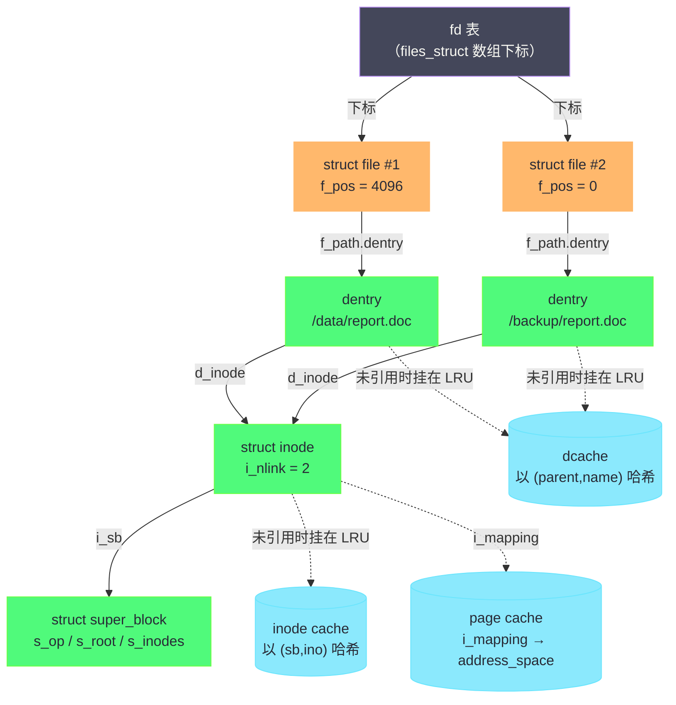
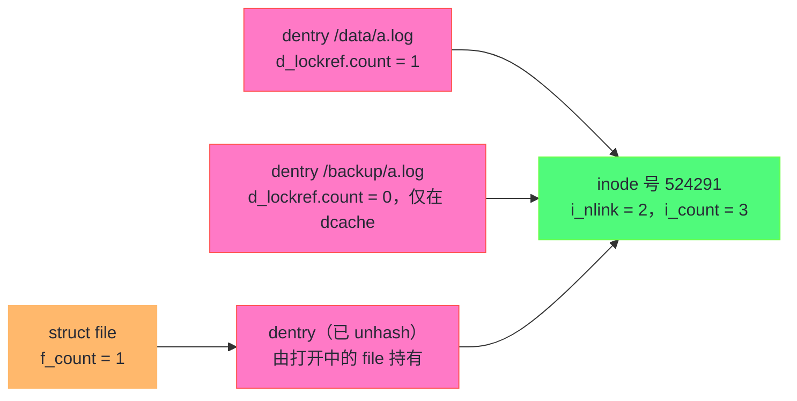
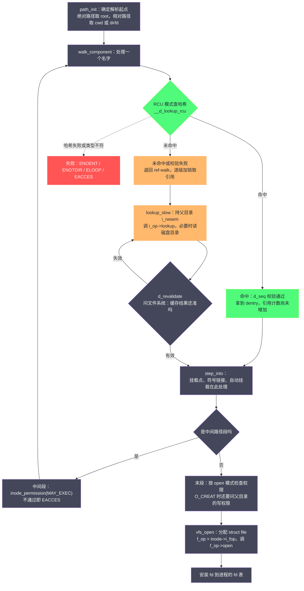
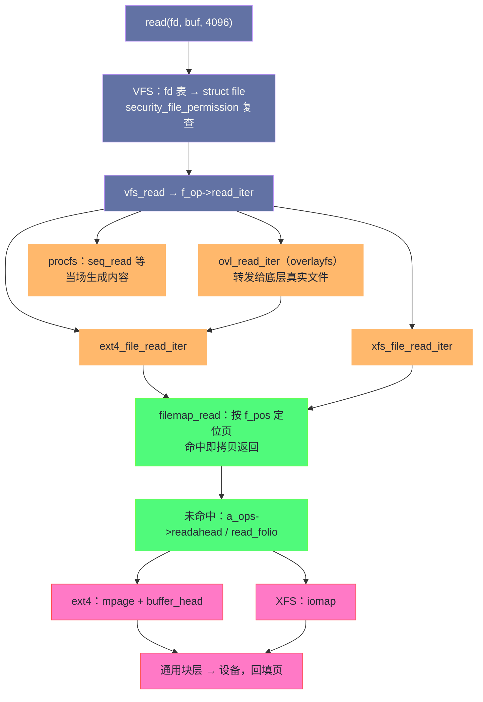
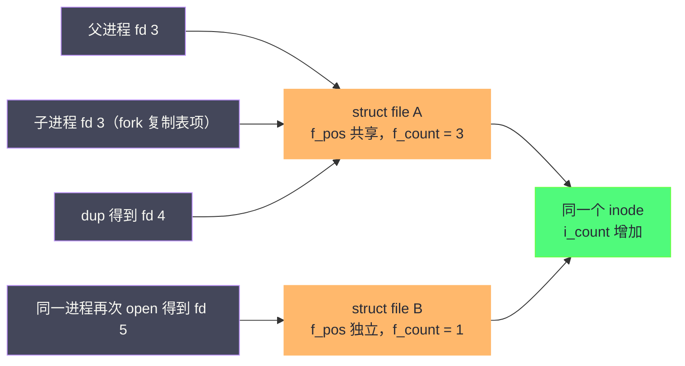
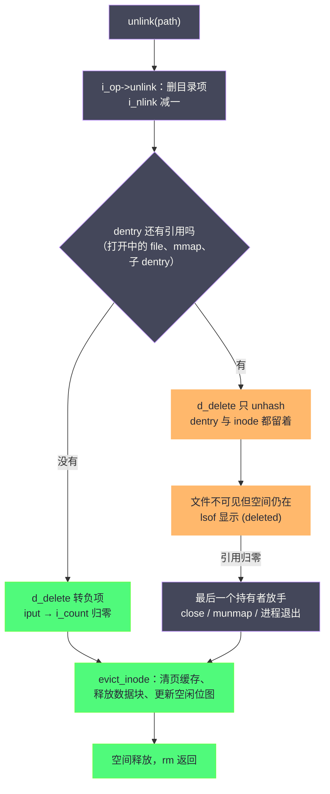

# VFS 虚拟文件系统——超级块、inode、dentry 与 file

**摘要：**

路径解析、权限检查、硬链接、卸载失败、删掉文件后空间却不回来——这些看似互不相干的现象，最终都会收敛到内核里同一组数据结构上。虚拟文件系统（Virtual File System，VFS）用四个内存对象把上百种实现统编在同一套接口之下：super_block 记录一次挂载的上下文，inode 承载一个文件的元数据与操作入口，dentry 是名字到 inode 的缓存台阶，file 是一次打开的会话状态。本篇按三条线索展开：先交代四个对象由谁创建、被谁持有、在什么条件下才能回收，把"引用链"和"缓存"这两套机制分开；再拆开四张 operations 表，说明同一个 `read()` 在 ext4、XFS、overlayfs 与 procfs 上如何走向完全不同的代码；最后把 `open("/a/b/c")` 的路径解析逐段走完，包括 `..` 的挂载点跨越、符号链接的重新解析，以及 `openat2` 的 `RESOLVE_*` 如何把检查与使用合成一步。文中把三本账（`i_nlink`、`i_count`、`f_count`）与三处缓存（dcache、inode cache、page cache）逐一对齐，并给出 dcache 内存占用与路径解析成本的量级估算。收尾回答两个具体问题：一个 inode 为什么能被多个 dentry 共享，以及 `unlink` 之后磁盘空间为什么可能迟迟不释放。

---

## 第 1 章 一次 open 背后的四个对象

### 1.1 1986 年，文件系统学会插拔

1980 年代中期，Sun 的工程师碰到一个具体麻烦：一台工作站上既要跑本地 UFS，也要跑网络文件系统 NFS，两套实现的数据结构、寻址方式、甚至"文件是否存在"的含义都不一样，而 `open/read/write` 这些系统调用已经写死在代码里，任何一方的私有结构都无法塞进另一方的位置。1985 年 SunOS 2.0 给出的答案是引入 vnode（virtual node）层，Sun 的 Steve Kleiman 随后在 1986 年的 USENIX 会议上发表《Vnodes: An Architecture for Multiple File System Types in Sun UNIX》，把这套想法讲成了通用方案：把"文件在内核中的代表对象"拆成与实现无关的公共外壳，以及外壳里指向具体实现的私有数据与操作表，系统调用只跟外壳打交道，外壳通过操作表把请求转派下去。

这套拆法之所以影响深远，不在于它多精巧，而在于它把"文件系统"从一个内核内建的子系统变成了**可以插拔的插件**。自此以后，新增一种文件系统不需要征得内核其他部分的同意，只要填好合同里的那几组函数即可入场。Linux 从 1991 年诞生起就站在这个设计上，2.4 时代随着 ext2、NFS、smbfs、procfs 等数十种实现共存而彻底成熟，今天在内核里登记的实现在一百种上下：本地盘的 ext4 与 XFS、网络的 NFS 与 CIFS、集群的 CephFS、内存里的 tmpfs 与 procfs、叠加式的 overlayfs、用户态的 FUSE。

用会计的比喻说，具体文件系统是各自记账的账房，VFS 是那本统一的会计科目表——科目表本身不记一笔账，但没有它，每个账房的凭证都无法互相阅读。

### 1.2 四份合同，四个对象

VFS 的全部约定可以压缩成四个结构体和挂在上面的四张函数表。读者不妨先建立这个全景，后文每一章都在往里填细节：

| 对象 | 内核结构 | 由谁创建 | 生命周期 | 磁盘上有没有对应物 |
| :--- | :--- | :--- | :--- | :--- |
| 超级块 | `struct super_block` | 挂载时由 `sget` 一族函数创建，文件系统的 `fill_super` 填充 | 从挂载到卸载，可被多个挂载点共享 | 有（ext4 的超级块在块组 0 起始处） |
| 索引节点 | `struct inode` | 首次访问时由文件系统读入或构造，进 inode 缓存 | 磁盘上是长期实体，内存中按需缓存、引用归零后回收 | 有（ext4 是 inode 表里的一条记录） |
| 目录项 | `struct dentry` | 路径解析途中由 `d_alloc` 系列创建，结果进 dcache | 纯内存，随 dcache 收缩而消失 | 无 |
| 文件对象 | `struct file` | `open()` 成功时分配，与其副本共享引用计数 | 从 open 到最后一个引用被 `fput` | 无 |

四个对象里，dentry 与 file 是**会话与缓存**，内存里可以随时蒸发再重建；super_block 与 inode 是"账本的内存映像"，回收之前必须保证脏状态已经落盘。这条分界线看起来只是分类，其实是后面一切回收行为的判据：内存紧张时内核敢成批扔掉 dentry，却不敢随手扔掉一个脏 inode。

### 1.3 引用链与三处缓存

四个对象不是并列的，它们串成一条从进程到磁盘的链：进程描述符里的文件描述符表是数组，数组元素指向 `struct file`，`struct file` 里的 `f_path` 是一个二元组 `(vfsmount, dentry)`，dentry 的 `d_inode` 指向 inode，inode 的 `i_sb` 指回超级块。这条链上有一个容易看漏的设计：`struct file` 存的是 dentry 而不是 inode 指针，打开一个文件等于把那个 dentry 钉住，于是路径解析的结果也被这次打开固化了——`unlink` 之后 dentry 可以从目录树上摘下来，却因为还挂在 file 上而不消失，这一层间接正是"删了文件空间不释放"的结构基础。

下图把链条与三处缓存放在一张图上，实线是引用，虚线是"登记在缓存里"，后者与引用计数无关：



三处缓存的分工值得单独列表，因为运维现场最容易把它们混为一谈：dcache 缓存的是"名字查到什么"，inode cache 缓存的是"这个文件对象本身"，page cache 缓存的是"文件内容"（page cache 的机制见 [[04 Page Cache 与脏页回写——Linux IO 的秘密缓冲层]]）。

| 缓存 | 缓存单位 | 查找键 | 谁触发回收 | 观测入口 |
| :--- | :--- | :--- | :--- | :--- |
| dcache | dentry（一个路径组件） | 父 dentry + 名字 | 每 sb 的 shrinker，内存压力或 `drop_caches` | `/proc/sys/fs/dentry-state`、`slabtop` |
| inode cache | inode（一个文件对象） | super_block + inode 号 | 同上，与 dentry 同批收缩 | `/proc/sys/fs/inode-state`、`slabtop` |
| page cache | 页（4 KB 为粒度） | inode 的 `i_mapping` + 页偏移 | 页回收由 LRU 决定，脏页先回写 | `/proc/meminfo` 的 `Cached`、`cachestat` |

三处缓存的回收路径完全不同，这是排查"内存被谁吃掉"时第一件必须分清的事：dcache 与 inode cache 属于可回收 slab（计入 `SReclaimable`），page cache 属于文件页，两者在内存账上走的是两条收缩通道。

### 1.4 "一切皆文件"兑现到什么程度

Unix 的口号"一切皆文件"（Everything is a File）常被误解为一句修辞，其实它在 VFS 里有一份相当实在的兑现清单。套接字与管道真的有 inode：socket 挂在 sockfs 上，pipe 挂在 pipefs 上，它们都有 `i_fop` 指向各自的操作表，所以用 `fstat` 能看到 `S_IFSOCK` 与 `S_IFIFO`、能看到 inode 号。它们缺的是可解析的路径——不在任何目录树里，只能经由 `/proc/<pid>/fd` 这类通道被间接看见。也就是说，VFS 给"一切"发的是同一套数据结构身份，而不是同一个名字空间。

真正被这条口号推到极限的是"语义"这一端。`read()` 这个入口对全部实现一致，可它的承诺完全由实现裁剪：普通文件的 `read` 返回 0 表示文件尾，套接字的 `read` 返回 0 表示对端关闭，`/proc` 下某些文件的 `read` 可以在两次调用之间返回不同内容，`/sys` 下有些文件甚至只支持 `write`。判断一个对象"是不是文件"，看的是它有没有 inode 与 `file_operations`，而不是它有没有名字、能不能 `seek`。这条边界在 09 篇讨论权限与安全模块时会再次成为分界（[[09 文件系统的安全边界——权限、ACL 与 Capabilities]]）。

---

## 第 2 章 超级块与索引节点：账本的正本

### 2.1 super_block：一次挂载的全部上下文

`mount -t ext4 /dev/sdb1 /data` 在内核里的第一个实质动作，是创建一个 `struct super_block`，再调用 ext4 注册的填充函数从磁盘读入超级块、初始化块大小与根目录。此后这个对象就是该文件系统在内核里的驻外机构：`s_dev` 记住块设备、`s_blocksize` 记住块尺寸、`s_root` 指向根目录的 dentry、`s_inodes` 挂着这个文件系统上所有内存 inode、`s_op` 指向 `super_operations`，以及一把名为 `s_umount` 的读写信号量负责仲裁挂载、卸载与冻结。

超级块级别的方法尽量少，因为它们的频率远低于文件级别。下表只列与日常现象相关的几个：

| 方法 | 何时被调用 | 具体实现的自由度 |
| :--- | :--- | :--- |
| `alloc_inode` / `destroy_inode` | 内存 inode 创建与销毁时 | 分配多大、是否与私有结构绑在一起 |
| `write_inode` | 脏 inode 回写时 | 写哪些字段、是否需要额外缓冲 |
| `evict_inode` | inode 引用归零且要从缓存移除时 | 释放数据块、清理页缓存、更新空闲位图 |
| `put_super` | 卸载的最后一刻 | 落盘全局状态、释放超级块私有数据 |
| `sync_fs` / `freeze_fs` | `sync`、`fsfreeze`、快照前 | 是否等待日志提交、是否允许写 |
| `statfs` | `statfs(2)`、`df` | 可用空间怎么算，"保留块"算不算可用 |

`umount` 报出 `device is busy` 的原因也在这张表附近，只是判定条件散在引用链上：有人在挂载点上留了 cwd 或 root、有文件还处于打开或 mmap 状态、`s_active` 尚未归还、或者挂载点下面还压着别的挂载。判定逻辑在 `may_umount_tree` 与 `path_has_submounts` 里，逐条核对的顺序决定了报错文本，而 `fuser -m /data`、`lsof +D /data` 之所以能查出"谁赖着不走"，查的正是这些引用。唯一能绕开这套核查的是惰性卸载 `umount -l`（`MNT_DETACH`）：先把它从命名空间里摘掉，等引用自然归零再真正销毁，代价是此后一段时间里 `df` 与 `mount` 的显示会与实际不一致。

关于另一个常见说法需要纠正一次：老资料里写"同一个分区挂载两次会产生两个互不相识的超级块，导致数据损坏"。在带块设备的现代内核上，挂载路径会先按设备在超级块哈希里查找，已有则复用同一个 `super_block`、只是新增一个挂载点，两个路径共享同一份 inode 缓存与页缓存，并不存在两个内核世界。真正会分裂状态的是同一块设备被两台机器同时挂载（集群里的双挂载，靠文件系统自己的锁或隔离机制兜底），以及绕过这一查找逻辑的构建方式。内核版本不同，细节以对应版本文档为准。

### 2.2 inode：VFS 眼中的文件

`struct inode` 是 VFS 对"文件"的统一代表，也是四个对象里字段最多、脏得最慢的一个。对它最要紧的认知是：**内存 inode 不等于磁盘 inode**。磁盘 inode 是 ext4、XFS 各自的私有存储格式，挂载与访问时被"翻译"进内存 inode；而 procfs、tmpfs 这类根本没有磁盘 inode 的文件系统，也会凭空构造一个内存 inode 交差。两者共有的只是 VFS 约定的那部分字段与两张操作表。

只截取与本文论述相关的字段，可以看到它同时承载了三种性质不同的信息：从磁盘翻译来的身份、只有内存才有的状态、以及分派入口。

```c
/* 字段顺序与 include/linux/fs.h 略有出入，只保留与本篇相关的部分 */
struct inode {
    umode_t     i_mode;      /* 文件类型 + 权限位，权限检查的第一手依据 */
    kuid_t      i_uid;       /* 属主；i_gid 同理，两者都可能被 idmapping 改写 */
    unsigned long i_ino;     /* 只承诺"在本 super_block 内唯一" */
    atomic_t    i_count;     /* 内存引用：多少对象正持有我（与 i_nlink 是两本账） */
    unsigned int i_nlink;    /* 磁盘名字数：还有几条目录项指向我 */
    struct super_block    *i_sb;
    struct address_space  *i_mapping;  /* 页缓存里的身份，见 04 篇 */
    struct inode_operations *i_op;     /* 对"结构"的动作：lookup/create/unlink */
    struct file_operations  *i_fop;    /* 对"内容"的动作：read/write/fsync */
    struct list_head      i_dentry;    /* 别名链：哪些 dentry 指着我 */
    /* ... i_rwsem、i_state、i_writecount、i_generation 等 */
};
```

两张操作表的分工是理解 VFS 分派机制的钥匙：`i_op` 管"对文件结构本身的动作"，`i_fop` 管"对文件内容的动作"。`open` 走到最后一步时，正是把 `i_fop` 拷进新建的 `struct file` 的 `f_op`，此后这个 file 上的所有读写都通过它分派。同一个函数指针槽位，在 ext4 里指向经过页缓存与块层的实现，在 procfs 里指向当场拼出一段内存文本的实现，在 FUSE 里指向把请求打包发给用户态守护进程的实现——外壳相同，内核不同。

还有几个容易忽略的字段决定了现场症状。`i_writecount` 记录着"有几个写者"（写打开与可写 mmap 都算），`exec` 前要先 `deny_write_access`，于是"二进制文件正被写入或可写映射时执行会报 `ETXTBSY`"这条古老报错有了机制解释。`i_generation` 是给 NFS 这类需要跨机文件句柄的实现用的，文件删除后 inode 号会被复用，单靠 `i_ino` 无法判断句柄是否已陈旧。`i_rwsem` 则是目录级并发控制的主力，创建、删除、改名、真正的 `lookup` 都在这把锁下串行化。

### 2.3 一个 inode，多个名字

硬链接是 VFS 里最容易被讲成"另一个文件"的概念，而它的机制其实只有一句：`link()` 在父目录的数据里新增一条"名字 → 既有 inode 号"的映射，然后把 `i_nlink` 加一。没有数据复制，没有新 inode，甚至没有新的元数据块。

内存里的表现是：同一个 inode 的 `i_dentry` 别名链上挂着多个 dentry，每个 dentry 都有各自的父目录与名字，`d_alias` 把它们串起来。于是"一个 inode 被多个 dentry 引用"不是异常，而是硬链接的常态；反过来"一个 inode 一个 dentry"才是特例。



这张图里藏着三个必须分清的数字。`i_nlink` 是**磁盘账**：目录里还有几条名字指向这个 inode，硬链接每加一个名字就加一，`unlink` 每删一个名字就减一。`i_count` 是**内存账**：有多少个对象（dentry、file、正在执行的代码）正持有这个 inode 对象。第三个数字是 dentry 自己的 `d_lockref.count`。dcache 缓存一个 dentry 并不需要给它加引用计数，未被引用的 dentry 恰恰以 `count = 0` 的状态挂在 LRU 上等着被回收——如果缓存也持引用，缓存就永远不会失效。

这三个数字的不同组合，正好解释了三种现场情况。`i_nlink = 2`、`i_count = 3` 是上图的状态，硬链接与被打开的文件同时存在。`i_nlink = 0` 而 `i_count > 0` 意味着所有名字都删光了但还有打开者，inode 与数据都还在，`lsof` 能看到一个末尾带 `(deleted)` 的条目。`i_nlink = 0` 且 `i_count = 0` 才是空间真正可以回收的时刻，此刻 VFS 调 `evict_inode`，文件系统释放数据块、页缓存与元数据。第 6 章会把这三本账的结算过程展开。

### 2.4 inode cache：对象级的查找

路径解析的最后一步、`stat` 的每一次调用、`open` 之后的每一次读写，都要先把 inode 对象拿到手，而从磁盘读一条 inode 记录是几十微秒起步的慢活。内核为此维护一份全局的 inode 缓存，用 `(super_block, inode 号)` 做哈希键——这个键的设计本身就说明了 `i_ino` 的语义边界：它只在一个文件系统内部唯一，跨文件系统没有意义，所以哈希键里必须带上超级块。

查找流程是"先哈希、后磁盘"：命中则引用计数加一直接返回；未命中则调用文件系统的读入路径新建一个 inode，先以 `I_NEW` 状态插入哈希占位（同一 inode 的并发读者会在 `wait_on_inode` 上排队），填充完成后再清掉标记唤醒等待者。这个"先占位再填充"的顺序，是为了防止两个进程同时为同一个 inode 各建一份内存对象——那会造成两份缓存、两份脏状态，写回时互相覆盖。

回收是这一章最需要精确理解的一段。inode 引用归零后并不立刻销毁，而是挂到所属超级块的 LRU 上等内存压力。真到要回收时，也不是无条件释放：脏 inode 必须先回写（元数据经 `write_inode`），有页缓存挂在上面的要先按文件系统语义处理（`evict_inode` 里通常先 `truncate_inode_pages_final`）。所以 inode 缓存的收缩从来不是"释放内存"这么单纯，它会把 IO 一起带进来，这也是内存压力下偶发卡顿的一个来源。

---

## 第 3 章 dentry 与路径解析：名字变成对象的全过程

### 3.1 dentry 的四种身份

`struct dentry` 对应路径里的一个组件，只记三样东西：父 dentry、名字、以及解析结果——指向某个 inode，或者明确表示"这里什么都没有"。名字通常内联在结构体里（`d_iname`，x86-64 上 32 字节以内不用额外分配），超长名字才另申请内存，这个细节决定了数百万小文件的场景下内存开销的量级。

dentry 在生命周期里会经历四种身份，现场排查时的很多困惑都来自把它们混为一谈：

- 正被引用：`d_lockref.count > 0`，有 file、有子 dentry、或者正被路径解析拿着。
- 仅在缓存：`d_lockref.count = 0`，挂在超级块的 LRU 链上，仍参与哈希查找，随时可以被回收。dcache 的命中率主要靠这批对象撑起来。
- 负项（negative dentry）：`d_inode` 为空，名字在目录里被确认为不存在。它同样参与哈希，同样有父与名字，价值在于把"没有"这个结论缓存住。
- 已 unhash：被 `d_delete` 或父目录变化摘出了哈希表，不再能被新查找命中，但只要还有引用就不释放，等最后一个持有者放手。

负项缓存的意义常被低估。一个反复探测配置文件是否存在的应用，第一次 `open` 要走完整路径查找并真实读一次目录，此后每次命中负项、直接返回 `ENOENT`，成本降到与命中正项同级。代价是负项也要占内存，且会随着"扫描未命中"的负载迅速膨胀——遍历一棵大目录树时，每一级未命中的名字都会留下一条负项。

### 3.2 dcache 的三把锁

dcache 要同时满足"读极快"与"改正确"，靠的不是一把大锁，而是三层分工。第一层是哈希桶锁：dentry 按 `(父 dentry, 名字)` 散列到桶里，插入与摘除时持桶锁，桶的数量由启动参数决定。第二层是每个 dentry 自己的 `d_seq` 序列计数，读者在 RCU 模式下取一次序号、读内容、再读一次序号校验，不一致就说明期间有人改过，退回慢路径重来。第三层是一把全局的 `rename_lock` 序列锁，只在改名与路径反查（`d_path`，`getcwd` 与 `/proc/<pid>/cwd` 都靠它）时参与，保证读者看到的父子关系不是改名进行到一半的中间态。

挂载点的穿越还额外需要 `mount_lock`，因为"这个 dentry 是不是某个挂载的根"这件事记在 mount 结构上而不是 dentry 上。三种锁的分工可以记成一句话：桶锁管插入删除，`d_seq` 管无锁读，`rename_lock` 与 `mount_lock` 管结构性变动。

### 3.3 路径解析的完整流程

现在可以把 `open("/a/b/c", O_RDONLY)` 从头走到尾了。整个流程在 `fs/namei.c` 里，入口是 `path_openat`，主干结构几十年没变，变的是每一步的同步策略。下图给出主干与两条分岔：



有几点值得对照代码确认。起点是由 `path_init` 决定的：绝对路径从当前进程的 root 出发（`chroot` 改的就是它），相对路径从 cwd 或者 `openat` 传入的目录 fd 出发。每一段都先查 dcache，因为在绝大多数系统上路径解析的成败并不取决于磁盘，而取决于这条缓存链是否还热。真正需要读目录的那一步是 `lookup_slow`，它持父目录的 `i_rwsem` 调用文件系统的 `i_op->lookup`，把目录数据读进来、找到名字对应的 inode 号，再让文件系统把结果包装成一个 dentry 返回——这就是 dcache 的填充入口。

RCU 模式（**RCU-walk**）是 2011 年 2.6.38 引入的优化，思路是把"读路径不加锁"贯彻到底：整个遍历持 RCU 读锁，取到的 dentry 不带引用计数，只在最后要使用它时才真正加引用；中途一旦发现有并发改名、需要睡眠、或者需要 IO，就返回 `-ECHILD` 从起点重来，这一遍走慢路径。快路径享受线性扩展，慢路径保留旧语义。它的代价是代码复杂度：几乎每个路径组件处理的函数都要写 RCU 与加锁两版（`follow_dotdot_rcu` 与 `follow_dotdot`、`lookup_fast` 与 `lookup_slow`），且文件系统的回调必须遵守"RCU 模式下不得睡眠"的纪律。第 4.3 节会看到这条纪律如何限制 `d_revalidate`。

### 3.4 每一级都要过权限：搜索权限

路径解析不只在最后一步检查权限。每走过一个中间目录，内核都要问一次"这个进程能不能穿过它"，对应的权限位是目录的 `x`（execute），在内核里叫 MAY_EXEC 的搜索权限。`/root` 权限为 700 时普通用户无法 `stat /root/anything`，原因不在于目标文件的权限，而在于解析在 `root` 这一段就已经失败。

这条规则把权限检查拆成了两种性质：中间段的检查是"通行"，末段的检查是"开门"。末段的检查按打开的意图（读、写、追加、创建）决定要看哪些位，`O_CREAT` 还要额外检查父目录的写权限与搜索权限。两类检查都汇总到 `inode_permission`，它先做通用的属主/属组/其他人三段判断（`generic_permission`），再把决定权交给文件系统的 `i_op->permission`（ACL 与安全模块挂在这里），最后才返回。搜索权限只要求 `x`（**通行**位），不需要 `r`（**列举**位），所以一个 711 的目录可以被穿过而无法列出内容，这种配置在共享目录里很常见。权限模型的完整版图见 [[09 文件系统的安全边界——权限、ACL 与 Capabilities]]。

### 3.5 `..`、挂载点与命名空间

`..` 看起来是"取父 dentry"，实际上有两个麻烦。第一个是并发：`d_parent` 可能正在被改名修改，RCU 模式下需要序列计数保护；第二个才是真正的难点——如果当前组件正好是某个挂载的根，`..` 必须回到挂载点，而不是回到被挂载文件系统内部的父目录。

后一种情况之所以成立，是因为路径从来不是单靠 dentry 表达的，而是 `(vfsmount, dentry)` 的**二元组**。挂载把一棵新树嫁接到某个 dentry 上，`struct mount` 记录着"我的根是谁、我挂在哪"；当解析走到挂载根再遇到 `..` 时，`follow_dotdot` 会先用 `mount_lock` 确认这条挂载关系，然后跳到挂载点所在的父树。这条逻辑是 `chroot`、容器根文件系统、`pivot_root` 能工作的基础，也是"删掉挂载点目录之后为什么 `..` 还能走出去"这类怪现象的来源：挂载点 dentry 即使被 unhash，mount 结构仍然记得它。

命名空间把这件事又叠了一层。同一个 dentry 在不同 mount namespace 里可以挂着不同的东西，所以"路径"这个概念在跨命名空间时是失效的——一个进程看到的 `/data` 与另一个进程看到的 `/data` 可能是两个完全不同的文件系统。`/proc/<pid>/mountinfo` 是核对这类差异的入口，`setns` 与 `unshare` 则是制造差异的入口。

### 3.6 符号链接：重新开始解析

符号链接不是"指向 inode 的另一种指针"，而是一个内容为路径字符串的小文件。解析到它时，内核读取这段字符串，然后把解析的当前基准换成链接目标，从那里重新开始走——这是"重新解析"而不是"跟随跳转"，语义差别体现在相对链接上：相对目标的基准是链接所在的目录，而不是进程的 cwd。

这条路径上有三个机制值得记住。其一是深度限制：单次解析最多跟随 40 层符号链接（`MAXSYMLINKS`），超过返回 `ELOOP`，防止 `a → b → c → a` 这类环把内核拖死。其二是 magic link：`/proc/self/fd/N`、`/proc/self/cwd`、`/proc/self/root` 这些符号链接的目标不是字符串，而是内核直接给出一个 dentry 与 mount，用 `nd_jump_link` 一步到位，省掉拼字符串再解析的过程；`RESOLVE_NO_MAGICLINKS` 就是专门拒绝这类链接的开关。其三是重复打开与复制的区别：`dup()` 复制的是同一个 `struct file`，两个 fd 共享偏移量；而 `open("/proc/self/fd/N")` 通过 magic link 新建一个 `struct file`，对普通文件而言偏移量是独立的。这条差异在写"安全地重新打开一个已打开的目录"这类代码时是分水岭。

### 3.7 openat2 与 RESOLVE_*：把检查与使用合成一步

路径解析的安全问题有一个固定形态：检查的时候是一个东西，使用的时候变成了另一个东西。典型场景是上传目录——进程先 `stat("/tmp/upload")` 确认它是普通文件，再 `open("/tmp/upload")` 读取，两步之间攻击者把 `/tmp/upload` 换成指向 `/etc/shadow` 的符号链接，于是读到的就是不该读的内容。这类时间差攻击（TOCTOU，Time-of-Check to Time-of-Use）在只靠字符串路径的接口上无法根治，因为两次系统调用之间世界可以改变。

这套时间差之所以成立，根源在于字符串路径只是名字，而名字随时可以被重新绑定：两次系统调用各自解析一次，中间没有任何机制保证两次解析落在同一个对象上。VFS 对此的回应不是加一层锁，而是把"从哪个起点解析、允许怎么走"变成**一次解析之内的约束**——约束在查找过程中逐步生效，越界的瞬间就失败，不给替换留窗口。

Linux 5.6 引入的 `openat2` 把路径解析的约束条件做成了显式参数，这些约束在查找过程中逐步生效，而不是打开之后再检查：

| 标志 | 拒绝什么 | 对应的攻击面 |
| :--- | :--- | :--- |
| `RESOLVE_NO_XDEV` | 跨越任何挂载点 | 用挂载把路径引到别的文件系统 |
| `RESOLVE_NO_MAGICLINKS` | 拒绝 magic link | 借 `/proc/self/fd` 之类跳板逃逸 |
| `RESOLVE_NO_SYMLINKS` | 拒绝任何符号链接 | 符号链接替换（最常见的 TOCTOU 手法） |
| `RESOLVE_BENEATH` | 路径不得逃出起始目录 | 用 `..` 或绝对链接向上穿越 |
| `RESOLVE_IN_ROOT` | 把起始目录当作 `/`，`..` 到此为止 | 容器内的根目录约束 |
| `RESOLVE_CACHED` | 只接受全命中缓存的解析，否则 `EAGAIN` | 避免在热路径上被 IO 阻塞（5.12 加入） |

```c
/* 目录 fd + 相对路径 + 显式约束，是目前防 TOCTOU 的标准组合 */
int dirfd = open("/srv/uploads", O_PATH | O_DIRECTORY | O_CLOEXEC);
struct open_how how = {
    .flags   = O_RDONLY,
    .resolve = RESOLVE_BENEATH | RESOLVE_NO_SYMLINKS,
};
int fd = syscall(SYS_openat2, dirfd, "2026/report.pdf", &how, sizeof(how));
/* RESOLVE_BENEATH 让 ".." 无法把解析带出 /srv/uploads；
   RESOLVE_NO_SYMLINKS 让中途被换成链接的名字直接失败，
   两者合起来消掉"检查后替换"的窗口 */
```

这套接口的意义不止在安全。把一个目录 fd 当作解析基准，等于把"我信任的起点"固化成了一个内核对象，而不是一串随时可能被重新解释的字符；再配合 `O_PATH` 只取路径不取权限，就有了容器与沙箱里常用的"句柄式文件访问"。它与 `openat` 的关系不是替代，而是把原本隐藏在实现里的解析策略升格为契约。

---

## 第 4 章 四张操作表：同一个 read 的不同人生

### 4.1 分派的总图

四个对象各挂一张表，四张表合起来就是 VFS 与具体实现之间的完整合同。它们的分工不是按"大与小"切的，而是按"动作发生在哪一层"切的：

| 操作表 | 挂在哪 | 典型方法 | 什么时候被调用 |
| :--- | :--- | :--- | :--- |
| `super_operations` | inode 的 `i_sb->s_op` | `alloc_inode`、`write_inode`、`evict_inode`、`sync_fs`、`statfs` | 整个文件系统级别的动作 |
| `inode_operations` | inode 的 `i_op` | `lookup`、`create`、`mkdir`、`unlink`、`rename`、`permission`、`get_link` | 目录项与 inode 结构的增删改查 |
| `dentry_operations` | dentry 的 `d_op` | `d_revalidate`、`d_hash`、`d_compare`、`d_delete`、`d_prune`、`d_iput` | 缓存的有效性判断与哈希比较 |
| `file_operations` | file 的 `f_op`（来自 inode 的 `i_fop`） | `read_iter`、`write_iter`、`llseek`、`mmap`、`open`、`release`、`fsync` | 一次打开之后的内容级动作 |

这张表最值得记住的一点是：每一层都可以被具体实现接管，而且接管的粒度是方法级的。一个文件系统可以只填 `read_iter` 与 `write_iter`，其余全部留空，VFS 会用默认助手补齐一部分，剩下的调用会返回 `EINVAL`、`ENOSYS` 或 `EOPNOTSUPP`。于是"某种操作不支持"这件事在 VFS 里不是一个统一的错误码，而是"那张表上那个槽位没有人填"。

### 4.2 inode_operations：目录项的增删改查

`inode_operations` 里最核心的一族方法作用于目录 inode，因为"在目录里加一个名字""删一个名字"本质上是修改目录内容，必须由文件系统实现。`lookup` 是路径解析的冷路径入口：VFS 在 dcache 里找不到目标名字时调用它，由文件系统读目录数据、定位名字、把 inode 号换成内存 inode，再返回一个 dentry。返回方式有讲究，通常用 `d_splice_alias` 而不是简单的 `d_add`——前者会检查这个 inode 是否已经有别名 dentry（NFS 与本地硬链接都可能造成），有则把新 dentry 拼接过去，避免同一目录被表示成两个不同的 dentry 树节点。

`create`、`mkdir`、`mknod`、`symlink` 负责新建，`unlink`、`rmdir` 负责删除，`rename` 负责改名，它们共同的纪律是：调用时父目录的 `i_rwsem` 已由 VFS 持有，改名还要同时持有两个父目录的锁，且必须遵守"按地址排序加锁"以避免死锁。`rename` 的两个父目录若不在同一个文件系统，VFS 会直接返回 `EXDEV`，轮不到实现方表态——这是 `mv` 跨挂载点时退化成"复制再删除"的机制源头。

`permission` 与 `get_link` 是两个特殊成员。前者给了 ACL 与安全模块插入权限判断的位置，默认实现是 `generic_permission`；后者只有符号链接才用得上，返回链接的目标字符串（内联在 inode 里的短链接直接给指针，长的要走 `page_get_link` 读页）。`setattr` 承载 `chmod`、`chown`、`truncate`、`utimes` 这一整族调用，是"元数据写入"的唯一入口。

### 4.3 dentry_operations：缓存的有效性由谁担保

这四张表里，`dentry_operations` 最不显眼，却决定了缓存能不能被信任。dcache 缓存的是"某个时刻的解析结果"，而真相在文件系统手里；两者一旦分叉，路径解析就会把用户带到错误的位置。VFS 的解法是把"这个缓存还准不准"的判断权交给实现方，接口就是 `d_revalidate`。

`d_revalidate` 的契约在现代内核里有一条硬约束：如果路径解析处于 RCU 模式，这个回调不能睡眠，返回值只能是三种——1 表示缓存有效，0 表示失效需要重新查，`-ECHILD` 表示"我在 RCU 模式下没法回答，请退回加锁模式重来"。这条约束逼着网络文件系统把校验分成快慢两套：快的一套只做本地状态检查，慢的一套才发网络请求。本地文件系统通常根本不需要实现它，因为本地改名与删除都会同步让 dcache 失效。

其余成员各有专主。`d_hash` 与 `d_compare` 用于自定义名字的散列与比较，大小写不敏感的文件系统（ext4 的 casefold 特性、CIFS、部分 FUSE 实现）必须在这里接管，否则 dcache 会把 `README` 与 `readme` 当成两个名字。`d_delete` 在名字被删除时被调用，网络文件系统用它把 dentry 转成负项而不是彻底摘除，以便下次访问时还能去服务器确认。`d_prune` 在 dcache 要回收一个未被引用的 dentry 时被调用，给了实现方"别急着扔"的机会。`d_iput` 在 dentry 释放 inode 引用时被调用。`d_manage` 服务于自动挂载（autofs），可以在解析到某个 dentry 时暂停并触发用户态挂载。

| 方法 | 谁需要实现 | 不实现或实现错误时的症状 |
| :--- | :--- | :--- |
| `d_revalidate` | NFS、CIFS、FUSE 等远端或代理文件系统 | 看到服务器上已删除或改名的旧对象，路径指向"幽灵文件" |
| `d_weak_revalidate` | 同上，用于 `stat` 末段这类弱校验场景 | 末段解析绕过校验，`stat` 结果与真实状态不一致 |
| `d_hash` / `d_compare` | 大小写不敏感、Unicode 归一化的实现 | 同一文件出现两个 dentry，缓存与目录内容对不上 |
| `d_delete` | 需要控制负项留存策略的实现 | 删除后 dcache 状态与文件系统不一致，查找结果错乱 |
| `d_prune` | 希望精确控制回收时机的实现 | 缓存被过早回收，热路径退化为磁盘查找 |
| `d_manage` | autofs 一类自动挂载 | 访问触发不了挂载，报 `ENOENT` 或直接失败 |

### 4.4 file_operations：内容级动作的分派

`file_operations` 是四个人最熟的一张表，因为几乎所有"给文件系统加个功能"的教程都从它讲起。现代内核的读写入口是 `read_iter` 与 `write_iter`，参数是一个 `kiocb`（描述这次 IO 的上下文：偏移、标志、目标文件）与一个 `iov_iter`（描述用户缓冲区，可以是用户空间地址、内核地址、管道或另一段页）。这组接口之所以取代了老的 `read`/`write`，是为了让一次调用可以携带多个不连续的缓冲区，并让异步 IO 有统一的载体。

`llseek` 决定 `lseek` 能做什么：普通文件用 `generic_file_llseek`，只支持前三个 whence；管道与套接字用 `noop_llseek`，永远返回当前偏移；有些伪文件系统干脆返回 `ESPIPE`。`mmap` 决定内存映射能不能建立，它背后还会牵出 `vm_operations_struct` 与 `address_space_operations` 两张表。`open` 与 `release` 是成对的会话钩子，注意 `release` 只在最后一个引用消失时调用一次，而 `flush` 在每次 `close` 时都会调用，二者不可混用。`fsync` 的语义与代价在 [[04 Page Cache 与脏页回写——Linux IO 的秘密缓冲层]] 有完整讨论。

有一条纪律在文档里写得很清楚，却常被忽视：**f_op 一旦装进 fd 表就不能再替换**。内核允许文件系统在 `open` 回调里替换 `f_op`（overlayfs 就这么做：打开时把 f_op 换成自己的 `ovl_*` 实现，后续读写再转发到真实的底层文件），因为此刻 file 还没被任何其他线程看见；一旦安装完成，替换就是竞态。

### 4.5 一次 read 的四次转派

把上面的表串起来，一次 `read()` 在内核里的分派路径如下。注意演示的是分派结构，不涉及页缓存内部的细节：



这张图里有一个常见误解需要拆掉。教科书常说"同一个 `read()` 在 ext4 与 XFS 上走不同代码"，方向对，但分派点被说错了：在 buffered IO 的路径上，两者最后都收敛到同一个 `filemap_read` 里查页缓存，`read_iter` 的差别主要在处理 `O_DIRECT` 与一些边界条件（ext4 的 `read_iter` 在带 `IOCB_DIRECT` 时转给 `ext4_dio_read_iter`，XFS 同理转给 iomap 的直读路径）。真正的差异在第 4 张表之外——`address_space_operations`，它挂在 inode 的 `i_mapping` 上，负责"页缺失时怎么把数据读进来"。ext4 仍以 buffer head 与 mpage 路径为主，XFS 已全面转向 iomap。也就是说，四张表覆盖的是"对象与操作"，而**数据路径另有接管者**——它藏在第五张表里。这一点是理解现代 Linux 文件系统分层的要点：接口在 VFS 层统一，数据通路在 a_ops 层分家。

能力差异同样体现在 file_operations 上，且直接影响运维直觉。同一个 `cp` 命令在两种文件系统上的表现可以差出几个数量级，原因不在 `read_iter` 的快慢，而在是否实现了克隆：

| 能力 | 由哪个方法承载 | ext4 | XFS | 现场可见的差别 |
| :--- | :--- | :--- | :--- | :--- |
| 数据克隆 | `remap_file_range` | 不实现 | 实现（reflink） | XFS 上大文件复制近乎瞬时，ext4 上是真搬运 |
| 区间预分配 | `fallocate` | 实现 | 实现，另有投机预分配 | `du` 立刻涨、`ls -l` 里的空洞处理不同 |
| 直接 IO | `read_iter`/`write_iter` 内的分支 | 支持，要求对齐 | 支持，要求对齐 | 未对齐时 `EINVAL`，错误点在对齐检查而非权限 |
| 页缓存读取 | `a_ops` 的读入回调 | mpage 路径 | iomap 路径 | 同一次冷读的内核栈不同，`perf` 里符号不同 |

### 4.6 默认助手与"部分实现"的代价

VFS 给实现方留了大量默认助手：`generic_file_llseek`、`default_llseek`、`noop_llseek`、`simple_dir_operations`、`generic_file_read_iter`、`simple_getattr`、`simple_setattr`。一个新文件系统往往先抄一份 `ramfs`，把默认助手填满，再逐个替换成自己的实现。这种"渐进接管"是该架构最大的善意，也是它的一处陷阱：默认助手只保证"不会崩"，不保证"语义正确"。`default_llseek` 允许任意偏移，对普通文件没问题，对只读的伪文件就是错的；`simple_getattr` 返回的块数常常是 0，于是 `du` 对这类文件系统永远显示 0。

版本迁移也会在表上留下痕迹。老接口 `read`/`write` 被 `read_iter`/`write_iter` 取代，`iterate` 被 `iterate_shared` 取代（后者允许并发目录遍历），每一次替换都意味着"只填了旧槽位"的实现要靠兼容层活着。读别人的文件系统代码时，先看它的 `file_operations` 填了哪些槽位，比读它的文档更能判断它到底支持什么。

---

## 第 5 章 file 与偏移量：会话状态为什么必须独立

### 5.1 struct file 里真正重要的字段

`struct file` 是四个对象里最少被谈论、却在排障时最常被间接观测到的一个。它代表**一次打开**，而不是一个文件；同一个文件被打开十次就有十个 `struct file`，每个有独立的状态：

```c
struct file {
    struct path        f_path;     /* (vfsmount, dentry)：打开时把路径钉住 */
    struct inode      *f_inode;    /* 缓存自 f_path.dentry->d_inode，省一次解引用 */
    const struct file_operations *f_op;  /* 安装后不可替换 */
    atomic_long_t      f_count;    /* 引用计数：fd、fork、mmap、SCM_RIGHTS 都算 */
    unsigned int       f_flags;    /* 打开时的 O_* 标志，供实现查询 */
    fmode_t            f_mode;     /* 读/写/追加/路径模式，VFS 内部判定依据 */
    loff_t             f_pos;      /* 当前偏移：这就是"会话状态"的核心 */
    struct mutex       f_pos_lock; /* 共享 file 上更新 f_pos 时的互斥 */
    struct address_space *f_mapping;  /* 等于 f_inode->i_mapping */
    /* ... f_owner、f_version、f_security、f_ra 等 */
};
```

`f_pos` 的存在，就是"打开两次各自独立"的全部原因。它属于 file 而不属于 inode，所以两个进程打开同一个文件各有各的偏移；反过来，`fork` 出来的子进程复制的是 fd 表项，父子指向同一个 `struct file`，于是共享偏移——父子进程往同一个日志文件顺序写时，写入位置会互相推进，这正是很多人第一次写多进程日志时的困惑来源。

`f_path` 存的是 dentry 而不是 inode，是 1.3 节强调过的那处间接。它让"打开"这个动作在路径解析之上多钉了一层：即便路径上的目录被改名、被删除，已打开的文件仍然通过 dentry 指向正确的 inode，读写不受影响。这个设计带来的副作用，就是第 6 章要处理的"删了但不释放"。

### 5.2 四种共享关系

把 fd 的复制方式与 file 的创建方式分开看，共享语义就清楚了：



| 操作 | 新的 fd | 新的 file | 偏移量 | 关闭一个是否影响其他 |
| :--- | :--- | :--- | :--- | :--- |
| `fork()` | 是（子进程表里一份） | 否，`f_count` 加一 | 共享 | 不影响 |
| `dup()` / `dup2()` | 是 | 否，`f_count` 加一 | 共享 | 不影响 |
| 再次 `open()` | 是 | 是，各自 `f_count = 1` | 独立 | 不影响 |
| 通过 Unix 套接字传 fd | 是（接收方表里一份） | 否 | 共享 | 不影响 |
| `mmap()` 映射同一文件 | 否 | 否，但 VMA 持有 file 引用 | — | 不影响，`munmap` 后才可能释放 |

这张表能解释一批实战问题。多线程共享一个 fd 做 `read` 时，偏移量是共享的，两个线程各读一半、结果交错；这不是线程安全问题，而是语义使然，解决办法是用 `pread`——它把偏移作为参数传入，不改 `f_pos`，天然无状态。反过来，追加写之所以要 `O_APPEND`，也是因为"先 `lseek` 到末尾再 `write`"在共享 file 上会把定位与写入拆成两步，中间被别的写者插队就会互相覆盖；`O_APPEND` 把两件事合成一步，本地文件系统上由 VFS 在写路径里持锁完成，网络文件系统上要另作判断。

### 5.3 f_pos_lock 与 close 之后

共享 file 上的 `read`/`write` 每次都要更新 `f_pos`，这个更新由 `f_pos_lock` 保护，所以高并发共享同一个 fd 的读会在锁上排队——这是一处不常被注意到却真实存在的争用点，与 inode 的 `i_rwsem` 是两把不同的锁。

`close()` 的语义也比直觉复杂。它做的事是从 fd 表里摘掉表项并 `fput` 一次，`fput` 把 `f_count` 减一，只有减到 0 时才调 `f_op->release`、释放 dentry 与 inode 引用。`fput` 还可能是延迟执行的：中断上下文或持有锁的路径上不能立刻做释放，内核把它挂到 task_work 上，等系统调用返回用户态前再处理。于是"`close` 返回了，文件一定已经关闭"这个假设并不严格成立，只是很快就成立了。

另外两个与人有关的行为：`O_CLOEXEC` 决定 `exec` 时 fd 是否自动关闭，不设它会让子进程继承一堆不该继承的描述符（这也是"服务重启后端口仍被占"的常见原因之一——旧进程的 fd 被新进程继承）；`release` 与 `flush` 的区别在于后者每次关闭都会调用，前者只在最后一个引用消失时调用，把资源清理写在 `release` 里、把"未写完的数据刷出去"写在 `flush` 里，是文件系统实现的分内事。

---

## 第 6 章 删除之后：空间为什么不回来

### 6.1 unlink 究竟做了什么

"删除文件"在 VFS 里被拆成**两件事：删名字，销毁 inode**。`unlink()` 只负责前一半，而且它的前提检查比想象中多——父目录要有写权限与搜索权限、文件不能是不可变属性（`chattr +i`）、在带粘滞位的目录里还要求调用者是属主或目录属主。

检查通过后，`vfs_unlink` 持父目录的 `i_rwsem` 调用文件系统的 `i_op->unlink`，具体实现从目录数据里删掉那条名字映射，并把 `i_nlink` 减一；然后 VFS 调 `d_delete` 处理 dentry。真正决定"空间有没有回来"的，是 `d_delete` 之后的那一步：

- 若这个 dentry 已经没有任何引用（没有 file、没有子 dentry、没有路径解析拿着它），`d_delete` 会把它变成负项，并 `iput` 掉它持有的 inode。inode 的 `i_count` 随之归零，而 `i_nlink` 已经是 0，两个条件同时满足，`iput_final` 调 `evict_inode`：清理页缓存、释放数据块、把 inode 标记为空闲。这个过程是同步发生的，`rm` 返回时空间大多已经回来。
- 若这个 dentry 仍被打开的文件持有，`d_delete` 只做 unhash：把它从 dcache 的哈希表里摘掉，让新的路径查找再也找不到它，但 dentry 与 inode 都活着，`i_count` 大于 0。空间要等最后一个持有者放手才回收。



这里有一个容易被忽略的崩溃语义细节：如果 `unlink` 执行到一半掉电，磁盘上可能出现"目录项已删、inode 还标记为占用"的孤儿 inode。ext4 的应对是在 `i_nlink` 归零时把这个 inode 挂进磁盘上的孤儿链表（orphan list），下次挂载时由日志回放与孤儿清理把残留收尾。所以"删了但没关"的文件在掉电重启后不会永远泄漏——这台机器可能丢的是数据，不是账。

### 6.2 三个成因与判据

现场遇到"`rm` 之后 `df` 不降"，按**引用链**去找，绝大多数落在三种情况里。它们的判据不同，处置方式也不同：

| 成因 | 谁持有最后一根引用 | 关键判据 | 处置 |
| :--- | :--- | :--- | :--- |
| 进程仍持有 fd | `struct file` → dentry → inode，`i_count > 0` | `lsof +L1` 或 `/proc/*/fd` 里出现 `(deleted)` | 关掉 fd、重启该进程，或从 `/proc/<pid>/fd/N` 把内容救出来 |
| 仍有硬链接 | 另一条目录项，`i_nlink > 0` | `ls -l` 第三列大于 1；`find / -inum <ino>` 找到剩余名字 | 把剩余名字也删掉，或确认它本来就是别名 |
| 被 mmap 映射 | VMA 的 `vm_file` 持有 file，且脏页需要回写 | `/proc/<pid>/maps` 里有该文件；`map_files` 可见 | `munmap` 或结束进程；脏页回写后才能释放 |

除这三种，目录还可能被进程钉住：`fs_struct` 里的 pwd 与 root 都以 `(mount, dentry)` 的形式持有对应目录，判据是 `ls -l /proc/<pid>/cwd` 指向哪里。这种情况通常表现为 `umount` 报忙而不是空间不降，因为目录 inode 本身很小，真正的杀伤力在挂载点与命名空间上——一个进程躲在挂载点目录里，`umount` 就会一直报 `device is busy`，运维现场"到底谁在用这个盘"的排查，查的正是这条引用链。

还有两类更隐蔽的持有者。一类是内核自身：`loop` 设备、`swap` 文件、device mapper 的目标、被打开的块设备，都会持有对应文件的引用，于是你既删不掉也看不见。另一类是网络文件系统的"silly rename"：NFS 客户端在删除一个正被打开的文件时，会把它改名为 `.nfsXXXX` 再删，等最后一个使用者关闭后才真正删除——在服务器上看到一个以 `.nfs` 开头的怪文件，基本可以确定有客户端还开着它。

### 6.3 观测入口

排查这类问题，四条命令基本够用。`lsof +L1` 直接列出链接计数为 0 但仍被打开的文件，输出里的 `NLINK` 列为 0、`NAME` 列往往没有路径（因为路径已经不存在了）。没有 `lsof` 的机器可以用 `/proc` 手搓：

```bash
# 1) 哪些进程持有"已删除"的文件（deleted 标记由内核在 d_path 里加上）
for p in /proc/[0-9]*; do
  ls -l "$p/fd" 2>/dev/null | grep '(deleted)' && echo "  ^-- pid ${p#/proc/}"
done

# 2) 找到链接计数归零但仍被打开的对象（没有 lsof 时的替代）
find /proc/[0-9]*/fd -lname '*deleted*' 2>/dev/null

# 3) 反查 inode 号还有没有别的名字
find /data -inum 524291 2>/dev/null

# 4) 对比两本账：df 少了空间而 du 找不到对应文件
df -h /data; du -sh /data/* | sort -h | tail
```

`du` 与 `df` 对不上是这类故障的典型信号，但要对上号还得排除其他原因：ext4 默认保留 5% 给 root（`tune2fs -m` 可调）、稀疏文件按块记账、预分配已记账但未写入、日志区固定占用、以及文件系统的元数据开销。把这些常规差异排掉之后剩下的缺口，才轮到"已删除未释放"。

对 ext4 还有一个偏门但有效的入口：在文件系统**未挂载**时用 `debugfs -R "lsdel"` 列出已删除但仍占着块的 inode。挂载状态下 `debugfs` 不是安全的检查手段，不要在生产挂载点上试。

### 6.4 几个常见误判

第一种误判是把 `rm` 当成"释放空间"的同义词。`rm` 的语义是"去掉一个名字"，空间是否回收取决于第 6.1 节那条链。在日志型应用上这几乎是日常：进程删掉旧日志文件后继续往里写（因为 fd 还在），磁盘不降反升，直到进程重启才发现空间一次性回来了。

第二种是把 `truncate` 当成"删掉重建"。`>` 重定向会截断文件内容但保留 inode 号与所有已打开者的会话，很多"日志轮转后新日志还写到旧文件里"的事故就是这么来的——正确做法是让应用重开文件，或者用 `copytruncate` 并接受那一段竞态。

第三种是把"删不掉"与"空间不释放"混为一谈。`rm: cannot remove: Operation not permitted` 通常来自不可变属性或粘滞位，与 inode 生命周期无关；判断方法是 `lsattr` 看有没有 `i` 标志，以及看父目录是否带 `t` 位。

第四种是把 `df` 的下降当作释放完成的唯一证据。文件系统可能已经释放了 inode 与数据块，但 `df` 读到的是 `statfs` 算出的可用块数，中间的差异（保留块、预分配、延迟记账）会让数字慢半拍。真正要确认，看的是 `evict_inode` 有没有走完，而这在用户态只能间接观察：`lsof` 里没有了、`slabtop` 里该文件系统的 inode 缓存降了、`df` 随后跟上。

### 6.5 目录也有生命周期

文件的引用链讲完了，目录并不特殊，只是它的"打开"往往被藏在进程状态里。每个进程的 `fs_struct` 存着两份路径：root（`chroot` 改的就是它）与 pwd（`chdir` 改的是它），两份都以 `(mount, dentry)` 的形式钉住对应目录。于是：

- 一个进程 `chdir` 到某个目录后，那个目录的 dentry 与 inode 就有了一个额外的持有者；`umount` 该文件系统会失败，直到进程离开或退出。这也是守护进程惯例在启动时 `chdir("/")` 的原因——不是为了安全，而是为了别把某个目录钉死。
- Linux 允许进程 `rmdir` 自己所在的当前目录（POSIX 对此不作规定）。此后该目录成为孤儿，`getcwd` 会返回 `ENOENT`，相对路径的解析失去可靠起点；已经在手里的绝对路径与已打开的 fd 不受影响。
- 容器场景里 root 被 `pivot_root` 换掉之后，旧根目录仍可能被某些进程的 root 或 fd 钉住，这是"容器删除后磁盘空间不回收"的常见来源之一，排查要从宿主机上找那些进程。

---

## 第 7 章 缓存的规模：dcache 的内存账与观测

### 7.1 观测入口与字段读法

dcache 与 inode cache 的观测入口分散在三四份文件里，各看一个侧面：

| 入口 | 看什么 | 关键字段 | 典型用途 |
| :--- | :--- | :--- | :--- |
| `/proc/slabinfo` | 对象级内存占用 | `dentry` 行的 `active_objs`、`num_objs`、`objsize` | 用 `num_objs × objsize` 估算 dcache 总内存 |
| `slabtop -o` | 同上，按占用排序 | `OBJS`、`OBJ SIZE`、`CACHE SIZE` | 快速判断"谁在吃内存" |
| `/proc/sys/fs/dentry-state` | dcache 的规模与年龄 | `nr_dentry`、`nr_unused`、`age_limit`、`want_pages`、`nr_negative`、`nr_dentry_negative` | 判断缓存是否过热、负项是否失控 |
| `/proc/sys/fs/inode-state` | inode 缓存的规模 | `nr_inodes`、`nr_free_inodes`、`preshrink` | 判断 inode 是否被大量钉住 |
| `/proc/meminfo` | 内存账上的位置 | `SReclaimable`、`Slab`、`Cached` | 确认这些缓存是可回收的，不是泄漏 |

`dentry-state` 的六个字段各有读法。`nr_dentry` 是当前 dentry 总数，`nr_unused` 是其中未被引用、挂在 LRU 上等着回收的部分；两者的差就是"正被使用"的缓存，这部分无法回收。`age_limit` 反映最老的那批未被引用 dentry 的年龄，单位与语义随版本略有差异，以对应版本文档为准；它持续很小，说明回收压力大、缓存刚放进去就被挤出来。`want_pages` 记录回收方提出的页数需求，是个近似指标。最后两个字段专记负项，`nr_negative` 与 `nr_dentry_negative` 的差别在统计口径（一个只算未被引用的部分，一个算全部，以对应版本的内核文档为准）；数值异常高通常意味着有人在大目录里做大量无望的名字探测。

`slabtop` 输出里的 `OBJ SIZE` 是估算内存最直接的一手数据，因为它反映的是编译配置与架构下的真实结构体大小，比任何文档里的数字都可靠。下面这段输出只是演示读法，数字随内核版本与架构变化：

```bash
$ sudo slabtop -o -s c | head -8
 Active / Total Objects (% used)    : 412345 / 9876543 (4.2%)
 Active / Total Slabs (% used)      : 23456 / 123456 (19.0%)
 Active / Total Caches (% used)     : 98 / 132 (74.2%)
 OBJS  ACTIVE  USE OBJ SIZE  SLABS OBJ/SLAB CACHE SIZE NAME
 3810234  2103221  55%    0.19K  95102       40    380408K dentry
 1204567  1204567 100%    0.66K  20102       60    803928K inode_cache
  512001   512001 100%    1.02K   9021       56    921348K ext4_inode_cache
```

读法很直白：`dentry` 那一行的 `OBJ SIZE` 是 0.19 KB，`OBJS` 有 380 万个，乘起来约 380 MB。`inode_cache` 是通用 inode 对象，`ext4_inode_cache` 是 ext4 的私有结构（它把 `ext4_inode_info` 与 VFS inode 放在同一块分配里，所以更大）。两个缓存同时存在并不矛盾：一个是"文件系统私有数据 + VFS 外壳"的容器，另一个服务于不走私有 inode 的伪文件系统。

### 7.2 回收路径：shrinker 与 vfs_cache_pressure

dcache 与 inode cache 的回收由 slab 的 shrinker 机制驱动。现代内核的做法是按超级块注册一个 shrinker：每个 `super_block` 在 `s_shrink` 里挂一个回调，`super_cache_scan` 同时处理两件事——先按 dentry 的 LRU 回收未被引用的 dentry（`prune_dcache_sb`），再回收 inode 缓存（`prune_icache_sb`）。这种**按超级块收缩**的设计比早期的全局 `dentry_shrinker`/`inode_shrinker` 精细，因为一台机器上哪个文件系统占了多少缓存、该优先挤谁，只有超级块这一级才说得清；早期那种全局计数器会在多文件系统混布时把压力算错。

回收的先后与代价不对称。干净、无引用的 dentry 可以直接扔掉，代价近乎零；脏 inode 要先回写；inode 上有页缓存时还要先处理页，于是"内存紧张导致路径解析变慢"这类现象的机制就清楚了：回收器为了腾内存，把刚缓存的 dentry 挤掉，接下来的 `open` 只能重新读目录。

`/proc/sys/vm/vfs_cache_pressure` 控制回收倾向，默认 100。调大意味着更愿意回收 dentry 与 inode 缓存、相当于把内存让给页缓存；调小则相反，缓存留得更久。把它设成 0 是一个危险的玩法：内核会因此几乎不回收这两类对象，极端情况下内存压力全部转嫁给页缓存与匿名页，可能引发 OOM。上游文档明确提示过这个风险，生产上若要用，先在小范围观察 `dentry-state` 的 `nr_unused` 是否持续膨胀。

手工清缓存用 `drop_caches`：写 1 清页缓存，写 2 清可回收 slab（dentry 与 inode），写 3 两者都清。它是排查与测试工具，不是运维手段——清完之后所有热路径都要重新灌缓存，业务延迟会有一段可见的抖动。

### 7.3 量化：一个 dentry 多少钱，一条路径多贵

把上面的数字换成估算，可以建立一个直觉。x86-64 上 `struct dentry` 连同内联名字大约两百字节上下，按 `slabtop` 的 `OBJ SIZE` 取值更准。一个一百万文件规模的目录树，若每个文件平均有 3 到 4 个路径组件被缓存，dentry 数量就在三百万到四百万量级，对应内存约 600 MB 至 800 MB（示例推算）；再加上每个文件一份 inode 缓存（ext4 的私有 inode 结构通常在 1 KB 上下），总量会翻倍。五千万文件的备份卷把缓存全部灌满，元数据缓存吃掉几十 GB 内存并不奇怪——这也是为什么大目录服务上"内存明明够用却总在回收"的抱怨很常见。

路径解析的成本则取决于两件事：路径有几段，以及每段是否命中。命中路径上每段要做一次哈希定位与一次名字比较，量级在百纳秒级（示例推算，受缓存局部性与 CPU 影响很大），一条 20 段的路径全命中大约 2 至 4 微秒；冷路径上每段要读一次目录，SSD 上几十微秒、机械盘上毫秒级，同样的 20 段路径可能落到几十毫秒量级（示例推算）。这个对比解释了为什么"把深目录改浅"在批处理与构建系统里是真实有效的优化，也解释了为什么同一个应用在不同机器上启动速度差出几倍——差别往往不在 CPU，而在 dcache 的初始温度。

### 7.4 负项缓存的两面

负项缓存是 dcache 里性价比最高也最容易反噬的部分。它把"这个名字不存在"的结论缓存住，让反复探测配置文件的程序从毫秒级降到微秒级；`systemd` 启动时对 `/etc` 下几十个可选配置文件的探测、容器运行时对挂载配置的查找，都受益于此。

反噬发生在扫描型负载上。遍历一棵大目录树、对每个文件尝试若干候选后缀（编辑器与备份工具常这么做），会在缓存里留下海量负项；它们与正项一样占内存、一样参与哈希，且在相当长时间内不会被用到。`dentry-state` 的负项计数就是为这类场景准备的：如果 `nr_dentry_negative` 与 `nr_dentry` 同步上涨而命中率没有改善，说明缓存正在被"不存在的名字"污染，此时清理缓存或调整探测逻辑比加内存更有效。

---

## 第 8 章 边界与反例集

### 8.1 /proc 不是普通文件系统

把 `/proc` 当成普通磁盘上的目录来操作，是初学者最容易踩的一类坑。它的 inode 是内存里现编的，`i_ino` 由 pid 与文件类型动态合成，`stat` 出来的大小恒为 0，读出来的内容在两次调用之间可以完全不同；`cp -a /proc` 要么报错要么复制出一堆空文件，因为很多条目根本不允许普通读取。它没有磁盘 inode，也没有持久化的目录数据，`ls` 看到的"文件"是读取时现场生成的目录项。

但这些差异并不意味着 VFS 在 `/proc` 上失效了。相反，路径解析的前半段完全共用：从 `/` 到 `/proc` 到 `/proc/1234` 的 dentry 一样进 dcache、一样按 `(父, 名字)` 哈希、一样会在内存压力下被回收；`/proc/1234/status` 的权限检查一样走 `inode_permission`；`/proc/1234/fd/3` 是一个 magic link，走的是第 3.6 节那条 `nd_jump_link` 通道。把"伪文件系统"理解为"没有磁盘后端，但仍然完全遵守 VFS 合同"，很多现象就能自洽：`/proc` 的 inode 会出现在 `proc_inode_cache` 这个 slab 里而不是 `inode_cache`，容量受 pid 数量与打开的文件数约束。

### 8.2 open 与 chdir：两套互不相干的基准

一个常见的错误直觉是把 fd 与 cwd 当成同一类东西。它们是**两套机制**：fd 表属于 `files_struct`，一次打开对应一个 file；cwd 属于 `fs_struct`，是进程级的路径基准。`chdir` 改变的是后续相对路径解析的起点，对已经打开的 fd 毫无影响；反过来，`open` 某个相对路径之后 `chdir` 到别处，那个 fd 依然指向原来的文件，因为它持有的 dentry 在打开时就固定了。

真正的坑在于混用。守护进程若在 `chdir` 之后用相对路径打开文件，实际读写的目录取决于当前所处位置，而这种依赖在 systemd、supervisord、容器入口脚本里经常被无声地改变；正确做法是把配置里的相对路径在启动时转成绝对路径，或者干脆用目录 fd 加 `openat`，让"相对谁"变成显式参数。

### 8.3 inode 号不是身份

`ls -i` 看到的数字只在一个文件系统内唯一，删掉之后还可能被新文件复用。把它当作跨时间的身份标识，会得到两类错误结论：一是"inode 号相同所以是同一个文件"（在 `unlink` 后新建的场景里，复用几乎立即发生）；二是"重启后 inode 号变了所以文件变了"（多数文件系统会复用号，但顺序不保证）。

网络文件系统与备份工具早就绕开了这个问题：文件句柄（file handle）里除了 inode 号还带 `i_generation` 世代号，`name_to_handle_at`/`open_by_handle_at` 用它做陈旧检测，`ESTALE` 这个错误码就是"句柄所指的 inode 已经不是你记得的那个"的正式表达。overlayfs 这类叠加文件系统还有一层复杂性：它的 inode 号是合成出来的，同一个底层文件经不同 overlay 挂载看到的号可能不同，这一点在跨容器的备份与审计里会造成对不上号。

### 8.4 同一个 inode，多个路径

硬链接、bind mount、overlayfs 会让同一个底层文件同时出现在多个路径下，而 VFS 层看到的 dentry 与 inode 关系各不相同：硬链接是同一个 inode 挂多个 dentry；bind mount 是同一个 dentry 与 inode 被两个 mount 引用，路径不同而对象完全一样；overlayfs 的读写层与底层是两个 inode，通过 `d_real` 一类的内部钩子对应起来。

这组差异直接影响工具的输出。`du` 默认对硬链接只算一次（它跟踪 inode），但对 bind mount 的多个挂载点会各算一次；`find -samefile` 与 `find -inum` 能列出硬链接，却列不出 bind mount 出来的路径；备份工具若不处理链接计数，会把一份数据备份两遍。判断"这些路径是不是同一个文件"时，先看是哪种机制造成的重复，再选工具，比直接比 inode 号可靠。

### 8.5 什么时候该怀疑 VFS

最后一节把前文的判据收成一张对照表，用来在故障现场做第一轮分流——先确定问题属于 VFS 这一层，再往下找文件系统或块层：

| 现象 | 优先怀疑 | 下一步 |
| :--- | :--- | :--- |
| 文件明明存在却 `ENOENT` | 相对路径基准错、mount namespace 不同、中间目录缺搜索权限 | 用绝对路径重试；`/proc/<pid>/mountinfo` 核对命名空间 |
| 报 `EACCES` 但权限看着没问题 | 路径中间某级目录缺 `x`、ACL、SELinux/AppArmor | 逐级 `namei -l`；`getfacl`；`ausearch` |
| `umount` 反复报忙 | 某进程 cwd/root 在该文件系统上、有打开文件、有子挂载 | `fuser -vm`、`lsof +D`、`/proc/*/mountinfo` |
| `df` 不降而 `du` 找不到 | 已删除未释放（fd/硬链接/mmap）、orphan inode | `lsof +L1`、`find /proc/*/fd -lname '*deleted*'` |
| 路径解析偶发变慢 | dcache 被挤、目录过大、符号链接链过长 | `dentry-state`、`strace -e trace=openat`、`perf` 看 `lookup_fast` |
| `ESTALE` | 网络文件系统的陈旧句柄或服务器端 inode 复用 | 该文件句柄对应的服务端状态 |
| `ELOOP` | 符号链接环、超过 40 层、或 `RESOLVE_NO_SYMLINKS` 生效 | `namei -l` 逐层展开 |

这张表的用法是排除法：每条现象都对应 VFS 里一个具体的对象或一张表上的方法，能在 VFS 层解释清楚的就不要下探到块层，解释不了的再交给 ext4、XFS 与块层的诊断工具（对应实现细节见 [[03 ext4 深度解析——日志、Extent 树与 Flex BG]] 与 [[07 XFS 文件系统深度解析——B+ 树与日志架构]]）。

---

## 小结

四个对象构成一条从进程到磁盘的引用链，四张表把链上每一层的动作转派给具体实现。这条链的长度决定了一件事：用户态看到的"文件"从来不是磁盘上的字节，而是**引用链的合成物**——`unlink` 摘掉的是链上的一条名字，`close` 归还的是一次会话，只有两个数字同时归零，数据块才真正回到空闲池。理解了这一点，"删了文件空间不回来"就不再是玄学，而是一次可以逐项核对的引用计数清点。

三处缓存的分工与三本账的分工同样重要。dcache 缓存名字、inode cache 缓存对象、page cache 缓存内容，它们的回收路径不同，混为一谈会把内存问题归错责任；而 `i_nlink`（磁盘名字数）、`i_count`（内存持有者）、`f_count`（打开者与映射者）是三条独立的账，任何"空间异常"都能落到其中一条上。

最后是抽象层的代价。VFS 买来的是"上百种实现共用一套接口"，付出的是每一次具体操作都要过一层函数指针、每一个对象都要走一遍缓存与回收纪律。这笔成本无法取消，只能通过默认助手、RCU 路径、按超级块收缩的缓存策略去摊薄——**收益共享，税负分摊**，这正是这类架构最难被替换也最值得理解的原因。

---

## 参考资料

1. S. R. Kleiman, *Vnodes: An Architecture for Multiple File System Types in Sun UNIX*, USENIX Summer Conference, 1986（vnode 抽象与"外壳 + 操作表"思想的原始论文）
2. Linux 内核文档 *Documentation/filesystems/vfs.rst*（四类对象与四张操作表的权威描述）
3. Linux 内核文档 *Documentation/filesystems/path-lookup.rst*（路径解析、RCU 模式与 `d_revalidate` 契约的详细说明）
4. Linux 内核文档 *Documentation/filesystems/proc.rst*（`dentry-state`、`inode-state` 等字段的定义）
5. Linux 内核文档 *Documentation/admin-guide/sysctl/vm.rst*（`vfs_cache_pressure` 与 `drop_caches` 的语义与风险提示）
6. man-pages: `open(2)`、`openat2(2)`、`path_resolution(7)`、`unlink(2)`、`proc(5)`（系统调用语义与 `/proc` 文件说明）
7. Neil Brown, *RCU-walk: faster pathname lookup in Linux*, LWN.net, 2015（RCU 路径遍历的设计动机与实现取舍）
8. Linux 内核源码 `fs/namei.c`、`fs/dcache.c`、`fs/inode.c`、`fs/open.c`（kernel 6.x，本文所述机制的实现出处）

---

> [!note] 思考题
> 1. 一个进程打开 `/data/big.bin` 后 `unlink` 掉它，随后 `fork` 出子进程并让父进程退出。此时 `i_nlink`、`i_count`、`f_count` 各是多少？空间什么时候释放？
> 2. 同一个文件有两个硬链接 `/data/a` 与 `/backup/a`，你 `stat` 两个路径得到的 `st_ino` 与 `st_nlink` 分别是什么？如果其中一个在 overlayfs 的上层、另一个在下层，答案会怎么变？
> 3. `openat2` 的 `RESOLVE_BENEATH` 与 `RESOLVE_IN_ROOT` 都能阻止路径逃出起始目录，它们在遇到绝对路径符号链接时行为有何不同？哪一个更适合容器运行时？
> 4. 一台机器上 `dentry` 占了几十 GB，但 `MemAvailable` 仍然充足，业务也没有变慢。应当把它当成故障吗？如果强行 `echo 2 > /proc/sys/vm/drop_caches`，接下来几秒会发生什么？
> 5. 某个 NFS 客户端上的日志文件被 `rm` 之后，服务器端出现一个 `.nfsXXXX` 文件。请用 dentry 与 file 的引用关系解释这个文件为什么会出现，以及它什么时候消失。