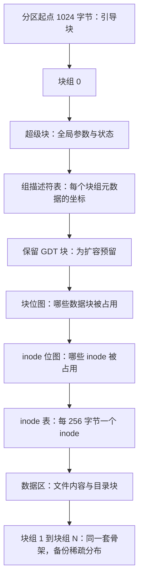
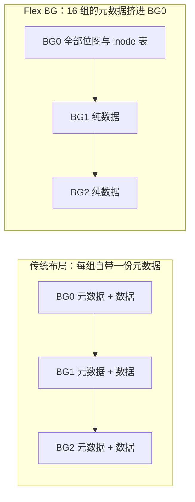
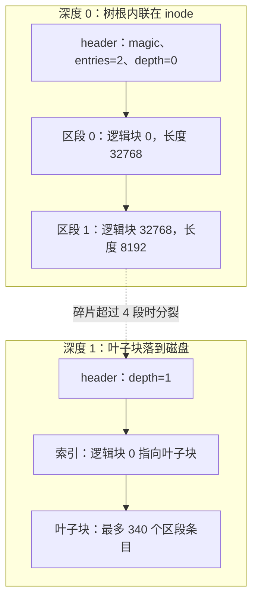
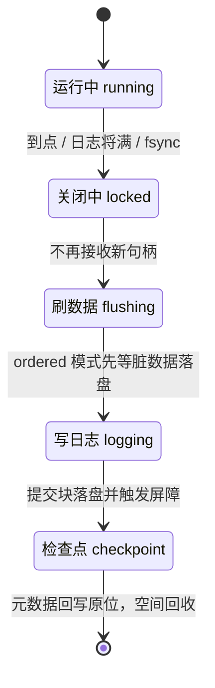
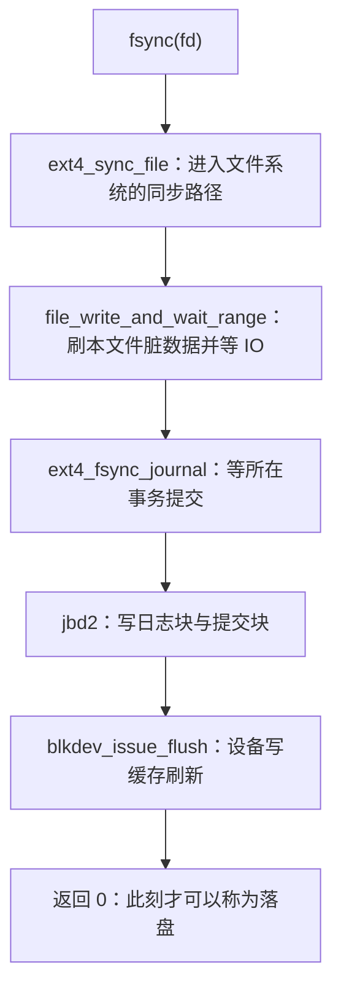

# ext4 深度解析——日志、Extent 树与 Flex BG

**摘要：**

ext4 是发行版系统盘上最常见的文件系统，也是被误解得最深的一层。它继承了 ext2 的块组骨架，却用弹性块组（Flex BG）把元数据搬了家；它用 12 字节的区段（extent）三元组取代三级间接块，让一个 1GB 连续文件的块映射元数据从 1MB 降到一百多字节；它用 jbd2 的预写日志把崩溃恢复从全盘扫描压缩到秒级，却从来没有承诺过"你的数据不会丢"。本篇不铺开命令手册，只追三条线索：其一，块组、超级块备份、位图与 inode 表如何在磁盘上排布，Flex BG 的收益在机械盘与 SSD 上为何不是同一回事，inode 比例这类格式化时的押注又会在几年后以什么形式反噬；其二，extent 树如何在 inode 的 60 字节里放下深度为 0 的四个区段，延迟分配与 `fallocate` 又如何改变元数据的形状；其三，`data=ordered` 究竟保证"元数据不会指向未写入的数据块"这句话的边界在哪里，`writeback` 为何会把旧数据漏给新文件，`barrier` 与 `commit` 又如何共同决定一次 `fsync` 的等待时间，以及 `e2fsck`、`orphan_file`、`tune2fs` 在恢复现场各自站在什么位置。读完应当能从 `dumpe2fs` 与 `/proc/fs/jbd2` 的输出里读出线索，而不是只背下几个挂载参数。

---

## 第 1 章 三次修补：从固定账本到可回放的日志

### 1.1 ext2 的固定账本

1993 年，Rémy Card 在 MINIX 文件系统与 ext 的基础上实现了 ext2，它确立了此后三十年 Linux 文件系统的磁盘骨架：整块设备被切成等大的**块组（Block Group）**，每个块组自带一套管理结构，文件的数据块与描述它的 inode 尽量待在同一个组里。如此安排的理由并不玄妙，就是**局部性**——机械盘的磁头最怕来回跑，一个文件的元数据与数据挨得越近，寻道次数越少。

ext2 描述文件内容的方式像一张固定格式的货位登记表：inode 里留出 15 个 32 位槽位，前 12 个直接写数据块号，后三个分别指向一级、二级、三级间接块。以 4KB 块计算，一个间接块能装 1024 个块号，于是单文件的上限依次是 12 个直接块（48KB）、一级间接（4MB）、二级间接（4GB）、三级间接（4TB）。这个设计在 1993 年绰绰有余，问题在于它的元数据量与文件大小成正比，而且比例不低。一个 1GB 的文件，块号表本身就要占掉约 1MB，散落在 257 个间接块里；顺序读这个文件的末尾，内核得先把两级间接块读进内存，才能知道数据在哪。换到 fsck 的视角更糟：磁盘越大、文件越多，需要逐块核对的结构就越多，一次全盘检查耗时以小时计是常态。

### 1.2 ext3 的草稿本

2001 年，Stephen Tweedie 把日志（journal）带进了 Linux 主线，ext3 随 2.4.15 发布。它没有改动 ext2 的布局，只是在磁盘上划出一块环形区域当日志：修改元数据之前，先把"将要改哪些块、改成什么"写进日志并确保落盘，再回头做正式修改；断电重启后，只需扫这一小块日志，把已盖章的事务重放一遍，未盖章的整笔丢掉。恢复时间从小时级降到秒级，这是日志真正的卖点，而不是"不丢数据"。

不过 ext3 的布局与块映射原封不动地继承了下来。大文件的间接块问题、目录里几十万条目时的线性查找问题、以及块分配器一次只能分配少量连续块的问题，都还在。日志解决的是崩溃一致性，解决不了元数据的经济性。

### 1.3 ext4 的三处重写

ext4 的开发从 2006 年开始，以 ext4dev 的名义进入 2.6.19，2008 年底的 2.6.28 摘掉了 dev 标签。它保留 ext3 的磁盘结构与日志思路，但把三件事重写了：用区段（extent）取代块指针数组，把块映射从"逐块登记"变成"按区间登记"；用**弹性块组（Flex BG）**把多个块组的位图与 inode 表集中到一处，换取数据区的连续；用延迟分配（delalloc）与多块分配器（mballoc）把"一次只分几个块"改成"攒够再分、尽量分一大片"。此后 jbd2 又陆续补上日志校验和、快速提交（fast commit，5.10）与 orphan_file（5.15）等能力，但骨架再没变过。

### 1.4 三个问题

本篇围绕三个问题展开。第一，日志到底保什么、不保什么，三种 `data=` 模式各自的承诺边界在哪里。第二，extent 树凭什么用极少的元数据描述大文件，它的收益在什么情况下会反转。第三，`commit=`、`data=`、`barrier=`、`discard`、`noatime` 这几个挂载参数，改的到底是哪一段机制，代价落在谁身上。布局是这三条线索的地基，所以先从磁盘上走一圈。

---

## 第 2 章 磁盘布局：块组、备份与 Flex BG

### 2.1 一个块组的解剖

在 4KB 块大小下，一个 ext4 分区从偏移 0 开始的 1024 字节是引导块，ext4 自己不用它，只为兼容 PC 的分区引导约定留位。真正的文件系统从块 1 起算，第一块是超级块（superblock），紧接着是**组描述符表（Group Descriptor Table）**，再往后是保留的 GDT 块、块位图、inode 位图、inode 表，最后才是数据区。每个块组都重复这套骨架，只是超级块与组描述符表的副本只在少数块组里出现。块组内部的排布可以画成一条链：



六种结构的职责可以用一张表固定下来，这张表在排障时比任何文档都直接：哪一项坏了，症状就长在那张表的最后一列上。

| 结构 | 典型占用 | 作用 | 损坏后的表现 |
| :--- | :--- | :--- | :--- |
| 引导块 | 1024 字节 | 兼容分区引导约定，ext4 不使用 | 与 ext4 无关 |
| 超级块 | 1 块，另有稀疏备份 | 容量、块大小、特性位、状态、日志位置 | 无法挂载，需以备份超级块修复 |
| 组描述符表 | 每组 64 字节，合若干块 | 每组位图与 inode 表的物理位置、空闲计数 | 块组定位错乱，误分配元数据块 |
| 保留 GDT 块 | 视 `resize_inode` 而定 | 在线扩容时容纳新增的组描述符 | 扩容受限，需离线搬移 |
| 块位图 | 1 块 | 标记本组数据块的占用 | 重复分配、空间泄漏 |
| inode 位图 | 1 块 | 标记本组 inode 的占用 | inode 重复使用，文件互相覆盖 |
| inode 表 | 每 8192 个 inode 约 512 块 | 存放 inode，文件的一切元数据 | 大量文件属性丢失 |

### 2.2 超级块与它的备份

超级块是整份账本的第一页，魔数 `0xEF53` 写在 `s_magic` 里，所有 ext2/3/4 实现都靠它认亲。它记录总块数与 inode 数、块大小、每组块数、空闲计数、日志 inode、特性位，以及一个容易被读错的 `s_state`：`0x0001` 表示文件系统干净，`0x0002` 表示曾经出错，`0x0004` 表示有孤儿 inode 待恢复。把 `s_state` 记成"1 干净、0 出错、2 孤儿"是流传很广的错误说法，实际用的是位标志，`0` 意味着连"干净"这位都没置，通常只出现在半初始化的镜像里。

超级块与 inode 在内存里各有一个常驻对象，VFS 用四张方法表把它们与具体实现解耦，这条线在 [[02 VFS 虚拟文件系统——超级块、inode、dentry 与 file]] 里已经拆开；此处只看磁盘上那份副本长什么样。

超级块之所以要有备份，是因为它一旦损坏，整块设备就等于失去了目录。ext4 默认启用 `sparse_super`，在块组 0、1，以及编号为 3、5、7 的幂次的块组里放副本；`sparse_super2` 是另一种策略，只在块组 0 与最后一个块组留两份，更省空间也更脆弱。这个设计给了一条救砖路径：块大小为 4KB、每组 32768 块时，块组 1 从块 32768 开始，它的超级块就在 32768，于是 `e2fsck -b 32768 /dev/sda1` 能用备份重建主超级块。反过来，`dumpe2fs -h` 里第一行 `Filesystem state` 与 `Filesystem features` 是判断"这块盘能不能直接挂"的最快入口。

### 2.3 描述符、位图与 inode 表的算术

块组的大小不是随手定的，而是由位图容量倒推出来的：一个 4KB 的块位图有 32768 个二进制位，正好能标记 32768 个数据块，于是每组 32768 块、合 128MB，这就是 `8 × 块大小` 这条经验公式的来历。每组 inode 数则由 `mke2fs` 的 inode 比例决定，默认每 16KB 容量配一个 inode，于是一个 128MB 的块组有 8192 个 inode；每个 inode 占 256 字节，合 2MB，也就是 512 个块。把这几项加起来，一个块组的元数据约占 `1 + 5 + 1 + 1 + 512` 个块，再算上保留 GDT，大约占该组容量的百分之一点六。

组描述符表的大小随块组数量线性增长。开启 64bit 特性后每个描述符 64 字节，一个 10GB 的文件系统约有 80 个块组，GDT 不过 5KB，两块就装得下；但到了 16TB、13 万个块组时，GDT 就有 8MB，需要两千个块。`resize_inode` 特性会在格式化时预留一批 GDT 块，让 `resize2fs` 在线扩容时不必搬动元数据；`meta_bg` 则换了一种思路，把描述符分散到各组、按需扩展，代价是老内核不认。

inode 比例是布局里唯一需要提前押注的参数。默认每 16KB 容量配一个 inode，意味着一个 100GB 的数据盘只有约 650 万个 inode；若负载是海量小文件，`df -i` 会先于 `df -h` 报警，而 inode 表在格式化之后无法扩容，只能重建文件系统或换盘。反向的押注也有代价：`-T largefile4` 把比例放到每 4MB 一个 inode，inode 表从几十万块缩到几千块，省下的空间与 fsck 时间可观，代价是稍多的小文件就会把 inode 耗尽。`bigalloc` 改变的是另一条算术：它把分配单元从块提升为簇（cluster），位图的位宽不变，一个块组能覆盖更大的容量，元数据更省，但小文件按簇浪费空间，`df` 的统计口径也随之变化。

这里还藏着一个 fsck 提速的关键：`uninit_bg`（后来的 `metadata_csum` 承接了它的角色）允许块组被标记为"未初始化"，即该组的 inode 表在磁盘上还是一片空白、所有 inode 位图的位都是零。`e2fsck` 看到这个标志就整组跳过，不必逐 inode 核对，这是 ext4 把大容量 fsck 时间压下来的主要手段之一。

### 2.4 Flex BG：把元数据搬进同一个街区

传统布局的问题是元数据跟着块组走：每 128MB 就有一小片位图与 inode 表夹在数据中间。顺序写一个大文件时，块分配器填满一个组的数据区，就要去写下一组的位图、更新 inode 表，磁头在"数据区—元数据区"之间来回跑。数据流越连续，这种打断越显得浪费。

Flex BG 的做法是把若干个传统块组的位图与 inode 表统统搬到第一个组的开头，也就是把元数据搬家，其余组只留纯数据。默认一个 Flex BG 含 16 个块组，即 2GB 范围；组描述符里记录的是位图与 inode 表的真实块号，所以"搬家"对上层完全透明。两种布局的差别用一张对比图更清楚：



收益是双向的。写路径上，一个 2GB 范围内新增的数据块只对应一组位图与 inode 表，且这些块在磁盘上连续，写位图和写数据不再交错；读路径上，`inode_readahead_blks` 预读 inode 表时命中的是一整段连续块，而不是每隔 128MB 才有一小片。对机械盘，这直接减少寻道；对 SSD，省下的不是寻道而是元数据页的反复改写——同一组位图块会被不同块组的分配反复擦写，集中之后写热点更明显，但 FTL 的映射粒度通常能吃下这种局部性。

Flex BG 也有它的代价。元数据被压进每个 Flex BG 的首组，一旦这个组的元数据区出问题，影响的不是一个块组而是十六个；在线扩容时新组的元数据也要塞进新 Flex BG 的头部，`resize2fs` 需要为此预留空间。`mke2fs -G 32` 可以把一个 Flex BG 放大到 32 个块组，换来更长的连续数据段，但元数据热点也更集中。机械盘上偏大、SSD 上偏小甚至保持默认，是笔者见过的比较稳妥的取向，具体仍要以工作负载实测为准。

### 2.5 从 dumpe2fs 读布局

`dumpe2fs` 把上面这些结构如实列出来，读它比读任何二手资料都可靠。下面是一段示例输出，数值取自一个 40GB 的示例文件系统，仅用于说明字段含义：

```bash
# 全局参数：块大小、每组块数、inode 比例、日志大小
dumpe2fs -h /dev/sdb1 | egrep 'Block count|Block size|Blocks per group|Inodes per group|Flex block group|Journal size'
# Block count:              10485760
# Block size:               4096
# Blocks per group:         32768
# Inodes per group:         8192
# Flex block group size:    16
# Journal size:             128M

# 单个块组：位图、inode 表、空闲计数的真实位置
dumpe2fs /dev/sdb1 | sed -n '/^Group 0:/,/^Group 1:/p'
# Group 0: (Blocks 0-32767) csum 0x8a2c
#   Primary superblock at 0, Group descriptors at 1-5
#   Reserved GDT blocks at 6-261
#   Block bitmap at 262 (+262), csum 0x31d0
#   Inode bitmap at 278 (+278), csum 0x0d7f
#   Inode table at 294-805 (+294)
#   23420 free blocks, 8181 free inodes, 2 directories
```

注意 inode 表那一行的跨度：8192 个 inode、每个 256 字节，正好 512 个块。位图的位置也能读出 Flex BG 的痕迹：块位图紧跟在保留 GDT 之后（262），inode 位图却被推到 278，中间 16 个块是同一 Flex BG 里其他组的块位图；inode 表又从 294 开始，前面 16 个块是其他组的 inode 位图。知道这一点，看到"位图位置不连续"就不会误判为损坏。

---

## 第 3 章 Extent 树：用三元组替代指针表

### 3.1 一段连续区间值多少钱

区段（extent）的思路可以用货运单打比方。逐块指针像是一箱一箱登记货位号，一万箱就要写一万行；区段则是"从 7 号库房第 12 排起，连续放 32768 箱"，一行写完。ext4 的区段条目就 12 字节，三个字段：文件内的起始逻辑块号、物理起始块号（低 32 位加高 16 位，共 48 位）、连续块数。

```c
/* 磁盘上的区段条目，12 字节；一个条目覆盖一段连续区间 */
struct ext4_extent {
    __le32  ee_block;     /* 文件内起始逻辑块号 */
    __le16  ee_len;       /* 连续块数；最高位标记"未写入"预分配 */
    __le16  ee_start_hi;  /* 物理块号高 16 位 */
    __le32  ee_start_lo;  /* 物理块号低 32 位 */
};
```

`ee_len` 是 16 位，但最高位被借去标记未写入区段，因此单个初始化区段最多 32768 块，4KB 块下就是 128MB；逻辑块号是 32 位，所以单文件上限是 `2^32 × 4KB = 16TB`。这两个数字解释了 ext4 的两条硬边界：一个区段最多 128MB，一个文件最多 16TB。

把 1GB 文件放进来对比，差距是数量级的。ext2 需要 `262144` 个块号，占约 1MB，散在 257 个间接块里；ext4 则切成 8 个 128MB 的区段，条目共 96 字节，加上一个叶子块的头与校验，元数据不到 4KB。读文件末尾时，ext2 要先读两级间接块，ext4 只需在 inode 内联的树根里二分一次，若深度为 1 再读一个叶子块。

### 3.2 60 字节里的四个槽位

inode 的 `i_block` 数组总长 60 字节，区段树的节点头占 12 字节，剩下 48 字节刚好放 4 个 12 字节条目。所以一个文件只要碎片不超过 4 段，整棵树的根就内联在 inode 里，查找与读取 inode 是**同一次 IO**，没有任何额外开销。

```c
struct ext4_extent_header {
    __le16  eh_magic;      /* 0xF30A，损坏检测的第一道关 */
    __le16  eh_entries;    /* 当前条目数 */
    __le16  eh_max;        /* 容量：inode 内 4，磁盘块内 340 */
    __le16  eh_depth;      /* 0 表示本节点即叶子 */
    __le32  eh_generation; /* 树的版本号 */
};

struct ext4_extent_idx {
    __le32  ei_block;    /* 该索引覆盖的起始逻辑块 */
    __le32  ei_leaf_lo;  /* 子节点物理块号低 32 位 */
    __le16  ei_leaf_hi;  /* 高 16 位 */
    __u16   ei_unused;
};
```

一个磁盘块去掉 12 字节头，还能放 `(4096 - 12) / 12 = 340` 个条目；块的末尾 4 字节留给校验和，因为 `4096 % 12 = 4`，这个余数刚好被尾部结构吃掉。树的深度上限是 5，扇出 340，理论容量远超单文件上限，实际很少超过 2。深度 0 与深度 1 的形态可以对照着看：



查找走的是 B+ 树的常规路径：在每个节点内对 `ei_block` 或 `ee_block` 做二分，找到覆盖目标逻辑块的那一段，深度为 0 就直接得到物理块号。插入则麻烦一些：若新区段与相邻区段物理连续，就只改 `ee_len`；否则插入新条目，节点满了就分裂、树长高一层。这些操作都要在日志事务里完成，于是元数据修改的规模直接取决于碎片程度——这也是 ext4 在碎片化文件上写入变慢的根源，而不是数据本身的 IO 慢。

### 3.3 延迟分配：让区段长得更整齐

ext4 默认启用延迟分配（delalloc）：`write()` 只把页标记为脏，不立即分配块；等到脏页真正要回写时，内核才知道这一批写有多大，再一次性向多块分配器要一段连续空间。这样分配出来的区段更长，树更浅，元数据事务更少。代价是空间的归属被推迟，`write()` 返回成功时磁盘上可能一个块都还没分配；此时断电不会损坏文件系统，但文件可能变成零长度或只保留一部分，这是 `data=ordered` 也管不到的窗口。

`nodelalloc` 把分配提前到 `write()` 时，换来的是"写入即占空间"的可预期性（比如配额与 ENOSPC 更早暴露），代价是区段更碎。对顺序追加的大文件，delalloc 几乎总是更优；对依赖"写完立刻可见于磁盘布局"的工具（某些备份与快照脚本），才需要考虑关掉它。脏页攒到多大、什么时候被回写、`dirty_expire_centisecs` 如何参与，是 [[04 Page Cache 与脏页回写——Linux IO 的秘密缓冲层]] 的主题；从文件系统这一侧看，只需记住分配的时机被整体推迟了。运行中的文件系统可以用 `/sys/fs/ext4/<dev>/delayed_allocation_blocks` 观察还有多少块处于"已脏但未分配"状态，这个数字长期居高不下，往往说明回写跟不上写入。

### 3.4 fallocate 为什么比 dd 快

预分配的价值在数据库与虚拟化场景里最直观：建一个 100GB 的镜像文件，`dd` 要真的把 100GB 写一遍，`fallocate` 可以在毫秒级完成。差别不在"写得多快"，而在"要不要碰数据"。

```bash
# 只登记区段：分配块、写位图、建未写入区段，不搬运任何数据
fallocate -l 100G /data/vm/disk.img

# 真的写 100GB 数据：经过 Page Cache，回写时逐段分配
dd if=/dev/zero of=/data/vm/disk.img bs=4M count=25600 status=progress
```

`fallocate` 走 `ext4_fallocate`，为每段连续空间建立**未写入（unwritten）区段**，更新位图与配额，整个过程由若干日志事务完成，IO 量只与区段数、涉及的块组数相关，与文件大小几乎无关。`dd` 则要把 100GB 数据从用户态拷进 Page Cache，再由回写线程写盘，最后还要在写回时逐段分配块、更新区段树——时间由磁盘带宽决定。按 500MB/s 的盘估算，前者是几十毫秒的量级，后者是两百秒上下，这是量级判断而非基准测试。

未写入区段有个容易被忽略的后续成本：第一次真正往这段空间写数据时，ext4 要把未写入区段转换成已写入，必要时还会拆分，因此"预分配 + 首次顺序写"并不是完全零成本的，只是把成本从"按字节搬数据"降成了"按区段改元数据"。`fallocate` 的几种模式各有用途：`FALLOC_FL_KEEP_SIZE` 只占块不改文件大小，`FALLOC_FL_ZERO_RANGE` 分配并保证读出为零，`FALLOC_FL_PUNCH_HOLE` 则是反向操作，把一段区间还给文件系统并留下空洞。

### 3.5 碎片：区段收益的边界

区段并非任何情况下都更省元数据。一个碎片化的文件，每段都要 12 字节的条目，而间接块方案每个块号只要 4 字节；当碎片粒度接近单块时，区段条目反而比块号表大三倍。极端例子是 10 万个 4KB 的碎片：ext4 需要约 1.2MB 的区段条目、三百多个叶子块；ext2 只需要 40 万个字节的块号、约 98 个间接块。这时 ext4 的优势已经反转，真正拖慢它的是反复分裂的树与更大的元数据事务，而不是磁盘寻道。

不过 SSD 时代对这一条要打折看。机械盘上碎片意味着寻道，SSD 上碎片只意味着更多区段、更深的树、更多的元数据 IO，而随机读本身的惩罚小得多。`filefrag -v` 会逐条列出文件的区段（4KB 块下超过 128MB 的连续段会按 `ee_len` 上限切开），`e4defrag -c` 给出碎片评分，`e4defrag` 可以在线整理单个文件或目录。对数据库文件、虚拟机镜像这类"一次分配、长期随机写"的负载，预分配加固定大小往往比事后整理更有效。

---

## 第 4 章 日志：jbd2 到底保什么

### 4.1 一次追加要动七处

设一个订单服务把成交记录追加到 `/data/orders/2026-11-19.log`，然后调用 `fsync`。这一行数据背后，文件系统至少要改七处磁盘结构：在 inode 位图里占用一个 inode（新建文件时）、初始化 inode 的区段树与大小、在块位图里标记新分配的数据块、把数据写进数据块、在父目录的数据块里加一个目录项、更新父目录 inode 的修改时间与大小、最后更新超级块里的空闲计数。这七处写不可能在物理上同时完成，机器又偏偏会在任意两条写指令之间断电；若在位图已标记、目录项未写入时掉电，那个块就成了"既被占用又不属于任何文件"的孤立块，只能靠 fsck 全盘扫描找回来。

日志要解决的就是这个窗口：把"七处修改"打包成一个有提交标记的单元，要么整体可见，要么整体作废。它买来的不是"不崩溃"，而是"崩溃后存在一个明确且能快速抵达的一致点"。

### 4.2 三段式事务与环形日志

jbd2 的事务由三种块构成：描述符块（descriptor）声明本次事务要改哪些块、数据块（data）承载这些块的新内容、提交块（commit）作为"盖章"标记。除此之外还有撤销块（revoke），记录"本事务内某块的旧修改已作废"，避免重放时把更早的内容又写回去——没有它，同一个块在一个事务里被反复修改、又被释放时，重放顺序可能把中间态写了回去。提交块写完并落盘，事务才算成立；恢复时从日志头扫到日志尾，遇到完整且校验通过的事务就重放，遇到残缺的就停在上一笔。事务从产生到落定的状态迁移如下：



日志区默认内嵌在文件系统内部，由 8 号 inode 承载——`/proc/fs/jbd2/sdb1-8/` 这个目录名就是设备名加日志 inode 号；也可以把日志放到独立块设备（`journal_dev`），再用 `journal_path` 或 `journal_dev` 指过去。外置日志的收益是让日志写与数据写落在两块设备上互不干扰，代价是多一个故障点，且那块设备本身的可靠性必须单独论证。

日志本身是一个环形区域，tail 指向最老的未检查点事务，head 指向最新写入位置。提交只是把事务写进日志，元数据还要由**检查点（checkpoint）**写回原位；只有当一个事务的所有块都完成检查点，它占的日志空间才能被复用。这条约束解释了一个常见现象：写入压力大时，日志先满，内核被迫提前关闭事务、甚至阻塞新的写操作等待检查点推进，此时应用看到的是延迟毛刺，而不是错误。

### 4.3 三种模式各保什么

`data=` 三个模式的区别，一句话概括：进日志的东西不同，等待的顺序不同。真正要记住的是"保什么"和"不保什么"，而不是哪个更快。

| 模式 | 进日志的内容 | 崩溃后保住什么 | 保不住什么 | 写放大 | fsync 等什么 |
| :--- | :--- | :--- | :--- | :--- | :--- |
| `journal` | 数据 + 元数据 | 结构与已提交数据都能回到提交点 | 提交点之后的写；性能最差（读写成对时才可能反超） | 数据两遍、元数据两遍 | 等日志提交，数据已在日志里 |
| `ordered`（默认） | 仅元数据 | 结构一致；不会出现元数据指向未写入数据块 | 未 `fsync` 的数据可能丢；同事务里其他写者的数据要一起等 | 数据一遍、元数据两遍 | 等本文件数据落盘 + 事务提交 |
| `writeback` | 仅元数据 | 结构一致 | 数据可能陈旧、顺序可能错乱，旧文件内容会漏给新文件 | 数据一遍、元数据两遍 | 只等元数据事务提交 |

表里最要紧的一列是"保不住什么"：**结构一致与内容一致是两件事**，前者由日志与 fsck 保证，后者得靠应用自己的 `fsync` 与校验去换。

`data=journal` 把数据也塞进日志，理论上最强，代价是每一字节数据至少写两遍（先日志、后原位），写入带宽直接砍半。它还有两个副作用：延迟分配与 `O_DIRECT` 都被禁用，因为数据必须先经过日志；而 `O_DIRECT` 请求会被退回缓冲写。粗略估算，写入 1GB 数据、元数据约占 1% 时，`ordered` 模式的磁盘写入约 1.01GB，`journal` 模式约 2.02GB，磁盘写入翻了一倍。需要说明的是，内核文档已经把这一模式标为废弃，计划在 2028 年 1 月移除支持，新部署不应再把它当作"更安全"的选项。

`data=ordered` 是默认值，它的承诺常常被简化成"数据先于元数据落盘"，更准确的说法是：在引用某段数据的元数据被提交之前，那段数据必须先落到最终位置。这条约束排除了最坏的一种崩溃形态——重启后文件的区段指向一个已被标记占用、内容却是上一个文件残留的块，于是应用读到的是一段合法但错误的数据。它不承诺"最近写入的数据不丢"，也不承诺"写入顺序与读取顺序一致"，只承诺文件系统的结构不会指向未写入的内容。

`data=writeback` 连这条顺序都不要了，元数据可以先进日志、数据随后慢慢写。崩溃后 fsck 不会报错，因为结构自洽；但新文件里可能出现旧数据，这正是内核文档明确警告的**陈旧数据暴露（stale data exposure）**，在某些多租户场景下还是信息泄露问题。它确实更快，快在去掉了"等数据"这一步，代价是把内容一致性的责任整体推给了上层。

### 4.4 ordered 怎么做到"等数据"

机制落在 jbd2 的 inode 链表上。ext4 在 ordered 模式下修改某个文件的元数据时，通过 `ext4_jbd2_inode_add_write` 把该 inode 与"数据范围"登记到当前事务的 `t_inode_list`；事务提交线程在写提交块之前，会遍历这条链表，对每个 inode 调用 `filemap_write_and_wait_range`，把这些脏数据页刷到磁盘并等待完成。只有这批数据 IO 全部落地，提交块才会被写出。于是"数据先于元数据"不是靠时间上的巧合，而是靠提交路径上的同步等待强制的。

这里有两个后果值得记住。第一，`fsync` 慢不只因为你自己那 4KB 数据：一次事务里可能混着几十个进程的写，提交前要把这些 inode 的脏页全部刷完，你的 `fsync` 得等它们一起。第二，delalloc 与 rename 的组合有个历史坑：`open("foo.new") → write → close → rename("foo.new","foo")` 这种"先写临时文件再改名"的模式，若在改名提交时数据块还没分配，崩溃后可能得到一个零长度的 `foo`。ext4 用 `auto_da_alloc`（默认开启）打补丁：识别 replace-via-rename 与 replace-via-truncate 两种模式，在提交改名事务前强制把新文件的延迟分配块落地并写数据。它是针对特定模式的补丁，不是 ordered 模式的普遍承诺。

### 4.5 提交、检查点与日志满

事务的最大年龄由 `commit=` 控制，默认 5 秒。这个"5 秒"不是硬性的定时器语义，而是"运行中的事务最多攒 5 秒就被关闭"：到点关闭，日志空间紧张时提前关闭，`fsync` 触发提交时也会关闭。单个事务能容纳的块数有上限，jbd2 初始化时按 `(日志总长 - fast commit 区) / 3` 折算，也就是说一个事务最多用掉约三分之一的日志，剩下的空间留给检查点追赶。

`/proc/fs/jbd2/<dev>-<日志 inode 号>/info` 是观察这条流水线最直接的窗口，字段随内核版本略有差异，常见形态如下：

```bash
cat /proc/fs/jbd2/sdb1-8/info
# 252 transactions (300 requested), each up to 43690 blocks
# average:
#   3 ms waiting for transaction
#   0 ms request delay
#   12 ms running transaction
#   2 ms transaction was being locked
#   9 ms flushing data (in ordered mode)
#   1 ms logging transaction
#   280us average transaction commit time
#   6 handles per transaction
#   18 blocks per transaction
#   21 logged blocks per transaction
```

这段输出里最该盯的是 `flushing data (in ordered mode)`：它就是"等数据落盘"那段耗时。若它占了提交时间的大头，说明瓶颈在数据写入带宽或脏页太多，而不是日志本身；`logging transaction` 偏高，则更可能是日志所在设备慢或屏障次数太多；`waiting for transaction` 偏大，说明应用在等一个迟迟不关闭的事务，通常意味着有长事务或检查点跟不上。把这几个数字与 `iostat -x` 的 `await`、`aqu-sz` 放在一起看，基本能定位到"日志盘慢、数据盘慢、还是日志满"。

### 4.6 写屏障：顺序保证落在谁身上

日志的正确性依赖一个物理前提：提交块必须在它描述的数据块之后到达持久介质。可磁盘与 SSD 都有易失写缓存，控制器完全可以先把提交块写下去、再慢慢写数据块。**写屏障（barrier）**就是把这个顺序交还给设备：块层用 `REQ_PREFLUSH` 要求设备先把缓存刷到介质，或用 `REQ_FUA` 要求这次写直达介质；jbd2 在提交块前后使用这类语义，若设备不支持，块层退化为一次显式 flush。

`barrier=0`（或 `nobarrier`）关掉的正是这一步。关掉之后，日志的写序变成"尽力而为"，断电时可能出现提交块已落盘、事务里部分块还在缓存里的局面。带日志校验和时，jbd2 能识别出这种残缺事务并拒绝重放，代价是文件系统留下不一致，需要 fsck 收拾；没有校验和时，更糟的结果是把半个事务重放上去。所以关屏障换来的性能，等于把设备缓存的可靠性假设写进了文件系统的正确性证明里——只有在盘本身有掉电保护（带电池的 RAID 卡、企业级 SSD 的电容）时，这个假设才成立。

### 4.7 崩溃之后：重放与 fsck 的分工

非正常关机后，超级块的"干净"位没有置上，下一次挂载时内核会先重放日志，再放行挂载。重放只处理日志里已提交的事务，速度是秒级；但如果日志本身损坏、校验失败，或者崩溃发生在日志之外的窗口（比如 `barrier=0` 导致的乱序），重放就救不了，需要 `e2fsck` 做全量检查。理解这条分工很重要：日志负责**快速回到提交点**，fsck 负责在没有提交点可用时重建自洽，两者不是替代关系。

---

## 第 5 章 三个挂载参数的真实后果

### 5.1 commit=

`commit=` 改的是事务最大年龄，默认 5 秒。调大（譬如 60）让事务合并更多修改、提交次数下降，元数据密集负载的吞吐会好看一些；代价是断电后可能丢失的元数据窗口变长，而且日志满得更快——事务攒得越大，检查点越难追上，写延迟的毛刺反而更明显。调小（譬如 1）让提交更频繁、每次刷的脏页更少，断电窗口缩小，但日志写与屏障次数成倍增加，吞吐下降。

有一个流传很广的误解需要纠正：`commit=60` 并不意味着"断电最多丢 60 秒数据"。它约束的是元数据事务的可回放窗口；数据页是否落盘，取决于应用有没有 `fsync`，以及内核的 `dirty_expire_centisecs`（默认 30 秒）与回写节奏。延迟分配还会让这个窗口进一步错位——数据块可能在 `commit=` 到点之后仍未分配。把 `commit=` 当成数据保护参数来调，方向就错了。

### 5.2 data=

`data=` 是三个里唯一直接改变语义的参数，代价也最大。从 `writeback` 到 `ordered` 再到 `journal`，保护递增、吞吐递减；反向调整则相反。这里最需要说清的是"数据库该不该用 writeback"这个老问题：数据库自己有 WAL，确实不依赖文件系统的数据顺序来保证事务原子性，但文件系统层的 `writeback` 会在崩溃后把陈旧数据暴露给新文件，破坏备份、复制与校验链的一致性——备份工具读到的可能是上一个文件的内容，而校验和只能事后发现。除非上层对"崩溃后文件内容可能错乱"有完整对策，否则 `ordered` 仍是更稳的默认值。

`data=journal` 在当下更不该作为"更安全"的默认选项：它已被标记为废弃，禁用延迟分配与 `O_DIRECT`，写入带宽减半，只适合极少数"写入即需双份耐久"的特殊场景。把安全性寄托在文件系统层的数据日志上，通常不如让应用自己做 `fsync` 加校验。

### 5.3 barrier=

`barrier=1` 是默认值，也是日志顺序保证的物理基础。关掉它（`barrier=0`）能省掉每次提交的一次 flush，在虚拟化环境里收益尤其明显，因为 virtio 的 flush 往往要陷出到宿主机，单次成本远高于裸机。但省掉的是"提交块一定后写"这个保证，代价见 4.6 节：轻则 fsck，重则半个事务被重放。

判断能否关掉的标准不是"负载有多重"，而是"设备缓存是否可靠"：有掉电保护的 RAID 卡、企业级 SSD、或者日志放在独立且带电容保护的设备上，关掉的风险可控；云主机的普通云盘、消费级 SSD、USB 移动盘，关掉就是把数据交给运气。折中方案是把日志外置到可靠设备（`journal_dev`），让数据盘保持屏障关闭，但这个组合需要显式配置，也牺牲了单盘部署的简洁性。

### 5.4 discard 与 nodiscard

`discard` 让文件系统在释放块时向 SSD 发 TRIM，告诉主控这些页可以回收。它默认是关闭的（`nodiscard`），这和设备端的现实有关：早期的同步 TRIM 在删除大量小文件时会造成明显的尾延迟，一个 `rm -rf` 可能从秒级变成分钟级，因为每次释放都要等一次命令往返。内核后来加入了批量与异步处理，但高 IOPS 负载下的抖动依然存在。

更常见的做法是保持 `nodiscard`，用 `fstrim.timer` 周期性全盘 TRIM（多数发行版默认每周一次），把回收成本挪到低峰。需要注意 TRIM 不是数据擦除，它只是告知主控哪些块无效，被 TRIM 的块内容在物理上未必立刻消失；把 `discard` 当安全擦除手段是另一类误解。

### 5.5 noatime 与 relatime

访问时间（atime）的更新会在每次读文件时写 inode，读多写少的负载因此凭空多出大量元数据写。`noatime` 直接不更新 atime，省掉这类写；`relatime` 是折中，只在 atime 早于 mtime/ctime 或超过一天时才更新，从 2.6.30 起就是默认值；`strictatime` 恢复每次都更新；`lazytime` 把 atime 留在内存、随其他元数据一起落盘，兼顾语义与开销。对绝大多数服务，`relatime` 已经够用，`noatime` 适合明确不需要 atime 的场景（譬如只读镜像、日志盘）；把 `noatime` 当成普遍提速手段，收益通常被高估。

### 5.6 参数矩阵

把这五个参数放在一张表里，代价的方向就清楚了。表中"调大/调小"指沿保护强度或数值方向调整，而非单纯的大小。

| 参数 | 默认 | 往保护强的一侧调 | 往吞吐高的一侧调 | 代价落在哪里 |
| :--- | :--- | :--- | :--- | :--- |
| `commit=` | 5 秒 | 调小：提交频繁、窗口缩短 | 调大：合并更多、提交变少 | 调小增日志 IO 与屏障次数；调大延长元数据丢失窗口并加剧日志满 |
| `data=` | `ordered` | `journal`：数据也进日志 | `writeback`：不等数据 | `journal` 写放大一倍且已废弃；`writeback` 放弃内容一致性 |
| `barrier=` | 1 | 保持开启 | 关闭（`0`） | 关闭后提交块可能先于数据落盘，崩溃需 fsck 甚至重放残缺事务 |
| `discard` | 关闭 | 开启并配合 TRIM | 保持关闭 + 定期 `fstrim` | 开启增加释放路径延迟；关闭把回收压力留给周期任务 |
| `noatime` | `relatime` | 保持 `relatime` | `noatime` | 失去访问时间语义，部分审计与备份工具依赖它 |

落到部署上，三种组合最常见。数据库与虚拟化镜像盘：`data=ordered`、`barrier=1`、`noatime`、`nodiscard` 加周期 `fstrim`，把 `fsync` 的优化交给批量提交与更快的设备，而不是拆掉一致性底线；日志盘或只追加的大文件盘：在确认设备缓存可靠的前提下可以关屏障、适度调大 `commit=`，但不要动 `data=`；容器与系统根盘：保持默认，`relatime` 就够，真正该关心的是 inode 比例与镜像层数带来的小文件数量。把这三种组合写进 fstab 之前，先在测试环境用带 `fsync` 的负载跑一遍延迟分布，比抄任何模板都可靠。

---

## 第 6 章 fsync 为什么慢：三层归因

### 6.1 第一层：一次提交至少一次落盘

`fsync` 从 VFS 落到 ext4 的 `ext4_sync_file`，第一步是 `file_write_and_wait_range`：把本文件的脏数据页提交写出并等待完成。数据落盘之后才轮到元数据——`ext4_fsync_journal` 拿着 inode 上记录的 `i_sync_tid`，等这个事务真正提交；若事务尚未关闭，内核会推动一次提交：写描述符、写日志块、写提交块，屏障开启时还多一次 flush。这一层的最小成本就是"至少一次往返到持久介质"，任何软件优化都消不掉它，只能靠合并摊薄。

### 6.2 第二层：ordered 的等待与同事务的其他写者

ordered 模式下，提交之前要遍历事务里登记的 inode，把它们的脏数据全部刷完。你的 `fsync` 等的可能不只是自己那几 KB，而是同一事务里其他几十个写者的数据。这解释了一个常见困惑：单线程压测时 `fsync` 延迟很稳，混部之后突然抖动——不是磁盘变慢，而是事务里混进了别人的大块写。数据量越大、写者越多，这一层的占比越高。

顺带把 `fdatasync` 与 `fsync` 的差别钉在机制上：两者都会先刷数据，但 `fsync` 等的是 `i_sync_tid` 记录的那次事务，`fdatasync` 等的是 `i_datasync_tid`，后者只覆盖"让数据能被读回"所必需的元数据（大小、区段、块数），不包含修改时间、访问时间这类与数据可读性无关的字段。差别不算大，但在只追加、极少改属性的负载上，`fdatasync` 确实可能少等一次元数据提交。

### 6.3 第三层：队列深度与设备

单个线程的 `fsync` 天然是**队列深度 1**：写完等、等到再写。blk-mq 的多队列、调度器的合并，对这一条同步链路基本无用武之地，延迟就是设备延迟加一次 flush 的成本。按每次 0.5 毫秒估算，单线程每秒最多完成两千次同步写；想让一万次同步写挤进一秒，靠的不是更快的盘，而是把它们的提交合并进几十次事务。机械盘上一次 flush 动辄毫秒级，SATA SSD 在亚毫秒到毫秒之间，NVMe 通常更低，但虚拟化层的一次 flush 可能又要陷出一次。按量级估计，单次 `fsync` 在 NVMe 上是零点几毫秒，在 SATA SSD 上是一到两毫秒，在机械盘上是十毫秒上下——这些是量级判断，具体数值随设备与内核版本变化很大。

块设备层的排队与调度见 [[05 块设备栈——从 bio 到 blk-mq 的 IO 路径]] 与 [[06 IO 调度器——CFQ、Deadline 与 mq-deadline 的演进]]，`fsync` 在这里只是一个 QD1 的同步请求，调度器能帮的忙有限。

### 6.4 组提交、max_batch_time 与 fast commit

既然单次提交不可省，方向就只有"让更多同步写挤进同一次提交"。ext4 的 `max_batch_time` 就是干这个的：默认 15000 微秒，同步写触发提交前，内核会按历史提交耗时估算一个等待窗口，稍等片刻看有没有别的写者搭车；`min_batch_time` 默认 0，调大可以提高多线程同步写的吞吐，代价是增加单次延迟。这就是**组提交（group commit）**在文件系统层的实现，数据库的 WAL 组提交是同一思路的上层版本。

5.10 引入的**快速提交（fast commit）**是另一条路：把 `fsync` 产生的小幅元数据变更写进日志尾部的一小块快速提交区，不必走完整事务，日志区大小约为日志的六十四分之一。它把"每次 `fsync` 都要写提交块"降为"多数时候只写一小段"，失败或空间不足时回退到完整提交。需要在格式化或 `tune2fs -O fast_commit` 时显式开启，且以对应内核与 e2fsprogs 版本支持为准。把一次同步写的等待按调用顺序串起来，等待点一目了然：



### 6.5 三层归因表

把三层拆开对照，现场判断会快很多。`fsync` 变慢时，先看它卡在哪一层，再决定是调参数、改写入模式，还是换设备。

| 层次 | 在等什么 | 典型量级 | 观测点 | 缓解方向 |
| :--- | :--- | :--- | :--- | :--- |
| 日志提交 | 描述符与提交块落盘、屏障 | 数百微秒到数毫秒 | `/proc/fs/jbd2/*/info` 的 logging 与平均提交时间 | 组提交、fast commit、日志外置 |
| ordered 等数据 | 本文件与同事务其他 inode 的脏页 | 与写入量、设备带宽相关 | 同一文件的 flushing data 字段 | 预分配、顺序写、拆分事务、减少混部 |
| 块层与设备 | flush 完成、设备缓存、GC | 数十微秒到数十毫秒 | `iostat -x` 的 await/aqu-sz、blktrace | 更快的盘、避免屏障、提高并发 |

还有一类"返回 0 却没真正落盘"的情形必须单独列出：`fsync` 只保证文件本身与它的元数据，不保证父目录里的目录项——`rename` 之后要再 `fsync` 父目录，否则断电后可能找不到新名字；`barrier=0` 加易失写缓存时，提交块可能还在盘内缓存；廉价 SSD 的固件可能谎报 flush 完成。数据库最怕的正是最后这一类：它拿到了成功的返回值，却把持久性建立在一个不成立的假设上。

---

## 第 7 章 恢复现场：e2fsck、orphan_file 与 tune2fs

### 7.1 e2fsck 的五个阶段

日志救不了的时候，`e2fsck` 是最后一道防线。它的检查按五个阶段推进，输出里的 `Pass 1` 到 `Pass 5` 就是这五步：

| 阶段 | 检查对象 | 典型输出与含义 |
| :--- | :--- | :--- |
| Pass 1 | inode、块与大小 | 遍历 inode 表，核对块占用、链接数、格式合法性 |
| Pass 2 | 目录结构 | 逐目录核对目录项、inode 号、名字长度与类型 |
| Pass 3 | 目录连通性 | 从根出发做可达性检查，把丢失的目录挂回 `lost+found` |
| Pass 4 | 引用计数 | 核对 inode 链接数与目录项引用是否一致 |
| Pass 5 | 组汇总信息 | 核对超级块与组描述符里的空闲计数、位图统计 |

`-n` 只检查不修改，适合先看清问题；`-p` 是开机脚本用的预检模式，只修安全的错误；`-y` 全部回答 yes，适合已确认可丢弃或已备份的数据盘；`-f` 强制全检，即使文件系统标记为干净；`-b 32768` 指定备份超级块，用在主超级块损坏时；`-z` 先写 undo 文件再修，给一次反悔机会。fsck 慢的本质是它要遍历全部元数据，容量越大越慢，这也是 ext4 在大容量场景逐渐让位给 XFS 的原因之一——XFS 的元数据组织与并行检查更适合超大卷，细节见 [[07 XFS 文件系统深度解析——B+ 树与日志架构]]。

### 7.2 orphan_file：把孤儿链表从超级块里挪走

进程打开文件后被杀死，inode 还占着块但已无目录项引用，这类 inode 叫孤儿（orphan）。ext4 传统上把它们串成一条链表，链表头放在超级块里，所有孤儿操作都要抢同一把锁；在大容量、多核、高并发的场景下，这把锁成了瓶颈。5.15 引入的 `orphan_file` 特性把孤儿记录搬进一个专门的文件，用位图分块管理，锁的竞争被拆散，删除大量文件时的可扩展性明显改善。当前 e2fsprogs 的默认 ext4 特性里已经包含它，老文件系统可以用 `tune2fs -O orphan_file` 加上（需要内核与工具链支持，升级前应先备份）。

### 7.3 tune2fs 常用项

`tune2fs` 调的是文件系统的"出厂设置"，而不是运行时行为，改完通常要重新挂载才生效。下表只列现场最常用的几项：

| 选项 | 作用 | 使用注意 |
| :--- | :--- | :--- |
| `-l` | 打印超级块信息 | 与 `dumpe2fs -h` 类似，排查第一步 |
| `-o` | 写入默认挂载选项 | 可持久化 `journal_data_ordered` 等，避免漏配 fstab |
| `-O` | 开关特性 | 如 `fast_commit`、`orphan_file`，老内核不认新特性会拒挂 |
| `-e` | 出错行为 | `continue`、`remount-ro`、`panic` 三选一 |
| `-c` / `-i` | 按挂载次数/时间触发 fsck | 现代发行版多用 `enable_periodic_fsck=0` 关掉 |
| `-m` | 为 root 保留的空间比例 | 默认 5%，大容量数据盘常降到 1% |
| `-L` / `-U` | 改卷标/UUID | 改 UUID 会影响 fstab 与引导项 |

### 7.4 现场关键字

内核日志里，ext4 与 jbd2 的报错有固定句式，认得它们能省下大量猜测。`EXT4-fs error (device sdb1)` 表示元数据校验失败，后面的函数名指向出错的结构；`JBD2: Detected IO errors while flushing file data` 表示 ordered 模式刷数据失败，通常意味着数据盘出问题；`JBD2: Invalid checksum recovering block N in log` 是日志校验救回了一次残缺事务；`Aborting journal on device sdb1-8` 之后往往紧跟 `Remounting filesystem read-only`，此时文件系统已经自保为只读，先别急着重挂，先用 `dumpe2fs -h` 看状态、必要时离线 fsck。把日志、`/proc/fs/jbd2` 与 `iostat` 三处放在同一时间轴上对照，比单看任何一处都可靠。

还有一条容易踩的坑：只读挂载并不等于不写盘。ext4 以 `ro` 挂载时仍会重放日志，而重放就是写操作；要让设备完全不被写入，得用 `ro,noload`。取证、只读救援、镜像校验这类场景里，漏掉 `noload` 可能直接污染现场。

---

## 第 8 章 反例与量化

### 8.1 data=writeback 上数据库

把 `data=writeback` 当成"数据库专用优化"是一个流传已久的危险建议。它的确去掉了 ordered 模式里等待数据落盘的那一段，`fsync` 的延迟会下降；数据库凭借自己的 WAL 与双写，单机事务的原子性通常也还成立。问题出在崩溃后的文件内容上：`writeback` 允许元数据先提交，于是新文件可能映射到仍含旧数据的块，备份工具、逻辑复制、校验和检查读到的就是错乱内容。这类损坏不会让 fsck 报错，却会让"从备份恢复"这条最后的退路失效。

更稳的做法是把数据库的写入模式与文件系统语义对齐：数据文件用 `ordered`，把 `fsync` 的成本交给批量提交与更快的设备去摊；确实要压榨延迟，可以调 `max_batch_time`、开 fast commit、把日志放到低延迟设备，而不是拆掉内容一致性的底线。PostgreSQL、MySQL 各自有 `full_page_writes`、双写缓冲这类机制处理页断裂，它们补的是"页内不一致"，不是"文件系统把旧块给了新文件"。

### 8.2 barrier=0 换性能

`barrier=0` 在虚拟化与云盘上确实能换来可观的 `fsync` 提升，因为省掉的那次 flush 在 virtio 路径上并不便宜。但这条优化成立的前提是"设备缓存不会丢"：如果底层是带掉电保护的存储、或云厂商明确承诺 flush 语义可靠，风险可控；如果是消费级 SSD 或没有掉电保护的云盘，关掉屏障等于让提交块可能先于数据落到介质，崩溃后轻则 fsck，重则事务残缺。

一个折中的判断方法：在测试环境用 `fio` 做带 `fsync` 的随机写，分别测开、关屏障的延迟分布；如果关掉后 P99 改善明显而设备又没有掉电保护，那么这笔收益是用可恢复性换来的，是否接受要看业务对"崩溃后需 fsck"的容忍度，而不是只看吞吐数字。

### 8.3 discard 在高 IOPS 下拖慢

`discard` 的代价集中在释放路径上：每次删除文件或截断，文件系统都要为释放的块发 TRIM，高 IOPS 的小文件负载会把这条路径变成瓶颈，表现为删除变慢、写延迟抖动。默认关闭它、改用周期 `fstrim`，是多数发行版的选择。需要注意的是，`fstrim` 也不是零成本：全盘 TRIM 期间会占用设备带宽，安排在低峰期、或用 `fstrim --minimum` 限制范围，比全天候 `discard` 更可控。

### 8.4 量化：日志档位与提交频率

`mke2fs` 的默认日志大小不是按比例连续增长的，而是分段跳档（4KB 块，示例推算，具体以 e2fsprogs 版本为准）：小于 128MB 的文件系统配 4MB 日志，1GB 以下配 16MB，2GB 以下 32MB，16GB 以下 64MB，32GB 以下 128MB，64GB 以下 256MB，128GB 以下 512MB，更大的配 1GB。再按"单事务最多用约三分之一日志"折算，就能估出一次提交最多能合并多少元数据：

| 文件系统容量 | 默认日志 | 单事务上限（约） | 定时器主导时的元数据吞吐上限 |
| :--- | :--- | :--- | :--- |
| 100MB | 4MB | 1.3MB | 0.8MB/s |
| 512MB | 16MB | 5MB | 3MB/s |
| 8GB | 64MB | 21MB | 12MB/s |
| 100GB | 512MB | 170MB | 100MB/s |
| 1TB 及以上 | 1GB | 340MB | 200MB/s |

这张表解释了两件事。其一，小容量盘的日志很小，元数据密集的负载很容易把日志写满，于是事务提前关闭、提交频率远超 5 秒一次，`fsync` 延迟自然不稳；这类场景把日志做大（`mke2fs -J size=` 或重建文件系统）比调 `commit=` 更有效。其二，日志大小与快照、备份窗口无关，它只影响"提交多久一次、检查点能不能追上"，不要指望通过加大日志提高数据安全性。

### 8.5 量化：区段与碎片

仍以 1GB 连续文件为例（以下为算术推算）：ext4 切成 8 个 128MB 区段，条目 96 字节；ext2 需要 262144 个块号、约 1MB 的间接块。反过来，10 万个单块碎片时，ext4 的区段条目约 1.2MB，比 ext2 的 400KB 块号表大三倍。这两个方向说明**区段的收益完全取决于连续性**：连续性好时它是数量级的节省，碎片到块级时它反而更贵。`filefrag -v` 的区段数、`e4defrag -c` 的评分，就是判断自己处在哪一侧的现成指标。

### 8.6 ext4 的边界

ext4 的强项是通用、成熟、工具链完整，弱项在大容量与超高并发的元数据操作：fsck 时间随容量线性增长，目录与分配器的扩展性不如 XFS 的分配组设计，在线收缩（shrink）至今不支持。选型时把"容量、并发、恢复时间"三个维度摆出来，答案通常不复杂：单机系统盘、中小容量数据盘选 ext4；超大容量、海量小文件与高并发元数据选 XFS，两者的结构差异见 [[07 XFS 文件系统深度解析——B+ 树与日志架构]]；至于怎么把这些参数与设备能力对上，[[08 存储栈性能调优——从 fio 到 iotop 的全套方法论]] 给的是方法论而不是结论。

---

## 小结

ext4 的三处改进各管一件事：块组与 Flex BG 管磁盘布局的局部性，区段树管块映射的经济性，jbd2 管崩溃后的可恢复性。三者都不承诺"数据不丢"，只承诺结构自洽与快速回到一致点。日志的三种模式里，`ordered` 的准确表述是"引用数据的元数据提交前，数据必须先到最终位置"，它排除了最坏的结构性错误，但把数据丢失的责任留给了 `fsync`；`writeback` 放弃了内容一致性，`journal` 则因为写放大与废弃路线不再是默认选项。参数调优的正确顺序是先分清"改的是哪一层"，再评估代价落在吞吐、延迟还是可恢复性上：`commit=` 动的是事务年龄，`barrier=` 动的是物理写序，`discard` 动的是回收路径，`noatime` 动的是元数据写量。`fsync` 慢的三层原因——提交、等数据、设备队列——各自有对应的观测点与缓解手段，混在一起谈"存储慢"只会得出误导性的结论。

给应用层的建议可以收成一句：**持久性要自己买**。`fsync` 该调就调，`rename` 之后记得同步父目录，校验和与备份链不要省；文件系统能做的，是保证崩溃之后你还能挂载、还能 fsck、还能知道丢的是哪一段。

---

## 参考资料

1. Linux 内核文档，*ext4 General Information*，<https://docs.kernel.org/admin-guide/ext4.html>（挂载参数、三种数据模式、`max_batch_time` 与 `auto_da_alloc` 的权威描述）
2. Linux 内核文档，*ext4 Disk Layout*，<https://docs.kernel.org/filesystems/ext4/>（块组、超级块、区段树的磁盘格式）
3. Linux 内核源码，`fs/ext4/ext4_extents.h`、`fs/ext4/fsync.c`、`fs/jbd2/commit.c`、`fs/jbd2/journal.c`、`include/linux/jbd2.h`（区段结构、fsync 路径、事务状态与 `/proc` 统计字段）
4. e2fsprogs 源码，`lib/ext2fs/mkjournal.c`、`misc/mke2fs.conf.in`（默认日志大小档位、默认特性集）
5. Avantika Mathur 等，*Ext4: The Next Generation of the Ext2/3 Filesystem*，Linux Symposium 2007（ext4 的设计动机与区段、Flex BG 的原始论述）
6. Rémy Card、Theodore Ts'o、Stephen Tweedie，*Design and Implementation of the Second Extended Filesystem*，1994（ext2 布局与间接块）
7. Stephen Tweedie，*ext3, Journaling Filesystem*，Ottawa Linux Symposium 2000（日志进入 Linux 的原始方案）
8. Remzi H. Arpaci-Dusseau、Andrea C. Arpaci-Dusseau，*Operating Systems: Three Easy Pieces*，第 42 章（fsck 与日志的入门论述）
9. e2fsprogs man 页：`e2fsck(8)`、`mke2fs(8)`、`tune2fs(8)`、`dumpe2fs(8)`；man 页：`fsync(2)`、`fallocate(2)`
10. Jan Kara，ext4 `orphan_file` 特性（Linux 5.15 合并，孤儿 inode 记录从超级块链表迁至专用文件）

---

> [!note] 思考题
> 1. 一个 4KB 块、默认参数、容量 100GB 的文件系统，日志约 512MB，单事务上限约 170MB。若某个负载每秒产生 40MB 元数据写入并以 `commit=5` 运行，事务会在 5 秒到点前被日志空间逼着提前关闭吗？由此推断，此时调大日志与调小 `commit=` 哪一个更能降低 `fsync` 的尾延迟？
> 2. `data=ordered` 保证"元数据不会指向未写入的数据块"，但一个 `open`+`write`+`close`+`rename` 的替换模式仍可能在崩溃后留下零长度文件。`auto_da_alloc` 补的是哪一个具体窗口？如果应用改用 `O_TRUNC` 覆写原文件，这个补丁还生效吗？
> 3. ext4 的区段条目 12 字节，间接块里的块号 4 字节。请构造一个碎片化程度，使得同一个文件的区段树元数据反而比间接块方案更大，并说明为什么 SSD 上这种反转造成的性能损失比机械盘小。
> 4. 某服务在 NVMe 上单线程 `fsync` 稳定在 0.3ms，混部后 P99 涨到 8ms，而磁盘 `iostat` 的 `%util` 只有 30%。请用本文的三层归因，给出至少两条可能的原因与对应的验证命令（提示：`/proc/fs/jbd2/*/info` 的字段、事务里其他写者的脏页）。
> 5. `barrier=0` 在云主机上常能显著降低 `fsync` 延迟。若底层云盘没有掉电保护，一次断电后最坏会出现哪两种结果？日志校验和在其中分别起什么作用，fsck 又能修到什么程度？