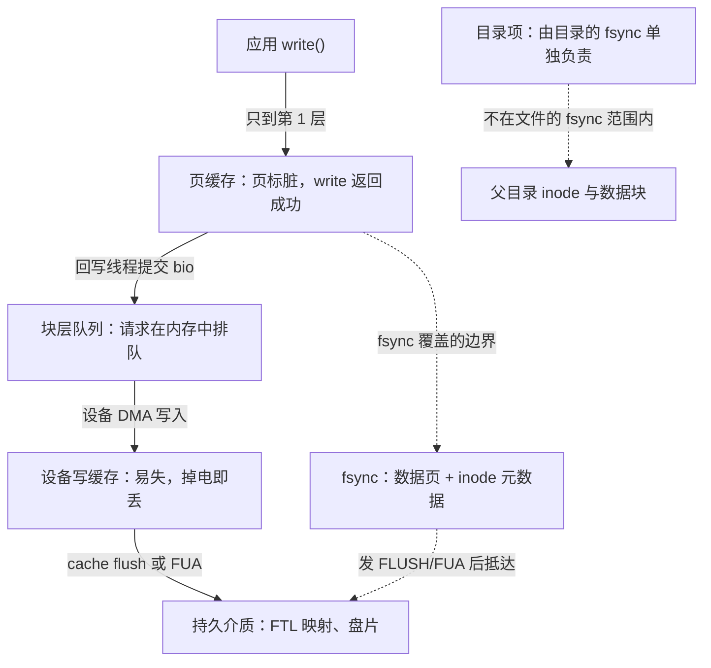
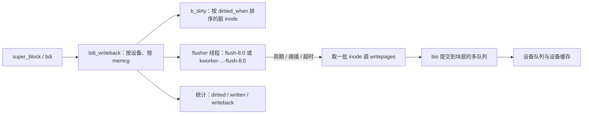
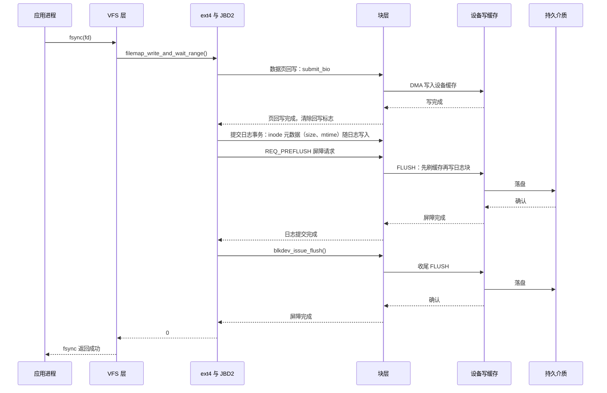
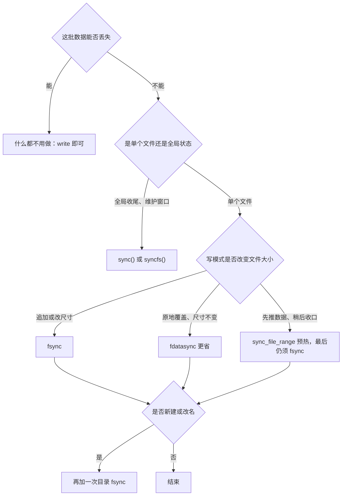
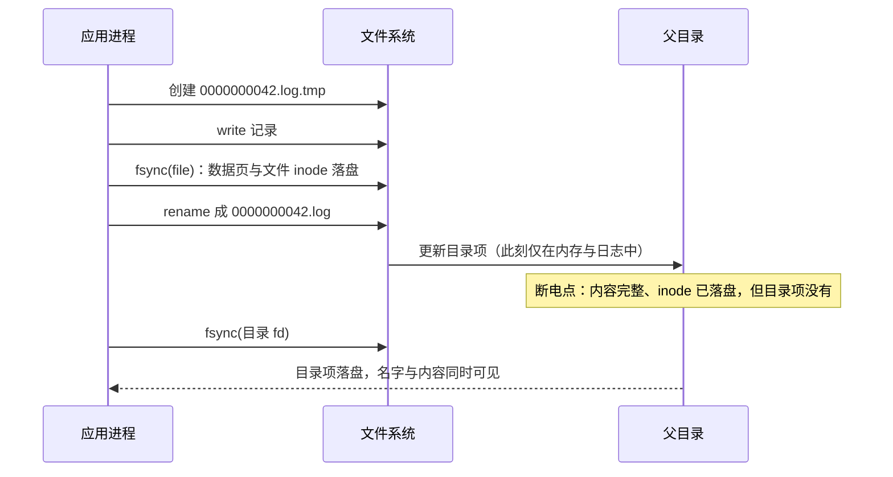

# Page Cache 与脏页回写——Linux IO 的秘密缓冲层

**摘要：**

`write()` 返回成功、机器随即掉电、重启后文件内容退回旧版本——这类事故几乎都能追到同一处契约边界：数据从内存走到介质之间隔着好几层缓存与队列，每一层的承诺强度并不相同。本篇从文件系统的侧面切入，回答两个问题：今天的回写机制由谁执行、被哪些参数驱动；`fsync` 到底保证了什么、又在哪些条件下悄悄失效。前者需要走完 pdflush 到 per-BDI flusher 的沿革、四个 `dirty_*` 参数构成的双阈值、`address_space_operations` 上标脏与批量回写两个回调的分工，以及 `iomap` 这一现代路径为什么要替换掉 buffer_head；后者要把 `sync`、`fsync`、`fdatasync`、`O_SYNC`、`sync_file_range` 的语义逐项拆开，再交代它们被存储栈、文件系统配置、错误报告机制、`mmap` 与目录项这五个环节削弱的现场，最后给出一套从 `/proc`、trace 点到 `iostat` 的判据。读完应当能判断：手上这条写入路径的承诺终止在哪一层，以及为补齐下一层要付多少代价；对每条承诺，先问它终止于哪一层缓存，再问那一层的失败如何被发现。

---

## 第 1 章 两个视角的分工：内存账本与承诺链

### 1.1 同一批页，两种问法

2009 年前后，ext4 刚刚接替 ext3 成为多数发行版的默认文件系统，社区里出现了一批令人费解的报告：程序用"写临时文件、`rename` 覆盖旧文件"的经典手法做原子更新，进程正常退出，紧接着机器断电，重启后旧文件还在，新文件的内容却是空的。这场争论持续了很久，最终的产物之一，是 ext4 里一个名为 `auto_da_alloc` 的启发式补丁——它专门识别"`rename` 覆盖已有文件"这个模式，在提交元数据之前先把数据刷下去。一个文件系统的默认行为，被一个使用惯例倒逼着改掉，这件事本身就说明：`write()` 返回成功之后发生的事情，比多数人以为的复杂得多。

Linux 为这件事同时维护着两套叙事，分别从两个视角回答"文件页现在处于什么状态"。

内存视角问的是"这批页算谁的内存"：它们记在 `Cached` 里，参与 `MemAvailable` 的估算，脏页多到一定程度会挤压可用内存，`tmpfs` 的页混在同一个字段里却没有磁盘后端，`cachestat` 让应用第一次能查询自己那段区间还有多少页驻留。这些问题、以及它们背后的回收与配额机制，已经在 [[04 Page Cache：Linux 为什么要用内存来缓存磁盘]] 里系统处理过，本篇不再重复。

文件系统视角问的是另一件事：这一页的数据，此刻在物理上走到哪一层了。是还在内存里、已经进了块层的请求队列、到了设备内部的写缓存、还是真正落在介质上。这个问题不关心内存账怎么记，只关心一个承诺链——`write()`、`fsync()`、文件系统的日志、块层的屏障、设备的写缓存，五个环节各自承诺了多少、在什么条件下会失守。数据库与消息队列设计持久化时反复权衡的，正是这条链的强度。

两个视角共享同一批 `struct page`，但问题不同，结论也不同：内存视角里"脏页"是一个水位数字，文件系统视角里"脏页"是一笔尚未兑现的欠账。后文只在机制交叉处向内存侧指路，其余篇幅全部留给欠账怎么还、什么时候还不上。

### 1.2 承诺链的五个环节

把一次 `write()` 之后的路径摊开，可以数出五个"签收点"，每个签收点的含义都不一样：

1. **`write()` 返回**：内核已经把数据拷进页缓存，页被标脏，inode 被挂进回写队列。此后的任何时刻掉电，这份数据都可能消失——它不是"已保存"，只是"已接收"。
2. 回写线程把页交给块层：数据从页缓存变成 `bio`，进入设备队列。此时掉电，数据仍在内存里丢光，因为块层队列也是内存。
3. 设备控制器接收写请求：数据抵达设备的易失写缓存（volatile write cache）。现代 SSD、RAID 卡、虚拟磁盘都有这一层，而且它比多数人以为的大得多。掉电时缓存里的数据一起消失。
4. 设备把缓存刷入介质：闪存的 FTL 映射、磁盘的盘片、阵列的 NVRAM 落盘。这是"真正落盘"。
5. 文件系统的日志与元数据也完成相应的落盘：数据落盘而元数据没落，重启后 fsck 面对的是一个自相矛盾的文件系统。

`fsync()` 的价值，就是在这条链上尽量往后推：它要求数据页、文件元数据、以及设备缓存屏障三件事一起完成。但"尽量"两个字决定了它并非绝对——后文第 5 章会逐条拆掉这个错觉。不妨先看一张总图，图中每个环节都标了它自己的承诺边界：



设备写缓存这一环在整条链上最容易失守，也最容易被忽略；目录项那条旁支则是另一处独立欠账，文件自身的 `fsync` 管不到它。这两个位置，恰好对应生产事故里最常见的两类"已确认却丢失"。

### 1.3 一条贯穿案例

后文反复回到一个具体场景，它足够小，却串起了全部机制：一个消息队列的分区日志目录，里面按段存放 `0000000000.log` 这样的文件，每段写满后归档。写入一段新日志的标准动作是：创建临时文件、追加记录、`fsync` 写文件、`rename` 成正式段名、`fsync` 目录。这条路径上，第 2 章的阈值决定"不 `fsync` 时数据能活多久"，第 3 章的 `a_ops` 决定脏页怎么被批量刷出，第 4 章决定 `fsync` 与 `fdatasync` 该选哪个，第 5 章决定它在什么情况下骗人，第 6 章决定是否值得用 `O_DIRECT` 换掉这条路。案例保持不变，提问逐层加深。

---

## 第 2 章 回写机制：谁在执行，被什么驱动

### 2.1 三代执行者

Linux 的回写执行者换过三代，每一代的更替都对应一次具体的规模瓶颈。

最早是 **bdflush 与 kupdate** 两个内核线程的分工：`kupdate` 按周期扫描脏页、决定该刷什么，`bdflush` 接收请求并批量提交给块层。这套设计在单盘、小内存的年代够用，线程数固定、状态简单，但它把所有设备放在同一个队列里。

2.4 时代（2001 年前后）把两者合并成 **pdflush**——一组全局线程，按需增减。pdflush 解决了 bdflush 单线程的吞吐上限，却留下了更麻烦的问题：线程池是全局共享的，一块慢盘上积压的脏页会让整个池子陪着排队，快盘的回写被慢盘定义节奏；设备数量增长之后，线程数与设备数的匹配关系也难以调好。

真正的手术发生在 2.6.32（2009 年底），Jens Axboe 主导的 writeback 重构把回写彻底按设备分片：每个块设备（backing device，BDI）拥有一组自己的回写线程，进程名形如 `flush-8:0`（8:0 是设备号），较新的内核里则显示为 `kworker/u8:1-flush-8:0` 这种形式。慢盘的积压只拖累自己，快盘不再被牵连；线程按需创建，调度与统计都按设备分开。这次重构的动因值得记一笔：凡是全局共享的资源池，最慢的成员都会定义整体的节奏，解法不是把池子调大，而是把池子按设备拆开。

2015 年的 4.2 内核又加了一层分片：per-memcg 的 writeback（`bdi_writeback` 按 cgroup 再切一份），让容器的脏页按容器记账、按容器配额触发回写。这条线的记账细节属于内存与 cgroup 的领域，见 [[05 内存回收：kswapd、LRU与直接回收的博弈]] 与 [[09 CGroups 内存子系统：容器内存隔离的底层实现]]，这里只需记住结论：回写的执行者从"全局一组"变成了"每设备一组、每容器再一组"的树状结构。

### 2.2 现在的结构

今天的回写对象可以用一棵树来概括：`super_block` 上的 `bdi` 指向一个 `bdi_writeback`（下称 wb），wb 维护着脏 inode 链表（按 `dirtied_when` 排序的 `b_dirty`）、正在回写的 inode 链表、以及自己的统计计数；flusher 线程挂在 wb 的延迟工作上，被周期唤醒或被阈值唤醒，取一批 inode 调 `->writepages`，把页变成 `bio` 交给块层。



回写线程与设备号的对应关系，在进程列表与 sysfs 里都能直接看到：

```bash
# flusher 的命名：flush-8:0 是设备号，与 /sys/class/bdi 下的目录同名
$ ps -eo pid,comm | grep -E 'flush-[0-9]'
    312  flush-8:0
   1421  kworker/u8:1-flush-259:0

# 每块设备的回写对象、额度与设备缓存模式
$ ls /sys/class/bdi/
  259:0  8:0  8:16
$ cat /sys/class/bdi/8:0/max_ratio
  100            # 该设备可占用的全局脏页额度上限，100 表示不额外限制
$ cat /sys/block/sda/queue/write_cache
  write back     # 设备自己报告有易失写缓存，fsync 的可信度在此处打折
```

这棵树在用户态有三个观察入口。`/sys/class/bdi/` 下按 `MAJOR:MINOR` 命名，属性包括 `min_ratio`、`max_ratio`、`strict_limit`、`read_ahead_kb`、`stable_pages_required`，前三个直接决定该设备能占多少脏页额度；`/sys/kernel/debug/bdi/MAJOR:MINOR/stats` 给出该设备的累计脏页、已写回页数、当前回写中页数、以及它自己的脏页阈值；`ps` 里则能看到 flusher 的忙碌程度。`bio` 提交之后的路由、合并与多队列分发属于块层的题目，见 [[05 块设备栈——从 bio 到 blk-mq 的 IO 路径]]。属性集合随内核版本略有出入，以本机目录与对应版本文档为准。

### 2.3 双阈值与四个参数

回写的触发条件可以分成两组：一组管"新鲜度"，一组管"库存量"。四个 `vm.dirty_*` 参数各管一头，其中两个构成所谓的双阈值：

| 参数 | 默认值 | 管什么 | 调小或调零的代价 | 调大的代价 |
| :--- | ---: | :--- | :--- | :--- |
| `vm.dirty_background_ratio` | 10 | 后台回写的启动线：脏页占比超过它，flusher 开始异步写，写进程不受影响 | 回写更早更碎，小 IO 增多，顺序写收益下降 | 脏页堆积更久，突发写入时回写洪峰更猛 |
| `vm.dirty_ratio` | 20 | 同步阻塞线：脏页占比逼近它，写进程在 `balance_dirty_pages()` 里被节流甚至等待 | 写入吞吐下降，应用延迟更早变差 | 断电窗口与回写洪峰同时放大，最坏时全机写入一起卡死 |
| `vm.dirty_expire_centisecs` | 3000 | 脏页年龄上限（30 秒），超过即被周期性回写扫到 | 数据更新鲜，代价是 IO 更碎、写放大更高 | 断电窗口变长，数据在内存里滞留更久 |
| `vm.dirty_writeback_centisecs` | 500 | flusher 的巡逻周期（5 秒），决定"发现过期脏页"的粒度 | 巡逻更频繁，小唤醒增多 | 过期脏页最多多等一个周期才被处理 |

这张表里有三处容易被读错。

其一，双阈值的语义并不对称。背景线只唤醒后台线程，写进程照旧全速前进；阻塞线才作用在写进程自己身上——它在 `write()` 路径的 `balance_dirty_pages()` 里被要求睡一小会儿。3.2 内核（2011 年）之后，这个睡眠不是"撞线才卡"的一刀切，而是按脏页超出阈值的比例计算睡眠时长，越接近硬线睡得越久。这解释了生产上那个典型现象：磁盘抖动时，写入服务的延迟不是突然从 0.1ms 跳到 1s，而是先缓慢抬升，最后在硬线附近变得完全不可用。

其二，百分比与绝对值是两套互斥的开关。`dirty_background_bytes` 与 `dirty_bytes` 设了非零值就覆盖对应的 ratio，反过来写 ratio 会把 bytes 清零。大内存机器的 ratio 换算出来的绝对额度常常荒唐：512GB 内存的 20% 是 100GB 量级的脏页额度，一块普通 NVMe 把这么多脏页落完需要几十秒，这个"额度"实际是把内存当成了磁盘的缓冲区。把两档换成绝对值、钉在"一块盘几十秒能落完"的量级，是这类机器的常规做法，具体数值取决于盘速与业务能容忍的回写洪峰长度。

其三，全局阈值之上还有设备级分账。`max_ratio` 限制某块设备最多占多少脏页比例，`min_ratio` 给它保底份额，`strict_limit` 则让该设备严格执行自己的限额而不吃全局余量。多盘混布时，一块慢的机械盘如果没有 `max_ratio` 约束，会把全局脏页额度吃到接近硬线，连带快盘上的写入一起被节流——这是 per-BDI 化解决了执行者问题之后，遗留下来的额度分配问题。

> [!warning] 生产避坑：脏页阈值不是"内存参数"，是"落盘速度参数"
> 阈值应当按最慢的那块盘、最坏的写入突发来定，而不是按内存大小定。同样的 20%，在 512GB 内存加单块 SATA SSD 的机器上意味着上百 GB 的欠账，在任何应用眼里都等于"掉电即回滚几十分钟"。大内存机器与多盘机器，优先用 `dirty_bytes` 系列把额度钉死。

### 2.4 一个脏页的保险之旅

把默认参数连成时间线，一个页从变脏到落盘的流程是这样的：第 0 秒 `write()` 返回；最迟约 5 秒后 flusher 巡逻一次，看它够不够老；如果它是这一批里最老的，满 30 秒时被写回；写回期间它被标上正在回写的标志，完成后恢复干净。断电窗口的上界因此大致是"30 秒年龄 + 一个巡逻周期 + 写回耗时"。这条线上还有一个常被忽略的细节：回写队列**按 inode 排序**，不是按页——wb 的 `b_dirty` 链表按 inode 最后一次变脏的时间排序，flusher 一次取一批 inode、对每个 inode 调 `writepages`，所以一个被反复追加的日志文件不会因为"最新写入的页还不老"而拖住整个文件——但同一个文件里新老页的落盘顺序由文件系统的 `writepages` 实现决定，应用不能指望它。

脏页在内存压力下还有另一条出路：不是被 flusher 刷，而是被内存回收逼着刷。回收路径调用 `writepages` 时带的是同步标志，要求这批页写完才允许释放，这条路径的细节与 `kswapd`、直接回收的关系在第 3.3 节与 [[05 内存回收：kswapd、LRU与直接回收的博弈]] 里有更完整的交代，此处只需知道：脏页的落盘时机有两个来源，定时器与内存压力，前者可控，后者不可控。

---

## 第 3 章 接口层：address_space_operations 的三个回调

### 3.1 谁把页标脏

页缓存与文件系统之间的契约写在一张方法表上：`address_space_operations`（下称 a_ops），这张表挂在 VFS 的 `address_space` 上，四类对象的组织方式见 [[02 VFS 虚拟文件系统——超级块、inode、dentry 与 file]]。往这张表上看，与回写相关的回调有五个，其中三个是主干：

| 回调（6.x 名称） | 旧名或历史位置 | 谁调用它 | 职责 | 今天的地位 |
| :--- | :--- | :--- | :--- | :--- |
| `dirty_folio` | `set_page_dirty` | `write()` 的通用写路径、`mmap` 写缺页、块层 | 把页标脏，并把 inode 挂进 wb 的脏链表 | 标脏入口，folio 化后改名 |
| `writepages` | 无 | flusher、`fsync`、内存回收 | 批量扫描脏页、合并、提交 `bio` | 回写主路径 |
| `writepage` | 无 | 老的回收路径、`write_cache_pages()` | 单页回写 | 已停止新增使用，仅剩兼容位 |
| `read_folio` | `readpage` | 读缺页 | 把一页从磁盘读上来 | 读路径入口，folio 化后改名 |
| `direct_IO` | 无 | `O_DIRECT` 的读写 | 绕过页缓存的直读直写 | 名字保留，实现普遍转向 `iomap_dio_rw` |

`dirty_folio` 的实现分两类，这个分类是理解后面所有差异的钥匙。以 buffer_head 为基础的文件系统用 `__set_page_dirty_buffers()`：数据先写进页内的缓冲区（buffer_head），改哪个块就把哪个块对应的 bh 标脏，于是标脏粒度是块而不是页——当块大小小于页大小时（譬如 1KB 块的 ext4），一页里只有被改动的块需要回写。另一类是整页标脏，`__set_page_dirty_nobuffers()` 用于没有 buffer_head 的页（ramfs、块设备的裸页），iomap 路径则用 `iomap_set_page_dirty()` 之类的实现。标脏之后，内核通过 `__mark_inode_dirty(I_DIRTY_PAGES)` 把 inode 挂进 wb 的 `b_dirty` 链表，并记录 `dirtied_when`——第 2 章那条"30 秒年龄"的计时，从这里开始。

5.18 内核对整个页缓存做了 folio 化改造，`set_page_dirty`、`readpage` 这些以单页为粒度的名字陆续让位给 `dirty_folio`、`read_folio`。改名不是洁癖：folio 表示"一个或多个物理连续页"，大页缓存与批量回写只有在 folio 粒度上才谈得上一次处理一片，而不是逐页循环。

### 3.2 批量回写：writepages 与 writeback_control

`writepages` 是回写的主干，它的第二个参数 `struct writeback_control` 把"这次回写的意图"打包传进来，理解这几个字段就能理解回写系统的调度逻辑：

| 字段 | 含义 | 谁会给它赋值 |
| :--- | :--- | :--- |
| `sync_mode` | `WB_SYNC_NONE` 允许跳过正在回写的页；`WB_SYNC_ALL` 必须等齐 | `fsync` 与内存回收用 ALL，后台回写用 NONE |
| `nr_to_write` | 本次最多写多少页 | 后台回写按块设备速率给额度，`fsync` 给全体 |
| `range_start` / `range_end` | 只回写文件的某段 | `fsync` 的区间、`sync_file_range` |
| `for_kupdate` | 只处理超过年龄上限的脏页 | 周期性巡逻线程 |
| `for_background` | 由背景水位触发 | flusher |
| `for_reclaim` | 由内存回收触发，必须尽快完成 | 直接回收、`kswapd` |
| `range_cyclic` | 从上次位置继续，循环扫描 | 后台回写避免每次都从头扫 |

实现层面的差别决定了性能。ext4 的 `writepages` 依赖 extent 状态树（extent status tree）把逻辑上相邻的脏页合并成大块请求，一个顺序写场景因此能输出接近设备带宽的大 IO；XFS 用 `iomap_writepages` 直接在 extent 粒度上生成 bio，省掉了页与块之间的映射查找。两者共同的思路是：回写的价值不在"把页写出去"，而在"把能合并的页合并之后再写出去"，合并得越好，写放大与寻道越少。这也是为什么 `dirty_expire_centisecs` 不宜调得太小——攒得久一点，合并的机会就多一点，代价是断电窗口变长。

`WB_SYNC_ALL` 与 `WB_SYNC_NONE` 的差别不只是"等不等"。`fsync` 走 ALL，要求调用返回时文件里所有在此刻之前变脏的页都已完成回写；后台回写走 NONE，允许跳过正在回写的页、允许只写一部分就收工。混淆这两个模式会得出错误的结论，譬如"回写线程跑完了，所以数据都在盘上了"——后台回写从来不做这种承诺，它只承诺"尽力往前推"。

### 3.3 单页回写：writepage 的退场

`writepage` 是这套接口里最有历史感的一个。它最初的用途是给内存回收调用：回收器选中一个脏页，调用 `->writepage` 把它写出去，然后释放。问题在于这个调用发生在内存回收的栈上——kswapd 或直接回收的上下文里，栈空间紧张，且不允许为了写一页而分配内存、长时间休眠或去抢文件系统的锁。早期的文件系统实现没有完全遵守这些限制，于是在 ext3、reiserfs 这类代码上反复出现"回收路径里分配内存触发递归回收"的死锁，或者"在受限栈上嵌套调用导致栈溢出"的崩溃。

修复的方向不是把限制放宽，而是换掉入口：内存回收改成调用带 `WB_SYNC_ALL` 的 `writepages`，一次处理一批页，把"逐页"的开销与约束一并消除。今天主流文件系统的 `writepages` 已经绕开单页路径，`->writepage` 只剩两种残留：仍在使用 `write_cache_pages()` 这套通用扫描器的老文件系统，把它当作逐页回调；以及块设备的 buffer_head 页这类特殊对象。新文件系统不再实现它。

这段历史留下一条对应用有意义的结论：脏页的落盘延迟不是一个常量，而是随内存压力变化。定时器路径上它是 30 秒量级，内存压力大时回收路径会提前把脏页刷出去，刷的节奏由回收速度决定，应用完全无法预测。把"我的数据大约 30 秒后落盘"当成设计前提，在内存紧张的机器上会失效。

### 3.4 两条现代路径：direct_IO 与 iomap

`direct_IO` 是 `O_DIRECT` 的落点。它绕过页缓存，把用户缓冲区直接交给块层做 DMA，代价是三个对齐要求（见第 6 章）。在 6.x 内核里，这个回调本身还留在 a_ops 上，但实现方式已经统一：绝大多数文件系统不再自己写直读直写的映射逻辑，而是调用 `iomap_dio_rw()`，由 iomap 层完成"逻辑偏移到物理 extent"的翻译、拆分成 bio、处理对齐与同步语义。

iomap 是 2016 年前后由 Christoph Hellwig 引入的一套抽象，目标是给"文件偏移到物理块"的映射提供一个统一接口，让直接 IO、DAX、回写、以及未来的大页缓存不再各自维护一套代码。它的核心是一对回调：`iomap_begin()` 查询某段逻辑范围对应的物理位置与类型（普通 extent、空洞、内联数据、延迟分配中），`iomap_end()` 负责收尾；上层则用 `iomap_apply()` 按段迭代。与 buffer_head 的差别可以列成一张表：

| 维度 | buffer_head 路径 | iomap 路径 |
| :--- | :--- | :--- |
| 映射单元 | 块（bh），每块一个描述符 | extent，一次给出起始与长度 |
| 元数据驻留 | bh 数组挂在页的私有字段上 | 查询回调按需返回，不常驻每块 |
| 部分块写 | 天然支持，块级标脏 | 页内未对齐需读改写或走写入口 |
| 大 folio | 需要遍历 bh | 天然按 folio 与 extent 批处理 |
| 回写合并 | 逐页逐块提交，合并靠上层 | extent 级合并，顺序写更友好 |
| 直读直写 | 需各自实现 | 复用同一套映射 |
| 现实分布 | ext4 写回主路径仍在用 | XFS 已全面化，ext4 的直读与 DAX 也已接入 |

这张表不需要背，它只说明一件事：接口层的抽象程度，决定了文件系统能在多大粒度上做优化。buffer_head 把文件切成固定大小的块，合并的机会受块边界限制；iomap 把文件看作 extent 序列，合并、预分配、DAX 都能在更大的尺度上做。ext4 至今保留 buffer_head 作为写回主路径，是因为它的延迟分配与 extent 状态树已经把合并做到了够用的程度，全面切换的收益不足以覆盖风险——这本身就是一个典型的工程权衡：新抽象更好，但迁移成本要有人付。

---

## 第 4 章 四个同步接口的精确语义

### 4.1 一张承诺矩阵

同步接口的差异，全部落在四个维度上：刷不刷数据页、刷不刷元数据、等不等设备缓存、能不能报错。把这四列钉死，选型就没有模糊地带：

| 接口 | 刷数据页 | 刷元数据 | 等设备缓存 | 错误可见 | 典型用途 |
| :--- | :--- | :--- | :--- | :--- | :--- |
| `sync()` | 全系统所有文件 | 全部 | 标准只承诺排队；Linux 实现会等 I/O 完成，更强但不报错 | 否 | 停机、维护前的粗扫 |
| `syncfs(fd)` | 该文件系统 | 该文件系统全部 | 同上 | 5.8 起可报 EIO | 单个文件系统的收尾 |
| `fsync(fd)` | 该文件 | 该 inode 全部（含 mtime、size、权限） | 是 | 是 | 单文件强持久 |
| `fdatasync(fd)` | 该文件 | 仅"取回数据所必需"的部分（size、块映射），不含 mtime | 是 | 是 | 高频原地更新 |
| `O_SYNC` | 每次 `write` 都刷 | 每次全量 | 是 | `write` 返回值 | 每条都关键、量极小的写 |
| `O_DSYNC` | 每次 `write` 都刷 | 每次仅必要项 | 是 | `write` 返回值 | 同上的轻量版 |
| `sync_file_range()` | 指定区间的数据页 | 不刷 | 否，且明说不刷设备缓存 | 是 | 把数据先推给设备、稍后收口 |
| `msync(MS_SYNC)` | 映射区间的脏页 | 视文件系统实现 | 与 `fsync` 同一条边界 | 是 | `mmap` 共享写的收口 |

表格里最难理解的是第一行与第七行，它们的"保证"都带着明显的缺口。

`sync()` 的缺口在标准与实现之间。POSIX 只要求它"把写入排入队列"，Linux 的实现走得更远：它会遍历所有超级块、对每个文件系统做一次回写并等待 I/O 完成，man 页据此说它提供了"对每个文件各调一次 `fsync` 的同等保证"。但这条保证有两个致命缺口：函数返回 `void`，任何设备错误都无处可报；遍历是逐个文件系统进行的，遍历窗口之后新产生的写入不在这一轮的覆盖内。用它代替 `fsync` 的应用，得到的只是"大多数时候确实刷了"，而不是"刷成功了"。

`sync_file_range()` 的缺口是设计性的，man 页的措辞毫不客气："This system call is extremely dangerous"。它只处理指定区间的数据页，不写文件的元数据，也不刷设备的写缓存，因此在有易失写缓存的设备上不提供任何数据完整性；对于 copy-on-write 文件系统，连"原地覆盖"这个前提都不成立。它存在的理由只有一个：把一次很长的 `fsync` 拆成"先把数据推出去"与"最后只做元数据与屏障"两段，让前一段的耗时被别的计算掩盖——第 4.6 节展开。

### 4.2 fsync 的内核路径

`fsync` 是这套接口里承诺最完整的一个：数据、元数据与屏障三件事一起做。它的内核路径可以拆成四步，每一步都对应急性不同的等待：



这张时序图解释了 `fsync` 成本的构成：一次数据回写、一次日志提交（自带屏障）、一次收尾屏障，以及沿途每一次等待设备确认的往返。在机械盘上，一次屏障的代价就是一次盘片同步，毫秒量级；在 NVMe 上，屏障是几十到几百微秒；在带电池保护的阵列上，控制器可以把缓存里的数据视为已持久而快速返回（这是 BBU 的真正价值，也是它失效时最危险的地方）。

不同文件系统的实现差异也集中在这张图上：ext4 的 `ext4_sync_file()` 按"刷数据页、提交日志、发设备屏障"的顺序收口，inode 元数据随日志一起提交、不单独写盘；XFS 的核心是强制日志（log force），数据与元数据的顺序由日志的排序保证；btrfs 把 `fsync` 变成一次事务提交；NFS 的 `fsync` 是一次 `COMMIT` 远程过程调用，落盘与否由服务端定义。接口相同，代价结构与可信度完全不同——这是选型时最容易忽略的一层。

### 4.3 fdatasync：省掉的是哪一次写

`fdatasync` 与 `fsync` 的差别只有一个：不刷"取回数据用不到"的元数据。man 页给的标准例子是 `st_atime`、`st_mtime` 不必刷，而 `st_size`（例如 `ftruncate` 造成的尺寸变化）必须刷，因为数据读取要靠 size 与块映射定位。

这个定义在不同写模式下省下的开销差别极大：

- **原地改写**（覆盖文件中固定位置的记录，size 不变）：`fdatasync` 跳过 inode 元数据更新，`fsync` 要写。省一次元数据写与它在日志里的开销，这是 `fdatasync` 的主场。
- **追加写**（日志、WAL 段）：每次写都改 size，`fdatasync` 同样要刷元数据，与 `fsync` 的差距缩小到"mtime 那一点"；真正决定成本的是日志提交与设备屏障，两者都省不掉。
- **延迟分配的文件系统**：ext4 的写回路径要到 `fsync` 时才真正分配块，块映射本身就是元数据，所以"省元数据"的空间比预想的窄。

由此可以纠正一个流传很广的经验：`fdatasync` 并不总是比 `fsync` 快一倍，它只在"尺寸不变、元数据更新很少"的写模式下才明显便宜。数据库的预写日志是追加写，用的是 `fsync`；某些存储引擎的原地页更新用 `fdatasync`，省下来的是一次 inode 更新与部分日志内容，而不是那道设备屏障。

### 4.4 O_SYNC 与 O_DSYNC：把决策挪到 open 时刻

`O_SYNC` 的语义是"每次 `write` 返回时，数据与关联元数据都已到硬件"，等价于每次写完调一次 `fsync`；`O_DSYNC` 等价于每次写完调一次 `fdatasync`。glibc 里 `O_SYNC` 的定义就是 `__O_SYNC | O_DSYNC` 的组合，内核看到 `__O_SYNC` 才走完整同步路径。

它们的价值不在语义更强，而在"不依赖调用方记得同步"。审计日志、单条关键的配置写入、某些元数据服务的写，打开时就声明"这条路径上的每次写都要落盘"，代码里就不会出现漏掉 `fsync` 的分支。代价是量级性的：每次 `write` 都带一次屏障往返，吞吐会被屏障延迟封顶。

把同步语义挪到调用粒度，是这组接口的另一个演进方向：`pwritev2` 允许在单次调用上带 `RWF_DSYNC` 或 `RWF_SYNC`，同一个 fd 上可以混着用——大部分写走 buffered，少数关键写带同步标志。比起"整个文件都开 `O_SYNC`"，这是更细的粒度。

> [!warning] 生产避坑：fsync 的代价必须进预算
> 一次 `fsync` 的成本不是一个固定常数，而是"数据回写 + 日志提交 + 一到两次设备屏障"的和。机械盘上一次屏障是毫秒级，单线程每秒最多几百次；NVMe 上是几十到几百微秒，数千到上万次（示例推算，实际取决于设备与文件系统）。每条事务同步一次的设计，吞吐上限由设备屏障延迟乘以次数直接决定，与应用层的 CPU、内存、网络无关。出路只有三条：分组提交（一批事务共用一次 `fsync`）、把随机写整理成顺序写、换屏障延迟更低的持久层。

### 4.5 分组提交：把屏障次数压下来

既然成本主要在屏障，优化的方向就是把"多次同步"合并成"一次同步"。这套技术比 Linux 更古老：1980 年代的 Cedar 文件系统用日志结构加组提交（group commit），把一批事务的日志记录合成一次落盘，让提交延迟与吞吐同时改善；数据库领域的 ARIES 把预写日志的规则固化成"日志先于数据落盘"，组提交则是在这条规则上叠的批处理。

实现上的关键是"攒批"与"确认"分离：事务提交时把日志记录写进缓冲区，然后进入一个提交队列；某一个线程负责发起 `fsync`，等它返回后，一次性唤醒队列里所有等待者。N 条事务共用一次屏障，吞吐提高接近 N 倍，代价是每条事务的确认延迟被拉长到"攒批窗口 + 一次屏障"。窗口取多大，取决于业务能接受的首字节延迟——这是持久性与延迟之间最标准的一处权衡。

一个具体的算式（示例推算）：设备单次屏障 200 微秒、攒批窗口 1 毫秒，则每秒可完成约 1000 次提交组，每组容纳 100 条事务，吞吐 10 万条每秒，单条最坏延迟约 1.2 毫秒。若每条都单独同步，同样设备只能到 5000 条每秒，且延迟随并发上升。两个方案的持久性保证完全相同，差别只在这笔账怎么算。

### 4.6 sync_file_range：把长 fsync 拆成两段

回到 `sync_file_range`。它危险，但并非无用：把"数据推给设备"与"元数据与屏障"拆开，前者可以在后台慢慢做，后者只需要做一次短促的收口。PostgreSQL 的检查点路径就用了这个思路，用 `pg_flush_data` 把脏数据页先推给设备，真正的持久性仍由之后的 `fsync` 保证。

安全使用的条件很苛刻：必须确认自己写的是"已经分配好的块的原地覆盖"（否则元数据没刷，崩溃后数据不可达）、必须清楚它不刷设备缓存（后续必须有真正的 `fsync` 收口）、在 copy-on-write 文件系统上基本不适用、不能把它当作提交点。满足这些条件时，它能把一次几十毫秒的 `fsync` 拆成"平时零散预热 + 提交时几毫秒收口"，对延迟分布是实打实的改善。

选型可以收成一张决策图：



---

## 第 5 章 fsync 在什么时候骗你

### 5.1 存储栈：屏障被谁吞掉了

`fsync` 的最后一环是让设备把易失写缓存刷进介质。这个动作在块层由两种请求表达：`REQ_PREFLUSH`（先发一个 FLUSH，把之前的写都刷下去）与 `REQ_FUA`（要求这一笔写绕过缓存直接落盘）。设备支持 FUA 就用 FUA，不支持就退化成"FLUSH 再写再 FLUSH"。整条链可信的前提是：设备与它下面的一切中介都真的执行了这两类请求。

失守的位置比想象的多：

- **设备写缓存本身**。SATA 盘可以用 `hdparm -W0` 关掉写缓存，SAS/SCSI 盘用 `sdparm --set=WCE=0`，NVMe 盘可以用 `nvme id-ctrl` 看 `vwc` 字段是否报告了易失缓存。关掉之后写变慢，但每次写都直接落介质，屏障自然失去意义。
- **RAID 卡与盘阵的缓存**。控制器把写缓存在自己的 NVRAM 里并立刻向主机确认，靠电池或超级电容保证掉电不丢。这是合法且高效的加速，前提是电池健康、并且控制器在老化的电池上仍然诚实地告警。电池失效而缓存模式仍是 write-back 的阵列，是"fsync 返回成功但数据丢了"最常见的现场。
- **虚拟化层与云盘**。虚拟机磁盘的 cache 模式（如 `cache=writeback`）会让宿主机的页缓存替代设备的写缓存，客户机里的 `fsync` 到了宿主机可能只到宿主机的页缓存；云盘的持久性由厂商的副本与承诺定义，客户机看到的 `fsync` 语义取决于虚拟块设备的实现。
- **屏障选项下放块层**。老资料里常见的建议是"把 `barrier=0` 加到挂载参数以提升写入性能"，这一条在今天的 ext4 上已经失效：屏障相关挂载选项在 2011 年前后就被废弃，控制权下放到块层，现代内核遇到 `barrier=` 只打印警告并忽略，刷写屏障通过 FLUSH/FUA 恒定发出。把它当性能开关的人，得到的只是警告日志与一个没有变化的系统。

> [!info] 判据：怎么知道这台机器的 fsync 是真的
> 三层各查一遍：设备侧看 `/sys/block/sdX/queue/write_cache` 是 write back 还是 write through、`/sys/block/sdX/queue/fua` 是否为 1；阵列侧看控制器缓存模式与电池/电容健康状态；系统侧用一次真实的断电测试（写已知模式、`fsync`、直接断电、重启校验）。前两层只能证明"配置声称如此"，只有断电测试能证明"它真的如此"——Brad Fitzpatrick 的 `diskchecker.pl` 就是把这套流程脚本化的小工具。

### 5.2 文件系统：ext4 的三种数据模式

ext4 提供三种数据模式（日志与 extent 树的细节见 [[03 ext4 深度解析——日志、Extent 树与 Flex BG]]），它们对"崩溃后看到什么"的保证完全不同，而 `fsync` 只在其中一部分场景里补齐缺口：

| 模式 | 数据是否进日志 | 崩溃后可能的状态 | fsync 的效果 | 代价 |
| :--- | :--- | :--- | :--- | :--- |
| `data=journal` | 数据与元数据都进日志 | 已提交事务的数据完整，无旧数据暴露 | 数据已在日志里，收口快 | 写放大明显，吞吐最低 |
| `data=ordered`（默认） | 数据不进日志，但提交元数据前先写数据块 | 元数据不会指向未写入的块，但不保证最后一次写的完整 | 刷数据页后提交日志 | 兼顾安全与吞吐 |
| `data=writeback` | 数据与元数据之间无顺序约束 | 元数据可能先落盘，崩溃后文件里出现未初始化块，旧数据可能被读到 | 仍会刷本文件数据 | 吞吐最高，一致性最弱 |

`data=writeback` 下的"fsync 骗你"与另外两种不同：它不是让 `fsync` 失效，而是让"没 `fsync` 的写"变得危险。元数据已经提交、数据块尚未写入的窗口里崩溃，重启后文件大小是对的，内容却可能是这块磁盘上以前属于别的文件的残骸。ext4 用未初始化 extent 的标记与延迟初始化减轻这类暴露，`auto_da_alloc` 则专门在"`rename` 覆盖已有文件"时先刷数据，但这些都是缩小窗口的启发式，不是保证。

2009 年那批 `rename` 之后文件变空的报告，正是这条窗口的现场：应用相信"`rename` 是原子的，所以要么旧内容要么新内容"，而文件系统只保证"名字的切换不出现中间态"，不保证切换发生时新文件的数据已经在盘上。两个保证之间差着一个 `fsync`。

### 5.3 错误报告：被吞掉的那一次 EIO

比"没落盘"更隐蔽的一类欺骗，是"没落盘但返回成功"。

页回写是异步的，写失败（介质坏块、链路错误、设备离线）发生在回写线程的上下文里，用户进程看不到。错误要等到某个同步接口才被报告。4.13 之前，内核在一个文件映射上只报告一次写回错误：第一个遇到它的 `fsync` 拿到 `EIO`，后续的 `fsync` 直接返回成功，因为它们"已经报过了"。于是同一批数据的不同副本、不同线程的提交，可能得出完全相反的结论。

4.13（2017 年）引入的 errseq 机制改变了这一点：错误被记录成一个序号，每个文件描述符各自记住自己看到的序号，于是每个 `fsync` 都能看到"自上次以来是否发生过写回错误"。这个修复是静默的，很多应用至今没有利用它。

它带来的工程要求很直接：`fsync` 的返回值必须检查，且 `EIO` 意味着这批数据不可信。不能"记个日志继续跑"，因为失败的那批页可能已经被丢弃，文件内容与元数据之间可能已经不一致。2019 年初 PostgreSQL 的一次修复正是这个教训的产物：`fsync` 失败后如果继续推进检查点与日志回收，损坏会被固化到备份与副本里；正确处理是把该实例标记为不可继续服务，交给恢复流程。`close()` 与 `munmap()` 都不会替你把错误报出来，`fsync` 是最后一次机会。

### 5.4 mmap：msync 管的到底是哪一段

`mmap` 的共享映射把文件页直接映进进程地址空间，写内存就是写页缓存。围绕它的说法里，流传最广的一条是"`fsync` 不管 `mmap` 的脏页，必须 `msync`"，这条在今天的 Linux 语义里并不成立：`MAP_SHARED` 写脏的页就在文件的同一个 `address_space` 里，`fsync(fd)` 扫描的是这个地址空间的脏页，所以对同一个 inode 的 `fsync` 会把这些页一并刷出去。

真正需要 `msync` 的是三种情形：手里没有可用的文件描述符（映射之后关掉了 fd），需要按区间而不是整个文件收口，或者需要 `MS_INVALIDATE` 让其他映射看到刚写入的新值。man 页的原始表述是"不使用 `msync` 就没有'在 `munmap` 之前写回'的保证"——注意它保证的是时机，不是落盘。

`msync` 自身也有两个陷阱。`MS_ASYNC` 只是"排入队列"，自 2.6.19 起内核因为能自己跟踪脏页而把它实现成空操作，指望它给出完成确认是不现实的；`MS_SYNC` 会等回写完成并走文件系统的同步收口，但它能推到哪一层取决于文件系统与存储栈，不比一次 `fsync` 更强，也不为目录项负责。

不归 `fsync` 管的 mmap 页确实存在，只是位置不同：`MAP_PRIVATE` 的写会触发写时复制，产生的是匿名页，永远不会写回文件；`fsync` 返回之后其他线程继续写映射区域，产生的脏页在这一次保证之外。把这两类情形误当成"`fsync` 不管 mmap"，是这条流行说法的来源。在笔者看来，这条说法的价值不在于对错，而在于它逼人去确认一次映射与一次同步是否指向同一个 inode。

### 5.5 目录项：最经典的那个 bug

man 页对 `fsync` 的描述里有一句容易被跳过的话：调用 `fsync` 并不保证包含该文件的目录项也已经落盘，要做到这一点，还需要对目录的文件描述符再调一次 `fsync`。

目录项是父目录 inode 的数据块。文件自身的 `fsync` 覆盖的是文件 inode 与它的数据页，父目录的那块数据不在范围内。于是"创建文件、`fsync` 文件、崩溃"这个序列，重启后可能得到一个内容完整却没有名字的 inode（空间泄漏，且应用认为文件已存在），也可能什么都看不到。消息队列、数据库、邮件系统在这上面栽过的跟头数不胜数，共同点是：都以为 `fsync` 文件就够了。

正确的序列要把目录也算进去，下图标出了断电最危险的时刻：



对应的代码是：

```c
/* 新建段文件并保证"名字 + 内容"都落盘 */
int fd = open("/data/wal/0000000042.log.tmp",
              O_WRONLY | O_CREAT | O_TRUNC, 0644);
write(fd, records, len);
fsync(fd);                     /* 内容与文件元数据 */
close(fd);

rename("/data/wal/0000000042.log.tmp",
       "/data/wal/0000000042.log");   /* 名字切换，原子但仅限内存语义 */

int dfd = open("/data/wal", O_RDONLY | O_DIRECTORY);
fsync(dfd);                    /* 目录项落盘，缺这一步就是经典 bug */
close(dfd);
```

两个细节决定这段代码是否成立。其一，目录 fd 必须用 `O_RDONLY | O_DIRECTORY` 打开，`O_PATH` 得到的描述符不能用于 `fsync`（失败，具体 errno 随内核版本为 `EBADF` 或 `EINVAL`）。其二，`rename` 跨目录时新旧两个目录都要 `fsync`，只刷一个，崩溃后可能出现"旧名字还在、新名字没有"的中间态。`auto_da_alloc` 能兜住一部分 `rename` 覆盖的情形，但新建文件不在它的保护范围内。

> [!warning] 生产避坑：目录 fsync 缺失的症状是"文件凭空消失"
> 现象通常是这样：应用侧确认过写入成功，重启后文件列表里少了一个段，磁盘空间却没释放。判断方法很直接——检查代码里所有"创建或改名"的路径，看紧随其后有没有目录 `fsync`；`strace -f -e trace=fsync,fdatasync` 抓一遍启动与提交路径，目录 fd 上的 `fsync` 是否出现一目了然。

### 5.6 时序、对象与距离

还有几类欺骗与存储栈无关，纯粹来自对"保证范围"的误解。

`fsync` 保证的是"调用时刻之前已经写进内核的写"。多线程共享一个 fd 时，`fsync` 会把文件当时所有脏页刷出去，但调用返回之后其他线程再写的内容不在保证内；用 `fsync` 做多线程之间的提交屏障，必须自己在应用层排序。`close()` 不保证持久性，进程退出更不保证——内核只保证"数据在页缓存里，迟早会写"，迟早不等于现在。

网络文件系统另有一层：NFS 客户端会把 `fsync` 翻译成 `COMMIT` 请求，但落盘与否由服务端决定，man 页明确写过有些服务端会向客户端谎称数据已到稳定存储，以换取性能。FUSE 与叠加文件系统的 `fsync` 是透传的，底层文件系统的实现决定了它的强度；叠加层自身可能没有"落盘"的概念。容器里的 `fsync` 一路透传到宿主机与存储，容器编排层的任何缓存（镜像层、卷插件）都可能成为新的中介。

把这些位置合起来看，`fsync` 的承诺边界可以概括成一句话：它把数据从页缓存推到设备的持久边界，再往下能推多远，取决于设备、阵列、虚拟化层与文件系统配置是否履行了各自的承诺。这句话里的每一个名词，都是可以失守的地方。

---

## 第 6 章 O_DIRECT 与 O_SYNC 的组合

### 6.1 O_DIRECT 绕过了什么

`O_DIRECT` 的目标是让读写绕过页缓存，由用户缓冲区直接与设备做 DMA。它适合"自己有缓存、并且比内核更懂访问模式"的应用：数据库的缓冲池、存储引擎的块缓存。绕过的收益是省掉一次内存拷贝与双重缓存带来的内存浪费，代价是失去页缓存带来的合并与预读。

不过，它没有绕过的东西更值得记住：设备写缓存、块层队列、文件系统元数据与日志。一个 `O_DIRECT` 的写到达设备缓存时，与 buffered 写一样脆弱；元数据同样要等文件系统的日志提交；`O_DIRECT` 本身也不提供同步保证，man 页写得很清楚：这个标志会"尽力"让传输同步，但不提供 `O_SYNC` 级别的保证，要同步必须显式加上 `O_SYNC`。

对齐要求是它最出名的门槛。2.4 时代要求块大小对齐，2.6 起放宽到设备的逻辑块大小（通常 512 字节），现代 NVMe 与多数 SSD 的逻辑块是 4096 字节，且部分文件系统对未对齐的请求直接返回 `EINVAL`，另一部分会静默回退到 buffered IO（于是你以为在测直读，实际测的是页缓存）。6.1 内核起可以用 `statx()` 的 `STATX_DIOALIGN` 查询某个文件的实际对齐要求，不再靠猜。用户缓冲区要用 `posix_memalign()` 按同一粒度分配，否则地址不对齐同样失败。另有一条容易被忽略的约束：`O_DIRECT` 的缓冲区若是私有映射（堆、栈、`MAP_PRIVATE`），不能与 `fork()` 并发，否则父子进程可能同时看到被写坏的数据。

### 6.2 五种组合的取舍

把缓存与同步两个维度交叉，能得到五种有意义的组合：

| 组合 | 数据路径 | 元数据与屏障 | 典型延迟 | 适用场景 |
| :--- | :--- | :--- | :--- | :--- |
| buffered | 进页缓存，延迟回写 | 无 | 微秒级返回 | 绝大多数应用、日志、静态文件 |
| `O_DIRECT` | 直通块层 | 无 | 微秒到毫秒，取决于设备 | 自管缓存、要避免双重缓存的引擎 |
| buffered 加 `O_DSYNC` | 进页缓存且每次同步数据 | 必要元数据，有屏障 | 每次写一次屏障 | 少量关键写、审计记录 |
| `O_DIRECT` 加 `O_DSYNC` | 直通且同步 | 必要元数据，有屏障 | 一次设备往返 | 需要严格控制缓存的持久化写 |
| `O_DIRECT` 加 `O_SYNC` | 直通且全同步 | 全量元数据，有屏障 | 最贵 | 强一致的元数据与小事务 |

`O_DIRECT` 与 `O_SYNC` 的组合是唯一同时做到"不经内核缓存"与"调用返回即持久"的组合，代价是每次写都付一次设备屏障，吞吐通常只有 buffered 的几分之一到几十分之一。反过来，`O_DIRECT` 不加任何同步标志，只是把缓存责任从内核转移给了应用——持久性一点没变强。

### 6.3 引擎们的选择

真实系统很少把这些接口单独用，而是组合成一套策略。InnoDB 用 `O_DIRECT` 打开数据文件，配合自己的缓冲池与重做日志的 `fsync`，目的是避免同一份数据在页缓存与缓冲池里存两遍；PostgreSQL 默认用 buffered IO，靠 WAL 的 `fsync` 与全页写来保证崩溃恢复，把缓存交给内核；RocksDB 的 WAL 用带同步标志的追加写，SST 文件落盘后才更新 MANIFEST，靠"先数据后元数据"的顺序保证恢复；Kafka 把持久性主要押在副本上，单机 `fsync` 只覆盖必须同步的元数据，用复制换取吞吐。

这些选择没有高下，只有预算的分配方式：把持久性预算花在屏障次数上，还是花在副本数量上，还是花在应用的日志结构上。理解了第 4 章的屏障成本与第 5 章的失守位置，就能看懂每种选择在为什么付费。

---

## 第 7 章 判据与观测：怎么确认它真的落了盘

### 7.1 三个层级的观测入口

排查"写入是否落盘"，观测要分层做，否则容易在错误的层里找证据：

| 观测对象 | 入口 | 看什么 | 局限 |
| :--- | :--- | :--- | :--- |
| 全局脏页水位 | `/proc/meminfo` 的 `Dirty`、`Writeback`、`WritebackTmp` | 待落盘与正在回写的页量（kB） | 全机合计，无法定位到文件或设备 |
| 内核计数 | `/proc/vmstat` 的 `nr_dirty`、`nr_writeback`、`nr_dirty_threshold`、`nr_dirty_background_threshold` | 脏页页数、当前生效的两条阈值 | 单位是页，需乘页大小换算 |
| 设备级回写 | `/sys/kernel/debug/bdi/MAJOR:MINOR/stats` | 该设备累计脏页、已写回、回写中、设备自己的阈值 | 需要 debugfs，字段名随版本变化 |
| 设备级属性 | `/sys/class/bdi/MAJOR:MINOR/` 下的 `min_ratio`、`max_ratio`、`strict_limit` | 该设备的脏页额度与是否严格限额 | 只看配置，不看实时量 |
| 回写事件 | `/sys/kernel/debug/tracing/events/writeback/` | 脏页产生、进入队列、回写完成的事件流 | 需要 tracefs 与采样策略 |
| 块层请求 | `blktrace` 与 `bpftrace` 的块层脚本 | 每个请求的延迟，以及 `F` 动作（FLUSH/FUA）出现的频率与耗时 | 数据量大，适合短窗口 |
| 设备延迟 | `iostat -x` 的 `await`、`aqu-sz` | 平均请求延迟与队列深度；`aqu-sz` 在 sysstat 12 之前叫 `avgqu-sz` | 聚合口径，混杂读与写 |

有一条换算关系值得背下来：`Dirty` 的单位是 kB，`nr_dirty` 的单位是页；两者对不上时先确认页大小。另一条是阈值口径：`nr_dirty_threshold` 与 `nr_dirty_background_threshold` 是内核按当前内存与设备分账后算出的实际生效值，直接读它比用 `dirty_ratio` 乘内存更准确——尤其在有 per-BDI 限额与 cgroup 限额的情况下。脏页水位在内存账里的准确读法、`Cached` 混入 tmpfs 的口径、以及 `cachestat` 与回收的关系，见 [[04 Page Cache：Linux 为什么要用内存来缓存磁盘]]。

### 7.2 把 fsync 的耗时拆开

定位"为什么 `fsync` 慢"，最有效的手段是把它拆成两段：数据回写段与屏障段。

`fio` 的 `--fsync=1` 选项可以测"每次写后同步"的延迟分布，加上 `--rw=write --bs=4k --iodepth=1`，得到的是最接近数据库提交路径的形状。`bpftrace` 或 `blktrace` 则能把一次 `fsync` 里的 FLUSH 请求单独拎出来计时——如果屏障占了绝大部分时间，优化方向是换设备或减少同步次数；如果数据回写段占大头，方向是合并写、减少脏页量、或者让文件系统更容易做大块 IO。

trace 点里，`writeback_dirty_page`、`writeback_written`、`writeback_queue` 与 `global_dirty_state` 分别是"页变脏""页写完""进入队列""全局水位快照"的观测点，用它们可以还原一次批量写入的完整生命周期：脏页何时开始堆积、何时越过背景线触发回写、每次回写覆盖了多少页、屏障占用多少时间。

> [!note] 观测的优先级
> 先看设备侧的延迟与 FLUSH 频率，再看文件系统侧的脏页水位，最后才看应用侧的 `fsync` 耗时。反过来的顺序会让人在应用日志里找很久，最后发现是阵列电池没电、缓存模式变了、或者设备进入了写保护。

### 7.3 三个反例

**反例一**：以为 `fsync` 一定安全。代码写得无可挑剔，每笔事务都 `fsync`、返回值也检查了，但存储栈的某一层把屏障吞了：阵列电池失效而缓存模式还是 write-back，或者虚拟磁盘的 cache 模式是 writeback 且宿主机没有对应的持久化保证。这类事故的判据往往在别处：`fsync` 的延迟异常地快（屏障被短路了），或者同型号机器在另一批存储上从不出问题。验证只能靠断电测试。

**反例二**：用 `sync()` 代替 `fsync()`。触发场景通常是"每 N 秒批量同步一次"的定时器设计：用 `sync()` 省掉了遍历文件描述符的麻烦，也省掉了错误处理——`sync()` 是 `void`，失败了不会有人知道。它还把所有文件系统、所有设备拖进同一轮回写，无法控制范围，也无法定位是哪一块盘卡住。维护窗口里用它可以，提交路径上用它等于放弃了错误可见性。

**反例三**：`mmap` 改了文件，调 `fsync` 以为刷了。这里要分成两种情形说：如果映射是 `MAP_SHARED` 且 fd 还开着，`fsync(fd)` 确实会刷到这些页，误判"必须 `msync`"反而是多余的担心；真正刷不到的是 `MAP_PRIVATE` 的写（那些页根本不属于文件）与并发写入的页。更常见的实际错误是反向的：用 `msync(MS_ASYNC)` 之后就认为收口完成——它不等待、不报错，自 2.6.19 起几乎是空操作。

### 7.4 一张故障对照表

| 症状 | 判据 | 根因 | 处置 |
| :--- | :--- | :--- | :--- |
| 掉电后已确认的写丢失 | `fsync` 延迟异常低；`/sys/block/*/queue/write_cache` 为 write back；阵列电池告警 | 屏障被存储层吞掉 | 关设备写缓存、修复 BBU、改虚拟磁盘 cache 模式、断电复测 |
| `fsync` 返回成功后文件内容不一致 | `dmesg` 有 IO 错误；`fsync` 偶发 `EIO` | 回写错误未正确处理；硬件坏块 | 检查返回值语义、切换副本与重建、隔离介质 |
| 重启后文件名消失、空间不回收 | 代码里创建或改名后没有目录 `fsync` | 目录项未落盘 | 补目录 `fsync`，跨目录改名刷两个目录 |
| 批量写入后全机卡顿数秒 | `Dirty` 逼近 `nr_dirty_threshold`；`iostat` 的 `aqu-sz` 抬升 | 脏页触达阻塞线，写进程被集体节流 | 换 `dirty_bytes` 绝对值、平滑写入节奏、提高落盘能力 |
| `fsync` 耗时波动大 | trace 中 FLUSH 耗时长尾明显；设备 `await` 同步抬升 | 设备缓存刷写或介质 GC | 换持久层、降低同步频率、分组提交 |
| 单位时间写入量正常但延迟抖动 | `Writeback` 长期非零；回写线程 CPU 占比高 | 回写跑不赢产生速度 | 降低脏页额度、拆分设备、把冷热数据分开 |

---

## 第 8 章 结语：承诺的边界与预算

把全篇收拢成一条线：`write()` 是"我收下了"，回写线程是"我开始送了"，`fsync` 是"送到设备的持久边界了"，而设备、阵列与虚拟化层决定"能不能再往前送一步"。这四个承诺的强度依次递增，代价也依次递增，而绝大多数持久性事故都发生在"应用以为自己在第四层，实际停在第二层"的位置。

这条链上没有一个环节可以靠单方面的信任来免除验证。文件系统的屏障选项在 2011 年就被下放到块层，设备写缓存的开关藏在 `/sys/block` 与阵列管理卡里，虚拟化层又加了一层缓存模式，错误报告机制直到 4.13 才做到每个描述符可见。这些细节的共同点是：它们都不是应用能控制的，但都是应用必须知道的——因为 `fsync` 的返回值只覆盖它能看见的那一段。

所以持久性不是一个是非题，而是一条预算线。把预算花在屏障次数上，就要接受吞吐被设备往返延迟封顶；花在副本数量上，就要接受网络与一致性协议的复杂度；花在日志结构上，就要接受恢复时间与空间放大。数据库与消息队列的那些看起来繁琐的提交设计——分组提交、预写日志、检查点、目录同步——本质上都是这条预算线上的分配方案，而不是某种可以互相替换的最佳实践。

判断一个系统是否真的持久，标准不在代码里有没有 `fsync`，而在能不能回答三个问题：数据到设备缓存之前经过哪些层，每一层在这台机器上的真实配置是什么，以及当其中一层失守时，系统靠什么发现并恢复。前两个问题靠观测（第 7 章），第三个问题靠设计（第 4 章与第 5 章）。答不上来的部分，就是那条预算线上还没被计价的风险。

---

## 参考资料

1. Linux man-pages 项目. `fsync(2)`、`fdatasync(2)`、`sync(2)`、`msync(2)`、`sync_file_range(2)`、`open(2)`. https://man7.org/linux/man-pages/man2/fsync.2.html
2. Linux Kernel Documentation. `Documentation/admin-guide/sysctl/vm.rst`（`dirty_*` 参数语义与默认值）. https://docs.kernel.org/admin-guide/sysctl/vm.html
3. Linux Kernel Documentation. `Documentation/filesystems/vfs.rst`（`address_space_operations` 与回写接口）. https://docs.kernel.org/filesystems/vfs.html
4. Linux 内核源码. `Documentation/ABI/testing/sysfs-class-bdi` 与 `/sys/class/bdi` 属性定义. https://git.kernel.org/pub/scm/linux/kernel/git/torvalds/linux.git/tree/Documentation/ABI/testing/sysfs-class-bdi
5. Jens Axboe 等. Linux 2.6.32 的回写重构：per-BDI flusher 线程与 `bdi_writeback`. 2009.
6. Tejun Heo 等. per-memcg writeback 与 cgroup v2 io 控制器. 2015 年前后.
7. Jeff Layton. `errseq_t` 与写回错误报告机制的修复（Linux 4.13）. 2017.
8. Theodore Ts'o. ext4 延迟分配、`auto_da_alloc` 与 2009 年数据丢失讨论. linux-ext4 邮件列表.
9. Linux Kernel Documentation. ext4 文件系统文档与挂载选项（`data=journal/ordered/writeback`）. https://docs.kernel.org/filesystems/ext4/
10. PostgreSQL Global Development Group. `fsync`、`synchronous_commit`、`full_page_writes` 相关文档，以及 2019 年初关于 `fsync` 失败处理的版本修复说明. https://www.postgresql.org/docs/
11. R. Hagmann. Reimplementing the Cedar File System Using Logging and Group Commit. SOSP, 1987.
12. C. Mohan 等. ARIES: A Transaction Recovery Method Supporting Fine-Granularity Locking and Partial Rollbacks Using Write-Ahead Logging. ACM TODS, 1992.
13. Brad Fitzpatrick. `diskchecker.pl`：用真实断电检验 `fsync` 承诺的脚本工具.
14. sysstat 项目. `iostat(1)` 手册（`await`、`aqu-sz` 字段口径）. https://github.com/sysstat/sysstat

---

> [!note] 思考题
> 1. 一个消息队列承诺"producer 收到 ack 后不丢"，请沿第 1 章的五个签收点列出它的 ack 至少需要覆盖到第几层；如果只用单机 `fsync` 而不做副本，第几层仍然失守？
> 2. 两台同样配置的机器，一台 `fsync` 延迟稳定在 0.3ms，另一台在 0.05ms 左右且波动极小。在不看存储配置的前提下，你怀疑哪一台的屏障被短路了，用什么实验确认？
> 3. 为什么 `fdatasync` 在"原地改 4KB 记录"与"追加 4KB 记录"两种写模式下省下的开销不同？分别写出它们需要刷新的元数据项。
> 4. ext4 的 `data=ordered` 与 `data=writeback` 在"崩溃后文件内容为旧块残骸"这件事上的差别是什么？`auto_da_alloc` 能覆盖其中哪些场景、覆盖不了哪些？
> 5. `sync_file_range()` 明确不刷元数据也不刷设备缓存，为什么 PostgreSQL 仍然用它？什么样的写模式下这种用法是安全的，什么模式下会直接导致崩溃后数据不可达？