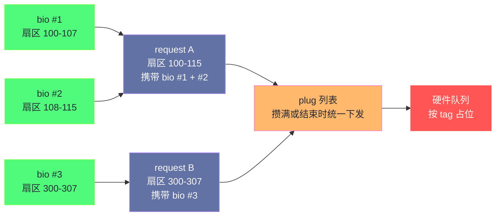
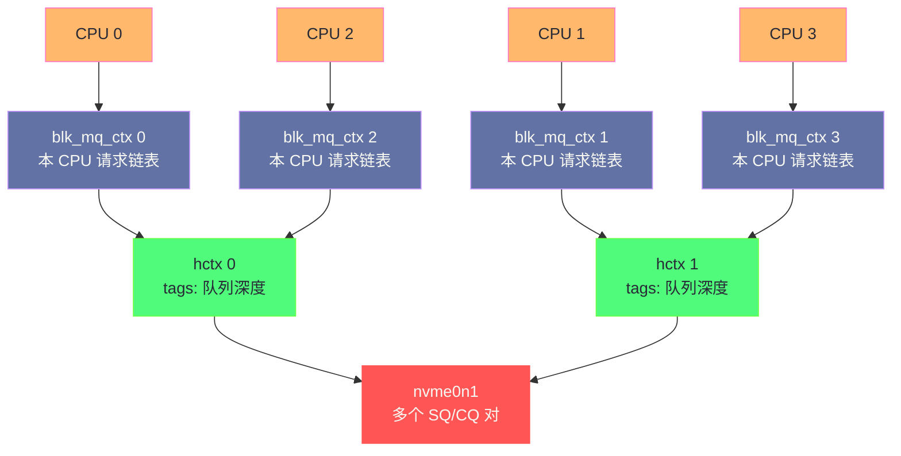
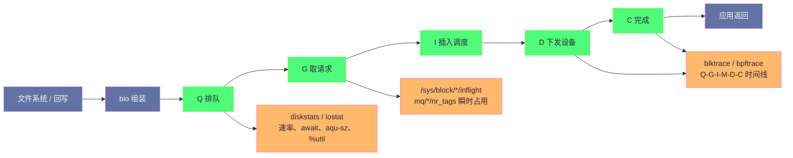
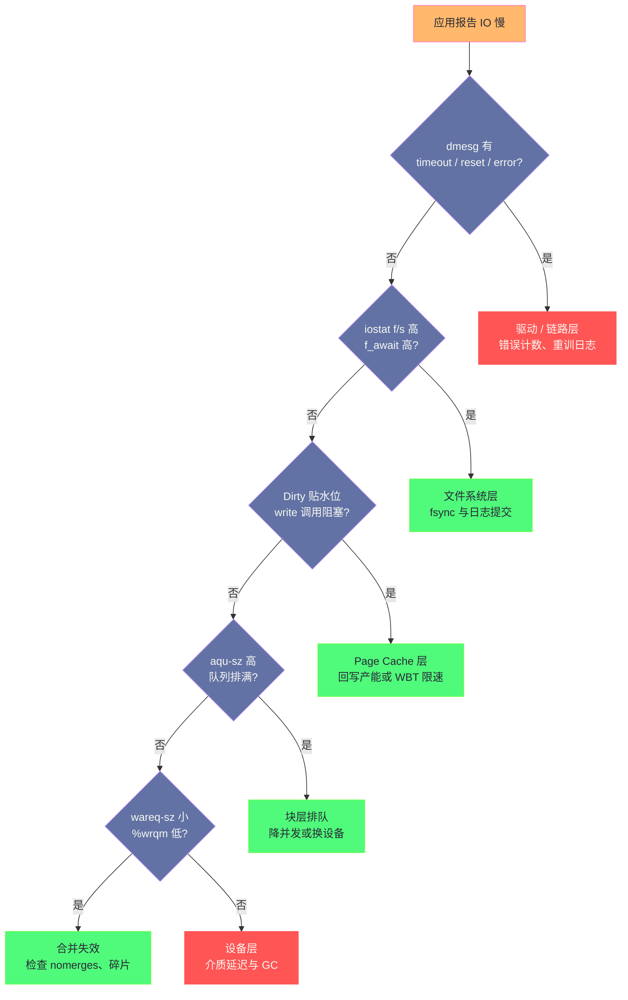

# 块设备栈——从 bio 到 blk-mq 的 IO 路径

**摘要：**

本篇把一次磁盘 IO 从文件系统一路跟到设备寄存器，并回答一个具体问题：多队列块层（multi-queue block layer，blk-mq）究竟改变了什么。下行路径分五段——VFS 找到文件对应的地址空间，具体文件系统（ext4 或 XFS）把文件偏移翻译成物理扇区，Page Cache 与回写决定这次 IO 是立即发生还是攒成一批，通用块层把内存页与扇区区间封装成 `bio`，块层再把若干 `bio` 合成 `request`、经 `plug` 批量下发到硬件队列，最后由驱动（nvme 或 scsi）写进设备的提交队列。`bio` 是块层的基本 IO 单元，`request` 是调度的实体，`plug` 与合并决定了下行时 IO 有多"厚"，tag 决定了一块盘能同时挂多少请求。blk-mq 的核心不是"更快"，而是把单队列时代的一把全局锁拆成 per-CPU 软件队列加多个硬件队列，让提交路径的锁争用从全局退化为局部；代价是合并机会被切碎、每队列深度被摊薄、公平性要另找机制补。文章后半段落到观测与判据：`iostat -x` 的六个字段与 `%util` 在 NVMe 上失效的机理、`/proc/diskstats` 的二十列、`blktrace` 与 `bpftrace` 的事件、`/sys/block/*/inflight` 的口径，以及"IO 慢"在五层上各长什么样；再以 Little's Law 说明队列深度与延迟的换算关系，并拆掉两个常见但无效的调参动作。

---

## 第 1 章 一次 IO 的地形

### 1.1 从一次 write(2) 说起

不妨从一个最普通的动作开始：某个进程调用 `write(fd, buf, 8192)`，把 8 KB 数据追加到一个已经打开的文件，随后调用 `fsync(fd)`。这两行代码在内核里触发的事情，比大多数人想象的要长得多，而它的形状在过去二十年里被改写过两次。

第一次改写发生在 2000 年代中后期，Page Cache 与回写线程的分工定型，文件系统的写不再等同于磁盘的写；第二次发生在 2014 年前后，块层的排队结构从"一条队列一把锁"变成"每 CPU 一条软件队列、设备若干条硬件队列"，即本篇的主角 blk-mq。两次都没有增加"层"的数量，却都改变了每层内部的责任边界，而现场对磁盘性能的困惑大多来自对这些边界的误判——把块层的排队延迟算到设备头上，或者拿标称 IOPS 去解释一条根本没填满的队列。

所以本篇的写法是：先把一次 IO 从顶到底走完一遍，标出每一段交接时究竟传递了什么；再回过头看 blk-mq 在这条路径上动了哪几处；最后把这条路径折叠成几张可以照着查的表。整个过程的载体，就是上面那 8 KB 数据。

### 1.2 交接单上只有四件事

用物流打比方：分拣中心只关心四件事——发到哪个地址、包裹里是哪几件货、总共多重、什么时限送达；货怎么装箱、箱怎么上车，是下一段流程的事。存储栈的每层交接遵循同样的纪律：只把下一层能理解的最小信息集交出去，其余细节留在本层。

从文件系统交给块层的那张交接单上，恰好也是四件事：

1. 目标块设备（`/dev/nvme0n1p1` 这类具体分区，而非"某个文件"）；
2. 设备上的扇区区间（起始逻辑块地址加长度，单位是 512 字节扇区）；
3. 内存里参与这次传输的页与页内偏移（可能不止一页，且不保证物理连续）；
4. 操作类型与若干语义标志（读、写、丢弃、写零，以及是否要求落盘、是否是元数据、是否可失败）。

这四件事的封装体就是 `bio`。块层之下的一切——合并、排队、调度、tag 分配、驱动下发——都只在这四件事上做文章，再也看不见"文件""偏移""inode"这些概念。这条分界线是理解整条栈的起点——文件系统只管**位置**，块层只管**搬运**。两者的关注点一旦混淆，讨论就会失焦，譬如把"随机读比顺序读慢"归因于块层调度不佳，其实是文件系统的映射结构（extent 树、B+ 树）在随机访问下多做了几次查找，块层只是被动接收了更多、更碎的区间。

### 1.3 三个尺寸与三种延迟

在往下走之前，得把三种尺寸单位的关系钉死，因为它们决定了后面所有结构为什么要那样设计。

扇区（Sector）是设备的读写单位，传统 512 字节；块（Block）是文件系统的分配单位，常见 4 KB；页（Page）是内核内存管理的单位，x86-64 上 4 KB。三者等大或成整数倍关系不是巧合：一页缓存正好装下一个文件系统块，一次块读写正好覆盖八个扇区，数据在内存与设备之间搬运时无需拆解重组。这条对齐关系在绝大多数场景下成立，但它在两种情况下会破：文件系统块小于页（1 KB 块、4 KB 页），以及设备逻辑块为 4 KB 而文件系统按 512 字节扇区记账（高级格式盘）。前者导致一个 `bio` 里可能塞进同一页的多个块，后者导致扇区号与实际介质访问单位错位，写放大因此产生。

延迟的量级分布同样要钉死，否则后面的判据无从谈起。按笔者的量级判断：内存访问百纳秒级；Page Cache 命中加一次系统调用的总开销在微秒以内；进入块层之后，一次 4 KB 随机 IO 在设备侧的服务时间，NVMe 盘是几十微秒量级，SATA SSD 在百微秒上下，机械盘是毫秒级（寻道占大头）；而在队列深度为一的前提下，端到端延迟大致就是"内核路径开销 + 设备服务时间"，其中内核路径在不做轮询时通常只占设备时间的零头，除非设备快到让软件栈成为瓶颈。

| 环节 | 典型量级（判断，非基准） | 决定因素 |
| :--- | :--- | :--- |
| L1 / 内存访问 | 1 ns / 100 ns | 硬件 |
| Page Cache 命中读 | 亚微秒到微秒 | 系统调用与拷贝开销 |
| 块层提交路径 | 微秒以内 | CPU 主频、是否命中合并、tag 竞争 |
| NVMe 设备服务 | 几十微秒 | NAND 读、控制器队列、GC |
| SATA SSD 设备服务 | 百微秒量级 | AHCI/NCQ、固件 |
| 机械盘服务 | 毫秒级 | 寻道、旋转、传输 |
| 网络块设备（云盘） | 百微秒到毫秒 | 网络往返 + 远端存储 |

这张表有一个实用推论：应用报告毫秒级延迟而 `iostat` 的设备侧 `await` 只有几十微秒，说明等待发生在设备之前——排队，或者在页缓存回写路径上被限速；反过来，`await` 本身就有几毫秒，问题已在设备或驱动层，软件栈再调也压不下去。判据的形状先在这里立住，第 8 章逐层填充。

### 1.4 本篇要回答的两个问题

第一个问题关于路径：一次 IO 从文件系统到设备，在哪些点上做了决策、输入是什么。第二个问题关于变化：blk-mq 替换掉单队列块层（single-queue block layer，下文简称 blk-sq）之后，哪些决策的位置变了、代价转移到了哪里。流传的答案大多停在"多队列消除锁竞争"这一句，它解释不了三个现场现象——换 NVMe 后顺序写吞吐没涨多少、`nr_requests` 调大后应用仍慢、`%util` 显示 100% 而盘还有余力。三个答案分别藏在合并、队列填充方式与统计口径里。

---

## 第 2 章 上半程：从 VFS 到 submit_bio

### 2.1 VFS 交出的只是地址空间

`write(2)` 进入内核后先到 VFS。这一层做三件事：根据 `fd` 找到 `struct file`，校验权限与打开模式，然后把调用转发到具体文件系统的 `write_iter` 方法上。对大多数磁盘文件系统来说，这个方法指向通用实现的 `generic_file_write_iter`，它再委托给 iomap 或旧式的缓冲写路径。

VFS 在这一步的职责止于"找到正确的对象"，真正被传递下去的是 `address_space`（地址空间）——文件在内存中的页缓存索引，加上偏移量与长度。页缓存以 `address_space` 为单位组织，而它挂在 inode 上，同一文件的多个打开实例共享同一份缓存页：两个进程写同一区域时改的是同一批页，谁先落盘取决于回写顺序而非写入顺序。

### 2.2 ext4 与 XFS：把文件偏移翻译成块号

数据要落到盘上，必须先回答"文件的第 N 个块在哪"。这个问题由具体文件系统的映射结构回答：ext4 用 extent 树（挂在 inode 上的多级树，描述"第几块起、共几块、对应物理块号"），XFS 用 B+ 树（按偏移组织的 extent 记录），两者都支持把连续的文件区间翻译成连续的物理区间，这正是顺序 IO 高效的结构基础。

映射的结果是一串"逻辑块号到物理块号"的对应关系，文件系统据此切出 `bio`：一段连续的物理扇区区间配上一组内存页。切分的粒度受三方面约束——文件的 extent 边界（跨 extent 必须拆）、页边界（一个 `bio` 里的页数有上限）、以及设备声明的最大传输长度（`max_sectors_kb`）。所以"一次 8 KB 写对应一个 `bio`"只是最理想的情况；在碎片化严重的文件上，8 KB 可能被拆成三四个 `bio`，每个指向不同的扇区区间，块层再逐个处理。这个事实解释了一个常见的观测反差：应用只发了一次 8 KB 写，而 `iostat` 的 `w/s` 涨了好几个数。

同一段逻辑在 XFS 上略有不同：XFS 的 extent 记录本身更紧凑，延迟分配（delayed allocation）把物理块的分配推迟到回写时刻，因此写路径上更常见的形态是"先占页缓存、回写时再一次性映射出一大段连续区间"。延迟分配对顺序写友好，对"写完立刻要空间保证"的场景不友好——`fallocate` 与 `fsync` 的差别正在这里。两种文件系统的取舍不展开，只记住结论：交给块层的扇区区间是否连续，取决于文件系统的**映射结构**，而不取决于应用怎么写。

### 2.3 回写：脏页攒成一批 bio

写操作在页缓存里只是把页标记为脏（`set_page_dirty`），并不立即产生 IO。真正的下行动作由回写触发，触发源有三类：脏页超过水位（`dirty_ratio` / `dirty_background_ratio`）、脏页存在时间超过阈值（`dirty_expire_centisecs`）、以及显式的 `fsync` / `sync` / `syncfs`。前两类由后台回写线程处理，第三类由调用者同步等待。

回写的组织方式对块层影响极大。内核在回写时并不是"脏一页发一次 IO"，而是按 `address_space` 批量取脏页、按 extent 聚合成尽量大的 `bio`，并且在一批写完之前持有 `blk_plug`（第 4 章展开）。这就是为什么一个正在做大量顺序写的系统，`iostat` 里看到的 `w/s` 很低而 `wkB/s` 很高——每个请求都很厚。反过来，随机写密集的系统里 `w/s` 高而 `wkB/s` 不高，合并率上不去，块层的排队压力就成倍增加。

回写路径上还有一层限速：写回节流（writeback throttling，WBT）按设备的目标延迟对回写做速率控制，避免后台刷脏挤死前台读，目标值暴露在 `/sys/block/*/queue/wbt_lat_usec`。它的存在意味着"回写慢"未必是设备慢。脏页水位、`fsync` 的精确语义、ext4 三种日志模式对回写顺序的影响，在 [[04 Page Cache 与脏页回写——Linux IO 的秘密缓冲层]] 里完整展开，本篇只取它对块层的输入形态：一批页、一段区间、一个 plug。

### 2.4 交棒点上，块层收到四样东西

行文至此，一次 IO 的上半程结束了。文件系统在 `submit_bio()` 这个函数上把控制权交给块层，交接的内容正是 1.2 节列出的四件事。这里值得停一下，把交接前后的信息差摊开看：

| 信息 | 文件系统知道 | 块层知道 |
| :--- | :--- | :--- |
| 数据属于哪个文件、哪个偏移 | 是 | 否 |
| 是否元数据（日志、inode、目录） | 是，通过 `REQ_META` 标注 | 只知道"是元数据"这个标志 |
| 是否要求持久化 | 是，通过 `REQ_FUA` / `REQ_PREFLUSH` 表达 | 只知道需要前置 flush 或强制写穿 |
| 物理扇区区间 | 是 | 是 |
| 内存页与页内偏移 | 是 | 是 |
| 设备与队列 | 是（分区到 gendisk） | 是 |

这张表说明了一件常被忽略的事：**块层是"无状态"的**，它不知道这些扇区为什么被访问，也不知道哪些请求属于同一个事务。所以它无法为文件系统的语义做任何优化，只能在"扇区区间"这个粒度上做合并与排序。所有跨越语义边界的需求——事务原子性、日志顺序、barrier——必须由文件系统用标志位提前表达，块层只负责执行。这也解释了为什么引入 FUA 与 preflush 之后，NVMe 上的 `fsync` 延迟会跳一个台阶：一次带 FUA 的写必须等介质确认，而普通写只要写进设备的易失缓存就算完成。

---

## 第 3 章 bio：块层的基本 IO 单元

### 3.1 一个结构，三组字段

`bio` 的定义在内核里几十年没大改，字段可以按用途分成三组。第一组回答"去往哪里"：`bi_bdev` 指向目标块设备，`bi_iter` 里的 `bi_sector` 是起始扇区、`bi_size` 是剩余字节数；第二组回答"带哪些内存"：`bi_io_vec` 指向一个 `bio_vec` 数组，`bi_vcnt` 是有效条目数，每个 `bio_vec` 由页指针、页内偏移、长度三个字段构成；第三组回答"完成时叫醒谁"：`bi_end_io` 是完成回调，`bi_private` 是回调的私有数据，`bi_status` 在回调里可读，用来说明这次 IO 成功还是失败。

```c
struct bio {
    struct block_device *bi_bdev;     /* 目标设备：分区级，不是文件 */
    blk_opf_t            bi_opf;      /* 操作类型 + 语义标志位 */
    struct bvec_iter     bi_iter;     /* 扇区号与已处理字节数，随拆分推进 */
    bio_end_io_t        *bi_end_io;   /* 完成回调：页缓存的解锁与唤醒在这里 */
    void                *bi_private;
    unsigned short       bi_vcnt;     /* bio_vec 有效条目数 */
    struct bio_vec      *bi_io_vec;   /* 页向量：散射-聚集的描述 */
    struct bio_vec       bi_inline_vecs[]; /* 内联小数组，省掉小 IO 的一次分配 */
};

struct bio_vec {
    struct page *bv_page;
    unsigned int bv_len;
    unsigned int bv_offset;
};
```

`bi_iter` 把"这次 IO 的进度"与"目标"分开：拆分时不必复制整个结构，只复制一份 `bvec_iter`，把 `bi_sector` 往后推、`bi_size` 减去已处理部分，页向量共享。代价是生命周期变复杂——子 `bio` 全部完成，父 `bio` 才能回收，由 `bi_remaining` 引用计数保证。

### 3.2 为什么必须是 scatter-gather

`bio_vec` 数组存在的理由，是内存页的物理不连续与磁盘扇区的逻辑连续之间的错配。一个 64 KB 的写，在页缓存里可能是 16 个物理页，这些页在内存里东一块西一块；而在设备看来，它只是从某个扇区开始的连续 128 个扇区。如果没有 `bio_vec`，内核只有两条路：要么按页拆成 16 次独立 IO（设备侧看到 16 个 4 KB 请求，吞吐和延迟都吃亏），要么先把 16 页拷贝到一块连续的 64 KB 缓冲区（多一次全量内存拷贝，还要额外分配）。

`bio_vec` 给了第三条路：把 16 个不连续的页描述成一个 IO，交给设备的散聚 DMA（scatter-gather DMA）去搬运。设备的 DMA 引擎按描述符逐段读取，数据不经过中间缓冲区。这条路径成立的前提是设备支持散聚——现代 NVMe 与 SATA 控制器都支持，但描述符数量有上限（`max_segments`），超过上限的 `bio` 会在进入队列时被拆分。所以在 `/sys/block/*/queue/max_segments` 上调大这个值，对超大 IO 的合并率有直接影响；调小则会增加拆分次数。

这里要澄清一个流传甚广的说法：`bio` 描述"多个不连续内存页到一段连续扇区"的映射，反过来说不成立——一个 `bio` 不能描述磁盘上的多个不连续区间，**扇区必须连续**。扇区必须连续是硬约束，合并只发生在"首尾相接"的 `bio` 之间；中间有空洞，再多的 `bio` 也只能并排排队。

### 3.3 谁在拆 bio

一次逻辑写很少恰好等于一个 `bio`，拆分发生在三个位置，理解它们的分工可以省掉大量排障时间。

**文件系统的拆分**由映射结构决定。跨 extent 的写必须拆；一个页内的多个块如果属于不同 extent，也要拆。ext4 在块大小等于页大小时可以走批量路径（一次读多个页、一个大 `bio`），块大小小于页大小时只能逐块处理，`bio` 数量成倍增加——这是 1 KB 块文件系统在小文件密集负载下 IO 次数偏高的结构性原因，与块层无关。

**块层的拆分**由设备限制触发。提交路径上的 `__bio_split_to_limits` 会检查扇区数是否超过 `max_sectors_kb`、段数是否超过 `max_segments`、起点是否满足设备的对齐约束（`dma_alignment`、`virt_boundary_mask`），任何一项不满足就切。这些限制来自驱动与硬件，`/sys/block/*/queue/` 下都能读到。调大 `max_sectors_kb` 能让单个请求更厚，但超过设备实际能一次处理完的长度时，驱动会在内部再拆，收益归零。

**页数上限**是第三道闸。`BIO_MAX_VECS` 为 256，一个 `bio` 最多描述 256 个页，按 4 KB 页算约 1 MB；更大的 IO 只能拆成多个 `bio` 再合并回 request。所以"单个请求最大 1 MB"有两层含义：`bio` 的上限来自向量数，`request` 的上限来自 `max_sectors_kb`，两者不必相等。

### 3.4 标志位：块层能理解的语义

`bio->bi_opf` 是操作类型与标志位的位域组合。操作类型定义做什么，标志位定义怎么做。常用的一组值如下表。

| 标志 | 含义 | 对下行路径的影响 |
| :--- | :--- | :--- |
| `REQ_OP_READ` / `REQ_OP_WRITE` | 读 / 写 | 决定走读路径还是写路径的统计与限速 |
| `REQ_OP_FLUSH` | 刷设备易失缓存 | 单独成请求，不可与普通读写合并 |
| `REQ_OP_DISCARD` / `REQ_OP_WRITE_ZEROES` | 丢弃 / 写零 | 不搬运数据，只发命令，但可能触发设备内部擦除 |
| `REQ_PREFLUSH` | 先刷缓存再执行本次写 | 块层会先生成一个 flush 请求，串行化前后顺序 |
| `REQ_FUA` | 强制单元访问，写穿到介质 | 设备必须确认落介质才回完成，延迟上一个台阶 |
| `REQ_META` | 元数据 IO | 部分调度器与限速器会给更高优先级 |
| `REQ_SYNC` | 同步 IO | 影响调度器的合并倾向与限速 |
| `REQ_RAHEAD` | 预读 IO | 允许失败、允许被丢弃 |
| `REQ_NOWAIT` | 拿不到资源立即返回 | 用于 `RWF_NOWAIT` 与部分异步框架 |
| `REQ_POLLED` | 由调用者轮询完成 | 与 `io_poll` 配套，跳过中断 |
| `REQ_NOMERGE` | 禁止参与合并 | 常用于有条带对齐要求或语义敏感的 IO |

最需要留意的是 `REQ_PREFLUSH` 与 `REQ_FUA`：它们看着只是多一个标志，实际会改变请求拓扑。带 `REQ_PREFLUSH` 的写被拆成"一个 flush 请求 + 一个写请求"，flush 必须等设备确认缓存刷完才放行；带 `REQ_FUA` 的在设备侧走不同命令路径，许多消费级盘对 FUA 要么缺失（回退成 flush + write），要么实现粗糙。数据库 `fsync` 在 NVMe 上几百微秒到几毫秒的波动，多半源自这两条路径的固件实现差异。

### 3.5 bio 与 request 的分界

`bio` 到达块层之后，下一步是变成 `request`。两者的关系可以这样理解：`bio` 是货运单，`request` 是车次。一张货运单可能被并入某个车次，一个车次也可能装多张货运单；车次有发车时间、有路线安排，而货运单只有目的地和货物。



合并的方向是单向的：多个 `bio` 可以并进一个 `request`，一个 `request` 不会被拆回多个 `bio`（只有在设备限制或错误重试时才拆）。`request` 用 `bio` 与 `biotail` 两个指针维护自己的 `bio` 链，用 `__sector` 与 `__data_len` 记录整段扇区区间，用 `tag` 标识自己在硬件队列里的位置。这三个信息一旦固定，`request` 就具备了被调度、被记账、被追踪的资格——`/proc/diskstats` 的每一列统计，记的都是 `request` 的生命周期，而不是 `bio` 的。

这也解释了为什么 `iostat` 的 `r/s` 与文件系统视角的"读次数"经常对不上：应用发 100 次 4 KB 读，如果扇区连续，块层可能合成 3 个 128 KB 的 `request`，`r/s` 只涨 3；如果扇区分散在 100 个位置，`r/s` 就是 100。统计口径的**分母是 request**，不是系统调用，也不是 bio。三个分母之间可以差出两个数量级，把它们的数值混着用是排查中最常见的自伤。

---

## 第 4 章 request、tag 与 plug：合并发生在哪里

### 4.1 request 的状态机

一个 `request` 从出生到回收走一条固定的状态线：由 `blk_mq_get_new_requests` 分配（此时持有调度器 tag 或驱动 tag）、填入 `bio`、尝试合并、插入调度队列或直接下发、被驱动消费、完成后记账回收；每个状态在 blktrace 事件里都有对应观测点，这是第 7 章能拿事件时间戳还原延迟分解的前提。它记着两类时间：入队时间与下发时间之差是队列等待，下发时间与完成时间之差是设备服务时间。`iostat` 的 `await` 把两段加在一起，无法区分"排队久"与"设备慢"，这个区分要靠 `aqu-sz` 与吞吐趋势组合推断。

### 4.2 tag：并行度的票据

现代存储协议允许同时向设备提交多个未完成的命令，这是深队列（queue depth）的物理基础。NVMe 用一个提交队列加一个完成队列实现它，SCSI 用 NCQ 或 tagged command queuing 实现它，virtio-blk 用 virtqueue 实现它。内核侧管理这个并行度的办法，是给每个在途请求分配一个整数编号，即标签（tag）。

tag 的分配与回收由标签集合（`blk_mq_tags`）负责，内部是两套可扩展位图（sbitmap）：普通 tag 与预留 tag（`nr_reserved_tags`，留给内存回收等不能等的路径）。容量就是队列深度，用尽时新请求要么等待、要么返回 `BLK_STS_RESOURCE` 让上层重试。这套结构在 4.x 后期从位图换成 sbitmap，动机与 blk-mq 相同：单把锁的位图在高并发下也是热点，sbitmap 给每个 CPU 一份缓存位图。

tag 的数量分两层。驱动 tag（`hctx->tags`）的数量由驱动在建立标签集合时声明，对应设备的真实队列深度；调度器 tag（`sched_tags`）的数量由 `nr_requests` 控制，只在启用 IO 调度器时存在。请求先拿调度器 tag 进调度队列，被调度器选中后再拿驱动 tag 下发；没有调度器（`scheduler` 为 `none`）时，请求直接拿驱动 tag，此时 `nr_requests` 就不参与限流了。这条链路是理解"调 `nr_requests` 为什么没效果"的关键，第 10 章会用整节说明。

### 4.3 plug：攒一批再发

合并的最大障碍是时间：如果每个 `bio` 一到块层就立刻下发，相邻的 `bio` 根本没有机会相遇。解决办法是给提交路径装一个缓冲区，让调用者在短时间内提交的一批 IO 先攒着，攒到一定条件再统一处理。这个机制叫 plug，字面意思是"塞住"，形象地说就是把水管先堵上蓄水，再一次性放。

plug 是任务级的，不是设备级的。`struct blk_plug` 挂在 `current->plug` 上，`blk_start_plug()` 把当前任务标记为"处于 plug 状态"，此后的 `submit_bio()` 不再立即下发，而是把 `request` 挂进 `mq_list`；`blk_finish_plug()` 统一调用 `blk_mq_flush_plug_list()`，按设备分组、尝试合并、批量下发。回写与文件系统批量操作是主要使用者，它们天然产生大量相邻扇区的 `bio`。

攒的时机有明确的阈值，超过就提前放水：请求数达到 `BLK_MAX_REQUEST_COUNT`（当前为 32，多队列场景放宽到两倍），或者最后一个请求的字节数达到 `BLK_PLUG_FLUSH_SIZE`（128 KB），又或者任务即将睡眠（`schedule()` 里的 `blk_flush_plug`）。这三条阈值分别对应"攒够了数量""攒够了厚度""不能再等了"，最后一条尤其重要：如果任务在 plug 未 flush 时进入睡眠，挂着的请求会无限期占着 tag，写回线程与某些同步路径因此死锁，所以调度器切换前必须放水。

plug 还顺带做批量分配：`blk_plug` 里的 `cached_rqs` 让回写这种"一次发几十个请求"的场景预取 `request` 结构，省掉逐个分配的开销，代价是内存占用与逻辑复杂度上升。

plug 的使用方式很简单，但误用会带来隐蔽的延迟：

```c
struct blk_plug plug;
blk_start_plug(&plug);        /* 之后提交的 IO 先挂起，攒批 */

for (每个待回写的页组) {
    submit_bio(bio);          /* 不立即下发，进入 plug 列表 */
}

blk_finish_plug(&plug);       /* 统一下发，此间尝试合并相邻请求 */
```

plug 攒的是请求而不是数据，不会跨设备混合，也不会跨越 flush 屏障合并。它对顺序负载收益最大，随机负载下只是把一批请求攒到一起再发，减少的是提交路径的锁开销。

### 4.4 合并的三条路径

一个 `bio` 想并入已有请求，会依次尝试三个位置，任何一处成功就不再往下走。

| 合并位置 | 触发时机 | 成功条件 | 失败原因 |
| :--- | :--- | :--- | :--- |
| 直接并入在途 `bio` 链 | `submit_bio` 前 | 同设备、同操作、扇区首尾相接、标志兼容、不超 `max_sectors_kb` | 扇区不连续、读写混杂、带 barrier |
| plug 列表合并 | 请求挂在 plug 期间 | 同上，且在同一个 plug 列表内 | 请求已越过阈值被 flush、跨设备 |
| 调度器合并 | 请求插入调度队列时 | 调度器在排序树里找到相邻请求，前并或后并 | 调度器为 `none`、`nomerges` 关闭、超长 |

三条路径的效率依次递减：第一条最便宜（只改指针与长度），第二条要遍历 plug 列表（列表不长，成本可控），第三条要在调度器的红黑树里找邻居（有锁、有比较开销）。这也解释了为什么 `none` 调度器在 NVMe 上往往性能更好——它放弃了第三条路径，把合并责任完全交给前两条，换来的是零排序开销；代价是失去了跨 plug 的合并机会，在随机混合负载下请求会碎一些。

合并的失效条件比成功条件更值得记住，因为现场调优基本都是跟失效条件打交道：

- **扇区不连续**。这是最主要的原因，随机负载下几乎必然发生。合并率低不代表块层有问题，只代表访问模式碎。
- **标志不兼容**。带 `REQ_PREFLUSH` 的写不能与普通写合并，带 `REQ_NOMERGE` 的请求根本不参与；日志提交、条带对齐、加密数据单元的写因此天然不可合并。
- **长度超限**。合并后超过 `max_sectors_kb` 或 `max_segments` 就放弃。这也是为什么把 `max_sectors_kb` 调大到超过设备能力后，合并率不变而拆分次数上升。
- **跨队列**。blk-mq 的合并发生在设备级队列上，但 plug 与软件队列是 per-CPU 的；两个 CPU 同时提交相邻扇区，各自的 plug 里都能合并，但两块相邻区间分属两个请求，最终在硬件队列里不会二次合并。这是多队列架构特有的一种"合并损失"，第 6 章展开。

### 4.5 合并率怎么读

`/proc/diskstats` 的第 5、9、16 列分别记录读、写、丢弃的合并次数，单位是"合并动作发生了多少次"，不是"合并了多少个 `bio`"。一个由 8 个 `bio` 组成的请求贡献 7 次合并，所以合并次数与请求数之比的上限是大请求内的 `bio` 数减一。`iostat` 把这些列换算成 `rrqm/s`、`wrqm/s` 与百分比 `%rrqm`、`%wrqm`，百分比的分母是该方向的请求数。

读数要配着请求大小一起看。假设一次回写产生 8 个相邻的 4 KB `bio`，合进一个 32 KB 请求，那么请求数是 1、合并次数是 7，`%wrqm` 达到 700% 量级（合并次数超过请求数、百分比超过 100 属于正常）。若同一负载下 `%wrqm` 只有个位数，`w/s` 很高而 `wareq-sz` 只有 4 KB 上下，说明合并没有生效，该查 `nomerges`、`max_sectors_kb` 与文件系统碎片。

| 观测组合 | 常见解释 |
| :--- | :--- |
| `w/s` 低、`wkB/s` 高、`wareq-sz` 大、`%wrqm` 高 | 顺序写，合并有效，块层工作正常 |
| `w/s` 高、`wareq-sz` 约等于块大小、`%wrqm` 低 | 随机写或跨线程交错写，合并无处落脚 |
| `w/s` 高、`wareq-sz` 大、`%wrqm` 低 | 单请求本来就大（如 `O_DIRECT` 大块写），无需合并 |
| `r/s` 高、`rareq-sz` 远大于块大小、`%rrqm` 高 | 预读在起作用，顺序读 |

还有一类合并发生在文件系统内部、块层看不见：多个相邻的小写被页缓存吸收进同一个脏页，回写时一次发出。这类"合并"不进入 `diskstats` 的合并列，却直接减少了请求数。所以当应用侧观测到"写了 1000 次、盘上只收到 30 个请求"时，功劳多半属于页缓存与回写，而不是块层——把两处合并混为一谈，会让调优方向偏到错误的一层。

---

## 第 5 章 blk-mq：把一条队列拆成两层

### 5.1 单队列的三笔成本

blk-sq 的结构简单到可以一句话说完：所有 CPU 的 IO 都提交到同一个 `request_queue`，入队时拿 `queue_lock`，调度器在同一把锁下排序，驱动在同一把锁下取请求，出队时再拿一次。这套结构在机械盘时代完全够用——盘本身每秒只能处理几百个 IO，锁的持有时间与 IO 的完成时间相比可以忽略。

到了 2010 年代初，队列深度从个位数涨到几十、几百，三笔成本同时浮出水面：锁争用（所有核心在同一点排队，`_raw_spin_lock` 占比随核数上升）、缓存行迁移（锁与队列头在核心间弹跳，一致性协议吃掉真正干活的时间）、以及提交带宽（单条队列的入队吞吐本身有上限，多核抢一条队列等于把并行度压回单核）。

三笔成本在 NVMe 出现之后变成硬墙：一块中端盘的 4 KB 随机读在几十万 IOPS 量级，单队列软件栈能喂给它的可能只有几万。瓶颈不在盘，也不在 CPU 算力，而在那一条队列的串行化。

### 5.2 两级队列与三级标签

blk-mq 把队列分成两层。上层是软件队列（software staging queue），每个 CPU 一个，用 `blk_mq_ctx` 描述，主要工作是承接提交、尝试合并、把请求暂存在本 CPU 的链表里。下层是硬件队列（hardware dispatch queue），数量由设备与驱动决定，用 `blk_mq_hw_ctx` 描述，每个硬件队列对应设备侧一个真实的提交通道（NVMe 的一个提交队列/完成队列对，或 SCSI 的一个 tag 池）。



两个队列之间是多对一的映射：一个硬件队列可以服务多个 CPU，一个 CPU 的请求在理想情况下只进一个硬件队列（由 `hctx->cpumask` 决定），但允许在负载不均时被分到其他队列。映射关系在设备初始化时建立，驱动可以通过 `blk_mq_ops.map_queues` 自定义，也可以使用默认的按 CPU 编号取模分配。硬件队列还可以按用途再分类，`HCTX_TYPE` 区分常规队列、只跑读的队列与轮询队列，轮询队列是 io_uring 直连设备那套机制的基础，[[10 现代存储技术——NVMe、io_uring 与用户态存储]] 有完整讨论。

标签是三层：软件队列里的请求先持有调度器 tag，硬件队列里的请求持有驱动 tag，设备内部还有自己的命令编号——内核侧两层、设备侧一层。三层各有容量上限，任何一层满了提交路径就停下等待。这把"队列深度"从模糊概念变成三个可测的数字。

### 5.3 提交路径的一次完整走位

把前四章的结构接到 blk-mq 上，一次读 IO 的下行路径如下。函数名以 6.x 主线为准，版本差异不影响理解主干。

```text
read(2) → vfs_read → filemap_read
  └─ 页缓存未命中，分配页并加锁
      └─ ext4 / XFS 映射到物理块号
          └─ bio_alloc + bio_add_page 组装 bio
              └─ submit_bio → submit_bio_noacct
                  ├─ 记账：bdev_start_io_acct
                  └─ blk_mq_submit_bio
                      ├─ 先试合并：bio 与同设备在途请求是否首尾相接
                      ├─ __bio_split_to_limits：超限就拆
                      ├─ 拿 tag（调度器 tag 或驱动 tag）
                      ├─ blk_mq_bio_to_request：填扇区、挂 bio 链
                      └─ 有 plug → 挂进 plug 列表，等 flush
                          无 plug → blk_mq_try_issue_directly 直接下发
                              └─ blk_mq_run_hw_queue → blk_mq_dispatch_rq_list
                                  └─ ops->queue_rqs / ops->queue_rq
                                      └─ nvme_queue_rq：写 SQ 条目、敲 doorbell
                                          └─ 设备 DMA 到页缓存页
                                              └─ 中断 → nvme_irq
                                                  └─ blk_mq_complete_request
                                                      └─ bio_endio → 解锁页、唤醒进程
```

路径上有三个分叉值得记住，它们是不同延迟形态的源头。

第一个分叉在合并。合并成功意味着这个 `bio` 只是既有请求的延长——省掉一次 tag 分配、一次队列插入、一次驱动调用与一个设备侧命令；合并失败则每个 `bio` 独立走完全程。订单库那种"每笔 8 KB、扇区分散"的负载在这里吃亏最多。

第二个分叉在 plug。有 plug 时，请求被攒着，延迟增加但吞吐效率提升；无 plug 时（同步 IO 没有批量上下文），每个请求立即下发，延迟最低但合并机会最少。同一个设备上，一次 `pwrite + fsync` 与一次后台回写，走的就是这两条不同的分支。

第三个分叉在直接下发与经调度器下发。`none` 调度器下请求直接进驱动 tag；有调度器时先进调度队列，由调度器决定顺序，可能被重排、可能被延迟到下一个时间片。这是 [[06 IO 调度器——CFQ、Deadline 与 mq-deadline 的演进]] 的地盘，本篇只需要知道：调度器存在与否，会改变请求在块层里停留的时长。

### 5.4 三个数字的关系

`nr_requests`、`nr_hw_queues`、`queue_depth` 经常被混着说成"队列深度"，实际是三件不同的事。

| 参数 | 含义 | 默认与上限 | 调大的收益 | 调大的代价 |
| :--- | :--- | :--- | :--- | :--- |
| `nr_requests` | 每个硬件队列的调度器 tag 数，即软件侧可挂起的请求数 | 默认 128 量级；有调度器时上限 1024，无调度器时不超过 `queue_depth` | 深队列负载下减少 tag 耗尽导致的等待 | 内存占用上升；调度器排序开销变大；对同步 IO 无意义 |
| `nr_hw_queues` | 硬件队列个数，即并行出口数 | 由设备与驱动决定；NVMe 通常等于在线 CPU 数（受控制器队列数限制） | 提升提交并行度，减少单队列锁竞争 | 每队列深度被摊薄；合并机会被切碎；中断与软中断开销上升 |
| `queue_depth` | 每个硬件队列的驱动 tag 数，即设备能同时挂多少条命令 | 由驱动声明；nvme 驱动由模块参数 `io_queue_depth` 决定，默认 1024，并受控制器队列能力约束 | 提升设备侧并发，压满设备内部并行度 | 超过设备真实并行度后只增延迟不增吞吐；内存与完成处理开销上升 |

三者乘起来不是"并发 IO 上限"。理论上在途请求数不超过 `nr_hw_queues × queue_depth`，实际能达到多少取决于应用有没有发出那么多并发、CPU 有没有余力处理提交与完成、设备内部通道能不能吃下。拿"32 队列 × 1024 深度"宣称设备支持 32768 个并发 IO，算术没错，工程上误导——那只是缓冲区容量，不是吞吐能力。

读数的方式也要跟着改。`nr_hw_queues` 在较新内核里已不再作为 `queue/` 下的属性暴露，可靠的读法是数 `/sys/block/*/mq/` 下的子目录个数；每个子目录里能看到 `nr_tags`（该硬件队列的驱动 tag 数）、`nr_reserved_tags`（预留 tag 数）、`cpu_list`（哪些 CPU 映射到它）。这三个文件比任何调优文章都可靠，因为它们读的是运行时的真实结构。

### 5.5 /sys/block/*/queue/ 该看哪些

`queue/` 目录下的属性有几十个，绝大多数与 IO 路径无关。按"回答哪个问题"来筛，真正需要知道的是这十二个：

| 属性 | 回答什么问题 | 读数的意义 |
| :--- | :--- | :--- |
| `scheduler` | 走不走调度器 | 方括号里的是当前生效值；`none` 表示直通驱动 |
| `nr_requests` | 软件侧能挂多少请求 | 只在有调度器时是硬约束 |
| `max_sectors_kb` | 单请求上限 | 合并的上限由它决定；超过设备能力的值无意义 |
| `max_sectors_kb` 的硬上限 `max_hw_sectors_kb` | 设备能一次处理多长 | 只读；`max_sectors_kb` 不能超过它 |
| `max_segments` | 一次散聚 DMA 最多几段 | 太小会拆大 IO，太大对设备无用 |
| `logical_block_size` | 设备逻辑块大小 | 4 KB 的设备上，不对齐的小写会被读改写放大 |
| `physical_block_size` | 设备物理块大小 | 判断是否值得做 4 KB 对齐 |
| `read_ahead_kb` | 预读窗口 | 顺序读有效，随机读有害 |
| `nomerges` | 合并是否被关闭 | 0 全开、1 只允许简单合并、2 全关 |
| `rotational` | 是否被视为机械盘 | 影响调度器默认选择与预读策略 |
| `wbt_lat_usec` | 写回节流的目标延迟 | 回写被限速时会在此体现 |
| `io_poll` / `io_poll_delay` | 是否允许轮询完成 | 低延迟场景才开，开了浪费 CPU |

这张表里没有 `%util`、没有 `await`，因为那些是统计量而不是配置。把配置与统计混在一张表里对比，是很多"调优指南"最有毒的遗产。

---

## 第 6 章 与单队列块层的实质差别

### 6.1 拉模型：驱动来取

blk-sq 对驱动提出的契约是：驱动注册一个 `request_fn` 回调，块层有自己的"泵"（`blk_run_queue`），泵在队列锁保护下调用 `request_fn`，驱动在回调里用 `blk_fetch_request` 主动取请求。队列所有权在块层，驱动是"被叫来取货的"。好处是排序、合并、限流都在单点完成；坏处是泵串行，一次只能有一个 `request_fn` 在跑，驱动的下发时间直接计入锁的持有时间——一块下发要几百微秒的慢盘足以让其他核心干等。

### 6.2 推模型：块层把请求推给驱动

blk-mq 把这个契约反转了。驱动实现 `blk_mq_ops.queue_rq(hctx, bd)`，块层在分发时把请求"推"进去，驱动只负责把这一条请求写进设备的提交队列并返回状态；返回 `BLK_STS_OK` 表示已接手，返回资源不足则由块层重新排队。队列的所有权下放到硬件队列：每个 `hctx` 有自己的锁与自己的 tag 池，分发在 `hctx` 粒度上并行。

契约反转带来两个直接后果。其一，锁的争用范围从"整个设备"缩小到"单个硬件队列"，多核提交不再互相等待。其二，驱动的下发耗时不再影响其他队列——某条队列的驱动慢，只堵那条队列。块层因此从"中央调度台"变成了"分拣线"，这也是为什么 blk-mq 的补丁能在一个版本周期内把 NVMe 的 IOPS 从几万推到几十万。

稳妥的说法是：blk-mq 改变的是**提交路径的结构**，不是设备能力。它把一次提交从"多核抢一把锁"变成"各自排队、各自下发"。反过来，对队列深度只有个位数的机械盘，这套结构的收益接近于零，开销却是实打实的——每个 CPU 一套 `blk_mq_ctx`、每个硬件队列一套 tag 数组与两个位图。

| 维度 | blk-sq（旧单队列） | blk-mq（多队列） |
| :--- | :--- | :--- |
| 队列数量 | 每设备一条 | 每 CPU 一条软件队列 + 每设备若干硬件队列 |
| 锁 | 一把 `queue_lock` 保护全队列 | 每 `hctx` 一把锁，提交路径基本无跨核争用 |
| 驱动接口 | `request_fn`，驱动主动取（拉） | `queue_rq` / `queue_rqs`，块层推送（推） |
| 并行度来源 | 单点串行，靠减少锁持有时间优化 | 多队列并行，靠增加出口数提升 |
| 调度器 | CFQ、deadline、noop 等，单队列内排序 | mq-deadline、bfq、kyber、none，每 `hctx` 独立排序 |
| 合并 | 全局视图，跨 CPU 也能合并 | 局部视图，跨 plug 合并机会减少 |
| 现状 | 5.0 起从内核移除 | 唯一的块 IO 路径 |

### 6.3 多队列的代价

没有免费的架构。blk-mq 换来并行度，付出的代价集中在四处，每一处都对应一类现场问题。

第一处是合并损失。合并需要"看到相邻请求"，而 blk-mq 的视野被 per-CPU 队列切碎：两个 CPU 各自提交一段相邻扇区，各自在自己的软件队列里合并，进了硬件队列不会再合并。单队列时代这种合并是自动的。单线程顺序写不受影响（同一 CPU、同一 plug），多线程顺序写在 blk-mq 上反而更碎——这是"多线程写还不如单线程快"的来源之一。

第二处是深度摊薄。设备的队列深度是固定的，硬件队列越多，每个队列分到的深度越少。当 `nr_hw_queues` 大于实际并发 IO 数时，请求被分散到多条浅队列上，每条队列都占不满，调度器的排序与合并失去上下文。于是出现一种反直觉的调优方向：低并发场景下**降低队列数**、把多个 CPU 绑到同一个队列，反而能提升吞吐。有些驱动提供了控制队列数的参数，动机就在这里。

第三处是公平性。单队列只有一条排序线，公平性在排序时自然成立；多队列没有全局视图，A 进程的请求在队列 0 排队、B 进程的在队列 1 排队，谁快谁慢取决于映射关系。现代内核用三层机制补这个缺口：`blk-throttle` 做绝对限速（走自己的限速钩子），`iocost` 做按权重的成本分配（挂在 `rq_qos` 框架上），`bfq` 在单队列内做时间片公平。[[08 存储栈性能调优——从 fio 到 iotop 的全套方法论]] 会用到这些接口。

第四处是开销放大。分层结构带来了额外对象：每 CPU 的 `ctx`、每 `hctx` 的 tag 池与位图、plug 列表、批量分配缓存。4 KB 随机 IO 这种"小请求、高频率"场景下相对开销尤其明显——数据只有 4 KB，记账、分配、位图操作却不少。这也是 SPDK 那类用户态驱动的空间：省掉的正是这些固定成本。

### 6.4 版本脚印

把时间线摊开，能看清这条演进不是一次发明，而是一串迁移。2013 年底的 3.13 合并窗口，blk-mq 作为可选路径进入内核，只有少数驱动支持；随后几个版本里，`scsi-mq`、`virtio-blk`、`dm`、`nvme` 陆续被移植；4.20 里 device-mapper 先移除了自己的旧 `request_fn` 支持，为彻底删除旧路径铺路；原计划在 4.21 完成旧块层与 CFQ 等旧调度器的移除，而 4.21 那一版最终改号成了 5.0——所以"CFQ 在哪个版本消失"这个问题，答案同时是 4.21 和 5.0。5.0 之后，内核里只剩一条块 IO 路径，`/sys/block/*/queue/scheduler` 里能选的调度器变成 `none`、`mq-deadline`、`kyber`、`bfq` 四个。5.1 前后加入轮询队列，6.x 起加入批量提交接口 `queue_rqs`，页缓存也继续向 folio 迁移——每一次都是在这套结构上继续加优化，而不是推翻重来。

---

## 第 7 章 四个观测点

### 7.1 iostat -x：六个字段与一个失效的指标

`iostat -x` 是使用最广也最容易误读的工具。它的数据全部来自 `/proc/diskstats`，只是把累计值换算成每秒速率与平均值。真正需要理解的只有六个字段：

| 字段 | 定义 | 怎么用 |
| :--- | :--- | :--- |
| `r/s` / `w/s` | 每秒完成的读 / 写请求数 | 统计单位是 request，不是系统调用 |
| `rkB/s` / `wkB/s` | 每秒读 / 写的数据量 | 与 `r/s` 配合可得平均请求大小 |
| `rareq-sz` / `wareq-sz` | 平均每次请求的扇区数（换算成 KB） | 判断合并是否生效的直接证据 |
| `r_await` / `w_await` | 读 / 写请求的平均端到端耗时（毫秒） | 含排队时间，不等于设备服务时间 |
| `aqu-sz` | 平均排队长度（未完成的请求数） | 判断是否饱和的主指标 |
| `%util` | 设备"忙"的时间占比 | 单通道设备可用，深队列设备失效 |

`svctm` 已经不在现代输出里了——sysstat 先在手册页标注"不要再相信这个字段"，随后把它从输出中删除，具体小版本取决于发行版。它的本意是"设备服务时间"，但块层的排队与服务在完成回调里已经混在一起，测不出这个值，只能靠 `await` 与排队长度反推，误差极大。看到老文章还在教人"用 `await` 减 `svctm` 得到排队时间"，可以直接跳过。

`%util` 的问题更值得展开。它的算式是"设备忙于处理 IO 的毫秒数 / 采样窗口毫秒数"，其中"忙"的判定来自 `io_ticks`：只要有请求在途，时间就被计入。这套算法隐含一个假设——设备只有一条处理通道，同一时刻只能处理一个请求。机械盘与单队列 SATA 盘大致符合这个假设，所以 `%util` 逼近 100% 意味着接近饱和，这个经验在历史上是成立的。

NVMe 打破了这个假设。一块盘同时挂着几十个请求是常态，`io_ticks` 从第一个请求进队到最后一个请求完成几乎全程为"忙"，于是 `%util` 稳定 100%，而实际利用率可能只有三成；加上 `io_ticks` 的累加粒度受 jiffies 限制，短促 IO 还会被抹平。判断 NVMe 饱和度要看 `aqu-sz` 与 `await` 的趋势、`r/s` 是否已不再随队列深度增长；`%util` 只适合判断"这块盘有没有在干活"。

### 7.2 /proc/diskstats：二十列的口径

`/proc/diskstats` 每行二十列，是 iostat、sar、node_exporter 等一切工具的数据源。理解它比理解任何工具都划算，因为换算关系一目了然。

| 列 | 含义 | 换算 |
| :--- | :--- | :--- |
| 1-3 | 主设备号、次设备号、设备名 | — |
| 4 | 完成的读请求数 | 除以采样秒数得 `r/s` |
| 5 | 读合并次数 | 除以采样秒数得 `rrqm/s` |
| 6 | 读扇区数 | 乘 512 得字节数，除以秒数得 `rkB/s` |
| 7 | 读耗时累计（毫秒） | 除以第 4 列得 `r_await` |
| 8-11 | 写请求数、写合并次数、写扇区数、写耗时 | 同上，对应写方向 |
| 12 | 当前在途 IO 数 | 瞬时值，精细观察用 `/sys/block/*/inflight` |
| 13 | 设备忙累计（毫秒） | 除以窗口毫秒数得 `%util` |
| 14 | 加权耗时（毫秒） | 除以窗口毫秒数得 `aqu-sz` |
| 15-18 | 丢弃请求数、合并次数、扇区数、耗时 | 对应 `d/s`、`dkB/s` |
| 19-20 | flush 请求数与耗时 | 对应 `f/s`，`fsync` 密集时看这两列 |

有两处容易算错。`await` 是各方向耗时除以各方向请求数，不是"总耗时除以总请求数"，读写混合时要分开算。`aqu-sz` 由第 14 列加权耗时推导，含义是"每个时刻平均有多少请求在系统里（排队加服务）"，与第 12 列的瞬时在途数不是一回事。

### 7.3 blktrace 与 bpftrace：看到事件序列

`diskstats` 只有结果，没有过程。要看清一个请求在块层里停了多久、被合并了几次，得靠事件追踪。内核在块层的每个关键位置埋了 tracepoint，`blktrace` 把它们按 CPU 收集成流，`blkparse` 负责合并成可读的时间线。

| 动作 | 含义 | 出现位置 |
| :--- | :--- | :--- |
| `Q` | bio 排队 | 提交到块层 |
| `G` | 拿到 request | 分配 tag 成功 |
| `I` | 插入调度队列 | 进入调度器排队 |
| `M` | 合并 | 并入已有请求 |
| `D` | 下发设备 | 调用驱动的 `queue_rq` |
| `C` | 完成 | 设备回报完成 |
| `P` / `U` | plug / unplug | 攒批与放水 |

一轮分析的标准做法是：先跑 `blktrace` 抓十秒，再用 `blkparse` 看 `D` 到 `C` 的间隔（这是设备服务时间）与 `Q` 到 `D` 的间隔（这是块层停留时间）。两段一比，"慢在块层还是慢在设备"立刻分明。`Q` 到 `D` 长而 `D` 到 `C` 短，说明请求在软件队列里排队，多半是队列深度或调度器策略的问题；反过来则指向设备、固件或链路。

`bpftrace` 是更轻的替代，不必落盘就能做聚合。下面这段按"下发到完成"的间隔出直方图，用 key 区分设备与起始扇区，完成时记得清理状态，否则 map 会一直涨：

```bash
bpftrace -e '
tracepoint:block:block_rq_issue {
    @start[args->dev, args->sector] = nsecs;
}
tracepoint:block:block_rq_complete {
    @start[args->dev, args->sector]
        ? (@lat_us = hist((nsecs - @start[args->dev, args->sector]) / 1000),
           delete(@start[args->dev, args->sector]))
        : 0;
}'
```

这里有个必须知道的口径：完成事件发生在中断或软中断上下文，`comm` 与 `pid` 是当时的内核线程，不是发起 IO 的进程。要把延迟归因到进程，得在下发时把 `comm` 存进 map；直接拿完成事件的 `comm` 当答案，只会看到一堆 `swapper` 与 `kworker`。

块层事件按设备号聚合，分区与整盘的设备号不同；分析分区 IO 时要确认抓到的是哪个号，否则两个 map 都对不上。

### 7.4 inflight 与 mq 目录：最便宜的窗口

如果只需要一个数字判断"现在盘上压着多少请求"，`/sys/block/*/inflight` 是最省事的：两个整数，分别是读与写在途数。它是瞬时值，刷新频率取决于读取时刻，不做平均，也不区分排队与服务。配合 `/sys/block/*/mq/*/nr_tags` 就能算出每个硬件队列的占用比——`inflight` 除以 `nr_hw_queues × nr_tags` 大致就是队列填充率，填充率长期接近 1 而应用侧延迟仍在上升，说明排队已经饱和，再加深队列只会把延迟推得更高。



四个观测点互补而非替代：`diskstats` 便宜但只有结果，`blktrace` 精细但开销大，`bpftrace` 居中但要自己写聚合，`inflight` 最便宜但只有快照。排障顺序从便宜到贵：先 `iostat -x` 定方向，再用 `inflight` 确认队列，需要精确定位时上 `bpftrace`，最后用 `blktrace` 抓全量时间线。

---

## 第 8 章 "IO 慢"的五层定位判据

### 8.1 一个可以照着走的判据表

判据的价值不在于覆盖所有情况，而在于把"感觉慢"变成"某层有异常"。下表按层给出可观测的症状与对应的确认手段，顺序即排障顺序。

| 层 | 典型症状 | 先看什么 | 判据 |
| :--- | :--- | :--- | :--- |
| 文件系统 | `fsync` 返回慢，吞吐正常 | `iostat` 的 `f/s`、`f_await`；`bpftrace` 打 `vfs_fsync_range` | `f/s` 不高但 `f_await` 高，说明每次 flush 都在等设备确认 |
| Page Cache | 写请求周期性卡住，`D` 状态线程增多 | `/proc/meminfo` 的 `Dirty`、`Writeback`；`vm.dirty_*` 参数 | 脏页贴近水位，写线程在 `balance_dirty_pages` 里睡眠 |
| bio / request | 延迟高但设备不忙 | `%wrqm`、`wareq-sz`、`aqu-sz` | 平均请求远小于块大小说明合并失效；`aqu-sz` 低而 `await` 高说明不是排队问题 |
| 驱动 | 偶发超时、重置、错误日志 | `dmesg` 关键字；`/sys/block/*/device/` 计数 | 出现 `timeout`、`reset`、`abort`、`I/O error` 即判定驱动或链路层异常 |
| 设备 | 延迟基线本身就高 | `await` 与请求大小、读写比例；SMART 与介质错误计数 | 小 IO 也多毫秒级、错误计数增长、SMART 有告警 |

### 8.2 文件系统层：等待发生在提交

`fsync` 慢是数据库场景最常见的主诉。它的路径与普通写不同：先等脏页落盘，再等日志提交，最后等设备把易失缓存刷到介质，三件事都带"等设备确认"的语义。这一层的慢有个特征——吞吐正常、`w/s` 不高，唯独 `f/s` 与 `f_await` 突出。用 `bpftrace` 挂 `vfs_fsync_range` 的返回时长能直接画出分布，比平均值有用，因为这类延迟是"绝大多数很快、少量极慢"，平均值会把尖峰抹掉。

同一层还有一类慢与日志相关：元数据密集的负载（建大量小文件、频繁 `rename`）会让日志提交成为串行点，表现为 `w/s` 很高而 `wareq-sz` 很小，其中相当比例是带 `REQ_META` 的写。这类写几乎无法合并，也无法跳过，属于文件系统语义的固有成本。ext4 的三种日志模式对它的影响、`fsync` 在什么情况下返回成功却没真正落盘，都在 [[04 Page Cache 与脏页回写——Linux IO 的秘密缓冲层]] 里逐条拆过。

### 8.3 Page Cache 层：回写跟不上

第二层的症状是"写调用本身卡住"。脏页超过阈值之后，写路径上的 `balance_dirty_pages` 会让发起者进入睡眠，直到回写腾出空间；表现出来就是应用线程周期性变慢，而磁盘侧的 `w/s` 看起来并不高。确认方法很直接：连续采样 `/proc/meminfo` 的 `Dirty` 与 `Writeback`，若 `Dirty` 长期贴着 `dirty_ratio` 对应的绝对值，且 `Writeback` 也有相当数量，就说明回写产能不足。

这一层还有一个容易误判的分支：写回节流。WBT 会按目标延迟对回写做限速，`wbt_lat_usec` 越小限得越狠；在混合读写负载下，节流器为了保护前台读会把回写压得很低，于是"回写慢"其实是策略选择而不是能力不足。把 `wbt_lat_usec` 临时调大或置零观察变化，是区分两种情况的快办法，但这是诊断动作，不是调优建议。

### 8.4 bio / request 层：合并率与队列填充

第三层是块层自身。这一层的两个指标——合并率与队列填充率——分别对应两类问题。

合并率低（`%wrqm` 个位数、`wareq-sz` 约等于块大小）意味着块层收到的是碎请求。原因可能在文件系统（碎片、跨 extent），可能在访问模式（随机、多线程交错），也可能在配置（`nomerges` 被设成 2、`max_sectors_kb` 被调小）。判定时要排除最后一项，因为它是唯一能靠配置立刻改变的。

队列填充率低（`aqu-sz` 接近 0 而延迟不低）意味着请求根本没在块层排队，慢在别处——要么设备每次都很慢，要么采样点选错了设备（分区号与整盘号）。反过来，`aqu-sz` 高且随负载线性增长，说明队列已经排满，此时加深队列只会把延迟继续推高，正确的方向是降低并发或换设备。

### 8.5 驱动层：错误计数与内核日志

第四层的证据最硬，因为驱动会直接把异常记下来。SCSI 设备在 `/sys/block/sdX/device/` 下有一组计数器，`iorequest_cnt` 是发出的请求总数，`iodone_cnt` 是完成的，`ioerr_cnt` 是失败的，三者一比就知道错误率。同时 `state` 文件会显示设备是否处于离线或降级状态。

NVMe 侧没有同名的计数器，要靠 `dmesg` 与 SMART 日志：出现 `I/O timeout`、`Abort status`、`resetting controller`、`controller is down` 这类字样，说明命令已经超时并由内核发起重置；`nvme smart-log` 里的错误日志条目数与介质错误计数持续增长，则指向闪存或固件问题。

这一层还有一个常被忽略的来源：链路。SATA 链路降速、PCIe 链路重训、多路径切换失败，都表现为"偶发的慢"；`dmesg` 里与 `link`、`speed`、`retrain` 相关的时间戳，往往能解释按小时出现的延迟尖刺。

### 8.6 设备层：介质本身的脾气

最后一层是介质。NVMe 的读延迟在无干扰时很稳定，写延迟受垃圾回收影响：盘越满、写入越随机，写放大越重，长尾越厚。SATA SSD 受 SLC 缓存耗尽影响，机械盘受寻道距离影响。这一层的确认手段是看延迟分布而非平均值，以及 SMART 的磨损、重映射与介质错误计数。

把五层合成一张判据图，按顺序问五个问题，每一问的"否"都往下一层走：



回到贯穿案例：订单库的 `fsync` p99 从两百微秒涨到八毫秒，`w/s` 与吞吐都没变。按这张图走，第一步排除 `dmesg` 异常，第二步看 `f/s` 与 `f_await`——`f_await` 涨到毫秒级而 `f/s` 稳定，判定在文件系统层的提交路径；再往下查，发现日志设备的 `wbt_lat_usec` 被上一轮调优设得过小，回写被节流，日志提交排队。整条排查没有用到 `%util`，也没有调 `nr_requests`。

---

## 第 9 章 队列深度与延迟：Little's Law 的实际含义

### 9.1 三个量的换算式

排队论里最朴素的一条定律是 Little's Law：系统内的平均顾客数等于到达率乘以平均停留时间。搬到存储栈上，就是"在途请求数 = 吞吐 × 延迟"，移项得：

```text
IOPS = 队列深度 / 平均延迟
平均延迟 = 队列深度 / IOPS
```

这两个变形的用处不一样。前一个用来估计"给定延迟，需要多深的队列才能跑满吞吐"；后一个用来判断"当前延迟里有多少来自排队"。举个示例推算：一块盘在队列深度为 1 时 4 KB 随机读 10 微秒到不了，按 100 微秒算，那就是 1 万 IOPS；要让吞吐到 30 万 IOPS，按公式需要 30 个在途请求；如果实测到 30 万 IOPS 时延迟是 110 微秒，反推队列深度约 33，与设计的 32 基本吻合，说明没有额外的排队膨胀。

| 队列深度（示例） | 吞吐（示例推算） | 平均延迟（示例推算） | 状态 |
| :--- | :--- | :--- | :--- |
| 1 | 1 万 IOPS | 100 微秒 | 串行，延迟最低 |
| 8 | 8 万 IOPS | 105 微秒 | 并发提升，延迟略涨 |
| 32 | 29 万 IOPS | 110 微秒 | 接近设备并行上限 |
| 128 | 40 万 IOPS | 320 微秒 | 吞吐饱和，延迟开始膨胀 |
| 512 | 40 万 IOPS | 1.3 毫秒 | 纯排队，吞吐不再增长 |

表里的数字是示例推算，用来展示形状而不是给基准：吞吐随深度上升但会饱和，延迟在饱和点之后近似线性增长。两个拐点之间的区域是通常说的"甜点区"——吞吐接近上限而延迟还没被排队污染。越过饱和点继续加深队列，多出来的请求只是在队列里互相等待，对吞吐毫无贡献。

### 9.2 三个"深度"不是一回事

现场讨论队列深度时，至少三个不同的东西被混用：应用侧并发度（`fio` 的 `iodepth`、线程池大小、异步框架的 outstanding 数）、内核侧 tag 数（`queue_depth` 与 `nr_requests`）、设备内部并行度（闪存通道数、控制器队列、SATA 的 NCQ 深度）。三者是漏斗关系：应用发得再多，内核挂不住就排队；内核挂得再多，设备吃不下也排队。所以调大 `queue_depth` 只对第二种瓶颈有效；应用本来就是同步 IO 时，第一个数字是 1，后两个调到多大都无用。

### 9.3 同步 IO 为什么永远填不满队列

同步 IO 的并发度恒为 1：`read()` 返回之前，同一线程不会发第二次调用。用它测深队列设备，测到的是单请求延迟而非设备吞吐，二十万 IOPS 的盘被测出两万是常态，问题在方法不在设备。

要压出吞吐，必须让多个 IO 同时在途：多线程、异步 IO（`io_uring` 或 `aio`）、或把批量交给内核（预读、多块 `O_DIRECT` 写）。数据库的预读、写批处理、组提交之所以值得做，本质是把"串行的多个小 IO"改造成"一批并行的 IO"，用并发度换吞吐。`fio` 的 `numjobs` 与 `iodepth` 相乘才是总并发，只调一个都会得到失真结论。

---

## 第 10 章 两个"配置了没用"

### 10.1 nr_requests 调大，而应用是同步 IO

`nr_requests` 控制的是软件侧能挂多少请求。它的生效前提有两个：一是有调度器（`scheduler` 不为 `none`），二是应用真的会同时发出多个未完成 IO。缺任何一个，调大它都不会有任何变化。

第一个前提常被忽略：`none` 调度器下请求直接拿驱动 tag，`nr_requests` 不再是限流点，此时上限是 `queue_depth`；写这个属性还可能被拒绝，因为它必须大于预留 tag 数、且不超过驱动声明的深度。第二个前提更常见：应用一次只发一个 IO，队列里永远只有一个请求，`nr_requests` 从 128 调到 1024 只是让空队列的容量变大。

判定方法很直接：跑业务的同时读 `/sys/block/*/inflight` 与 `/sys/block/*/mq/*/nr_tags`，如果 inflight 长期在个位数而 `nr_tags` 上百，队列根本没被用起来，任何队列深度的调整都是空转。

### 10.2 read_ahead_kb 调大，而访问是随机的

预读窗口的收益建立在"接下来要读的块与刚读的块相邻"这个假设上。顺序读时假设成立，预读把多个小读合成大读，减少请求数；随机读时假设不成立，预读读进来的页大概率不会被用到，白占内存带宽与设备带宽，甚至在缓存紧张时把有用的页挤出去。数据库的索引查找、键值存储的点查，都是典型的随机模式，给它们调大 `read_ahead_kb` 通常只会让 `rkB/s` 上升而有效吞吐不变。

同一个参数在不同文件系统上的默认值也不同，有的文件系统按设备类型自动调整（`rotational` 为 0 时预读更保守），所以"从别处抄一个值"这种做法在预读上尤其不可靠。

| 动作 | 有效前提 | 失效场景 | 副作用 |
| :--- | :--- | :--- | :--- |
| 调大 `nr_requests` | 有调度器、并发 IO 多、tag 曾耗尽 | 同步 IO、`none` 调度器 | 内存占用上升 |
| 调大 `queue_depth` | 设备内部并行度高、应用并发足 | 设备已饱和、单线程应用 | 超过饱和点只增延迟 |
| 调大 `read_ahead_kb` | 顺序读、命中率高 | 随机读、大页缓存压力 | 无效 IO 与内存浪费 |
| 调大 `max_sectors_kb` | 合并受长度限制、设备支持大传输 | 随机小 IO、设备上限低 | 拆分次数上升 |
| 调小 `wbt_lat_usec` | 需要压低回写对前台的影响 | 回写本身就是瓶颈 | 回写被过度限速 |

### 10.3 四类反例

第一类是拿 `%util` 判断 NVMe 饱和。深队列设备的"忙"几乎是常态，`%util` 显示 100% 与设备是否还有余力没有关系。判断饱和度看 `aqu-sz` 与吞吐是否还在随并发增长。

第二类是无脑调大 `nr_requests`。在没有调度器、或者应用串行提交的环境里，这个动作的唯一效果是让 `sysctl` 看起来被"优化"过。

第三类是忽略 `fio` 的队列深度设置。用默认参数（单线程、深度 1）测 NVMe，得到的数字比设备能力低一个数量级，据此写出的选型结论必然是错的。测吞吐要显式给 `iodepth` 与 `numjobs`，测延迟才用深度 1，两者的目的不同。

第四类是把 `await` 当设备延迟。`await` 包含排队时间，队列越深它越大。要看设备本身的响应，得在低队列深度下测，或者用 `blktrace` 把 `D` 到 `C` 的间隔单独拎出来。

---

## 结语

把这条路径折叠成一句话：一次 IO 的形态在文件系统与页缓存那里已经基本定型，块层只能在这个形态上做合并与排队，设备只能按收到的命令去执行。三者之间是可以互相甩锅的，而判据的价值就是让甩锅有依据——`f/s` 与 `f_await` 指向提交语义，`Dirty` 与 `WBT` 指向回写策略，`%wrqm` 与 `wareq-sz` 指向请求形态，`aqu-sz` 指向排队，`await` 与错误计数才指向设备。

blk-mq 在这条路径上做的改动，方向很清楚：把单点串行的提交链拆成多入口、多出口的并行结构，用队列数量换并行度。它也付出了相应的代价——合并视野被切碎、队列深度被摊薄、公平性要另建机制、低并发场景下开销反而更明显。所以它不是一个"更快的块层"，而是"为深队列设备准备的块层"；在只支持浅队列的介质上，这套结构几乎没有收益，只剩成本。

这也解释了为什么块层的调优经验总是互相矛盾：有人说不调就好，有人说必须调大队列，有人说调度器越简单越好。他们的设备、负载与并发度各不相同，块层的行为本就由这三者共同决定。判断一个参数是否值得动，先确认它作用的那一层是不是当前瓶颈，再看应用有没有能力把那一层填满。

---

## 参考资料

1. Jonathan Corbet, *The multiqueue block layer*, LWN.net, 2013，<https://lwn.net/Articles/552904/>（blk-mq 进入 3.13 前后的设计动因）
2. Linux 内核文档 *Documentation/block/queue-sysfs.rst*（`nr_requests`、`nomerges`、`max_sectors_kb`、`wbt_lat_usec` 等属性的权威说明）
3. Linux 内核源码 `block/blk-mq.c`、`block/blk-mq-tag.c`、`block/blk-sysfs.c`、`block/blk-core.c`、`block/blk-plug.h`（本篇引用的函数链与常量以此为准，`BLK_MAX_REQUEST_COUNT`、`BLK_PLUG_FLUSH_SIZE`、`BIO_MAX_VECS` 均在源码中定义）
4. Linux 内核文档 *Documentation/block/*（`null_blk.rst` 与块层各篇，多队列结构的官方描述与本机验证手段）
5. *Documentation/iostats.rst* 与 *Documentation/admin-guide/blockdev/*（`/proc/diskstats` 二十列字段的官方说明）
6. Brendan Gregg, *Systems Performance: Enterprise and the Cloud*, 2nd Edition, 2020（队列深度、Little's Law 与利用率指标的系统论述）
7. Jens Axboe, *blk-mq driver conversions and legacy path removal*, 2018 补丁集说明，<https://lwn.net/Articles/769835/>（旧块层与 CFQ 退场的上游记录）
8. `blktrace`、`blkparse`、`bpftrace` 手册与 sysstat 的 `iostat(1)`（第 7 章事件与字段口径）

---

> [!note] 思考题
> 1. 一个请求在 `blk_mq_submit_bio` 里先尝试合并、拿 tag、再入 plug。如果把这合并、取 tag、入 plug 三步的顺序改成"先拿 tag 再尝试合并"，在 tag 耗尽的高并发场景下会发生什么？
> 2. `nr_hw_queues` 越多并行度越高，但合并机会越少。假设一个纯顺序写负载由四个线程分摊在四个 CPU 上，队列数从 4 降到 1 会让合并率与吞吐各怎么变？
> 3. `%util` 在 NVMe 上失效的根因是"忙"的定义假设了单通道。如果要设计一个能在深队列设备上表达饱和度的指标，你会选哪几个原始字段组合，为什么？
> 4. 同步 IO 的并发度恒为 1，因此在深队列设备上测出的吞吐远低于能力。如果把单线程同步 IO 换成组提交式的批量写，吞吐提升的来源是并发度还是合并率？
> 5. 本章说 `await` 包含排队时间，而 `blktrace` 的 `D` 到 `C` 不含。请设计一个实验，用同一次负载同时读出"排队时间"与"设备服务时间"，并说明两段之和与 `await` 的偏差来自哪里。
