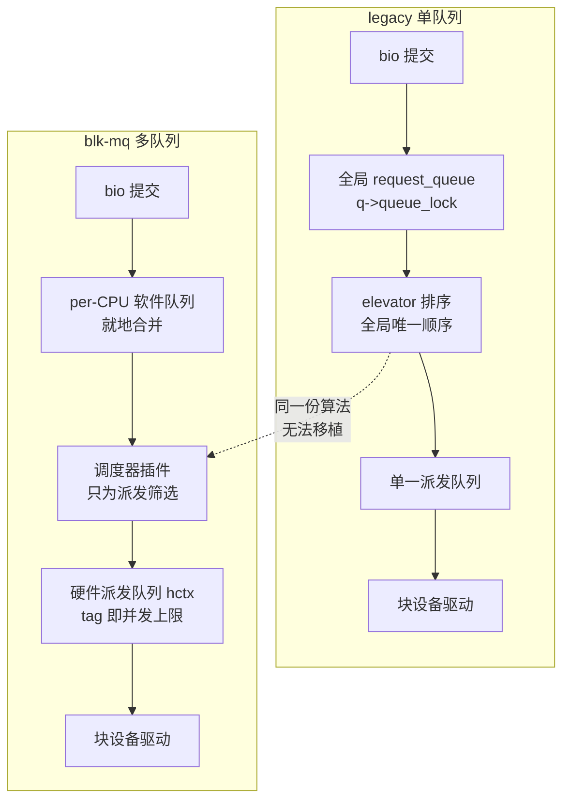
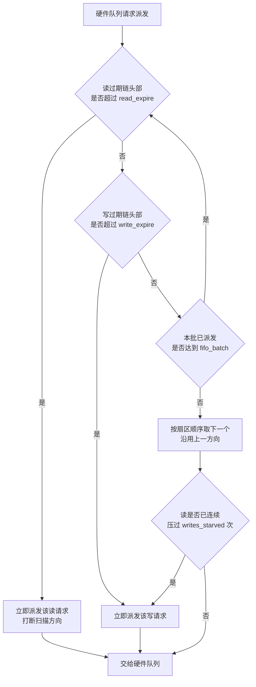
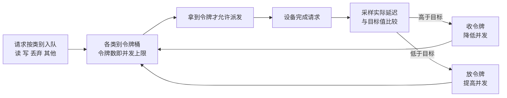
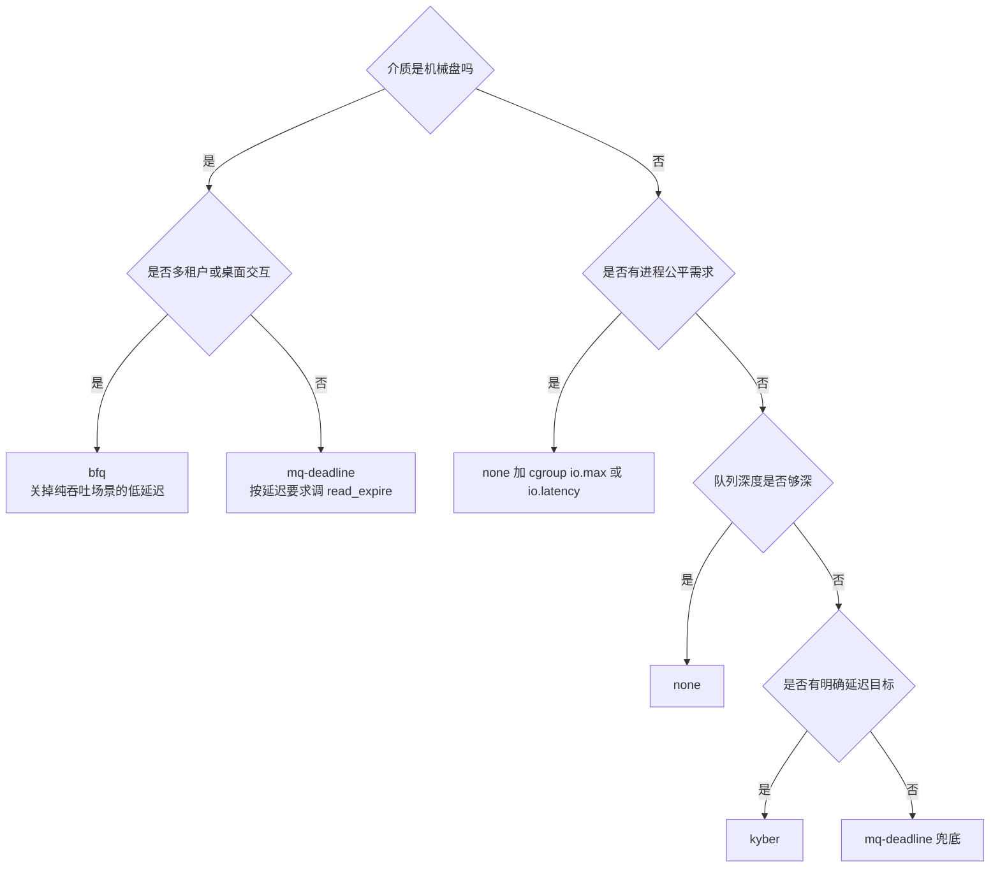

# IO 调度器——CFQ、Deadline 与 mq-deadline 的演进

**摘要：**

IO 调度器是通用块层里专门替硬件收拾物理形状的一层：机械盘的磁头一次只能停在一个位置，内核便替它把散乱的请求排成一次单向扫描；固态盘没有磁头，这层软件就从优化器退回成减速器。本文沿着 elevator 单队列框架、blk-mq 多队列框架与 NVMe 三个阶段展开，回答两个问题：调度器今天还剩几个，以及该不该设这个问题的答案为什么会变。全文先拆开合并、排序、排队这三个常被混为一谈的动作，交代每一种动作成立的前提；再厘清 CFQ 的死亡时间线——它从来就不属于 blk-mq，随 legacy 单队列框架在 4.21/5.0 周期一并删除，网上大量"CFQ 与 Deadline 对比"的材料因此失效；随后逐个拆解 none、mq-deadline、kyber、bfq 的调度单位、参数与失效条件，给出以设备类型和负载形态为坐标的判据表，并澄清一个常被误读的细节：期限参数管的是软件队列里的等待，不是设备的完成时间。最后给出同一份 fio 负载的对照方法与一张验证指标清单，说明换调度器在哪些情形下根本不会带来变化。

---

## 第 1 章 调度器到底在调度什么

### 1.1 三个被混为一谈的动作

关于 IO 调度器的讨论常常一开口就陷入名词之争：有人说它负责给请求排序，有人说它负责公平分配带宽，有人说它在 NVMe 上什么都不做。这三种说法都不算错，只是各自描述的是三个不同动作中的一个。把动作拆开、再看每个动作在什么硬件上才有收益，比记名字有用得多。

第一个动作是**合并**（merging）。相邻扇区的两个请求如果能拼成一次更大的传输，设备只需付一次寻道、一次协议开销，吞吐立刻上一个台阶。合并发生的位置很关键：在 blk-mq 里，它由块层核心与 plug 列表完成，并不在调度器里；也就是说，即便把调度器切成 none，相邻 bio 依然会被合并。

第二个动作是**排序**（sorting）。合并只对前后紧邻的请求有效，排序则要跨越整个队列重排顺序，让磁头沿一个方向扫过去。排序的前提是"设备顺序访问确实更快"，这在机械盘上成立得不容置疑，在固态盘上则几乎不成立。

第三个动作是**排队与限流**（queuing and throttling）。它不改变请求之间的先后，只控制同一时刻允许有多少请求压在设备上，用并发度去换延迟确定性。

这三个动作的收益曲线随硬件代际剧烈变化，而它们的成本却大体固定：合并要花 CPU 做区间比对，排序要花 CPU 做红黑树操作，限流要花 CPU 做令牌计算。调度器的历史，本质上是这三条收益曲线相对一条成本曲线不断下移的历史。当收益跌到成本之下，删除调度器反而更快——这句话听上去像反讽，却是 NVMe 时代的常态。

### 1.2 为什么机械盘非排不可

要理解调度器的价值，得先把机械盘的物理账算一遍。一块 7200 转的盘，寻道时间在毫秒量级，旋转等待平均也要小半圈，传输时间反而最短；因此随机读一次 4 KiB 的延迟由前两者主导，折算下来单盘每秒只能完成百来次随机 IO，对应的有效带宽不到半兆字节每秒。而同样的盘顺序读时磁头几乎不动，带宽可以达到一百多兆字节每秒。两个数字相差**三个数量级**，中间那道落差完全是"磁头要移动"造成的。

我们不妨做一个反事实推演：假如内核完全不管请求顺序，任凭进程以什么次序提交就按什么次序下发，那么一台被数据库随机读打满的机器，其吞吐会稳定退化为随机访问的物理极限，再多的内存、再宽的 PCIe 都无济于事。反过来，只要把一段时间窗内到达的请求按地址重排，把"读 A 柱面、读 Z 柱面、再读回 A 柱面"变成"从 A 扫到 Z"，同样的硬件能多服务几倍的请求。这就是调度器存在的全部理由，也是它唯一站得住的理由。

这条理由的反面同样重要：一旦设备不再需要移动磁头，"顺序比随机快"这个前提就瓦解了。固态盘的随机读与顺序读在设备内部都要经历同样的闪存页访问与通道调度，差异主要体现在传输长度与命令开销上，通常只有一个数量级以内，而且大块传输的收益更多来自协议效率而非介质本身。把机械盘时代的排序算法原样搬到固态盘上，等于为一个不存在的问题付费。

### 1.3 三个阶段的轮廓

调度器的形态跟着块层框架走，而块层框架跟着 CPU 与设备拓扑走。下图把三个阶段、各自的实现与交接关系放在一张图上；注意 CFQ 没有出现在 blk-mq 那一格里，它随旧框架一起被删除，而不是被移植。


三个阶段的差异可以整理成一张对照表，其中"失效前提"一列最值得记住：一个调度器什么时候不该用，比它怎么实现更能指导决策。

| 阶段 | 块层框架 | 队列与锁 | 调度单位 | 代表实现 | 失效前提 |
| :--- | :--- | :--- | :--- | :--- | :--- |
| elevator 时代 | 单队列 `request_queue` | 一把 `queue_lock`，全局串行 | 请求、进程 | `noop`、`deadline`、`cfq`、`anticipatory` | 多核 + 高速设备，锁竞争吃掉全部收益 |
| blk-mq 时代 | 多队列，per-CPU 软件队列 + 硬件派发队列 | 无全局锁，靠 tag 与 sbitmap | 请求、请求类别 | `none`、`mq-deadline`、`kyber`、`bfq` | 设备自带深队列且无需公平与排序 |
| NVMe 时代 | 多队列成为默认 | 队列按 CPU 数铺开，设备端并发更深 | 设备内部调度 | 仍是上表四个，但多数设备落在 `none` | 需要公平或延迟上限时仍要回到软件层 |

读者会注意到一个断层：elevator 时代的三个实现里，只有 deadline 的移植版活了下来，noop 变成了 none，cfq 则彻底消失。这个不对称不是偶然，下一章会逐条解释。

---

## 第 2 章 elevator 时代：三个调度器与一把锁

### 2.1 单队列块层的形制

legacy 块层的结构简单到可以用一句话概括：整台机器（严格说是每个块设备）只有一个请求队列，队列由**一把自旋锁**保护，任何 CPU 想把请求放进队列或从队列取出请求，都得先抢到这把锁。这套框架在内核源码里叫 elevator（电梯），名字来自它最初的实现形态；noop、deadline、cfq 都是挂在这个框架上的算法，各自实现排序与插入的策略，框架本身负责锁、合并与派发的主干。请求进入队列之前，会先尝试与队列里已有的请求合并；合并失败就插入调度器维护的队列结构；块设备驱动随后从队列里逐个取走请求，交给硬件。从 `bio` 到 DMA 的完整路径见 [[05 块设备栈——从 bio 到 blk-mq 的 IO 路径]]，这里只看调度器所在的这一段。

这把锁在单核与低速设备的年代是人畜无害的，因为临界区里的工作相对于 IO 本身微不足道。

但 2000 年代末的多核服务器把它变成了咽喉：一块每秒几十万 IOPS 的固态盘，每次 IO 都要经过一次全局锁的获取与释放，锁本身的缓存行在多个核心之间来回弹跳，核心越多，浪费越大。内核开发者试过把锁拆细、试过减少临界区，最后承认这条路走不通——问题的根源是"一个队列"这个数据结构本身，而不是锁的粒度。

单队列还带来另一个结构性限制：队列里的请求必须形成一个全局可比较的顺序，于是所有设备、所有 CPU、所有进程的 IO 都被塞进同一个排序空间。对机械盘来说这是必要的，因为磁头本来就只有一个；但对一块内部有多个闪存通道、能并行处理几十个请求的固态盘来说，这种全局排序既不必要，又人为制造了串行点。

### 2.2 noop：合并就是全部

`noop` 的名字容易引起误会，它并非什么都不做：合并仍然启用，只是不做排序。新请求到达时先尝试与队列尾部合并，合并不上就按 FIFO 顺序排队，驱动按顺序取走。整个实现只有几百行，没有红黑树、没有时间戳、没有优先级。

它的适用场景在早年很清晰：当底层设备自己就有良好的访问顺序（譬如带大容量缓存与电梯算法的硬件 RAID 控制器），或者当设备根本没有寻道成本（早期的闪存盘、RAM 盘）。把请求原样交给设备，让设备固件去决定内部顺序，比内核多排一遍更划算。

但 noop 从未成为通用默认值，原因也很清楚：它**没有防饥饿机制**。FIFO 意味着一个持续发送请求的进程可以稳定地把队列填满，后来的读请求只能排在后面；在没有排序的情况下，这种排队时间直接转化为延迟，而且没有上限。机械盘上这个问题尤其致命，因此 noop 长期只作为"明知设备会自己排"时的选项存在。

### 2.3 deadline：两个队列，两条期限

2006 年进入主线的 `deadline` 调度器，是 elevator 时代对饥饿问题最直接的回应。它的数据结构由四样东西组成：读与写各一棵按扇区地址排序的红黑树，读与写各一条按到期时间排序的 FIFO 链表。每个请求插入时，除了挂进排序树，还会按方向算出自己的到期时刻（`fifo_time = 当前 jiffies + 该类请求的期限`），挂到对应的 FIFO 尾部。

派发时的判断顺序决定了它的全部行为：先看读 FIFO 的头部是否已经到期，到期就立刻派发，不看排序树；再看写 FIFO 的头部，同样处理；两个 FIFO 都没到期，才回到排序树，沿上一次的扫描方向取下一条请求，连续取若干条之后强制回头再查一次 FIFO。伪代码大致如下，重点是那段"回头查"的逻辑，它保证了排序不会把某个请求无限期压住。

```c
/* legacy deadline 的派发骨架，省略了锁与统计 */
static struct request *deadline_dispatch(void)
{
        /* 第一优先级：到期即插队，排序让位于承诺 */
        rq = fifo_head_expired(READ);
        if (rq)
                return rq;
        rq = fifo_head_expired(WRITE);
        if (rq)
                return rq;

        /* 第二优先级：沿方向取排序树上的下一条 */
        rq = next_in_direction();
        if (rq && ++dd->batching < dd->fifo_batch)
                return rq;

        /* 一批取满，强制回到 FIFO 复查，防止饥饿 */
        dd->batching = 0;
        return NULL;
}
```

这套机制里有一个容易被忽略的语义边界：到期只保证"在这条请求被派发给设备之前不会超过期限"，它**不保证设备在期限内完成**。请求一旦离开调度器进入驱动的队列，调度器就失去了对它的控制，排队时间转由设备与驱动承担。把 `read_expire=500` 理解成"读延迟不超过 500 毫秒"是错的，它只是"读请求在软件队列里最多等 500 毫秒"。这条边界在后文讨论 mq-deadline 时会反复出现，因为现存的实现继承了同样的语义，而误读它的人远比误读 CFQ 的人多。笔者见过不少调优记录，把 `read_expire` 调到 100 毫秒就宣称读延迟不超过 100 毫秒，实测的 p99 却仍在半秒量级，原因正是这条边界。

读写期限为什么差一个数量级，理由在应用的调用方式上：同步读的进程通常正阻塞在 `read()` 上等待结果，读延迟直接变成进程的停顿；而写请求背后有 Page Cache 兜底，应用早已拿到"写成功"的返回值，晚几百毫秒甚至几秒才落盘，对应用几乎不可见。只有当写者显式 `fsync` 或脏页水位逼近上限时，写的排队时间才会反过来惩罚应用——这是 deadline 类调度器与回写机制之间那条隐形的连线。

读优先的设计还有一处隐含前提：写方不必等结果。一旦应用改用同步写——每次写完就等落盘的 `O_DSYNC`，或者绕开缓存用 `O_DIRECT` 自己管——写请求的排队时间就直接变成进程的停顿，这时读优先反而在惩罚一个同样在等的进程。极端情况下，一批同步写被持续压后，应用的写线程全被卡在块层，吞吐塌陷得比不设调度器更快。遇到这种负载，调小 `write_expire` 或者干脆让设备落在 none 上，通常比继续调排序参数有效。

### 2.4 cfq：把公平分给进程

`cfq`（Completely Fair Queuing）是 elevator 时代最复杂也最"人性化"的实现，2006 年的 2.6.18 起成为多数发行版的默认调度器。它的出发点与 CPU 调度器里的 CFS 相似：磁盘是共享资源，凭什么一个跑备份的进程能把磁头占满，让前台的编辑器卡上几秒？

它的做法是给每个进程（严格说是每个 IO 上下文）维护一条独立的请求队列，然后在这些队列之间轮转。轮转的计量单位既不是纯时间也不是纯请求数，而是时间片与扇区量子的组合：一个队列在拿到服务机会后，可以连续派发若干请求，直到用完它的份额或者超出了量子；之后轮到下一个队列。为了让顺序性不被破坏，CFQ 还引入了**空转等待**（idling）——一个同步队列的请求派发完之后，如果判断它很可能马上再来一条相邻请求，调度器会空等一小段时间，让磁头停在原地，而不是切去服务别人再切回来。

在机械盘上，这套设计确实兑现了承诺：前台交互的响应变快，后台批量任务依然能跑满，`ionice` 的三档（实时、尽力、空闲）也有了真实的着落。CFQ 还进一步接入了 cgroup 的 blkio 控制器，把"进程级公平"扩展成"进程组级公平"，这是它在虚拟化与多租户场景里长期受欢迎的原因。

但空转等待在固态盘上是纯粹的浪费。固态盘处理一条请求只要百微秒量级，调度器却为了等一条可能到来的相邻请求而空等数毫秒，这段时间里设备本可以服务几十条别人的请求。

更隐蔽的伤害来自队列深度：CFQ 按进程轮转，等于把设备能同时处理的并发请求切成了许多小份，单进程的队列深度被算法性地限死，深队列设备的并行能力根本无法释放。机械盘时代"公平与吞吐可以兼得"的经验，到了固态盘上变成了"两头都丢"。

### 2.5 CFQ 是怎么消失的

关于 CFQ 的退场，流传最广的说法是"Linux 5.0 删除了 CFQ，换成了 mq-deadline"。这句话的结论没错，过程却常常被讲错，而讲错的部分恰好是判断一台机器上到底有没有 CFQ 的关键。

准确的时间线是这样的：blk-mq 在 2013 年的 3.13 中合入，它**从一开始就没有 CFQ 这个实现**——多队列框架下每个硬件队列独立派发，CFQ 那套基于全局队列与进程轮转的公平性根本无处安放。此后数年里，内核同时存在两套块层：新设备走 blk-mq，老驱动（以及不少企业发行版的稳定分支）仍走 legacy 单队列路径，CFQ 只活在后者里。

到 2018 年底至 2019 年初的 4.21 开发周期，维护者把 legacy 单队列块层连同其上的调度器整体删除，CFQ、legacy deadline、legacy noop 一起退场；而 4.21 正是后来被改名为 5.0 的那个版本，所以按发布版本号说"5.0 删除 CFQ"与按提交记录说"4.21 删除"指向的是同一件事。

这条时间线有两个直接推论。其一，任何 blk-mq 设备上都不可能把调度器切成 cfq，因为内核里没有这个实现；网上那些"cfq vs deadline"的压测对比图，绝大多数来自 4.x 之前的单队列内核或 RHEL 6/7 这类长期维护旧代码的发行版，把它们套到今天的机器上是刻舟求剑。其二，"CFQ 在 5.0 被 mq-deadline 取代"这个说法也不准确——取代 CFQ 的不是 mq-deadline，而是整个 blk-mq 框架；mq-deadline 只是恰好成为 legacy deadline 在新框架下的移植版，它的调度哲学与 CFQ 并不相同。

真正继承 CFQ 公平理念的是 bfq，而 bfq 与 CFQ 之间隔着一整套重新设计的数据结构。

---

## 第 3 章 blk-mq：调度器被降级为插件

### 3.1 三层队列

blk-mq 的核心改动是**三层队列**：每个 CPU 有一到多个软件暂存队列（software staging queue，对应 `blk_mq_ctx`），请求先进入本 CPU 的软件队列并在那里完成合并；设备按自己的能力注册若干个硬件派发队列（hardware dispatch queue，对应 `blk_mq_hw_ctx`），每个硬件队列对应驱动里一条真实的提交通道；每个硬件队列上还有一组 tag（基于 sbitmap 的位图），tag 的数量就是该队列允许同时在飞的请求数上限。请求从软件队列搬到硬件队列的过程叫派发（dispatch），而调度器就挂在这一步上。

还有一处容易混淆的数量关系：每个硬件队列上可同时挂载的请求数由 tag 决定，而 `nr_requests`（默认在 128 量级）限制的是调度器能攒多少请求，实际可用的 tag 数取它与驱动声明的队列深度中较小的一方，具体取法随内核版本略有差异。这个数量决定了 none 与 mq-deadline 的行为差异能有多大：排序树里能攒的请求越多，排序越有意义；攒不了几条时，调度器的收益自然趋近于零。

下图把 legacy 的一条直线路径与 blk-mq 的三层路径画在一起，注意两者的分叉点：legacy 里所有请求必须经过同一个队列与同一把锁，blk-mq 里每个 CPU 各走各的路，只有在派发时才可能与调度器打交道。



这个结构带来的第一个后果是锁的消失：请求入队在本 CPU 的队列上完成，通常不需要任何跨核同步；派发时每个硬件队列各自取请求，锁的粒度降到单个队列。

第二个后果更深刻：全局唯一的顺序不再存在，每个硬件队列眼里只有自己那一份请求序列。调度器从此失去了"看到全部请求"的能力，它能做的只剩下"在某个硬件队列该派发时，从本队列已有的请求里挑一条"。

### 3.2 插件接口与派发路径

在多队列框架里，调度器实现的是一组固定回调，注册进块层后由框架在合适的时机调用：初始化与销毁、硬件队列建立与连接、队列深度变化通知、派发（`dispatch_requests`）、是否还有可派发的工作（`has_work`）、请求完成时的收尾、以及深度限制。这套接口在源码里叫 `elevator_mq_ops`，名字沿用自 legacy 的 elevator，但语义已经完全不同：legacy 的 elevator 是队列的拥有者，mq 版的 elevator 只是派发环节的一个筛选器。

从派发的调用链上，我们能看到这层插件的确切位置：驱动或框架发现某个硬件队列可以接收新请求，于是调用调度器的派发回调；调度器把自己选中的请求交给硬件队列；硬件队列再按 tag 的可用情况把它们真正写入设备。

如果这台设备没有启用调度器（也就是 none），框架跳过插件，直接把软件队列里的请求搬到硬件队列。这条差异解释了为什么 none 的开销几乎为零：它不是"一个很轻的调度器"，它是"**没有调度器**"这条短路。

也正因为调度器只被调用在派发这一步，它对合并的影响力被大幅削弱。legacy 时代 CFQ 与 deadline 都能在请求入队阶段影响合并（合并后的请求要重新插入排序结构）；而在 blk-mq 里，合并早已在软件队列与 plug 阶段完成，调度器看到的是一条条既定大小的请求。这意味着调度器对吞吐的贡献从"改变请求形状"退化为"改变派发顺序"，能做的事情少了一个维度。

### 3.3 老实现为什么搬不过来

把 CFQ 直接移植到 blk-mq 的努力并没有成功，原因不是工程量，而是**三个结构性冲突**。

第一是全局锁的消失。CFQ 的公平性依赖一个全局视角：它要知道当前有哪些进程队列在等待、各自的份额用到了哪里，才能决定下一个该服务谁。在多队列框架里，每个硬件队列独立派发，进程 A 的请求可能散落在多个硬件队列上，谁也无法在不加全局锁的前提下给出全局判断。加回全局锁等于把 blk-mq 的收益全部还回去，不加锁又无法维持公平——这是一个死结，bfq 后来用另一套数据结构绕开，代价是复杂度。

第二是进程队列的消失。CFQ 的调度单位是每个进程的请求队列，而 blk-mq 的队列按 CPU 与硬件通道组织，进程维度只以 `io_context` 的形式留下一点痕迹（IO 优先级、cgroup 归属）。要在多队列上恢复进程级公平，就得在派发时反查请求属于谁，再维护跨队列的权重账本，这与"派发路径要足够短"的设计目标直接矛盾。

第三是空转等待失去了意义。CFQ 的空转是为了让磁头停在原地等待同一个进程的下一条相邻请求，从而保住顺序性；在 blk-mq 里，请求来自多个 CPU、多个硬件队列，调度器空转时并不能确定下一条请求会落到哪个队列上，"等"这个动作本身就不再成立。

三条合起来说明一件事：CFQ 不是"没来得及移植"，而是它的核心假设在新框架里全部失效。这也是为什么最终进入 blk-mq 的四个实现里，没有一个试图完整复刻 CFQ 的进程队列模型。

### 3.4 现存四个的出身

今天在 `/sys/block/*/queue/scheduler` 里能看到的调度器只有四个，它们与三个阶段的对应关系如下表。表中"调度单位"一列是理解彼此差异的钥匙：none 没有调度单位，mq-deadline 以请求为单位并带期限，kyber 以请求类别为单位做限流，bfq 以队列预算为单位做公平。

| 名字 | 出身 | 调度单位 | 主要目标 | 典型默认场景 | 主要代价 |
| :--- | :--- | :--- | :--- | :--- | :--- |
| `none` | blk-mq 框架自带，对应 legacy 的 noop | 无 | 零干预，把顺序交给设备 | NVMe、高性能 SSD | 无延迟上限、无公平性 |
| `mq-deadline` | legacy deadline 的多队列移植，4.13 前后可用 | 单个请求 + 截止期 | 给读写各设一道最坏等待上限 | 机械盘、有延迟要求的固态盘 | 排序收益随设备变快而衰减 |
| `kyber` | Facebook 提交，4.12 合入 | 请求类别（读、写、丢弃、其他） | 用延迟反馈把并发压在目标值附近 | 快速设备、延迟敏感服务 | 反馈有滞后，无法改善顺序性 |
| `bfq` | Paolo Valente 等人，4.12 合入 | 每个进程或 cgroup 的扇区预算 | 进程间公平与交互延迟 | 桌面、单盘多租户 | CPU 开销高，深队列下吞吐损失明显 |

这些名字与 legacy 时代并不一一对应：none 不是 noop 的改名（legacy noop 有独立的合并策略开关，none 的合并完全由框架核心完成），mq-deadline 不是 deadline 的简单编译版本（它按硬件队列各持一份状态），bfq 也不是 CFQ 的后继代码（数据结构与计量方式都重新设计过）。把新旧名字当作同一事物的不同称呼，是选型时最常见的概念错误。

---

## 第 4 章 四个调度器的机制与参数

### 4.1 none：把顺序交还给设备

none 的行为可以用两句话说完：请求进入本 CPU 的软件队列时就地合并，凑不成合并的请求按到达顺序排队，硬件队列有空位就直接搬过去。没有排序，没有期限，没有权重。

它对 NVMe 是合理选择，理由不是"NVMe 太快所以不需要调度"，而是"NVMe 自己就是一台会排队的小计算机"。一块 NVMe 盘内部有多个闪存通道、多个核心、复杂的地址映射与垃圾回收策略，设备固件对"哪些请求先做、哪些可以并行、哪些该合并"掌握的信息比内核多得多：它知道闪存页的分布、知道哪些块即将被回收、知道各通道的忙闲。

内核在设备之外再排一遍序，等于让一个看不到内部状态的外部程序去指挥一个内部程序，**信息劣势**注定了收益有限。

但 none 并非放任自流，它保留了两件事：合并与背压。合并仍然在框架核心完成，相邻 bio 会被拼成更大的请求；背压来自 tag 数量，硬件队列的 tag 用尽时新请求只能在软件队列里等待，这构成了一种粗糙但有效的限流。所以在把队列深度开得很大的机器上，none 依然能把设备打满，它缺的只是"公平"与"最坏延迟"这两个承诺。

代价也很清楚。多租户环境下，一个进程可以用深队列把 tag 占满，其他进程的请求只能排队，谁先谁后完全由到达顺序决定，没有任何机制阻止这种挤压。对延迟敏感的服务与后台批处理共用一块盘时，none 会让前者的尾延迟随后者的负载漂移，而这种漂移在监控上表现为"高峰期偶发卡顿"，很难归因。

### 4.2 mq-deadline：把期限带到多队列

mq-deadline 是 legacy deadline 的移植，但它不是逐行翻译。最关键的改动在于状态的组织方式：在 blk-mq 里，每个硬件队列持有一份独立的调度状态——自己的两棵排序树、自己的两条过期 FIFO、自己的方向记录与批量计数。这意味着 500 毫秒这个读期限是"**每个硬件队列各自的上限**"，硬件队列之间没有全局排序，也没有跨队列的期限协调。

这个改动带来的后果值得单独讲，因为它改变了我们谈论"500 毫秒"时指的东西。legacy deadline 承诺的是"任何读请求在全局队列里最多等 500 毫秒"；mq-deadline 承诺的是"任何读请求在它所属的那个硬件队列里最多等 500 毫秒"。设备有多个硬件队列时，一条读请求先进入某个软件队列，被派发到某个硬件队列，再在设备内部排队，整条链路上只有中间那一段受期限约束。

所以当有人说"我设了 read_expire=500，为什么读延迟还是到了几十毫秒"，答案往往不在调度器，而在设备内部队列或上层排队——期限管不到那些地方。

派发逻辑与 legacy 版本同构，下图把判断顺序画出来：先看读的过期链，再看写的过期链，都没过期才回到排序树沿方向扫描，并且每扫固定条数就强制回头复查。



参数全部位于 `/sys/block/<dev>/queue/iosched/` 之下，且只在该设备当前使用 mq-deadline 时才有意义。这些旋钮作用的对象只有一个：请求在软件队列里的最坏等待时间。下表列出内核文档记载的五个参数，重点看最后两列：每一个旋钮都是在两种代价之间挪动，没有单向收益。

| 参数 | 默认值 | 含义 | 调大的代价 | 调小的代价 |
| :--- | :--- | :--- | :--- | :--- |
| `read_expire` | 500 毫秒 | 读请求在软件队列里允许等待的上限 | 读的尾延迟上限抬高，交互与同步读变钝 | 排序窗口变窄，磁头来回次数增加，吞吐下降 |
| `write_expire` | 5000 毫秒 | 写请求允许等待的上限 | 写更晚才会插队，读被写的挤压更少，但脏页堆积风险上升 | 写频繁插队打断扫描，顺序写吞吐下降 |
| `writes_starved` | 2 | 允许写越过顺序之前，读最多连续优先的次数 | 写更容易被延迟，读的尾延迟更好看，写延迟恶化 | 写频繁插队，读的排序连续性被打断 |
| `front_merges` | 1 | 是否尝试向前合并，即把新请求并入已有请求的尾部 | 无（只取 0 或 1） | 关掉可以省掉一次查找，但相邻请求只能各自下发 |
| `fifo_batch` | 16 | 一批连续派发的条数，取满后强制回头查过期 | 单次扫描更长、吞吐更好，但过期检查变稀疏 | 过期检查更频繁，延迟更稳，排序收益变少 |

顺带提一个不属于表内、却与排序效果直接相关的量：`nr_requests`。它决定每个硬件队列上调度器能攒住多少请求，而排序的前提正是手里有足够多的请求可供重排。把它调大能给排序更多素材，代价是队列变长、等待变久；调小则让调度器几乎退化成 FIFO。很多"mq-deadline 没效果"的现场，根因是这个量太小，而不是参数没调。

`read_expire` 的取舍最常被讨论，可以用一组示例推算来说明量级。假设一块机械盘上混合着随机读与顺序写，读请求平均到达间隔固定，把 `read_expire` 从 500 毫秒调到 200 毫秒：读请求能攒在排序树里的时间窗缩短到原来的四成，窗口内可排序的请求数随之减少，磁头为这些请求改变方向的次数上升，按寻道成本折算，读吞吐可能下降百分之几到一成；换来的是读请求在软件队列里的最坏等待从 500 毫秒压到 200 毫秒。反过来调到 1000 毫秒，排序窗口翻倍，吞吐略升，但一旦出现写洪峰，读的尾延迟上限也跟着抬高到一秒量级。这组数字只是示例推算，用于说明"旋钮的两端各是什么代价"，实际取值必须在自己设备上测。

还有一个边界必须写清楚：**派发不等于完成**。`write_expire` 到期的效果是"这条写请求被提前派发"，而不是"这条写请求在 5 秒内被写进盘"。派发之后它还要在硬件队列与设备内部排队，写密集时后者可能远超期限。把 `write_expire` 当成写的延迟保证，是调优里最常见的一厢情愿。

### 4.3 kyber：用延迟反馈拧节流阀

kyber 的设计出发点与前三个都不同：它不排序、不做进程公平，只做一件事——把并发度控制在"刚好能让延迟停在目标值"的水平上。它的世界观是：设备的总处理能力终究有限，请求积压越多、排队越久；与其预测哪种顺序更好，不如直接观测"现在延迟是多少"，然后加减允许同时在飞的请求数。

实现上，请求被分成四个类别：读、写、丢弃、其他。每个类别有自己的目标延迟与自己的令牌桶，桶里的令牌数就是该类别允许的并发上限。派发时，某类请求要先拿到令牌才能下发；令牌不足就等待，让其他类别或后续请求先走。系统周期性地采样各类请求的实际完成延迟，与目标值比较：高于目标就收令牌，低于目标就放令牌。参数的命名也直白，读的目标延迟、写的目标延迟各自对应一个 `*_lat_nsec` 文件，默认值在毫秒量级，写通常比读宽松。

下图把这个反馈回路画出来，注意它是一个闭环：令牌数不是静态配置，而是被实测延迟持续修正的量。



这种控制在什么设备上有效，取决于一个隐含假设：设备的延迟与并发之间存在单调、相对稳定的关系，增加并发会让延迟上升，减少并发会让延迟下降。对多数固态盘，这个假设在中等并发区间成立；但到了接近设备饱和的区间，延迟会突然跳变（内部垃圾回收、通道争用），**反馈的滞后**就会导致振荡——令牌收得太晚，延迟已经爆了；放得太早，又立刻打满。kyber 的轻量正是它的局限：它没有队列历史，也没有对设备内部状态的任何认知，只凭一个滞后的误差信号做比例式调整。

它适合的场景因此很窄：设备本身足够快、延迟目标明确、负载相对平稳，且不希望承担 bfq 的 CPU 开销。对机械盘，它缺少排序，表现通常不如 mq-deadline；对深队列 NVMe，它多数时候不如 none 直接。真正让它发挥作用的场合，是"设备很快但需要一条延迟底线"的中间地带。

### 4.4 bfq：用扇区预算买公平

bfq 是四个实现里唯一还认真做进程级公平的。它继承了 CFQ 的问题意识——一块盘被多个进程共享时，谁该先走——但换了一套计量方式：不按时间片切，而**按扇区预算切**。

具体机制是：每个进程（或每个 cgroup）对应一条 bfq 队列，队列获得一个以扇区计的预算；该队列的请求被连续派发，直到预算耗尽或出现更该被服务的队列；之后让位给其他队列。预算不是固定的，而是根据该队列的历史行为自适应：一个持续做大块顺序写的队列会被判定为"吞吐型"，预算放大，让它尽量连续地占用设备；一个请求短而零散的队列会被判定为"交互型"，预算缩小，让它尽快把手里那点活干完、尽快让位。权重来自 IO 优先级，实时、尽力、空闲三档映射到不同的份额，cgroup 的权重也可以叠加进来。

真正让 bfq 在桌面场景出名的是低延迟模式。它会在检测到交互型负载时，主动压低其他队列的份额，把设备让给那条"用户正在等"的请求，从而把文件打开、保存、程序启动这类操作的感知延迟压到很低。代价是吞吐：为了保住交互队列的响应，设备不能总是被大块顺序 IO 占满，批量任务的完成时间会被拉长。

bfq 的旋钮比另外三个多，常用的两个是低延迟开关与空转窗口。低延迟开关默认开启，纯吞吐场景（备份服务器、离线计算）应当关掉它；空转窗口控制"派发完一个队列后是否空等它下一条请求"，在机械盘上有价值，在固态盘上应当置零，否则会重现 CFQ 在 SSD 上的老问题。参数集合随内核版本有增删，具体条目以对应版本的文档为准。

### 4.5 延迟分布上的差异

调度器的差别很少体现在平均吞吐上，多数时候体现在尾延迟上：平均值被大量正常请求稀释，p99 与 p99.9 才是用户能感知到的卡顿。下表给出一组示例推算，用于说明四个实现在同一块机械盘、同一份随机读负载下的相对关系，表中相对值以 mq-deadline 的结果为基准，数值只表示量级与方向，不代表任何具体设备。

| 调度器 | 随机读 IOPS（相对值） | p50 延迟 | p99 延迟 | 主要成因 |
| :--- | :--- | :--- | :--- | :--- |
| `none` | 基准的九成上下 | 略低 | 最高，可到平均值的数倍 | 无排序，磁头方向随机；无上限，长队尾无人处理 |
| `mq-deadline` | 基准 | 略高 | 明显低于 none | 排序减少寻道；过期链给尾延迟设了软上限 |
| `kyber` | 与 none 接近 | 接近 none | 居中 | 限制并发降低了排队，但不改善顺序 |
| `bfq` | 基准的九成到十成 | 略高 | 最低 | 公平与低延迟模式优先照顾短队列 |

笔者要提醒的是，把这张表读成"bfq 最好"是误读：它的低 p99 是用吞吐换来的，而且换的方式是牺牲大块顺序 IO 的连续性。在顺序写为主的场景里，bfq 的表现会明显落后于 mq-deadline，因为后者的排序树正好服务于"连续地址一起下发"这件事。

尾延迟的比较只有在负载形态一致时才有意义，这也顺带说明了下一章要讲的方法论：换调度器必须用同一份负载对照，否则比较的不是调度器，而是负载。

---

## 第 5 章 怎么读、怎么改、怎么验证

### 5.1 scheduler 文件的实际读法

当前调度器与可选项写在 `/sys/block/<dev>/queue/scheduler` 这一个文件里，读出来是一行空格分隔的名字，正在生效的那个用方括号括住。这行输出本身就是一次完整的自描述：方括号里的值是现状，方括号外的值是这台设备在本内核上支持的备选。如果方括号外空空如也，说明这台设备只有一种选择，通常意味着它压根不参与调度。

```bash
# 读：方括号标出当前值，其余是可选值
cat /sys/block/nvme0n1/queue/scheduler
# [none] mq-deadline kyber bfq

cat /sys/block/sda/queue/scheduler
# [mq-deadline] kyber bfq none

# 改：写入名字即生效，不需要重启，也不影响正在飞的请求
echo mq-deadline > /sys/block/sda/queue/scheduler

# 参数目录随调度器变化：切到 none 之后 iosched 可能为空或不存在
ls /sys/block/sda/queue/iosched/
```

这里有几个我们常踩的误判需要点破。其一，**方括号的位置才是真相**，不要凭发行版文档或别人的截图推断；同一台机器上不同设备的当前值可能完全不同，NVMe 落在 none、SATA 盘落在 mq-deadline 是常态。其二，可选值列表里出现某个名字，不代表这台设备的硬件适合它，它只说明内核编译进了这个模块、驱动也没有拒绝注册。

其三，并不是所有块设备都有可切换的调度器：loop 设备、zram、部分虚拟盘与设备映射目标上，这个文件可能只列 none，写入其他名字会返回错误；这类设备的 IO 路径本来就绕开了真实硬件的排队环节，讨论调度器没有意义。

还有一个常被忽略的判据文件是 `/sys/block/<dev>/queue/rotational`：1 表示旋转介质，0 表示非旋转。它看起来正好可以用来做"机械盘用 mq-deadline、固态盘用 none"的自动判据，实际上并不可靠——虚拟盘、某些 RAID 控制器、部分 USB 桥接设备上报的值与物理事实不符，云主机的系统盘尤其容易报 0 却共享着宿主机上一块机械盘。把它当作提示而非事实，是使用 udev 规则自动设置调度器时的必要谨慎。

设备映射与软 RAID 还有一个层级问题。对 dm、md 这类组合设备，真正的排队发生在底层的物理盘上，调度器应当设在物理盘对应的 `/sys/block` 条目上；在组合设备上写调度器，要么只影响它自己那层几乎不存在的队列，要么根本不被接受。多路径设备同理：路径选择在上一层完成，底层每条路径仍是一块独立的盘，各自的调度器独立生效。

### 5.2 参数的生命周期

通过 sysfs 写入的调度器与参数，生命周期只到设备重新扫描或系统重启为止。内核不保存这些值，谁在什么时候设置它们，取决于用户空间的规则：发行版通常自带一套 udev 规则，在设备出现时按设备类型写入调度器；管理员再叠加一份自己的规则覆盖默认值。这意味着两个现实问题：一是容器或云主机里可能没有权限改，改了也会在实例重建后丢失；二是同一台机器上可能同时存在两套规则，后加载的那套说了算，排查时先看规则文件而不是先怀疑内核。

内核命令行参数 `elevator=` 是 legacy 时代的遗产，在 blk-mq 下它仍然会被解析，但只能接受当前存在的调度器名字。写成 `elevator=deadline` 不会报错退出，却也不会产生任何效果——内核里没有叫 deadline 的调度器，这条参数被忽略，设备仍按 udev 规则或默认值工作。这是"照抄网上参数"最典型的翻车现场：参数格式没变，语义早就不在了。

### 5.3 同一份负载的对照方法

笔者把验证的做法归结为一句话：换调度器之后，除了调度器本身，其余一切都要固定住——同一台机器、同一块裸设备、**同一份 fio 作业文件**、同样的缓存与写回状态、交替多轮以抵消温度与后台任务的影响。指标至少看三列——吞吐或 IOPS、尾延迟、CPU 占用，只看其中一列几乎一定会得出错误结论。

```bash
# 一份作业文件，四个调度器共用，保证除了 scheduler 之外全部相同
cat > /tmp/rr4k.fio <<'EOF'
[global]
ioengine=libaio
direct=1
rw=randread
bs=4k
iodepth=8
numjobs=4
runtime=60
ramp_time=10
filename=/dev/sdb
group_reporting=1
EOF

for s in none mq-deadline kyber bfq; do
        echo "$s" > /sys/block/sdb/queue/scheduler
        fio /tmp/rr4k.fio --output-format=json > "/tmp/fio-$s.json"
done
```

看结果时，三列各有各的读法。IOPS 列回答"调度器有没有帮忙把设备喂得更饱"；尾延迟列回答"排队时间有没有被压住"；CPU 列回答"这些收益是不是拿 CPU 换来的"——在高速设备上，调度器的收益经常小于它自身的开销，表现为吞吐不升、CPU 上升、尾延迟反而恶化。

还可以用 blktrace 把延迟拆开，看请求在调度器队列里（插入到派发）花了多少、在设备里（派发到完成）花了多少；前者是调度器能影响的部分，后者不是。这套指标的完整读法——`iostat` 各字段的含义、blktrace 事件的拆分、读写放大的判定——见 [[08 存储栈性能调优——从 fio 到 iotop 的全套方法论]]。

| 观察维度 | 具体指标 | 判断标准 | 结论方向 |
| :--- | :--- | :--- | :--- |
| 吞吐 | IOPS 或带宽 | 相对基线提升是否超过噪声 | 提升有限说明调度不是瓶颈 |
| 尾延迟 | p99、p99.9 | 是否显著低于基线且可复现 | 只有尾延迟改善也值得保留 |
| CPU 开销 | 内核态与软中断占比 | 是否随调度器变化明显 | 开销上升而收益为零即应回退 |
| 排队结构 | iostat 的队列深度与利用率 | 队列深而设备闲，说明堵在软件层 | 这才轮到调度器背锅 |
| 稳定性 | 多轮重复的吞吐与尾延迟波动 | 波动是否小于调度器之间的差异 | 差异被噪声淹没即不必切换 |

---

## 第 6 章 判据与反例

### 6.1 设备 × 负载的判据

笔者把前面几章的内容压缩成一张表，就是选型时真正要查的东西。注意判据的主轴不是设备型号，而是两个问题：设备自己能不能把顺序排好，以及这块盘上有没有别人跟你抢。

| 设备 | 负载形态 | 首选 | 备选 | 判据 |
| :--- | :--- | :--- | :--- | :--- |
| NVMe SSD | 单应用、深队列、随机为主 | `none` | `mq-deadline`（需要延迟底线时） | 设备内部排队能力强，软件排序是重复劳动 |
| NVMe SSD | 多租户共用、尾延迟敏感 | `none` 加 cgroup 限制 | `kyber` | 公平性优先交给 blk-cgroup，而不是调度器 |
| SATA SSD | 混合读写、有同步读 | `mq-deadline` | `none`（纯顺序或纯并发） | 单队列设备没有设备端并行，软件排序仍有收益 |
| 机械盘 | 随机读写混合 | `mq-deadline` | `bfq`（需要进程公平） | 寻道成本主导，排序是唯一有效手段 |
| 机械盘 | 桌面、交互优先 | `bfq` | `mq-deadline` | 用户可感知的延迟优先于吞吐 |
| 机械盘 | 顺序写为主、单任务 | `mq-deadline` | `none` | 排序收益有限，期限仍能兜底 |
| 虚拟盘、loop | 任意 | 不设 | 跟随宿主设备 | 这类设备没有独立排队语义，设置无意义 |

这张表可以进一步压缩成决策树。树里的每个分支都对应前面某一章的前提判断，读者不妨拿自己机器上的设备走一遍，看落点是否与现状一致；不一致本身就是一条值得追查的线索。



### 6.2 换调度器没用的三种情形

第一种是设备队列已经足够深。调度器的排序收益建立在"设备一次只能做一件事"的假设上，当设备能同时处理几十上百条请求时，重排的边际收益被并行度淹没，而调度器自身的 CPU 与排队开销却是实打实的。深队列设备上换调度器，常见的观测结果是吞吐在一个噪声范围内波动、尾延迟没有系统性改善、CPU 反而多花了一点——这时候正确的动作是回退，而不是继续调参。

第二种是负载本身就是顺序 IO。排序算法的价值来自把随机变顺序，如果请求本来就是顺序的，排序无事可做，唯一的差别是合并窗口大小与派发时机。日志追加、大文件拷贝、顺序扫描这类负载，在四个调度器上的表现差异通常小到不值得折腾；此时影响吞吐的是块大小、预读、队列深度这些参数，不是调度器。

第三种是上层已经是大量并发的直接 IO。应用用 `O_DIRECT` 加几十上百的队列深度自己管住了 IO 的形状与并发，请求到达块层时已经是一批批成型的、地址连续的请求，调度器既没有重排空间，也没有限流必要性。数据库、分布式存储这类应用通常自带 IO 调度逻辑，它们真正需要的是"内核别挡路"，而不是"内核替我排队"。

在笔者接触过的现场里，这三种情形有一个共同点：**瓶颈不在这一层**。判断方法也不复杂——用 blktrace 或 iostat 看请求在软件队列里待了多久，如果这一段的占比很小，无论把调度器换成什么都不会有变化。

| 情形 | 典型症状 | 判据 | 该做什么 |
| :--- | :--- | :--- | :--- |
| 设备队列已足够深 | 换调度器后 IOPS 与 p99 都在噪声内 | 设备空闲队列数与 tag 数已接近设备并行度 | 回退到 none，转向应用层并发与块大小 |
| 负载本身顺序 | 四种调度器差异不显著 | 合并率高、随机度低 | 调预读与队列深度，不碰调度器 |
| 上层直接 IO 高并发 | 调度器队列里几乎没有等待 | 软件队列驻留时间占端到端延迟的比例极低 | 保持 none，关注设备与文件系统参数 |

### 6.3 几个必须记住的反例

第一个反例是把 `elevator=deadline` 写进内核参数。这个参数在 legacy 时代有效，在 blk-mq 下名字已经不存在，内核不会因为找不到而拒绝启动，却也不会因此做任何事；排查者以为已经生效，实际设备仍在按发行版默认值运行，于是所有后续对比都建立在错误前提上。

第二个反例是在 NVMe 上设 bfq。bfq 的公平性与低延迟机制是为"一次只能服务一个请求"的设备设计的，它在深队列设备上会把并发切碎、把空转窗口变成纯粹的浪费，同时付出可观的 CPU。有人因为"bfq 对桌面最流畅"的经验把它套到服务器 NVMe 上，得到的通常是吞吐下降与尾延迟抖动同时出现。

第三个反例是把换调度器当成解决 IO 瓶颈的通用手段。IO 慢有三种常见根因：设备带宽或 IOPS 到顶、请求形状与设备特性不匹配、上层排队策略有问题。调度器只对第二种有直接影响，对第一种无能为力，对第三种最多只能缓解。动手之前先把端到端延迟拆成"软件排队 + 设备服务"两段，是省时间的做法。

第四个反例是把调度器的期限参数当成延迟保证。`read_expire` 与 `write_expire` 管的是软件队列里的等待，派发之后的路程它们一概不管；把这两个值调小到很小的数字，除了让排序失效、吞吐下降之外，不会让设备变快。

第五个反例是只测一种负载就下结论：同一个调度器在顺序读上测出的结论，与在随机写上可能完全相反，用一次 `dd` 或一次默认参数的 fio 就定调，等于拿一把尺子去量温度。

### 6.4 概念在弱化，但没有消失

把视角拉远，我们看到的调度器这一层，处境是"位置变了"。过去它是块层的核心，负责把设备的物理缺陷翻译成软件收益；现在设备自己越来越会排队，公平性诉求又被 cgroup 接走——`io.weight` 做权重分配、`io.max` 做绝对限速、`io.latency` 做延迟保护，这些机制在请求进入调度器之前就已经把流量塑过形。再往下一层，NVMe 的队列数量已经多到内核不必再替设备操心顺序，io_uring 之类的接口甚至允许应用把命令直接投递到设备，绕过块层的一部分；NVMe 的队列规模与直通投递机制见 [[10 现代存储技术——NVMe、io_uring 与用户态存储]]。调度器从"必经之路"退成了"**特种工具**"。

这段位移在运维语言里也能看出来：十年前问的是"该用哪个调度器"，如今更常见的问法是"这块盘该不该设调度器"，前一个问题预设了必要性，后一个问题允许回答"不设"。问题形式的变化，往往比任何性能数字更能说明一层技术在栈里的位置。

但"弱化"不等于"可以删掉"。只要还存在机械盘、还存在单队列的 SATA 设备、还存在多租户共用一块盘且没有 cgroup 兜底的场景，排序与期限就仍然有它的位置；bfq 在桌面上的价值也不是任何 cgroup 策略能替代的，因为用户感知的是"点了保存之后窗口卡不卡"，而不是某个队列的权重比例。真正变化的是默认值与心智模型：过去选调度器是选"更好的排序"，现在选调度器多半是在选"要不要让内核插手"。

---

## 小结

三层动作、三个阶段、一张判据表，构成了这一篇的全部骨架。

其一，调度器做的三件事——合并、排序、排队——各有各的成立前提。合并需要聚合窗口，排序需要设备顺序访问更快，排队需要设备并发有限，三者随硬件代际此消彼长，而成本大体固定；判断某个调度器是否还有价值，就是判断这三条前提在这台设备上还剩几条。

其二，CFQ 的退场不是被某个调度器取代，而是整个单队列框架被替换。它从未进入 blk-mq，随 legacy 块层在 4.21/5.0 周期一起删除，所以任何讨论"今天的机器上 CFQ 与 deadline 谁更好"的材料都已经失去对象；沿用旧结论去调新内核，方向从一开始就是错的。

其三，选型的判据是设备能否自己排好顺序、以及有没有人跟你抢，而不是设备型号或别人的截图。换与不换，都要用同一份负载、同一台设备、三列指标去对照；在设备队列足够深、负载本身顺序、上层已经高并发直接 IO 这三种情形下，换调度器不会有任何变化，因为瓶颈不在这层。

调度器这一层没有高下之分，只有**位置之分**：它曾经站在块层的正中央，如今退到一侧，专门处理那些设备自己解决不了、cgroup 也管不到的问题。

---

## 参考资料

1. Linux 内核文档，*Multi-Queue Block IO Queueing Mechanism (blk-mq)*，https://docs.kernel.org/block/blk-mq.html
2. Linux 内核文档，*Deadline IO scheduler tunables*，https://docs.kernel.org/block/deadline-iosched.html
3. Linux 内核文档，*Kyber I/O scheduler tunables*，https://docs.kernel.org/block/kyber-iosched.html
4. Linux 内核文档，*BFQ I/O scheduler*，https://docs.kernel.org/block/bfq-iosched.html
5. Jonathan Corbet，*The multiqueue block layer*，LWN.net，2013，https://lwn.net/Articles/552904/
6. Matias Bjørling 等，*Linux Block IO: Introducing Multi-queue SSD Access on Multi-core Systems*，SYSTOR 2013（blk-mq 的设计论文）
7. Fabio Checconi、Luigi Rizzo、Paolo Valente，*BFQ: Budget Fair Queuing*，技术报告，2008（bfq 的算法来源）
8. Jens Axboe，提交 *block: remove legacy IO schedulers*，合入 4.21/5.0 开发周期（CFQ、legacy deadline 与 legacy noop 的删除记录）
9. fio 文档，*Flexible I/O Tester*，https://fio.readthedocs.io/
10. man-pages，*open(2)*（`O_DIRECT` 的对齐与语义），https://man7.org/linux/man-pages/man2/open.2.html

---

> [!note] 思考题
> 1. 同一台机器上一块 NVMe 的 scheduler 文件显示 `[none] mq-deadline kyber bfq`，另一块 SATA 盘显示 `[mq-deadline] kyber bfq none`。如果发行版的 udev 规则把两块都设成同一个值，会出现什么后果？哪一种设备更依赖 udev 规则？
> 2. mq-deadline 的 read_expire 是每个硬件队列各自的上限。在一块 8 个硬件队列的盘上，一条读请求的最坏软件排队时间还是 500 毫秒吗？如果不是，上限由什么决定？
> 3. bfq 的低延迟模式与 cgroup v2 的 io.latency 都在保延迟，它们分别作用在哪一层、能否同时开启？如果同时开启，谁的决定权更大？
> 4. 一台机器上数据库与备份任务共用一块机械盘，可用的手段有换调度器、用 cgroup 限速、把备份挪到独立设备。请给出你的判据顺序，并说明在什么条件下第一手段（换调度器）根本不值得做。
> 5. kyber 的令牌数由实测延迟反馈决定，它与控制论里的比例控制器有什么相似与缺失？为什么这种控制在设备延迟随并发突变的场景里会振荡？
> 6. 假设应用是 64 线程同步随机读、NVMe 的队列深度却只用到 4，此时更该做的是换调度器、调大应用并发，还是改用异步 IO？请用本篇的机制语言说明理由。