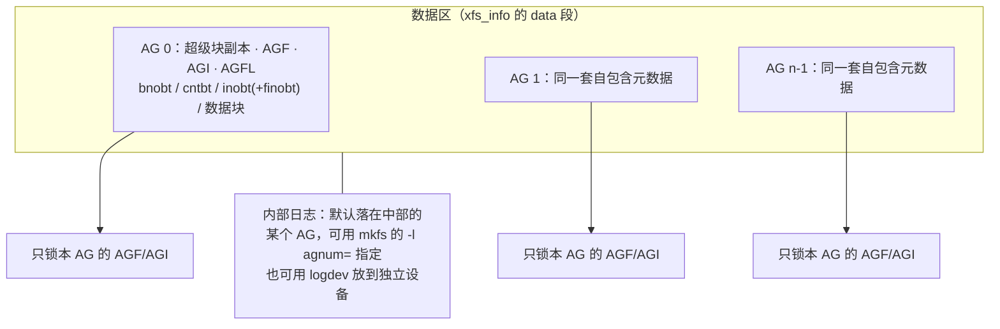
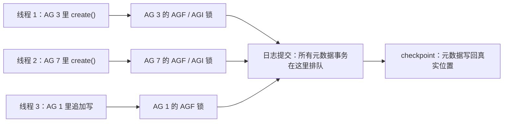
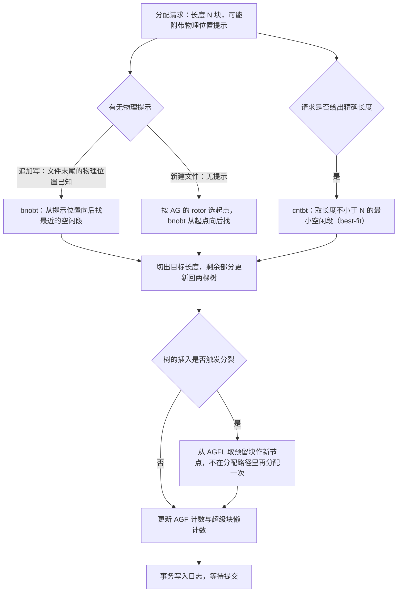
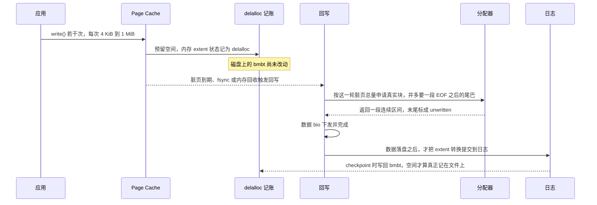
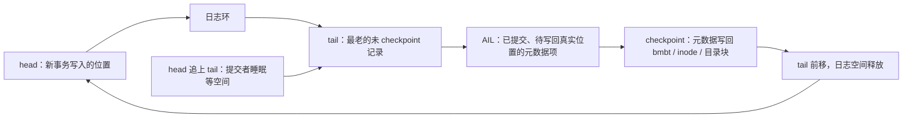

**摘要：**

XFS 是 RHEL 7 之后各企业发行版的默认文件系统，也是众多数据节点、渲染农场与视频存储的事实标准。它 1993 年为 SGI 的 IRIX 而生，从第一天起就以"多处理器同时做元数据操作"为前提设计，这与把账本集中管理的传统 Unix 文件系统走了两条路。本文沿着三个骨架展开：分配组（AG）如何把磁盘切成若干个自包含的子文件系统，使空闲空间树与 inode 树按 AG 分片，从而让多线程分配互不相干；每个 AG 里的两棵空闲空间 B+ 树（按块号索引的 bnobt 与按长度索引的 cntbt）如何分别服务"就近延展"与"找一段足够大的连续区"，后者正是大文件抗碎片的账本基础；延迟分配与投机预分配如何把"写多少次就分配多少次"变成"攒够了再一次分配"，并额外预留 EOF 之后的空间，代价是短命小文件的浪费与残留空间。日志部分说明 XFS 只把元数据写进日志、数据从不过日志的边界，如何在顺序被打乱时从"丢数据"恶化成"结构损坏"。最后给出一张 ext4 与 XFS 的判据表，以及"df 看不出空间去哪了"的分账方法。

---

## 第 1 章 一个 1993 年的并行文件系统命题

### 1.1 从 IRIX 到 Linux

1993 年，Silicon Graphics（SGI）启动了为 IRIX 重写文件系统的工程。当时的 SGI 卖的是 Origin 系列多处理器服务器，一台机器上几十个处理器共享内存与磁盘阵列，客户用它跑流体仿真、影视渲染、医学影像，负载形态相当一致：少数几个极大文件被持续顺序写，同时有成千上万个小文件在目录树里被反复创建与删除。

承载这些负载的文件系统，必须能在几十个 CPU 上同时推进元数据修改，而不是把每次 `create()` 都排进同一个队列。

XFS 在 1994 年随 IRIX 5.3 交付，1996 年的 USENIX 论文《Scalability in the XFS File System》把设计取舍讲得很直白：磁盘空间与 inode 的管理被切成互相独立的分配组，每个分配组有自己的空闲空间索引与 inode 索引，B+ 树承担全部索引工作。2000 年 SGI 以 GPL 释出源码，2001 年进入 Linux 2.4 主线，2014 年随 RHEL 7 成为企业发行版的默认选择。三十多年过去，磁盘从 4 GB 的 SCSI 盘换成了几十 TB 的 NVMe，但 AG 与两棵 B+ 树的结构没有变，这说明它解决的不是某个年代的硬件问题，而是"并发元数据"这个长期存在的结构问题。

### 1.2 三条不可让步的约束

第一个约束是**并发**。文件系统的元数据账本如果只有一本，那么无论把锁拆得多细，"找到一个空闲块"这一步都要访问同一份数据结构，处理器越多，争用越重。

SGI 的选择是把账本按地址空间切成若干份，每一份自带索引、自带锁、自带统计，操作落在哪一份就只锁哪一份。这个思路在今天看来平常，但在 1993 年，绝大多数 Unix 文件系统的空闲空间还只是一张位图加一把锁。

第二个约束是单文件的规模与吞吐。渲染输出的单帧、视频素材的单个文件动辄几十 GB，文件系统必须能用很少的元数据描述很长的连续区间，否则每写一段就要改一次块映射，元数据写放大会把顺序写的吞吐吃掉。

XFS 从一开始就用变长的 extent 描述文件数据，并把"一段能有多长"这个上限设得很高，高到多数文件只需要个位数的 extent。

第三个约束是**在线增长**。大型机停不起，容量不够时不能"备份、重新格式化、恢复"。XFS 因此把增长做成了运行时可做的事：新增的空间被追加成新的分配组，已有结构原地不动。

这条约束反过来也锁死了一个能力——AG 是等大、顺序编号的，缩容意味着搬走尾部 AG 里的全部数据并重排编号，这条代码路径从未存在。

### 1.3 反事实：若沿用集中式账本

不妨设想 XFS 沿用当时通行的结构：一张全盘空闲块位图、一张固定大小的 inode 表、一个全局超级块锁。在 8 路机器上它还能用，到了 64 路机器上，每次创建文件要依次拿"inode 表锁"和"空闲位图锁"，两次都是全局限界；即便把位图切成 32 份，把 inode 表切成 32 段，仍然要回答一个问题——"找一段连续的空闲空间"。位图能高效回答"第 N 块空不空"，但对"从某处开始连续 256 块都空吗"这种问题，最坏情况要扫过整段区间。

碎片一多，分配路径就从"查一次"变成"扫很久"，延迟的方差随碎片程度上升，而方差正是长时间运行的存储服务最难承受的东西。

XFS 用 B+ 树回应了这个问题：把"空闲区间集合"同时按两种键建索引，一种按起始块号，一种按长度。前者回答"离这里最近的一段空闲在哪"，后者回答"哪一段足够长"。两个问题都是 O(log n)，与碎片程度弱相关。这是本文后面所有讨论的地基——AG 决定并发度，两棵树决定分配质量，延迟分配决定这两棵树被问到的频率与问题的规模。

### 1.4 本篇的边界

VFS 的四个对象与方法表见 [[02 VFS 虚拟文件系统——超级块、inode、dentry 与 file]]，本文只在需要时提到 `address_space` 与 `->writepages`；ext4 的块组、mballoc 与 JBD2 见 [[03 ext4 深度解析——日志、Extent 树与 Flex BG]]，本文与它对照时只谈结构差异；`fsync` 的精确语义、脏页水位与 `O_SYNC` 的行为见 [[04 Page Cache 与脏页回写——Linux IO 的秘密缓冲层]]，本文只讲 XFS 日志在这条链上承担什么。

至于块层的 flush/FUA 与调度，见 [[05 块设备栈——从 bio 到 blk-mq 的 IO 路径]] 与 [[06 IO 调度器——CFQ、Deadline 与 mq-deadline 的演进]]；`fio` 测量与调优方法论见 [[08 存储栈性能调优——从 fio 到 iotop 的全套方法论]]。

### 1.5 一个贯穿全篇的案例

设想一台视频转码节点的数据盘：8 个转码进程各自把一批 4K 素材合成一个 200 GB 的中间文件，持续顺序追加；同目录下还有 200 万个帧缓存小文件在反复创建与删除；运维希望这块盘"以后能缩容"，因为它挂在云盘上，规格随时可能下调。这三个要求——高并发元数据、单文件极大、容量可变——恰好分属本文前三个骨架，后面每讲完一个机制，就回到这台机器上看它落在哪里。

---

## 第 2 章 分配组：把一本总账拆成若干本分账

### 2.1 一个 AG 里装了什么

XFS 把数据区按等大切成若干**分配组**（Allocation Group，AG），`agsize` 的合法范围是 16 MiB 到略小于 1 TiB，具体值由 `mkfs.xfs` 在格式化时按设备容量自动缩放，也可以用 `-d agcount=` 或 `-d agsize=` 手工指定。

每个 AG 都是一个自包含的缩影：开头的超级块扇区里放本 AG 的超级块副本，随后是三个元数据扇区，分别叫 AGF（AG Free space）、AGI（AG Inode）与 AGFL（AG Free List），再往后是该 AG 的若干棵 B+ 树与数据块。

AGF 里存的是这个 AG 的空闲空间统计与两棵空闲 B+ 树的根；AGI 里存的是 inode B+ 树的根与已用、空闲 inode 计数；AGFL 是一小段预留块的链表，专门留给"B+ 树自己需要长高"时用。这棵预留链表是 XFS 的一个精细处：空闲空间 B+ 树在插入记录时可能要分裂出新块，而新块本身要从空闲空间里分配，如果分配路径在持有树锁的情况下再次进入分配路径，就会自锁。AGFL 把这对矛盾拆开了——树长高用预留块，常规分配走树，两条路不交叉。

这也解释了为什么 XFS 在盘几乎写满时仍能完成一部分元数据操作，而依赖块组描述符预留位的实现更容易在这个临界点上卡住。

下图是一个数据设备被切分之后的鸟瞰，以及单个 AG 内部的构成。



### 2.2 并行度的来源

把一个文件写进某个 AG，需要改的元数据只有三类：本 AG 的空闲空间 B+ 树与 AGF 计数、本文件的 inode 与其块映射树、以及日志里的一条事务。前两类都是 AG 局部的，锁的粒度因此可以做到 AG 级——内核为每个 AG 维护一个 `xfs_perag` 结构，里面挂着该 AG 的锁与缓存。

两个线程往不同 AG 里创建文件、分配块，走的是完全不相交的数据结构，没有共享的计数器需要原子操作，也没有需要排队的全局链表。

文件落在哪个 AG，并不是随机的。创建新文件时，XFS 优先把 inode 分配在父目录 inode 所在的 AG，这叫**父 AG 亲和**；写文件时，分配器优先从文件已有 extent 的物理位置附近取块。这两条亲和规则让"一个目录下的文件"在物理上聚在同一个 AG 里，读目录时元数据访问的局部性好，但也带来一个直接后果：单个大目录的元数据负载集中在一个 AG 上，该 AG 的 AGI 更新成为串行段。200 万个文件塞进一个目录，无论 AG 总数是多少，inode 分配这条路径的并行度都退化成 1。XFS 在大目录上比 ext4 强的地方在查找（B+ 树对 htree），不在创建时的并发。

下图把并行与串行两段路标出来：分配路径散在各 AG，提交路径仍然汇入同一个日志。



### 2.3 并行度的上限

分配并行不等于提交并行。XFS 只有一个日志设备（内部日志或一块外部日志设备），所有元数据事务最终都要按序写进这个环形区域，提交点是一处全局串行段。AG 再多，也只能让"准备事务"这一步并行，不能让"事务入日志"这一步并行。写密集型元数据负载的真实吞吐上限，通常先撞到日志设备的小块顺序写能力，再撞到 AG 锁。

若一个现场把 agcount 从 4 调到 32、创建吞吐却只涨了不到两成，第一嫌疑是日志与数据落在同一块盘上，提交段的排队时间并没有随 AG 数下降。

另外两个全局量也要记住：超级块里的持久计数器曾经是热点，XFS 用 lazy-count（默认开启）把它们搬到 AGF 里维护，避免每次分配都去改超级块；inode 号的分配在 inode32 模式下还有一个跨 AG 轮转的节奏控制（`fs.xfs.rotorstep`），那是为兼容旧应用保留的路径，与现代默认的 inode64 无关。

### 2.4 agcount 怎么取

`xfs_info` 的输出里，`agcount` 与 `agsize` 两个字段决定了切分方式，两者相乘约等于 `blocks`（尾部余量凑不进一个整 AG）。要在格式化之前知道结果，用 `mkfs.xfs -N` 干跑：它只打印几何而不写盘。

```bash
# 干跑：不写盘，只看 mkfs 会给出什么几何
mkfs.xfs -N /dev/nvme1n1

# 指定 AG 数量后干跑，对比 agsize 是否仍落在合理区间
mkfs.xfs -N -d agcount=16 /dev/nvme1n1

# 已挂载的文件系统读几何
xfs_info /data

# 设备离线时读超级块（-r 表示只读，不加 -r 的 xfs_db 会改盘）
xfs_db -r -c "sb 0" -c "print" /dev/nvme1n1
```

取值没有唯一正确答案，但有几个可操作的边界。AG 不能小于 16 MiB，否则元数据开销占比过高；单个 AG 也不宜大到让"一个大文件只能在一个 AG 里找空间"变成约束，因为分配器不会跨 AG 拼接一段连续区间。经验上把 agsize 控制在几十 GB 到几百 GB，让 agcount 落在 4 到 64 之间，并且是 4 的倍数——mkfs 的默认算法本身就倾向这个形状，也与常见 RAID 的盘数成整数关系。并发元数据压力大的节点（多进程各写各的文件、批量建目录）把 agcount 提到 CPU 核数附近；以吞吐为唯一目标的大文件盘，agcount 反而可以小一些，让每个 AG 拥有更大的空闲区间。

| 参数 | 何时确定 | 作用 | 调大 / 调小的代价 |
|---|---|---|---|
| `agcount` / `agsize` | 仅 `mkfs.xfs` 时 | 决定空闲树与 inode 树的分片数，即分配路径的并行上限 | 调大：并行度升、单 AG 连续区间变小，大文件更早跨 AG 分段，元数据固定开销增加；调小：单 AG 空间充裕、大文件连续性好，但高并发元数据会挤在少数 AG 的锁上 |
| `-i maxpct`（`imaxpct`） | `mkfs.xfs`，可由 `xfs_growfs -m` 改 | inode 可占用的空间比例上限 | 调大：小文件多的盘不会因 inode 配额先耗尽；调小：给数据留更多空间，但 inode 密集负载会提前 ENOSPC |
| `-i size` | 仅 `mkfs.xfs` 时 | inode 大小（v5 默认 512 B），决定内联 extent 列表能放几条 | 调大：单文件可内联更多 extent、减少 bmbt 块；调小：inode 密度高，小文件省空间，但 extent 一多就要外挂树 |
| `-d sunit` / `swidth` | `mkfs.xfs`，挂载项可在一定范围内调整 | 条带单元与条带宽度，决定分配与预分配的对齐粒度 | 设对：预分配与日志写都落在条带边界上；设错或留 0：在 RAID 上产生读改写放大 |
| `-l size` / `-l logdev` | `mkfs.xfs`（`xfs_growfs` 的日志调整项在当前 xfsprogs 中标注为未实现） | 日志容量与位置 | 调大：日志能容纳更长的在途事务，提交阻塞少，但恢复时要重放的量更大；调小：元数据密集时写者会在日志满时睡眠；外置日志：提交更快，但多一个设备故障面，修复时要显式指定 `-l` |

### 2.5 inode64：一个曾经必须选择的事

XFS 的 inode 号内部是 64 位，但 inode 号能有多少位有效，取决于 inode 被放在哪个 AG——AG 编号乘以 AG 内偏移构成 inode 号，放在靠后的 AG 里，inode 号自然超过 32 位。

上世纪九十年代到本世纪初的大量应用把 inode 号塞进 32 位整数（`ino_t` 的历史包袱、部分 NFS 客户端、一些备份与索引软件），于是 XFS 提供了 `inode32` 挂载项：只在前面的低位 AG 里创建 inode，保证 inode 号不超过 32 位有效位，代价是大容量文件系统的 inode 分配被压缩到磁盘前部，局部性变差，并引入跨 AG 轮转的节奏控制。

内核文档现在把 `inode32` 标为兼容选项，把 `inode64` 标为默认。这是一次**方向明确的翻转**：现代内核与 64 位用户态程序都能处理大 inode 号，而把 inode 全塞进低位 AG 的代价在 TB 级盘上越来越荒谬。

发行版之间曾有差异，RHEL 6 时代不少系统仍默认 inode32，RHEL 7 之后随上游一起改为 inode64；如果接手的是老系统，`/proc/mounts` 里看不到 `inode32` 就说明在用默认值，而"某台机器 inode 号突然变得很大"往往是升级或重挂载之后才被注意到的变化，值得在升级清单里单独列一条。真正需要保留 inode32 的场合只剩一种：确认有无法替换的软件把 inode 号按 32 位截断，并且它真的跑在这块盘上。

### 2.6 量化：AG 数与并行度

一个 24 vCPU、1 TiB NVMe 的转码节点，若按 mkfs 默认切成 4 个 AG，那么"分配路径的并行上限"就是 4。8 个转码进程各自在自己的目录里追加写，理论上最多 4 个能同时进入 AG 的分配临界区，其余在锁上排队；如果 8 个目录的父目录恰好都在同一个 AG，实际并行度更低。

把 agcount 改成 16，并让 8 个子目录分布在不同的父目录下，分配路径的并行上限抬到 16，排队现象消失——这是示例推算，真实加速比还要扣掉日志提交段的排队，后者不随 agcount 变化。反过来说，若把这台机器的 agcount 拉到 128，agsize 降到 8 GiB，每个 AG 的空闲区间变得局促，200 GB 的中间文件会被切到更多 AG 里，extent 数上升，元数据写放大反而变差。加法的收益有上限，减法的代价没有下限，这条经验在 AG 上体现得尤其清楚。

---

## 第 3 章 两棵 B+ 树与 inode 树

### 3.1 为什么不用位图

位图是 Unix 文件系统管理空闲空间最自然的做法：一位一个块，置 1 表示已用。它的优点是简单、空间开销低（1 TiB 的盘，4 KiB 块，位图 32 MiB）、相邻块的信息在同一个字节里，缓存友好。它的缺点在"按条件查询"上暴露：位图知道每一块的状态，却不知道"哪里有一段连续 N 块的空闲"；要回答这个问题只能扫，最坏扫过整张图。

碎片化的盘上，扫到一段够长的区间之前可能已经走过了几万个字节，而分配是写路径上的同步操作，这段时间直接变成写延迟。

位图还有两个次生问题。其一是并发修改的粒度：一位一个块意味着两个线程分配相邻块时可能写同一个字节，锁要么退化成按字节、按行，要么退化成整张图。其二是统计：位图不维护"最大连续空闲段"这类聚合数据，想快速回答尺寸类问题就得额外开一张表，而这张表一旦存在，就得和位图一样承受并发更新的成本。

XFS 的选择是把"空闲区间"当作**一等公民**：一个区间是一条记录，记录里只有起点与长度，所有空闲区间按两种键各建一棵 B+ 树。记录数正比于碎片数而不是盘的大小，空盘的树只有寥寥几个节点；查询是 O(log n)，与盘多大、碎成什么样弱相关。

代价是每次分配与释放都要改两棵树，其中一棵还要做删除加插入，元数据操作量比位图多。

### 3.2 bnobt：按地址排序的那棵树

第一棵树习惯叫 bnobt（by-blocknumber btree），键是空闲区间的起始块号。给定一个位置提示，它能回答"从这个位置往后，最近的一段空闲在哪里、有多长"。这是顺序写最需要的问题：文件末尾在物理位置上已经延伸到某处，下一段数据就该接在它后面，从那里向后找最近的空洞，既保持连续性，又不会在盘上跳来跳去。

这棵树的另一个用途是"在某个 AG 里找落脚点"。新建文件时没有物理提示，分配器按 AG 的轮转起点（rotor）选一个位置，从那里开始找最近的一段空闲，把文件的第一个 extent 放下去；下一个文件来时起点前移，于是文件在 AG 内均匀铺开而不是全部堆在一处。这种铺开对后续的顺序写有好处——每个文件后面都还有空地可以延展。

### 3.3 cntbt：按长度排序的那棵树

第二棵树叫 cntbt（by-size btree），键是空闲区间的长度。它回答的是另一个问题："长度至少 N 块的空闲区间，哪一段最合适"。这是 best-fit 分配的基础：请求 256 块（1 MiB），就在长度不小于 256 的区间里挑长度最小的那一段，切走 256 块，剩下的放回。

挑最小而不是挑最大，是为了不把一个本来能装下更大请求的区间切碎——这是赌未来的行为，也是在碎片化盘上唯一合理的赌法。

两棵树的合作可以用**电影院找连座**来比喻：bnobt 是按座位号排的入场表，告诉你"这一排哪几号挨着空"；cntbt 是按连座数排的表，告诉你"全场哪几处还能坐得下六个人"。要六连座时查后者，一个人随便坐时查前者。两张表描述的是同一批空位，任何一次售出都要同时更新两张表，这就是 XFS 空闲管理的元数据成本。

| 维度 | bnobt（by-blocknumber） | cntbt（by-size） |
|---|---|---|
| 键 | 空闲区间的起始块号 | 空闲区间的长度 |
| 主要回答的问题 | 从某个位置往后最近的一段空闲在哪 | 长度不小于请求量的区间里哪段最合适 |
| 服务的分配模式 | 追加写、就近延展（near 分配） | 指定长度的精确分配、best-fit |
| 查询代价 | O(log n)，n 为该 AG 的空闲区间数 | O(log n)，同上 |
| 维护代价 | 每次分配/释放各一次删改，可能触发分裂与合并 | 每次分配/释放各一次删除加插入，两棵树都要改 |
| 恶化时的症状 | 顺序写开始跨 AG 或跳段，extent 数上升 | best-fit 找不到够长的段，分配退回小块，同时 `abtc2` 的分裂计数上升 |

### 3.4 一次分配的真实路径

把两棵树放在一起看，一次分配是这样展开的。



这张图里最容易被忽略的是 AGFL 那一支。B+ 树的分裂需要新块，而新块若要从空闲空间树里取，就出现了"为了改树而必须改树"的递归。XFS 的解法是每个 AG 预留一段块放在 AGFL 上，分裂时从链表取，用完再由常规分配补回。

预留意味着损失了一点可用空间，换来的是分配路径的有界性——在这一点上，XFS 与所有依赖元数据预留的文件系统做的是同一笔交易。

### 3.5 inode 树：inobt 与 finobt

inode 的管理在 XFS 里与数据块共用同一本账。需要新 inode 时，分配器从空闲空间里切出一段连续 32 KiB 的空间，做成一个 inode chunk，里面按顺序放 64 个 inode（v5 默认 512 B 一个），再把这个 chunk 的位置写进本 AG 的 inode B+ 树（inobt）；chunk 里哪些 inode 被用掉了，记在 chunk 的位图里。

inobt 的键是 inode 号，回答"某个 inode 在哪个 chunk、是否已分配"。随着文件系统老化，inobt 里记录越来越多已满的 chunk，而分配新 inode 时想找的恰恰是"还有空位的 chunk"。Linux 3.16 之后增加了一棵 finobt（free inode btree），只索引仍有余量的 chunk，分配时查这棵树就够了，不必遍历整棵 inobt。这是一个纯收益的优化，代价只是多一棵树要维护；在 `crc=1` 的默认格式上 `finobt` 默认开启，没有 CRC 的 v4 格式则不支持这棵树。

inode 的**动态分配**消除了 ext4 上那类"空间还够但 inode 用完了"的故障。`df -i` 在 XFS 上显示的 inode 总数是动态推算的，实际可用量随文件系统增长而变化。

但把这理解成"XFS 不会有 inode 问题"就过头了：inode chunk 是一段连续 32 KiB 的空间，盘写得极碎之后可能凑不出这段连续空间，分配 inode 会失败；`-i maxpct` 也仍然给 inode 的占比设了上限，默认 25%（1 TB 以下）、5%（50 TB 以下）、1%（50 TB 以上），意思是"inode 最多吃掉这么多空间"，不是预留。xfsprogs 为此提供过 sparse inode chunk 特性，允许在碎片严重时分配小于 64 个 inode 的 chunk，`xfs_info` 里通常能看到 `sparse=1`，具体默认值随 xfsprogs 版本而异，以对应版本的 `mkfs.xfs` 文档为准。

### 3.6 一条 extent 能有多长

XFS 的块映射记录（bmbt record）用两个 64 位字描述一段 extent：一个状态位标记这段是正常数据还是未初始化（unwritten），54 位放文件内的逻辑偏移，52 位放物理块号，21 位放长度。21 位决定了单条 extent 的长度上限是 2097152 个块，4 KiB 块下就是 8 GiB。extent 数量少的时候，整张表直接**内联**在 inode 的数据区里；数量超过内联容量才升级成独立的 B+ 树（bmbt），以逻辑偏移为键索引。

把这条上限与 ext4 对照一下就有量级感：ext4 的 extent 头里长度字段是 15 位，单条 extent 最多 32768 块，4 KiB 块下 128 MiB。一个 1 TiB 的连续文件，ext4 理论上的最少 extent 数是 8192 条，XFS 是 128 条；bmbt 的一个叶子块能放两百多条记录，所以 ext4 那边需要几十个叶子块加一层索引，每次写回都要动这些块并写日志，XFS 这边 128 条记录仍然可以内联在 inode 里，一次 inode 更新就够了。

这是示例推算，但它说明了"大文件在 XFS 上更稳"的一半来源：不是分配器更聪明，而是描述文件的元数据天生更短，短到元数据写放大在文件变大时几乎不增长。另一半来源在下一章的延迟分配。

### 3.7 目录也是 B+ 树

目录在 XFS 里有四种形态，随内容增长逐级升级：条目很少时用短格式（shortform），目录项与 inode 号直接内联在目录 inode 的数据区里；装进一个目录块时用块格式（block），块内带一张按名字哈希的小索引；再大就用叶子格式（leaf），数据块与一组专门装哈希索引的叶子块分开；条目数到万级以上后升级成节点格式（node），哈希索引本身变成 B+ 树，查找是 O(log n)。目录块大小默认 4 KiB，可在 mkfs 时调大；目录项里存了文件类型（ftype），`readdir` 不必为了返回类型而回去读 inode。

这套结构让"在百万文件的目录里按名查找"保持廉价，但正如 2.2 节所说，创建与删除仍要在目录 inode 上加锁。大目录的正确用法是把并发摊到多个目录上，让不同的目录 inode 落在不同的 AG，而不是指望单一目录在所有维度上都可扩展。

---

## 第 4 章 延迟分配与投机预分配

### 4.1 write() 只记账

缓冲写在 XFS 上走到文件系统时，先落进页缓存，同时向分配器要一个"预留"而不是真正的块。这个预留记录在 inode 的内存 extent 列表里，状态是 delalloc，配套做配额记账与空间统计，磁盘上的块映射树一个字都没有改。

换句话说，`write()` 返回时，文件系统只记住了"这里将来需要一段空间"，还没决定这段空间在哪。

对应用来说这段区别是看不见的，但对文件系统来说它把两件事解耦了：写路径上不必做分配，于是写延迟里没有分配器的耗时；分配被推迟到一个更合适的时刻，那个时刻知道的信息更多。顺手也带来一个必须记住的后果——`write()` 返回只代表数据进了页缓存，此时掉电，这段数据与这段预留一起消失，文件长度可能还停在旧值。这是 04 篇要展开的语义边界，这里只需要记住它在 XFS 里对应的机制位置。

### 4.2 回写时才分配

真正分配发生在回写的时候。脏页被提交给块层之前，XFS 的 `->map_blocks` 回调向分配器申请真实块，申请的长度是这一轮回写覆盖的脏页总量，而不是某一次 `write()` 的长度。一个应用以 4 KiB 为单位写了 4096 次，页缓存里攒下 16 MiB，回写时就变成一次 16 MiB 的请求；请求越大，cntbt 里能匹配到的空闲段越可能是一整段，而不是被切成许多块。

这就是延迟分配能改善碎片的原因，说到底是把"请求的粒度"从应用的写粒度换成了**回写的批量粒度**。

若每次 `write()` 都立刻分配 4 KiB，多个进程交替写时，磁盘上就会呈现"你一块我一块"的交错布局，这种布局一旦写下去就固定了，后续所有读都要面对散落的 extent。攒批之后，每个文件能拿到一段相对完整的区间，交错只发生在文件之间，而不是文件内部。

下面这张时序图把一次缓冲写从调用到落盘拆成两段，留意分配发生的位置。



回写路径里还有一个顺序上的讲究：XFS 把真实块的映射做进内存的 extent 列表，数据 bio 下发并完成之后，才把这次 extent 转换作为一个事务提交到日志。

这条顺序保证了日志里出现的每一条新块映射，原则上都指向已经落盘的数据。崩溃之后可能丢最近写入的内容，但不太可能出现"元数据说这里有数据、盘上实际是旧内容"的结构性矛盾——这是"只记元数据的日志"能够自洽的前提。

### 4.3 投机预分配：多占一段尾巴

延迟分配解决了"一次分配多大"，但没有解决"下次还得再找一次"。一个持续追加写的文件，每轮回写都要重新走一遍分配，每走一遍就多一次落点的机会，也就多一次碎片的机会。

XFS 的办法是：既然这个文件正在增长，就顺手在 EOF 之后多分配一段，标成 unwritten。这段空间在逻辑上不属于文件（读不到、不算文件长度），但在物理上已经占住了，等到下一次追加写落进来，只需要把状态从 unwritten 翻成正常数据，不必重新分配，也不必改物理块号。

翻转状态这个动作很便宜：extent 的物理地址与长度都没变，**只改状态位**，一次 inode 更新就能完成。

相比之下"先释放再分配"要在两棵空闲树上做四次改动，还可能触发树的分裂合并。省下的不是数据 IO，而是元数据的写放大与延迟——顺序写场景下这个差别会累积成很大的差距。

多给多少，由一个叫 `xfs_iomap_prealloc_size` 的函数决定。上游提交说明里写得很清楚：它会从写偏移往回走，找出物理与逻辑上都连续的那一串 extent，把它们的总长度作为输入，再向上取整到条带对齐与 2 的幂，并受 AG 内最长空闲段限制。

于是预分配量随文件生长而增长——文件越大、已有的连续段越长，下一段给得越大，直到触及上限或触到 AG 的边界。写满这段尾巴之后，下一次扩展重新计算，可能再翻一倍。

### 4.4 预分配量由什么决定

挂载项 `allocsize` 是**最直接的控制手段**。内核文档的表述是：它设定延迟分配写回时 EOF 之后的预分配大小，默认 64 KiB，合法取值从页大小（通常 4 KiB）到 1 GiB，且必须是 2 的幂；默认行为是动态启发式，按文件的分配与访问模式优化预分配大小，一旦显式指定 `allocsize`，动态行为就被关掉，永远用固定值。

这个"关掉动态"的措辞值得留意。动态启发式在多数负载上比固定值聪明，因为它跟着文件的实际增长节奏走；固定值的好处是可预测，坏处是它不知道文件正在变大还是已经写完。

Hadoop 时代的经验值 `allocsize=256m` 就是这么来的：数据块 128 MiB，一次预分配两个块的量，减少跨块的分配次数。这个值放在今天的对象存储或流式写入上依然可用，但把它无差别地设到一块装满小文件的盘上，就是给自己制造 4.5 节要说的麻烦。

对齐与条带是另外两个乘数。若 mkfs 时探测到了 RAID 几何（设备大于 1 GiB 时会自动查询），预分配会向上对齐到 stripe unit，写满时也倾向落在条带边界上；`swalloc` 挂载项进一步让扩展写按 stripe width 取整。在 RAID5/6 上这一步很关键，不对齐的预分配会造成读改写放大，而预分配本身就是为了减少写放大才存在的。

最后是 AG 的容量约束。预分配要在某个 AG 内找到一段连续空间，函数会去查该 AG 的最长空闲段，最长段不足时预分配量被迫缩水。这解释了为什么盘用到八成以上之后，即使文件仍在顺序增长，extent 数也会开始上升：不是启发式变笨了，是它没有足够的连续空间可以赌。

### 4.5 代价：短命小文件与看不见的占用

投机预分配不是免费的。一个 4 KiB 的临时文件如果被预分配了 64 KiB 的尾巴，瞬时占用是实际内容的 16 倍；若同时有 1000 个这样的小文件在被写入，被预分配占住的量就是 64 MiB 量级（示例推算）。这些空间记在文件系统的已用统计里，`df` 会显示已用，`ls -l` 的文件长度却只有 4 KiB。

XFS FAQ 对此有明确描述：EOF 之后的块计入 `stat()` 返回的 `st_blocks`，被文件系统当作全局已分配空间统计，因而 `df`、`du`、`ls` 都会呈现出让管理员困惑的差异。

这些空间在多数情况下是临时的，回收有几条路径。文件关闭时 `xfs_file_release` 会尝试把 EOF 之后的投机预分配裁掉；文件一直开着不关（长跑服务、轮转前不关的日志进程），就只能等后台扫描，扫描周期由 `fs.xfs.speculative_prealloc_lifetime` 控制，默认 300 秒，工作队列名叫 `xfs-gc`，专门回收 EOF 之外投机分配的空间。这两条路径都是"尽力而为"：裁不掉也不会永久泄漏，但在一段时间内确实占着。

更麻烦的是它对小文件密集负载的双重打击。一是空间：大量短命文件各自占一段尾巴，盘的可用空间比 `du` 汇总出来的少一截，容量规划失准。

二是碎片：每个小文件的预分配段被固定在各自的落点上，文件删除后这些段回到空闲树，但空闲树里因此多出许多中等长度的区间，下一批大文件来临时，能拿到的连续段反而变小了。预分配是为顺序大文件设计的机制，用在小文件上等于**用错了工具**。

### 4.6 fallocate 与 O_DIRECT 会改变什么

`fallocate` 走的是另一条路：它不猜，直接按请求的长度创建 unwritten extent，不给额外的尾巴。

分配是精确的，**浪费为零**，后续写只是状态翻转；`punch hole`、`zero range`、`collapse range` 也都建立在同一套 unwritten extent 机制上。凡是"写入前就知道要写多大"的场景——虚拟机的镜像文件、数据库的表空间、把对象落成文件的对象存储——都应该用 `fallocate` 把空间一次性铺好，而不是靠写零字节去占位。前者在文件系统层面预留，后者真的会写数据，代价差一个数量级。

`O_DIRECT` 的效果则相反方向的：它绕过页缓存，写请求直接进入文件系统的直接 IO 路径，分配在 write 的调用栈里同步完成，没有"攒批"的机会。请求多大，分配就多大；以 4 KiB 为单位做直接 IO 的应用，会得到比缓冲写碎得多的 extent 布局。

正确的做法要么把直接 IO 的请求放大到 MiB 级，要么先用 `fallocate` 把目标区间铺成 unwritten，让直接写落在已分配的空间里。数据库同时用这两种手段是常态：预分配给未来，直接 IO 控制绕过缓存的时机。

| 手段 | 分配时机 | 连续性 | 空间浪费 | 适用 |
|---|---|---|---|---|
| 缓冲写 + 动态延迟分配 | 回写时按批量申请 | 好，随批量增大而改善 | 有短暂的 delalloc 预留 | 通用文件写、日志、追加写 |
| 缓冲写 + 投机预分配 | 回写时多要一段 EOF 之后的尾巴 | 最好，跨多轮写维持连续 | 短命小文件上明显 | 顺序增长的大文件、转码与采集 |
| `fallocate` | 调用时精确分配 | 由请求长度决定，一次成型 | 无（本来就是预留） | 镜像、表空间、已知大小的对象 |
| `O_DIRECT` | 每次 write 同步分配 | 取决于单次请求大小 | 无 | 数据库、自管理缓存的应用 |

### 4.7 怎么看见它

单文件层面，`xfs_bmap -vp` 的 FLAGS 列里出现 `u` 就是 unwritten 段，也就是预分配或 fallocate 还没被写满的部分；`xfs_io -c stat` 输出里的块数与文件长度不匹配时，差额通常就在这些段里。

文件系统层面，`xfs_spaceman -c "prealloc -s"` 可以主动清掉投机预分配，手册里写明它支持按用户、组、项目过滤，也支持 `-m` 只处理大于某个长度的文件——盘快满时这是一条应急手段，比等后台扫描快。

计数器层面，`/sys/fs/xfs/<dev>/stats/stats`（`/proc/fs/xfs/stat` 是它的软链）里有几行值得记住：`extent_alloc` 给出分配与释放的块数与次数，`blk_map` 给出块映射的读改写次数，`abtb2` 与 `abtc2` 分别是 bnobt 与 cntbt 的操作计数（lookup/insert/delete/split/join 都在里面），`xstrat` 的 quick 与 split 两项反映分配器是"一次拿到"还是"切段拿到"，`log` 行的 `force`、`try_logspace`、`sleep_logspace` 则直接指出写者有没有在日志上等。如果 `xstrat` 的 split 相对 quick 持续偏高，或者 `abtc2` 的 split 不断增长，说明空闲树在长大、连续段在变少，这比等到延迟告警更早。

需要澄清一个流传较广的说法：不少资料引用 `/sys/fs/xfs/*/stats/*` 里的 `prealloc_extents` 来观察预分配。当前主线内核的 `stats` 输出由 `fs/xfs/xfs_stats.c` 的字段表生成，其中并没有这一行；能直接用的落点是 `xfs_spaceman` 的 `prealloc` 命令与 `xfs_bmap` 的 unwritten 标记。字段集合随内核版本增减，判断之前先 `cat` 一眼实际输出，比背字段名可靠。

---

## 第 5 章 日志：只记元数据的两段式提交

### 5.1 日志里只有图纸，没有砖

XFS 的日志（习惯称 XLOG）记录的是元数据缓冲区的镜像：inode 的核心字段、块映射树的记录、目录块、AGF 与 AGI 的计数、超级块里的持久计数器。文件内容**从不进日志**，所以 XFS 没有 ext4 的 `data=journal` 那种模式可选，也不打算提供。这个边界决定了它能承诺什么：日志保证文件系统**结构在崩溃后自洽**，不保证你刚写的正文还在。

与 ext4 默认的 `data=ordered` 对照一下更清楚。ordered 模式的承诺是"数据先于元数据落盘"，因此崩溃后不会出现"元数据说文件有 4 KiB，实际块里是上一任文件的内容"这种信息泄漏；XFS 没有这个模式，它用另一条机制达到相近的效果：回写路径把 extent 转换入日志的动作排在数据 IO 完成之后（4.2 节）。两条路殊途同归，都不是"保证数据不丢"，而是"保证结构自洽、不泄漏"。

于是"日志只记元数据"带给应用的推论是明确的：连续写 10 GB 后掉电，可能丢最后几秒甚至更多（取决于回写进度），但文件系统本身能正常挂载、目录能正常遍历、不会出现指向随机块的 extent。要让数据在掉电后确定存在，只有 `fsync` 这一条路，它的语义与代价由 04 篇展开。

### 5.2 两段式：先写日志，再写位置

一次元数据修改在 XFS 里分两段完成。第一段把修改后的元数据缓冲区组装进内存日志缓冲（ICLOG），写进日志环，写完后在日志里落一条提交记录，事务就算"已提交"。第二段由后台线程把已提交的元数据写回它们在磁盘上的真实位置，只有当某条日志记录覆盖的所有元数据都落位之后，这条记录才可以被丢弃，日志的 tail 才能前移。挂在中间的是 AIL（Item AIL），一张"已提交、尚未写回位置"的清单。

这两段的分离让提交变得很快（只写日志），又让空间能循环使用（checkpoint 推进 tail）。它也定义了 XFS 写延迟的典型形态：数据写不慢，慢在等日志。日志环被填满而 tail 追不上时，新的提交者只能睡眠等空间，内核计数器 `try_logspace` 与 `sleep_logspace` 就是这件事的计数。此时观察到的现象是写吞吐突然塌陷、`iostat` 上日志设备的写队列持续有量，而数据盘并不忙。



### 5.3 日志的大小与缓冲

日志大小在 `mkfs.xfs` 时确定，默认按文件系统大小缩放。当前 xfsprogs 的手册写着日志至少 512 个块，并且不得小于 64 MiB、不得大于 2 GiB；这与很多旧资料里"512 KB 到 2 GB、默认 10 到 30 MB"的说法完全不同，后者在今天的 xfsprogs 上连格式化都过不去。

改日志大小要在格式化时做——`xfs_growfs` 虽然有调整日志的选项，但在手册里明确标注未实现，实际可行的手段只有重建文件系统或把日志外置。

`logbufs` 控制内存日志缓冲的个数，合法范围 2 到 8，默认 8。多个缓冲的意义是让写日志的线程不必在同一个缓冲上排队：一个缓冲正在写盘时，另一个可以继续组装。

`logbsize` 控制每个缓冲的大小，两个参数共同决定单次日志写 IO 的上限与内存开销。日志版本 2 支持的缓冲大小是 16 KiB 到 256 KiB，默认值是 32 KiB 与日志条带单元中较大者，且必须是 mkfs 时设定的日志条带单元的整数倍——条带不对齐的日志写在某些 RAID 上会触发读改写，把本来最顺的顺序写变成最糟的随机写。

| 参数 | 默认与范围 | 作用 | 调大 / 调小的代价 |
|---|---|---|---|
| 日志大小 | mkfs 按容量缩放；不小于 64 MiB，不大于 2 GiB（以对应 xfsprogs 文档为准） | 环形区域能容纳的在途元数据量 | 调大：日志满导致的提交阻塞减少，代价是恢复时要重放更多；调小：元数据密集时写者更早开始睡眠 |
| `logbsize` | v2 日志 16 KiB 到 256 KiB，默认取 32 KiB 与日志条带单元的较大者 | 单个内存日志缓冲的大小，即单次日志写 IO 的量级 | 调大：日志写次数少、吞吐好，单次提交延迟与内存占用上升；调小：提交更及时，但日志写次数增加 |
| `logbufs` | 2 到 8，默认 8 | 内存日志缓冲的个数 | 调大：组装与写盘可重叠，内存开销增加；调小：小内存机器上省内存，元数据密集时排队变长 |
| `logdev`（外部日志） | mkfs 时指定 | 把日志放到独立设备 | 放对：提交延迟不再与数据写抢队列；放错：多一个设备故障面，修复时须显式给 `-l`，且外部日志设备丢失等于日志丢失 |

### 5.4 崩溃之后的三种结局

第一种是日志可重放。重启后挂载时内核重放日志，只扫日志区域，代价与日志大小相关，与文件系统规模基本无关。一个 256 MiB 日志的 TB 级文件系统，重放常在秒级完成（量级判断，实例差异很大），这也是 XFS 在大型盘上"挂载快"的来源之一。

第二种是数据未落盘。日志提交过的 extent 指向的块里可能是零或旧内容：结构自洽，内容不新。这不是**损坏**，POSIX 允许，数据库与消息队列都必须靠 `fsync` 自己把边界画出来。

第三种是顺序被打乱。如果日志的提交记录先落盘、它描述的元数据块后落盘，重放时就会把一份不完整的修改当作既定事实写下去，结果是结构自相矛盾——轻则孤立的 inode，重则空闲树与 inode 树互相指认同一块。这是三种结局里唯一会需要离线修复的一种，而它恰恰是可以通过关掉刷写顺序人为制造出来的。

### 5.5 nobarrier 的危险

XFS 历史上提供过 `barrier` 与 `nobarrier` 两个挂载项。默认带 barrier，意思是提交日志前必须让设备把写缓存刷到介质（或确认它具备掉电保护）；`nobarrier` 关掉这道保证，赌的是"设备缓存很安全"或者"丢一点也无所谓"。危险不在丢数据，而在**顺序**：关掉刷写之后，日志环里后写的提交记录可能先到盘，先写的元数据块后到盘，掉电重放就会踩上 5.4 节的第三种结局。

这条因果链很长，长到很多人在遇到它之前已经跑了几个月。

内核对这件事的处置是干脆的：内核文档的"已移除挂载项"表里，`barrier` 与 `nobarrier` 都标注在内核 v4.19 被移除。也就是说，今天再谈"用 nobarrier 提性能"已经不是一个可执行的建议，而是一个历史注脚。

要影响刷写行为，只剩下块设备层的手段（`/sys/block/<dev>/queue/write_cache` 的 write back / write through、设备是否支持 FUA 与 flush）与硬件层面的写缓存保护。正确的路径有两条：确认设备缓存有掉电保护（企业级 SSD 的电容、RAID 卡的电池或闪存备份），让 flush 变得便宜；或者把日志放到具备保护的低延迟设备上，让提交不必与数据写争抢。指望关掉保证来换性能，是把文件系统的一致性押在设备的诚实上。

---

## 第 6 章 在线运维：能扩不能缩的一族工具

### 6.1 xfs_growfs：只能加，不能减

扩容的流程是固定的：先把底层设备变大（LVM 的 `lvextend`、云盘改规格、分区扩容），再让文件系统吃掉新增空间。`xfs_growfs /data` 默认扩到设备能给的最大值，`-D <块数>` 可以指定目标，`-n` 只打印几何不实际扩，`-m` 顺便调整 inode 的占比上限。文件系统必须处于挂载状态才能扩，这一点与"离线工具"的直觉相反，但正是它能在线的理由。

**缩容不存在**，而且不是"工具还没做"的问题。AG 等大、顺序编号，元数据散布在每个 AG 内部，缩小文件系统意味着删掉尾部若干 AG、把里面的数据搬到前面的 AG、再重排所有 inode 号。这条路径在 XFS 的代码里从未出现过。

所以选型时"将来可能要缩容"是一个**否决性条件**，不是一个可以在运维阶段解决的麻烦。云主机的系统盘如果预期会被调小，或者一个 LVM 卷可能要从 20 TB 退回 10 TB，那么从一开始就不该选 XFS。

顺带一个容易踩的细节：想改日志大小或把内部日志搬到外部设备，`xfs_growfs` 的对应选项在当前 xfsprogs 中标注未实现。日志的几何与文件系统同生共死，要改只能重建。

### 6.2 xfs_repair：先分清是不是它的活

`xfs_repair` 处理的范畴是"结构不一致"，且必须离线运行——文件系统没卸载就修，结果可能更糟。它做的检查覆盖 inode 与块映射、inode 分配图、尺寸一致性、目录结构、路径可达性、链接计数、空闲图、超级块几何，修完把无主的 inode 与目录挂进 `lost+found`，名字用 inode 号。

第一步永远不是直接修，而是**判断日志是不是脏的**。XFS 的日志只能由内核在同类 CPU 架构的机器上重放，`xfs_repair` 自己不会重放，遇到脏日志会以退出码 2 收场。标准流程是：能挂就先挂上再正常卸载，让内核完成重放，然后跑修复；挂不上才考虑更激进的手段。很多人跳过这一步，直接对着脏日志跑 `-L`，把日志清零，等于主动丢弃崩溃时在途的那批元数据更新，手册对此的措辞是"可能造成严重的文件系统损坏"。

`-n` 是只检查不改，检测到损坏返回 1，干净返回 0，适合在动刀之前摸清情况。但手册同时提醒它并不完全准确：空闲空间图与 inode 图里的一些不一致（丢块、树被轻微破坏）它抓不到，而且因为是只读，同一个问题会被重复报告。把它当"体检"而不是"诊断结论"，才不会因为 `-n` 通过就以为万事大吉。

实用选项里，`-m` 限制内存占用，`-P` 关掉 inode 与目录预读（修复卡住时的解法，中断是安全的），`-o bhash=` 调缓冲哈希，`-o ag_stride=` 为跨 concat 单元的 AG 开多线程并行处理，大型文件系统上这一项能把时间显著压下来。

修复本身是遍历 inode、目录并重建空闲树的过程，TB 级容量与千万级 inode 的量级下，耗时以小时计（量级判断），这也是为什么"能不能快速修复"经常比"会不会损坏"更能影响可用性目标。

### 6.3 xfs_info 怎么读

`xfs_info` 的输出分四段，读法是有套路的。`meta-data` 段给出设备名、`isize`（inode 大小）、`agcount` 与 `agsize`、`sectsz`、以及一长串特性开关：`crc=1` 表示 v5 格式（有元数据校验），`finobt=1` 表示有空闲 inode 树，`sparse=1` 表示允许稀疏 inode chunk，`rmapbt=0` 表示没建反向映射树（默认不建，因为维护开销），`reflink=1` 表示支持重删与写时复制，`bigtime=1` 表示时间戳越过 2038。`data` 段给出 `bsize`、`blocks`、`imaxpct` 与 `sunit`/`swidth`；`naming` 段给目录块大小与版本；`log` 段给日志是内部还是外部、块数与字节数、版本、条带与 `lazy-count`。

三个快速判断：`agcount` 乘 `agsize` 与 `blocks` 是否接近（差值是尾部余量），`sunit`/`swidth` 是否为 0（在 RAID 或 LVM 上为 0 往往意味着 mkfs 时没探测到几何，条带对齐没做），`log` 段的块数乘块大小是否与预期相符（日志偏小是元数据密集负载写延迟抖动的常见根因）。

设备离线时用 `xfs_db -r -c "sb 0" -c "print"` 读超级块，能看到 `agcount`、`agblocks`、`dblocks` 等原始字段。

### 6.4 工具的分工与危险

| 工具 | 读 / 写 | 用来看什么 | 风险 |
|---|---|---|---|
| `xfs_info` | 只读 | 挂载中的几何与特性开关 | 无 |
| `xfs_db -r` | 只读 | 直接进超级块、AGF/AGI、inode、B+ 树内部 | 不加 `-r` 会写盘，生产环境必须带 `-r` |
| `xfs_bmap -vp` | 只读 | 单文件的 extent 布局、unwritten 标记 | 无 |
| `xfs_io` | 可读写 | 单文件的 stat、fsync、fallocate、直接 IO 试验 | 写操作会真的改文件 |
| `xfs_spaceman` | 可写 | `freesp -g` 看每 AG 空闲直方图、`prealloc` 清投机预分配、`health`、`trim` | `prealloc` 与 `trim` 会改状态，先确认影响面 |
| `xfs_growfs` | 写 | 在线扩容、改 inode 占比、干跑几何 | 只能扩；底层没先扩时会失败 |
| `xfs_fsr` | 写 | 碎片整理，按碎片度排序重写 extent | 需要空闲空间，期间文件短暂加锁 |
| `xfs_repair` | 写 | 离线修复结构 | 必须卸载；`-L` 是最后手段 |
| `xfs_metadump` | 只读式导出 | 把文件系统元数据打成镜像交给维护者分析 | 含元数据内容，注意脱敏 |

`xfs_db` 与 `xfs_repair` 的关系值得单独说一句：前者是"看"的工具，后者是"改"的工具。用 `xfs_db` 手工改盘上的字段或许能在极端场景下救回一次，但它绕过了日志与一致性检查，改错一个字节的代价通常超过重做文件系统。生产环境里 `xfs_db` 的正确用法是加 `-r`。

### 6.5 df 看不见的三本账

盘快满或"空间去哪了"的时候，先**分账**再动手，XFS 上至少有三本账会让 `df` 与直觉对不上。

第一本是投机预分配。EOF 之后的块计入已分配，`df` 算已用，`ls -l` 的文件长度不算，`du` 因为按 `st_blocks` 统计也会算进去。

第二本是已删除但仍被进程打开的文件：inode 还在 unlinked 链表上，块没释放，`df` 算已用，而任何按路径遍历的工具都看不到它。

第三本是配额账：项目配额把占用算在项目名下，`df` 给的是全局视图，两者对不上不代表哪个错了。

对应的处理手段各不相同。预分配用 `xfs_spaceman -c "prealloc -s"` 清理，或等 `speculative_prealloc_lifetime` 到点后由后台扫描回收。

unlinked 文件用 `lsof +L1` 之类的办法找持有者，让进程关闭或重启；配额差异用 `xfs_quota -x -c "report -h"` 对账。`xfs_spaceman -c print` 会列出当前所有打开的文件，排查"谁还占着已删除文件"时比 `lsof` 更贴近文件系统内部视角。

`xfs_fsr` 常被当成万能整理工具，但它做的是另一件事：把一个文件的 extent 重写到更连续的位置，按碎片程度排序逐个处理，需要空闲空间、会让文件短暂加锁（`-t` 可以限制每轮时长）。它对"本来就是几段大 extent 的顺序文件"没有收益，对"被随机写散成上千段"的文件有效，对预分配残留完全无效——那些是 EOF 之外的空间，不属于任何文件的 extent 链表，`xfs_fsr` 根本不会碰。先把三本账分清，再决定要不要跑整理，顺序反了就会白花几个小时。

---

## 第 7 章 ext4 与 XFS：给判据，不给立场

### 7.1 判据表

两个文件系统都不是"更好"或"更差"，它们押注的负载形状不同。下表把常见维度摆在一起，重点在**最后一列**——什么条件下这一维会变成决定性因素。

| 维度 | ext4 | XFS | 何时成为决定性判据 |
|---|---|---|---|
| 单文件规模 | 单 extent 上限 128 MiB，大文件需要多层 extent 树 | 单 extent 上限 8 GiB，大文件常个位数 extent | 单文件常在 GB 到 TB 级，元数据写放大直接体现为吞吐 |
| 目录规模 | htree 两级哈希，超大目录下查找变慢 | 四种格式逐级升级，最终是 B+ 树 | 单目录百万文件且以随机查找为主 |
| 并发元数据 | 块组账本加 mballoc 的 goal 回退，组多时路径变长 | 每 AG 一套自包含账本，分配路径按 AG 分片 | 多进程各写各的文件、批量建删，且核数多 |
| 缩容 | 支持离线缩容 | 不支持，只能扩 | 容量可能下调（云盘改规格、卷回退） |
| 崩溃恢复 | 日志重放快；e2fsck 在 TB 级与大量 inode 下耗时以小时计 | 日志重放只扫日志，与文件系统规模弱相关；xfs_repair 离线且耗时以小时计 | 容量巨大、可用性目标要求挂载快 |
| inode 供给 | 格式化时固定，可能"空间够但 inode 满" | 按需从空闲空间切 chunk，与数据共用账本 | 海量小文件且 inode 数量难预估 |
| 空间效率 | 尾块浪费小，元数据占比可预估 | 投机预分配造成短时虚高，EOF 外块计入已用 | 容量吃紧、小文件密集 |
| 特性 | 成熟稳定，工具链朴素 | reflink、反向映射、项目配额、外部日志 | 需要快照/重删、按项目记账、日志与数据分离 |
| 运维复杂度 | 修复、缩容、调优经验普及 | 参数多，AG/预分配/日志三者互相影响 | 团队对 XFS 的熟悉程度 |

### 7.2 三个部署的判断

HDFS 数据节点几乎清一色用 XFS，理由与本文前四章严格对应：单文件是几百 MB 到几 GB 的块文件、写入是顺序追加、多个 DataNode 线程各写各的盘、容量只增不减，正好踩在 XFS 的强项上，而不缩容与预分配虚高都不构成问题。这类盘上值得调整的是 AG 数量（每块盘独立格式化成独立的文件系统，agcount 不必大）与 `allocsize`（与 HDFS 块大小对齐），而不是去追 AG 的最大并行度。

容器节点是另一回事。镜像层解包是海量小文件加大量元数据操作，且节点盘经常随规格调整而需要缩容；这类负载上 ext4 的简单直接往往更省心。若坚持用 XFS，必须把目录摊开（不要把所有 pod 的临时文件塞进一个目录）、控制短命小文件的数量，并接受预分配带来的容量虚高。容器运行时选择文件系统时真正该问的问题是"这台机器的盘会不会被改小"和"单目录会不会堆到几十万文件"，而不是"哪个文件系统更快"。

数据库数据盘介于两者之间。数据库自己做缓存管理，通常用直接 IO 或异步 IO，需要精确预分配与低方差延迟；XFS 的 `fallocate`、extent 效率与不缩容的确定性在这里是加分项，MySQL 在 RHEL 系上的主流建议同样是 XFS。但若实例的数据目录里小文件极多（大量小表、临时表、binlog 切分很碎），或者运维需要在同一块盘上反复调整容量，ext4 的优势会重新出现。判断的关键不是数据库类型，而是"这个实例的数据文件大小分布"与"容量是否会变"。

### 7.3 四个反例

第一个反例是把 XFS 当成小文件元数据密集负载的最优解。百万级小文件放在一个目录里、进程频繁 create 与 unlink，此时 AG 的并行度被父目录 AG 亲和压缩成一个，inode chunk 与数据块在同一本空闲账上争空间，投机预分配又给小文件加上尾巴，日志成为真正的热点。

这种负载在 ext4 上表现往往更好，因为它的块组位图与固定 inode 表恰好适合"大量小对象、元数据简单"的形状。

第二个反例是明知可能缩容仍然选 XFS。这不是性能问题，而是能力缺失：一旦需求变成"把这块盘从 20 TB 退到 10 TB"，除了重建文件系统加数据迁移没有第二条路，而重建的成本与风险在选型时几乎总是被低估。

第三个反例是用 `nobarrier` 换性能。这个选项在内核 4.19 已被移除，今天既不可用，其历史危害也早已写清楚：它赌的不是"丢几秒数据"，而是"日志与元数据的顺序不乱"，赌输的代价是结构损坏。正确的方向是让 flush 变便宜，不是让它消失。

第四个反例是 `allocsize` **一把梭**。给小文件密集的盘设 `allocsize=1g`，等于要求每个活跃文件在 EOF 之后预留 1 GiB，几十个并发写就能吃掉大部分可用空间，还顺带把空闲树切得七零八落。固定 `allocsize` 是给"已知写入模式高度规律"的盘用的，不是通用提速开关。

### 7.4 小结

XFS 的结构可以概括成一句话：**把并发交给 AG**，把分配质量交给两棵 B+ 树，把碎片控制交给延迟分配与预分配，把一致性交给只记元数据的日志。这四件事互相咬合，任何一件单独拿出来都不足以解释它的表现。

AG 再多，没有 cntbt 的按长度匹配就拿不到连续区；延迟分配再好，没有 prealloc 的尾巴就会在每轮回写时重新赌一次落点；日志再快，关掉刷写顺序也会把结构自洽这个前提弄丢。

代价同样成套。AG 一旦定下就改不了，容量**只能增不能减**；预分配让小文件的账面占用高于实际，也让容量规划需要多留一截余量；日志只记元数据意味着"结构安全"与"数据安全"是两件事，后者必须由应用用 `fsync` 自己买断。这些不是缺陷，是同一套设计在不同负载上的投影。

所以选型时值得问的不是"XFS 和 ext4 哪个好"，而是三件事：这台机器的写是不是以少数大文件的顺序增长为主，元数据操作是不是由多个进程并发发出，容量是否可能在生命周期内被调小。

三个答案指向 XFS 时，它的 AG 与预分配会把长跑中的延迟方差压得很低；指向 ext4 时，别为了"先进"去换一个不匹配的结构。文件系统没有普适的更优解，只有与负载形状匹配度更高的那一侧。

---

## 参考资料

1. Kernel documentation, *The SGI XFS Filesystem*（挂载项、已移除挂载项、sysctl 与错误处理的权威描述，`allocsize` 默认 64 KiB、`logbufs` 默认 8、`barrier`/`nobarrier` 于 v4.19 移除均出自此处）：https://docs.kernel.org/admin-guide/xfs.html
2. Adam Sweeney 等, *Scalability in the XFS File System*, USENIX Annual Technical Conference, 1996（AG 与 B+ 树设计的原始论文）
3. xfsprogs, `mkfs.xfs(8)`（agcount/agsize 范围、inode 大小与 maxpct 默认值、日志大小下限与上限、sunit/swidth 自动探测）：https://manpages.debian.org/bookworm/xfsprogs/mkfs.xfs.8.en.html
4. xfsprogs, `xfs_repair(8)`（-n 的局限、-L 的后果、脏日志只能由内核重放、ag_stride 与内存限制）：https://manpages.debian.org/bookworm/xfsprogs/xfs_repair.8.en.html
5. xfsprogs, `xfs_growfs(8)`（必须挂载才能扩、日志调整项未实现）：https://manpages.debian.org/bookworm/xfsprogs/xfs_growfs.8.en.html
6. xfsprogs, `xfs_spaceman(8)`（freesp 直方图、prealloc 清除投机预分配、health 与 trim）：https://manpages.debian.org/bookworm/xfsprogs/xfs_spaceman.8.en.html
7. Linux-XFS 邮件列表 FAQ, *XFS speculative preallocation*（post-EOF 块计入 st_blocks、df/du/ls 的差异来源、回收机制）：https://linux-xfs.oss.sgi.narkive.com/jjjfnyI1/faq-xfs-speculative-preallocation
8. Linux 内核源码 `fs/xfs/xfs_iomap.c`（`xfs_iomap_prealloc_size` 的输入与取整规则）与 `fs/xfs/xfs_stats.c`（`/sys/fs/xfs/<dev>/stats/stats` 的字段表）
9. Linux 内核源码 `fs/xfs/libxfs/xfs_format.h`（bmbt 记录的位域划分：状态位、逻辑偏移、物理块号与 21 位长度）

---

> [!note] 思考题
> 1. 同一台 24 核机器上，把 agcount 从 4 调到 16 之后，批量创建小文件的吞吐只涨了不到两成。请按"分配路径并行、提交路径串行"的划分，说明瓶颈更可能在哪一处，以及用什么计数器验证你的判断。
> 2. 一个进程持续追加写一个 500 GB 的文件，写到磁盘使用率 85% 时 `xfs_bmap` 显示的 extent 数开始快速上升。请用 cntbt 的 best-fit 与预分配量受"AG 内最长空闲段"约束这两条机制解释这个拐点，并给出两种缓解手段及其代价。
> 3. 某服务写完文件后不关闭 fd，只做 `fsync`，运行一段时间后 `df` 与 `du` 的差距越来越大。请说明这些空间分别属于哪一本账、由哪条机制回收、需要多久，以及为什么"重启服务"能立刻让差距消失。
> 4. 有同事建议把 `nobarrier` 加回挂载参数以提升日志提交速度。请从"日志只记元数据"出发，说明关掉刷写顺序之后，哪一类故障形态会从"丢数据"升级为"结构损坏"，以及在不关刷写的前提下有哪些正当的提速办法。
> 5. 一个业务预期三年内数据量从 5 TB 涨到 50 TB，但云盘规格可能被下调到 20 TB。请结合 AG 的等大切分与"不可缩容"给出结论：是选 XFS 配可扩容的 LVM 薄卷，还是选 ext4，或者拆成多个独立文件系统分别选型。
