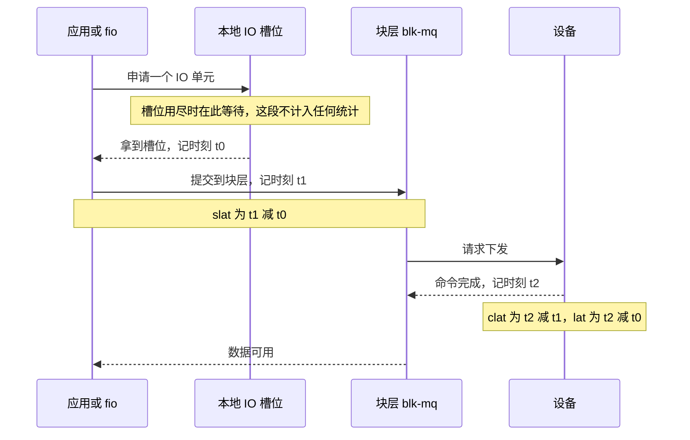
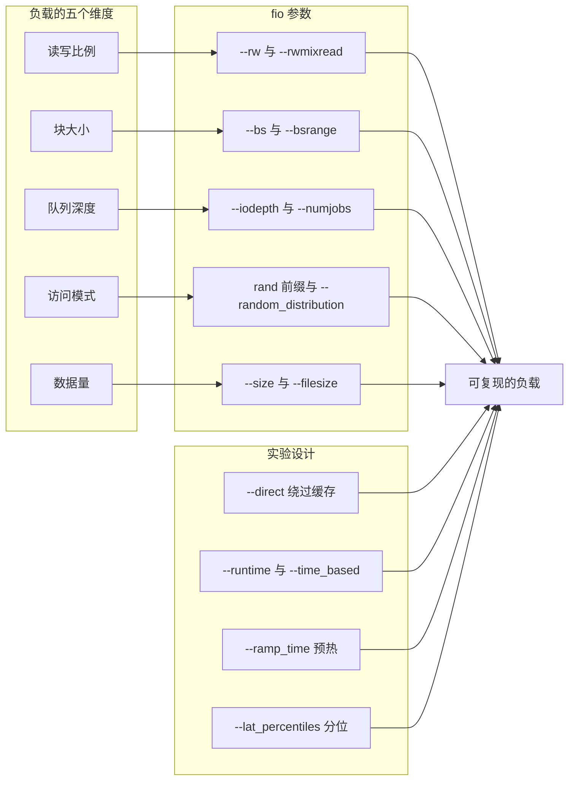
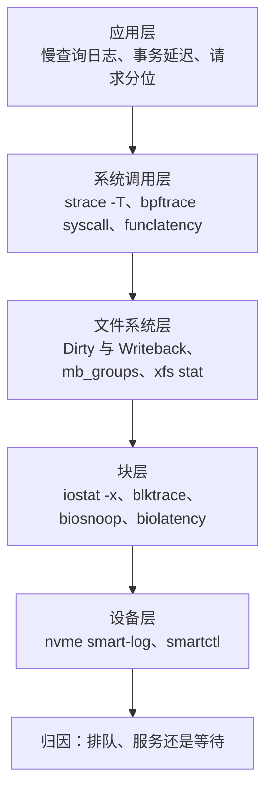
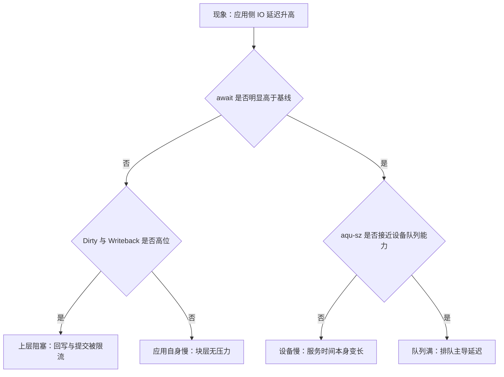
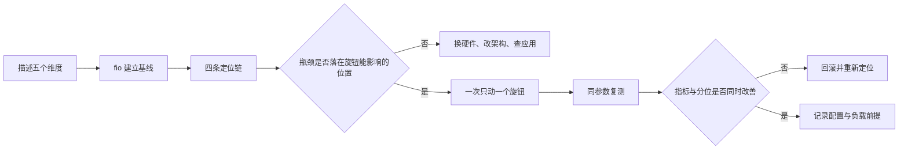

**摘要：**

存储调优最贵的一步，通常不是改参数，而是把「IO 慢」这句话拆开。同一个形容词可以指向四种完全不同的现场：设备本身在退化、队列被压满、脏页回写跟不上、或者根本没有块层压力而只是应用自己在等别的东西。本文的主线是描述先于优化。先给出描述一个 IO 负载的五个维度——读写比例、块大小、队列深度、访问模式、数据量，说明缺掉任意一个数时，结论会怎样失真；再用 fio 把这五个维度写成可复现的实验，讲清 `--rw`、`--bs`、`--iodepth`、`--numjobs`、`--direct`、`--ramp_time` 的语义与陷阱，以及怎样从 `iops`、`bw`、`slat`、`clat` 与百分位分布里读出设备的真实能力；随后按应用层、系统调用层、文件系统层、块层、设备层排出观测工具的层次，把 `iostat -x` 的七个字段与 `iotop` 的盲区逐项交代；最后把「IO 慢」归纳成四条定位链与四个可动的旋钮，并给出每个旋钮的适用前提与代价。读完之后应当能回答两个问题：手上的负载究竟该怎么描述，以及在描述清楚之前，为什么任何调参都是碰运气。

---

## 第 1 章 从一句话到五个数

### 1.1 一句「慢」里缺了什么

值班群里最昂贵的一句话是「数据库 IO 慢」。它听起来像一条结论，实际只是一个形容词；把它翻译成可处置的事实，中间还隔着五个数。不妨设想三个被同一句话掩盖的现场：第一种，某个 OLTP 库有 8 个工作线程，每线程同时挂 32 个未完成的 16KB 请求，读写比大致七三开，工作集 200GB 而内存只有 64GB；第二种，日志服务在单盘上顺序追加 1MB 的段文件，每秒 fsync 一次；第三种，离线任务正在对 400GB 的冷数据做全表扫描。三者都符合「IO 慢」的描述，但一个是队列与随机写的问题，一个是提交延迟与元数据的问题，一个是纯带宽与预读的问题——处置手段没有一条是共用的。

笔者在排查这类问题时有一个近乎机械的起点：把「IO 慢」改写成一句带数字的话。改不出来，说明还没开始诊断。这句话的形式大致是：N 个进程各自挂 Q 个未完成请求，块大小 B，读写比 R，随机还是顺序，工作集 W，持续 T。七个空填不出来的部分，正是接下来要去测的部分。这套写法并不新鲜，它的价值在于强迫提问者承认：性能是被负载定义的，不是被设备型号定义的。

把负载说清楚之所以困难，是因为应用开发者看到的单位是请求与事务，内核看到的是页与 bio，设备看到的是命令与队列槽位。三层单位之间要靠假设换算：一次事务可能触发四次页写与一次日志提交，一次 4KB 逻辑写可能触发读改写。描述负载的过程，本质上是把这三层单位对齐。

> [!info] 描述与优化的先后
> 先描述、再测量、再定位、最后才是调参。跳过前两步的调参，在统计上更接近随机游走：偶尔会撞上改善，但没人知道改善来自哪里，也没人知道它会在什么负载下失效。

### 1.2 五个维度

**读写比例**决定设备处在哪条物理路径上。纯读走的是查表与传输，纯写要在介质上真正落笔：SSD 要擦除再编程，HDD 要等盘片转到位置，RAID 5/6 的小块写还要先读旧数据算校验。同一条命令换成混合读写，代价并不落在读写两者的平均上，而是叠加在切换与元数据上——SSD 的垃圾回收（Garbage Collection，GC）在混合负载下更频繁，HDD 的磁头在读写之间反复寻道。所以「70% 读 30% 写」与「100% 读」的 IOPS 差距，往往远大于 30% 这个数字给人的直觉，示例推算里常见的是掉到纯读的四成到六成，具体倍数取决于盘的 GC 策略与预留空间。

**块大小**决定你在测 IOPS 还是带宽。一次 4KB 的请求与一次 1MB 的请求，对设备而言都是「一条命令」的开销加「一段数据」的传输：小块负载撞的是设备的命令处理上限（每秒能发多少条），大块负载撞的是接口与介质的吞吐上限（每秒能搬多少字节）。两者的瓶颈位置不同，调优方向也不同。同一块盘，4KB 随机读可能只有几十万 IOPS，128KB 顺序读则可能贴着接口带宽跑；把 IOPS 与带宽混为一谈，就会出现「我的盘标称 3.5GB/s，为什么数据库只能跑 20 万 IOPS」这种看似矛盾的疑问——两者本来就不是同一个上限。块大小还有一层容易忽略的含义：它是逻辑请求的大小，不是设备最终收到的命令大小，块层会按 `max_sectors_kb` 与设备的最大传输长度（Maximum Data Transfer Size，MDTS）把大请求拆开，文件系统还会按自己的块大小与预分配策略重组，这一段在第 2 章展开。

**队列深度**决定并发，而并发是吞吐的唯一来源。同步编程模型里，一个线程发出读请求后睡在系统调用里，未完成请求数恒为 1，此时 IOPS 的上限就是单次延迟的倒数：延迟 100 微秒，天花板就是一万 IOPS，这与盘的型号无关。异步 IO 或多线程把未完成请求数抬到几十上百，同一个设备才可能跑出几十万 IOPS。队列深度同时也是压力的来源：超过设备实际处理能力的部分只会变成排队时间，吞吐不再上升，而每个请求的等待被拉长。这项跷跷板关系是后面所有定位链的分界线。

**访问模式**决定寻址的代价。顺序访问里，下一个逻辑块就在当前物理位置之后，设备的内部预取与盘片旋转都能被利用；随机访问则要求每次重新定位，HDD 上这意味着一次寻道加半圈旋转，SSD 上意味着一次独立的闪存页读取与可能的映射表查询。更细的一层是随机的分布：均匀随机、热点集中、以及齐夫（Zipf）分布下的长尾，对缓存命中率与 GC 效率的影响完全不同。顺序与随机的差距在 HDD 上可以达到两个数量级，在 NVMe 上收缩到一到三倍——但收缩不等于消失，随机写在 SSD 上依然会推高写放大。

**数据量**决定测试落在预热期还是稳态。工作集小于页缓存时，读请求根本到不了设备，测出来的是内存带宽；工作集大于页缓存但小于 SSD 的 SLC 缓存时，写请求先落进高速缓存区，跑出的是峰值而非稳态；只有数据量把上述缓存全部穿透，读数才代表设备在长期压力下的能力。数据量还影响 SSD 的垃圾回收效率：盘占用率超过七成之后，可用于腾挪的空闲块变少，GC 频率上升，随机写性能会系统性下滑，这一点与「盘用了两年变慢」的体感是同一件事。

把五个维度与它们的观测量放在一起，可以排成一张对照表，日后拿到一份 fio 结果或一段 `iostat` 输出，按行去核对，缺哪一行就说明描述不完整。

| 维度 | 在 fio 里的写法 | 主要影响的指标 | 描述缺失时的典型误判 |
|---|---|---|---|
| 读写比例 | `--rw`、`--rwmixread` | 写放大、GC 频率、混合负载下的 IOPS | 把纯读基线当成交付能力，上线后写路径塌方 |
| 块大小 | `--bs`、`--bsrange` | IOPS 上限与带宽上限的切换点 | 用小块的 IOPS 去解释大块扫描的慢 |
| 队列深度 | `--iodepth`、`--numjobs` | 吞吐与单请求延迟的跷跷板 | 同步程序被测出深队列性能，结论不可用 |
| 访问模式 | `--rw` 的 rand 前缀、`--random_distribution` | 寻址开销、预读有效性、缓存命中 | 用顺序读的带宽解释随机读的延迟 |
| 数据量 | `--size`、`--filesize` | 缓存穿透、SSD 稳态、长跑衰减 | 在 SLC 缓存窗口内测出乐观三倍的写带宽 |

### 1.3 五个数如何决定上限

描述完负载，才轮到估算上限。存储性能里唯一恒成立的等式是**利特尔法则（Little's Law）**：系统中平均未完成的请求数等于到达率乘以平均驻留时间。写成存储的符号，就是队列深度等于 IOPS 乘以延迟。这个等式是恒等式，不是性能模型，它不告诉你设备能跑多快，但它能立刻指出一个结论是否自洽。

举一个最常见的自洽性检查。某块 NVMe 在 4KB 随机读、队列深度 1 时单次延迟约 100 微秒，那么单线程同步读的 IOPS 上限约一万；若实测报出五万，要么队列深度不是 1（程序内部有异步），要么部分请求走了页缓存。反过来，若目标是 50 万 IOPS，而单次延迟仍是 100 微秒，那么未完成请求数必须达到 50 个左右；如果设备实际并发能力只有 32，多出来的 18 个只会排队，吞吐封顶在 32 万附近——这正是「加线程没有用」的算术解释。

利特尔法则还能把「IO 慢」拆成两个方向：到达率不够（并发不足，设备闲）或者驻留时间太长（延迟高，设备忙或上层在等）。前者调并发，后者要分排队、服务、上层阻塞三段去找。五个维度的作用，是决定你站在哪一段：小块随机把压力放在命令处理上，大块顺序把压力放在带宽上，深队列把压力放在排队上，小工作集把压力放在缓存上。

下面的组合矩阵是一份示例推算，用来说明同一块盘在不同描述下的读数可以差多少。数字只用于建立量级感，不代表任何具体设备的实测值；真正落地时必须以自己机器上的 fio 结果替换。

| 负载描述（示例推算） | 预计观测 | 主要瓶颈 |
|---|---|---|
| 4KB 随机读，QD=1，工作集 200GB | 约 1 万 IOPS，延迟约 100µs | 单次延迟，并发不足 |
| 4KB 随机读，QD=32，工作集 200GB | 20 万至 30 万 IOPS，clat 抬到 100µs 以上 | 设备内部并发与命令处理 |
| 4KB 随机写 70/30，QD=32 | 有效 IOPS 掉到纯读的四到六成 | GC、写放大、读改写 |
| 128KB 顺序读，QD=16 | 贴着接口带宽，IOPS 只有数万 | 接口与介质带宽 |
| 1MB 顺序写，QD=4，工作集 800GB | 前几十秒是 SLC 峰值，之后掉到稳态 | SLC 缓存耗尽后的 GC |

这张表最值得记住的不是具体数字，而是最后一列：描述变了，瓶颈就换了一个位置。把这张表放在手边，就能识别出那些「换了盘还是慢」的案例——因为瓶颈从来不在盘上。

### 1.4 一句负载描述的最小模板

把五个维度拼成一句话，形式如下：八个工作进程，每个进程维持三十二个未完成请求，十六 KB 随机读写混合、读占七成，工作集八十 GB，持续五分钟。这句话已经完整到可以直接翻译成 fio 命令，也完整到足以让另一个人复现你的测试，而不必追问「你说的大量是多少」。

这句话还可以反向使用：拿到任何一份压测结论，先问它的负载描述是否含这五项。厂商标称的 IOPS 通常对应「4KB 随机读、高队列、纯读」，把它当成交付承诺，往往在混合写负载下被打回原形。

同一份报告里，还有一个常见缺口是统计口径：测了多久、有没有预热、报的是平均还是分位。这三项不属于负载描述，属于实验设计，但它们与五维度一样能决定结论的真假。第 2 章把这两部分合起来，交给 fio。

---

## 第 2 章 用 fio 把负载写成实验

### 2.1 dd 与 fio 的分工

`dd` 是很多人的第一反应：一条命令，读写指定大小的数据，输出一个带宽。它测的是单流、同步、顺序、队列深度恒为 1 的负载——恰好是最简单也最不典型的一种。用它测 NVMe 的顺序写，能把接口带宽大致跑满，于是给人一种「盘没问题」的错觉；可同一块盘在 4KB 随机写、深队列下会是什么表现，`dd` 一个字都给不出来。`oflag=direct` 能让 `dd` 绕过页缓存，但改变不了它的并发模型；`dd` 也不报延迟分布，只给一个平均带宽，而尾延迟恰恰是生产事故的主角。

`fio`（Flexible IO Test Suite）由内核块层维护者 Jens Axboe 开发，这个出身决定了它的参数语义与内核里的那一套一一对应：它说的 `iodepth` 就是块层的未完成请求数，它说的 `direct` 就是 `O_DIRECT`，它报的 `slat` 与 `clat` 对应提交与完成两个时刻。工具与内核共享词汇的好处是，测试里发现的异常可以直接翻译成内核里的现象；坏处是，不理解内核的人用 fio 很容易把参数写成「看起来像生产」而已。

`fio` 的能力边界也要说清：它能精确控制 IO 的形态，但不会自动知道你线上跑的到底是什么形态。它的价值在于把「描述」变成「可复现」——同一组参数在任何机器上跑，得到的都是同一种负载，于是不同设备、不同内核、不同配置之间才有可比性。

### 2.2 `--rw`：读写比例与混合方式

`--rw` 是负载描述里最先要定的一个参数，它同时决定读写比例与访问模式。常用的取值如下。

```bash
--rw=read         # 顺序读
--rw=write        # 顺序写
--rw=randread     # 随机读
--rw=randwrite    # 随机写
--rw=rw           # 顺序混合
--rw=randrw       # 随机混合
--rw=trim         # 丢弃，SSD 场景专用
```

混合负载用 `--rw=randrw` 配 `--rwmixread`（或 `--rwmixwrite`）表达比例，例如 `--rwmixread=70` 表示每十个 IO 中有七个是读。这里有两个容易踩空的语义细节。其一，混合是按 IO 逐次决策的，不是先读一段再写一段，所以设备看到的是读写交错的流，而不是两个阶段；这正是数据库在线事务处理（Online Transaction Processing，OLTP）的真实形态，也因此能复现出读写交错带来的额外代价。其二，比例为 70 意味着「IO 条数的七成」，不等于「时间的七成」，更不等于「字节数的七成」——在读写块大小不同的场景里，这三者会分道扬镳。

还有一个高频误解是把 `--rw=rw` 当成混合负载的代表。`rw` 是顺序混合，适合测日志与批处理的交替写入，用来代表 OLTP 则完全失真：顺序混合几乎不产生寻址开销，随机混合才会。若要同时表达「不同方向用不同块大小」，可以写成 `--bs=4k,64k`，前一个是读、后一个是写；这个写法在模拟「小读大写的日志型负载」时很有用。

### 2.3 `--bs`：块大小的三层含义

`--bs` 是**逻辑请求大小**，这是它最容易被误解的地方。用户写下 `--bs=1M`，以为设备会收到 1MB 的命令，实际上块层会按 `max_sectors_kb` 把它切成若干个请求，NVMe 驱动还会按控制器的 MDTS 再切一次；于是在 `iostat` 里看到的是若干个 128KB 级别的请求，而 fio 报告的是 1MB 的 IO。这解释了两种常见困惑：为什么 `bs=1M` 的 IOPS 看起来低得合理，以及为什么 `iostat` 的 `rareq-sz` 与 fio 的 `bs` 对不上。做容量规划时，要以设备实际收到的请求形态为准，而不是以 fio 的名义块大小为准。

块大小的第二层含义是对齐。`--direct=1` 要求缓冲区与偏移按设备的逻辑扇区对齐，未对齐的请求会被内核拆成「对齐部分加首尾两段」，写路径上还可能触发读改写。若设备是 4K 物理扇区（现在绝大多数 NVMe 与多数 SATA 盘都是），而请求按 512 字节切分，写一次就要先读一个 4K 物理块再改再写回，写放大立刻出现。所以 `--bs=512` 这种「测小 IO」的写法，在 4K 原生盘上测到的不是设备的真实能力，而是错位对齐的代价。

第三层含义是与文件系统块大小的关系。文件系统以 4KB 页为单位管理页缓存，ext4 与 XFS 的块大小通常也是 4KB；写一个 16KB 的请求，跨了四个文件系统块，元数据与 extent 的更新会按块粒度发生。数据库选择 16KB 或 8KB 的页大小，正是为了与文件系统、设备三者的粒度对齐，减少「一次逻辑写触发多次物理写」的情况。

### 2.4 `--iodepth` 与 `--numjobs`：并发写在哪个变量上

`--iodepth` 是单个 job 保持的未完成 IO 数，`--numjobs` 是 job 的个数（每个 job 是一个进程或线程）。两者相乘才是提交到设备的并发压力，这个乘积是描述队列深度时唯一有效的数字。把 `--iodepth=32` 与 `--numjobs=4` 写在一起，意味着 128 个未完成请求；只写 `--iodepth=32`，则只有 32 个。

这里有一条硬约束：同步 IO 引擎下队列深度恒为 1。用 `--ioengine=sync` 或 `psync` 时，fio 会依次提交并等待，`iodepth` 写得再大也不起作用；要测深队列，必须换成异步引擎，即 `libaio` 或 `io_uring`。这条约束对应的正是应用层最常见的错配：一个用同步 `read()` 写的程序，无论开多少线程，每个线程同时只有一个未完成请求，其并发等于活跃线程数，而不是线程池大小乘以某个深度。给这样的程序讲「把 iodepth 调到 64」，是没有落点的。

`libaio` 还有一条前提：只有配合 `--direct=1` 才是真正的异步。内核对缓冲文件（走页缓存的普通文件）的传统 AIO 路径在提交时会退化，`io_submit` 表面上返回成功，实际在内部等 IO 完成，队列深度形同虚设。于是会出现一种很隐蔽的假象：`iodepth=64` 的测试结果与 `iodepth=1` 几乎一样，使用者以为是盘不行，其实是引擎与缓存层把并发吃掉了。`io_uring` 对缓冲 IO 的支持要好得多，异步由内核工作线程承接，它本身的机制见 [[10 现代存储技术——NVMe、io_uring 与用户态存储]]；测设备能力时仍建议 `--direct=1`，理由在 2.5 节。

`--numjobs` 还带来两个工程细节。其一是数据量与文件布局：`--size` 是每个 job 的大小，四个 job 各 40GB，总工作集是 160GB 而非 40GB；若四个 job 指向同一个文件且不给偏移，它们的写入范围会重叠，随机的均匀性也会被破坏，此时应当用 `--offset_increment` 或 `--directory` 加 `--nrfiles` 让每个 job 落到独立区域。其二是资源开销：每个 job 占一个线程与一份缓冲区，深队列配多 job 会显著吃内存，压测机本身的 NUMA 布局与 CPU 亲和性也会进入结果，必要时用 `--cpus_allowed` 固定。

> [!warning] 并发不等于线程数
> 线程只有在其请求未完成时才构成并发。一个阻塞在 `read()` 里的线程贡献 1 个未完成请求；一个提交 32 个异步请求后继续干活的线程贡献 32 个。描述负载时写「并发 512」，指的必须是未完成请求数，而不是线程数或连接数。

### 2.5 `--direct=1`：绕开那一层内存

`--direct=1` 让 fio 以 `O_DIRECT` 打开文件或设备，读写都绕过页缓存，直达块层。它是测设备能力的必要条件，不加它测出来的东西有一个很不体面的名字：内存速度。

不加 `--direct` 的读测试，只要工作集小于页缓存，第一次读完之后所有请求都命中内存，带宽可以报出几十 GB/s，延迟低到微秒以下——这个数字与盘毫无关系。不加 `--direct` 的写测试更微妙：`write()` 只是把数据拷进页缓存就返回，fio 统计到的「完成」其实是内存拷贝完成，真正的落盘发生在后台回写线程里，既不在 fio 的计时范围内，也不受 fio 控制。于是写带宽看起来漂亮，延迟看起来极低，而设备到底能不能承受这个速率，测试根本没问。

`--direct` 也有它的代价与边界。它要求对齐，前面已经说过；它对某些文件系统不可用，`tmpfs` 直接不支持，`overlayfs` 上取决于下层文件系统；它也无法体现预读的收益，因为 `O_DIRECT` 不触发内核预读，所以它测出的顺序读带宽往往低于生产中缓冲读，两者不可互相替换。

因此完整的做法是两组测试：一组 `--direct=1`，回答「设备在这五个维度下的能力上限是多少」；一组不加 `--direct`，回答「经过页缓存、预读与回写之后，应用实际体验到的是什么」。前者用于选型与容量规划，后者用于解释线上现象。只做后者，会把缓存红利误认为设备能力；只做前者，会低估生产里的有效吞吐。

### 2.6 `--runtime`、`--ramp_time` 与 `--time_based`：时间维度上的三个开关

fio 默认按数据量跑：把 `--size` 指定的区域读写完就结束，此时 `--runtime` 只是一个上限。要让测试按时间跑满，需要加 `--time_based`，此后 fio 会循环访问同一区域直到时间耗尽。这两个模式的读数不可混用：按量跑的时间长短由设备速度决定，快的盘跑得短、慢的盘跑得长，横向对比时样本窗口都不一样；按时间跑才能保证各设备在同一个时长窗口里被比较。

`--ramp_time` 是预热时间，这段时间内的 IO 不计入统计。它的必要性来自三层缓存：页缓存需要被工作集填满才算稳定，SSD 的 SLC 缓存需要被写穿才会暴露**稳态**，设备的垃圾回收也需要积累到一定脏块比例才开始频繁触发。跳过预热直接统计，得到的往往是最好看的那一段，写测试尤其如此。

时间长度本身也是变量。太短的测试（几秒）会被采样噪声与突发调度主导，结论不可复现；常规建议是单点不少于六十秒，写测试与 SSD 稳态测试建议三百秒以上，并配合 `--write_bw_log` 导出每秒的带宽点，观察曲线是否走平。曲线还在下滑就宣布结论，是压测里最常见的错误之一：那不是稳态，那只是预热期的尾巴。

数据量的选择同样要看这层缓存。`--direct=1` 让页缓存失效，但 SSD 内部的映射表与 SLC 缓存仍然与数据量有关：在 1TB 的盘上只测 10GB 区域，FTL 的映射集中在很小的范围，GC 几乎不启动，读数会系统性偏好。合理的做法是把测试区域扩大到盘容量的相当比例，或者至少覆盖生产工作集的量级，并在报告中写明测试区域大小。

### 2.7 一个模板命令与三个场景

把前面几节的参数按五维度摆好，可以得到一个通用模板。它的作用是提供一份「描述完整」的骨架，实际使用时替换维度的取值即可。

```bash
# 通用模板：五维度各就各位，缺一项结论就不成立
# 前置：用 fallocate 预分配文件，避免 direct 写稀疏文件带来的额外开销
fallocate -l 40G /data/fio.test

fio --name=baseline \
    --filename=/data/fio.test --size=40G \
    --ioengine=libaio --direct=1 \
    --rw=randread --bs=4k --iodepth=32 --numjobs=4 \
    --runtime=120 --ramp_time=30 --time_based \
    --group_reporting --lat_percentiles=1 \
    --output-format=json --output=baseline.json
```

模板里每一行都对应一个维度或一个实验设计决定：`--filename` 与 `--size` 是数据量，`--rw` 是读写比例与访问模式，`--bs` 是块大小，`--iodepth` 与 `--numjobs` 是队列深度，`--runtime`、`--ramp_time`、`--time_based` 是实验窗口，`--direct` 决定测设备还是测缓存。`--group_reporting` 把多个 job 的统计合并成一份，避免四份报告各自为政；`--output-format=json` 便于入库对比。

三个典型场景在此基础上只改维度取值，不改结构。第一个是数据库 OLTP：随机、混合、页大小级别的块、深队列。第二个是日志顺序写：顺序、纯写、大块、浅队列，并额外关心提交延迟。第三个是大文件顺序读：顺序、纯读、大块、中等队列，关注带宽与预读的配合。

```bash
# 场景一：OLTP。16KB 贴近 InnoDB 页大小，七三读写比，8×64=512 个未完成请求
fio --name=oltp \
    --filename=/data/oltp.test --size=80G \
    --ioengine=libaio --direct=1 \
    --rw=randrw --rwmixread=70 --bs=16k \
    --iodepth=64 --numjobs=8 \
    --runtime=300 --ramp_time=60 --time_based \
    --group_reporting --lat_percentiles=1
```

OLTP 这一组参数里最需要复核的是并发总量。512 个未完成请求对高端 NVMe 是合理压力，对 SATA SSD 则远远超过其 32 的队列能力，多出来的部分只会变成排队，测出来的是「排队有多长」而不是「盘有多快」。先用 2.4 节的算术估算设备能承接多少并发，再决定 `numjobs` 与 `iodepth` 的乘积。

```bash
# 场景二：日志顺序追加。大块顺序写，浅队列
fio --name=logappend \
    --filename=/data/log.test --size=20G \
    --ioengine=libaio --direct=1 \
    --rw=write --bs=1M \
    --iodepth=4 --numjobs=1 \
    --runtime=300 --ramp_time=60 --time_based

# 变体：按提交节奏加 fsync，测的是「每次落笔要等多久」
# --fsync=64 表示每 64 个 IO 提交一次 fsync，用于逼近 group commit 的节奏
```

日志型负载的瓶颈通常不在带宽，而在同步点。顺序写本身很快，但每写一段就要 `fsync` 等待落盘，于是有效吞吐由「一次写的大小除以一次 fsync 的延迟」决定。这解释了为什么调整 `--bs` 对该场景的收益有限，而调整提交批量、日志模式与挂载参数往往立竿见影——后面第 5 章会把这些旋钮连起来。

```bash
# 场景三：大文件顺序读。1MB 块，16×4=64 个未完成请求
fio --name=seqread \
    --filename=/data/big.test --size=100G \
    --ioengine=libaio --direct=1 \
    --rw=read --bs=1M \
    --iodepth=16 --numjobs=4 \
    --runtime=180 --ramp_time=30 --time_based
```

顺序读场景下 `--direct=1` 会低估生产表现，因为生产里的缓冲读有内核预读帮忙，等效块大小被放大到预读窗口级别。要看生产体验，应当再做一组不加 `--direct` 的对照，并配合 `read_ahead_kb` 的取值做交叉验证，这部分放在 5.2 节。

### 2.8 输出的五个关键项

一份 fio 结果里真正需要看的是五项：IOPS、带宽、总延迟、提交延迟与完成延迟、以及完成延迟的分位分布。下面是一段示例输出，数值为示例推算，仅用于说明结构与量级关系，不是任何设备的实测值。

```text
read: IOPS=214k, BW=836MiB/s (877MB/s)(97.9GiB/120001msec)
   slat (nsec): min=1140, max=204180, avg=3120.40, stdev=2010.62
   clat (usec): min=410, max=3806, avg=592.14, stdev=176.55
    lat (usec): min=413, max=3809, avg=595.26, stdev=177.02
   clat percentiles (usec):
    |  1.00th=[  437],  5.00th=[  470], 10.00th=[  494], 20.00th=[  521],
    | 50.00th=[  573], 75.00th=[  650], 90.00th=[  760], 95.00th=[  845],
    | 99.00th=[ 1104], 99.50th=[ 1267], 99.90th=[ 1654], 99.99th=[ 2245]
```

`iops` 与 `bw` 是同一件事的两种度量，二者应当满足带宽约等于 IOPS 乘以块大小。示例里 214k 乘以 4KB 约为 877MB/s，换算成 MiB 就是 836，与第一行一致；若两者对不上，通常是块大小与实际提交大小不同（`bsrange`）或者存在重试。这个交叉校验看起来多余，实际能抓出不少「跑错文件、跑错块大小」的低级错误。

`lat` 是总延迟，等于 `slat` 与 `clat` 之和。`slat`（submission latency）是从 fio 发起提交到内核接受这段请求的时间，`clat`（completion latency）是从请求被内核接受、进入设备到 IO 真正完成的时间。前者包含进入块层的排队与拿取队列槽位的等待，后者包含设备内部的排队与服务。**clat 不含 fio 自己的排队**：当队列深度已经打满时，fio 会把新的 IO 压在本地等槽位，这段时间既不进 `slat` 也不进 `clat`，所以应用侧的端到端延迟通常大于 `lat`。这条差别是判断「队列满」的关键证据，第 4 章会用到。

把几个时刻画在一条线上，各自的归属就清楚了。



图里的注记最要紧：等槽位的等待发生在 t0 之前，因此 `slat`、`clat`、`lat` 三项都不包含它。这也是为什么 `iodepth` 打得越高、`clat` 越好看时，应用侧的真实延迟反而可能更大——那一段排队被挪到了统计之外。

单位是最容易出错的地方。示例里 `slat` 用纳秒、`clat` 用微秒，两个数字直接比较会差一千倍；`lat` 在延迟较大时可能切到毫秒，同一份报告里三种单位并存是常态。看报告先看括号里的单位，再看数字，这个习惯能省掉很多次误判。

最后是**分位分布**。同一份输出里，平均完成延迟约 592 微秒，而 p99 是 1104 微秒、p99.9 是 1654 微秒——均值把长尾抹平了，分位才把长尾露出来。只看均值会得出「这块盘很稳」的结论，再看 p99 就会明白，每一百个请求里有一个要等近两倍的时间。对串行调用链来说，这个差距会被放大：一次用户请求若串行访问五个存储调用，每个调用的 p99 都是 1 毫秒，那么至少有一次踩到 p99 的概率接近百分之五，用户侧看到的 p99 就不再是一毫秒。这就是**尾延迟**在架构层面的杠杆效应，也是为什么 fio 的 `clat percentiles` 比 `avg` 更值得抄进报告的首页。

下面的图把 fio 的参数与五个维度对应起来，可以当作写命令时的对照检查。



图里第三组「实验设计」的四项不属于负载描述，而属于实验纪律：它们决定这份读数是否可信，而不决定它描述的是什么负载。把两张图分开记，就不会在写不出五维度时用「加个 direct」来搪塞。

---

## 第 3 章 五层观测

### 3.1 为什么要按层组织工具

一个读请求从应用到介质，要穿过五六层：应用把逻辑请求翻译成系统调用，VFS 查页缓存，文件系统把偏移映射到块，块层把 bio 合成请求并分配队列槽位，驱动把命令写进门铃，设备内部的固件再做一次地址翻译与调度。每一层都有自己的延迟贡献，也都有自己的计数器。观测工具之所以让人眼花缭乱，是因为它们各自只照亮其中一层；把它们按层排好，问题就变成「先确定时间花在哪一层，再调那一层的工具」。

实践里有两条互补的走法。自下而上：先用 `iostat` 与设备日志证明设备还有没有余量，若设备很闲而应用很慢，问题一定在上层，可以省掉大量块层排查。自上而下：先用应用自己的指标确认慢在哪个调用，再用系统调用层的工具确认慢在哪个系统调用，逐层收窄。两条路在块层会合，会合点就是判断「时间到底花在排队、服务还是等待」的地方。

下面的图把五层与各层的代表工具排在一起，读的时候把它当索引而不是当清单。



### 3.2 应用层：唯一算数的口径

应用层指标是唯一能直接回答「用户有没有受影响」的口径，其他层再漂亮，只要应用侧的分位数没动，就说明压力尚在预算之内。数据库有慢查询日志与 InnoDB 的读写计数，消息队列有请求排队时间，JVM 应用有 GC 停顿与线程阻塞时间，这些指标的共同点是已经把「排队」算进去了：应用看到的一次读，包含在连接池排队、在文件锁上等待、在页缓存未命中后等待回写、在设备队列里等待，全部折成一个耗时。

应用层指标也有它的局限，最典型的是粒度太粗。慢查询日志能告诉你某条 SQL 花了 800 毫秒，但不会告诉你这 800 毫秒里有 700 毫秒在等一个被写满的日志组，还是在等一个被限流的 `write()`。所以应用层的作用是定位「哪一类操作慢」，而不是「慢在存储栈的哪一层」。前者决定要不要往下查，后者才决定改什么。

### 3.3 系统调用层：慢在哪个调用

`strace` 是最顺手的入口。`-T` 打印每个系统调用的耗时，`-c` 给出按调用的汇总，配合 `-e trace=` 只抓关心的几类，可以在几秒内看清一个进程的时间花在 `read`、`write` 还是 `fsync` 上。

```bash
# 只看文件读写与同步类调用，并给出每次调用的耗时
strace -f -T -e trace=openat,read,pread64,write,pwrite64,fsync,fdatasync -p $(pidof mysqld)

# 汇总视图：按调用类型统计次数与总耗时
strace -f -c -p $(pidof mysqld)
```

`strace` 的代价必须说清楚：它用 `ptrace` 让被跟踪进程在每次系统调用进出时各停一次，等于给每个调用加上两次上下文切换。低 QPS 的路径上这点开销无所谓，在每秒几十万次 IO 的进程上，它能让被测程序慢一个数量级，测出来的分布也不再是生产分布。所以 `strace` 适合短时采样与低频路径，不适合压测现场。

生产环境更合适的是基于 eBPF 的同类观测。BCC 的 `funclatency` 能给某个内核函数的延迟直方图，`syscount` 按进程统计系统调用次数，`fileslower`、`ext4slower`、`xfsslower` 专门抓超过阈值的慢文件 IO。用 bpftrace 写一段临时脚本也不难，下面的例子统计 `fsync` 的耗时分布，开销远低于 `strace`。

```bash
# fsync 延迟分布：进入时记时间戳，退出时算差值
bpftrace -e '
tracepoint:syscalls:sys_enter_fsync /comm == "mysqld"/ { @start[tid] = nsecs; }
tracepoint:syscalls:sys_exit_fsync /@start[tid]/ {
    @ns = hist(nsecs - @start[tid]);
    delete(@start[tid]);
}'
```

这段脚本依赖内核编入了系统调用追踪点（`CONFIG_FTRACE_SYSCALLS`），而且它统计的是系统调用在进程侧的耗时，包含排队但不区分排队在文件系统、块层还是设备——这正好是它比 `strace` 更强的地方：能定位到「哪个调用慢」，再交给下一层分辨「慢在哪一段」。

### 3.4 文件系统层：数据到底下去了没有

文件系统层要回答的问题很具体：写操作是真的落到了设备，还是变成了脏页躺在内存里；读操作是真的到了设备，还是命中了缓存；如果下去了，下去的是数据还是元数据。这三问的答案决定了后面所有判断的方向。

第一组观测量在 `/proc/meminfo` 与 `/proc/vmstat`。`Dirty` 是尚未回写的脏页总量，`Writeback` 是正在回写途中的页量；`/proc/vmstat` 里的 `nr_dirty`、`nr_writeback` 与两个阈值（`nr_dirty_threshold`、`nr_dirty_background_threshold`）以页为单位给出同一批信息。容器环境下还要看 cgroup v2 的 `memory.stat`，其中 `file_dirty` 与 `file_writeback` 是同一个账在 cgroup 粒度上的切分。

这些数字之所以关键，是因为内核的**回写节流**（`balance_dirty_pages`）就挂在这两个阈值上。脏页超过后台阈值时，flusher 线程被唤醒开始回写；脏页继续涨到硬阈值时，任何正在执行写操作的用户进程会在这个函数里被限速沉睡，直到脏页降下来。于是出现一种很有欺骗性的现场：应用侧的 `write()` 越来越慢，而 `iostat` 显示设备写带宽并不高、`await` 也不高——设备没忙，是内核不让写。这条链把「上层阻塞」与「设备慢」区分开，第 4 章会专门讲。

第二组观测量是文件系统自己的统计。ext4 的多块分配器在 `/proc/fs/ext4/<dev>/mb_groups` 里暴露每个块组的空闲块与碎片状况，碎片化严重时大文件写入会退化成多次小块分配，延迟上升而带宽下降；XFS 的计数器在 `/proc/fs/xfs/stat` 里，读、写、日志、分配各有累计值，`/sys/fs/xfs/<dev>/stats/stats` 是同一批计数的另一种视图，配合 `filefrag -v` 看单个文件的 extent 数量，能判断一个顺序写的文件是不是被写成了碎片。这些路径与字段名随内核版本有差异，具体以对应版本文档为准。

文件系统层的另一个用处是区分元数据与数据。一次创建、重命名、删除，在设备上可能只表现为几百字节的日志写，但它的延迟串行化了整个目录操作；一次 `fsync` 里若包含元数据提交，设备看到的是日志写加数据写两段。`iostat` 只报总量，看不到这个构成，而文件系统的日志设备（ext4 的 JBD2、XFS 的 log）在 `blktrace` 与 `biosnoop` 里可以按进程名区分出来，`jbd2/<dev>-8`、`xfs-log/<dev>`、`xfsaild/<dev>` 这些内核线程的名字会直接出现在记录里。

回写与脏页的完整机制在 [[04 Page Cache 与脏页回写——Linux IO 的秘密缓冲层]] 中拆解，内存账里脏页与回收的关系见 [[Linux/内存管理/04 Page Cache：Linux 为什么要用内存来缓存磁盘|内存管理专栏的 Page Cache 解剖]]；本篇只取其中与观测相关的部分。

### 3.5 块层：排队与服务在这里分开

块层是整条链上信息最丰富的一层，因为请求在这里从「逻辑 IO」变成「队列里的实体」。它的入口是 `iostat`。

`iostat -x` 的字段不多，各版本略有差异（新版本把 `avgqu-sz` 写作 `aqu-sz`，把 `rkB/s` 写作 `rMB/s`），需要盯住的只有七个。

| 字段 | 含义 | 常见的误读 |
|---|---|---|
| `r/s`、`w/s` | 每秒完成的读写请求数 | 把「完成数」当作「提交数」，高队列下两者有偏差 |
| `rMB/s`、`wMB/s` | 每秒读写吞吐 | 与小 IOPS 混用，误以为带宽就是能力 |
| `await` | 平均等待时间，包含排队与服务，单位毫秒 | 直接当作设备服务时间，忽略排队占比 |
| `aqu-sz` | 平均未完成请求数，即队列深度 | 只看峰值瞬时值，忽略采样平均 |
| `%util` | 设备有请求在途的时间占比 | 在 NVMe 上当作饱和度，实际意义很弱 |

七个字段里最需要重新理解的是 `await` 与 `%util`。`await` 是从请求进入块层到完成的时间，既包含设备服务，也包含排队等待，所以它上升有两种解释：设备变慢了，或者队伍变长了。区分方法看 `aqu-sz`：队伍长而服务没变，`await` 会随并发线性上升；设备变慢，`aqu-sz` 可能不高而 `await` 照样高。`%util` 是由设备「有请求在途」的时间累计出来的比例，对于能并行处理多个请求的设备，它达到 100% 只说明「任何时刻都至少有一个请求在飞」，不说明设备已经到达能力上限——在多队列的 NVMe 上，这个指标几乎失去了判别力，用它判断「盘满载」是典型的误用。

`iostat` 还有一个使用习惯上的坑：不带参数的第一次输出是开机以来的累计平均值，历史越长、离现在越远，它越不能代表当下。要么用 `-y` 跳过这份累计报告，要么等到第二个采样周期再读数。

`await` 与 `aqu-sz` 之间存在一个恒等关系，可以用来交叉校验采集是否正常：平均未完成请求数约等于读写各自到达率与等待时间的乘积之和。若 `aqu-sz` 明显偏离这个估算，通常说明采样窗口跨了突发、或者设备是多路径聚合设备，此时单看任何一个字段都会得出偏颇结论。

`iostat` 给出的是聚合值，要看单个请求的命运，得下到 `blktrace` 这一级。它把每个 IO 在块层里的关键事件都记下来：进入队列、插入调度器、下发给驱动、完成。更早的单队列时代还能看到请求合并一类的事件，blk-mq 路径下这些事件大多不再出现，能用的主要是队列、插入、下发、完成四个点。

```text
8,0  0  1  0.000000000  12345  Q  R 1000+8 [mysqld]
8,0  0  2  0.000001000  12345  I  R 1000+8 [mysqld]
8,0  0  3  0.000100000  12345  D  R 1000+8 [mysqld]
8,0  0  4  0.001500000      0  C  R 1000+8 0
```

四行分别对应入队（Q）、插入调度器（I）、下发（D）、完成（C）。把它们之间的差值算出来，就得到延迟的构成：入队到下发的差值是内核内部的排队时间，下发到完成的差值是设备服务时间。`btt` 工具会直接给出这组统计，其中 D2C 对应设备侧的服务时间，Q2C 对应端到端在块层内的总耗时；两者做差，就是块层内部贡献的排队。这个分解的价值在于，它可以证明「慢在设备上」还是「慢在我们自己把队列塞满了」。

`blktrace` 的代价是数据量大、侵入性强，长时间开在生产上并不合适。日常更常用的是两个基于 eBPF 的小工具：`biosnoop` 每条 IO 输出一行，带进程名、块号、大小与延迟，适合抓「谁在发、发多大、慢到多少」；`biolatency` 输出延迟直方图，适合看分布形状与离群比例。三者的分工可以用一张表概括。

| 工具 | 观测粒度 | 回答的问题 | 主要代价 |
|---|---|---|---|
| `iostat -x` | 设备级聚合 | 设备忙不忙、排队多不多 | 只有均值，看不到单请求与分布 |
| `blktrace` 与 `btt` | 单请求全事件链 | 延迟由排队还是服务构成 | 数据量大，长时间开启影响性能 |
| `biosnoop` | 单请求一行 | 谁发的、多大、多慢 | 高频下输出淹没终端 |
| `biolatency` | 延迟分布 | 长尾有多长、离群多大比例 | 不区分进程与设备细节 |

这几件工具的数据源都是块层追踪点，`biolatency` 与 `biosnoop` 用的也是同一批事件，差别只在聚合方式。想改造成自己需要的视图，用 bpftrace 挂在 `block:block_rq_issue` 与 `block:block_rq_complete` 上即可，前者记时间戳、后者算差值，思路与第 3.3 节的 `fsync` 脚本一样。块层内部的完整路径与 blk-mq 的队列结构见 [[05 块设备栈——从 bio 到 blk-mq 的 IO 路径]]。

### 3.6 设备层：它是不是在自我保护

设备层的观测回答一个很窄但很关键的问题：这块盘是在按设计性能工作，还是已经进入降级或保护状态。NVMe 设备用 `nvme-cli` 就能取到大部分答案。

```bash
# 健康与寿命：关注 media_errors、percentage_used、available_spare
nvme smart-log /dev/nvme0

# 控制器能力：mdts 决定单条命令的最大传输长度
nvme id-ctrl /dev/nvme0 | grep -i mdts

# 命名空间与 LBA 格式：确认逻辑/物理块大小是否 4K 原生
nvme id-ns /dev/nvme0n1 | grep -i "lbaf\|nsze"
```

`smart-log` 里几个字段特别值得记住：`media_errors` 非零说明闪存介质已经出现不可纠正错误，盘还活着但性能与可靠性都在下降；`percentage_used` 是寿命消耗比例，接近额定值时写性能通常先于可用性退化；`available_spare` 低于阈值意味着备用块快耗尽，写放大与 GC 会显著恶化；`critical_warning` 是固件给出的综合告警；`unsafe_shutdowns` 记录掉电次数，异常掉电后 FTL 重建会让一段时间的写性能明显变差。`nvme error-log` 能给出更细的错误条目，包括具体命令与状态码。

SATA 盘用 `smartctl`，同样是看几项关键计数：重映射扇区、待处理扇区、CRC 错误计数。前两者是介质退化，第三者通常是线缆或背板的问题——它会让重试增多，表现为延迟抖动而带宽尚可，很容易被误判成「盘慢」。

设备层还能解释一类看起来无解的现象：温度。NVMe 盘在高温时会主动降频，读延迟从微秒级抬到几十微秒甚至更高，IOPS 掉一半以上，而所有上层指标都「正常」。`smart-log` 里的温度与告警温度、`warning_temp_time` 能确认这一点。遇到这种案例，调任何内核参数都无效，要么改善风道，要么降低持续写入量。

### 3.7 iotop 的局限

`iotop` 几乎是所有人排查 IO 的第一站，它的界面直观：谁在读、谁在写、速率多少。但它有三个结构性局限，决定了它只能当起点。

第一个是采样。`iotop` 按固定间隔读 `/proc/<pid>/io` 的累计计数器再求差，默认间隔一秒，于是亚秒级的突发被平均掉，持续几毫秒的尖峰根本不会出现在屏幕上。用它判断「谁是 IO 大户」是够的，用它判断「那一刻发生了什么」不够。

第二个是归属。内核里的回写、日志提交、元数据刷写大多发生在内核线程上下文里：`kworker` 替所有进程做回写，`jbd2/<dev>-8` 替 ext4 提交日志，`xfsaild/<dev>` 替 XFS 刷 AIL。应用调用 `write()` 后立刻就返回了，真正的写盘时刻它在睡觉，于是 `iotop` 把 IO 记在 `kworker` 或 `jbd2` 头上，应用本身显示为零。若照着屏幕去优化「占用 IO 最高的进程」，很可能优化的是内核线程——而它没有可调的东西。

第三个是口径。`-o` 只显示当前有 IO 的进程，短命进程与间歇性刷写容易漏掉；`-a` 是累计模式，适合看一段时间内的总量，但会掩盖瞬时压力；`IO>` 一列是任务等待 IO 的时间占比，反映的是「被 IO 拖住的程度」，不是 IO 量本身。

真正需要按进程或按容器定量时，更可靠的口径是 cgroup 的 `io.stat`，它按设备给出该组的读写字节与 IO 次数，不依赖采样，也不会把归属算错；需要看单次调用时，回到第 3.3 节的 eBPF 工具。`iotop` 的位置是「先看看有没有明显的大户」，一旦要下结论，就得换口径。

---

## 第 4 章 四条定位链

### 4.1 把四条链分开的理由

把上面的观测拼起来，「IO 慢」会收敛到四种形态：设备慢、队列满、上层阻塞、应用自身慢。四者的判据互相排斥，处置手段互不通用，先分清形态再谈调参。

下面的判定图给出的是顺序：先看 `await` 是否异常，再看 `aqu-sz` 是否接近设备能力，最后看脏页与系统调用时间。这个顺序不是唯一正确的，但它把最便宜的两个观测放在最前面——`iostat` 一条命令就能把问题分流。



### 4.2 设备慢

判据是 `await` 显著高于同负载下的基线，而 `aqu-sz` 并不高——设备有能力接住更多请求，但每一个请求本身变长了。此时 `r/s`、`w/s` 往往同时低于基线；`%util` 可能很高，但在 NVMe 上不作为判据。

确认设备慢之后，证据要从设备层取。`nvme smart-log` 的介质错误与寿命、温度与降频计数、`available_spare` 都是硬证据；SATA 盘看 `smartctl -a` 的重映射与待处理扇区。若这些指标都正常，还有一种常见的「设备慢」是介质之外的原因：盘挂在远端存储上，延迟里包含了网络往返；盘参与了 RAID 重建，后台重构占走了带宽；盘被虚拟机或容器超分，实际可用能力低于标称。这三种情况在设备本地计数器上都看不出来，要靠拓扑与运行状态去核对。

设备慢的处置基本不在内核参数里。更换或增加设备、把热数据迁到更快的层、降低写放大（减少小随机写、对齐块大小）、给盘降温，这些才是有效动作。此时调 `nr_requests` 或换调度器通常没有效果，因为它们改变的是排队方式，而问题出在服务时间上——这也是判断有没有找错方向的一个反向检查：调完参数毫无变化，说明瓶颈大概率不在这一层。

### 4.3 队列满

判据是 `aqu-sz` 接近甚至顶到设备的队列能力，同时 `await` 上升、`r/s` 与 `w/s` 不再随并发增加。队列满的机理很直接：块层的请求槽位（tag）数量有限，槽位用尽之后新的提交要么在块层等待，要么在用户态被阻塞。前者的表现是 fio 的 `slat` 上升，后者的表现是 `io_submit` 返回资源不足、库层重试，最终都体现为「提交变慢」。

这条链最容易被误判成设备慢，因为两者的 `await` 都高。区分的关键是 `aqu-sz` 与并发实验：增加并发后 IOPS 不涨而 `await` 继续涨，就是队列满了；减少并发后 IOPS 基本不变而 `await` 明显下降，更能确认这一点。队列满时，系统的吞吐已经到顶，多出来的并发只是在给自己制造延迟。

处置有两类。短期是降并发：减小 `iodepth`、减小线程池、限制同时压盘的作业数——不是让应用变慢，而是让排队从设备内部挪回应用能控制的地方。长期是加并行度：分盘、分片、把读写分离到不同设备，或者换并发能力更强的设备。调大 `nr_requests` 这类操作需要格外小心，它只是把排队的位置从设备挪到内核，队列变长、延迟变高，吞吐未必改善，第 5 章会展开这个边界。

队列满还有一个更隐蔽的变体：队列没满，但请求在文件系统的锁上排队。单文件的多线程写、同一目录下的大量小文件创建，都会在 inode 锁或目录锁上串行化，此时块层的 `aqu-sz` 不高，`await` 也不高，但应用侧的写延迟很高——它的表现更接近第四条链，需要用 off-CPU 分析而不是块层工具。

### 4.4 上层阻塞

判据是脏页与回写指标处于高位、应用的写延迟高，而设备的写带宽并不高。这条链的因果是：写操作先进页缓存、变成脏页，回写跟不上，脏页堆积到硬阈值，内核开始对写进程限流，于是 `write()` 变慢；设备此时并不忙，因为它接到写请求的速率被限流压低了。

这条链在数据库上表现最典型。事务提交要等 `fsync`，`fsync` 要等日志落盘，日志写落盘要经过脏页回写，回写速率又受脏页阈值与设备能力共同约束。中间任何一环变慢，最终都表现为提交延迟上升；而 `iostat` 上可能只看到一条不高的写带宽与一条不高的 `await`，很容易被误读为「设备没问题」。真正的证据在 `/proc/meminfo` 的 `Dirty`、`Writeback` 变化曲线上，以及 `jbd2` 线程在 `biosnoop` 里的占比。

同一条链还有几个近亲：日志提交点太少，所有事务挤在同一个 `fsync` 上；单盘上同时跑着数据写与日志写，两者争抢同一队列；文件系统 `commit` 间隔过长或过短，前者放大断电窗口，后者制造周期性尖峰；cgroup 的 `io.max` 或 `io.latency` 对某个容器限流，被限流方看到的延迟上升，而整盘指标完全正常。

处置方向是减少需要同步落盘的次数、把提交点分散、让回写有更从容的空间。加大脏页上限可以让突发写得舒服一些，但它不是提速手段：脏页上限只是把内存当作延迟的缓冲池，池子满了照旧限流，而且上限越大，一次失控回写造成的尖峰越猛。这一点在第 5 章的旋钮边界里会再出现。

### 4.5 应用自己慢

判据是系统调用层面的耗时长，而块层几乎无压力：`await` 低、`aqu-sz` 低、设备带宽低，甚至 `iostat` 显示设备闲着。此时慢的原因不在存储栈的下面几层，而在「一次系统调用里同时发生了别的事」。

最常见的是内存回收。读请求要分配页，内存紧张时分配会触发**直接回收**（direct reclaim），于是 `read()` 的时间里混进了扫描 LRU、回写脏页、甚至等待 IO 的时间。表现出来就是「读一个已缓存的文件也要几十毫秒」，而设备计数器毫无动静。缺页异常、透明大页的整理、NUMA 迁移都属于同一类干扰。

其次是锁。目录项缓存与 inode 的锁、文件系统的日志提交锁、应用自己的文件锁，都会让系统调用在等锁而不是等 IO。这类等待在 `strace -T` 里体现为调用耗时变长，在块层看不到任何对应活动；用 `perf` 或 bpftrace 的 off-CPU 分析才能看到调用栈停在锁上。

还有一类完全在存储栈之外的等待：连接池、线程池、事件循环被同步代码阻塞、上游服务的重试退避。这些在系统调用统计里根本不出现，却经常被报成「IO 慢」；应用的排队时间高而执行时间正常，就与 IO 无关。

把这四条链与它们的判据放在一张表里，可以当作现场速查。表里的阈值是量级参考，实际基线要在自己的机器上测。

| 形态 | 关键判据 | 辅助证据 | 首选动作 |
|---|---|---|---|
| 设备慢 | `await` 高、`aqu-sz` 低、IOPS 低于基线 | 介质错误、温度、寿命、拓扑与重建状态 | 换盘、扩盘、降写放大、降温 |
| 队列满 | `aqu-sz` 接近队列能力、加并发不提吞吐 | fio 的 `slat` 上升、`await` 随并发线性上升 | 降并发、分盘、换并发更强的设备 |
| 上层阻塞 | `Dirty` 与 `Writeback` 高位、写延迟高而设备不忙 | `jbd2`、`xfsaild` 占比高、`fsync` 慢 | 减少同步点、分散提交、调整回写与 cgroup |
| 应用自身 | 系统调用耗时长、块层无压力 | off-CPU 栈停在回收或锁上 | 查内存、锁与并发模型，不动存储参数 |

四条链的价值在于互相排除。把这张表过一遍，通常能在十分钟内把「IO 慢」压缩成一个更具体的问题；而这张表最后一行提醒的是，有一半的「IO 慢」最终并不需要动存储——这一类结论在没有分层观测时几乎不可能得出。

---

## 第 5 章 四个旋钮

调参的位置由定位链决定：只有当结论指向排队方式、预读策略、请求排序或者落盘方式时，旋钮才有落点；若结论是设备慢或应用自身慢，下面四个旋钮一个都不该动。共同前提是同一条：先确认负载与它匹配。

### 5.1 队列深度

队列深度的旋钮是 `/sys/block/<dev>/queue/nr_requests`，在 blk-mq 下它对应每个硬件上下文的 tag 数量，也就是块层能同时在手的请求上限。调大它为深队列应用留出更多并发空间，在设备确实具备并发能力时能抬高吞吐；代价是内存占用增加、单请求的排队时间变长、尾延迟变高，设备一旦出问题，队列里积压的请求也更多。调小它能压低尾延迟与内存，但高并发时会先在提交侧阻塞，fio 的 `slat` 上升，吞吐随之下降。

这个旋钮的边界有三条。设备能力是硬上限，把 `nr_requests` 调到超过设备能承接的深度，只是把队列从设备挪进内核；同步 IO 场景下它毫无意义，未完成请求数恒为 1，队列深度再大也用不上；块层之外还有一层背压，写回节流（Writeback Throttling，WBT）与 cgroup 的 `io.max` 都会在请求到达 `nr_requests` 之前就限速，此时调它同样看不出变化。判断是否该动它，看两点：负载是否真的维持深队列，以及 `aqu-sz` 与 `await` 的关系是否显示「还有并发余量却已经排队」。

### 5.2 预读

预读的旋钮是 `/sys/block/<dev>/queue/read_ahead_kb`，它决定内核在检测到顺序访问时提前读入多少数据。对顺序扫描、备份、日志回放这类负载，加大预读能把多次小读合并成大读，带宽明显上升；对随机访问，预读进来的页大概率用不上，属于白烧带宽，还会把真正的请求挤到队列后面，`r_await` 反而变差。

它有一条容易被忽略的边界：`O_DIRECT` 不触发内核预读，所以用 `--direct=1` 测出的顺序读带宽里没有预读的贡献；生产里的缓冲读会吃到这部分收益，二者不可直接比较。判断是否该动它，先确认访问模式是否顺序——`biosnoop` 里块号的连续性、`filefrag` 给出的 extent 分布都能回答；再确认这部分收益是否值得用缓存污染来换。

### 5.3 调度器

调度器的旋钮是 `/sys/block/<dev>/queue/scheduler`，blk-mq 时代可选的是 `none`、`mq-deadline`、`bfq` 与 `kyber`。它的边界可以用一句话概括：调度器管顺序，不管能力。HDD 上排序请求能减少寻道，`mq-deadline` 给读请求设超时能压住饥饿，`bfq` 为交互场景提供更低的感知延迟；NVMe 上随机访问的寻道代价已经消失，多一层排序往往只增加 CPU 开销，`none` 更常见。设备慢与队列满这两种形态，换调度器都不解决——前者是服务时间，后者是并发上限。各调度器的内部算法与选型见 [[06 IO 调度器——CFQ、Deadline 与 mq-deadline 的演进]]。

### 5.4 挂载参数

挂载参数的旋钮不止一个，但它们共享同一条判断：负载是数据密集还是元数据密集，系统能否承受崩溃后的不一致。`noatime` 让读文件不再回写 inode，代价几乎为零，除极少数依赖访问时间的场景外都值得开；ext4 的 `data=writeback` 让数据不随元数据一起提交，顺序写会更快，代价是崩溃后可能读到旧数据，只有能接受这种语义的库与日志场景才适用；`commit=` 拉长日志提交间隔，减少日志写次数，代价是断电丢失窗口变大；`discard` 让删除立即下发 TRIM，代价是延迟尖峰，改成定期 `fstrim` 更稳；XFS 的 `allocsize` 影响投机预分配的粒度，大文件流式写受益，小文件密集写入则会浪费空间。ext4 与 XFS 的日志与分配机制分别在 [[03 ext4 深度解析——日志、Extent 树与 Flex BG]] 与 [[07 XFS 文件系统深度解析——B+ 树与日志架构]] 里有完整拆解。

### 5.5 匹配与纪律

把四个旋钮放回负载的坐标系，适配关系与代价排成一张表；「调大」「调小」两列是笔者的经验量级，实际收益要在自己的负载上复测。

| 旋钮 | 适配的负载特征 | 调大的代价 | 调小的代价 | 不适用时 |
|---|---|---|---|---|
| `nr_requests` | 深队列、设备并发有富余 | 排队变长、尾延迟上升、内存增加 | 提交侧阻塞、吞吐下降 | 同步 IO、WBT 或 cgroup 已限速 |
| `read_ahead_kb` | 大文件顺序读、流式扫描 | 无效 IO、缓存污染、`r_await` 变差 | 顺序读带宽下降、小 IO 变多 | 纯随机访问、`O_DIRECT` 路径 |
| 调度器 | HDD、需要延迟公平的混合负载 | 排序的 CPU 开销、吞吐略降 | 失去排序与超时保护 | NVMe 随机负载、设备已饱和 |
| 挂载参数 | 元数据密集、可容忍崩溃窗口 | 断电丢失窗口、崩溃后数据不一致 | 元数据写变多、吞吐下降 | 需要严格崩溃一致性的库、依赖 atime 的任务 |

顺序上有一条纪律值得坚守：**一次只动一个旋钮**，动完用同一组 fio 参数复测，指标与分位数同时改善才算有效；记录改动前后的负载前提，因为同一个参数在另一种负载下可能反向生效。下面的图把这条纪律画成闭环，它可以避免「调了一堆参数，说不清哪个起了作用」的常见结局。



---

## 第 6 章 反例

存储调优的多数错误不是算错，而是观测口径错。下面五条是笔者见过频次最高的。

第一条，fio 不加 `--direct`。工作集小于内存时读测试全命中页缓存，带宽可以报到接口之上，延迟低到微秒以下，这份数据测的是内存而不是盘。识别方法很简单：把带宽与接口理论值、把延迟与设备的物理下限对照，超出的一律先怀疑缓存；写测试更隐蔽，`write()` 的完成时刻与落盘无关，带宽好看不等于设备扛得住。

第二条，只看 `avg` 不看分位。均值天然抹平长尾，而生产事故几乎都由长尾触发。一份平均 592 微秒、p99 1104 微秒的报告，结论应当围绕 p99 展开；只报均值等于把最贵的那部分信息删掉。调用链越长，长尾的杠杆越大，这一点在第 2.8 节已经算过。

第三条，用 `%util` 判断 NVMe 是否满载。这个指标只说明「有请求在途的时间占比」，对能并行处理请求的设备，它先到 100% 远早于设备到能力上限。判满载应当看 `aqu-sz` 是否顶到队列能力、`await` 是否随并发线性上升、以及加并发之后吞吐是否还在涨。

第四条，把 `iotop` 当唯一工具。它按秒采样、把回写与日志提交记在内核线程头上、用「等待占比」冒充 IO 量，三项叠加足以把一个 `jbd2` 的提交尖峰误读成应用的读压力。它可以用来找大户，不能用来下结论。

第五条，把**基线**当成交付承诺。fio 在空载、单租户、纯读、深队列下测出的数字，与生产里混合读写、多租户争抢、cgroup 限流、RAID 写惩罚、远端存储往返叠加之后的可用能力，是两个概念。基线回答的是「设备上限在哪里」，容量规划要回答的是「在我的负载与隔离条件下还剩多少」。

还有一条实验纪律的提醒：跳过 `--ramp_time`、只跑几秒，把峰值当稳态写进报告，迟早要还这笔账。

---

## 结语

把全文压成一句：性能结论的成立条件，一半写在负载里，一半写在观测口径里。五个维度负责把负载说清楚，四条定位链负责把「慢」落到具体的一层，四个旋钮只在前两者都成立之后才有意义。跳过描述直接调参，得到的改善无法解释，也无法复用；而一旦负载被描述清楚，很多问题根本不需要调参——它们要么是设备在退化，要么是应用在等自己。

由此可见，存储调优里没有普适的最优参数，只有与特定负载、特定设备、特定一致性要求匹配的参数。这也是这一层最需要方法论的原因：它给出的不是一套配置，而是一套判断配置是否成立的顺序。

---

## 参考资料

1. fio 官方文档：参数语义与输出字段的权威说明。<https://fio.readthedocs.io/en/latest/fio_doc.html>
2. fio HOWTO 源文件，含 `ramp_time`、`iodepth`、`lat_percentiles` 的原始定义。<https://git.kernel.dk/cgit/fio/plain/HOWTO>
3. Linux 内核文档：块层队列参数（`nr_requests`、`read_ahead_kb`、`scheduler`、`wbt_lat_usec`）。<https://www.kernel.org/doc/html/latest/block/queue-sysfs.html>
4. Linux 内核文档：`vm.dirty_*` 等内存与回写相关的 sysctl 语义。<https://www.kernel.org/doc/html/latest/admin-guide/sysctl/vm.html>
5. `iostat` 手册页：各字段定义与 `-y` 的用途。<https://man7.org/linux/man-pages/man1/iostat.1.html>
6. BCC 工具集：`biosnoop`、`biolatency`、`fileslower`、`funclatency` 的实现与用法。<https://github.com/iovisor/bcc>
7. `nvme-cli`：`smart-log`、`id-ctrl`、`error-log` 的字段说明。<https://github.com/linux-nvme/nvme-cli>
8. `blktrace` 与 `btt`：块层事件与延迟分解工具。<https://git.kernel.org/pub/scm/linux/kernel/git/axboe/blktrace.git>
9. ext4 文件系统文档，含多块分配器与日志相关说明。<https://www.kernel.org/doc/html/latest/filesystems/ext4/index.html>
10. `xfs(5)` 手册页：XFS 挂载参数与分配行为。<https://man7.org/linux/man-pages/man5/xfs.5.html>

---

> [!note] 思考题
> 1. 你手上的生产负载能不能填满五个维度？如果只能填出三个，缺的那两个会让结论朝哪个方向偏？
> 2. 同一块盘在 QD=1 与 QD=64 下测出的 p99 差距，有多少来自设备、多少来自排队？用 `slat` 与 `clat` 能把两者分开吗？
> 3. 当 `%util` 长期 100% 而 `aqu-sz` 很低时，你会先怀疑设备、队列还是这条指标本身？
> 4. 为什么 `clat` 表现良好的盘，在应用侧仍然可能很慢？端到端延迟里还有哪些段落在 fio 的统计之外？
> 5. 如果一次调参让 fio 复测数据变好但生产 p99 没动，可能的原因有哪几类？