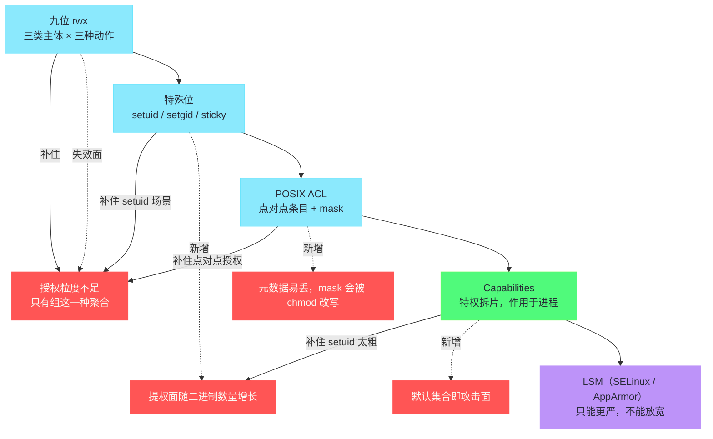
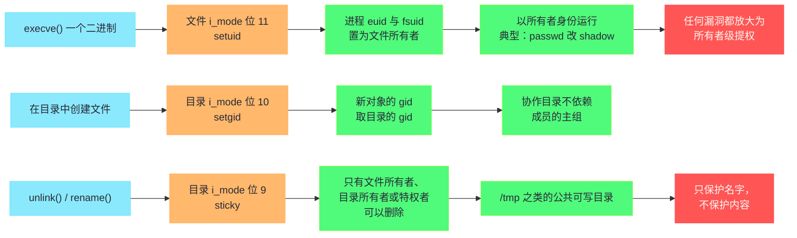
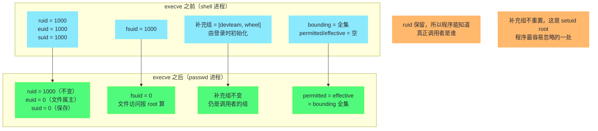
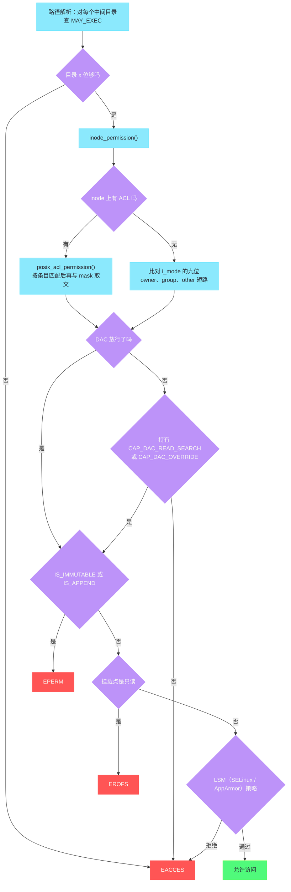
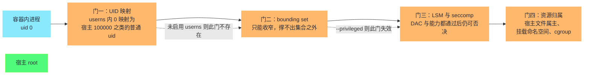

# 文件系统的安全边界——权限、ACL 与 Capabilities

**摘要：**

一个 `open()` 落到 inode 上时，内核其实要连续回答四个问题：九个权限位怎么说、特殊位有没有额外含义、ACL 里有没有更具体的条目、进程自身又持有哪些 capability。这四个问题对应四层权限模型，它们是一层层叠上去的补丁，中间没有代际更替——每块补丁都补住了上一层的失效面，同时自己又长出一个新的失效面。本文以一台构建机上的真实配置为线索，先把 UGO 九位、setuid/setgid/sticky、POSIX ACL、Linux Capabilities 逐层拆开，讲清每层解决什么、在哪一步失效、失效时的症状长什么样；再把视角从文件转到进程，拆解 real/effective/saved uid 与 gid、supplementary groups、fsuid/fsgid 以及 capability 的五个集合，说明为什么很多操作连 root 也做不了；最后落到容器，讲默认 capability 集合如何决定逃逸面、`CAP_SYS_ADMIN` 为什么被叫作新 root、`no_new_privs` 怎样掐断 setuid 提权、`/proc/self/status` 里那串十六进制位图又该怎么读。全文回答两个问题：四层模型的边界各自划在哪里，容器里的 root 为什么不是宿主 root；末了两章把这些边界摊开成五个常见误判，并给出一套能把失效面量出来的基线做法。

---

## 第 1 章 四轮盘问：权限模型为什么叠成四层

### 1.1 四个年代留下的四块补丁

九个权限位在 Unix 的早期版本里就已经定型，那个年代的机器是多用户分时系统，一台 PDP-11 前面坐着整个实验室的人，需要回答的问题只有一句：这个文件归谁、同组的人能不能看、外面的人能不能看。九个位恰好够用，因为它假设"共享"这件事的组织形式就是组。

特殊位是紧接着长出来的。setuid 的最早实现可以追到 1970 年代末 AT&T Unix 与 BSD 的交界处，各家考据给出的年份从 1979 到 1983 并不一致，笔者这里只取一个量级判断：它比 ACL 早了将近二十年。它出现的原因很具体——`passwd` 这个程序必须修改 `/etc/shadow`，而 `/etc/shadow` 只允许 root 写，如果坚持"不给普通用户任何特权"，改密码这件事在安全模型里就无解。

ACL 与 capabilities 是同一份标准的产物。电子电气工程师协会（IEEE）在 1990 年代中期起草 POSIX 1003.1e，想把"点对点授权"与"把 root 拆开"一起写进标准；草案在 2001 年前后被撤销，未成正式标准，但其数据结构与语义被 Linux、FreeBSD、Solaris 各自实现，成了事实标准。Linux 的落地很慢：ACL 随 2.6 早期的 ext3 进主线，文件能力等到 2.6.24（2008 年），环境能力拖到 4.3（2015 年）。

把四个年代排成一条线，会看到一个反复出现的模式：每一层都是为了修上一层的某个具体缺陷而出现，而不是为了推翻上一层。九个位修不了"只给某个人授权"，ACL 修了；九个位说不清"这个程序该不该借 root 的身份"，setuid 说了但说得太粗，capabilities 才把它拆细。旧的一层从未被移除，全部留在原地，每次访问时依次参与判断。

### 1.2 一台构建机上的四层同时在场

抽象地谈四层没有抓手，不妨给一台机器起个名字。`ops-07` 是一台构建机，上面同时跑着四件互相打架的事：

- 代码目录 `/data/build` 由三个小组共写，属于 `devteam` 组，要求新建文件自动落到这个组，任何人不能删别人的目录；
- 外包审计员 `bob` 需要读 `/data/build/audit` 下的产物，但不能给他 `devteam` 的组身份，否则他连源码都能改；
- `httpd` 需要在 80 端口监听，但不应该以 root 全程运行；
- 备份代理跑在容器里，容器内的进程号是 0。

四件事分别落在四层上：`/data/build` 靠 setgid 位，`bob` 靠 ACL，`httpd` 靠文件 capability，备份代理靠容器的 capability 边界集合。这台机器不特殊，它只是把平时散落在多台机器上的四层配置压缩到了一台里，后文的机制都围绕它展开。

### 1.3 四层的分工与各自的失效面

先建立全景。四层的落点不同：前两层直接改 inode 里的模式字段，第三层把条目塞进 inode 的扩展属性，第四层把特权从 inode 搬到进程凭证上——这是四层里唯一一次视角切换，也是理解容器安全的分水岭。

| 层次 | 落点 | 解决的语义 | 新增的失效面 |
| :--- | :--- | :--- | :--- |
| 九位 rwx | inode 的 `i_mode` 低九位 | 三类主体乘三种动作的组合判定 | 无法对单个用户点对点授权，组是唯一的多主体聚合手段 |
| 特殊位 | `i_mode` 的高三位 | setuid 借身份、setgid 托管新对象的组、sticky 限制删除 | 每个 setuid root 的二进制都是一条提权路径 |
| POSIX ACL | inode 的 `system.posix_acl_*` 扩展属性 | 任意用户与组的独立条目，目录可设默认继承 | 元数据在文件搬家时最容易丢，`cp`、`scp`、镜像层都可能吃掉它 |
| Capabilities | 进程 `cred` 的五个集合，加文件扩展属性 `security.capability` | 把 root 的四十余种特权拆成可独立授受的单位 | 集合的默认值本身就是攻击面，容器默认那十几项里仍有能击穿文件权限的 |

四层的叠加关系可以用一张图表示得更清楚：越往下越靠近"内核实际判定"，越往上越靠近"人可以配置"。注意箭头方向表示逐层收紧而非替代——上层给出的许可，下层可以再收回。



图里有一个容易读错的细节：特殊位与 ACL 是并列的两块补丁，它们补的不是同一个缺口，所以顺序上谁先谁后并不重要；真正的顺序发生在内核的判定函数里，那要等到第 7 章才展开。

---

## 第 2 章 九个位：能说清什么，说不清什么

### 2.1 inode 里的模式字段

权限位存在 inode 的 `i_mode` 里，这个字段是 16 位，高四位记文件类型，中间三位记特殊位，低九位记三组 rwx。理解这个布局有用，因为后面所有"加得上去的权限"其实都是在同一块 16 位空间里挤地方——ACL 之所以必须搬到扩展属性去，正是因为 `i_mode` 已经没有空位了。

```
i_mode 的位布局（16 位）

位 15-12  文件类型
  0b1000 = 普通文件      0b0100 = 目录
  0b1010 = 符号链接      0b0110 = 块设备
  0b0010 = 字符设备      0b0001 = 命名管道
  0b1100 = Socket

位 11-9   特殊位
  位 11 = setuid（显示为 s / S）
  位 10 = setgid（显示为 s / S）
  位  9 = sticky（显示为 t / T）

位 8-0    九位权限
  位 8-6  owner 的 rwx
  位 5-3  group 的 rwx
  位 2-0  other 的 rwx
```

`s` 与 `S`、`t` 与 `T` 的差别只有一条：有执行位时显示小写，没有时显示大写，大写意味着这一位当前不起作用。所以给一个普通文本文件 `chmod 4755` 只会看到 `-rwSr--r--`。

### 2.2 短路匹配：为什么所有者可能被自己的文件拒之门外

判定逻辑是按 owner、group、other 的顺序**短路匹配**，找到第一个匹配的身份就用那一组位，不再往下看。它的一个推论相当反直觉：如果文件属主是 `alice`、模式是 `----rwxrwx`，那么 `alice` 自己访问这个文件会被拒绝，因为内核匹配到 owner 身份之后只看 owner 那三个位，`---` 就是不给。

用排队办事打比方更容易记住：三个窗口按身份分流，你是第一类人就必须去第一个窗口，那个窗口说办不了，你不能转身去第二、第三个窗口试试。Unix 允许文件所有者"把文件给别人用，但不给自己用"，这正是短路规则的直接后果，谈不上 bug。

这条规则还有一个更常见的变体：文件属于 `alice:devteam`，`alice` 同时也在 `devteam` 组里，模式为 `rw-rw----`。此时 `alice` 走的是 owner 分支拿到 `rw`，而不是"owner 与 group 取并集"拿到 `rw`——并集这件事在内核里从来没有发生过。很多"为什么我给组加了权限他还是不能写"的困惑，源头都是把权限位当成了累加器。

### 2.3 目录的 rwx：三个字母，三套语义

目录上的 r、w、x 与文件上的含义完全不是一回事，这是权限体系里最常被记错的一张表：

| 位 | 对普通文件 | 对目录 | 缺失时的典型症状 |
| :--- | :--- | :--- | :--- |
| `r` | 读出内容 | 列出目录项的名字（`ls` 能列出名字） | `ls: Permission denied`，但已知名字仍可访问 |
| `w` | 改写内容 | 在目录内创建、删除、重命名条目 | 不能 `touch` 新文件，也不能 `rm` 已有文件 |
| `x` | 把文件交给内核执行 | 穿过目录、对目录内条目做 inode 查找 | `cd` 失败，`cat dir/file` 报 `Permission denied` |

只给 `r` 不给 `x` 的目录会造成一个奇特状态：`ls` 能把名字列出来，`cat` 却打不开任何一个——路径解析的每一步都要对中间目录做 `MAY_EXEC` 检查，名字可见不等于 inode 可达。反过来只给 `x` 不给 `r`，你能 `cat` 一个已知全路径的文件，却列不出目录内容，这个组合常被当作"藏目录"的土办法，挡不住知道路径的人。

`w` 位在目录上的语义要单独说一句：删除一个文件并不需要对该文件有任何权限，需要的只是对它父目录的 `w` 与 `x`。这一步是理解 sticky 位的前提，也是"为什么 `/tmp` 里别人的文件我能删"的答案。

### 2.4 表达缺口：点对点授权无处安放

回到 `ops-07` 的第二个需求。`bob` 要读 `/data/build/audit`，但不能进 `devteam` 组。九个位给出的选项只有两个：把 `bob` 加进 `devteam`（那他连源码都能改），或者把 `audit` 目录的 other 位放开（那全机器的人都能读）。两个选项都不对，这就是九位模型的表达缺口——它能表达的主体集合只有三类，而现实需求里"某一个人"是最常见的第四类。

这个缺口还会引发一种慢性病。团队一多，每个小组都要一个组来管共享目录，组越建越多，用户被反复加入不同的组，最终没人说得清某个人因为哪个组拿到了什么权限。组的成员关系是全局的、没有作用域的，加入 `devteam` 就在所有挂了这个组的地方同时获得权限。

新建文件的默认权限则由 `umask` 与 `open()` 请求的模式共同决定，实际权限等于请求模式与 `umask` 的按位取反做与。这个掩码的取值直接决定默认姿态，也直接决定协作目录要不要额外补位：

| umask | 新文件 / 新目录 | 适用场景 | 调大（更严）的代价 | 调小（更松）的代价 |
| :--- | :--- | :--- | :--- | :--- |
| `022` | `644` / `755` | 通用服务器默认值 | 组内协作失效，同事读不了你新建的文件 | 其他人可读，落到共享主机上有信息外泄面 |
| `027` | `640` / `750` | 面向外网的服务主机 | 同组非本项目的成员也被挡住 | 本组之外的人完全无法协作，跨组调试变难 |
| `077` | `600` / `700` | 密钥、审计日志目录 | 连组内自动化脚本都会失败，运维需要 `sudo` | 几乎不会误放，但目录一旦设错就是隐患 |
| `002` | `664` / `775` | 协作开发目录（配合 setgid） | 任何能写目录的人都能改别人的文件 | 新对象默认对全组可写，误改概率上升 |

`002` 这一行是 `ops-07` 上 `/data/build` 的取值，它配合 setgid 位才构成完整的协作目录方案——单有 `002` 而没有 setgid，新建文件仍会落到创建者的主组；单有 setgid 而没有 `002`，新建文件对组只可读，协作仍然做不成。

### 2.5 root 的捷径：短路在更前面

九个位的判定里有一条不成文的捷径：当进程的文件系统 uid 为 0 时，内核直接放行读写，不再逐位比对。这条捷径在代码里表现为 `uid == 0` 的提前返回，在语义上则等价于"root 持有 `CAP_DAC_OVERRIDE`"。之所以现在要这么说，是因为老代码里写死的 `uid == 0` 判断在有能力机制之后被逐处替换成了 capability 检查——判断的对象从"你是谁"变成了"你持有什么"，这是第 5 章之后会反复出现的一条主线。

执行权限是这条捷径的唯一例外：即使 uid 为 0，只要文件上没有任何一位执行权限，`execve` 依然会失败。这个例外很容易被记住却很难解释清楚，它背后是"防止 root 误执行一个本来不可执行的文本或数据文件"的朴素考虑，与 capability 体系无关。

---

## 第 3 章 特殊位：三个位的来路与三个真实的坑

中间三位是 `i_mode` 里最有历史包袱的部分。三个位各自回答一个与"普通权限"正交的问题，因此它们不能简单地看成"多出来的权限"，而应看成对权限判定流程的三处旁路插入。下面这张图把三个位的插入点标了出来，后文依次展开。



### 3.1 setuid：把身份借给一个程序

普通用户执行设置了 setuid 位的二进制时，内核把进程的有效 uid（effective uid，euid）与文件系统 uid（fsuid）改成文件所有者的 uid，随后程序内部的权限检查看到的都是新身份。真实 uid（real uid，ruid）保持调用者不变，区分这两者是后面理解凭证的关键。

为什么非要这样设计，`passwd` 是最好的例子。`/etc/shadow` 的属主是 root、模式是 `640`，普通用户改密码时确实需要写这个文件，而把写权限给所有用户等于把全机的口令哈希送去暴力破解。setuid 把"写 shadow"这一个动作限制在 `passwd` 这一个二进制内部：先校验旧密码，再生成新哈希，最后只改自己那一行，特权的存活时间被压缩到几百毫秒。

这个缩小是有边界的。只要二进制里存在一个可利用的缺陷，攻击者就能把这几百毫秒的特权完整接管，所以安全界对 setuid root 的态度一贯是"能少一个是一个"。2022 年初公开的 pkexec 漏洞（CVE-2021-4034）是最典型的样本：polkit 的 `pkexec` 设计上没有明显问题，问题出在它对参数计数的假设上——一个空的参数向量就能把环境变量挤进参数区，进而加载攻击者的模块，一个存在十几年的常规程序，一次边界疏忽就等价于本机提权。

基线的做法是定期扫一遍机器上有哪些 setuid 文件。命令很简单，结论需要人看：

```bash
# 两类特殊位一起扫，-perm -4000 只匹配 setuid
find / -xdev -type f \( -perm -4000 -o -perm -2000 \) -printf '%M %u:%g %p\n' 2>/dev/null

# 逐个回查包管理器，输出为空的那几个才是可疑项
for f in $(find / -xdev -type f -perm -4000 2>/dev/null); do
    rpm -qf "$f" >/dev/null 2>&1 || echo "不属于任何软件包: $f"
done
```

需要留意的是一致性而非数量：同一批机器里，如果某台的 setuid 清单比基线多出一两个，多出来的那两个就是本次排查的起点。较新的发行版上 `ping` 多半已改用 ICMP 数据报套接字，或以文件 capability 授予 `cap_net_raw`，所以在一台干净的机器上看到 `ping` 仍带 setuid 位，通常意味着系统很旧或者有人手工改过。

还有一个流传很广的误解需要澄清：给 shell 脚本加 setuid 位没有用。`execve` 发现目标不是 ELF 而是以 `#!` 开头的脚本时，会转而执行解释器；决定特权提升的是解释器那个二进制上的位，不是脚本文件上的位，现代内核还会主动忽略脚本上的 setuid/setgid 位以避免解释器与脚本之间的竞态。想给脚本单项特权，干净的路径只有文件 capability，而它加在脚本上同样无效——必须加在解释器上，那等于给所有用这个解释器的程序授权。

### 3.2 setgid 目录：协作目录的标准做法

setgid 位在可执行文件上的语义与 setuid 对称（有效 gid 变成文件的组），但它真正被广泛使用的是另一副面孔：设在一个目录上时，它改变的是"在这个目录里新建对象的组归属"。新建文件的 gid 不再取创建者的主组，而是取目录的 gid；新建的子目录除了继承组，还会自动继承 setgid 位本身，于是整棵子树都被这个规则覆盖。

`ops-07` 上的配置就三行，顺序不能反：

```bash
# 组必须在目录之前就位，并且改属主会清掉特殊位，所以 chown 在前
chown -R alice:devteam /data/build
chmod 2775 /data/build          # 2 = setgid，775 = rwxrwxr-x
find /data/build -type d -exec chmod g+s {} \;   # 存量子目录补位

# 验证：新建文件的组应为 devteam，而不是创建者的主组
touch /data/build/probe && ls -l /data/build/probe
```

在这个方案里，setgid 位解决的是**组的归属自动化**，`002` 或 `2775` 里的组写位解决的是"组内可写"，两者缺一不可。容易被忽略的是存量文件：setgid 位只对设置之后新建的对象生效，目录里已有的文件仍然挂在原来的组上，所以大规模调整协作目录时，`chgrp -R` 这一步跑不掉。

它的失效面在删除上。setgid 与组写权限一起给出去之后，组内任何人都能删别人创建的文件，因为删除看的是父目录的 `w`。要同时拿下"组内可写"与"不能互删"，需要叠加 sticky 位（目录模式 `3775`），或用 ACL 把删除权限按人拆开。`ops-07` 上第一版只加了 setgid，新同事一个手误删掉别人跑了一半的产物，第二版才补 sticky。

### 3.3 sticky：/tmp 的那一位，以及它不保护什么

sticky 位最早的含义与此无关：它诞生于 PDP-11 时代的 Unix，指"把这个可执行文件常驻交换区"以省掉频繁换入的开销。语义作废之后位被留了下来，4.3BSD 之后被重新定义成"目录里的条目只有所有者能删"。

现代语义只对目录有意义：设了 sticky 的目录，删除或重命名其中的条目时，内核额外检查调用者是否是该条目的所有者、目录的所有者，或者持有相应的特权。`/tmp` 是最标准的样本，模式是 `1777`：所有人都能写、都能进，但只有自己能删自己创建的东西。

这里必须把它的边界说透，因为实际事故大多来自边界而不是机制本身。sticky 保护的是名字，不是内容——用户对 `/tmp` 有写权限，打不开别人的文件（那要文件权限），但若别人把文件模式设成 `666`，他完全可以把文件截断重写，sticky 不拦。反过来，如果某个子目录既写又执行却没有 sticky，任何人都能在里面 `unlink` 别人的条目再建同名的新文件，这是不需要任何文件权限的替换攻击。

setgid 与 sticky 组合起来，就是协作目录的完整答案：`3775` 让新对象自动归组，也让组内成员不能互删对方的条目。`/tmp` 目录本身则通常还要求 `noexec` 与 `nodev`——这两项属于挂载选项，第 9 章一并处理。

### 3.4 三个位的汇总

| 位 | 作用对象 | 真实语义 | 典型使用者 | 失效点 |
| :--- | :--- | :--- | :--- | :--- |
| setuid | 可执行文件 | 执行时 euid 与 fsuid 变为文件所有者 | `passwd`、`su`、`sudo`、`pkexec` | 程序任一实现漏洞都放大为所有者级提权；脚本上无效 |
| setgid | 目录（主要）与可执行文件 | 新对象的 gid 取目录 gid，新子目录继承该位 | 团队协作目录 | 只影响新建对象；不阻止组内互删 |
| sticky | 目录 | 只有条目所有者或目录所有者能删除、重命名 | `/tmp`、`/var/tmp` | 不保护内容读写；子目录不自动继承（需另设） |

---

## 第 4 章 ACL：点对点授权，以及它在哪一步被弄丢

### 4.1 一条命令补住的缺口

访问控制列表（Access Control List，ACL）把"授权"从三个主体格子里解放出来。给 `bob` 单独开一个只读口子，只需要一条命令，目录的九位模式一个字都不用改：

```bash
# 只给 bob 读与执行（执行是为了能穿过目录），不给他写
setfacl -m u:bob:r-x /data/build/audit

# 查看结果：注意条目分两类，带名字的是 named entry
getfacl -p /data/build/audit
# file: data/build/audit
# owner: alice
# group: devteam
# user::rwx
# user:bob:r-x          <- named user
# group::rwx            <- group 条目（owner 组的权限）
# mask::rwx             <- 有效权限上限
# other::---
```

`ls -l` 的输出会多出一个加号，位置在权限串最后一位：`drwxrwx---+`。看到它就必须用 `getfacl`，不能靠九个位猜权限。还有一个更隐蔽的事实：文件带 ACL 之后，`ls -l` 中间那三位显示的不再是 `group::`，而是 `mask`，于是常出现"看着组是 `rwx`、组员却写不进去"的现场。

### 4.2 条目匹配与 mask：谁受限制，谁不受

ACL 的判定仍然遵循"第一个匹配就停"的原则，只是匹配的候选从三个变成了四类，且每一类都可能有多条。顺序是：`user::`（文件所有者）、所有 named user、`group::` 与所有 named group（多条命中时取并集）、`other::`。

mask 是这套结构里最容易出错的构件。它的规则可以精确表述为：named user、named group 与 `group::` 的实际有效权限都要与 mask 取交集，而 `user::` 与 `other::` 不受 mask 约束。

| 条目类型 | 是否受 mask 限制 | 匹配时的处理 | 典型误配后果 |
| :--- | :--- | :--- | :--- |
| `user::` | 不受 | 命中即用，直接终止 | 文件所有者永远拿不到比自己位更高的权限 |
| `user:NAME:` | 受 | 命中即用，权限与 mask 取交集 | 给了 `rwx` 但 mask 是 `r-x`，实际只有 `r-x` |
| `group::` | 受 | 命中后继续看 named group，取并集 | 组员被 mask 静默降权 |
| `group:NAME:` | 受 | 与 `group::` 取并集后再与 mask 取交集 | 多条 named group 只增不减，容易授权过宽 |
| `other::` | 不受 | 兜底条目 | 设成 `rwx` 等于回到"人人可写"，ACL 的意义归零 |

`getfacl` 会把被 mask 削掉的权限显式标成 `#effective:`，这是排查时最该看的一行。如果 `getfacl` 里某条 named user 后面跟着 `#effective:r-x` 而条目本身写的是 `rwx`，那么无论怎么解释"我已经给足权限了"，程序拿到的都是 `r-x`。

### 4.3 chmod 会改写 mask

mask 与九位模式是同一份数据的两种视图，这个**耦合**会带来一个非常隐蔽的副作用：对带 ACL 的文件执行 `chmod`，内核会把 `chmod` 给出的组权限位写进 mask。也就是说，一个为了"临时放开组读"而执行的 `chmod g+r`，会顺带把 mask 从 `---` 抬到 `r--`，从而把所有 named user 的有效权限一起抬高。

反过来更常见：为了收紧组权限执行 `chmod g-w`，mask 被同步收紧成 `r-x`，某个本应保留写权限的 named user 被一起削掉了。这类"改了一处、坏了一片"的事故没有报错，只有 `getfacl` 能看出来。工程上的纪律是：只要文件带 `+`，任何 `chmod` 之后都要回读一次 `getfacl`，或者干脆改用 `setfacl -m m::` 精确控制 mask。

### 4.4 默认 ACL 与 umask：谁说了算

目录可以再挂一份默认 ACL（default ACL），作用是新对象的访问 ACL 由它派生。这份默认 ACL 与 umask 的关系经常被简化为"两者相乘"，这个说法是错的：一个目录上存在默认 ACL 时，新建对象时 umask 不再参与计算，访问 ACL 直接由默认 ACL 派生，`open()` 传入的模式参数只用来在派生结果上再收窄一遍（具体如何处理各组位、如何与 mask 合成，以 `acl(5)` 的描述为准）。

```bash
# 默认 ACL 与访问 ACL 是两份独立的属性，要分别设置
setfacl -m u:bob:r-x /data/build/audit              # 管这个目录本身
setfacl -d -m u:bob:r-x /data/build/audit           # 管以后新建的对象

# 新文件会继承默认 ACL，但 bob 只有 r 没有 x（普通文件不需要执行位）
touch /data/build/audit/out.log && getfacl -p /data/build/audit/out.log
```

默认 ACL 只对目录有效，而且不会自动递归到已有的子目录；子目录要继承，同样得单独设置。还有一点容易踩：`setfacl -d` 只写在目录上，新建文件的 `user::` 条目由 `open()` 的模式与 umask 共同决定，默认 ACL 里并不存在 `user::` 的对应项可以继承。

### 4.5 ACL 在哪一步被弄丢

ACL 存在 inode 的扩展属性里（ext4 与 XFS 都走 `system.posix_acl_access` 与 `system.posix_acl_default` 两个名字），这意味着它的存活完全取决于"搬运工具愿不愿意搬扩展属性"。这一点与九位模式形成鲜明对照：九位模式在每个工具的复制逻辑里都是必拷项，ACL 却是可选项。

| 操作 | ACL 是否保留 | 原因与补救 |
| :--- | :--- | :--- |
| `cp` 不带选项 | 丢失 | 按 `umask` 重建模式；需要 `cp -p` 或 `cp -a` |
| `cp -p` / `cp -a` | 保留 | `-p` 覆盖模式与属主，`-a` 额外带上扩展属性 |
| `mv` 同一文件系统 | 保留 | 只是 `rename()`，inode 没动 |
| `mv` 跨文件系统 | 视实现 | 退化为复制再删除，等同于 `cp` 再 `rm` |
| `rsync` 带 `-A` | 保留 | 不带 `-A` 时 ACL 静默消失，且不报错 |
| `tar` 带 `--acls` | 保留 | 不带时只存九位模式，解包后 `+` 标记消失 |
| `scp` | 丢失 | `scp` 协议本身不传扩展属性 |
| 容器镜像层 | 视构建工具 | 取决于 `tar` 是否带 `--acls`，多数镜像构建不保 |
| 备份工具 | 视工具 | 只备份数据不带元数据的方案会在恢复时集体丢 ACL |

这张表解释了一类反复出现的事故：线上目录配好了 ACL，某次发布把产物从构建机 `scp` 到目标机、或者用 `rsync` 同步了一次，第二天审计员报"读不了"，`getfacl` 一看干干净净。ACL 的失效往往不是被谁删掉，而是在某次看不出异常的搬运里没被带上。

---

## 第 5 章 Capabilities：把 root 切成四十片

### 5.1 三次尝试才落地的"拆 root"

capability 的思想在 POSIX 1003.1e 草案里写得相当完整：把 root 的全能权力拆成一张可枚举的能力表，每个进程持有其中若干项，内核在特权操作的入口查"你持有这一项吗"。问题是它太好也太复杂——草案的三集合模型语义难用，早期 Linux 的实现（2.2 系列，1999 年前后）只够让 init 用。在文件能力落地之前，想用单项特权的程序实际只有两条路：setuid root，或者不用。

真正的转折点是 2008 年的 2.6.24：文件能力（file capabilities）让 capability 可以"烧"进二进制，写在扩展属性 `security.capability` 里，执行时按规则提升进程的集合。这一下把 setuid 的粗粒度替换掉了，`ping` 是最早的受益者之一——从"setuid root 的完整特权"换成"仅 `cap_net_raw`"，同一个功能只剩攻击面的几十分之一。2015 年的 4.3 又补上环境能力（ambient），才让"非 root 进程把能力传给子进程"这件事有了正常路径。

到 6.x 内核，能力编号排到 40（`CAP_CHECKPOINT_RESTORE`），总数随版本只增不减。讨论具体总数意义不大，值得记住的是几条与文件权限直接相关、也最常出现在容器默认集合里的：

| Capability | 能做什么 | 典型持有者 | 误授的代价 |
| :--- | :--- | :--- | :--- |
| `CAP_CHOWN` | 任意改文件属主与属组 | 安装器、镜像构建 | 可以把任意文件改成自己再改回，审计线索被抹 |
| `CAP_DAC_OVERRIDE` | 绕过 rwx 与 ACL 的读写执行检查 | 备份、恢复工具 | 第 2 到第 4 章的整套判定全部失效 |
| `CAP_DAC_READ_SEARCH` | 绕过读检查与目录搜索检查 | 备份、递归扫描 | 能读全机文件，但改不了，留下完整的窥探面 |
| `CAP_FOWNER` | 绕过"只有属主能改属主与模式"的限制 | 包管理、镜像层 | 可以改别人的文件权限，等价于给自己开后门 |
| `CAP_FSETID` | 改文件时不清 setuid/setgid 位 | 安装器、`cp -p` | 配合可写的 setuid 二进制，可维持提权后门 |
| `CAP_SETUID` / `CAP_SETGID` | 任意改进程 uid / gid | `su`、`sudo`、运行时 | 直接伪造身份，等价于本机 root |
| `CAP_SETPCAP` | 修改自身与子进程的能力集 | 运行时、容器 init | 可以自己"造"出别的能力 |
| `CAP_SYS_CHROOT` | 调用 `chroot()` | 服务隔离、容器 | 可构造 chroot 逃逸，前提是有另一条路径 |
| `CAP_SYS_ADMIN` | 挂载、改主机名、操作 namespace 等数十项 | 容器运行时、系统管理 | 几乎等于完整 root |
| `CAP_SYS_PTRACE` | 跟踪任意进程 | 调试器、profiler | 可读写任意进程内存，能偷密钥 |
| `CAP_MKNOD` | 创建设备节点 | 容器 init、安装器 | 配合可写挂载可造块设备节点直接读盘 |
| `CAP_NET_RAW` | 原始套接字 | `ping`、抓包 | 可伪造任意源地址发包、监听非本机流量 |

### 5.2 文件能力：setuid 的现代替代品

`ops-07` 的第三个需求正好用得上。`httpd` 需要绑 80 端口，这个操作的检查点是 `CAP_NET_BIND_SERVICE`；只要让这个二进制持有该项能力，进程就可以以一个普通用户的身份完成绑定，全程不需要 setuid：

```bash
# 先把 setuid 位摘掉，再烧入单项能力；两件事互不替代，不能只做一件
chmod u-s /usr/sbin/httpd
setcap cap_net_bind_service=ep /usr/sbin/httpd
getcap -v /usr/sbin/httpd
# /usr/sbin/httpd cap_net_bind_service=ep

# 全机扫一遍，看看有哪些文件带着能力
getcap -r / 2>/dev/null
```

`=ep` 里的两个字母是集合名：`e` 是 effective（执行后立即生效），`p` 是 permitted（允许持有的上限）。写成 `=p` 而不带 `e` 时，进程拿到了能力却没有启用，需要程序自己调用 `cap_set_proc` 才能用——这是刻意设计的，给不信任的程序少一点默认特权。第三个字母 `i` 是 inheritable，用于跨 `exec` 传递，实践中很少单独用。

文件能力的存储位置是 `security.capability` 这个**扩展属性**，位置决定了它的两个特征。好消息是它与 ACL 不同，不属于 `system.*` 命名空间，普通用户改不了；坏消息是它同样依赖搬运工具愿意搬 xattr——`cp` 默认不搬，`tar` 需要 `--xattrs`，`scp` 不搬。第 4 章那张"ACL 在哪一步被弄丢"的表，把 ACL 换成文件能力基本适用。

文件能力有两个与 ACL 不同、也更值得警惕的失效形态。第一个是**能力与逻辑分离**：能力附着在二进制的 inode 上，而程序运行时真正执行的逻辑来自它加载的配置、插件、脚本与共享库——攻击者不必替换二进制，只要改它能加载的东西，就能借这份能力办事。给 shell 加 `cap_dac_override`、给解释器加能力之所以危险，道理都在这里。第二个是**能力会被写入抹掉**：文件内容一旦被修改，内核会通过 `file_remove_privs()` 清掉 `security.capability`，于是升级包覆盖、`cp` 覆盖、编辑器保存都会让 `getcap` 的输出悄悄变短，症状是功能静默失效而不是报错，部署脚本里 `setcap` 必须排在写文件之后。

### 5.3 读 capsh 的输出

`capsh --print` 是查凭证最快的手段，它的输出分几段，各有含义：

```bash
capsh --print
# Current: cap_chown,cap_dac_override,cap_fowner,cap_fsetid,cap_kill,
#          cap_setgid,cap_setuid,cap_setpcap,cap_net_bind_service,
#          cap_net_raw,cap_sys_chroot,cap_mknod,cap_audit_write,cap_setfcap=ep
# Bounding set =cap_chown,cap_dac_override,...（同类清单）
# Ambient set =
# Securebits: 00/0x0/1'b0
```

`Current` 是当前进程有效集里的全部能力，末尾的 `=ep` 表示这些能力同时在 permitted 与 effective 里。`Bounding set` 是天花板，只能收窄不能扩张。`Ambient set` 为空通常意味着这个进程没有通过环境能力向子进程传递特权，非 root 容器里几乎都是这个状态。`Securebits` 是一组细粒度开关，容器运行时偶尔会动它。

---

## 第 6 章 进程凭证：一次访问要查几张身份证

### 6.1 cred 里到底存了什么

内核把"这个进程是谁"集中放在 `struct cred` 里，文件访问、信号发送、能力检查全部读这一份结构。它包含的东西比大多数人以为的多：三对 uid/gid、一组补充组、一对文件系统专用的 uid/gid，以及五个能力集合。

```c
struct cred {
    kuid_t   uid;          /* real uid：调用者本人 */
    kuid_t   euid;         /* effective uid：权限检查用的身份 */
    kuid_t   suid;         /* saved uid：exec 前后可以切回的身份 */
    kgid_t   gid, egid, sgid;
    struct group_info *group_info;   /* 补充组，最多 NGROUPS_MAX 个 */
    kuid_t   fsuid;        /* 文件系统访问实际用的 uid */
    kgid_t   fsgid;
    kernel_cap_t cap_inheritable, cap_permitted, cap_effective,
                 cap_bset, cap_ambient;
};
```

七个身份字段之间的关系可以用门禁比喻串起来：real uid 是工牌上的名字，effective uid 是当下刷开的权限等级，saved uid 是"随时可以切回去的那一档"，而 fsuid 是进门时真正被读的那张卡。大多数时候 fsuid 等于 euid，`setfsuid()` 可以把它们分开，专为"临时以另一个身份访问文件而不改变进程整体权限"准备。

### 6.2 五个能力集合的关系

能力集合不是并列的五个清单，它们之间有明确的包含与演化规则：

- permitted 是进程"有权持有"的上限，一切检查都以它为源头；
- effective 是"当前生效"的集合，`capable()` 查的正是它；
- inheritable 是"跨 exec 可以传给下一个程序"的那部分，语义别扭，实践中很少直接用；
- bounding 是天花板，任何 exec 都不能让进程获得集合外的能力，且 fork 后只能收窄；
- ambient 是 4.3 补上的第五集，让非特权程序可以把能力跨 exec 传递（前提是该能力同时在 permitted 与 inheritable 里）。

一个 setuid 程序执行时，内核会把进程的 permitted 直接置为"全部能力"，effective 同样置位，bounding 保持不变。这就是为什么"bounding 才是真正的边界"：即便 setuid 把 permitted 撑满，撑出来的也只能是 bounding 里那些。

### 6.3 一次 exec 前后的凭证变化

把 `ops-07` 上执行 `passwd` 的过程摊开来看，凭证的变化发生在 `execve` 提交的那一刻，而且改动是分字段的：



图里有两处值得停一下。第一处是 ruid 不变：`passwd` 能服务多个用户，靠的就是读 ruid 知道"这次是谁在改密码"，euid 只用来写 shadow。第二处是补充组不变：setuid root 的程序继承了调用者的全部组身份，若程序里 `chown` 或建文件时没有显式指定组，落下来的组会是调用者的某个组。

### 6.4 为什么很多事 root 也做不了

凭证结构解释了一个乍看矛盾的现象：`id` 显示 uid 是 0，某些操作仍然被拒绝。原因分布在四个层面，后文会逐一展开：

第一层是能力，euid 为 0 不等于持有全部能力，容器里的 root 通常只有十几项；第二层是能力的作用范围，user namespace 里的 root 拥有的是"那个 namespace 内"的全部能力，出了边界一文不值；第三层是文件系统自身的属性，不可变标志位、只读挂载、NFS 的根压缩都在能力检查之外；第四层是强制访问控制，DAC 与能力都通过之后 SELinux 仍可拒绝。这四层是串联关系，前面任何一层放行，后面一层都还有权否决。

---

## 第 7 章 权限检查的完整路径：四轮盘问的执行顺序

### 7.1 路径解析先付过一次账

`open("/data/build/audit/out.log")` 进入内核后，第一件事是把路径字符串一段段走完，还轮不到去找目标 inode。每走一段，VFS 都要对中间目录做一次 `MAY_EXEC` 检查——这就是第 2 章说的"目录的 x 位"。这一步的调用链是路径解析（`link_path_walk`）里的 `may_lookup`，最终落到 `inode_permission()` 上。目录缺 x 时在这一步就返回 `EACCES`，根本走不到目标文件。

路径解析完、拿到目标 inode 之后，才轮到"这个文件让不让你打开"。这一轮的入口仍然是 `inode_permission()`（VFS 对象与方法表的完整解剖见 [[02 VFS 虚拟文件系统——超级块、inode、dentry 与 file]]），它对具体文件系统的 `i_op->permission` 发起调用；绝大多数文件系统没有自己实现，于是落到通用的 `generic_permission()`。这个函数是四轮盘问的总调度处，形状大致如下（省略了大量与命名空间映射相关的参数）：

```c
/* 6.x 的 generic_permission 主干：伪代码，略去 flags 与 mode 的推导 */
int generic_permission(struct mnt_idmap *idmap, struct inode *inode, int mask)
{
    int ret = acl_permission_check(inode, mask, flags, mode, &is_owner);
    if (ret)
        return ret;                      /* ACL 或 UGO 已经给了结论 */

    /* 走到这里说明 DAC 不放行，才轮到能力兜底 */
    if (capable_wrt_inode_uidgid(idmap, inode, CAP_DAC_READ_SEARCH))
        return 0;
    if (capable_wrt_inode_uidgid(idmap, inode, CAP_DAC_OVERRIDE))
        return 0;

    return -EACCES;
}
```

### 7.2 为什么 ACL 会盖住九位模式

`acl_permission_check()` 的第一件事是看 inode 上有没有访问 ACL。没有，就按 owner、group、other 的顺序比对 `i_mode`；有，就交给 `posix_acl_permission()` 按 ACL 条目判定。两条路互斥，且 ACL 那条在前。

这个"覆盖"关系是同一份数据的**两种视图**，谈不上特例：一个带 ACL 的文件，`i_mode` 里那九位并没有消失，而是被解释成了 ACL 的三个特定条目——owner 位对应 `user::`，group 位对应 `mask`，other 位对应 `other::`。既然 group 位存的就是 mask，`chmod g+w` 必然改写 mask，也就必然影响所有 named 条目。

判定顺序的工程含义很直接：如果有 ACL，改九位模式基本是无用功，因为实际参与判定的是 ACL 条目；如果想整体放行，最省事的其实是把 mask 抬起来（`setfacl -m m::rwx`），而不是逐个条目去改。反过来，如果需要收紧，只改 mask 也能一次性收掉所有 named 条目，代价是下次别人 `chmod` 时会把它改回去。

### 7.3 DAC 之后还有三道闸

`generic_permission` 返回 0 不等于"一定能做"。后面还排着三道与文件内容无关的闸门，它们各自返回不同的错误码，错误码本身就是定位线索：

| 闸门 | 判定位置 | 拒绝时错误码 | 典型症状 |
| :--- | :--- | :--- | :--- |
| 不可变 / 只追加标志 | `may_open()` 检查 `IS_IMMUTABLE`、`IS_APPEND` | `EPERM` | root 也改不动，`chmod` 同样失败 |
| 只读挂载 | 写入路径上的 `mnt_want_write()`、`sb_rdonly()` | `EROFS` | `Read-only file system`，与权限无关 |
| 强制访问控制 | LSM 钩子 `security_inode_permission()` | `EACCES`（常伴 AVC 日志） | `ls -l` 看着全开，就是打不开 |

三者共同的特征是都在 DAC 放行之后才生效，所以"权限已经全开了还是不行"的问题，答案几乎一定在这三道闸里，而不是在 `chmod` 上。

`capable_wrt_inode_uidgid()` 这个函数名里的 "wrt_inode_uidgid" 值得单独一提：能力检查并不是无条件成立的，它要确认 inode 的属主在调用者的用户命名空间里能映射出来。这条约束是容器里"root 也不是万能"的机制级原因之一，第 8 章会接着讲。

### 7.4 决策树的完整形状

把上面几节拼起来，一次文件访问的判定路径如下。注意每一层的"否"都会直接终止，不会继续往下问：



这张图有一个隐藏前提：它描述的是"以某个进程当前的凭证访问某个已存在的 inode"。创建文件还要额外检查父目录的 `w` 与 `x`，执行文件还要额外检查"至少有一个 x 位"。图里只画主干，是为了让顺序看清楚——顺序在这里是所有排障推理的基础，而非实现细节。

---

## 第 8 章 容器里的 root：capability 集合就是逃逸面

### 8.1 默认那十四项

容器运行时不会把 root 的全部能力交给容器。Docker 定义的默认集合是十四项，Kubernetes 在没有额外声明时沿用运行时给出的默认值，因此这十四项实际上是绝大多数生产容器的起点：

```
CAP_CHOWN             改文件属主与属组
CAP_DAC_OVERRIDE      绕过 rwx 与 ACL 检查
CAP_FOWNER            绕过属主限制改模式
CAP_FSETID            改文件时不清 setuid/setgid
CAP_KILL              向任意进程发信号
CAP_SETGID            任意改进程 gid
CAP_SETUID            任意改进程 uid
CAP_SETPCAP           改自身与子进程的能力集
CAP_NET_BIND_SERVICE  绑定 1024 以下端口
CAP_NET_RAW           原始套接字
CAP_SYS_CHROOT        调用 chroot()
CAP_MKNOD             创建设备节点
CAP_AUDIT_WRITE       写内核审计日志
CAP_SETFCAP           给文件设置 capability
```

这十四项的共同点是"普通应用跑起来真的会用到"，它们构成兼容性与安全之间的一个折中，而这个折中可以从两边看出来。往回收：摘掉 `CAP_DAC_OVERRIDE`，所有"镜像里目录属主不对、应用以 root 硬改"的写法立刻报权限错；摘掉 `CAP_CHOWN`，`chown` 打不动的镜像会一片片挂掉。往外放：`CAP_NET_RAW` 让容器能发原始包，`CAP_SETFCAP` 让它能给自己造特权二进制，`CAP_MKNOD` 让它能建设备节点——这三项在很多场景里根本用不上，却是默认值。

`ops-07` 上的备份代理正好踩在折中线上。它需要读全机文件（`CAP_DAC_READ_SEARCH` 更合适，或者干脆用 `CAP_DAC_OVERRIDE`），而我们希望它连网络都不能碰。实际写法是把默认集合整体清空再补回最小集：

```bash
# 先全摘，再逐项加回；顺序上先 drop 再 add 才不会被默认值渗回来
docker run --cap-drop=ALL --cap-add=DAC_READ_SEARCH \
           --security-opt=no-new-privileges \
           --read-only --tmpfs /run backup-agent:latest
```

Kubernetes 里等价的安全上下文写在 `securityContext` 里，语义与上面逐项对应：`drop: ["ALL"]` 清空默认集合，`add` 补回具体项，`allowPrivilegeEscalation: false` 设置第 8.3 节要讲的 `no_new_privs`，`readOnlyRootFilesystem` 管挂载。

### 8.2 CAP_SYS_ADMIN：新 root 这个名字的由来

`CAP_SYS_ADMIN` 被称作"新的 root"，原因是覆盖面：挂载与卸载、改主机名、操作 namespace、相当一部分 `sysctl`、配额管理、一大批设备 `ioctl`、`fanotify` 初始化……单它一项就把第 5 章那张表里其余各项的功能拼回来大半。持有它的容器，能力机制几乎不再提供保护：能挂载就能把宿主目录挂进来，能操作 namespace 就能尝试各种 namespace 逃逸技巧。

所以 `--privileged` 的含义需要说准：它不只是"把 bounding set 填满"，还同时关掉默认的 seccomp 配置、去掉 AppArmor/SELinux 的约束、放开设备访问，并且不再限制它去改写宿主的网络与文件系统状态。一个 `--privileged` 容器在安全意义上不是"权限更大的容器"，而是"用 namespace 隔了一下视图的宿主 root"。把它用于"图省事让 DPDK 或某个监控 agent 跑起来"，等于用整台机器的安全性换取一次部署便利；逃逸路径的系统性梳理见 [[云原生/Docker/06 容器安全边界与逃逸风险|容器安全边界与逃逸风险]]。

另有两项能力的危险性被严重低估，而它们在默认集合里就有。`CAP_DAC_OVERRIDE` 让容器内的进程越过全部 rwx 与 ACL 判定读挂载进来的宿主目录——前面几章建立的那堵墙，在容器默认配置下对宿主目录是无效的，还能拦住它的只剩挂载选项与 LSM。`CAP_DAC_READ_SEARCH` 稍窄，只能读不能改，但足够把宿主上挂进来的配置、密钥、日志读走。

### 8.3 no_new_privs：掐断 setuid 提权的那一刀

`PR_SET_NO_NEW_PRIVS`（3.5 引入）只做一件事：给进程打一个一次性的、不可撤销的标记，此后这个进程及其所有后代在 `exec` 时都不会因为 setuid 位或文件能力而获得新特权。它拦的正是第 3 章那条最古老的提权路径——容器里只要存在一个 setuid root 的二进制，攻击者就能借它把 euid 抬到 0；打了这个标记之后，`exec` 会直接忽略文件上的 setuid 位与 `security.capability`，抬不起来。

它还有第二个身份：加载 seccomp 过滤器（`seccomp(SECCOMP_SET_MODE_FILTER)`）的前提条件之一就是进程要么持有 `CAP_SYS_ADMIN`，要么已经处于 `no_new_privs` 状态。这条约束的意图很清楚——不允许一个"还能通过 exec 获得新特权"的进程去限制系统调用，否则过滤器本身会变成绕过特权的工具。容器的运行时默认配置里这两件事通常一起做：先设 `no_new_privs`，再装 seccomp 过滤器。

Kubernetes 的 `allowPrivilegeEscalation: false` 就是设这个标记，而不是做别的什么。它的语义容易误解成"禁止以 root 运行"，实际并不是——它只禁止"通过 exec 获得比现在更高的特权"，容器仍可以一开始就以 root 启动。想同时禁止以 root 启动，要配合 `runAsNonRoot: true`。

### 8.4 读 /proc/self/status 里的能力位图

容器里查自己的真实权限，最快的一步是读 `/proc/self/status`：

```
CapInh: 0000000000000000
CapPrm: 00000000a80425fb
CapEff: 00000000a80425fb
CapBnd: 00000000a80425fb
CapAmb: 0000000000000000
NoNewPrivs: 0
Seccomp: 2
```

五行能力字段对应五个集合，后面跟着的是一张 64 位十六进制位图：第 i 位为 1，表示持有编号为 i 的 capability。`a80425fb` 这个值是容器默认集合的"指纹"，把它解开就能看到那十四项——下面是解算过程，属于示例推算，用于演示方法而非给出新结论：

```
0x00000000a80425fb
按四位十六进制一组，自右向左展开为二进制

  fb = 1111 1011  -> 位 0,1,3,4,5,6,7
  25 = 0010 0101  -> 位 8,10,13
  04 = 0000 0100  -> 位 18
  a8 = 1010 1000  -> 位 27,29,31

共 14 位，逐个对上编号：
  0  CAP_CHOWN            8  CAP_SETPCAP
  1  CAP_DAC_OVERRIDE     10 CAP_NET_BIND_SERVICE
  3  CAP_FOWNER           13 CAP_NET_RAW
  4  CAP_FSETID           18 CAP_SYS_CHROOT
  5  CAP_KILL             27 CAP_MKNOD
  6  CAP_SETGID           29 CAP_AUDIT_WRITE
  7  CAP_SETUID           31 CAP_SETFCAP            （示例推算）
```

比手工展开更省事的办法是让 `capsh` 代劳：`capsh --decode=00000000a80425fb` 会直接把这串数翻成清单。位图读法真正的用处不在核对默认值，而在比对差异——把容器里的 `CapBnd` 与宿主上进程的 `CapBnd`（`/proc/1/status`）一比，多出来的几位就是这次部署放宽的特权。`NoNewPrivs` 为 0 意味着 setuid 在这个容器里仍然有效，`Seccomp: 2` 表示过滤器处于过滤模式。

### 8.5 容器内的 root 与宿主的 root 之间隔着四道门

`id` 在容器里显示 `uid=0(root)`，这是事实，但它说的是"在这个容器的用户命名空间里编号为 0"，与"拥有宿主 root 的权力"是两件事。两者之间隔着四道门：



四道门的分工需要精确表述。**门一**只在启用了用户命名空间时存在（namespace 的机制见 [[云原生/Docker/02 Linux Namespace 深度解析|Namespace 深度解析]]）：容器内的 0 映射到宿主上的高位 uid，逃逸出去也只是普通用户；没开 userns 的容器里，容器内 0 就是宿主的 0，这道门不存在。**门二**永远存在：bounding set 撑不破，`--cap-drop` 与 `--cap-add` 的效果全落在这里。**门三**在默认配置下也在：seccomp 挡掉几十个高危系统调用，AppArmor 或 SELinux 的 profile 再收一层。**门四**是资源侧的事实：容器只在被允许的挂载点与 cgroup 里活动。

这也解释了为什么 `--privileged` 的破坏力那么大——它同时拆除门一以外的三道：bounding set 填满、seccomp 与 LSM 的约束放开、设备访问与挂载全部打开。此时容器内 root 与宿主 root 之间的距离，只剩 namespace 提供的视图隔离，而 namespace 从来不是安全边界，它只负责"看不见"。

### 8.6 逃逸面与集合的对应

把常见配置与它们的实际暴露面排成一张表，比记"不要用 privileged"这句话更有用：

| 配置 | 文件权限是否还能拦住它 | 主要暴露面 | 适用判断 |
| :--- | :--- | :--- | :--- |
| 默认集合（十四项） | 对容器内属主为 root 的路径无效 | `CAP_DAC_OVERRIDE` 读写挂载进来的宿主目录；`CAP_NET_RAW` 伪造包 | 兼容性折中值，不适合对外暴露的服务 |
| `--cap-drop=ALL` + 按需加回 | 有效 | 只剩被显式授予的那一项能力 | 首选姿态；代价是要逐项调试镜像的权限需求 |
| 加 `CAP_SYS_ADMIN` | 完全失效 | 挂载任意文件系统、操作 namespace、大量设备 ioctl | 除特殊测试外没有正当理由 |
| 加 `CAP_DAC_READ_SEARCH` | 读侧完全失效 | 读挂载进来的宿主密钥、日志、配置 | 仅备份类容器，且挂载点要单独收紧 |
| `--privileged` | 完全失效 | 全部能力、设备、LSM 与 seccomp 失守 | 等同于把宿主 root 交给容器 |
| `--security-opt=no-new-privileges` | 不受影响 | 掐断 setuid 与文件能力提权路径 | 成本极低，几乎所有容器都该加 |
| Rootless（userns 映射） | 不受影响 | 逃逸后只拿到宿主高位 uid | 网络与存储方案需要先验证兼容性 |

最后两行值得单独强调：`no_new_privs` 与 Rootless 是整张表里性价比最高的两项，因为它们都不改变应用看到的文件权限语义，却各砍掉一条主干逃逸路径。这两项也是被"先跑起来再说"顺序排到最后、经常没配的两项。

---

## 第 9 章 DAC 之外：不可变属性、挂载选项与 SELinux

### 9.1 不可变属性：连 root 都要绕道

`chattr +i` 给 inode 打一个"不可变"标志，此后这个文件不能被写、不能被删、不能被改名、不能被链接，`chmod` 与 `chown` 也会失败。它拦的不只是普通用户——root 同样被拦，返回的错误码是 `EPERM` 而不是 `EACCES`。这条特性是那张闸门表里唯一一项写在 inode 自身、连 `CAP_DAC_OVERRIDE` 也绕不过去的机制。

```bash
chattr +i /etc/ssl/private/wildcard.key     # 打标
lsattr /etc/ssl/private/wildcard.key        # 看标：末尾 i 为不可变，ext4 还会带 e
echo x >> /etc/ssl/private/wildcard.key     # Operation not permitted
chattr -i /etc/ssl/private/wildcard.key     # 摘标，需要 CAP_LINUX_IMMUTABLE
```

设置与摘除这个标志都要 `CAP_LINUX_IMMUTABLE`，所以它在容器里几乎用不上（默认集合不含此项）。另一个变体是 `+a`（只追加），语义是"只能往文件末尾写，不能改写已有内容"，适合放审计日志。两者的共同限制是文件系统支持：ext4、XFS、btrfs 支持，tmpfs 与多数网络文件系统直接返回不支持，在不支持的文件系统上，`chattr` 会直接返回不支持，没有替代机制兜底。

把这类属性写进运维纪律时要接受一个代价：`+i` 挡掉的不只是攻击者，还有所有"顺手改一下"的自愈脚本、配置管理工具与日志轮转。事故里相当一部分是"加了 `+i` 却没人记录，半年后升级卡住"，所以它必须与配置管理清单同步。

### 9.2 挂载选项：不写在 inode 上的权限

挂载选项与权限模型正交，在 VFS 层直接否决某类操作，检查落在权限判定的前后两侧。四个最常见选项的语义与代价如下：

| 选项 | 拦下的行为 | 调整（收紧）的代价 | 放宽的风险 |
| :--- | :--- | :--- | :--- |
| `ro` | 一切写操作，返回 `EROFS` | 需要独立的可写挂载点，写入路径要重新设计 | 容器根文件系统可写，镜像内任意二进制可被替换 |
| `nosuid` | setuid/setgid 位在这棵树上不生效 | 依赖 setuid 的旧工具（少数 `sudo` 变体、`mount` 辅助程序）失效 | setuid 二进制落在用户可写挂载点上，等于预留提权后门 |
| `noexec` | 在这棵树上无法执行任何二进制 | 脚本解释器路径、`/tmp` 下解包的安装包会失败 | 用户可写目录可执行，任何落地的二进制都能跑起来 |
| `nodev` | 这棵树上的设备节点不被解释为设备 | 需要访问设备的容器要单独 `--device` | 攻击者可在可写目录造 `sda` 节点直接读裸盘 |

譬如 `/tmp` 的惯例配置就是 `nodev,nosuid,noexec` 三件套，但选项按挂载点生效而不按目录树继承——某个子目录被单独挂载成可执行，整棵树的配置就白做了，这也是历史上若干容器逃逸利用的形态。

### 9.3 SELinux：在 DAC 之后再加一道门

强制访问控制（Mandatory Access Control，MAC）与前面所有机制的区别在于"由谁决定"：DAC 由文件所有者决定，能力由进程持有的凭据决定，而 MAC 由系统管理员写的策略决定，文件所有者与 root 都不能自行放宽。

SELinux 是 Linux 上最完整的 MAC 实现，核心是类型强制（Type Enforcement）：每个进程有一个域（domain），每个文件有一个类型（type），策略决定"哪个域可以对这个类型做哪些操作"。查看方式是 `ls -Z` 与 `ps -Z`，输出里 `system_u:object_r:httpd_sys_content_t:s0` 这一串依次是用户、角色、类型、级别，实际起作用的通常是第三段：

```bash
ls -Z /var/www/html/index.html
# system_u:object_r:httpd_sys_content_t:s0  /var/www/html/index.html

getenforce                       # Enforcing / Permissive / Disabled
restorecon -Rv /var/www/html     # 按策略库恢复上下文标签
ausearch -m AVC -ts today        # 找今天的拒绝记录
```

这里有一条对排障极其重要的顺序关系：LSM 钩子挂在 DAC 与能力判定之后，因此 SELinux **只能更严**，永远不能让判定更松。`chmod 777` 之后仍然打不开、而日志里有 AVC 记录，就是撞在这道门上的典型形态。反过来说，任何"关掉 SELinux 就正常了"的现场都不能以 `setenforce 0` 收尾——它把这一层彻底拿掉，正确做法是补标签（`restorecon`、`semanage fcontext`）或补策略布尔值。

这道门也解释了为什么容器里同时存在 seccomp、capability 与 SELinux 三套东西却不重复：seccomp 管"能调哪些系统调用"，capability 管"调进去之后凭据够不够"，SELinux 管"这个域能不能碰那个类型"。三者作用在判定链的不同位置，串起来才是完整的一道边界。

---

## 第 10 章 五个常见误判

机制拆完之后，还要处理它在人的脑子里被简化后留下的错误直觉：下面五条都是运维现场的高频共识，每一条只对了一半。

### 10.1 chmod 777 能解决一切权限问题

这条最流行，也最容易在"先把业务跑起来"的压力下被接受。它的问题分两层。第一层是常常根本不生效：文件带 ACL 时 `chmod` 改的只是 mask 与九位投影，named 条目的有效权限未必变化；带 `chattr +i` 时 `chmod` 直接返回 `EPERM`；挂载点只读时写操作先被 `EROFS` 挡掉；SELinux 在 DAC 之后仍能否决。第二层是它生效时的代价：`777` 对目录意味着人人可建可删可改名，对文件意味着人人可改写，事后除了一个 uid 没有线索。

比 `777` 稍好但仍然不对的一档是 `666` 与 `777` 混用，理由是"反正内网"。内网的前提是"没有人能在里面跑代码"，而这个前提在 CI 机器、构建机、跳板机上通常已经破了。

### 10.2 root 能读写所有文件

`root` 在九个位的判定里确实有捷径，但那条捷径在四类场景下不成立。`/proc` 下大量文件的读写根本不走常规的 inode 权限路径，而是由各自的处理函数决定，`/proc/<pid>/mem` 还需要 ptrace 权限；NFS 服务端配置了根压缩（`root_squash`）时，客户端的 root 被映射成 `nobody`，读写行为由服务端决定，本地的能力一点用都没有；只读挂载与 `chattr +i` 如前所述在权限之外否决；SELinux 的域限制对 root 同样生效。

第 7 章那个 `capable_wrt_inode_uidgid()` 是第五个例外，而且是最容易被忽略的一个：能力检查要求 inode 的属主在调用者的用户命名空间里可映射，一个在 user namespace 里的 root 去访问属主为宿主 uid 的文件时，`CAP_DAC_OVERRIDE` 并不会被算数。容器里"我是 root 但读不了挂进来的宿主文件"的现象，机制根源在这里。

### 10.3 chown 之后权限会自动正确

改属主这件事本身会带来一次副作用：内核对普通文件执行 `chown` 时会把 setuid 与 setgid 位**清掉**。这条设计的初衷是防止"把别人的文件改成自己的，再借它原有的 setuid 位提权"，但在部署脚本里制造的麻烦同样真实——`install` 与 `chmod` 的先后顺序错一次，一个本该 setuid 的工具就变成了普通程序，症状是功能静默失效而不是报错。

```bash
# 错的顺序：chown 会把刚设好的 setuid 位清掉
chmod 4755 /usr/local/bin/helper && chown root:root /usr/local/bin/helper
ls -l /usr/local/bin/helper      # -rwxr-xr-x，s 没了

# 对的顺序：先定属主，再定模式（或用 install 一步到位）
chown root:root /usr/local/bin/helper && chmod 4755 /usr/local/bin/helper
```

`chown` 还常与另一个假设一起出现——"属主改了，权限就跟着改了"。九个位与 ACL 都不随属主变化重算，改完属主后模式还是原来的模式，可能一下子从"谁都不能访问"变成"新属主能访问"，也可能反过来，且没有任何提示。

### 10.4 容器里 id 是 root 就是真 root

第 8 章已拆过四道门，这里只补观测侧的经验：判断"是不是真 root"不要看 `id`，看三样东西。`CapEff` 与 `CapBnd` 决定能调哪些特权操作，`/proc/self/uid_map` 决定这个 0 在宿主上对应谁，`/proc/self/ns/user` 的 inode 号是否与宿主相同决定是否在独立命名空间里。

一个具体形态可以说明差距有多大：默认容器里 `id` 输出 `uid=0(root) gid=0(root)`，而 `CapEff` 可能只有 `a80425fb` 那十四项，`uid_map` 显示 `0 0 4294967295`（没有开启 userns）。此时容器内的 root 在宿主上确实是 uid 0，但能力被裁剪过：能做什么由那十四项决定，而不是由 "root" 这个身份决定。

### 10.5 sudo 等于 root

`sudo` 本身是一个 setuid root 二进制，执行后进程确实拿到了 root 的完整凭证，所以"sudo 等于 root"这句话在凭证层面是对的。但它在行为层面不对，因为 `sudo` 在交出 root 之前与之后各做了一轮改造。

交出去之前，它按 `sudoers` 白名单决定"谁能跑哪条命令、以谁的身份跑"，默认还要密码并记日志。交出去之后，默认的 `env_reset` 清掉几乎全部环境变量，`secure_path` 把 `PATH` 换成固定的系统路径——用 `sudo` 跑依赖自定义 `PATH` 的脚本，行为与直接以 root 跑可能完全不同，症状是"命令找不到""导入的模块不对""读的配置文件不是那个"。要带过去得用 `sudo -E` 或 `env_keep`，两者都会削弱它原本的隔离价值。

`sudo` 的另一处不"等于 root"的地方在时间维度：`timestamp_timeout` 决定一次认证之后多久内免密，默认通常是几分钟，共享账号或者 `sudo -i` 之后忘了退出，都会把这个窗口变成别人的机会。

### 10.6 三个反例

三个错法，都是从"配置看起来没问题"走向事故的路径。

其一，把一个需要 DPDK 的监控 agent 用 `--privileged` 跑起来，理由是"它要访问网卡"。`--privileged` 同时打开了全部能力、设备访问与挂载，并且关掉了 seccomp 与 LSM 的默认约束；正确的做法是 `--cap-add=NET_ADMIN --cap-add=NET_RAW` 加 `--device` 精确指定网卡。两者的功能差距不大，安全差距是整台机器。

其二，把应用数据目录放在 `/tmp` 或自建的可写目录里当"持久区"，而目录没有 sticky 位。任何能写这个目录的进程都能删掉别人的文件再建同名的新文件（符号链接攻击的经典形态），受影响的进程下次打开"自己的"文件时读到的是攻击者准备的内容。自建目录同样需要 `1777` 加 `nodev,nosuid,noexec`。

其三，基础镜像里带着 setuid 二进制却从不做基线扫描。容器里只要有一个 setuid root 二进制，配合 `CAP_SETUID`/`CAP_SETFCAP` 之类的默认能力，就足以把"容器内普通用户"抬成容器内 root，再借文件权限问题摸到挂载进来的宿主目录。

---

## 第 11 章 基线：把自己的失效面量出来

### 11.1 用四条命令建立初始画像

安全边界这件事没有"配好了"的状态，只有"当前是什么状态"。四层各自的现状可以分别用一条命令取到，合起来就是一台机器的权限画像：

```bash
# 一、特殊位：setuid/setgid 文件清单
find / -xdev -type f \( -perm -4000 -o -perm -2000 \) -printf '%M %u:%g %p\n' 2>/dev/null

# 二、文件能力：哪些二进制带着被烧进去的特权
getcap -r / 2>/dev/null

# 三、ACL：哪些路径带加号（只看关键目录即可，全盘扫代价高）
getfacl -R -s -p /data 2>/dev/null | grep -B1 '^user:' | head -50

# 四、挂载选项：确认可写目录是否带了 nosuid/noexec/nodev
awk '$2 ~ /^\/(tmp|var\/tmp|dev\/shm|home)/ {print $2, $4}' /proc/mounts
```

四条命令的结论要落到**数量级**上判断，而不是落到单点。以笔者接触过的发行版安装为例，一台最小化安装的 RHEL/CentOS 系主机，`find / -perm -4000` 通常落在十到二十个之间，Debian 系常在个位数；数量本身没有绝对标准，要盯的是同批次机器之间的一致性，以及"不属于任何软件包"的那几个。这是量级判断，不能当作基线阈值。

`getcap -r /` 的典型结果更少，很多主机上只有 `ping` 一项（`cap_net_raw=ep`），容器宿主上还可能看到运行时自己放的几项。这一项的价值同样在"预期之外的多余"，不在绝对数量。

### 11.2 检查项与判据

| 检查项 | 命令 | 判据 | 超标后的处置 |
| :--- | :--- | :--- | :--- |
| setuid 基线 | `find / -perm -4000` | 与同批次机器比对，只多不少即为异常 | 确认来源，无用则 `chmod u-s`，需要功能则换文件能力 |
| 文件能力 | `getcap -r /` | 清单应短且可解释 | 去掉不必要的；确认被授能力的二进制不可被非特权用户写 |
| ACL 覆盖 | `getfacl -s` | 关键目录的 named 条目应可解释 | 清理过期授权；确认备份与同步工具带 `-A`/`--acls` |
| 默认 ACL | 同上 | 协作目录应有 `default:` 段 | 缺失会导致新建对象回退到九位语义 |
| 挂载选项 | `findmnt -no OPTIONS <path>` | 可写目录应带 `nosuid,nodev`，必要时 `noexec` | 与业务确认后收紧；注意重叠挂载 |
| 不可变标志 | `lsattr -R <关键目录>` | 应对应配置管理清单里的条目 | 清理无主标志，避免升级卡死 |
| 容器能力 | `capsh --print` 与 `/proc/self/status` | `CapBnd` 应等于最小必要集 | 从 `--cap-drop=ALL` 出发逐项加回 |
| 提权标记 | `/proc/self/status` 的 `NoNewPrivs` | 业务容器应为 1 | 在运行时或 `securityContext` 里设 `allowPrivilegeEscalation: false` |

### 11.3 加固顺序与它要付的代价

把四层一起收紧是行不通的，因为它们互为备份：组能顶掉多数 ACL 场景，setgid 目录能顶掉手工 `chgrp`，文件能力能顶掉 setuid，动一层就会牵动另一层的现有配置。实践顺序通常是从"改动最小、收益最确定"的一档开始。

先做 `no_new_privs` 与 `nosuid`：前者对绝大多数容器没有兼容性影响，后者只影响依赖 setuid 的少数工具，收益都是直接掐掉一条提权主干。再做 capability 收敛：从 `--cap-drop=ALL` 出发，逐个补回应用报错缺失的那一项，副产品是一份"这个应用到底需要哪些特权"的结论。然后处理 setuid 基线，最后才是 ACL 与 SELinux 的细化——它们动的是协作模型与策略模型，沟通成本最高。

这条顺序的落点是：四层机制没有一层可以省掉，但每一层都只值得收到**刚好够用**的位置。收得过头，第一线的解决办法会退化成 `chmod 777` 或者 `--privileged`，等于把前面所有的收紧一次性还回去；收得不够，四层就只是四张写着"已配置"的表格。

---

## 结语

四层权限模型的演化史，本质上是一部复杂性的转移史。九个位表达不了的授权需求，转移到了 ACL 的扩展属性上；setuid 提供的粗粒度身份借用，转移到了 capability 的位集合上；而这些新载体各自又带来了新的失效面——ACL 依赖搬运工具的配合，文件能力附着在二进制上而与它加载的内容分离，容器的默认集合把一部分 root 特权直接送到了应用进程手里。

容器把这条线索推到了极端：`id` 显示 root 而实际特权由 `CapEff` 与 `CapBnd` 决定，setuid 提权被 `no_new_privs` 掐断，整套文件权限判定被 `CAP_DAC_OVERRIDE` 绕过。理解这些不是为了记住更多配置项，而是为了在遇到权限问题时能说出它卡在四层中的哪一层——`EACCES`、`EPERM`、`EROFS` 的差别，往往比十次 `chmod` 试错更有用。

于是"该收到多紧"这个问题没有统一答案：同一套机制在个人开发机上放到最松也不出事，在共享构建机上就得按第 11 章那几条基线逐项核对。真正要守住的是两条——别让某一层成为唯一的防线，也别指望任何一层能替其他层工作。

---

## 参考资料

1. Linux 手册页 `capabilities(7)`、`capsh(1)`：能力集合与文件能力的权威定义，https://man7.org/linux/man-pages/man7/capabilities.7.html
2. Linux 手册页 `acl(5)`：POSIX ACL 的条目、mask 与默认 ACL 语义，https://man7.org/linux/man-pages/man5/acl.5.html
3. Linux 手册页 `chattr(1)` 与 `lsattr(1)`：不可变与只追加属性的行为与依赖，https://man7.org/linux/man-pages/man1/chattr.1.html
4. Linux 手册页 `proc(5)`：`/proc/self/status` 中 `Cap*`、`NoNewPrivs`、`Seccomp` 字段的定义，https://man7.org/linux/man-pages/man5/proc.5.html
5. Linux 手册页 `user_namespaces(7)`：UID 映射与能力在命名空间内的作用范围，https://man7.org/linux/man-pages/man7/user_namespaces.7.html
6. GNU Coreutils 手册 cp 一节：`-p`、`-a` 与 `--preserve` 对模式、属主与扩展属性的保留范围，https://www.gnu.org/software/coreutils/manual/html_node/cp-invocation.html
7. Docker 官方文档 Security：默认能力集合、seccomp 与 AppArmor 默认配置，https://docs.docker.com/engine/security/
8. Kubernetes 文档 Pod Security Standards：`allowPrivilegeEscalation` 与能力收敛的约束，https://kubernetes.io/docs/concepts/security/pod-security-standards/
9. SELinux Project Wiki：类型强制、上下文标签与 AVC 记录，https://selinuxproject.org/
10. NVD 条目 CVE-2021-4034（pkexec 本地提权）：https://nvd.nist.gov/vuln/detail/CVE-2021-4034

---

> [!note] 思考题
> 1. 一个目录上同时存在 setgid 位、sticky 位与默认 ACL 时，这三者各自负责"新建对象的组""删除的边界""新对象的权限"中的哪一部分？如果去掉其中一个，最先出问题的会是哪一类操作？
> 2. `chmod g+w` 在带 ACL 的文件上实际改的是 mask，这解释了一部分"越改越乱"的现场。如果要求团队里任何人都不允许用 `chmod` 改这类文件，替代的操作纪律应该是什么？
> 3. 文件能力附着在二进制上，而程序真正执行的逻辑来自它加载的配置与插件，这两者之间的分离在镜像与包升级的场景里意味着什么？能否设计一条校验链路，让"能力挂在了一个已被替换、或被诱导加载了别的东西的二进制上"这件事被自动发现？
> 4. 容器默认集合里的 `CAP_DAC_OVERRIDE` 让文件权限判定对挂载进来的宿主目录失效。若必须保留这一项，还有哪些机制能在它之外继续限制可读范围？
> 5. `no_new_privs` 只禁止"通过 exec 获得更高特权"，并不禁止以 root 启动。这个边界意味着它在防御哪一类攻击时有效，在防御哪一类攻击时完全无用？
> 6. 四层机制各自可以收到多紧，取决于业务能承受多少调试成本。如果要为一个既有系统做一次权限收敛，你会用哪几个指标来判断"收紧已经到位"，而不是继续加码？
