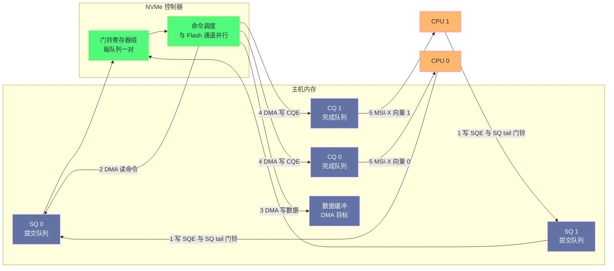
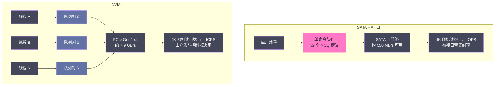
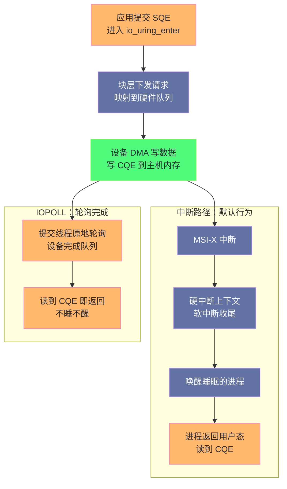
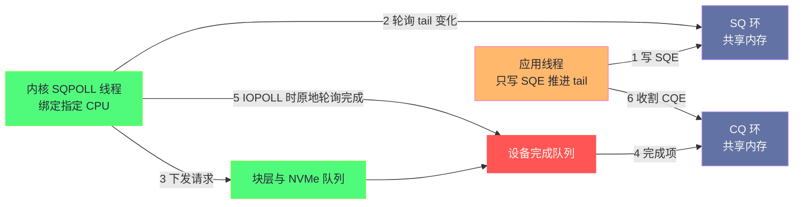

# 现代存储技术——NVMe、io_uring 与用户态存储

**摘要：**

存储硬件的换代从来不是一次带宽升级那么简单。SATA 把命令队列钉死在单队列 32 个槽位上，NAND 的多通道并行再强也只能从这一个口子里挤出来；NVMe 把队列拆成最多六万多个队列对，每一对可以绑定到不同的 CPU 核，门铃与完成中断各走各的路，"百万 IOPS"这才第一次有了硬件之外的物理基础。本篇要回答两个问题：硬件把并行能力交出来之后，软件要付出什么才接得住；以及接住之后，哪些场景其实并不值得。行文从 NVMe 的队列模型与门铃机制起笔，用一条 Little 定律把队列深度、端到端延迟与 IOPS 的算术摊开，说明 SATA 的天花板为何是结构性的而不是调参能救的；随后转入 io_uring 的块设备侧用法，辨析 `IORING_OP_READ`、`WRITE`、`FSYNC` 的语义与版本门槛，拆开 `IORING_SETUP_IOPOLL` 的轮询完成与 `IORING_SETUP_SQPOLL` 的内核线程提交各自省掉哪一段开销、又各自要求什么样的设备与队列前提；再把 io_uring 与传统 AIO、`O_DIRECT` 摆在同一张账上，说明它的真正优势不在"更快"，而在"能真正异步的操作更多"。接着下潜到 SPDK 这类用户态存储，算清绕过内核块层省下的每一微秒对应哪几项代价，并划出它适用的那几类系统。文末给出同步读写、AIO、io_uring、用户态四条路径的判据表与决策树，附 fio 与 liburing 的落地写法，以及两个"上了却没用"的反例。

---

## 第 1 章 队列：NVMe 换掉的第一样东西

### 1.1 两个百分之百

一台 32 核的数据库主机，后端是四块 SATA SSD 组成的 RAID，某个季度开始应用侧频繁抱怨提交延迟抖动。运维打开 `iostat -x`，四块盘的 `%util` 都贴着 100%，`aqu-sz` 在 20 上下，`await` 从两毫秒涨到八毫秒，而 CPU 与内存都还有余量。把同一套数据与同一份压测搬到一块 NVMe 盘上重跑，`%util` 依旧经常显示 100%，`await` 却回落到几百微秒，应用的尾延迟随之收敛。

两个"100% 利用率"的含义完全不同。`%util` 来自 `/sys/block/*/stat` 里的 `io_ticks`，统计的是"这一秒里设备有多少个 tick 有 IO 在飞"，只要有一个请求没完成，这一秒就算忙。SATA 上单队列只有 32 个槽位，忙等于排满，排队是真的；NVMe 上同一时刻可以有上千个请求在控制器内部的不同阶段流转，设备"从未空闲"与"已经饱和"是两件事。这个指标的失效条件、`await` 与 `aqu-sz` 在多队列设备上的正确读法，属于性能度量那条线索，[[05 块设备栈——从 bio 到 blk-mq 的 IO 路径]]与 [[08 存储栈性能调优——从 fio 到 iotop 的全套方法论]] 各有专文；本节只需要一个结论：判断饱和不能看利用率，只能看队列里到底压了多少活，以及每件活要花多久。

把这件事写成算术，只需要一条 Little 定律的变形：

- IOPS = 同时在飞的请求数 ÷ 单次请求的端到端延迟

代入 SATA 的现场：单队列最多 32 个请求在飞，4K 随机读的端到端延迟按 100 微秒计，`32 ÷ 100µs` 得到 32 万 IOPS 的理论上限。但 4K 乘 32 万等于 1.28 GB/s，远超 SATA III 的 6 Gb/s 链路，于是真正的天花板先被接口撞上：600 MB/s 的链路上跑 4K 随机读，`600MB/s ÷ 4KB` 约等于 14.6 万 IOPS 的绝对上界，再扣掉协议开销与实际控制器效率，落在一二十万之间，消费级盘通常只有几万。队列深度在这里不是瓶颈，链路带宽才是；即便把队列深度从 32 提到 128，IOPS 也不会动，因为路只有那么宽。

同样的算术搬到 NVMe 上，PCIe Gen3 x4 约 3.9 GB/s、Gen4 x4 约 7.9 GB/s、Gen5 x4 约 15.7 GB/s（均为理论编码带宽，实际可用值略低），4K 随机读的纯度上限分别是 97 万、197 万与 393 万 IOPS。于是百万 IOPS 的来源被解释清楚了：不是队列多这件事本身有多神奇，而是队列多让**在飞请求数**足以把 PCIe 链路吃满，剩下的才是控制器与 NAND 通道能不能跟上。SATA 的困局则在于链路与队列同时封顶，两个天花板叠在一起，任何软件优化都只能贴着第一个天花板走。

### 1.2 AHCI 的遗产：一个端口一条队列

要理解 NVMe 为什么长成这样，得先看它取代的东西。SATA 于 2003 年定稿，挂在它上面的 AHCI（Advanced Host Controller Interface）规范描述的是一个为机械盘设计的主机控制器：每个端口一套寄存器，一条命令队列，32 个槽位，命令通过内存里的 command list 与 command table 下发，必要时用 FIS 把寄存器内容搬过链路。机械盘的时代，32 个槽位足够把寻道与旋转的等待时间叠起来，队列再深也没有意义，因为磁头只有一个。

NAND 的物理结构和机械盘相反：一颗 SSD 内部有 8 到 16 个闪存通道，每个通道挂多片 die，片内还有多个 plane，天然可以并行；限制并行的不是"磁头只有一个"，而是控制器能不能同时把足够多的读写请求送到足够多的 die 上。AHCI 的单队列模型把这件事卡死了：所有并行诉求必须挤进 32 个槽位，再经过一条 6 Gb/s 的链路。这就像给一家有二十个收银台的超市只留一个入口，收银台再多也只能一个一个进人。

NVMe 1.0 规范 2011 年发布，主持制定的是当时 Intel、三星、美光、戴尔、Marvell 等厂商组成的工作组，出发点不是"给 SSD 做一个更快的 SATA"，而是"把队列这件事从端口的寄存器模型里解放出来"。规范后来的演进也沿着这个方向：2019 年的 1.4 版补齐了持久化事件日志等管理能力，2021 年的 NVMe 2.0 把一本规范拆成基础规范加若干命令集（NVM、ZNS、KV 各成一本），协议内核保持稳定，扩展通过命令集进行。

### 1.3 队列对：把一把锁拆成六万把

NVMe 的核心结构是**队列对**（Queue Pair）：一个提交队列（Submission Queue，SQ）配一个完成队列（Completion Queue，CQ）。规范允许的规模是提交队列与完成队列各最多 64K 个，每个队列最多 64K 个条目，队列号 0 固定留给管理队列，其余都是 IO 队列。这个上限在真实设备上远未用满，常见的企业级盘支持 32 到 128 个 IO 队列，每个队列深度 1024 左右，消费级盘可能只给 8 到 32 个队列。规范给的是天花板，实现按成本裁剪，判断一块盘到底能给多少，看的是 `Identify Controller` 返回的能力，而不是规范文本。

关键不在于数量本身，而在于"每个队列有自己的门铃"。队列对之间没有共享的锁，队列号与 CPU 核之间可以建立一一映射：CPU 0 上的线程只往队列 0 提交，CPU 1 只往队列 1 提交，内核与设备都不需要在提交路径上做跨核同步。传统的多队列设计里，共享队列意味着一把自旋锁加缓存行来回弹，核数一多，锁的代价会把并行度吃回去；队列对把锁直接拆掉，代价转移到了"队列数量有限，核数更多时仍要共享"这个现实约束上。

这种结构和网络侧的收包队列是同一个思路的两个投影：网卡的 RSS 把流按哈希分到多个接收队列，每个队列一个中断、一个核；NVMe 把 IO 按提交线程分到多个队列对，每个队列一对门铃、一个中断向量。两者的共同前提都是硬件先提供"多条互不干扰的通道"，软件才谈得上把工作摊开。

### 1.4 门铃与中断：一次提交的完整路径

NVMe 的命令短得出奇：一个提交项 64 字节，一个完成项 16 字节。一次 4K 随机读的提交，路径是这样的：应用（或内核驱动）在主机内存的 SQ 里填一个 64 字节的命令，写清 LBA、传输长度、数据要 DMA 到哪块内存、以及一个由软件分配的 command id；然后往控制器 BAR 空间里该队列对应的门铃寄存器写一个新的 tail 值，这一次 MMIO 写会变成 PCIe 上的一个 posted write，控制器收到后主动 DMA 读走 SQ 里的新条目；控制器把命令排进 Flash 通道，数据准备好后 DMA 写进主机内存，再往 CQ 里写一个 16 字节的完成项，其中带着状态码与被抄回来的 command id；最后控制器发一个 MSI-X 中断，通知某个核"这个完成队列有新东西"。

下图把这套关系画开，注意门铃是两个方向各一半：主机写 SQ tail 门铃告诉控制器"有新命令"，主机写 CQ head 门铃告诉控制器"这些完成项我收走了、空间可以复用"。



这张图里最值得盯住的是第 1 步与第 5 步。第 1 步里，门铃是一次 MMIO 写，单次成本在几百纳秒量级，如果每个命令都单独敲一次门铃，这笔钱会按 IO 数线性增长，所以硬件层面天然鼓励批量：一次门铃覆盖多个新条目，控制器按 tail 的推进量把它们一起取走。第 5 步里，MSI-X 中断最多 2048 个向量，理论上每个完成队列可以配一个向量，中断落在提交该 IO 的那个核上，避免了跨核唤醒。设备固件还普遍支持中断聚合，即攒几个完成项再打断一次，用延迟换中断开销；聚合参数藏在设备内部的设置里，`nvme` 工具链能调到的只是冰山一角。中断聚合与轮询的取舍，正是第 2 章 `IORING_SETUP_IOPOLL` 要接着讲的事。

除了队列，协议还规定了数据怎么描述。命令里带的不是一整串页地址，而是 PRP（Physical Region Page）指针或 SGL（Scatter Gather List）描述符：小传输直接给一个或两个 PRP，大传输给一个 PRP 列表，列表本身也要 DMA。单条命令能传多少字节由控制器的 `MDTS`（Maximum Data Transfer Size）决定，超过就得分命令，这也是大块 IO 在 NVMe 上反而要考虑拆分的由来。

### 1.5 队列绑定 CPU：blk-mq 落到硬件上的样子

硬件把队列交出来了，内核怎么用是另一半。块层的多队列化（blk-mq）为每个 CPU 建一个软件队列，再把它们映射到设备的硬件队列上，映射关系可以在 `/sys/block/nvme0n1/mq/` 下面看到：每个子目录对应一个硬件队列，里面的 `cpu_list` 写着这个队列服务于哪些核。NVMe 驱动在初始化时按在线 CPU 数申请 IO 队列，上限是设备 `Identify` 报告的能力，多于设备能力时多个核共享一个硬件队列，共享就会重新引入锁与缓存行争用。

这张绑定关系的收益有两层。第一层是提交侧：应用线程在哪个核上跑，就走那个核的软件队列与硬件队列，提交路径上没有跨核同步，队列的 tail 指针是核内私有的。第二层是完成侧：完成中断用一个与队列对应的 MSI-X 向量，落在同一个核上，唤醒这个核上等待的线程，缓存里还留着刚写过的缓冲区与文件描述符，不需要跨核搬状态。两层叠起来，才叫"每个核一条独立流水线"。

绑定也有它的代价，且在核数多的机器上会显形。队列数受设备能力限制，128 核的机器上若一块盘只给 64 个队列，硬绑之后就会出现两个核共享一条队列，这两个核之间的提交会互相干扰；退一步让块层做动态映射，又会多出映射表的维护成本。还有一类更隐蔽的错位：应用线程被调度器迁到别的核，提交与完成落在两个核上，绑定的收益当场作废，这也是为什么高性能场景里线程绑核往往与中断绑核要一起做。

### 1.6 单队列与多队列的并发模型

把 SATA 与 NVMe 的差别画成并发模型，比背规范条文更容易记住。SATA 一侧是一条通道上排 32 个槽位，槽位满了后来的请求就得等，链路的 600 MB/s 又把每个槽位的有效载荷压住；NVMe 一侧是 N 条通道各自排队，每条通道有自己的门铃与中断，链路带宽由 PCIe 提供。两条路线的上限因此不在一个维度上。



读这张图要防止一个误解：队列多不等于设备真的能同时处理这么多请求。设备内部的并行度由 Flash 通道数、die 数、FTL 的调度能力共同决定，队列只是"入口的宽度"。入口开得比内部通道宽，超出的请求会在控制器里排队，表现为高队列深度下延迟线性上涨而 IOPS 不再增长。判断饱和度时看到 `await` 从 100 微秒涨到 500 微秒而 IOPS 不动，就是入口宽于内部通道的典型信号。

按量级判断，企业级 SATA SSD 的 4K 随机读通常在 3 万到 10 万 IOPS 之间，企业级 NVMe 在 40 万到 100 万之间，PCIe Gen5 的高端型号还要更高；这条差距里既有接口带宽的成分，也有队列深度能不能把设备内部通道喂满的成分，两者缺一不可。

队列模型的差异还决定了一件事：软件要同时提交多少请求，才能把这个入口喂饱。队列深度给到 1024，应用却一次只发一个请求、等它完成再发下一个，硬件的并行度等于被软件白白锁死；反过来，应用能一次发几百个请求，硬件队列却只有 32 个槽位，多出来的请求会在块层排队。软硬两端的队列深度要匹配，这是后面几章反复出现的前提。

### 1.7 参数表：队列相关的旋钮与代价

NVMe 与块层暴露的队列相关旋钮不多，但每一个都有明确的双向代价，调之前最好先知道自己在拿什么换什么。

| 旋钮 | 作用 | 调大的代价 | 调小的代价 |
| :--- | :--- | :--- | :--- |
| `nvme.poll_queues` | 预留若干 IO 队列专供轮询使用，这些队列不注册中断 | 轮询队列挤占设备队列配额，留给中断队列的硬件队列变少，普通 IO 的并行度下降 | `IOPOLL` 的提交可能落到中断队列上，轮询与中断并存，延迟收益打折 |
| `nvme.io_queue_depth` | 每条 IO 队列的深度 | 深度超过设备内部并行度后只增加排队延迟与内存占用 | 深度不足时应用提交的请求在块层排队，尾延迟变差 |
| `/sys/block/nvme0n1/queue/nr_requests` | 块层每个硬件队列允许挂起的请求数，默认 128 | 单个硬件队列能容纳更多在飞请求，但每个请求都要占 tag 与内存 | 小于应用并发度时请求在块层等待，`io_uring` 的深度优势被吃掉 |
| `/sys/block/nvme0n1/queue/io_poll` | 该设备队列是否允许轮询完成 | 允许轮询但不轮询没有损失，轮询了则占用 CPU | 置 0 后 `IORING_SETUP_IOPOLL` 拿不到轮询路径，退回中断完成 |
| `/sys/block/nvme0n1/queue/scheduler` | 硬件队列上的调度器 | 选 `mq-deadline` 会增加每请求的调度开销，但对混合负载有排序收益 | 选 `none` 开销最低，但对读饥饿等场景没有保护 |
| `nvme_core.io_timeout` | 单条命令的超时秒数 | 调大能容忍慢盘与长尾，代价是故障暴露变晚 | 调小能快速失败，代价是偶发超时误杀与重试放大 |

表里的第一行是后面几章的关键伏笔：**轮询队列是硬件资源**，不是软件开关。把 `poll_queues` 设成 4，意味着这块盘从此少掉四个可为中断服务的硬件队列；设成 0 而应用强开 `IOPOLL`，往往只是"设置成功而行为未变"。规范、驱动与设备三者对轮询的支持程度，以对应内核版本的 `nvme` 模块文档与设备手册为准。

---

## 第 2 章 io_uring 的存储侧：四个操作与两种轮询

### 2.1 分界与一句话锚点

io_uring 的通用机制——SQ 环与 CQ 环如何经 `mmap` 与内核共享、`io_uring_enter` 如何一次提交一批并顺带收割、注册缓冲与注册文件表把什么成本钉成常量、SQPOLL 线程怎样替代陷入、容器默认 seccomp 又怎样把这三个系统调用直接拒掉——在 [[08 高性能网络编程——io_uring 网络、SO_REUSEPORT 与多队列 NIC]] 里已按 socket 侧完整拆过一遍，本篇不复述，只留一句锚点：应用把 SQE 写进共享内存并推进 tail，内核执行后把 CQE 写进完成环，热路径上唯一的通知点要么是 `io_uring_enter`，要么是轮询 SQ 的内核线程。

存储侧与网络侧的分岔出现在三个位置。其一是路径长度：一个 socket 请求的终点是网卡，一个块设备请求要穿过 page cache、文件系统、块层，才落到设备队列上，中间任何一层都可能让"异步"变形。其二是完成的位置：有些请求在 page cache 命中时就已经完成，根本没有碰到设备；有些要等设备 DMA 与中断；`IORING_SETUP_IOPOLL` 改变的正是后者的完成方式。其三是语义：读写之外还有"刷"这件事，`fsync` 把数据从易失的内存搬到持久介质，它的完成条件与一次 `read` 完全不同，而这恰恰是数据库与日志系统真正在意的边界。

一句话概括两篇的分工：网络侧讲 io_uring 怎样把 socket 的通知与搬运合并，存储侧讲 io_uring 怎样把设备队列的提交与完成接管过来，以及接管之后硬件前提与语义代价是什么。

### 2.2 四个操作：读、写、刷、等

存储负载真正用到的 SQE 操作并不多，把它们的语义与版本门槛列清楚，比背一张长长的 opcode 表有用。版本一列按内核主线计，具体发行版是否回移过补丁，以对应版本的内核文档为准。

| SQE 操作 | 对应系统调用 | 最低内核 | 存储侧要点 |
| :--- | :--- | :--- | :--- |
| `IORING_OP_READV` / `WRITEV` | `preadv` / `pwritev` | 5.1 | 支持多段缓冲，buffered 与 `O_DIRECT` 都走；段数过多会触发内核线性化 |
| `IORING_OP_READ` / `WRITE` | `pread` / `pwrite` | 5.6 | 单段缓冲，日常最常用；`O_DIRECT` 落在这一条上 |
| `IORING_OP_FSYNC` | `fsync` / `fdatasync` | 5.1 | 带 `IORING_FSYNC_DATASYNC` 标志即 `fdatasync` 语义，只等数据与必要的元数据 |
| `IORING_OP_POLL_ADD` | `poll` | 5.1 | 对块设备与普通文件基本恒就绪，存储侧价值有限，网络侧才是主场 |
| `IORING_OP_FADVISE` | `posix_fadvise` | 5.6 | 可以异步丢弃缓存或提示预读，适合批量导入前后调整缓存占用 |
| `IORING_OP_FALLOCATE` | `fallocate` | 5.6 | 预分配与 punch hole，放在环里才能与其他操作串成一条链 |
| `IORING_OP_OPENAT` / `CLOSE` / `STATX` | `openat` / `close` / `statx` | 5.6 | 元数据操作也异步，这是 AIO 给不了的覆盖面 |
| `IORING_OP_URING_CMD` | 无对应系统调用 | 5.19 | 直达驱动，NVMe pass-through 走这里，绕过块层但不绕过内核驱动 |

把读写几行与元数据那一行放在一起看，才能看出 io_uring 对存储的真正意义。数据库写一条预写日志的完整动作是打开文件、追加写入、`fsync`、必要时关闭，传统写法里这四步是四次系统调用，其中 `fsync` 还是同步阻塞的；在 io_uring 里它们可以是四个 SQE，用一个 `IOSQE_IO_LINK` 串起来，一次提交、四个 CQE 按序回来；下面的片段只保留写与刷两环，因为这两环恰好划出持久化的边界。链式提交的语义是"前一个成功完成后才启动下一个"，任何一环失败，后续环节以 `-ECANCELED` 收尾，这个语义正好对应"写失败就不要刷盘"的业务判断。

```c
/* WAL 追加写：write + fdatasync 串成一条链，一次提交 */
struct io_uring_sqe *sqe = io_uring_get_sqe(&ring);
io_uring_prep_write(sqe, wal_fd, buf, len, offset);
sqe->flags |= IOSQE_IO_LINK;          /* 写成功才轮到刷盘 */
io_uring_sqe_set_data64(sqe, 1);

sqe = io_uring_get_sqe(&ring);
/* IORING_FSYNC_DATASYNC：只等数据与定位所需的元数据，不等 mtime 与 atime */
io_uring_prep_fsync(sqe, wal_fd, IORING_FSYNC_DATASYNC);
io_uring_sqe_set_data64(sqe, 2);

io_uring_submit_and_wait(&ring, 2);   /* 一次进入，两个完成 */
```

这段代码里没有魔法，所有收益都来自"两个动作只进一次内核"与"刷盘期间 CPU 可以去干别的"。但要注意两点边界：`IOSQE_IO_LINK` 的串行只是完成顺序上的依赖，内核仍可能把写请求拆成多个 bio 并发下发，链只保证"刷盘 SQE 在写 CQE 之后才开始"；另外 `fsync` 的完成只代表该文件的数据与元数据落到了持久介质，文件系统日志、设备写缓存的行为还要看挂载参数与设备是否带掉电保护，这部分语义在 [[04 Page Cache 与脏页回写——Linux IO 的秘密缓冲层]] 里有逐条辨析。

`IORING_OP_POLL_ADD` 在存储侧的处境有些尴尬：普通文件与块设备在 epoll 语义下几乎永远是"就绪"的，没有"等它可读"这回事，真正需要等的是请求完成，而完成由 CQE 负责。把它列在这里是为了避免一种常见的误用：把网络代码里的 `POLL_ADD` 直接搬到文件描述符上，然后困惑于"为什么它立刻返回、还白白占一个 SQE"。

### 2.3 IOPOLL：把完成中断换成主动轮询

`IORING_SETUP_IOPOLL` 是存储侧独有的开关，也是被误解最多的一个。它的效果是：提交请求之后，内核不再等设备发中断，而是在提交线程的上下文里直接轮询设备的完成队列，直到拿到完成项才返回。硬件那条 MSI-X 中断、中断上半部、软中断、唤醒进程的整条链路，被一段 `while` 循环代替了。

要理解它省了什么，得先把中断路径的成本摊开。设备 DMA 写入完成项之后，中断控制器把 MSI-X 消息投给某个 CPU，CPU 在中断上下文里执行驱动注册的处理函数，通常只做最小工作就标记软中断；软中断随后把完成项收进块层，唤醒在 `io_uring_enter` 里睡眠的进程；进程被调度上 CPU，从内核返回用户态，读到 CQE。这条链路的固定开销在几微秒量级，具体取决于 CPU 频率、内核配置与中断是否被正确绑核，量级判断是两到五微秒。轮询路径把这些全部省掉，代价是这段时间里那个核什么也干不了。

下图把两条完成路径并排画出，左边是中断通知，右边是轮询收割，两者的差别只在"完成事件由谁发现"。



这条路径要真正生效，**三个前提**缺一不可。

> [!warning] IOPOLL 的三个前提
> 1. 设备与块队列支持轮询：`nvme.poll_queues` 非零，且 `/sys/block/*/queue/io_poll` 为 1
> 2. 文件以 `O_DIRECT` 打开：请求必须真的落到设备队列，缓存命中的请求没有可轮询的完成
> 3. 队列深度足够：省下的每 IO 中断时间乘以在飞请求数，要能抵掉轮询线程的空转

第一个前提是设备与队列支持轮询。块层用 `QUEUE_FLAG_POLL` 标记支持轮询的设备，NVMe 驱动会把一部分硬件队列做成轮询专用的队列，不注册中断向量，数量由 `nvme.poll_queues` 模块参数决定。`poll_queues` 为 0 时，`IOPOLL` 的提交会落到普通队列上，理论上驱动仍可能去轮询完成队列，但中断并没有被真正排除，收益与开销都变得模糊；更常见的情况是在 `loop`、`virtio-blk` 这类不支持轮询的块设备上强开，结果是设置成功、行为退回中断，性能数字纹丝不动。核对方式是看 `/sys/block/nvme0n1/queue/io_poll` 是否为 1，以及 `poll_queues` 是否为非零，两个都满足才算站得住。

第二个前提是文件必须以 `O_DIRECT` 打开。原因是 buffered 请求的完成点在 page cache：命中时数据在内存里就已经返回，根本不进入块层；未命中时请求被交给 `io-wq` 工作线程去发起，轮询即便发生也发生在工作线程里，与提交线程无关。`IOPOLL` 的语义是"我提交，我轮询，我拿走"，请求中途换了执行者，这个语义就断了。所以 `IOPOLL` 与 buffered IO 的组合不是"效果差"，而是"不成立"。

第三个前提是队列深度要撑得起这笔账。把收益写成公式：轮询省下的是每次 IO 几微秒的中断与唤醒成本，付出的是一个核在这段延迟里空转。以 4K 随机读、端到端延迟 100 微秒、队列深度 1 为例，省下 3 微秒只占 3%，同时一个核的利用率被拉满，净亏损；换成队列深度 64、每核每秒提交 60 万次 IO，省下的 3 微秒乘以 60 万等于 1.8 秒 CPU 时间，刚好抵掉轮询线程本身的占用，开始有净收益。队列深度不上来，轮询就只是把中断的开销换成了空转的开销。

同样重要的是轮询线程数与轮询队列数的匹配。块层的轮询请求会落到轮询硬件队列上，一条轮询队列同时只适合一个线程使用；`poll_queues` 设为 4 而轮询线程有 8 个，多出来的线程会与别人争抢同一条队列，延迟抖动比中断模式更糟。经验做法是 `poll_queues` 等于轮询线程数，并把线程与核、队列一起绑死，这一套与第 1 章讲的中断绑核是同一个思路。

### 2.4 SQPOLL：把提交侧的系统调用也省掉

`IORING_SETUP_SQPOLL` 解决的是另一半成本。默认模式下，即便批量提交，每批也要一次 `io_uring_enter`；SQPOLL 让内核起一个线程专门盯着 SQ 环，应用把 SQE 写好、推进 tail 就算提交完成，连那一次陷入也省了。配置项里 `sq_thread_idle` 指定轮询线程空闲多久后休眠，`IORING_SETUP_SQ_AFF` 配合 `sq_thread_cpu` 把它钉在指定核上，避免与业务线程抢同一个核。

存储侧关心的是它与 IOPOLL 的组合关系，这是**两个正交的开关**：SQPOLL 作用在提交侧，省的是陷入；IOPOLL 作用在完成侧，省的是中断。两个都打开，热路径上既没有系统调用也没有中断，只剩下内存写与轮询——这与第 4 章用户态存储的形态已经很接近，区别在于块层、文件系统、page cache 仍然留在路径上，安全边界与资源管理仍然由内核负责。

不过这个组合有一处容易忽略的细节：IOPOLL 的轮询发生在"发起请求的上下文"里。开了 SQPOLL，发起请求的是内核线程，于是提交与完成两件事同时压在这一个线程上，它成了整条流水线的唯一引擎；应用侧只需要轮询 CQ 环取结果。一个核跑满、零陷入、零中断，这就是这条路的极限形态，也解释了它为什么只适合"IO 密度稳定且能吃满一个核"的服务。流量稀疏的服务开 SQPOLL，内核线程大部分时间在睡与醒之间切换，省下的陷入被唤醒开销抵掉，还不如不开。下面这张图把这条全轮询流水线画开，提交侧由内核线程推进，完成侧若再叠上 IOPOLL，两件事就压在同一处。



权限与安全策略是一道绕不过去的门槛。较早日期的内核要求使用 SQPOLL 的进程具备 `CAP_SYS_ADMIN`，后续版本有所调整，发行版之间也不一致；容器运行时那边，Docker 自 2023 年底的默认 seccomp 配置起直接屏蔽 `io_uring_setup`、`enter`、`register` 三个系统调用，Kubernetes 沿用运行时默认配置时同样如此，应用会拿到 `EPERM` 而不是性能。这套门槛的来龙去脉与规避方式，[[08 高性能网络编程——io_uring 网络、SO_REUSEPORT 与多队列 NIC]] 里有逐项讨论，这里只提醒一句：在被默认策略收紧的环境里，SQPOLL 与 IOPOLL 的组合往往连第一步都过不去。

### 2.5 两个"上了却没用"

第一个场景是队列深度只有 1 的同步语义。代码形态是每次循环里 `get_sqe`、`prep_read`、`submit_and_wait(1)`、收割，一次只有一个请求在飞，这与直接调用 `pread` 的区别仅仅是"多绕了一层环"。算术上，一次 `pread` 的软件路径（系统调用进入、fd 查找、页缓存查找、返回）在几微秒量级，NVMe 的 4K 随机读端到端延迟在几十到一百微秒量级，把系统调用换成"共享内存 + 一次 enter"省下的绝对值只有一到两微秒，占比百分之几；如果数据在 page cache 里命中，介质延迟消失，剩下的是纯内存拷贝，此时省下的系统调用占比会上升，但绝对收益仍然只有一到两微秒，除非应用每秒要做上百万次这样的操作，否则根本测不出来。io_uring 的收益从来来自"在飞请求数 × 每次省下的固定成本"，队列深度为 1 意味着**乘数是 1**，后面的账都无从谈起。

第二个场景是 buffered IO 配 `IOPOLL`。前面已经说过它不成立，这里补上现场表现：`io_uring_setup` 成功、`IORING_SETUP_IOPOLL` 没报错、压测数字与不带 IOPOLL 时完全一致，有的版本还会因为轮询线程空转而让 CPU 升高。判断方法很简单：用 `fio` 做对照测试时看 `--direct=1` 是否真的打开，看压测期间 `mpstat` 的 `%sys` 与 `%usr` 分布，看 `/proc/interrupts` 里该设备的 MSI-X 中断计数是否还在增长——如果中断照常增长，说明轮询根本没接管完成路径，IOPOLL 只是一行没生效的参数。

还有一类隐蔽的失效：把 `IOPOLL` 开在支持轮询但 `poll_queues` 为 0 的设备上，或者开在 `poll_queues` 数量少于并发线程数的配置上。前者轮询与中断并存，省下的时间被中断开销吃掉一半；后者多个线程抢一条轮询队列，尾延迟反而比中断模式更差。这两种情况都不会报错，只会让"我们上了 IOPOLL"这句结论失去意义。

---

## 第 3 章 与 AIO、O_DIRECT 的关系：三条提交路径

### 3.1 AIO：被误传的"每 IO 两次系统调用"

Linux 原生 AIO（Asynchronous I/O）是 2.5 时代引入的接口，设计者是 Ben LaHaise，目标读者从一开始就是数据库这类"手里有一批已知偏移的读写、希望一次交给内核"的负载。接口只有三个：`io_setup` 建立上下文并指定事件容量，`io_submit` 提交一批 `iocb`，`io_getevents` 收割完成事件，配合 `eventfd` 做通知。

一个流传很广的说法是"AIO 每个 IO 要两次系统调用，所以慢"，这个说法经不起推敲：`io_submit` 一次可以带多个 `iocb`，本来就有批量能力。AIO 真正撞上的墙是另外几堵。第一堵是 `O_DIRECT` 绑定：只有以 `O_DIRECT` 打开的请求才会被真正异步提交，buffered 请求在提交线程里同步走一遍，甚至直接阻塞，这让 AIO 对绝大多数通用应用等于不可用。第二堵是操作集合窄：核心只有 pread 与 pwrite，`fsync`、`fdsync` 是较晚的版本才补进这个接口的，`openat`、`statx`、`close` 从来没有；一个完整的"打开、写、刷、关闭"流程，无法只用 AIO 表达。第三堵是缺少把固定成本钉成常量的手段：没有注册缓冲，每次提交都要让内核 pin 页；没有注册文件表，每次操作都要查 fd；每个 `iocb` 都要应用自己构造与回收，完成队列的容量还在 `io_setup` 时就固定死了。第四堵是可观测性与生态：`io_getevents` 的等待、`eventfd` 的注册、错误码的回收，全要应用自己拼，拼错了就是丢完成或空转。

把这几堵墙与 io_uring 的能力并排放，差别一目了然：

| 能力 | Linux AIO | io_uring |
| :--- | :--- | :--- |
| 批量提交 | 支持，一次 `io_submit` 多个 `iocb` | 支持，一次 `enter` 多个 SQE |
| buffered IO | 不真正异步，提交线程内同步执行 | 交给 `io-wq` 工作线程，异步成立 |
| 操作覆盖 | 以读写为主，`fsync` 较晚才补入 | 读写、刷、打开、关闭、`statx`、`fallocate`、`splice` 等 |
| 提交侧系统调用 | 每批一次 | 每批一次，SQPOLL 下为零 |
| 完成侧系统调用 | 每批至少一次 `io_getevents` | 读共享内存即可，必要时才 `enter` |
| 注册缓冲与文件 | 无 | `io_uring_register` 支持 |
| 队列容量 | `io_setup` 时固定 | 可调，CQ 满时有溢出链表兜底 |
| 单个环服务多种对象 | 仅文件 | 文件、块设备、socket 统一 |

这张表最容易被读成"io_uring 全面碾压"，但把第一行与第三行对照着看，结论要克制一些：在纯 `O_DIRECT`、高队列深度的读写压测里，两者的差距体现为**软件开销的百分比**，不是数量级；io_uring 真正拉开距离的地方，是 buffered IO、元数据操作的异步化、以及"把整条业务链放进一个环"的表达能力。

### 3.2 buffered IO 在 io_uring 上的三类完成点

buffered 读写是 io_uring 相对 AIO 最大的能力扩展，也是理解它收益边界的钥匙。同一个 `IORING_OP_READ`，完成点可能落在**三个完全不同的位置**。

命中 page cache 时，请求在内核里只是一次内存拷贝，`read_iter` 直接返回，CQE 几乎立刻可用。这种情况下异步与同步的差别只剩系统调用本身，省下的是几百纳秒到一两微秒，收益可以用"每秒操作次数乘以固定成本"精确算出来，量不大但确定。

未命中时，内核把请求交给 `io-wq` 工作线程，由它在自己的上下文里发起块层读并等待完成。此时"异步"的含义是"提交线程不被阻塞"，代价是工作线程的数量与调度成为新的瓶颈：`io-wq` 的线程池有上限，池子打满之后新请求会排队，表现为提交很快但完成很慢。这条路径的延迟比 `O_DIRECT` 直发多了一次线程切换，吞吐上限也不由设备决定，而由工作线程池与内存拷贝共同决定。

写请求的完成点又在别处。buffered 写把数据拷进 page cache 就返回完成，真正的落盘由内核的回写线程在稍后发起，应用拿到的 CQE 只代表"数据进了内存"。对于不要求持久化的场景这是最划算的语义，对于要求持久化的场景它什么也没保证，必须再补一个 `IORING_OP_FSYNC`，而那个 `fsync` 的完成语义、脏页水位与掉电窗口，是另一条完整的问题线，[[04 Page Cache 与脏页回写——Linux IO 的秘密缓冲层]] 里逐项拆过，这里只强调一句：buffered 写的"写完成"与"持久化完成"之间隔着一次显式的刷盘，io_uring 不会替你补上。

这三类完成点解释了一个常被忽略的现象：对象存储网关、日志采集器、静态文件服务器这类应用换成 io_uring 之后提升明显，因为它们的负载里缓存命中与元数据操作占比高，异步语义能覆盖到全流程；而数据库换成 io_uring 之后提升有限，因为数据库自己管理缓存，走 `O_DIRECT`，剩下的读写路径上省下的只是一点系统调用开销。

### 3.3 O_DIRECT：绕过缓存但不绕过队列

`O_DIRECT` 的语义是让读写绕过 page cache，直接在用户缓冲与设备之间搬数据。它有两条硬性要求：偏移与长度按逻辑块大小对齐（通常是 512 字节或 4K），缓冲区地址按内存页对齐；不满足就返回 `EINVAL`，而且不同文件系统的对齐粒度与报错时机还有差异，这是 `O_DIRECT` 应用最常见的翻车点。

**绕过 page cache 不等于绕过块层**。请求仍然要经过文件系统的 direct IO 路径（ext4 与 XFS 现在都走 iomap 框架）、通用块层的 bio 合并与 tag 分配、blk-mq 的硬件队列映射，最后才到设备队列。正因为这一层没被绕过，`IOPOLL` 才有意义：轮询的对象是设备完成队列，而请求确实经过了设备队列。反过来，如果哪天有人把用户态驱动接上，`IOPOLL` 这个概念就一起消失了——那里根本没有内核可通知。

`O_DIRECT` 的代价要算清楚。小 IO 失去了缓存的合并与预读，每个 4K 读都要真正落到介质上，随机读的 IOPS 因此更依赖设备而非内存；写路径上没有 writeback 的缓冲，延迟直接暴露设备行为；应用要自己做缓存、自己保证对齐、自己处理短读与部分写。数据库愿意付这些代价，是因为它自己的缓冲池比内核的 page cache 更懂访问模式，两套缓存叠加反而互相污染。通用业务不愿意付，因为内核的缓存加回写已经把绝大多数场景照顾得足够好。

| 维度 | buffered IO | O_DIRECT |
| :--- | :--- | :--- |
| 完成点 | page cache 命中即完成，未命中交给 `io-wq` | 设备完成队列 |
| `IOPOLL` 是否成立 | 不成立 | 成立，前提是设备支持轮询 |
| 数据拷贝次数 | 用户缓冲与 page cache 之间一次 | 用户缓冲与设备 DMA 直接对接 |
| 延迟可预测性 | 受回写与缓存回收影响，抖动大 | 直接反映设备行为 |
| 应用负担 | 对齐、刷盘时机由内核兜底 | 对齐、缓存、持久化边界都要自理 |

### 3.4 io_uring 不是加速器

把前面几节收拢成一句话：io_uring 的收益等于"省下的每次固定成本"乘以"能同时在飞的请求数"，再减去"新增的请求生命周期管理成本"。四个因子任何一个接近零，整体收益就接近零。

低队列深度让它接近零，因为乘数是 1；单线程同步语义让它接近零，因为根本没有并发可摊；buffered 缓存高命中让它接近零，因为介质延迟不在路径上，剩下的只有系统调用；容器默认安全策略让它直接为负，因为 `EPERM` 会把功能整个关掉。只有"高并发、`O_DIRECT`、批量提交、设备支持轮询"这四个条件同时成立，`IOPOLL` 与 `SQPOLL` 才谈得上收益，而这四个条件恰好也是用户态存储的入场券——两条路线的分岔，就出现在"愿不愿意再往下走一层"这个问题上。

---

## 第 4 章 用户态存储：把整条路搬出内核

### 4.1 内核路径上剩下的固定成本

即便把 io_uring 的批量提交、注册缓冲、固定文件表、`IOPOLL` 全部打开，一次 `O_DIRECT` 读仍然要走完这样一条链：进入内核、解析 SQE、在文件系统里把逻辑偏移翻译成物理块、构造 bio、在块层分配 tag 并映射到某个硬件队列、由 NVMe 驱动拼出 64 字节命令、敲一次门铃、等设备 DMA 与完成、把 CQE 回填到完成环、应用收割。到了 SQPOLL 与 IOPOLL 那一档，进入内核与中断这两段被省掉，中间的映射、构造、tag 分配、门铃仍然一层不少。

这些层每一层都在为一个通用目标付钱：VFS 要同时支持几十种文件系统，块层要同时支持机械盘、SSD、NVMe、网络块设备与各种调度策略，驱动要处理错误恢复、超时、热插拔与电源管理。对一个只读自己那块盘的存储引擎来说，这些通用能力一分钱也用不上，却要按 IO 数付账。量级判断是：内核路径上每 IO 的软件开销在两到四微秒之间，压在 100 微秒的介质延迟上只占几个百分点，可一旦 IOPS 上到百万级，这几微秒就变成两三个常驻的核。

用户态存储的思路就是把这笔**通用性开销**整个退掉：设备直接归进程管，命令自己拼，门铃自己敲，完成自己轮询，中间没有 VFS、没有块层、没有调度器。它并不是"更快的驱动"，而是"把内核那一层从路径上删掉"，代价也随之而来——删掉的那些层原本还在替你做事。

一个贴切的比方是，内核路径像所有车辆都必须经过的市政道路，红绿灯、限速、路政检查都是为"所有人共用"付的钱；用户态存储像企业自建的专用跑道，跑起来没有干扰，但跑道只跑自己的车，也没有交警、没有救援、出了事自己拖车。这个比方要立刻补上一句限定：专用跑道并不比市政道路"先进"，它只是在特定车流下更划算，而一旦需要共享、需要隔离、需要别人也能上路，它立刻变成一个负担。

### 4.2 vfio 与 uio：把设备从内核手里接过来

内核与用户态之间要交接一块 PCIe 设备，靠的是两块拼图。一块是 UIO（Userspace I/O）或 VFIO（Virtual Function I/O）框架：前者把设备的 BAR 空间映射到进程地址空间，简单但没有 DMA 隔离；后者借 IOMMU 把设备的 DMA 访问限制在进程注册的地址范围内，安全得多，也是 SPDK 现在默认推荐的路径。另一块是设备驱动的解绑：把 NVMe 设备从内核 `nvme` 驱动上解绑、绑定到 `vfio-pci`，此后 `/dev/nvme0n1` 消失，内核块层完全看不到这块盘。

交接完成之后，用户态程序要自己做内核驱动原本做的所有事：映射 BAR、按控制器寄存器布局初始化、建管理队列、发 `Identify` 命令拿到设备能力、创建若干 IO 队列对、分配并初始化 SQ 与 CQ 的环形缓冲、把缓冲的物理地址告诉设备、然后在提交路径上填 64 字节命令并敲门铃。数据传输用的缓冲区必须是大页（hugepage）并且提前锁定，不能让操作系统把它换出——DMA 用的是物理地址，页一换，数据就写到别处去了。

多核扩展的做法与内核里的 blk-mq 思路相通，但更彻底：每个核一个线程、一套队列、一个轮询循环，对象与内存都归属线程，线程之间只通过无锁环传消息，全程不拿锁、不做跨核唤醒。线程绑核因此从"优化"变成"必需"，一旦线程被调度器搬走，正在轮询的那条队列就没人管了。

### 4.3 SPDK 的分层与回调模型

SPDK（Storage Performance Development Kit）是这套思路最完整的开源实现，最早由 Intel 发起，现在由社区维护。它把自己切成几层：最底下是用户态驱动（NVMe、virtio 等），中间是块设备抽象层 bdev，再往上是 blobstore——一个自带分配器与元数据管理的日志结构存储，以及建立在它之上的 blobfs；最上面是各类应用形态，NVMe-oF target、vhost、iSCSI target 都长在这一层。

SPDK 的网络侧建立在 DPDK 之上，用户态收发包与环境抽象（大页、绑核、无锁环）用的是同一套做法，存储侧的 NVMe 直通与网络侧的用户态驱动并列；理解了 DPDK 为什么要把网卡从内核手里拿走，也就理解了 SPDK 为什么要把盘从内核手里拿走。

它的编程模型是回调式：提交一个读请求时同时注册一个完成回调，函数立刻返回；轮询循环在设备完成队列里拿到完成项后，按上下文找到回调并执行。这个模型与 io_uring 的 CQE 收割在思想上同源，区别在于 SQE 的构造、队列的管理、完成的匹配全在同一个进程里，没有任何系统调用边界。

```c
/* SPDK 风格：提交读并注册回调，函数立即返回 */
spdk_nvme_ns_cmd_read(ns, qpair, buf, offset_blocks, nblocks,
                      read_done, ctx);
/* 轮询循环里发生的事：检查该 qpair 的完成队列，找到匹配项后调用 read_done */

static void read_done(void *ctx, const struct spdk_nvme_cpl *cpl)
{
    /* cpl->status 非零表示失败，语义与 NVMe 规范一致，没有 errno */
    if (spdk_nvme_cpl_is_error(cpl))
        handle_error(ctx);
}
```

这段代码最值得留意的是错误模型：完成状态直接来自 NVMe 规范的状态字段，而不是 `errno`。用户态存储把语义一直保留到硬件原语这一层，好处是没有翻译损耗、行为可预期，坏处是应用要懂协议——这既是它性能的来源，也是它难以被通用业务接受的原因。

队列模型在 NVMe-oF 上被完整保留下来：远端块设备的访问仍然是一组队列对，只是队列对的两端从 PCIe 变成了 RDMA 或 TCP 连接，门铃被替换成网络消息。SPDK 的 target 实现把本地 NVMe 的队列语义原样转发给远端，这才让"远端存储的延迟接近本地"有了结构上的依据，而不是靠缓存糊出来的假象。

### 4.4 代价：四项无法回避的账

第一项是**设备独占**。一块盘绑到用户态之后内核看不见它，既不能挂载文件系统，也不能被别的进程共享；要跑多个应用，就得给每个应用分盘，或者在同一进程里用 blobstore 切分。这在分布式存储里不构成问题——一个 OSD 本来就该独占一小组盘，自己做副本与纠删码——但在通用服务器上意味着盘位规划与容量利用率的双重损失。

第二项是内存。用户态存储要求提前预留大页并锁定，这部分内存不参与换页、不受常规的内存回收策略调节；容器里还要额外开权限与 hugepage 配额。内存估算错了，要么启动失败，要么把机器的内存预算吃穿。

第三项是可靠性。用户态代码崩溃就是进程崩溃，没有内核的保护与错误恢复；设备热插拔、链路错误、超时重试这些内核驱动里写了很多年的逻辑，用户态实现要自己补。更要紧的是持久化语义：`FLUSH`、`FUA` 什么时候发、写缓存什么时候算安全、掉电后元数据如何恢复，全要应用自己设计与验证。文件系统无偿提供的一致性保证，在这里变成了应用的核心工作量。

第四项是运维。设备在内核视图里消失，`iostat`、`nvme-cli`、`/proc/diskstats` 都看不到它，监控、告警、容量采集要自建；升级要停进程；出了问题没有 `dmesg` 可看，只有自家日志。这一项在 PoC 阶段最容易被忽略，在生产阶段最先咬人。

| 维度 | 适合用户态存储 | 不适合用户态存储 |
| :--- | :--- | :--- |
| 数据组织 | 自管副本与纠删码的分布式存储、自研存储引擎 | 依赖文件系统语义（目录、权限、快照、配额）的业务 |
| 设备归属 | 可以整盘独占，盘位与 NUMA 可规划 | 一块盘要被多个进程或容器共享 |
| 延迟目标 | 追求每核 IOPS 与尾延迟，愿意为此投入研发 | 延迟要求普通，系统复杂度预算有限 |
| 运维能力 | 有存储团队，能自建监控与故障处理 | 只有通用运维，依赖标准工具链 |
| 典型系统 | 分布式存储 OSD、NVMe-oF target、自研数据库引擎 | Web 服务、Kubernetes 有状态工作负载、备份与归档 |

### 4.5 适用面：谁真的需要它

分布式存储的 OSD 是最典型的一类。OSD 的职责是把一块本地盘变成可复制的存储单元，它自己管理副本、校验、恢复，本来就不需要内核文件系统；把内核块层换成用户态驱动，省下的每核 IOPS 直接换算成每 TB 的成本。Ceph 社区围绕 BlueStore 做过接入 SPDK 的尝试，思路正是让 OSD 直接管裸盘。

NVMe-oF target 是第二类。它的工作是把本地 NVMe 通过 RDMA 或 TCP 暴露给远端主机，本质是一台"存储协议转换器"，每一微秒的转发延迟都会叠加到远端应用的读延迟上，用户态实现几乎是这类产品的标配。

自研存储引擎与数据库是第三类，判据也最苛刻：只有当应用已经用 `O_DIRECT` 把内核路径跑到单核饱和、且确实能独占设备、且有团队能承担可靠性验证时，往下走这一层才划算。多数团队在这一步之前就该停下——把 io_uring 的批量提交与固定缓冲用对，通常已经能拿到内核路径能给的绝大部分收益，剩下那一小段是给"每 IOPS 成本"敏感的规模化系统准备的。

---

## 第 5 章 量化与判据：四条路径怎么选

### 5.1 四条路径的账

把同步读写、`O_DIRECT` 配 AIO、io_uring、用户态存储放在同一张表里，先看它们的软件开销与可承载的并发量。表里的数字是量级判断与示例推算，具体数值随 CPU 微架构、内核版本、设备型号浮动，不要当成基准测试结论引用。

| 路径 | 提交方式 | 完成方式 | 每 IO 软件开销 | 单核可承载 IOPS | 生效前提 |
| :--- | :--- | :--- | :--- | :--- | :--- |
| 同步 `read` / `write` | 每 IO 一次系统调用 | 系统调用返回即完成 | 两到四微秒 | 受 QD 限制，单线程约一万到两万 | 无，任何环境可用 |
| `O_DIRECT` + AIO | 批量 `io_submit` | `io_getevents` 收割，或 eventfd 通知 | 一到三微秒 | 数十万，取决于线程数 | `O_DIRECT` 打开、按批收割 |
| io_uring（默认） | 批量 `enter`，或 SQPOLL 零陷入 | 读 CQ 环 | 一到两微秒 | 十万到三十万，缓存命中时更高 | 内核 5.6 以上、安全策略放行 |
| io_uring + IOPOLL | 批量 `enter`，提交线程原地轮询 | 轮询设备完成队列 | 亚微秒到一微秒 | 三十万到六十万 | 设备支持轮询、`poll_queues` 非零、`O_DIRECT`、深度足够 |
| 用户态存储 | 函数调用 | 轮询完成队列 | 亚微秒 | 三十万到六十万以上，随设备数扩展 | 设备独占、大页、绑核、自建可靠性 |

这张表有一处容易被误读：单核 IOPS 那一列并不是"换了框架就能达到"，它是在设备本身能提供足够 IOPS、且队列深度足以喂满的前提下，单核**软件路径的能力上限**。设备只有十万 IOPS，四条路径的单核数字都会停在十万附近，差别只体现在 CPU 占用与尾延迟上——这恰恰是选型时最该看的两个指标。

### 5.2 判据表：什么时候值得上

选型的问题从来不是"哪个快"，而是"**瓶颈在哪一层**、绕开它的代价我付不付得起"。下面这张表按判据组织，而不是按技术组织。

| 判据 | 同步读写 | `O_DIRECT` + AIO | io_uring | 用户态存储 |
| :--- | :--- | :--- | :--- | :--- |
| 解决的核心问题 | 无，基准形态 | 让批量读写不阻塞线程 | 让批量提交与完成都不需要系统调用，并覆盖 buffered 与元数据 | 把内核路径整段删掉 |
| 收益来源 | — | 线程不被 IO 阻塞 | 每批一次陷入、完成侧零调用、注册缓冲省 pin 页 | 每 IO 软件开销降到亚微秒 |
| CPU 代价 | 每 IO 一次陷入，进程可能阻塞 | 线程切换与事件收割 | 默认模式很低；SQPOLL 与 IOPOLL 各吃一个核 | 每核一个轮询线程，100% 占用 |
| 工程复杂度 | 最低 | 中，需处理事件循环与 `O_DIRECT` 对齐 | 中高，需管理请求生命周期、注册缓冲、版本能力位 | 最高，需自建驱动、元数据、可靠性、监控 |
| 什么时候值得上 | 并发低、延迟不敏感 | 已有批量读写、想最小改动拿到异步 | 高并发、批量、`O_DIRECT` 或 buffered 混合负载 | 每核 IOPS 成为成本瓶颈，且能独占设备 |
| 什么时候不值得 | 高并发下线程与系统调用成为瓶颈 | buffered 负载、需要元数据异步 | 队列深度为 1、缓存高命中、容器默认策略 | 需要文件系统语义、共享盘、标准运维 |

把这张表读成决策顺序会更实用：先确认瓶颈真的是 IO，再确认队列深度能不能上去，然后确认数据路径是 `O_DIRECT` 还是 buffered，最后才在 io_uring 与用户态之间选。次序颠倒的典型后果是——系统瓶颈在锁或业务逻辑上，却先把 io_uring 接进来，压测数字不变，团队却多了一层异步代码要维护。

### 5.3 决策树

把前面各章的前提串成一棵树，入口不是"我想上什么"，而是"我先该确认什么"。

```mermaid
%%{init: {'theme': 'dracula'}}%%
flowchart TB
    S{"IO 是当前瓶颈吗"} -->|"不是"| S0["先优化别的层<br/>别引入异步复杂度"]:::plain
    S -->|"是"| Q1{"并发能到 32 以上吗"}:::q
    Q1 -->|"不能"| Q1A["保持同步读写<br/>最多换 O_DIRECT"]:::plain
    Q1 -->|"能"| Q2{"数据路径是 O_DIRECT 吗"}:::q
    Q2 -->|"否，buffered 为主"| Q2A["io_uring 默认模式<br/>不要开 IOPOLL"]:::plain
    Q2 -->|"是"| Q3{"设备支持轮询且 poll_queues 非零吗"}:::q
    Q3 -->|"否"| Q3A["io_uring + 默认完成<br/>先解决设备前提"]:::plain
    Q3 -->|"是"| Q4{"内核与容器策略放行吗"}:::q
    Q4 -->|"否"| Q4A["改用 O_DIRECT + AIO<br/>或争取安全策略"]:::plain
    Q4 -->|"是"| Q5{"单核软件开销仍是瓶颈吗"}:::q
    Q5 -->|"否"| Q5A["io_uring + IOPOLL<br/>绑定轮询线程与队列"]:::plain
    Q5 -->|"是"| Q6{"能独占设备并自建可靠性吗"}:::q
    Q6 -->|"否"| Q6A["停在 io_uring<br/>收益已接近上限"]:::plain
    Q6 -->|"是"| Q6B["用户态存储<br/>SPDK 路线"]:::plain
    classDef plain fill:#44475a,stroke:#bd93f9,color:#f8f8f2
    classDef q fill:#ff79c6,stroke:#ff79c6,color:#282a36
    style S fill:#44475a,stroke:#ff79c6
```



树上的每一个分叉都对应一条前面论证过的前提：队列深度决定收益乘数，`O_DIRECT` 决定 `IOPOLL` 是否成立，`poll_queues` 决定轮询有没有硬件落脚点，安全策略决定这条路通不通，最后的分叉则决定"要不要为了最后那点软件开销付出一整套自研成本"。多数业务的答案是停在第三或第四个分叉上，这不是妥协，而是收益曲线已经变平。

### 5.4 fio 与 liburing 的落地写法

测 io_uring 最常见的错误是把参数开成"看起来最激进"的样子，然后测出一组互相矛盾的数字。fio 的参数组合、对照实验设计与结果解读，[[08 存储栈性能调优——从 fio 到 iotop 的全套方法论]] 里有完整方法论，本节只挑 io_uring 独有的那几个开关讲。一组能说明问题的对照，至少要覆盖默认模式与 `IOPOLL` 模式两组，且两组都锁定 `O_DIRECT`、块大小、队列深度与作业数。

```bash
# 默认模式：批量提交，完成走中断
fio --name=uring-rr --filename=/dev/nvme0n1 --ioengine=io_uring \
    --direct=1 --rw=randread --bs=4k --iodepth=64 --numjobs=8 \
    --runtime=30 --time_based --group_reporting

# 轮询模式：完成走轮询，需要 hipri 与 direct 同时成立
fio --name=uring-rr-poll --filename=/dev/nvme0n1 --ioengine=io_uring \
    --direct=1 --hipri=1 --rw=randread --bs=4k --iodepth=64 --numjobs=8 \
    --runtime=30 --time_based --group_reporting

# 提交侧也零陷入：sqthread_poll 对应 IORING_SETUP_SQPOLL
fio --name=uring-rr-sqpoll --filename=/dev/nvme0n1 --ioengine=io_uring \
    --direct=1 --sqthread_poll=1 --sqthread_poll_cpu=2 \
    --rw=randread --bs=4k --iodepth=64 --numjobs=8 \
    --runtime=30 --time_based --group_reporting

# 固定缓冲与注册文件：把 pin 页与 fd 查找从热路径拿走
fio --name=uring-fixed --filename=/dev/nvme0n1 --ioengine=io_uring \
    --direct=1 --fixedbufs=1 --registerfiles=1 \
    --rw=randread --bs=4k --iodepth=64 --runtime=30 --time_based
```

| fio 参数 | 作用 | 前提与常见坑 |
| :--- | :--- | :--- |
| `--ioengine=io_uring` | 选用 io_uring 引擎（基于 liburing） | 内核与容器策略要放行，否则初始化即失败 |
| `--iodepth` | 每个作业的在飞请求数 | 总在飞数是它乘以 `--numjobs`，压满设备要两者一起看 |
| `--hipri=1` | 请求 `IOPOLL` 轮询完成 | 必须同时有 `--direct=1`；设备要 `io_poll` 与 `poll_queues` 支持，否则不生效也不报错 |
| `--sqthread_poll=1` | 请求 `IORING_SETUP_SQPOLL` | 需要权限；测出来的收益只在 IO 密度高时为正 |
| `--fixedbufs=1` | 注册固定缓冲区 | 块大小要固定；注册失败会退回普通路径，注意 fio 的告警输出 |
| `--registerfiles=1` | 注册文件表 | 多文件场景才有意义，单文件收益有限 |
| `--direct=1` | 绕过 page cache | 测块设备时默认就会绕过，但仍要显式写清以免口径混乱 |

写进生产代码时，liburing 的 API 数量并不多，掌握七个函数就能覆盖存储侧的绝大多数用法：

| API | 用途 | 需要注意的地方 |
| :--- | :--- | :--- |
| `io_uring_queue_init_params` | 初始化环并传入 `io_uring_params` | `IORING_SETUP_IOPOLL`、`SQPOLL` 都在这里设；失败要按能力位降级 |
| `io_uring_register_buffers` | 注册固定缓冲 | 注册后的内存不能随意释放；按 NUMA 首次触碰分配更稳 |
| `io_uring_register_files` | 注册文件表 | 注册后 SQE 用下标而非 fd，`IORING_REGISTER_FILES_UPDATE` 可热更新 |
| `io_uring_prep_read_fixed` | 用固定缓冲发起读 | 下标与注册顺序对应，错位是最常见 bug |
| `io_uring_prep_fsync` | 发起刷盘 | 带 `IORING_FSYNC_DATASYNC` 才是 `fdatasync` 语义 |
| `io_uring_submit_and_wait` | 批量提交并等至少一个完成 | 等待数量要小于等于本批提交数，否则永远等不到 |
| `io_uring_peek_batch_cqe` | 一次取出多个 CQE | 取完要 `io_uring_cq_advance` 统一推进，别逐个 `cqe_seen` 掉批量优势 |

```c
/* 存储侧最小骨架：初始化、注册缓冲、批量读、批量收割 */
struct io_uring_params p = { .flags = IORING_SETUP_IOPOLL };  /* 前提：O_DIRECT + 设备支持轮询 */
io_uring_queue_init_params(1024, &ring, &p);
io_uring_register_buffers(&ring, iov, nr_bufs);                /* 把 pin 页成本提前付掉 */

for (int i = 0; i < nr_bufs; i++) {
    struct io_uring_sqe *sqe = io_uring_get_sqe(&ring);
    /* 尾参是注册缓冲下标；用法与普通 read 的差别只在这里 */
    io_uring_prep_read_fixed(sqe, fd, iov[i].iov_base, iov[i].iov_len, off, i);
    io_uring_sqe_set_data64(sqe, (uint64_t)i);
}
io_uring_submit(&ring);

struct io_uring_cqe *cqes[32];
int n, done = 0;
while (done < nr_bufs) {
    n = io_uring_peek_batch_cqe(&ring, cqes, 32);  /* 一次搬一批，摊薄共享内存写 */
    for (int i = 0; i < n; i++) {
        if (cqes[i]->res < 0) { /* 负数即错误码，没有 errno */ }
        done++;
    }
    io_uring_cq_advance(&ring, n);                 /* 统一推进 CQ head */
}
```

### 5.5 反例集：六种"上了却没用"

| 反例 | 现场症状 | 判据 | 正确做法 |
| :--- | :--- | :--- | :--- |
| 低并发业务上 io_uring | 压测数字与 `pread` 一致，代码复杂度翻倍 | 队列深度长期为 1，收益乘数为 1 | 保留同步接口，先解决真正的瓶颈 |
| 开了 `IOPOLL` 却没 `O_DIRECT` | 参数设置成功，中断计数照常增长，CPU 略升 | buffered 请求的完成点在 page cache | 改用 `O_DIRECT`，否则关掉 `IOPOLL` |
| 以为 io_uring 自动加速所有 IO | 缓存命中场景毫无变化，未命中场景变慢 | 收益只在缓存穿透时存在 | 先测缓存命中率，再决定要不要异步化 |
| `SQPOLL` 常年空转 | CPU 有一核长期 100%，吞吐未涨 | IO 密度撑不起轮询线程 | 关掉 `SQPOLL`，或只在高峰开启 |
| 容器里直接上 io_uring | 初始化返回 `EPERM` | 运行时默认 seccomp 屏蔽三个系统调用 | 定制白名单或换用 AIO，安全评审同步介入 |
| 通用业务上 SPDK | 设备在内核消失，监控与备份全断 | 业务依赖文件系统语义与共享盘 | 退回内核路径，用 io_uring 优化 |

这六种情形有一个共同点：技术本身没有失效，失效的是"**它自动生效**"这个假设。队列深度、数据路径、安全策略、设备能力，四个前提任何一个不成立，性能数字都不会动；而它们都不会以报错的形式提醒你，只会让一次改造在复盘时无法解释。

---

## 第 6 章 结语：绕开与守住

三章技术走下来，能看到一条共同的线索：性能提升的每一步都来自"**绕开某一层**"，而每一步的代价都来自"这一层原本替你做的事"。

NVMe 绕开了 AHCI 的单队列模型，把队列对交到每个核手里，代价是软件必须自己把并发度喂上去——队列深度上不去，硬件给的门票作废。io_uring 绕开了系统调用边界，把提交与完成都变成共享内存操作，代价是应用要自己管理请求生命周期、缓冲所有权与错误回收，`IOPOLL` 更是用 CPU 空转去换中断开销，只在深度足够时才划算。用户态存储绕得更彻底，把内核块层整段删掉，代价是设备独占、可靠性自建、运维工具链清零。三者是同一条曲线上的三个位置，不是三代替代关系。

对多数系统来说，答案落在中间那一段。队列深度能上到几十、数据路径是 `O_DIRECT`、批量提交能凑齐、设备支持轮询——四个条件同时成立时，io_uring 加 `IOPOLL` 能拿到接近用户态存储的软件开销，而块层、文件系统、安全边界仍在。再往下走一层，收益的边际变小，代价的边际变大：省下的每核 IOPS 要用自研驱动、自建监控、自行验证掉电语义来换，这笔交易只在每 TB 成本敏感的规模化存储里成立。

反过来，条件不成立时最好的选择往往是"什么都别上"。低并发、高缓存命中、容器默认策略这三类场景里，io_uring 的收益为零甚至为负；把它们接进来，得到的是一套难以排查的异步代码与一份讲不清收益的技术债。判断的次序永远比手段的选择重要：先确认队列深度，再确认数据路径，然后确认设备与策略，最后才谈框架。

至于硬件继续往前走会怎样，目前仍然言之尚早。PCIe 带宽每代翻倍，队列数量早已不是瓶颈，真正的约束正在从"能不能同时发足够多的请求"转向"每 IO 的 CPU 成本"，这也是为什么用户态存储与 io_uring 的边界会持续往中间移动。但无论边界怎么移动，那条老规矩不变：省下的固定成本要能被在飞请求数放大，收益才存在；否则技术只是换了一个名字。

---

## 参考资料

1. NVM Express 组织，《NVM Express Base Specification》与 NVMe 2.0 命令集规范，https://nvmexpress.org/specifications/
2. Jens Axboe，《Efficient IO with io_uring》，https://kernel.dk/io_uring.pdf
3. Linux 内核文档《io_uring》，https://docs.kernel.org/io_uring/
4. Linux man-pages：io_uring(7)、io_uring_setup(2)、io_uring_enter(2)、io_uring_register(2)，https://man7.org/linux/man-pages/man7/io_uring.7.html
5. liburing 项目与示例，https://github.com/axboe/liburing
6. Linux 内核文档《Block layer》，https://docs.kernel.org/block/
7. Linux man-pages：open(2) 中 `O_DIRECT` 的对齐约定，https://man7.org/linux/man-pages/man2/open.2.html
8. fio 文档《Howto》，io_uring 引擎参数说明，https://fio.readthedocs.io/en/latest/fio_doc.html
9. SPDK 官方文档，含 NVMe 用户态驱动与 NVMe-oF target，https://spdk.io/doc/
10. nvme-cli 项目，`Identify`、`get-feature` 与队列参数查询，https://github.com/linux-nvme/nvme-cli

---

> [!note] 思考题
> 1. `poll_queues` 设成 4、轮询线程也是 4 个时，一条轮询队列与一个线程的绑定关系由谁保证？如果没有绑定，尾延迟会呈现什么形态？
> 2. `IOPOLL` 用 CPU 空转换中断开销，这笔交易在什么队列深度下才由亏转盈？如果把每 IO 的中断开销按 3 微秒、介质延迟按 80 微秒计，交点大约在多少？
> 3. buffered IO 在 io_uring 上的完成点可能在 page cache，也可能在 `io-wq` 工作线程。这两种情况对"异步"的承诺有什么不同，应用该如何分别设计超时与重试？
> 4. 用户态存储把错误模型退回 NVMe 状态字段，应用因此失去了 `errno` 那套约定。这对错误处理与可观测性意味着什么，团队需要补哪些能力？
> 5. 一台机器上既有要求低延迟的数据库，又有要求高吞吐的日志服务，是否应该让它们共用同一套 `poll_queues` 配置？如果分开配置，代价落在哪里？
