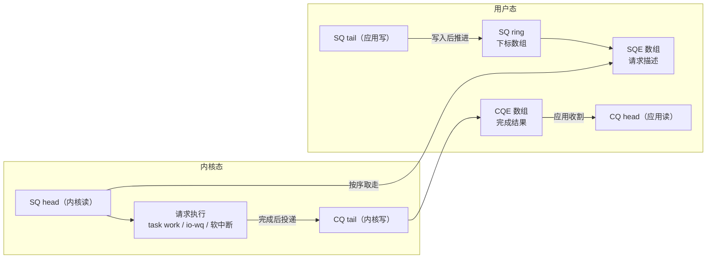
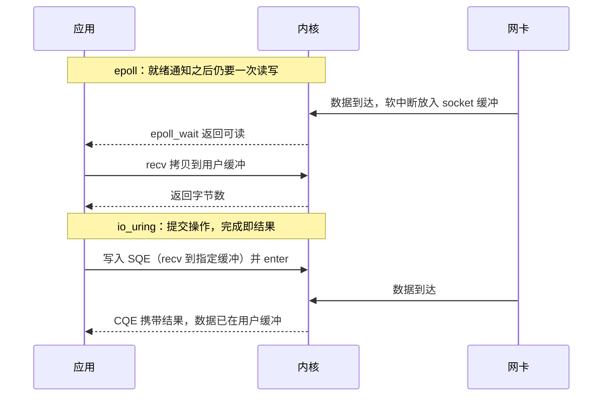
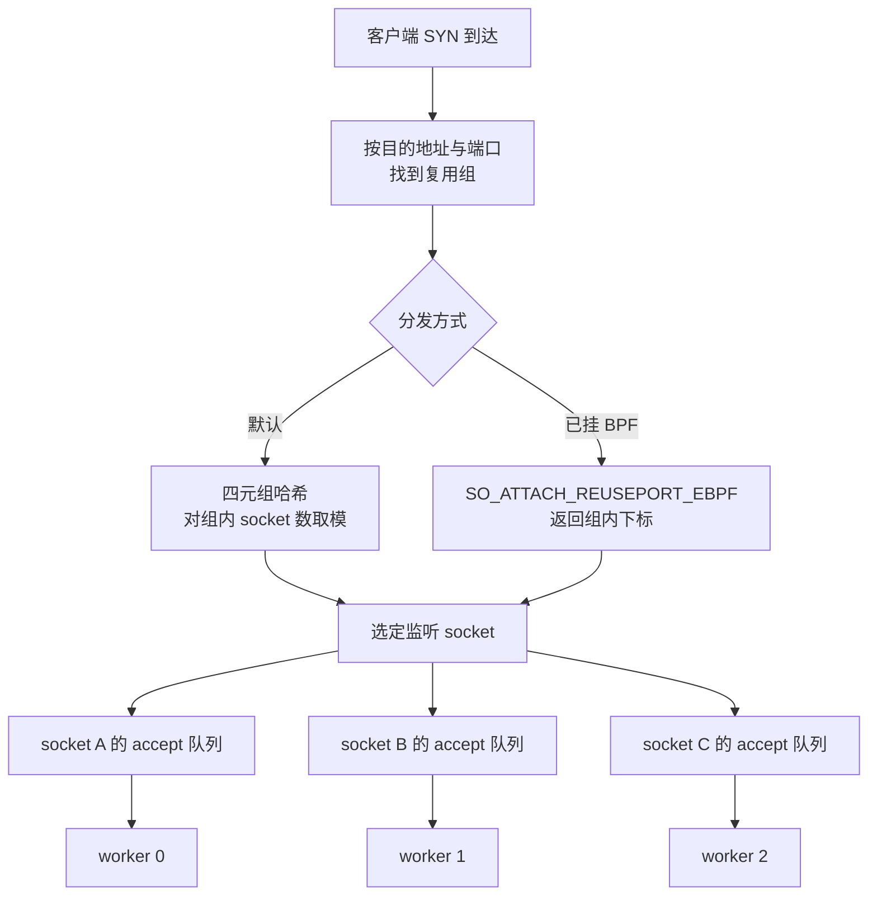
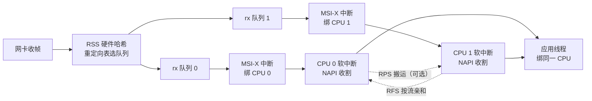

# 高性能网络编程——io_uring 网络、SO_REUSEPORT 与多队列 NIC

**摘要：**

高性能网络服务常被简化成三个开关：打开 io_uring、打开 SO_REUSEPORT、打开多队列网卡。三个开关绕开的却是三种位置不同的固定成本——系统调用的边界、监听 socket 的争用、单核收包的吞吐天花板——收益形状与失效条件并不相同。本篇先拆开 io_uring 的共享内存环形队列：提交队列与完成队列如何经 mmap 与应用共享，一次 `io_uring_enter` 如何批量提交并收割，SQPOLL 与 IOPOLL 各自省掉了哪一段开销，固定缓冲与固定文件表把什么成本钉成了常量；再把 epoll 的"就绪通知 + 仍要读写"与 io_uring 的"提交操作 + 异步完成"摆在一起，看模型转移带来的收益与新的复杂度，并如实核对内核版本、容器安全策略、可观测性与生态这四道软边界。随后回到 SO_REUSEPORT，辨析它与 SO_REUSEADDR 的语义差别、四元组哈希与 BPF 选择器、以及会话漂移与热重载的真实风险；最后把 RSS、RPS、RFS、XPS 与中断亲和串成端到端亲和链，指出单连接只能落在一个队列这类硬约束。文末给出三种手段的收益形状、组合边界与反例，回答两个问题：它们各自在什么条件下才真正生效，拼在一起时哪一段会先断。

---

## 第 1 章 三个瓶颈与三条绕行路线

### 1.1 一台打不满的网关

一台 8 核的边缘网关在 6 Gbps 处撞上了天花板，`mpstat -P ALL` 里绝大多数核的 si 只有个位数，CPU 0 的 si 却长期贴着九成——整机 CPU 利用率不到四成，收包能力已经到顶。把网卡中断重新绑到 8 个队列之后，同一个程序在同样的流量下跑到了 20 Gbps 以上，应用代码一行没改。这个现场浓缩了本篇要讲的三种手段的共同前提：性能瓶颈很少是"算力不够"，更多时候是"算力没有被放到该去的地方"，而挡住算力的那几样东西——系统调用的边界、监听队列上的锁、单核处理收包的串行性——都是结构性的**固定成本**。

固定成本的可怕之处在于它与请求数量成正比，却与请求内容无关。以一次网络请求为例，用户态与内核态的往返、文件描述符的查找与引用计数、监听队列上的一次竞争、软中断在某个 CPU 上的串行处理，每一项单看都只值几百纳秒到几微秒，放在每秒百万次的规模上就变成了若干个核的账单。举一个只做算术的示例推算：每秒 100 万次请求、每次请求触发 4 次系统调用、每次调用连同内核入口的固定开销按 200 纳秒计，这段时间加起来是 0.8 秒/秒，也就是 0.8 个核常驻在这段固定成本上。真实数值随 CPU 微架构、KPTI 的页表切换、缓存状态浮动，但量级已经说明问题：固定成本只有被摊薄或被消除，才会从账单上消失。

由此可以写出三种手段的收益公式：收益 ≈ 被消除的固定成本 ÷ 总成本。分母不变、分子只占一小部分时，优化就趋近于零，这正是许多团队"上了新技术却没有变快"的根因。io_uring 消除的是每次 IO 的系统调用与"通知之后还要搬运"的两段式；SO_REUSEPORT 消除的是多个 worker 争抢同一个监听 socket 的锁与唤醒；多队列网卡消除的是所有收包工作压在一个核上的串行性。三者分别作用在 IO 接口层、socket 分发层与硬件收包层，彼此不重叠，也不互相替代。

### 1.2 三种固定成本与它们的对照

把三条路线放进同一张表，先看它们各自绕开什么、靠什么绕开、以及绕开的代价落在谁身上：

| 手段 | 绕开的对象 | 依赖的机制 | 主要代价 | 典型失效条件 |
| :--- | :--- | :--- | :--- | :--- |
| io_uring | 每次 IO 的系统调用与就绪—搬运两段式 | 共享内存 SQ/CQ 环、内核异步执行 | 请求生命周期管理、内核版本与安全策略门槛 | 批量太小、容器屏蔽系统调用、异步栈难调试 |
| SO_REUSEPORT | 单监听 socket 的 accept 争用与惊群 | 组内多 socket、四元组哈希或 BPF 选择 | 分发不均、会话漂移、热重载需自行排空 | 新建连接率低、worker 数少、分发策略缺失 |
| 多队列 NIC | 单 CPU 处理全部收包的串行性 | RSS 硬件哈希、每队列独立中断 | 绑核与队列规划、运维复杂度 | 中断未绑核、虚拟网卡无 RSS、单连接流量 |

这张表的读法是从"代价"一列往右看：三种手段都把复杂性从内核搬到了别处，io_uring 搬到应用的请求管理，SO_REUSEPORT 搬到分发策略，多队列搬到运维的亲和性配置。看不见的账单不等于没有账单，选型时最该问的一句是"这份复杂性由谁维护、出问题时谁能看懂"。

### 1.3 一个贯穿全篇的场景

为了让三种手段落在同一个语境里，笔者设想一个足够典型的边缘网关：对外承接移动客户端的短连接 API 请求，新建连接率高、单请求字节数小、对尾延迟敏感；同时维持数十万条推送长连接，单连接流量低但连接总数大；整个服务部署在容器里，运行在双路 16 核、两块 NUMA 节点的宿主机上，网卡是支持多队列的 25 GbE。短连接场景考验 accept 路径与系统调用的密度，长连接场景考验单核收包与连接分布的均衡，容器与双路 NUMA 则把安全策略和内存亲和一起摆上台面。后面每一章都回到这个网关上算账，避免把三种机制讲成互不相干的三个知识点。

---

## 第 2 章 io_uring：把系统调用边界摊平成共享内存

### 2.1 2019 年的那次转身

2019 年 5 月，Linux 5.1 把 io_uring 送进主线，作者是块层的长期维护者 Jens Axboe。它的野心不在"再做一个异步 IO 接口"，而在重新划分应用与内核的边界：把原本必须经系统调用传递的"要做什么"，改成写进一块双方共享的内存，让提交与收割都变成内存操作，只在必要时才进一次内核。理解 io_uring 的第一性设计由此不是"异步"，而是**共享内存**——异步只是共享之后自然得到的性质。

共享的载体是四个 mmap 区域：提交队列环（SQ ring）、完成队列环（CQ ring）、存放提交项的 SQE 数组、存放完成项的 CQE 数组。SQ 环里放着两个由不同一方推进的指针，应用推进 tail，内核推进 head；CQ 环反过来，内核推进 tail，应用推进 head。环本身只存下标，真正的请求描述在 SQE 数组里，完成结果在 CQE 数组里。`io_uring_setup` 返回一个文件描述符，应用用 `mmap` 按固定偏移把这几块内存映射进自己的地址空间，此后填写 SQE、推进 tail 全是用户态的内存写，连一次陷入都不需要。

下图把这块共享内存的读写关系画清楚，注意两个队列的推进方向是相反的：



这张图里没有一处"调用"，只有指针的推进，而这正是 io_uring 全部性能的来源，也是它全部复杂性的来源：应用必须自己保证"写了 SQE 再推进 tail"的顺序（编译屏障与写屏障），必须自己维护 in-flight 请求与缓冲区的生命周期，内核不再替你兜底。

### 2.2 一次进入，批量提交与收割

只共享内存还不够，内核总要知道"有新请求了"。这个通知动作由 `io_uring_enter` 承担，它的参数里藏着 io_uring 最实用的两处设计：`to_submit` 表示本次最多提交多少个 SQE，`min_complete` 表示至少要等到多少个完成事件才返回，配合 `IORING_ENTER_GETEVENTS` 标志，一次调用可以同时完成"提交一批"与"等待至少一个完成"。于是应用中常见的形态从"每个请求一次系统调用"变成"一批请求一次系统调用，顺带收割一批完成"。

```c
/* 一次 enter 同时做两件事：提交 32 个接收请求，并等待至少 1 个完成 */
for (int i = 0; i < 32; i++) {
    struct io_uring_sqe *sqe = io_uring_get_sqe(&ring);
    /* 缓冲区的所有权交给内核，直到对应 CQE 被收割前都不能复用 */
    io_uring_prep_recv(sqe, conns[i], bufs[i], BUF_SZ, 0);
    sqe->user_data = (uint64_t)i;   /* 完成时靠它把 CQE 对回请求 */
}
/* 内部即 io_uring_enter(fd, 32, 1, IORING_ENTER_GETEVENTS) */
int ret = io_uring_submit_and_wait(&ring, 1);

struct io_uring_cqe *cqe;
unsigned head = 0, count = 0;
io_uring_for_each_cqe(&ring, head, cqe) {
    handle_result(cqe->user_data, cqe->res);  /* res 为负即错误码 */
    count++;
}
io_uring_cq_advance(&ring, count);   /* 一次性推进 CQ head，避免逐个处理 */
```

这段代码的注释比代码本身更值得读。`user_data` 是应用与内核之间唯一的关联凭据，完成顺序与提交顺序无关，靠它才能把结果对回请求；`res` 为负数是 io_uring 的错误约定，`-EAGAIN`、`-ECANCELED`、`-ECONNRESET` 都以这种方式回来，而不是设置 `errno`；`io_uring_cq_advance` 存在的意义是一次性推进 CQ head，避免每处理一个完成就写一次共享内存——批量收割与批量提交是对称的，只做一半，收益就少一半。

还有一个不显眼但重要的细节：CQ 环的容量默认是 SQ 的两倍，内核在 CQ 满时会先把完成项暂存到溢出链表，等应用下次进入时再冲刷进环里。这个机制让"提交多、收割慢"的应用不至于丢完成事件，但它也意味着应用的收割节奏会反过来影响内核侧的暂存开销，收割越懒，内核替你保管的完成项越多。

### 2.3 从就绪通知到完成投递

把 io_uring 与 epoll 放在同一条时间轴上，两者的差别不在"快慢"，而在"谁负责搬运"。epoll 是**就绪模型**：内核只告诉你"这个 fd 现在可读"，真正的 `recv` 仍要应用自己发起，于是每次事件至少包含两次系统调用（`epoll_wait` 返回、`recv` 取数），数据在 socket 缓冲里等着被搬走；io_uring 是**完成模型**：应用提交的是"把数据收到这块缓冲区"这个动作本身，内核在数据到达时直接完成拷贝，再把结果投递到 CQ，应用醒来时数据已经在自己的缓冲里。

下图把两种模型的时间轴并排画出，注意 epoll 一侧"通知"与"搬运"是两段，io_uring 一侧只有"提交"与"完成"两个端点：



模型转移带来的第一层收益是系统调用次数：epoll 下每个事件两次，io_uring 下若干个操作共享一次 enter，SQPOLL 模式下连 enter 都可以省掉。第二层收益更隐蔽——epoll 的就绪通知是"水平触发或边沿触发"的状态机，应用必须处理 `EAGAIN`、短读、部分写，把一次业务请求拆成若干次状态迁移；io_uring 把一次请求表达成一个 SQE，内核负责把它做完，应用的代码结构从"事件驱动的状态机"变成"请求队列的流水线"。第三层代价也随之而来：缓冲区的生命周期从"调用期间"延长到"in-flight 期间"，应用必须保证内核还在用的缓冲区不被改写或释放，这份责任在 epoll 模型里是不存在的。

把两种模型的差异收进一张对照表，便于在选型会上逐行过：

| 维度 | epoll（就绪模型） | io_uring（完成模型） |
| :--- | :--- | :--- |
| 内核通知的含义 | 现在可以读写了 | 你提交的操作已经做完 |
| 数据搬运的发起者 | 应用调用 read/write | 内核按 SQE 描述执行 |
| 一次事件的最小系统调用 | 2 次（wait + 读写） | 1 次（enter；SQPOLL 下 0 次） |
| 缓冲区管理 | 调用期间有效，处理 EAGAIN 与短读 | in-flight 期间一直有效，需显式回收 |
| 支持的文件类型 | 普通文件不适用（恒就绪或返回 EPERM） | 文件与 socket 统一 |
| 批量能力 | 一次 wait 多个事件，仍需逐个读写 | 一次提交多个操作、一次收割多个完成 |
| 取消与超时 | 靠关闭 fd 或事件循环兜底 | 提供取消与链式、超时语义 |
| 可观测性 | 语义简单，工具链成熟 | 异步执行栈，依赖 tracepoint 与库内调试 |

表的最后一行值得单独说一句：epoll 的简单是有回报的，`epoll_wait` 返回什么、`recv` 做了什么，用 `strace` 与火焰图都能一眼看清；io_uring 的请求可能在提交线程的 task work 里执行，也可能被交给 io-wq 工作线程，还可能由内核在软中断里完成，同一条请求的执行位置随场景漂移，这也是它调试成本高于 epoll 的结构性原因，后文 2.7 节会展开。

### 2.4 SQPOLL、IOPOLL 与链式提交的边界

`io_uring_enter` 已经把系统调用从"每请求一次"压到"每批一次"，SQPOLL 模式还想再进一步：让内核起一个专门的线程盯着 SQ 环，应用把 SQE 写好、推进 tail 就完事，连 enter 都省了。启用方式是在 `io_uring_setup` 时传入 `IORING_SETUP_SQPOLL`，配合 `sq_thread_idle` 指定轮询线程空闲多久后休眠，`IORING_SETUP_SQ_AFF` 与 `sq_thread_cpu` 则把这个线程钉在指定核上。省下的开销是每次提交的陷入与返回，付出的代价是一个核常驻空转——这是一笔明码标价的交易，只有在"IO 密度足够高且稳定、且确实有富余核"时才划算；流量稀疏的服务开了它，轮询线程大半时间在睡与醒之间切换，收益会被唤醒开销吃掉。

```c
struct io_uring_params p = {
    .flags = IORING_SETUP_SQPOLL | IORING_SETUP_SQ_AFF,
    .sq_thread_cpu = 3,      /* 轮询线程固定到 CPU 3，避免与业务抢核 */
    .sq_thread_idle = 2000,  /* 空闲 2 秒后休眠，唤醒由 enter 负责 */
};
io_uring_queue_init_params(1024, &ring, &p);
/* 此后提交只需写 SQE 并推进 tail，不再调用 io_uring_enter */
```

SQPOLL 还有一个常被忽略的配套：完成事件的等待。省掉了提交侧的 enter，收割侧仍需要一个"睡下并被叫醒"的机制，否则应用只能轮询 CQ。`io_uring_register` 的 eventfd 注册正是为此而设——把 ring 的完成事件注册到一个 eventfd 上，内核在投递 CQE 时唤醒它，应用可以安稳地睡在 eventfd 上，提交靠 SQPOLL、收割靠事件通知，两侧都不再需要轮询。这套组合适合网关这类"常年有流量、延迟要求苛刻"的服务，而不适合"一天只有几个高峰"的批处理任务。

IOPOLL 则是另一个方向，也是被误解最多的一个。`IORING_SETUP_IOPOLL` 让 io_uring 直接轮询块设备的完成队列，绕过中断，但它有两个硬性前提：只对块设备生效，且要求文件以 `O_DIRECT` 打开。网络 socket 在 IOPOLL 下根本用不了，把 IOPOLL 当成"socket 轮询开关"是常见的错误联想。网络侧真正对应的轮询机制是 NAPI 的忙轮询（`SO_BUSY_POLL`）与 AF_XDP 的用户态收包环，它们作用在驱动与协议栈的交界处，与块层的 IOPOLL 是两套东西。

链式提交（`IOSQE_IO_LINK`）同样需要边界意识。它的语义是"前一个 SQE 成功完成后才启动下一个"，任何一个环节失败，后续环节以 `-ECANCELED` 收尾；`IOSQE_IO_HARDLINK` 则变体为"不管成败都继续"。这类链适合依赖关系在**提交时确定**的操作序列，譬如打开文件、读取、关闭，或者对同一个已知 fd 的连续发送。有一类示例在网络上流传很广：把 accept、recv、send 串成一条链，宣称一次提交就完成整个会话。这个示例在提交时无法成立——accept 返回的新 fd 是 CQE 的结果，不可能作为下一个 SQE 的输入，提交时应用手里根本没有这个 fd。可行的替代是用 multishot accept 持续接收新连接，每条连接再挂上 provided buffer 接收，把"每个连接一次提交"变成"一次提交服务多条连接"，效果比链式更接近示例想表达的意思。

### 2.5 固定缓冲与固定文件：把重复成本钉成常量

即便批量提交，只要每次提交都要让内核把用户缓冲区"钉住"（pin 页、建立映射、防止换出），这笔成本仍然按请求数线性增长。`IORING_REGISTER_BUFFERS` 的思路是把这件事提前做一次：注册时内核把整片缓冲区钉住并记下物理页，之后的 SQE 只携带一个下标，省掉每次提交时的页表遍历与引用计数。对网络接收而言，与之配套的是 provided buffer ring（5.19 引入的缓冲区环注册），内核在数据到达时自行从环里取一个缓冲，应用收割完成后再把缓冲还回环里——"谁提供缓冲、谁归还缓冲"被固定成两条单向流，避免了"每次 recv 都要重新提交一个缓冲"的循环。

`IORING_REGISTER_FILES` 解决的是另一半成本：文件描述符查找。每次系统调用处理 fd 时，内核要走一遍 fd 表、加引用、操作完再减引用；当进程的 fd 表被多个线程共享（`CLONE_FILES`）时，这张表还是并发热点。把一批 fd 一次性注册进 ring，SQE 里填的是注册表下标，查找退化为一次数组访问。`IORING_REGISTER_FILES_UPDATE` 可以在运行中替换表项，这让"长连接池 + 注册表"成为可能，但也意味着应用要自己维护注册表与真实 fd 的一致性，fd 泄漏与下标错位是这类代码最常见的 bug。

零拷贝发送 `IORING_OP_SEND_ZC`（6.0）把成本压到最后一层：数据不再从用户缓冲拷进 skb，而是直接引用用户页。它的代价是完成通知分两级——第一个 CQE 表示数据已交给网络栈，第二个带 `IORING_CQE_F_NOTIF` 的通知才表示网卡已经用完这块缓冲；应用必须等到通知才能改写或释放缓冲，否则发出去的就是被覆写过的数据。这一条把完成模型的责任边界画得最清楚：**通知即所有权**，第一级通知交出数据、第二级通知交回缓冲，中间这段时间缓冲不归应用管。

| 机制 | 消除的重复成本 | 适用对象 | 主要风险 |
| :--- | :--- | :--- | :--- |
| 注册缓冲 | 每次提交的 pin 页与映射 | 高频定长读写 | 注册内存不可随意释放、按 NUMA 首次触碰分配 |
| 注册文件表 | 每次操作的 fd 查找与引用计数 | 大量长连接、多线程共享 fd 表 | 注册表与真实 fd 需自行保持同步 |
| provided buffer ring | 每次接收都提交一个缓冲 | 高 QPS 短报文 | 缓冲归还遗漏会导致环枯竭 |
| SEND_ZC | 用户态到内核的数据拷贝 | 大块发送、带宽受限场景 | 必须等通知 CQE 才能复用缓冲 |

### 2.6 内核版本：可用不等于好用

io_uring 的网络能力不是一次性到位的，它随着内核版本一块一块补齐，这张表是选型时最该先查的东西：

| 操作或能力 | 等价接口 | 最低内核 |
| :--- | :--- | :--- |
| io_uring 主体、SQ/CQ、缓冲与文件注册 | — | 5.1 |
| `IORING_OP_SENDMSG` / `IORING_OP_RECVMSG` | sendmsg / recvmsg | 5.3 |
| `IORING_OP_ACCEPT` / `IORING_OP_CONNECT` | accept / connect | 5.5 |
| `IORING_OP_SEND` / `IORING_OP_RECV`、close、openat | send / recv / close / openat | 5.6 |
| `IORING_OP_SHUTDOWN` | shutdown | 5.11 |
| `IORING_OP_SOCKET`、provided buffer ring 注册 | socket | 5.19 |
| `IORING_OP_SEND_ZC`、multishot accept / recv | 零拷贝发送、持续接收 | 6.0 |

5.6 常被当作"网络支持基本完整"的界碑，因为收发这两个最常用的操作在这一版补齐；但完整与好用之间还差一段，multishot 与零拷贝发送要等到 6.0，而这两项恰是高吞吐服务最需要的。以 LTS 内核为例，5.15 与 6.1 都能跑通基本收发，但 5.15 上做不了 multishot 收包，每接一段数据就要重新提交一次 SQE，批量优势被吃掉大半。笔者的判断是：以 6.x 作为生产起点，并把"目标内核是否真的提供某个 op"写进测试用例，而不是写进文档假设。

版本判断还有一条更可靠的做法：在运行时探测**能力位**。`io_uring_setup` 返回的 `params.features` 里有一组 `IORING_FEAT_*` 标志（单次 mmap、CQ 溢出保留、提交稳定、快速 poll 等），liburing 也提供对应的探测接口。用能力位分支代替版本号比较，既避免了发行版回移补丁带来的误判，也让代码在旧内核上有优雅降级的路。

### 2.7 四道软边界：容器、安全、观测与生态

第一道边界来自容器。Docker 在 2023 年 11 月的默认 seccomp 配置里屏蔽了 `io_uring_setup`、`io_uring_enter`、`io_uring_register` 三个系统调用，并与 containerd 的默认配置同步，理由是安全研究人员普遍认为 io_uring 的**攻击面**过大，Google 的公开材料也提到其生产服务器与 Android、ChromeOS 都关闭了 io_uring。这意味着在沿用默认配置的容器里（Docker 的默认配置、Kubernetes 的 RuntimeDefault），io_uring 代码会直接被拒绝并拿到 `EPERM`；containerd 与 CRI-O 的默认配置文件同样把这三个调用列为拒绝项。要在容器内使用，必须定制 seccomp 白名单或以特权方式运行，而这又抵消了隔离带来的一部分安全收益。Kubernetes 上若节点运行时沿用默认配置，同一个镜像在虚拟机上能跑、在集群里报错，是很典型的现场；更极端的是 gVisor 这类用户态内核，根本没有实现 io_uring，调用会直接以 `ENOSYS` 失败，连定制 seccomp 也救不回来。

第二道边界是安全本身。io_uring 的请求在内核里执行、状态复杂、接口面广，2021 年以来多次成为本地提权漏洞的入口，这也是运行时收紧它的直接动机。对一个面向公网、多租户共用的服务，是否值得为了系统调用的开销引入这块攻击面，需要安全团队参与决策，而不是性能团队单方面拍板。

第三道边界是可观测性。epoll 时代的排障直觉在 io_uring 上会失灵：`strace` 只能看到 `io_uring_enter` 这一层，真正执行的 `recv`、`send` 发生在内核任务或工作线程里，进程视图里看不到；火焰图上，请求的执行栈可能落在 `io_wq_worker` 或软中断上下文中，与提交它的业务线程不在同一处。可用的观测面是 io_uring 自带的 tracepoint（提交、完成、异步工作入队等）与 liburing 的调试接口，配合 bpftrace 按 `user_data` 串联单请求的提交与完成时间。这套工具链能用，但成熟度与"`ss` 一把梭"的 epoll 时代不在一个量级上。

第四道边界是生态。liburing 把裸接口包得足够好用，Rust 侧有 monoio、tokio-uring 这类独立运行时，Netty 有 incubator 的 io_uring 传输，libuv 在文件操作上引入过 io_uring 而 socket 事件仍以 epoll 为主，Go 的运行时至今没有把 io_uring 纳入默认网络模型。语言与框架的支持程度参差，意味着选它往往等于同时选了一条"自己维护封装层"的路，框架升级、内核升级、库升级三条线都要跟。

---

## 第 3 章 SO_REUSEPORT：把一把锁拆成 N 把

### 3.1 共享监听 socket 的三重争用

多进程服务器的经典形态是父进程创建监听 socket，fork 出若干 worker 共享同一个 fd，谁先抢到就由谁 accept。这个模型在连接率不高时工作得很好，连接率上去以后会同时暴露三处争用。其一是唤醒争用：新连接到达时，阻塞在 `accept` 上的 worker 可能被同时唤醒，只有一个能拿到连接，其余白跑一趟再睡回去，这就是**惊群**；Linux 从 2.6 起用排他唤醒缓解了大部分场景，但它只保证"尽量少唤醒"，不改变"同一时刻只有一个 worker 在 accept"的事实。其二是队列争用：所有 worker 从同一个 accept 队列取连接，取的过程要拿 socket 锁，连接率越高，这把锁越像收费站。其三是调度错位：worker 拿到连接后未必在收包的那个 CPU 上处理，缓存亲和性从一开始就断了。

Nginx 早年用用户态的 `accept_mutex` 在 worker 之间轮流放行，把惊群压下去，代价是把并发 accept 变成了串行 accept——惊群是减少了，吞吐的天花板也随之固定。这类"用一把用户态锁换另一把内核锁"的方案，说明问题的根不在唤醒策略，而在"所有 worker 共享一个监听对象"这个结构本身。

### 3.2 每个 worker 一个监听 socket

`SO_REUSEPORT`（Linux 3.9，2013 年）把这个结构拆开了：每个 worker 自己创建 socket、设置该选项、绑定同一个地址与端口、各自 `listen`，内核把这些 socket 收进一个复用组，新连接在 SYN 到达时由内核选定其中一个，连接直接进入该 socket 的 accept 队列。此后每个 worker 只从自己的队列取连接，队列锁不再跨进程争用，唤醒也只在被选中的那个 socket 上发生。

```c
int fd = socket(AF_INET, SOCK_STREAM | SOCK_NONBLOCK, 0);
int on = 1;
/* 必须在 bind 之前设置，且组内所有 socket 都要设置 */
setsockopt(fd, SOL_SOCKET, SO_REUSEPORT, &on, sizeof(on));
bind(fd, &addr, sizeof(addr));
listen(fd, backlog);
/* 之后每个 worker 只 accept 自己的 fd，互不干扰 */
```

这套机制的约束需要背下来：组内所有 socket 必须属于同一个有效 UID，内核以此阻止同机其他用户劫持端口；选项必须在 bind 之前设置，若已有 socket 绑定了该端口而没设这个选项，新的 bind 会以 `EADDRINUSE` 失败；复用组以网络命名空间为界，容器各有自己的 netns，跨容器不构成一组。把这三条记住，能省掉现场大半的"为什么绑不上"。

### 3.3 四元组哈希与 BPF 选择器

内核选哪个 socket，取决于**分发算法**。早期实现是在组内逐个查找匹配项，组大了就退化成线性扫描；2016 年前后 Craig Gallek 的补丁系列把 UDP 与 TCP 的选择都改成数组加哈希，用连接的四元组（源地址、源端口、目的地址、目的端口）算出一个下标，直接定位 socket，并在同一次改动里加入了 `SO_ATTACH_REUSEPORT_EBPF`，允许应用挂一段 eBPF 程序自己决定返回哪个下标。选择发生在握手之前，一旦选定，这条连接在整个生命周期里都归那个 socket，不会中途搬家。

下图把一次 SYN 的分发路径画出来，注意哈希与 BPF 是二选一的关系，挂了 BPF 程序就以程序的返回值为准：



BPF 选择器的价值在于把"选哪个 worker"从哈希的随机性变成可控策略。程序里可以读当前处理这个包的 CPU（`bpf_get_smp_processor_id()`），返回与该 CPU 对应的 socket 下标，于是"包在哪个核上被协议栈处理，连接就交给哪个核上的 worker"。配套的 `SO_INCOMING_CPU` 则让应用在接受连接后知道它是由哪个 CPU 收下来的，把 worker 绑到同一个核上，收包、协议栈、应用处理三段就落在同一份缓存里。相对地，纯哈希分发只保证"同一条连接总去同一个 worker"，不保证"去的是最合适的那个 worker"——当 worker 数与核数的映射关系错位时，缓存局部性依旧是断的。

哈希分发还有一个统计上的软肋：均匀性依赖流数量。连接数上千时四元组哈希能把负载摊平，流只有几十条时，某些 worker 分到三五条、某些分到十几条是常态，组内负载偏差可以到数倍。这类偏斜在压测里最容易被误判成"reuseport 没生效"。

### 3.4 与 SO_REUSEADDR 的分野

这两个选项名字相似、常被一起设置，语义却完全不同。`SO_REUSEADDR` 解决的是"地址还能不能绑"的问题：让处于 `TIME_WAIT` 的地址可以被重新绑定，让通配地址与具体地址的绑定能够共存，它不允许多个 socket 同时在同一端口上监听并分流。`SO_REUSEPORT` 解决的是"多个 socket 能不能同时监听同一端口并分担连接"的问题：它允许并分流，但要求同 UID、同选项。把两者当成一件事，最典型的后果是只设了 `SO_REUSEADDR` 就以为多进程可以各自监听，结果第二个进程直接 `EADDRINUSE`。

| 维度 | SO_REUSEADDR | SO_REUSEPORT |
| :--- | :--- | :--- |
| 解决的问题 | 地址复用与 TIME_WAIT 状态下的重新绑定 | 多个 socket 同时监听同端口并分流 |
| 是否允许多个 LISTEN | 不允许（同一地址端口仍只有一个监听者） | 允许，组内每个 socket 各有一个 accept 队列 |
| 身份约束 | 无同 UID 要求 | 组内必须同一有效 UID |
| 生效阶段 | bind 时判定地址能否复用 | bind 时建组，SYN 到达时选 socket |
| 典型用途 | 服务重启时快速重绑、避免 TIME_WAIT 阻塞 | 多 worker 分流、零停机升级 |
| 常见误配 | 以为它能实现多进程共享监听 | 以为它能替代 REUSEADDR 处理 TIME_WAIT |

两者可以同时设置，Nginx 的 `listen 80 reuseport` 背后通常也带着 `SO_REUSEADDR`，但它们各自负责一段：一个让重启不被 `TIME_WAIT` 卡住，一个让多个 worker 各拿各的连接。把它们混为一谈的配置，在单 worker 时看不出问题，扩容到多 worker 才暴露，属于典型的"上线后才发现的语义债"。

### 3.5 会话漂移与热重载的真实风险

`SO_REUSEPORT` 的分发发生在连接建立之前，这个时间点决定了它的两个风险形态。对 TCP 而言，连接一旦建立就不会迁移，所以已建立的会话是稳定的；不稳定的是新连接——增删 worker 会改变组内成员，新连接按新组的哈希落位，老连接仍留在原 worker 上，于是升级完成后的一段时间里，流量分布与 worker 数量并不匹配，老的 worker 明明该退场，却还扛着一批长连接。对 UDP 与 QUIC 而言风险更大：分发是按包进行的，组内成员变化会改变同一条四元组的落点，同一条 QUIC 连接的报文可能被送到两个 worker，连接状态一分为二；客户端网络切换导致源端口变化时，即使组成员不变，四元组哈希也会把后续报文送到另一个 worker，这就是**会话漂移**。

热重载的风险同理。关闭一个监听 socket 时，内核会把它从复用组摘除，并处理它队列里尚未被接受的连接——正在握手的、已经完成握手但还没 accept 的，都可能收到 RST。想做到"无损"，需要应用自己完成三步：先让分发停止选中即将退场的 socket（用 BPF 选择器按 worker 状态摘流），再等它的 accept 队列排空、存量连接自然结束，最后才关闭。把无损热重载的希望寄托在内核或某个框架版本上，是这类方案最常见的误解——内核只负责选择与排队，排空与摘流的时序必须由应用编排。

### 3.6 收益的形状

`SO_REUSEPORT` 的收益与"新建连接率 × worker 数"同向增长：短连接 API 网关每秒几十万次握手、worker 数等于核数时，accept 争用是实打实的瓶颈，拆开后的提升立竿见影；长连接推送服务每秒只有几百次新建连接、worker 数又少，accept 本来就不构成争用，开了它只会多出一层分发策略要维护。判断该不该上，先量三个数：每秒新建连接数、每个 worker 的 accept 耗时占比、以及 `ss -lnt` 里监听队列的溢出计数；三个数都不高时，reuseport 属于"看起来专业但收益为零"的配置。

---

## 第 4 章 多队列 NIC：把收包拆给多个核

### 4.1 RSS：网卡自己做分拣

RSS（Receive Side Scaling）把分拣工作交给网卡硬件：驱动初始化时为每个接收队列分配一段描述符环，网卡对每个到达的帧算一次 Toeplitz 哈希（输入通常是四元组，可扩展到 VLAN 与隧道字段），用哈希值查重定向表（RETA）得到一个队列号，把帧 DMA 进该队列的环里，并触发该队列对应的 MSI-X 中断。整个过程不消耗 CPU，CPU 只在被中断之后处理自己那一份。

```bash
# 队列数与每队列的中断（现代网卡多为 combined 队列）
ethtool -l eth0
ethtool -L eth0 combined 8          # 队列数通常不超过参与收包的核数
# 查看重定向表与哈希字段
ethtool -x eth0
ethtool -n eth0 rx-flow-hash tcp4  # 参与哈希的字段
# 每队列的统计与 sysfs 目录
ethtool -S eth0 | grep -E "rx_queue_[0-9]+_(packets|drops)"
ls /sys/class/net/eth0/queues/
```

RSS 的分配依据是流而不是包，所以同一条 TCP 连接的报文总是落到同一个队列，由同一个 CPU 处理——这是"每连接单核"模型的硬件基础，也同时埋下了它的天花板：一条连接再大，也只能用一个队列、一个核。报文在软中断里被 NAPI 成批收割、再送进协议栈的过程见 [[07 Linux 网络包的完整收发路径——软中断、NAPI 与 XDP]]，本章只关心它在哪个核上发生。队列数怎么定，取决于愿意拿多少核做收包；队列多于收包核数会让多个队列共享一个核，中断变密而并行度不变；队列少于核数则天然浪费了一部分核。

### 4.2 中断亲和：把队列钉到核上

队列分好了，中断落在哪个核上仍由中断亲和性决定。每个队列对应一个中断号，`/proc/interrupts` 的每一列是一个 CPU，一眼就能看出某个队列的中断全落在哪一列；`/proc/irq/<号>/smp_affinity` 用十六进制位掩码指定允许的核，`smp_affinity_list` 则可以直接写核号列表。默认状态下所有中断的亲和性是全部 CPU，实际由中断控制器在允许集合里挑选，结果常常是同一个网卡的所有队列都压在 CPU 0 上——这就是"多队列开了等于没开"的最常见成因。

```bash
# 把 eth0 的 8 个队列中断分别绑到 CPU 0-7
for i in $(seq 0 7); do
    irq=$(grep -w "eth0-TxRx-$i" /proc/interrupts | cut -d: -f1 | tr -d ' ')
    echo $i > /proc/irq/$irq/smp_affinity_list
done
```

`irqbalance` 是这套手工配置的天敌。它以均衡中断负载为目标，周期性重写亲和性，把刚绑好的中断挪走，且不理解"这个队列属于这张网卡、这条网卡的 NUMA 节点是 0"这类业务语义。两种做法各有权衡：停掉 irqbalance 并全量手工绑定，可控但需要随网卡与核数变化维护脚本；保留 irqbalance 并把网卡中断排除在它的管理之外（`IRQBALANCE_BANNED_INTERRUPTS` 或 `--banirq`），省事但依赖版本与配置的正确性。高性能场景通常选前者，因为绑核关系本身就是性能设计的一部分，不应交给启发式算法。

### 4.3 RPS 与 RFS：硬件不给力时的软件补丁

虚拟网卡大多只有一对队列，veth、tap、未开多队列的 virtio-net 都是如此，容器与云主机的收包因此天然压在单核上。RPS（Receive Packet Steering，2.6.35）是这一层的软件补丁：协议栈在 `netif_receive_skb` 之后按包的哈希选一个目标 CPU，把 skb 挂到该 CPU 的 backlog 队列并发送核间中断（IPI）唤醒它，收包工作被"搬运"到目标核。配置只需给每个接收队列写掩码，代价是每次搬运都产生一次 IPI 与一次跨核内存访问，效率低于硬件分队列。

```bash
# 让 CPU 0-3 参与处理 rx-0 队列的包
echo f > /sys/class/net/eth0/queues/rx-0/rps_cpus
# RFS：记录每条流的消费 CPU，需要同时扩大全局与每队列流表
sysctl -w net.core.rps_sock_flow_entries=32768
echo 4096 > /sys/class/net/eth0/queues/rx-0/rps_flow_cnt
```

RFS（Receive Flow Steering）在 RPS 之上补了流亲和：内核记录每条流最近一次被应用消费时所在的 CPU，后续的包优先送到那个 CPU，让"软中断处理"与"应用读取"在同一核上发生。它治的是 RPS 的盲点——哈希只保证分散，不保证分散到的核正好是应用所在的核。RFS 的流表是哈希表，条目不够时不同流会互相碰撞，表现为流在核间抖动，所以高流数场景必须同时调大 `rps_sock_flow_entries` 与每队列的 `rps_flow_cnt`。更进一步的 aRFS（accelerated RFS）把这份流表信息编程进网卡的过滤规则，让硬件直接按流分队列，省掉 IPI——前提是网卡支持 ntuple 过滤。

下表把接收侧与发送侧的四种机制放在一起，方便对照它们的层次与代价：

| 机制 | 所在层次 | 分发依据 | 主要代价 | 典型场景 |
| :--- | :--- | :--- | :--- | :--- |
| RSS | 网卡硬件 | Toeplitz 哈希 + 重定向表 | 队列数受限于核数与硬件 | 物理多队列网卡 |
| RPS | 内核软件 | 包哈希，投递到目标 CPU 的 backlog | 每包一次 IPI 与跨核访问 | 单队列虚拟网卡 |
| RFS | 内核软件 | 流最近被消费的 CPU | 流表碰撞、需扩表 | 应用线程位置稳定的服务 |
| XPS | 内核软件 | 发送 CPU 到 tx 队列的映射 | 映射配错会串队列 | 多核并发发送 |

### 4.4 XPS：发送侧的镜像

接收侧靠 RSS 把包分给多核，发送侧对应的是 XPS（Transmit Packet Steering，2.6.38）：它决定某个 CPU 上产生的发送流量走哪个 tx 队列。没有 XPS 时，多个 CPU 可能同时往同一个 tx 队列里塞描述符，队列锁与描述符缓存成为争用点；配上 XPS 后，每个核固定使用自己的 tx 队列，发送路径的并行度与接收路径对称。`/sys/class/net/eth0/queues/tx-0/xps_cpus` 就是这张映射，配置原则与 RSS 相同——队列与核一一对应，且不要跨 NUMA 节点。

### 4.5 三种失效形态

多队列的失效往往不是"没配"，而是"配了但没生效"，典型形态有三种。第一种是中断全落 CPU 0：`/proc/interrupts` 里所有队列的中断都集中在第一列，原因可能是默认亲和性没有改动、irqbalance 把所有中断归到了一起、网卡实际只有一对队列而 `ethtool -l` 的 combined 显示的是驱动上限，或者 RPS 掩码写成了十进制。第二种是超线程被当成两个核：同一物理核的两个逻辑线程共享 L1/L2 与执行单元，把两个接收队列绑到这对兄弟线程上，收包吞吐不如绑到两个物理核，观测 `/sys/devices/system/cpu/cpu*/topology/thread_siblings_list` 能避开这个坑。第三种是跨 NUMA 收包：网卡插在某个 PCIe 槽位，`/sys/class/net/eth0/device/numa_node` 给出了它归属的节点，把中断绑到另一个节点的核上，每一次 skb 访问都是**远端内存**，延迟与带宽双重受损。

下图把接收侧的四种力量画在同一条路径上，硬件分拣、软件搬运与流亲和各自作用在不同位置：



图里的虚线是软件补丁的位置：硬件分队列之后仍可用 RPS 再分散，也可以用 RFS 把包追到应用所在的核；实线是理想路径，队列、中断、软中断、应用线程四段共享同一份缓存。

---

## 第 5 章 三者合流：亲和链与它的断点

### 5.1 一条端到端的亲和链

把三种手段装进第 1 章那个边缘网关，理想的形态是一条首尾相接的链：网卡按 RSS 把某条连接的报文放进队列 3，队列 3 的中断绑在 CPU 3，CPU 3 的软中断完成协议栈处理并把数据挂进 socket 接收队列，SO_REUSEPORT 的 BPF 选择器把这条连接交给 CPU 3 上的 worker，worker 从自己的 io_uring 环里收割完成，全程不离开 CPU 3 的 L1/L2。链上任何一段错位，缓存就要搬一次家，而每一次搬家都是几十纳秒到上百纳秒的额外延迟，在高 QPS 下累积成可观的 CPU 开销。下图把这条链画成一条直线，每个方框代表同一份缓存里的工作，任何一格落到别的核上，链就断了：


链上有三个容易断的地方。第一个断点在 accept：默认的四元组哈希不关心包是哪个核处理的，选中的 socket 可能属于另一个核上的 worker，BPF 选择器按 `bpf_get_smp_processor_id()` 返回下标就是为补这一段。第二个断点在唤醒：`epoll_wait` 返回后，被唤醒的线程由调度器放到哪个核并不确定，需要把 worker 显式绑核，并用 `SO_INCOMING_CPU` 核对连接确实来自预期的核。第三个断点在异步执行：io_uring 的请求可能被交给 io-wq 工作线程，完成处理跑在另一个核上，缓存亲和性在这里被异步化抵消——这正是 io_uring 与绑核策略之间需要专门设计的地方，SQPOLL 加固定核，或者让快路径留在提交线程的 task work 上执行，都是为补这一段。

### 5.2 单连接的天花板

三种手段叠在一起，仍然绕不开一条硬约束：一条 TCP 连接的四元组固定，RSS 哈希只给它**一个队列**，协议栈处理只在一个核上进行；SO_REUSEPORT 只在握手时选一次 socket，对已建立的连接无从干预；io_uring 改变的是一次提交能带多少个操作，改变不了这条连接的数据落在哪个核。于是单连接的吞吐上限约等于单核的协议栈处理能力——按笔者的量级判断，一颗现代服务器核在开启 GRO/TSO 之后通常能跑满一条 10 GbE 到 25 GbE 量级的连接，具体数字随包长、卸载能力与协议特性浮动，但"一条连接一个核"这个结论是稳的。

要突破它，只有把连接拆开：应用层连接池放多条连接、gRPC 多 channel、按分片建连，让多条连接分散到多个队列。这里有一个反直觉的推论：连接复用与多核扩展是一对矛盾。HTTP/2 与 gRPC 的多路复用把每对下游的连接数压到一两条，好处是握手与拥塞控制的开销摊薄，代价是上游的 RSS 只能用到一两个队列，剩余的核在围观；负载均衡器的上游连接池如果按"越少越省"来配，恰好把多队列的并行度锁死。合理的做法是按队列数与核数配连接数，而不是按"省连接"配，把多路复用的收益与多队列的收益分开算账。

### 5.3 NUMA 与超线程的取舍

双路机器把这条链的约束又收紧一层。网卡插在哪个 PCIe 槽位，就决定了它的 DMA 内存属于哪个 NUMA 节点，`/sys/class/net/eth0/device/numa_node` 给出的节点号应当同时约束三件事：队列中断绑到该节点的核、worker 绑到该节点的核、缓冲区的内存在该节点上分配（`numactl --cpunodebind --membind` 或按节点建内存池）。三者只要有一项跨到远端节点，延迟就会翻倍——这是量级判断，不是精确倍数，但方向从不出错。

超线程的取舍更微妙。收包是典型的"缓存与中断密集"负载，同一物理核的两个逻辑线程共享 L1/L2 与执行单元，把一个队列的中断与另一个队列的中断绑到这对兄弟线程上，两个队列的收包会互相挤占同一份执行资源，吞吐反而不如只用一个线程、把另一个线程留给不需要缓存的业务。判断方法很直接：读 `thread_siblings_list`，让收包核的兄弟线程保持空闲或只跑低强度任务。

### 5.4 组合的边界

把三种手段的生效前提与失效表现并列，能看出它们并不在同一层上竞争，而是各自守住一段路径：

| 层级 | 该层的瓶颈 | 对应手段 | 生效前提 | 失效表现 |
| :--- | :--- | :--- | :--- | :--- |
| 接口层 | 每次 IO 的系统调用与通知往返 | io_uring | 批量足够大、内核与安全策略允许 | 低并发下收益趋零、容器内 EPERM |
| 分发层 | 单监听 socket 的 accept 争用 | SO_REUSEPORT | 新建连接率高、worker 数多 | 分发倾斜、UDP 会话漂移 |
| 收包层 | 单核处理全部报文 | 多队列 + 中断亲和 | 队列数与核数匹配、中断绑核 | 中断全落 CPU0、跨 NUMA |
| 应用层 | 唤醒与处理不在收包核 | 绑核 + SO_INCOMING_CPU | worker 与队列一一对应 | epoll 唤醒漂移、io-wq 异地执行 |

这张表的用法是自下而上排查：先确认收包层的工作真被分出去了（`/proc/interrupts` 的分布），再确认分发层的连接真被分匀了（各 worker 的 accept 计数），最后才看接口层的系统调用占比（`perf` 里的 syscall 时间）。顺序颠倒，就会在接口层做大量优化，却发现瓶颈还在中断那一行。

---

## 第 6 章 五个反例：三种手段各自的幻觉

### 6.1 以为 io_uring 在所有场景都比 epoll 快

这是流传最广的一个判断，也是最容易在压测里被证伪的一个。io_uring 省下的是"每次 IO 一次系统调用"的固定开销，这笔开销的绝对值只有几百纳秒，能不能变成收益，取决于一次 enter 能带上多少操作。一个只有几十条长连接、每条连接每秒几个请求的服务，提交时每批只有一两个 SQE，省下的系统调用还不够抵消请求生命周期管理与完成队列收割的成本；epoll 在这个规模下每次事件两次系统调用的总量本来就不大，换模型的收益自然接近于零。

**批量密度**是判断该不该换的第一个指标：每核每秒的 IO 次数乘以平均每批的操作数，如果乘出来的批量长期小于 4，io_uring 的收益就很难被观测到。第二个指标是完成延迟的抖动：请求的完成若被推迟到下一次 enter 才被处理（内核用 task work 处理完成，而 task work 在进入内核时才执行），尾延迟会比 epoll 的即时唤醒更差，较新的内核用 COOP_TASKRUN、DEFER_TASKRUN 一类标志缓解这个问题，但缓解不等于消除。第三个指标是团队对异步调试的熟练度，这一项不进压测报告，却决定故障时的恢复速度。

反过来说，io_uring 有一项与速度无关的价值常被忽略：它把文件与 socket 放进同一个完成队列，磁盘读、定时器、网络收发可以共用一套事件循环，不必再让 epoll 与 aio 各管一半。对既做存储又做转发的服务，这份统一本身就是收益，与快慢无关。

### 6.2 开了 SO_REUSEPORT 却没有流亲和

一个推送网关从 4 个 worker 扩到 8 个，扩容完成后老 worker 的连接数几乎没降，新 worker 的 CPU 占用却在低位徘徊——监听是分开了，存量连接还是按四元组哈希老实地留在原 worker 上，扩容只对新连接生效。这类现场的修复不在 listen 层，而在扩容节奏与分发策略：先用负载均衡把新连接引导到新 worker，或让 BPF 选择器在过渡期返回偏向后加入的 socket，等存量连接自然衰减。若服务是 UDP 或 QUIC，问题会更严重：分发按包进行，组内成员一变，同一条四元组的报文就可能落到不同 worker，会话状态被切成两半，表现为消息乱序、重复或鉴权失败。**分发策略**是 reuseport 的后半篇文章，只写前半篇（加上选项、多开 socket）的系统，在扩容与发布时会集中还债。

### 6.3 多队列开了，中断还是全在 CPU 0

新网卡上线，`ethtool -l` 显示 8 个队列，`ethtool -S` 里 8 个队列的收包数很均匀，`mpstat` 里却只有 CPU 0 的 si 接近饱和。队列在工作，处理没有分散——问题出在**中断亲和性**：默认掩码是全部 CPU，中断控制器把该网卡的所有队列中断都投给了第一个可用核；或者 irqbalance 在跑，把刚绑好的中断又挪了回来。验证只需要三行命令：`grep eth0 /proc/interrupts` 看每一列，`cat /proc/irq/<号>/smp_affinity_list` 看当前掩码，`mpstat -P ALL 1` 看 si 分布。修复后再核对一遍三处是否一致，因为改完亲和性立刻被 irqbalance 改回去的情况同样常见。

### 6.4 在容器与虚拟机里照搬宿主机的结论

同一份 io_uring 代码，在虚拟机上跑得好好的，进了默认配置的容器就报 `EPERM`；同一套 reuseport 方案，在宿主机上把连接分得很匀，进了 Pod 却只剩一个 worker 在收——容器各自有独立的网络命名空间，复用组只在同一个命名空间内成立，跨 Pod 共享端口根本不是它解决的问题；同一张"多队列网卡"，在 veth 上只有一对队列，RSS 无从谈起，只能靠 RPS 兜底。容器化部署把三类前提一起改了：系统调用的允许列表、网络命名空间的边界、网卡的多队列能力。压测结论在宿主机上成立，不等于在 Pod 里成立，这两套环境的数字要分开采。

### 6.5 SQPOLL 与 IOPOLL 的误用

SQPOLL 用一个常驻轮询线程换掉每次提交的陷入，在 8 核机器上等于永久让出一个核。如果这个服务的 IO 密度撑不起这个核的空转，总吞吐会下降，而不是上升；更隐蔽的代价是这个核被固定在某个 NUMA 节点上，跨节点访问的延迟要另算。IOPOLL 的误用则更直接：它只对块设备与 `O_DIRECT` 生效，给 socket 打开它没有任何效果，把 IOPOLL 写进网络服务的初始化参数，得到的只是"设置成功但行为未变"的假象。网络侧的轮询要么交给 NAPI 的忙轮询，要么交给 AF_XDP 的用户态环，路径完全不同。

---

## 第 7 章 收益的形状与选择的次序

### 7.1 三种收益曲线

三种手段的收益都不是"开了就有"，而是各自随一个变量增长，又在某个位置饱和：

| 手段 | 收益随什么增长 | 饱和条件 | 失效条件 | 首要观测指标 |
| :--- | :--- | :--- | :--- | :--- |
| io_uring | 每批操作数 × 系统调用密度 | 批量趋近 1 时收益趋零 | 容器 seccomp 拦截、内核缺所需 op | 系统调用占比、每次 enter 的提交数 |
| SO_REUSEPORT | 新建连接率 × worker 数 | worker 数接近收包核数后饱和 | 分发倾斜、UDP 会话漂移、热重载未排空 | 各 worker 的 accept 计数、监听队列溢出 |
| 多队列 NIC | 参与收包的核数 | 受内存带宽与单流上限约束 | 中断未绑核、单连接、虚拟网卡 | 中断在核间的分布、各队列包数、si 分布 |

这张表的价值在于把"要不要上"变成"处在曲线的哪一段"。新建连接率只有每秒几百、worker 只有两个时，reuseport 处在曲线的起点，收益接近零；每核每秒只有几千次 IO、批量凑不到 2 时，io_uring 同样在起点；只有一条 10 GbE 连接的业务，多队列再调也只能用到收包侧的一个核。

### 7.2 先定位，再选手段

把三种手段放进一棵决策树，入口不是"我想用什么"，而是"瓶颈在哪一层"：

```mermaid
%%{init: {'theme': 'dracula'}}%%
flowchart TB
    S{"最先变红的是哪一层"} -->|"系统调用占比高"| I{"能凑出批量吗"}
    I -->|"能，且内核与安全策略允许"| I1["io_uring<br/>固定缓冲 + 批量提交"]
    I -->|"不能"| I2["保留 epoll<br/>先优化别的层"]
    S -->|"accept 争用、新建连接率高"| R{"worker 数接近核数"}
    R -->|"是"| R1["SO_REUSEPORT<br/>配 BPF 按核分发"]
    R -->|"否"| R2["先把 worker 扩到位"]
    S -->|"单核 si 饱和、众核空闲"| N{"网卡支持多队列"}
    N -->|"是"| N1["调队列数 + 中断绑核"]
    N -->|"否"| N2["RPS / RFS 软件兜底"]
    I1 --> V["小流量验证收益<br/>再看下一层"]
    R1 --> V
    N1 --> V
    N2 --> V
    style S fill:#44475a,stroke:#ff79c6
    style V fill:#44475a,stroke:#50fa7b
```



树的每一层都有一句隐含的前提：上一层的瓶颈已经排除。收包层还堵着的时候去优化接口层，等于在一条拥堵的路上换更快的车；分发层还倾斜的时候去调 io_uring，等于给一个已经排满的窗口加收银员。**判断的次序**比手段的选择更重要，这也是第 5 章那张层级表的用意。

### 7.3 边际收益与复杂性守恒

三种手段都在做同一件事：把某个固定成本从路径上拿掉。拿掉之后，账单会转移到别处——io_uring 把复杂性转到请求生命周期与缓冲管理，SO_REUSEPORT 转到分发策略与热重载编排，多队列转到绑核脚本与 NUMA 规划。**复杂性守恒**在这里体现得最直白：路径上的固定成本不会凭空消失，只会变成某个团队需要维护的代码或配置。判断值不值得，要算两笔账：省下的 CPU 与延迟，以及新增的维护面与故障模式；只算前一笔，技术选型就会在半年后以"没人敢动"收场。

边际收益递减也值得提前写进预期。多队列从 1 个队列扩到 4 个，收包能力接近线性提升；从 8 个扩到 16 个，提升开始受内存带宽与 PCIe 带宽限制；再往上，收包不再是瓶颈，瓶颈换成了协议栈锁或应用处理。io_uring 从每批 1 个操作提到 8 个，系统调用次数降一个数量级；再往上提，收益曲线变平，因为剩下的开销在内存拷贝与业务逻辑里。把这三条曲线画在脑子里，就不会在收益已经饱和的地方继续投入。

---

## 第 8 章 绕开的代价与判断的次序

三种手段的名字都很"高性能"，但它们的共同点不是快，而是**绕开**：io_uring 绕开系统调用边界，SO_REUSEPORT 绕开单监听 socket 的锁，多队列绕开单核收包的串行性。绕开意味着把控制权从内核的通用路径移到应用或运维的定制路径上，收益与代价同时被放大——内核替你兜底的那些行为（缓冲管理、连接迁移、中断均衡）从此要自己负责。

这也解释了为什么三种手段的收益都强烈依赖场景：固定成本在总成本里的占比高，绕开才划算；占比低，绕开只是把简单问题复杂化。第 1 章那个边缘网关的答案是三件事一起做——多队列与中断亲和把收包摊到 8 个核，SO_REUSEPORT 把 accept 分给 8 个 worker，io_uring 把每个 worker 的系统调用压到批量一次；三者缺一，另外两个的收益都会被打折。但换一个场景，同样的三件事可能一件都不该做：连接只有几十条、每秒请求不足千次的内部服务，把这三样配齐，得到的是一套难维护、难排查、收益为零的架构。

判断的落点因此不在"用不用"，而在"哪一层最先变红、绕开它的代价由谁承担、收益能否被观测到"。先测量，再动手，动完手再测量，这三步比任何一份调优清单都可靠；三种手段只是清单上的三个选项，不是三道必须通过的关卡。

---

## 参考资料

1. Jens Axboe，《Efficient IO with io_uring》，https://kernel.dk/io_uring.pdf
2. Linux man-pages：io_uring(7)、io_uring_setup(2)、io_uring_enter(2)，https://man7.org/linux/man-pages/man7/io_uring.7.html
3. Linux 内核文档《io_uring》，https://docs.kernel.org/io_uring/
4. Jonathan Corbet，《Ringing in a new asynchronous I/O API》，LWN.net，https://lwn.net/Articles/776703/
5. Linux 内核文档《Scaling in the Linux Networking Stack》（RSS、RPS、RFS、XPS），https://docs.kernel.org/networking/scaling.html
6. Linux man-pages：socket(7)（SO_REUSEADDR、SO_REUSEPORT 的语义），https://man7.org/linux/man-pages/man7/socket.7.html
7. LWN.net，《Faster SO_REUSEPORT for TCP》（Craig Gallek 的补丁系列与 BPF 选择器），https://lwn.net/Articles/675043/
8. Linux 内核源码：net/core/sock_reuseport.c，https://git.kernel.org/pub/scm/linux/kernel/git/torvalds/linux.git/tree/net/core/sock_reuseport.c
9. moby 提交 891241e7：默认 seccomp 配置屏蔽 io_uring 系统调用，https://github.com/moby/moby/commit/891241e7e74d4aae6de5f6125574eb994f25e169
10. Nginx 文档：listen 指令的 reuseport 参数，https://nginx.org/en/docs/http/ngx_http_core_module.html#listen

---

> [!note] 思考题
> 1. SQPOLL 用一个常驻核换取零系统调用，核数刚好等于 worker 数时这笔交易是否仍然划算？若把 SQPOLL 线程与某个 worker 绑在同一核上，会发生什么？
> 2. SO_REUSEPORT 的 BPF 选择器按 CPU 分发，与 RPS 的软件搬运在目标上高度重合。两者同时开启时，谁应该在前，谁应该被关掉？
> 3. HTTP/2 的多路复用把连接数压到每对下游一两条，RSS 只能用到一个队列。如果既想保留多路复用，又想让收包分散到多核，应用层可以怎么拆？
> 4. 容器默认 seccomp 已经屏蔽 io_uring，若业务确实需要它的批量能力，安全与性能之间的取舍应该由谁决策、用什么形式固化下来？
> 5. RSS 的哈希输入是四元组，因此同一条连接固定落在一个队列。如果把哈希输入扩展到包含更多字段，单连接的天花板会被打破吗，还是会引入新的乱序问题？
