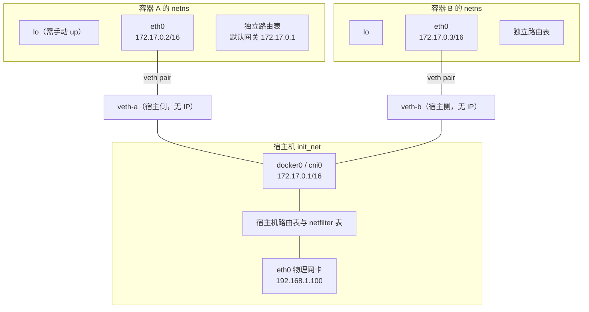
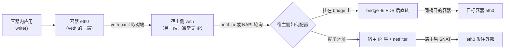
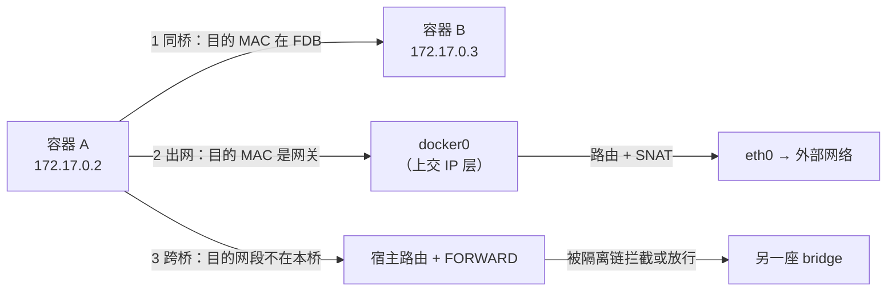
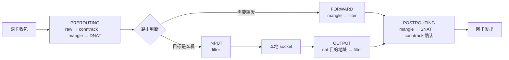
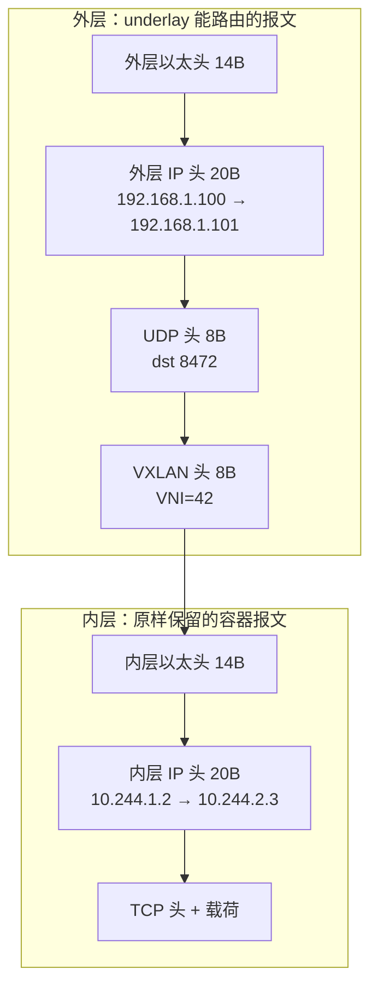
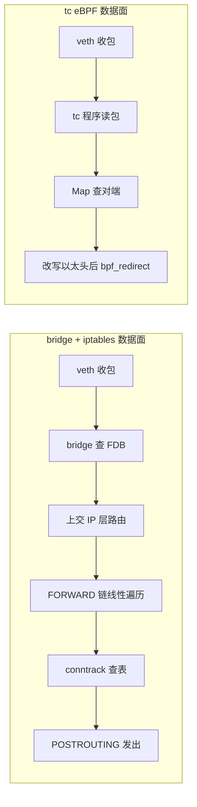

**摘要：**

容器网络是这些年被讲得最多、也最容易讲偏的一块。偏在两点：一是把它当成某个产品的功能，二是把它当成一套新协议。实际上内核里没有"容器网络"这个东西，只有五件早已存在的工具——网络命名空间负责圈地，veth 负责拉线，bridge 负责接线，netfilter 负责改地址，VXLAN 负责把二层架到三层之上，eBPF 则提供了绕开长链的另一条路。本篇把这五件工具逐个拆开，先讲每一件在内核里究竟是什么、能做什么、不能做什么，再讲它们拼接处的接缝：为什么地址分配必然带出 NAT，为什么 NAT 的规则量会随规模线性放大，为什么 overlay 一定会吃掉 MTU，以及为什么"大包不通、小包正常"几乎总是 MTU 而非路由。除此之外，文中还给出一条能复用的定位顺序——先切对视图、再在两端抓包、最后读连接跟踪表，以及四个反复出现的误判：把同网段当成同广播域、MTU 不跟着封装调、规则过万仍靠加规则、把 docker0 的规则当成集群的规则。全篇的落点在权衡：同一组原语可以拼出简单可读的小集群网络，也可以拼出绕开协议栈的高性能数据面，差别不在谁更先进，而在规模、故障可见性与团队认知成本三者之间的取舍。

---

二零一四年六月 Docker 1.0 发布，`docker run -p 8080:80` 这行命令被当作容器易用性的标志反复引用。但更值得追问的是这行命令背后究竟发生了什么：内核给这个容器造了一套独立的网络视图，一对虚拟网线把它接到宿主机上的一台软交换机，netfilter 在数据包进出宿主机的两处改写地址，最后由 conntrack 把双向的地址映射接上。整条链路上没有任何一处是 Docker 发明的东西，最老的一件可以追到二零零一年的 Netfilter，最新的 VXLAN 驱动也已在 3.7 内核里躺了两年。

把这些部件称为"原语"是准确的：它们各自只回答一个很小的问题，而且回答得很克制。命名空间只回答"给谁看"，不回答"怎么连"；veth 只回答"怎么连"，不回答"连到哪"；bridge 只回答"多个口怎么互通"，不回答"地址从哪来"；netfilter 只回答"在哪个点改包"，不回答"该不该改"；VXLAN 只回答"怎么把二层搬到三层上"，不回答"什么时候该搬"。容器网络的复杂度，几乎全部来自这些原语的组合方式与拼接处，而不是来自任何单件工具本身。

这也解释了为什么同样叫容器网络，小规模与大规模会走向完全不同的实现：规模小的时候，把五件工具按教科书顺序串起来最省心，出问题也看得见；规模上去以后，每件工具的内部成本（线性匹配、全量重写、封装开销、广播域）开始超过它带来的便利，人们才转向绕开它们的数据面。本篇只谈 Linux 这一侧，Kubernetes 的 Service 与 kube-proxy 数据面、CNI 插件选型、NetworkPolicy 的语义分别属于 [[云原生/Kubernetes/Kubernetes架构深度剖析/14 Service 与 kube-proxy：iptables IPVS eBPF 数据面演进]] 与 [[云原生/Kubernetes/Kubernetes架构深度剖析/15 CNI 网络模型与数据面对比：Flannel Calico Cilium]] 的话题，这里不再展开。

---

## 第 1 章 网络命名空间：被隔离的到底是什么

### 1.1 一个命名空间装下哪些东西

**网络命名空间（Network Namespace）**在二零零八年随 Linux 2.6.24 进入主线，由 Eric Biederman 维护的那一批 namespace 改动引入。内核里每个命名空间对应一个 `struct net` 实例，它不是一个"网卡容器"，而是一整套网络协议栈状态的容器。

把 `struct net` 的字段摊开看，能更清楚地知道隔离发生在哪一层：`netns_core` 放 sysctl 参数（诸如 `tcp_rmem`），`netns_ipv4` 与 `netns_ipv6` 放各自的协议状态与路由表，`netns_nf` 与 `netns_xt` 放 netfilter 的钩子点与 iptables 表，`netns_ct` 放连接跟踪表，`dev_base_head` 是这个命名空间里所有网络设备的链表，`loopback_dev` 指回环设备。任何一项在命名空间之间都不共享，因此一个容器里 `iptables -L` 看不到宿主机的规则，`ip route` 也拿不到宿主机的路由。

不过命名空间的边界并不等于"安全边界"。它隔离的是网络资源，不隔离内核版本、不隔离 CPU 与内存，也不隔离设备文件；真正把容器关进沙箱的还有 cgroups、capabilities、seccomp 等一批机制，命名空间只负责其中"看得见什么"的那一角。这一点在排查"容器里为什么能改宿主参数"一类问题时尤其要紧，因为很多内核参数的可见性由其他机制决定，与网络命名空间无关。

| 资源 | 是否按命名空间隔离 | 说明 |
|---|---|---|
| 网卡与 lo | 是 | 物理网卡默认留在 `init_net`，不会自动出现在新命名空间 |
| IP 地址与路由表 | 是 | 每个命名空间一套 FIB，策略路由的表号也各自独立 |
| iptables / nftables 规则 | 是 | 表与链都按命名空间挂载，宿主机规则对新命名空间不可见 |
| 连接跟踪表（conntrack） | 是 | 每个命名空间独立一份，表满只影响本命名空间 |
| socket 与端口空间 | 是 | 两个容器可以各自监听 8080，互不冲突 |
| `/proc/net` 统计 | 是 | 只反映本命名空间的计数 |
| 主机名与域名（UTS） | 否 | 属于 UTS 命名空间，与网络命名空间正交 |
| 内核网络参数默认值 | 部分 | 已存在的命名空间不跟随宿主机的 sysctl 变更 |

### 1.2 新建的命名空间里为什么只有一只 DOWN 的 lo

第一次执行 `ip netns add` 再进去看的人，几乎都会被这个场面劝退：里面空空荡荡，只有一只状态为 DOWN、MTU 为 65536 的回环设备，连 127.0.0.1 都不通。原因在于命名空间的设计取向是**干净继承**——新命名空间不继承宿主机任何配置，只由内核在创建时自动补一只 lo，且不主动把它拉起来。

```bash
# 创建一个命名空间：iproute2 会在 /var/run/netns 下建一个绑定挂载点
ip netns add probe

# 进去看：只有 lo，而且没有 IP、没有路由、没有 UP
ip netns exec probe ip link show
# 1: lo: <LOOPBACK> mtu 65536 qdisc noop state DOWN mode DEFAULT

ip netns exec probe ip addr add 127.0.0.1/8 dev lo
ip netns exec probe ip link set lo up
ip netns exec probe ping -c1 127.0.0.1
```

这个细节本身就是一条排障线索：如果容器里 127.0.0.1 不通，第一嫌疑是 lo 没起来，而不是应用绑错了地址。`ip netns add` 在用户态做的动作也值得记一笔——它并不真的"创建"一个内核对象，而是执行 `unshare(CLONE_NEWNET)` 造出新的命名空间，再把 `/proc/<pid>/ns/net` 绑定挂载到 `/var/run/netns/<name>`。名字只活在文件系统里，内核并不认识它。于是 `ip netns list` 列的其实是那个目录下的文件名，`ip netns delete` 做的也是卸载加删目录。

由此带出第一个常见的认知偏差：`ip netns list` 看不到全部容器的网络视图。容器运行时未必把命名空间挂到这个目录下，containerd 一类的实现会自己创建 `cni-` 前缀的挂载点，而早期直接用 `setns` 进入的实现干脆不留痕迹。`ip netns pids` 靠扫描 `/proc/*/ns/net` 找进程，`ip netns identify <pid>` 反过来按进程查名字，两者都是"遍历比对"而非内核索引，规模大时会慢，但它们至少能覆盖没有挂载点的情形。

### 1.3 进程是怎么被放进去的

从宿主机进入一个命名空间，与从零创建一个命名空间，是两条不同的路径。进入用 `setns()`，把一个指向目标命名空间的 fd 交给内核；创建用 `clone(CLONE_NEWNET)` 或 `unshare(CLONE_NEWNET)`，让新任务带上一套全新的协议栈状态。`ip netns exec` 的实现在前者：先在父进程里打开挂载点、拿到 fd，再 fork 出子进程，子进程 `setns()` 之后 `execve()` 目标命令——多出来的那次 fork 不是多余，而是必须。

原因的根源在 `nsproxy`。`setns()` 改的是"当前任务"的 `nsproxy` 指针，而这个指针在线程组内是被共享的，改一个线程等于改整组；同时，进程此前已经打开的 socket 仍然绑定在旧命名空间上，`setns()` 不会把它们搬过去。所以进入新命名空间的恰当做法是：fork 出一个单线程子进程，在它里面 `setns()`，然后立刻 `execve()`，让进程从干净状态开始在新视图里创建 socket。

容器运行时走的是创建路径。OCI 规范里，容器的配置中有一份 `linux.namespaces` 列表，`runc` 在对子进程做 `clone()` 时按这份列表带上 `CLONE_NEWNET`，一个全新的网络命名空间就在这一刻诞生；如果列表里某类命名空间带的是 `path` 而不是 `type`，`runc` 就改成 `setns()` 进入那个已有路径。Kubernetes 的 Pod 正是用了后一种形态：kubelet 先创建沙箱容器（也就是 pause 容器），沙箱自带一个全新的 netns，随后调用 CNI 插件的 ADD，把沙箱 netns 的路径作为参数传进去，插件进入该命名空间创建 veth、分配地址、写路由；最后创建业务容器时，其 OCI 配置里的网络命名空间指向同一个路径。

这条时序解释了两个经常被当成"特性"的现象：同一 Pod 内所有容器共享同一个 netns，所以它们可以用 `localhost` 互访，也所以它们会在端口上打架；沙箱容器本身几乎不干活，却必须存在，因为它持有的那个 netns 是 Pod 网络身份的实际载体，沙箱一死，Pod 的 IP 与连接跟踪也就随之消失。把宿主机与两个容器的命名空间并排画出来，资源的归属关系就清楚了：设备各有各的一份，桥只有一座。



图上能看出一个容易被忽略的对称性：容器侧那只 `eth0` 与宿主侧那只 `veth-x` 是同一条线的两端，容器侧的配置由 CNI 插件在命名空间内完成，宿主侧的配置（接桥、无 IP）在 `init_net` 里完成，两侧各自只认自己那半段。

---

## 第 2 章 veth：一根网线，而不是一台交换机

### 2.1 成对出现的设备

veth（Virtual Ethernet）驱动的历史比网络命名空间更久，早期在 Xen、OpenVZ 一类虚拟化方案里用来给虚拟环境拉一根虚拟网线，后来成了跨命名空间通信的标准手段。它的核心语义只有一句话：**成对出现**，一端发出即另一端收到。

```bash
# 造一对线，先放在宿主机上
ip link add veth-a type veth peer name veth-b

# 把容器那一半塞进命名空间
ip link set veth-b netns probe

# 两端分别上电、配地址
ip addr add 10.0.0.1/24 dev veth-a
ip link set veth-a up
ip netns exec probe ip addr add 10.0.0.2/24 dev veth-b
ip netns exec probe ip link set veth-b up
ip netns exec probe ip route add default via 10.0.0.1
```

下面这张图把这段路径画出来，注意宿主侧那个分叉：同一根线的另一端，接桥与配 IP 是两条完全不同的处理路径。



数据在内核里的走向几乎没有"传送"这个动作。`drivers/net/veth.c` 里的发送函数先取出 `priv->peer`，把 skb 直接交给对端的接收路径（`netif_rx`，或 NAPI 模式下挂到对端轮询队列上），对端此后就和真的从网线上收到一个包一样，走完整的协议栈处理。整个过程中没有 DMA、没有中断、没有 PCIe 事务，因此单跳延迟极低。

但"极低"不等于"免费"。skb 仍然要被解析一次，可能的 GRO 仍然要做，协议栈的入口函数一个不少；一对 veth 上跑满流量时，软中断同样会打满一个核。veth 省掉的是硬件那一侧的搬运，不是软件那一侧的处理。

### 2.2 "点对点"这个定性决定了能力边界

关于 veth 最值得记住的一句话是：它是一根网线，不是一台交换机。这句话不是修辞，而是能力边界的精确表述，四个直接后果都从这里推出来。

线只有**两个端点**，所以它不可能同时连三个容器。想让 A、B、C 三个容器互通，要么拉三根线并在宿主侧做路由，要么拉三根线接到一台软交换机上——后者就是 bridge 存在的理由。

线不会学习地址。bridge 有转发表、会记源 MAC、会在未知单播时泛洪，veth 一样都没有；它收到的帧只能交给对端或本机协议栈，没有"转给第三个口"这个动作。

线不做策略。veth 上没有可以下发的访问控制，策略只能落在别处——netfilter 的 FORWARD 链、或者挂在 veth 上的 tc/XDP 程序。这解释了为什么策略类数据面（eBPF 方案）总是把程序挂在 veth 上：那是每个容器流量都必然经过的最窄的卡口。

线不跨三层。veth 两端可以配不同网段的地址，但那样它们就是一条点对点链路，两侧都需要各自的路由才能把包送到更远的地方；指望 veth 自己"把一个网段搬到另一个网段"是不成立的，那需要封装或路由。

### 2.3 四种接法，对应四种用途

同一对 veth，在宿主侧怎么处理，决定它在组网里扮演什么角色。这个视角比背设备类型有用，因为线上遇到的绝大多数拓扑都是这四种接法的组合。

| 设备 | 是否成对 | 可跨 netns | 二层语义 | 典型用途 |
|---|---|---|---|---|
| veth | 是 | 是 | 点对点，无学习无泛洪 | 容器接入宿主机 |
| tap | 否，另一端接用户态 | 可 | 点对点，帧交给用户态进程 | 虚拟机网卡、用户态交换 |
| macvlan | 否，挂在父接口上 | 是 | 独立 MAC，看起来像物理网卡 | 容器直接接入物理网段 |
| ipvlan | 否，共享父接口 MAC | 是 | L2/L3 两种模式 | 大量容器、规避 MAC 表压力 |
| dummy | 否 | 是 | 仅本机可见 | 承载地址、做测试与黑洞路由 |

第一种接法是宿主侧无 IP、直接接桥，这是 Docker 与多数 CNI 的默认形态，veth 在此只是"容器到交换机的一段跳线"。第二种接法是宿主侧有 IP、不接桥，两端构成一条三层点对点链路，这种形态在轻量组网与网络实验里很常见，它把路由决策全部交给两端，省掉桥的转发与广播域。第三种接法是宿主侧挂 tc 或 XDP 程序，此时 veth 不再是转发路径上的被动管道，而是策略执行点。第四种接法是宿主侧作为监控点，抓包、镜像、统计都在这一侧完成。

第二种接法有个不起眼的好处：没有桥就没有广播域，ARP 只发生在点对点两端，规模上去以后 FDB 与泛洪的成本直接消失。代价是每新增一个容器就要多一条宿主路由，路由表规模随容器数线性增长，等规模再大一些又会被迫回到按节点聚合的方案上去。

### 2.4 拔线与对端消失

veth 的清理语义也值得知道。删除任意一端，另一端会自动消失；反过来，如果对端所在的命名空间被销毁而这一端还活着，发送函数取到空的 `peer`，包会被直接丢弃，不会有 ICMP 差错回给发送方。这类"静默丢包"在容器重启、沙箱重建的瞬间很常见，表现为应用侧偶发的连接超时，而宿主机的网卡计数里什么都看不到。

同理，veth 的 MTU 两端独立可设，但真正的端到端 MTU 由**路径上最小的一跳**决定。宿主侧为了方便常常不动默认的 1500，容器侧却在 overlay 场景下被设成 1450，于是"容器认为能发 1450、宿主认为能发 1500"这种局部一致、全局不一致的状态，就成了第七章要专门处理的 MTU 问题的温床。

---

## 第 3 章 bridge：宿主机上的一台二层交换机

### 3.1 为什么需要一台交换机

只有一对 veth 时，容器与宿主机之间的通信已经成立，但容器与容器之间还差一步。若不用 bridge，两个容器互访只能让包先上到宿主机 IP 层，由路由与 FORWARD 链转发，再从另一根 veth 下去——每次通信都过一次三层，代价是两次路由查找与两轮 netfilter 遍历。更麻烦的是地址规划：每加一个容器就多一条宿主路由，路由表与容器数同阶增长。

Linux bridge 把这件事降回二层。它模拟一台以太网交换机：多个口组成一个广播域，帧按目的 MAC 转发，同一网段内的两台主机不需要任何路由配置就能互访。Docker 在 2014 年把 `docker0` 作为默认 bridge 网络的载体，多数 CNI 插件也沿用这个套路，只是把桥改名为 `cni0`。

### 3.2 转发表的三个判断

bridge 的转发逻辑本身很短：一个帧从某个口进来，先学源 MAC（记下"这个 MAC 在这个口后面"），再查目的 MAC，然后做三选一的判断。目的 MAC 在表里，单播转发到对应口；不在表里，**泛洪**到除入端口外的所有口；目的 MAC 是 bridge 自己的地址，上交本机 IP 层。

```bash
# 建桥、配地址、上电
ip link add br-lab type bridge
ip addr add 10.10.0.1/24 dev br-lab
ip link set br-lab up

# 把一根 veth 的宿主侧插进桥（此时它就没有 IP 了，纯二层口）
ip link set veth-a master br-lab
ip link set veth-a up

# 看桥上的口与转发表
bridge link show
bridge fdb show dev veth-a
```

`bridge fdb show` 里那条全零 MAC 的永久表项是本地表项，用来接住泛洪；后面跟着的则是学到的容器 MAC。排查"同桥两个容器不通"时，先看 FDB 有没有对方的表项，再看两侧的 veth 是否都是 forwarding 状态，最后才去看 iptables——顺序反了会浪费很多时间。

### 3.3 docker0 的双重身份

`docker0` 这个名字容易让人以为它只是个网桥，实际上它在内核里同时是两样东西，这就是它的**双重身份**：一台二层交换机，和一块宿主机的网卡。作为交换机，它把挂在下面的 veth 连成一个广播域；作为网卡，它自己有一个 IP（默认 `172.17.0.1/16`），出现在宿主机的路由表里，是容器默认网关的下一跳。

```bash
ip -d link show docker0
# docker0: <BROADCAST,MULTICAST,UP,LOWER_UP> mtu 1500
#     bridge forward_delay 0 hello_time 200 max_age 2000
ip route show | grep docker0
# 172.17.0.0/16 dev docker0 proto kernel scope link src 172.17.0.1
```

双重身份的后果是：容器把包发给网关（`172.17.0.1`）时，这个 MAC 地址其实就是 bridge 自己的地址，帧到了桥上就被"上交本机"，进入宿主机的 IP 层；而容器与同桥另一个容器通信时，目的 MAC 是对方的地址，帧在桥上直接转发，根本不上到 IP 层。同一个 bridge 设备，两条完全不同的处理路径，取决于目的 MAC 是谁。

这也解释了 `docker0` 为什么必须有 IP：没有 IP 它就只能当交换机，容器就没有网关，出网就无从谈起。反过来，如果一台宿主机上的 `docker0` 被手工删掉又重建却没有配地址，容器仍然能互访（二层还在），但出网全断（没有网关），症状会非常像"DNS 坏了"。

### 3.4 三条路径

同一个宿主机上的容器流量，实际上只有三种归宿，把这三条路径记牢，大部分拓扑问题都能在脑子里跑一遍。



第一条是同桥互访，全程二层，桥查表直转，不经过宿主机 IP 层，也不产生路由查找。第二条是出网，帧到桥即上交，宿主机路由选中 `eth0`，`nat` 表的 POSTROUTING 做源地址改写。第三条是跨桥，两个容器分属不同网段、不同桥，二层完全不通用，只能靠宿主路由加 FORWARD 转发；Docker 默认用 `DOCKER-ISOLATION-STAGE` 链把跨桥转发丢掉，目的是防止不同 bridge 网络之间未经声明就互通，这个默认值经常被误认为"网络坏了"。

开源实现里还有一层容易被忽略的开关：`br_netfilter`。这个模块让桥接流量也走一遍 netfilter 的 FORWARD 链，Docker 会加载它并打开 `net.bridge.bridge-nf-call-iptables`。好处是容器间流量也能被策略约束；代价是每个桥接帧都要过一次 netfilter，在规则量大时这笔开销并不小，而它恰恰是纯二层转发本以为可以省掉的部分。

### 3.5 桥的代价

桥不是免费的抽象层，它把问题从"路由表膨胀"换成了"广播域扩张"，而广播域有它自己的成本。

泛洪是最直接的一项：目的 MAC 未知时帧会发往所有口，ARP 请求天然是广播，容器数量多、短连接多的时候，泛洪流量在桥内占比会明显上升。转发表规模是第二项：每个容器一个 MAC，几千个容器就是几千条 FDB 表项，查表本身是哈希所以不慢，但老化与重建会带来抖动。第三项是没有 STP——Docker 默认关掉生成树，因为容器网络里出现环路的概率低，一旦真接出环路，桥会用泛洪把环路放大成广播风暴，这类事故在小规模环境里罕见，在混合组网（同时接了 underlay 与 overlay）时并不罕见。

还有一个隐含成本在故障可见性上：桥接流量不经过 IP 层，`ip -s link` 的计数分散在桥与各个 veth 口上，抓包要抓对端口才有意义。这也是为什么排障时"在 docker0 上抓不到包"经常不是没流量，而是流量根本没上到那一层。

---

## 第 4 章 地址与 NAT：出网靠 SNAT，入网靠 DNAT

### 4.1 地址从哪来

容器要能通信，第一件事是拿到地址。这里的做法有三类，各有各的代价。

集中分配：由一个全局的服务记录所有已用地址，容器创建时申请、销毁时归还，全局唯一性最强，但需要一次网络往返与状态存储，容器密度高时控制面压力明显。按节点切块：每个节点分到一段（Flannel 给每个节点一个 `/24`，Calico 给一个 `/26` 的 block），节点内自由分配，聚合性好、控制面轻，代价是地址利用率低，节点数多时整段地址会被切得很碎。第三类是 DHCP，直接复用现有基础设施，但引入了租约与广播，在容器生命周期短、创建频繁的场景里不划算。

Docker 的默认做法接近第二类，只是粒度更粗：`docker0` 拿 `172.17.0.0/16`，容器在这个 /16 里依次分配。于是"容器地址都在 172.17 网段"变成了一个广泛流传的错觉——这个 /16 只在本宿主机的 `docker0` 广播域内有意义，跨宿主机的同网段是两座互不相通的孤岛，除非上面再叠一层封装或路由。

### 4.2 五个钩子与它们的先后

地址有了，接下来是改地址。netfilter 在协议栈上放了五个钩子点，每个点按优先级挂若干张表，数据包经过时依次执行。理解这张顺序表，比记住任何一条具体规则都有用，因为排查 NAT 问题时问的第一个问题永远是"这个包经过哪个钩子时被谁改了"。

下图把五个钩子与两张关键表的位置画在一起，DNAT 落在路由之前、SNAT 落在路由之后，这个顺序不是实现细节，而是"路由必须看到改写后的目的地址"这一约束的直接结果。



| 钩子 | 挂载的表与优先级（由先到后） | 典型动作 |
|---|---|---|
| PREROUTING | raw(-300)、conntrack(-200)、mangle(-150)、nat 目的地址(-100) | DNAT、建立连接跟踪 |
| INPUT | mangle、filter、security | 发往本机服务的准入 |
| FORWARD | mangle、filter、security | 转发流量准入，容器互访策略 |
| OUTPUT | raw、conntrack、mangle、nat(-100)、filter | 本机发出的包改写目的地址 |
| POSTROUTING | mangle(-150)、nat 源地址(100)、conntrack 确认 | SNAT、MASQUERADE |

顺序上的两个细节决定了大量行为。其一，conntrack 在 nat 之前，所以 NAT 只对连接的第一个包做真正的改写，后续包靠**连接跟踪**表直接命中，这也是为什么 NAT 规则再多，长连接的稳态转发并不受规则量影响——受影响的是新建连接。其二，nat 表在 PREROUTING 处改的是目的地址、在 POSTROUTING 处改的是源地址，位置不能互换，因为路由决策发生在两者之间：目的地址必须在路由之前改好，源地址必须在出口确定之后才能改。

### 4.3 出网：MASQUERADE 的完整链路

容器访问外部网络，源地址是私有的，必须换成宿主机出口地址，否则回程无处可去。Docker 为此加了三条规则，分别负责改写、放行与回程。

```bash
# 源地址改写：从 172.17.0.0/16 来、且不是从 docker0 出去的包
iptables -t nat -A POSTROUTING -s 172.17.0.0/16 ! -o docker0 -j MASQUERADE

# 转发放行：允许容器出网及其回程
iptables -t filter -A FORWARD -o docker0 -m conntrack --ctstate RELATED,ESTABLISHED -j ACCEPT
iptables -t filter -A FORWARD -i docker0 ! -o docker0 -j ACCEPT
```

`MASQUERADE` 与 `SNAT --to-source` 的区别在于出口地址是否固定：前者每次取当前出口接口的地址，适合拨号或地址会变的场景，代价是每条连接都要查一次出口地址；后者写死地址，快一些，但换 IP 就要改规则。容器场景里出口地址通常固定，理论上用 SNAT 更省，Docker 选 MASQUERADE 是为了适配"宿主 IP 也可能变"的桌面环境。

一个从容器到外部 HTTPS 服务的包，走完的路径是这样：容器查路由得默认网关 `172.17.0.1`，ARP 得到 bridge 的 MAC，帧经 veth 上到桥；桥发现目的 MAC 是自己，上交 IP 层；宿主路由选中 `eth0`；FORWARD 链放行；POSTROUTING 把源地址从 `172.17.0.2` 改成 `192.168.1.100`，同时 conntrack 记下这对映射；包从 `eth0` 出去。回程包到 `eth0` 后，PREROUTING 的 conntrack 命中，目的地址被还原成 `172.17.0.2`，再按路由送进 `docker0`，最终到达容器。整个回程不需要任何 DNAT 规则，全靠连接跟踪表。

### 4.4 入网：DNAT 与端口映射

反方向的访问需要目的地址改写。`docker run -p 8080:80` 会在 nat 表里留下四条规则，每条都有明确的存在理由。

```bash
# 只在目的地址属于本机时进入 DOCKER 链，避免无谓遍历
iptables -t nat -A PREROUTING -m addrtype --dst-type LOCAL -j DOCKER
iptables -t nat -A OUTPUT     -m addrtype --dst-type LOCAL -j DOCKER

# 端口映射本体：从非 docker0 接口进来、目的端口 8080 的包改投容器
iptables -t nat -A DOCKER ! -i docker0 -p tcp --dport 8080 -j DNAT --to-destination 172.17.0.2:80

# 回环（hairpin）：同宿主容器经宿主 IP 访问映射端口时的源地址改写
iptables -t nat -A POSTROUTING -s 172.17.0.0/16 -d 172.17.0.2 -p tcp --dport 80 -j MASQUERADE
```

第二条规则里的 `OUTPUT` 链常被忽略：宿主机上直接 `curl 127.0.0.1:8080` 时，包不经过 PREROUTING，只经过 OUTPUT，没有这条规则，本机访问映射端口就不通。第四条规则解决的是另一个不对称：容器 A 经宿主 IP 访问容器 B 的映射端口时，请求的源地址是 A 的地址，B 看到的源也是 A 的地址，于是 B 的回程会直接把包发给 A 而不经过宿主机，NAT 被绕过，连接建不起来；补一条针对该路径的 MASQUERADE 让回程也走宿主机，问题才消失。

除了这套规则，Docker 默认还会起一个用户态进程 `docker-proxy` 监听宿主端口。它的存在是为了覆盖某些规则覆盖不到的场景（例如早期内核的本地回环路径），代价是每个映射端口多一个进程、多一次用户态转发。关掉它（`userland-proxy: false`）能省掉这笔开销，但会改变某些访问路径的行为，属于典型的"性能换确定性"的取舍。

### 4.5 规则量上去以后

NAT 这套机制在小规模下几乎无懈可击，问题出在规模上，而且不是一种问题，是三种成本同时放大。

第一种是匹配成本。iptables 的链是**线性表**，一个包进入某个钩子，就要从链头开始逐条比对，直到命中。容器场景里，`DOCKER` 链的规则数等于映射端口数，`FORWARD` 链还要经过隔离链；如果上层是 Kubernetes，`KUBE-SERVICES` 链每个 Service 一条规则，再跳进每个 Service 自己的子链，规则数与 Service、端点数量同阶增长。以一万条规则、每条一次比较在数十纳秒量级来估算，单次新建连接多出的匹配开销落在数百微秒（示例推算）。这个数字单独看不大，但它加在每一个新连接的第一个包上，对 P99 的影响远大于对平均值的影响。

第二种是更新成本。iptables 的规则集没有增量接口，任何改动都要用 `iptables-restore` 把整张表**全量重写**一遍，写入耗时随规则数线性增长；规则集到数千条量级时，一次全量同步通常在百毫秒到秒级（量级判断）。在端点频繁变化的环境里，这种"为了改一条规则而重写一万条"的模式会周期性地占住 CPU，并在这段时间里让新规则不可见。

第三种是连接跟踪的成本。NAT 依赖 conntrack，每条连接一个表项，表项数受 `nf_conntrack_max` 限制，超限时新连接被直接丢弃，内核日志里留下 `nf_conntrack: table full, dropping packet`。表本身是哈希加链，桶数不随表项数自动扩展，桶内链表变长以后查找退化；高并发短连接场景下，插入与过期还要争同一把锁。这类问题在 NAT 规则完全正确的情况下也会发生，因此只盯着规则看是查不出来的。

| 规则量级 | 新建连接的多余匹配开销（示例推算） | 一次全量同步耗时（量级判断） | 典型体感 |
|---|---|---|---|
| 数十条 | 微秒以内 | 毫秒级 | 无感 |
| 数百到一千条 | 数十微秒 | 十毫秒到百毫秒 | 长尾略抖 |
| 数千条 | 百微秒量级 | 百毫秒到秒级 | 新建连接 P99 抬头，同步时抖动明显 |
| 万条以上 | 数百微秒到毫秒 | 秒级及以上 | 同步期间规则短暂不一致，需要换数据面 |

### 4.6 nftables 的位置

顺着这条线自然会问：换成 nftables 是不是就不用换数据面了。答案是部分成立。nftables 仍然跑在同一套 netfilter 框架上，钩子点与优先级顺序不变，但规则被编译成字节码执行，并且支持集合（set）与映射（map），把"按目的地址查一组前缀"这类判断从线性扫描变成哈希或树查找，规则更新也从全量替换变成事务性增量。

不过链内的规则仍然是顺序执行的，模型没有根本改变；更现实的问题是工具链与生态，nftables 的语法、调试方式、周边工具与 iptables 差异不小，存量规则迁移不是免费的。因此多数大规模集群选择的不是"把 iptables 换成 nftables"，而是直接跳到第 6 章那类 eBPF 数据面，把匹配逻辑挪进 BPF 程序与 Map 里。

---

## 第 5 章 VXLAN：把二层架到三层之上

### 5.1 为什么需要 overlay

前面的故事都发生在同一台宿主机上。跨宿主机时，问题立刻变得棘手：容器的地址是各宿主自己切的私有网段，物理网络不认识它们，交换机也不会为它们转发。有两种解法——让物理网络认识这些地址（BGP 把容器网段通告出去，走原生路由），或者让容器流量钻进一个宿主机之间能路由的隧道里（overlay）。前者要求网络设备配合，后者只要求宿主之间三层可达。

VXLAN（Virtual Extensible LAN）是后者的主流实现，规范是二零一四年的 RFC 7348，Linux 驱动在 3.7 内核里就已经落地。它把整个二层帧塞进 UDP 里发送，于是"跨宿主机的二层网段"这件事变成了"两台宿主机之间发 UDP 包"，中间的网络不需要知道任何容器地址。

代价也随之而来，而且集中在三处：字节、CPU、可见性。字节是封装头的开销，直接影响 MTU；CPU 是封装与解封装的处理，影响吞吐；可见性是封装的副作用——underlay 上抓包只能看到 UDP，看不到里层的连接。

### 5.2 报文结构与配置

封装后的包里，原来那个完整的以太帧成了载荷，前面加上 VXLAN 头（8 字节，含 24 位 VNI）、UDP 头（8 字节，默认端口 4789，Flannel 沿用 8472）、外层 IP 头（20 字节），再加上外层以太头（14 字节）。合计 50 字节，这就是"1500 减 50 等于 1450"的由来。下图把这层套娃摊平，看得出来内层报文一个字节没少，只是外面多穿了几件衣服。



与 veth 的一对一不同，VXLAN 设备是一台一对多的隧道端点：同一个设备可以和任意多个远端宿主建立隧道，对端由转发表项指定，而不是像 veth 那样在创建时就把两端锁死。这个差别解释了为什么 VXLAN 设备总是配着 bridge 出现——桥负责在本地把多个容器的口聚起来，隧道端点负责把整个广播域送到远端。

在 Linux 上建一个 VXLAN 设备只需要一行，但要把它接进现成的桥、并告诉它"对端在哪个宿主"，还得补两步。

```bash
# 1. 在 underlay 上建隧道设备：id 即 VNI，dev 指定出口，dstport 是两端约定
ip link add vxlan0 type vxlan id 42 dev eth0 dstport 8472
ip link set vxlan0 up

# 2. 接进桥，让容器网段与隧道同处一个广播域
ip link set vxlan0 master br-lab

# 3. 泛洪表项：目的 MAC 未知（BUM 流量）时发往哪个对端
bridge fdb append 00:00:00:00:00:00 dev vxlan0 dst 192.168.1.101
```

第三步是全手工配置里最容易漏掉的一步。VXLAN 设备本身不知道对端在哪，单播表项靠学习填充，而 ARP 这类广播（BUM：广播、未知单播、多播）没有目的 MAC 可查，只能靠全零表项指定"发给谁"。漏掉它，症状是跨宿主 ping 不通、同宿主一切正常，因为 ARP 请求根本出不了宿主机。

生产环境里这张表通常由控制面维护（Flannel 用 etcd 或 API Server 存子网与宿主的对应关系，再由 `flanneld` 写 FDB），手工 `bridge fdb append` 只在实验与排障时出现。理解它的存在，才能在"跨节点不通但地址都对"的时候第一时间想到去看 FDB。

### 5.3 三笔开销

第一笔是字节，也就是 50 字节的封装头，把有效 MTU 从 1500 压到 1450。这笔开销是固定的、可预测的，也最容易事前算清；真正麻烦的是它引发的连锁反应——应用与中间件若假设 MTU 为 1500，就会在大包上撞墙。这部分第 7 章专门展开。

第二笔是 CPU。封装要复制数据、算校验和、可能还要分段，解封装同理。现代网卡支持 VXLAN 卸载（把分段与校验和交给硬件），开启与不开启的差距很大；网卡是否真的认下了这个隧道端口可以直接查——`ethtool --show-tunnels eth0` 会列出被识别为隧道端口的 UDP 端口表，VXLAN 端口不在表里，就谈不上硬件分段与校验和卸载，只能走软件路径；纯软件路径下，封装带来的吞吐损失通常在一成到数成之间，小包场景更明显，因为每字节的头部占比更高（量级判断）。延迟上的增量主要来自多一次内存拷贝与一次 UDP 收发，绝对量不大，但对延迟极其敏感的服务仍可感知。

第三笔是可见性。在 underlay 上抓包，看到的是 UDP 8472 的流量，里层的五元组要解封装才能看到；`tcpdump` 在 VXLAN 设备上抓可以拿到解封装后的帧，但设备本身可能没有地址，抓包位置需要斟酌。故障定界因此多了一层：先确认 underlay 通不通，再确认 VNI 与 FDB 对不对，最后才是容器内的路由与服务。

### 5.4 什么时候不该用 overlay

overlay 用封装换掉了对物理网络的要求，这笔交易在三种情况下不划算。

宿主机之间本来就在同一个三层网段、且网络设备允许通告容器网段时，原生路由（BGP 或静态路由）没有封装开销，MTU 保持 1500，抓包可见，排查链路也更短。对吞吐与延迟极敏感的场景，50 字节与一次拷贝的代价会直接体现在业务指标上。需要网络设备参与策略、审计或镜像的场景，封装会让中间设备看不懂流量，合规与安全团队通常不接受。

反过来说，跨机房、跨云、以及网络设备不受自己控制的环境里，overlay 几乎是唯一选择——这就是权衡：它不是更先进的方案，而是把复杂度从"要求别人改网络"挪到了"自己承担封装"。

| 组网方式 | 封装开销 | 1500 下建议 MTU | 对物理网络的要求 | 可见性 |
|---|---|---|---|---|
| 同宿主 bridge | 无 | 1500 | 无 | 好，逐跳可抓 |
| 原生路由（BGP/静态） | 无 | 1500 | 需通告容器网段 | 好 |
| IPIP | 外层 IP 头 20B | 1480 | 三层可达 | 中，需解封装 |
| VXLAN / Geneve | 约 50B | 1450 | 三层可达 + UDP 放行 | 差，需解封装 |
| WireGuard 等加密隧道 | 约 60B | 1440 | 三层可达 + UDP 放行 | 差，且看不到明文 |

---

## 第 6 章 eBPF：绕开长链的另一条路

### 6.1 iptables 的三个结构性成本

第 4 章末尾提到的规模问题，根子不在配置写得对不对，而在三个**结构性选择**。

匹配是线性的：规则按顺序存在链里，判断必须逐条进行，没有任何索引可借。更新是全量的：改一条要重写整张表，因为规则在用户态是一个整体，没有增量下发接口。位置是固定的：包必须走完路由决策、必须构造出 skb，才能到达 netfilter 的钩子，因此既不能在更早的阶段丢弃，也无法看到传输层以上的内容。

这三条都不是实现缺陷，而是 netfilter 在二零零一年设计时的合理取舍——那个年代转发规则是几十条量级，可读性与一致性比大规模性能重要得多。二十多年后规模变了，取舍的前提也就变了。

### 6.2 eBPF 能挂在哪

eBPF 提供的不是"另一个防火墙"，而是一组可以挂到内核各处的执行点。不同的挂载点看到的数据形态不同，能做的事也不同，选错挂载点往往比写错程序更麻烦。

| 挂载点 | 看到的数据 | 典型能力 | 主要限制 |
|---|---|---|---|
| XDP | 原始帧，无 skb | 最早丢弃、重定向、计数 | 无 skb，看不到传输层以上；需驱动支持 |
| tc（clsact） | skb | 重定向、改写、限速、策略 | 比 XDP 晚，但信息完整 |
| socket 层 | socket 与消息 | 短路转发、L7 解析、代理加速 | 只覆盖本机 socket 路径 |
| kprobe / tracepoint | 内核函数参数 | 观测、诊断 | 不能改包，开销随点位增长 |

对容器网络而言最关键的是 tc 这一层：每个容器的 veth 都在宿主侧有一个确定的挂载点，把 `clsact` qdisc 挂上去，容器流量的进与出就都在掌握之中。这比在链上堆规则灵活得多，因为程序可以直接读包、查表、改字段、决定去向，而不是只能"匹配-动作"。

### 6.3 从长链到一次重定向

eBPF 数据面的核心动作是把"经过一长串规则判断后转发"换成"查一次表然后直接**重定向**"。具体由两个原语承担。

`bpf_redirect(ifindex, flags)` 让当前包从指定设备发出，跳过内核的路由查找与 netfilter 钩子；`bpf_redirect_neigh(ifindex, params, ...)` 更进一步，允许程序只给出下一跳地址与出口，由内核补齐邻居表（ARP/ND）信息再发，省掉在 BPF 程序里自己维护 MAC 的麻烦。前者要求程序自己把以太头改对，后者把邻居解析交回内核，两者在写法复杂度与可控性上各有取舍。

另一条路在 socket 层。`sockmap` 允许把两个 socket 关联到一张 map 里，`sk_msg` 程序在这条关联上做重定向与改写，于是"代理"这件事可以从用户态搬进内核：两个 socket 之间的数据不再经过用户态的读写循环，而是直接在内核里对接。这条路径对短连接密集的代理、以及服务网格里 sidecar 的转发尤其有效，因为它省掉的正是用户态那一轮上下文切换与内存拷贝。

### 6.4 同宿主直连与它带来的债

把这两件原语拼起来，同宿主两个容器之间的通信可以变成一条极短的路径：容器 A 的 veth 上挂着 tc egress 程序，程序查一张以目的地址为键的 map，拿到 B 的 veth 的 ifindex 与 MAC，改好以太头，`bpf_redirect` 过去；包直接在 B 的 veth 上出现，中间没有 bridge 的查表与泛洪，没有 FORWARD 链的遍历，也没有 conntrack 的参与。

```c
/* 示意：tc egress 上的同宿主直连，省略错误处理与 map 定义细节 */
SEC("tc")
int redirect_peer(struct __sk_buff *skb)
{
    struct l3_key key = {};
    parse_l3(skb, &key);                    /* 取目的 IP 作为查表键 */

    struct peer *p = map_lookup_elem(&peers, &key.daddr);
    if (!p) {
        return TC_ACT_OK;                   /* 表里没有，交回协议栈按常规处理 */
    }
    bpf_skb_store_bytes(skb, ETH_DST_OFF, p->mac, ETH_ALEN, 0);
    return bpf_redirect(p->ifindex, 0);     /* 直接送到对端 veth，跳过路由与 netfilter */
}
```

两条数据面的差别，可以归结为包经过多少个判断点。



省下来的这些步骤，正是需要自己补回来的东西。conntrack 的语义（NAT 的还原、`RELATED` 关联、超时老化）、策略的默认拒绝、连接的可观测性，全都要在 BPF 程序或控制面里重建一遍。这不是"实现细节"，而是这套方案的主要成本：绕过框架的同时也失去了框架提供的一切。

一个具体的例子能说明这种债的分量。某些多通道协议（控制连接协商出数据连接的端口）依赖 conntrack 的 `RELATED` 机制自动放行数据连接，纯 eBPF 数据面如果没有实现对应的关联逻辑，控制连接能通、数据连接会被丢，而且丢得毫无痕迹——因为没有任何一条规则在拒绝它。

### 6.5 门槛与代价

eBPF 的工程门槛集中在内核与工具链：BTF 与 CO-RE 让程序可以跨内核版本复用，但要求内核足够新（4.18 起步，生产实践通常要求 5.x 以上）；同一个程序在不同发行版内核上的行为差异需要通过特性探测兜底；调试要靠 `bpftool`、verifier 日志与 trace，比 `iptables -L` 高出不少认知成本；map 的内存占用、LRU 淘汰策略、程序指令数上限也都是需要设计的参数。

| 维度 | iptables | IPVS | tc/XDP eBPF |
|---|---|---|---|
| 匹配方式 | 链内线性遍历 | 服务维度哈希 | Map 查找 |
| 规则更新 | 全量重写 | 增量 | 增量 |
| 大规模表现 | 随规则数退化 | 随服务数基本平稳 | 与规模基本无关 |
| L7 能力 | 无 | 无 | 可编程解析 |
| 可观测性 | 计数器与日志 | 有限 | 程序内任意埋点 |
| 门槛 | 无 | 需要内核模块 | 内核版本、工具链、团队认知 |

对 Cilium 一类方案的思路可以用一句话概括：把每个容器 veth 当成策略执行点，用挂在 tc 上的 eBPF 程序加 BPF map 取代 kube-proxy 与 iptables 的长链，同宿主流量走重定向直连，跨宿主再回落到隧道或原生路由。

### 6.6 什么时候还该留在 iptables

三件事上 iptables 仍然更合适：规模在几百条规则以内，此时匹配开销可以忽略，而可读性带来的运维收益是实打实的；团队没有内核侧调试能力，需要"看得懂的规则"而非"看得懂的程序"；环境的内核版本参差、无法统一，eBPF 程序的可移植性成本会超过它带来的性能收益。

这不是技术保守，而是把复杂度放在能被维护的地方。一个只有五十条规则、但任何人都能 `iptables -L -n` 看懂的节点，比一个性能优秀但只有两个人能调试的数据面更可靠——可靠性从来不只由数据面性能决定。

---

## 第 7 章 MTU：最容易出事的一处

### 7.1 一笔必须做的算术

MTU（Maximum Transmission Unit）是链路能承载的最大 IP 报文长度，以太网默认 1500。问题在于封装：封装之后，内层那个完整的帧成了外层包的载荷，外层还要加上自己的头部，于是"外层链路能装 1500"就意味着"内层最多只能装 1500 减去封装头的长度"。

这笔账在每条链路上都必须算。同宿主 bridge 没有封装，内层仍是 1500。IPIP 加 20 字节外层 IP 头，内层降为 1480。VXLAN 加约 50 字节，内层降为 1450。加密隧道如 WireGuard 再多一些，通常按 1440 配。

算错的方向有两种，后果完全不同。MTU 配大了，内层按 1500 发出的报文到了外层装不下，若 `DF` 位（Don't Fragment）置位则被丢弃，若没置位则被外层分片，分片后任一片丢失都会让整个报文重传；MTU 配小了，报文被拆得更碎，吞吐下降但连接可用，问题被效率掩盖。前者表现为业务中断，后者表现为"有点慢"，显然后者更容易被长期忽略。

### 7.2 症状学：大包不通，小包正常

MTU 问题最典型的指纹是"小包通、大包不通"。ICMP 的 echo 是小包，TCP 的握手包也小，所以 `ping` 通、`telnet` 端口通、`curl` 小页面通；一旦要传证书、传页面、传文件，连接就卡住或超时。

```bash
# 二分定位：-M do 强制不分片，-s 指定 ICMP 载荷长度（不含 28 字节头）
ping -M do -s 1472 -c1 10.244.2.3      # 1472+28=1500，同宿主无封装时应通
ping -M do -s 1422 -c1 10.244.2.3      # 1422+28=1450，VXLAN 内层上限
ping -M do -s 1423 -c1 10.244.2.3      # 跨 overlay 时应失败
```

这套二分是判断 MTU 最快的手段，比翻配置可靠得多：能通的最大载荷加 28 就是路径 MTU。失败时的报错也值得看，`Frag needed and DF set` 说明收到了 ICMP 的分片需求报文（路径 MTU 可探），而直接超时说明 ICMP 报文被中间设备吞了（路径 MTU 不可探，也就是黑洞）。

真实故障里更常见的是第二种。TLS 握手就是典型：ClientHello 很小，能过去；ServerHello 之后紧跟着证书链，动辄两三 KB，一旦超过路径 MTU，握手就停在那里，客户端报"连接超时"或"SSL 错误"，服务端日志一片安静。SSH 登录卡在认证之后、`git clone` 卡在枚举对象之后、`docker pull` 拉取大层时卡住，都是同一个机制的不同外衣。

### 7.3 PMTUD 与它的失效

协议本身有解法，叫路径 MTU 发现（PMTUD）：发送方把 `DF` 置位，路由器发现报文超过下一跳 MTU 时，回一个 ICMP "fragmentation needed"（type 3 code 4），发送方据此调小。这套机制优雅，但依赖一个前提——ICMP 报文能回到发送方。

现实里这个前提经常不成立。云安全组默认不放行 ICMP，企业防火墙策略把 ICMP 当作探测流量丢掉，容器内的 iptables 规则只放行 TCP，这些都会让 PMTUD 静默失效：包被丢了，没有任何通知，发送方继续按大尺寸重传，直到应用超时。这就是常说的 **PMTUD 黑洞**。

两个补救手段。一是在转发链上做 MSS 钳制，让 TCP 在握手时就协商出一个不会超限的段大小：

```bash
# 让经过的 SYN 报文把 MSS 压到路径 MTU 允许的值
iptables -t mangle -A FORWARD -p tcp --tcp-flags SYN,RST SYN -j TCPMSS --clamp-mss-to-pmtu
```

二是把 ICMP 放行，至少放行 type 3 code 4。前者对 TCP 有效、对 UDP 无效；后者对所有协议都有效，但要过安全审批。两者都做不成的环境里，只能在应用侧把报文尺寸压小，这是最后的兜底。

### 7.4 把配置和验证对齐

配置的落点分散在几处：容器网络接口的 MTU 由 CNI 插件在创建时写入（Docker 是 `--mtu`，Flannel 是配置项，Calico 按封装方式推算），veth 两端要一致，overlay 设备要与 underlay 匹配，隧道对端要约定同一个值。任何一处漏改，端到端 MTU 就等于这条链上最小的那个值——通常也就是那处漏改的地方，于是"大部分流量正常、偶尔卡死"。

验证的顺序建议从下往上：先看 underlay 接口的 MTU，再看隧道设备的 MTU，再看容器内 `eth0` 的 MTU，最后用 `ping -M do` 二分确认端到端实际值。`tracepath` 自带路径 MTU 探测，能一次把沿途各跳的 MTU 打出来；`ss -ti` 能看到已建连接协商出的 MSS，反过来推算路径 MTU。

| 检查点 | 命令 | 期望 |
|---|---|---|
| 物理网卡 | `ip link show eth0` | 1500（或与交换机一致） |
| 隧道设备 | `ip -d link show vxlan0` | 1450 或显式设置的更小值 |
| 容器内接口 | `nsenter -t <pid> -n ip link show eth0` | 与隧道一致 |
| 端到端 | `ping -M do -s N` 二分 | 最大 N 加 28 等于实际路径 MTU |
| TCP 协商值 | `ss -ti` 看 `mss` | 不超过路径 MTU 减 40 |

---

## 第 8 章 排障：把容器网络摊在桌面上

### 8.1 三个视图切换工具

容器网络的排障难点不在命令多，而在"你看到的视图是谁的"。同一台机器上，宿主机的 `ip addr` 与容器内的 `ip addr` 是两个世界，切错视图会让所有后续判断都建立在错误前提上。

`ip netns exec` 是最常用的入口，但它只对挂在 `/var/run/netns` 下的命名空间有效；`nsenter -t <pid> -n` 绕开这个限制，直接按进程进入它的网络命名空间，容器里的 `eth0`、路由表、iptables 规则都能看到；`ls -l /proc/<pid>/ns/net` 可以确认某个进程到底在哪个命名空间里，多个容器共享同一个 inode 就说明它们共享网络栈（Pod 内的常态）。

```bash
# 按进程进入容器网络视图（不依赖 /var/run/netns 里的名字）
nsenter -t $(pgrep -f 'my-app' | head -1) -n ip addr show eth0

# 看两个进程是不是同一个网络命名空间
readlink /proc/1001/ns/net /proc/1002/ns/net
```

第二个命令在判断"两个容器是不是共享网络"时特别有用，因为直觉往往不可靠：`docker run` 起来的两个容器各自独立，而同一个 Pod 里的两个容器共享，前者的端口会冲突，后者不会，仅靠看进程名是分不出来的。

### 8.2 两端抓包

抓包的价值在于定界：包在哪一段消失，问题就在哪一段之前。veth 的宿主侧是天然的观察点，因为它是容器流量离开命名空间后的第一站。

```bash
# 宿主侧：先找到容器对应的 veth
ip -d link show | grep -A2 veth
tcpdump -i veth1a2b3c -Q out -nn    # 容器发出的方向
tcpdump -i veth1a2b3c -Q in -nn     # 发往容器的方向

# 容器侧：抓它自己的 eth0
nsenter -t <pid> -n tcpdump -i eth0 -nn

# 桥与 underlay
tcpdump -i docker0 -nn
tcpdump -i eth0 -nn udp port 8472
```

判读的顺序有讲究：容器侧发出、宿主侧没收到，问题在容器内的路由或 ARP；宿主侧收到、桥没转发，问题在 FDB 或隔离链；两端都收到但没有回包，问题在容器内的服务或它自己的防火墙；只有 underlay 上看到 UDP、解封装后内层地址不对，问题在 VNI 或 FDB 的映射。

### 8.3 conntrack 里的现场

NAT 的问题几乎都能在连接跟踪表里找到答案。`conntrack -L` 列出所有表项，每条都带**原始元组**与回复元组，能直接看出地址被改成了什么；`conntrack -E` 实时打印新建与销毁事件，适合观察"连接建不起来"的瞬间；`conntrack -S` 给出插入失败、无效包、超限丢包等计数，是判断表是否打满的第一手材料。

```bash
conntrack -L -p tcp --dport 80 | head
conntrack -S
sysctl net.netfilter.nf_conntrack_count net.netfilter.nf_conntrack_max
```

一个具体的读法：如果 `conntrack -L` 里能看到 `172.17.0.2` 到外部地址的表项、且回复方向显示 `192.168.1.100`，说明 SNAT 正常；如果表项存在但状态停在 `SYN_SENT`，说明包出去了没回来，问题在下游而不是 NAT 本身。`conntrack -S` 里 `insert_failed` 增长，通常是表满或哈希冲突，此时规则再对也没用。

### 8.4 一张定位顺序表

排障最怕的是"想到哪查到哪"。把常见症状与第一手命令对应起来，可以把大部分问题的定位压缩到几步之内。

| 症状 | 首选命令 | 判据 |
|---|---|---|
| 容器内 `127.0.0.1` 不通 | `nsenter -t <pid> -n ip link show lo` | lo 是否 UP |
| 同宿主容器互 ping 不通 | `bridge fdb show`、`ip -d link show veth` | FDB 是否有对端、veth 是否 forwarding |
| 容器出网不通 | `conntrack -L`、`iptables -t nat -L POSTROUTING -n -v` | 是否有 MASQUERADE 命中计数 |
| 端口映射不通 | `iptables -t nat -L DOCKER -n -v`、`ss -lntp` | DNAT 规则计数、容器内是否在监听 |
| 跨节点不通 | `bridge fdb show dev vxlan0`、`tcpdump -i eth0 udp port 8472` | 是否有对端 FDB、underlay 是否通 |
| 大包不通 | `ping -M do -s N` 二分、`ip link show` | 端到端 MTU 是否小于应用假设值 |
| 间歇性超时 | `conntrack -S`、`nstat -az` | 表满计数、重传与丢包计数 |

---

## 第 9 章 反例：四个最常见的误判

### 9.1 有独立 IP 就在同一个二层

容器拿到 `172.17.0.2`，隔壁宿主机上的容器拿到 `172.17.0.3`，看起来在同一个网段，于是有人据此认为它们二层互通，甚至据此规划"不用 overlay，直接通信"。这个推论在两台机器之间立刻失效：两个 `/16` 是各自 `docker0` 的独立广播域，中间没有二层连接，地址相同只是巧合。

根因在于把"地址在同一网段"当成了"链路在同一广播域"。网段是三层概念，广播域是二层概念，只有同一广播域内的同网段主机才不需要网关。判断方法很直接：看两端是否有桥、桥是否被隧道或路由连起来；没有连接手段，同网段也只是两座孤岛。

纠正的做法是把地址规划与连通性分开考虑：地址可以按节点切块以保证聚合，连通性由封装或路由提供；两者独立演进，才能在扩缩容时不互相牵制。

### 9.2 MTU 没跟着 overlay 一起调

集群上了 VXLAN，容器内 MTU 却还是 1500。表面上一切都好：容器能启动、能 ping、能建连、小请求正常；直到某个响应超过 1450 字节，连接开始随机卡死。排查的人往往先去查 DNS、查防火墙、查后端服务，因为这些"看起来像"超时原因，而 MTU 不在候选列表里。

根因是端到端 MTU 取决于最小的一跳，而封装把那一跳悄悄降低了 50 字节。纠正的做法是在组网方案里把 MTU 当成一等参数：CNI 配置显式写 MTU，隧道设备与容器接口取同一个值，并且在集群验收里加一条"大包连通性"检查，用 `ping -M do -s 1422` 一类的探测把它变成可回归的用例。

### 9.3 规则上万条还在往里加

某个集群的 Service 数量涨到几千，新建连接的延迟开始抖，工程师的第一反应是"再写几条优化规则"。这个方向从一开始就错了：线性匹配的成本随规则数增长，加规则只会让问题更重；而全量重写让每次端点变化都变成一次全表同步，抖动会随着集群规模放大。

正确的处理是换匹配模型：把"按目的地址查一组规则"这件事从链式遍历改成哈希或树查找。可以换 nftables 的集合，也可以换 IPVS 或 eBPF 数据面；三者代价不同，但都指向同一个方向——把规模敏感的部分从"规则条数"里挪出去。

### 9.4 把 docker0 的规则当成 K8s 的规则

在一台装了 Docker 的 Kubernetes 节点上，`iptables -t nat -L` 能同时看到 `DOCKER` 链与 `KUBE-SERVICES` 一类链，于是有人拿 `DOCKER` 链的规则去解释 Pod 的端口映射，或者反过来用 `KUBE-` 链去解释 `docker run` 的容器。两套规则由不同的组件写入，服务不同的网络，互相之间没有引用关系。

根因是把"同一台机器上的规则"当成了"同一个网络的规则"。Docker 的 `docker0` 与 CNI 的 `cni0` 是两座独立的桥、两个独立网段；kube-proxy 写的规则只对 `cni0` 上的 Pod 地址有意义，Pod 的端口映射由 CNI 或 Service 机制负责，与 `DOCKER` 链无关。判断方法：看规则里的网段，与 `ip route` 中的桥网段对齐，就能知道它属于哪套网络。

---

## 结语：原语不变，拼法在变

把这一路看下来，容器网络里没有一件工具是新的：命名空间二零零八年进入主线，Netfilter 二零零一年成型，VXLAN 的规范二零一四年定稿，veth 与 bridge 的年纪更大。真正在变的只是拼法——小规模时按教科书顺序串起来，简单、可读、随手可查；规模上去以后，把最贵的那一段（线性匹配、全量重写、封装与广播域）换成代价更低的结构，同时接手它留下的语义债。

这条线索也解释了为什么同一个问题在不同团队会得到不同答案。有人坚持 iptables，因为他管的集群只有几百条规则，可读性比微秒重要；有人早早换成 eBPF，因为他有上万条规则、并且有内核侧的人能调。两者都不是错的，错的是把别人的答案当成自己的前提。

如果要给出一条可操作的判断依据，笔者会这样表述：先测出你的规则量与连接建立速率，再测出端到端 MTU 与丢包率，最后看团队里有没有人能读懂数据面。三项里第一项决定要不要换匹配模型，第二项决定要不要保留封装，第三项决定换了以后能不能维护。三者都指向同一个方向时，选择是清晰的；指向不同方向时，把复杂度留在能被维护的地方，通常比追求纸面性能更划算。

---

## 参考资料

1. Linux man-pages：network_namespaces(7)，命名空间语义与隔离范围，https://man7.org/linux/man-pages/man7/network_namespaces.7.html
2. Linux man-pages：ip-netns(8)，`ip netns` 子命令与挂载点行为，https://man7.org/linux/man-pages/man8/ip-netns.8.html
3. Linux man-pages：veth(4)，veth 设备语义与成对行为，https://man7.org/linux/man-pages/man4/veth.4.html
4. Linux man-pages：setns(2)，进入命名空间的系统调用与权限要求，https://man7.org/linux/man-pages/man2/setns.2.html
5. Linux 内核文档：VXLAN，`ip link ... type vxlan` 参数与 FDB 配置，https://www.kernel.org/doc/html/latest/networking/vxlan.html
6. RFC 7348：Virtual eXtensible Local Area Network，VXLAN 报文格式与 VNI 定义，https://datatracker.ietf.org/doc/html/rfc7348
7. Netfilter 官方文档：Packet Filtering HOWTO，钩子点、表与链的语义，https://www.netfilter.org/documentation/HOWTO/packet-filtering-HOWTO.html
8. Docker 文档：Bridge 网络驱动，`docker0`、端口映射与用户态代理的行为，https://docs.docker.com/engine/network/drivers/bridge/
9. Linux man-pages：tc-bpf(8)，tc 上的 eBPF 程序挂载方式，https://man7.org/linux/man-pages/man8/tc-bpf.8.html
10. Linux 内核文档：BPF，程序类型、Map 与 verifier 约束，https://www.kernel.org/doc/html/latest/bpf/
11. Cilium 文档：eBPF Datapath，端点程序、Map 与重定向的实现说明，https://docs.cilium.io/en/stable/network/ebpf/

---

> [!note] 思考题
> 1. 同一 Pod 内的容器共享一个网络命名空间，若把两个都要监听 80 端口的服务放进同一 Pod 会发生什么，这个约束又如何反过来影响 Pod 的边界划分。
> 2. 若把 `br_netfilter` 关掉，同桥容器之间的二层流量就不再经过 iptables 的 FORWARD 链，那么容器间的访问控制该落在哪一层，代价是什么。
> 3. 一份规则集在 100 条与 1 万条时，最该关注的指标分别是匹配延迟还是同步耗时，为什么这两者的临界点不同。
> 4. VXLAN 把有效 MTU 压到 1450，若应用不做路径 MTU 探测而直接发 1500 字节报文，丢包会发生在哪一跳，发送方能否感知。
> 5. eBPF 数据面绕开 Netfilter 之后要自己重建 conntrack 语义，哪些协议或场景会最先暴露这块空缺。
> 6. 如果两台宿主机之间的 underlay 只允许 TCP 出网，前面讲的 overlay 方案还能成立吗，需要引入什么样的替代路径。