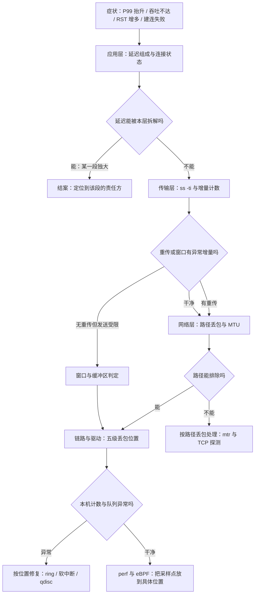
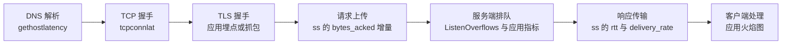
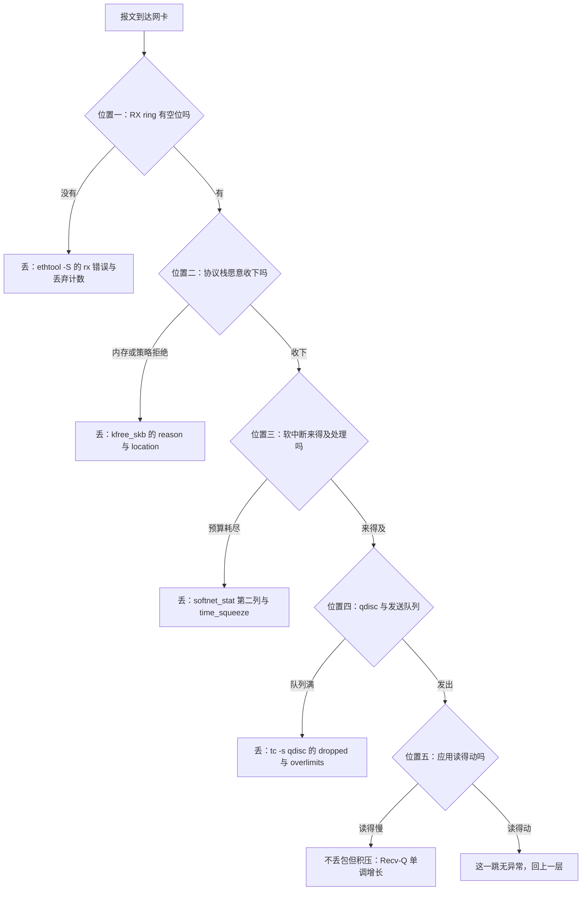
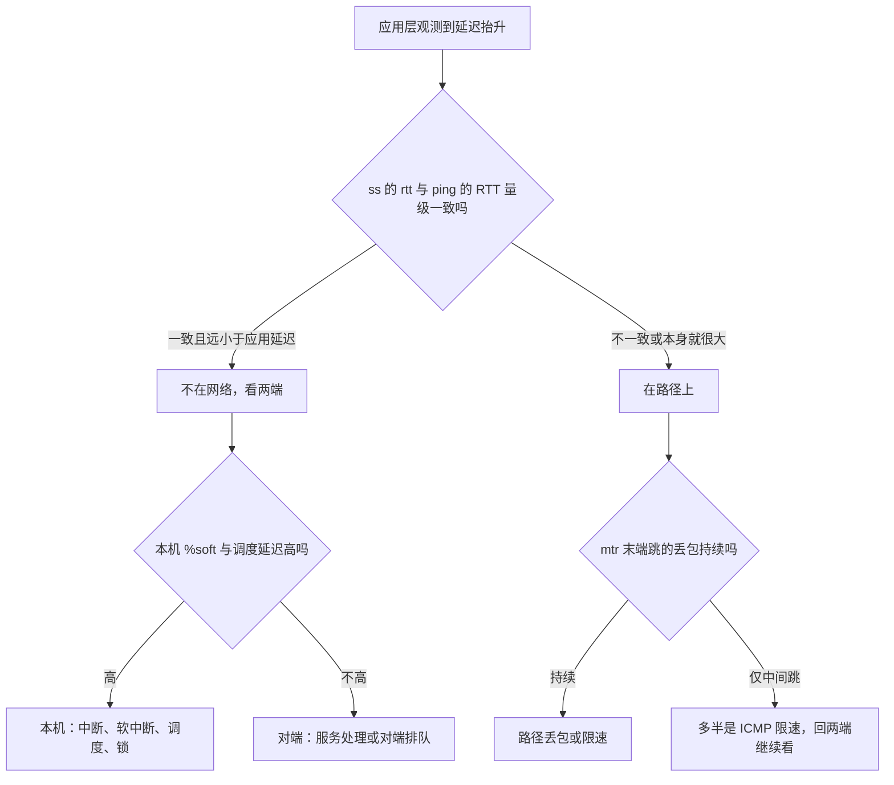
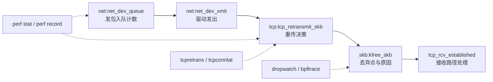
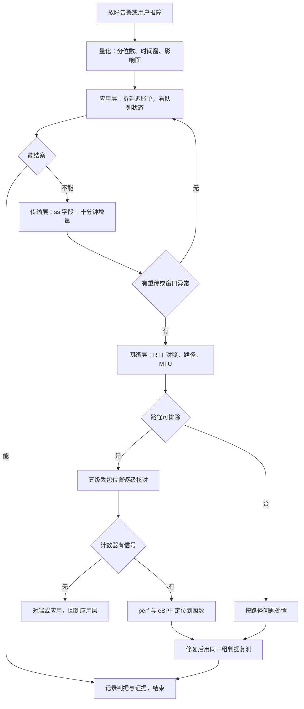

# 网络性能诊断——从 ss 到 perf 与 eBPF 的全套工具链

**摘要：**

一次网络故障复盘中最贵的成本，通常不是工具不够多，而是判断顺序反过来：手边的 `tcpdump` 一开，几十万行报文倒进磁盘，真正的线索被埋进时序噪声里。本文不复述工具清单，而是给出**判定顺序**——先把问题钉在应用层、传输层、网络层还是链路与驱动层，再决定动用哪一件工具。应用层要回答延迟由哪些时间块拼成、连接队列是否溢出；传输层靠 `ss -ti` 的窗口、RTT 与重传计数在不抓包的前提下定性，靠 `/proc/net/snmp` 与 `nstat` 的差分量判断丢包落在协议栈的哪一段；网络层用 `ping`、`mtr` 与 TCP 探测把路径问题与对端问题分开，同时接受 ICMP 限速带来的失真；链路层把丢包按 RX ring、内核、软中断、qdisc、应用读取五个位置归位。文中还说明抓包为什么排在最后、`perf` 与 eBPF 的采样点该落在哪里、每类观测手段自身的开销与失效场景，以及把延迟拆到本机、网络与对端三处的分源方法。核心主张只有一句：诊断的胜负取决于先问对哪一层，而不是先拿到多少字节。

---

## 第 1 章 判定顺序：为什么工具清单救不了现场

当一个服务的 P99 从 3 ms 抬到 40 ms，值班的人第一件事该做什么？多数现场给出的答案是抓包。这个动作之所以流行，是因为它看起来最像取证：谁都不必先判断问题出在哪一层，先把原始材料拿下来，事后再慢慢看。但抓包恰恰是代价最高的一步，贵在三处。它不区分层次，一次抓取同时收下应用、传输、网络、链路四层的全部噪声；它在高流量下自己会丢包，抓到的样本对真正的问题存在系统性偏差；它把判断工作整体推给事后的分析者，而在故障当口，最缺的正是分析时间。

工具清单越长，这种错位越明显。清单给人以"取数"的错觉，仿佛排障就是把该跑的命令都跑一遍。但真正决定成败的是**判据**：拿到 `retrans:0/3` 之后，分子分母各是什么含义，3 次重传对应多少条连接、多长时间、多少字节，才算值得追查？没有分母支撑的数字只是猜测。同样一条 `cwnd:10`，出现在一条闲置的健康检查连接上毫无意义，出现在一条持续压测的连接上则说明拥塞窗口被反复打回起点。工具给出数字，判据给出含义，而判定顺序决定你在哪个数字上花掉有限的注意力。

### 1.1 工具可得性掩盖了判据缺失

十年前的机器上，`tcpdump` 往往是唯一能直接看到 TCP 行为的工具，于是"先抓包"形成了一种路径依赖。如今的内核把大量状态暴露在成本极低的接口上：`/proc/net/snmp` 与 `/proc/net/netstat` 是两份随时可读的计数器，`ss` 通过 Netlink 直接拿到每条连接的 `tcp_info`，`perf` 与 eBPF 能在纳秒粒度上挂钩内核函数。工具变多之后，稀缺的就不再是数据，而是"拿哪个数据能一票否决一整层"的判断力。

判据缺失表现为三种典型症状。第一种是全部跑一遍：`ss -s`、`netstat -s`、`ethtool -S`、`tcpdump`、`perf top` 依次执行，输出存了五个文件，最后仍然说不清瓶颈在哪一层。第二种是选择性使用自己熟悉的那一件，把一切问题都解释成自己工具能看见的形态，用 `tcpdump` 的人容易把任何延迟都归因于重传或小包交互，用火焰图的人容易把任何延迟都归因于 CPU 热点。第三种是把相关性当因果：某次故障期间 `nf_hook_slow` 占比很高，于是断定 iptables 是元凶，却没人问过同一个占比在高负载但健康的时间窗里是多少。

### 1.2 四层判定模型与它的结案条件

判定顺序的组织方式，是把观测手段按"能排除哪一层"来排序，而不是按"能看到多少细节"来排序。应用层先回答延迟由什么拼成、队列是否在积压；传输层回答重传、窗口、拥塞是否异常；网络层回答路径是否丢包、MTU 是否通；链路与驱动层回答网卡、软中断、qdisc 是否来得及处理。每向下一层，工具的开销与侵入性都上一台阶，因此顺序本身也是一条成本曲线。

下面这张决策流程是全文的骨架，后面九章都在解释其中每个判断的判据从哪里来。



判定顺序之所以能收敛，是因为每一层都自带**结案条件**：一旦某层的证据足以解释全部症状，后面的层就不必再看。反过来说，如果一层的工具跑完之后，既不能结案也不能明确否定，那说明这一层的问题没有被正确提问，继续下沉只会积累更多无法解释的数据。

| 层次 | 首查工具 | 首个判据 | 何时需要下沉 |
|---|---|---|---|
| 应用层 | `ss -s`、`ss -lnt`、应用指标 | 延迟分布是否单峰偏移、队列是否单调增长 | 延迟无法被应用内部耗时解释 |
| 传输层 | `ss -ti`、`nstat -az` 差分 | `retrans` 增量、`cwnd` 与在途量的关系 | 确认有重传或窗口被压死 |
| 网络层 | `ping`、`mtr`、`tcpping`、`ip route get` | 末端 RTT 与丢包是否稳定复现 | 需要判断丢在路径还是丢在主机 |
| 链路与驱动 | `ethtool -S`、`/proc/net/softnet_stat`、`tc -s qdisc` | 计数器增量与队列积压 | 需要知道内核里具体哪个函数丢的 |

### 1.3 顺序成立的两个前提

第一个前提是症状可量化。P99 从 3 ms 抬到 40 ms 是可量化的，用户抱怨"系统很慢"不是。可量化意味着能给出三个数字：分位数、时间窗、影响面。分位数决定看平均值还是看尾部，时间窗决定差分计数器取多长的间隔，影响面决定要不要按连接、按对端、按网卡拆开看。缺了这三个数字，`ss -ti` 抓出来的几十条连接里，你不知道哪一条代表问题。

第二个前提是有对照。绝大多数计数器的绝对值无法判断，必须与参照物比较：与同一服务一小时前的基线比，与同机其他端口比，与同集群其他节点比，与对端自己的观测比。对照的作用是消掉那些与故障无关的恒定量，譬如一台常年跑批的机器上 `TCPTimeouts` 本来就以稳定速率增长，只有偏离基线的斜率才值得追。

这就像急诊的分诊台：先量体温、血压、血氧三件事，不是因为它们能确诊，而是因为它们能以极低的成本把人分流到不同诊室。分诊做错，后面所有精密检查都是在错误的方向上加倍投入。

### 1.4 三条秩序纪律

第一条是先便宜后昂贵。读 `/proc` 计数器是微秒级操作，`ss` 单次查询在毫秒级，`perf` 采样是百分点级的 CPU 占用，`tcpdump` 在高速率下既有 CPU 成本又可能丢样本。把贵的放在后面，不是因为它不好，而是因为它的输出需要更多上下文才能解释。

第二条是先全局后局部。整机、整个 namespace、整个进程的聚合值先看，再按连接、按对端、按 CPU 收窄。反过来的顺序会造成"局部正确、全局错误"：某条连接重传很多，但它所在的整机重传率极低，那么这条连接的问题大概来自它自己的对端或它自己的路径，与整机网络无关。

第三条是先增量后绝对值。所有内核网络计数器都是自开机以来单调累加的，重启清零、容器重建清零、多网卡与多 namespace 各自独立。拿绝对值比较两台机器，等于比较两个不同时长的里程表读数。

---

## 第 2 章 应用层：先把延迟拆成账单

延迟不是一堵墙，而是一张账单：一次请求的总耗时由若干笔费用叠加而成，排障的第一步是看清哪一笔变贵了。DNS 解析、TCP 握手、TLS 握手、请求上传、服务端排队与处理、响应传输、客户端处理，每一段都有各自的观测手段，也各有各的典型病理。把总耗时当成一个整体去追查，等于对着账单总额猜是哪笔消费超支。

### 2.1 时间切分与观测手段的对应

下面这张图把一次典型请求沿时间轴切开，并标注每一段最便宜的观测手段。细看之下，越靠前的段越容易用现成工具测准，越靠后的段越依赖应用自身的埋点，这个梯度决定了排障时应该先量哪一段。



如果 DNS 解析占了大头，问题在本地解析器或上游 DNS，与 TCP 无关；如果握手耗时正常而首字节迟迟不来，问题在服务端的排队或处理；如果首字节很快但传输时间偏长，才轮到窗口与带宽去解释。这条判断链条的价值在于：它能在完全不碰内核工具的前提下，把一大半"网络慢"的报障挡在应用层之外。

一个常见的误判是把建连慢当成服务慢。客户端连接池耗尽后新建连接，每次都要重做 TCP 与 TLS 握手，用户感知到的延迟上升，而服务端的处理耗时毫无变化。此时看服务端指标一切正常，看客户端火焰图也找不到热点，只有把建连耗时单独统计出来才能解释。

### 2.2 连接状态：`ss -s` 的三个盲区

`ss -s` 输出的是按状态聚合的计数，它便宜、快、一眼能看出整体形态，适合作为第一眼的全局视图。但它有三个盲区。

第一个盲区是没有分布。它告诉你当前有 391 条 TIME-WAIT，却不告诉你这 391 条集中在哪个本地端口、哪个对端、哪段时间产生。TIME-WAIT 本身是 TCP 的正常收尾状态，只有当它集中在少数端口上并且速率持续高于回收速率时，才意味着短连接滥用。

第二个盲区是没有原因。CLOSE-WAIT 非零确实说明对端已关闭而本端未调用 `close`，这是应用层连接泄漏的强信号；但 `ss -s` 只给总数，要定位到哪个进程、哪个 fd，还得 `ss -tanp state close-wait` 配合进程信息。

第三个盲区是把等待当成故障。`orphaned`、`timewait` 这些字段在健康系统上本来就非零，把它们当成异常去"优化"，最常见的后果是启用 `tcp_tw_reuse` 之类的开关，把问题从连接状态转移到序列号与 NAT 的兼容性上。

### 2.3 `Recv-Q` 的两副面孔

`ss` 输出里的 **`Recv-Q`** 是最容易被误读的字段，因为它在不同状态下含义完全不同。`LISTEN` 状态下的 `Recv-Q` 是已完成三次握手、等待 `accept()` 取走的连接数，它接近 `Send-Q`（即 backlog 上限）就说明 accept 队列快满了；`ESTAB` 状态下的 `Recv-Q` 是接收缓冲区里尚未被应用读走的字节数，它非零只说明"有数据等着读"，完全可能是对端发得快、应用正在批量处理。

| 状态 | `Recv-Q` 语义 | `Send-Q` 语义 | 真正的异常判据 |
|---|---|---|---|
| `LISTEN` | 已握手待 accept 的连接数 | backlog 上限 | `Recv-Q` 长期贴近上限，且 `ListenOverflows` 有增量 |
| `ESTAB` | 接收缓冲区未读字节数 | 发送缓冲区未确认字节数 | `Recv-Q` 单调增长且不回落，持续数秒以上 |
| `TIME-WAIT` | 通常为 0 | 通常为 0 | 单端口数量持续增长并挤占本地端口 |
| `CLOSE-WAIT` | 已收到 FIN 未关闭 | 待发送数据 | 出现即需定位进程，通常为 fd 泄漏 |

判定 `ESTAB` 的 `Recv-Q` 要看趋势而不是瞬时值：一次快照里的 64 KB 可能只是批处理中的正常水位，连续采样十分钟都在增长、且应用侧的消费速率没有对应上升，才说明读取跟不上。把瞬时非零当应用问题，是这类排障里最常见的错案，尤其当对端是 Kafka、日志采集器这类突发写入方时，`Recv-Q` 的锯齿状波动本来就是设计内的行为。

### 2.4 应用层可以结案的三种情形

第一种是 `ss -ti` 里 **app_limited** 为 1。这个标志表示发送方没有被拥塞窗口或接收窗口限制，而是应用没有及时把数据交给内核。此时带宽、RTT、重传全都正常，问题在业务逻辑的产出速率，继续往网络层查是白费力气。

第二种是连接数随时间单调上升且不回落。这通常意味着连接池泄漏或 `close` 遗漏，`ss -tan state close-wait` 与进程 fd 计数能直接给出证据。

第三种是延迟集中在少数对端。按对端地址聚合 `ss -ti` 的 RTT 与重传，如果异常只出现在一个网段或一个 VIP 上，那么问题大概率在对端或那条特定路径，本机协议栈只是受害者。

以上三种情形都能在不抓一个包的前提下结案，代价只是多跑几条 `ss` 与几次差分。这也解释了为什么判定顺序要把应用层放在最前面：它是唯一能用近乎零成本排除掉一半可能性的层次。

---

## 第 3 章 传输层首查：`ss -ti` 的字段读法

应用层结不了案的延迟，下一步就落在传输层。这一层有一个独一无二的优势：内核已经把每条连接的拥塞控制状态、往返时间、重传计数摊开在 `tcp_info` 里，读取它不需要抓包、不需要停服务、不需要任何特权动作。`ss -ti` 的价值不在"信息多"，而在它是少数几件能在生产环境里高频执行、又足以对网络行为作出定性判断的工具。

### 3.1 一条连接的三组指标

`ss -ti` 的输出很长，硬记字段没有意义，按语义分成三组就好读：窗口族回答"还能发多少"，时间族回答"路有多远、有多抖"，计数族回答"已经发生过什么"。三组里任一组异常都能独立地指向一类根因，而三组同时正常却仍然慢，就说明瓶颈不在传输层。

| 字段 | 语义 | 异常判据 | 什么情况下正常也可能有问题 |
|---|---|---|---|
| `cwnd` | 拥塞窗口，以 MSS 为单位 | 长期低位且 `ssthresh` 反复下调 | 连接空闲时窗口本来就不会涨 |
| `snd_wnd` | 对端通告的发送窗口，受窗口缩放影响 | 远小于 `cwnd` 时发送受对端限制 | 老版本 iproute2 不打印此字段 |
| `rtt` | 平滑后的往返时间与其方差 | 方差远大于均值说明路径抖动 | 采样窗口太短，末段突发会拉高均值 |
| `rto` | 当前重传超时时间 | 远大于 `rtt` 说明估算被异常样本污染 | 首次测量前 RTO 取初始值，偏大属正常 |
| `retrans` | `当前在途重传段数/连接累计重传次数` | 分母增速与发送段数之比偏高 | 刚发生过一次丢包时分子短暂非零 |
| `bytes_acked` | 已被确认的字节数 | 差分与 `delivery_rate` 对不上 | 连接刚建立时基数很小 |
| `unacked` | 已发出未确认的段数 | 持续接近 `cwnd` 且不回落 | 大窗口下高在途量本就正常 |
| `delivery_rate` | 内核估算的实际交付速率 | 远低于 `pacing_rate` 与窗口理论上限 | 短连接上来不及收敛 |
| `app_limited` | 发送是否被应用限住 | 为 1 说明瓶颈在应用 | 空闲连接的该标志没有诊断意义 |

### 3.2 三条能直接定性的读法

第一条读法是用**在途量**与带宽时延积对照。链路的带宽时延积决定了一条连接"必须有多少数据在途"才能跑满，而在途量的上限由拥塞窗口与对端接收窗口共同决定。把 `cwnd` 乘以 MSS 得到字节数，与"带宽乘以 `rtt`"相比：前者明显小于后者，说明发送被窗口卡住，问题要么在拥塞控制（丢包导致窗口萎缩），要么在对端接收窗口；前者远大于后者却跑不满，说明有数据被丢或接收端消费得慢。这个比较不需要知道精确带宽，数量级差一倍以上就足以定性。

第二条读法是拆开 **retrans** 的分子与分母。`retrans:0/3` 里，斜杠后是这条连接生命周期内的累计重传次数，斜杠前是当前仍在途、尚未被确认的重传段数。分母只会随时间单调增长，所以它单独没有意义；有意义的是它的增长速率相对于同期发送段数的比例，以及分子是否长期不归零。分子长期非零说明重传本身也在丢，链路质量已经差到连补救措施都失效。

第三条读法是把发送受限的原因按优先级排掉。先看 `app_limited`：为 1 就直接结案，应用没有数据可发。再看 `snd_wnd`：如果它远小于 `cwnd`，发送受对端接收窗口限制，责任在对端或对端的读速。最后才看 `cwnd` 与 `ssthresh`：窗口在低位且阈值被反复下调，才是本端拥塞控制的判断。这个顺序能避免一个常见错误——看到 `cwnd` 小就归因于丢包，而实际上对端早就在通告零窗口。

### 3.3 单次快照不够用

`ss -ti` 打印的是瞬时状态，而拥塞窗口、重传计数、交付速率都是随时间演化的量。真正的判断往往依赖趋势：窗口是在缓慢爬升还是反复被打回、重传是在均匀发生还是集中在几个时间点。因此采样要连续，而且要把每条连接的标识一起记下来。

```bash
# 只取需要的两条行：连接行与 tcp_info 行，减少无谓输出
# 为什么不用 watch：它会重绘整屏，历史窗口被覆盖，字段级的变化看不出来
for i in $(seq 1 30); do
  date +%s.%N
  ss -tinmo dst 10.0.0.12:8080 | head -4
  sleep 1
done | tee /tmp/ss-ti.log

# 事后把时间序列压成两条曲线：累计重传次数的斜率，与 cwnd 的走势
awk '/retrans:/{
  match($0, /retrans:([0-9]+)\/([0-9]+)/, r)   # gawk 的 match 带捕获组
  printf "%s %s\n", prev, r[2]                 # 分母才是累计量
} {prev=$0}' /tmp/ss-ti.log
```

关键在于把"累计量"和"瞬时量"分开对待：累计量看斜率，瞬时量看方差。把两者混在一张图里，得到的是既不能说明趋势、也不能说明状态的折线。

### 3.4 `ss` 自身的成本

`ss` 走的是 `NETLINK_SOCK_DIAG`，一次 dump 把当前所有 socket 的 `tcp_info` 从内核拷出来，内核侧成本随连接数线性增长。连接数在几千的量级时，单次查询是毫秒级；到了十万连接的量级，单次全量 dump 会进入秒级，而这个时间窗口里连接状态已经变化，抓到的是一张"曝光期间被平均过的照片"（量级判断，具体耗时取决于内核版本、连接状态分布与输出字段数）。所以高频采样要靠过滤把输出压小，而不是靠减少采样次数。

`-e`、`-m`、`-o` 三个开关各自增加一类字段：扩展信息、socket 内存、定时器。它们的单项开销不大，但在每秒采样的循环里叠加起来仍然可观：只看 RTT 与重传时，`-i` 一个开关就够。

`/proc/net/tcp` 是另一条路径，它用文本格式导出基础字段，解析成本比 Netlink 更高，而且拿不到 `tcp_info` 里的窗口与拥塞状态。用它做兜底的兼容手段可以，拿它做高频诊断没有理由。

---

## 第 4 章 增量证据：计数器只认差值

### 4.1 为什么绝对值不能用

内核网络计数器像汽车里程表：它只增不减，从开机那一刻开始累计。比较两台机器的 `TCPTimeouts` 绝对值，等于比较两块跑了不同年头的里程表，除了"都跑过"之外得不出任何结论。更麻烦的是清零：机器重启、容器重建、namespace 销毁都会让读数归零，一次跨重启的前后对比可能得到负增量。

容器环境把这个问题放大了。每个 network namespace 有自己的一套计数器，宿主机上读到的数字是全部 namespace 的合计，而真正出问题的容器可能只有几百个连接。此时按 namespace 拆开看（`nsenter` 进目标 namespace 再读）比在宿主机上看聚合值有意义得多。

### 4.2 两份文件的分工

`/proc/net/snmp` 放的是遵循标准 MIB 的计数：`Ip:` 段的收发包与丢弃、`Tcp:` 段的连接尝试与重传总量、`Udp:` 段的收发与错误。这些字段由标准定义，跨内核版本稳定，适合做长期基线与跨机比较。

`/proc/net/netstat` 放的是 `TcpExt:` 扩展计数，由内核自定义，随版本增减，覆盖了大量标准 MIB 装不下的诊断信息：监听队列溢出、超时重传、重传再次丢失、内存压力、延迟确认行为。这类计数器的名字与含义在不同内核版本之间会有差异，查之前最好先在目标机器上确认字段存在。

两份文件都采用"两行制"：一行是名字，紧接着一行是数值。直接肉眼读几乎不可行，所以实际工作中都交给解析工具或 `nstat`。`nstat` 的默认行为正好解决了增量问题——它把上一次的读数缓存在本地，本次调用打印的是差值；加 `-a` 才是自开机的绝对值，加 `-z` 会把零值也列出来，加 `-d` 进入守护模式按固定间隔输出。理解这个默认值的方向，比背命令行参数重要。

### 4.3 五个必须先看的增量字段

| 字段 | 含义 | 增量判据 | 常见误判 |
|---|---|---|---|
| `TcpExtTCPTimeouts` | 触发 RTO 超时的次数 | 与发送段数之比持续偏高 | 单次抖动就会计入，需看速率 |
| `TcpExtTCPLostRetransmit` | 重传的报文再次丢失 | 非零即说明链路丢包严重 | 混淆于普通重传计数 |
| `TcpExtTCPSynRetrans` | SYN 段重传次数 | 建连变慢时首先看它 | 归因于服务端拒绝，其实是丢包 |
| `TcpExtListenOverflows` | accept 队列满导致溢出的次数 | 与新建连接数相比的溢出率 | 只看 `ss -lnt` 的瞬时值 |
| `TcpExtListenDrops` | listen 队列满导致的丢弃总数 | 增长即说明有请求被静默丢 | 与 `ListenOverflows` 混为一谈 |

这五个字段构成一条**互补的链**。`TCPSynRetrans` 增长而 `ListenDrops` 不增长，说明 SYN 或 SYN-ACK 在路径上丢了，服务端根本没机会处理；`ListenDrops` 增长而 `TCPSynRetrans` 温和，说明握手能完成但用户态 accept 跟不上，队列塞满之后内核开始丢弃；`TCPTimeouts` 与 `TCPLostRetransmit` 同时增长，说明数据面已经在拥塞崩溃的边缘，重传包本身也在丢。同样是计数器在涨，落在哪个字段上，结论完全不同。

`TcpExtListenOverflows` 与 `TcpExtListenDrops` 的区别值得单独说一句：前者统计 accept 队列溢出的次数，后者统计因 listen 队列满而被丢弃的连接总数。只看其中一个会漏掉另一种形态——SYN 洪泛打满半连接队列时，`ListenDrops` 增长而 `ListenOverflows` 可能不动，因为请求根本没走到建立完成那一步。

### 4.4 `netstat -s` 与 `ss -s` 的局限

`netstat -s` 的问题在实现与形态。它遍历 `/proc` 下的多份文件再拼成文本，在有大量连接的机器上耗时明显长于 `ss`；输出是给人看的自然语言，字段名与列布局随版本变化，脚本解析容易失效；它一次给出全部计数，没有窗口与速率概念，想得到增量还得自己前后各存一份。它作为一次性现场快照仍然可用，作为持续观测手段已经过时。

`ss -s` 的局限在维度。它只按连接状态聚合，不涉及任何协议栈计数，因此它能告诉你"有多少连接卡在 SYN-RECV"，却不能告诉你"是因为 SYN 丢了还是因为半连接队列满了"。这两件事的处置方式截然不同，前者要查路径，后者要调队列参数。

### 4.5 一行差分脚本

下面这段脚本做一件很小的事：取十秒窗口内 `TcpExt` 的变化量，只打印发生变化的项。它替代的是 `watch netstat -s` 这种把绝对值反复刷屏的用法。

```bash
# /proc/net/netstat 是名字行与数值行成对出现，必须按位置配对
tcp_ext() {
  awk '/^TcpExt:/ {
         if (!seen) { for (i=2; i<=NF; i++) n[i]=$i; seen=1 }
         else       { for (i=2; i<=NF; i++) print n[i], $i }
       }' /proc/net/netstat
}

tcp_ext > /tmp/n0; sleep 10; tcp_ext > /tmp/n1
# 两份快照的字段顺序一致，按行粘起来做差即可
paste /tmp/n0 /tmp/n1 | awk '$2 != $4 { printf "%-32s %+d\n", $1, $4-$2 }'
```

输出的每一行都是"这十秒新增了多少"。把它接到监控系统里做速率曲线，比任何一次性排障都更有价值——故障的形态往往在斜率里，而不在某一刻的读数里。

---

## 第 5 章 网络层：路径、MTU 与探测工具的失真

传输层确认了丢包或延迟，接下来要回答的是"丢在哪一段路"。这一层的标准工具是 `ping` 与 `mtr`，它们便宜、直观、几乎不需要权限，但也最容易被过度信任。ICMP 探测与业务流量在队列、优先级、限速策略上完全是两套待遇，把探测结果直接当作业务体验的代理，是网络排障里最常见的越界推断。

### 5.1 `ping` 能证明什么

`ping` 打通只证明一件事：ICMP 回显请求与应答在这条路径上没有全部被丢。它不能证明 TCP 握手能成功，不能证明大包能通过，也不能证明这条路径就是业务流量实际走的那条。

`ping` 不通的证明力同样有限。ICMP 在多数网络设备上是**二等公民**：中间路由器对 `TTL` 超时与回显应答有令牌桶限速，内核侧也有 `net.ipv4.icmp_ratelimit`、`net.ipv4.icmp_msgs_per_sec` 与 `net.ipv4.icmp_msgs_burst` 三个参数控制回执速率。这就像客服热线做了限流：打不通不代表公司倒闭，接通了也不代表业务顺畅。把 `mtr` 上某一跳的丢包率当成故障证据，是这类误判的典型形态——中间跳的丢包只有在该跳之后的所有跳都持续同样比例时才可信，否则多半是限速带来的假象。

另一层失真来自多路径。`ECMP`（等价多路径）按五元组哈希选路，`ping` 的 ICMP 流与业务 TCP 流哈希到不同下一跳是常态。于是可能出现探测显示路径良好、业务却周期性抖动的情况，因为抖动发生的那条路径从未被探测过。

### 5.2 TCP 探测补上 ICMP 的缺口

绕过 ICMP 的办法是用 TCP 本身探测。向目标端口发 `SYN` 并计时握手完成，得到的是业务同族的路径指标：`tcpping` 这类工具做的就是这件事，它测的是"三次握手要多久"，而不是"回显要多久"。代价是它要求目标端口可达，且只能测握手这一段——握手正常但传输慢的情况它看不出来。

更完整的手段是直接统计业务自身的建连延迟。eBPF 工具 `tcpconnlat` 挂在 `tcp_v4_connect` 返回与连接建立完成的钩子上，输出每一次 `connect` 的耗时分布，天然只包含业务流量，不受探测工具失真影响。这类"从业务流量里直接取指标"的思路，是判定顺序里把 eBPF 放在靠后位置、却常常能一步到位的根本原因。

### 5.3 MTU 与那条看不见的黑洞

`PMTUD`（路径 MTU 发现）依赖中间设备在遇到超限报文时回送 ICMP 类型 3 代码 4 的「需要分片」消息。当这类消息被防火墙过滤掉，发送方永远收不到"包太大"的提示，于是大包被静默丢弃、重传、再丢弃，形成 **PMTUD 黑洞**。它的症状极具辨识度：小请求正常、大响应卡住；握手与短报文一切正常，一旦响应体超过某个尺寸就超时；`ss -ti` 上表现为重传集中在少数大数据段，而 RTT 与小包延迟完全正常。

| 探测手段 | 测的对象 | 有效判据 | 失效场景 |
|---|---|---|---|
| `ping` | ICMP 回显往返 | 末端持续丢包且逐跳累积 | 中间设备对 ICMP 限速，优先级被降级 |
| `mtr` | 逐跳 TTL 超时 | 末端跳与业务症状一致 | 只有中间跳异常，实为限速假象 |
| `tcpping` | TCP 握手往返 | 握手耗时与业务感知一致 | 端口被封或服务拒绝，握手本就不成立 |
| `tracepath` | 逐跳 MTU | 某一跳后 MTU 突降 | 抑制 ICMP 的路径上无法收敛 |
| `ip route get` | 本机选路结果 | 出口网卡与源地址 | 只反映本机路由表，不含中间设备策略 |

确认 MTU 问题不需要猜。`ping -M do -s` 指定不分片并逐步加大包长，能直接测出这条路径的可通过尺寸；`ip route get` 给出本机实际选中的出口与源地址，避免在错误的网卡上折腾；临时缓解靠调小 `MSS`（`iptables` 的 `TCPMSS` 目标或路由上的 `advmss`），根治要靠放行 ICMP 类型 3 代码 4，或者启用 `net.ipv4.tcp_mtu_probing` 让内核在探测失败时自行下调。

### 5.4 丢包的五个位置

网络层能定位到"路径上丢"，但路径之外还有一整套主机内的丢包点。把丢包按发生位置分级，是判定顺序里承上启下的一步：网络层负责判断"包有没有到这台机器"，链路与驱动层负责判断"到了之后死在哪里"。这五个位置在下一章逐个展开。

| 序号 | 位置 | 主观测点 | 典型判据 |
|---|---|---|---|
| 1 | 网卡 RX ring | `ethtool -S` 的 `rx_*` 错误与丢弃 | 硬件侧计数增长，协议栈无感知 |
| 2 | 内核协议栈 | `skb:kfree_skb` 的丢弃原因 | 有明确的 reason 与调用点 |
| 3 | 软中断与 backlog | `/proc/net/softnet_stat` | 第二列丢弃与 `time_squeeze` 增长 |
| 4 | qdisc 与发送队列 | `tc -s qdisc` | `dropped`、`overlimits`、`backlog` 增长 |
| 5 | 应用读取 | `ss` 的 `Recv-Q` | 持续增长但不丢包，延迟堆积在缓冲区 |

---

## 第 6 章 链路与驱动层：丢包死在哪一道关卡

接收路径上硬中断、软中断、NAPI 与 XDP 的分流机制已在 [[07 Linux 网络包的完整收发路径——软中断、NAPI 与 XDP]] 中拆开，这里只借用它的分层结论：从网卡到应用，每一个可以丢包的位置都对应一组独立的计数器。分级的价值在于避免"丢包"这个词被笼统使用——五个位置的处置方式毫无交集，把 RX ring 溢出当成协议栈丢包去调 `somaxconn`，等于给漏水的水管换灯泡。按报文流经的顺序把五个位置排开，得到下面这张位置图。



### 6.1 位置一：RX ring 溢出

网卡收到的报文先落在驱动申请的环形缓冲区里，由中断与轮询从中取走。取走的速度跟不上到达的速度，环就填满，后续报文在硬件或驱动层被丢弃，协议栈完全不知道这件事发生过。这一类丢包的证据只在网卡的私有计数器里，名字因驱动而异：有的驱动叫 `rx_missed_errors`，有的叫 `rx_no_buffer_count`，有的把两者分开统计。`ethtool -S` 只是把驱动注册的字符串与数值原样列出，所以第一步永远是先看这台机器的网卡究竟暴露了哪些名字，而不是背一张通用字段表。

`ethtool -g` 显示环的当前大小与上限，`ethtool -G` 调整。加环能吸收突发，代价是内存与中断延迟：环越大，单次中断能批量处理的包越多，吞吐上去了，最坏情况下的排队时延也上去了。这与所有缓冲区调优是同一笔交易，区别只在于这一次的交易发生在硬件队列上。

### 6.2 位置二：内核协议栈的主动丢弃

协议栈收下报文之后，仍可能在多个钩子上丢弃：没有匹配的 socket、接收缓冲区超过上限、`netfilter` 规则显式 `DROP`、内存分配失败。这些丢弃点全部汇聚到 `kfree_skb`，而 `skb:kfree_skb` 这个 tracepoint 会把丢弃原因与调用位置一起记录下来。`drop_reason` 是较新内核才有的枚举，把"为什么丢"从"在哪个函数丢"细化成可聚合的类别；老内核上只有返回地址，需要符号解析才能读。

这一层的判据是"原因分布"，而不是"总丢包数"。总丢包数增长可能完全正常——一条 `iptables` 规则每天丢弃百万个扫描包，与业务毫无关系。有意义的是新增丢弃集中在哪个 reason 上，以及它是否与症状同时间出现。

### 6.3 位置三：软中断过载

收包高潮期，内核用软中断与 NAPI 轮询把报文从环里抽出来送进协议栈。每个 CPU 的软中断处理有预算：`net.core.netdev_budget` 与 `netdev_budget_usecs` 限定一次 `NET_RX` 软中断最多处理多少包、花多少时间。预算用完而环里还有包，**`ksoftirqd`** 接手继续处理；如果连 `ksoftirqd` 也追不上，新到的包就会在 backlog 里被丢弃。

观测点有三个。`/proc/net/softnet_stat` 每行对应一个 CPU，第一个字段是处理过的包数，第二个字段是 backlog 溢出丢弃数，第三个字段是 **`time_squeeze`**——软中断预算耗尽的次数。`time_squeeze` 增长说明处理能力已经饱和，哪怕还没开始丢包，也已经在延迟的悬崖边上。`/proc/softirqs` 的 `NET_RX` 列给出各 CPU 的软中断次数增量，能看出负载是否集中在少数核上。`mpstat -P ALL` 的 `%soft` 则从另一个角度确认：某个核的软中断占比长期高于其他核，说明该核绑定的队列在挨打，多队列与 RPS/RFS 的调整就有了依据。

这里有一个容量与延迟的取舍：加大 `netdev_budget` 能让单次软中断处理更多包，减少调度开销，代价是软中断在单个 CPU 上停留更久，同一核上的用户态任务被推迟，延迟毛刺变长。这与批处理系统的批量大小选择是同一道题，答案取决于业务更怕吞吐不足还是更怕尾部延迟。

### 6.4 位置四：qdisc 与发送队列

发送方向同样会积压。`tc -s qdisc show dev eth0` 的 `backlog` 是当前排队字节数，`dropped` 是因队列满被丢弃的包数，`overlimits` 是触发限速或队列管理的次数。`dropped` 增长说明出口带宽被压满而应用仍在灌数据；`overlimits` 增长在 `fq_codel`、`htb` 这类带队列管理的 qdisc 上是正常工作，在 `pfifo_fast` 上则意味着队列已经触顶。

发送队列还有一个隐蔽的瓶颈：单队列网卡在高核数机器上会出现排队锁竞争，`tx queue stopped` 的时间变长，表现为发送侧 CPU 占用不高但吞吐上不去。多队列网卡配合 `SO_REUSEPORT` 或 RSS 能把这条锁拆开，代价是连接分布可能不均，需要哈希策略配合。

### 6.5 位置五：应用读取慢

最后一个位置不丢包，只积压。接收缓冲区里的数据等待应用 `read`，应用处理慢或事件循环被阻塞，缓冲区就填满，随后内核通过窗口通告把发送方压住。这种形态在 `ss` 上表现为 `Recv-Q` 单调增长，在网络上表现为对端 `snd_wnd` 收缩，在丢包计数上则一片干净。

把位置五误判成位置一或位置二，是最伤时间的错误，因为修复动作完全相反：前者要优化应用或加并行度，后者要加硬件资源或调队列。判据的分水岭很简单——位置一到四都有明确的计数器增长，位置五没有任何丢包计数，只有队列长度在涨。

| 位置 | 计数器信号 | 是否丢包 | 典型修复方向 |
|---|---|---|---|
| RX ring | 网卡私有 `rx_*` 计数增长 | 是 | 加环、多队列、分流到 XDP |
| 内核协议栈 | `kfree_skb` 原因分布变化 | 是 | 查规则、查内存、查 socket 匹配 |
| 软中断 | `softnet_stat` 第二列与 `time_squeeze` | 是或濒临 | 调预算、RPS/RFS、多队列 |
| qdisc | `dropped`、`overlimits`、`backlog` | 是 | 限速、整形、换 qdisc |
| 应用读取 | `Recv-Q` 单调增长 | 否 | 优化消费速率、加并行、限流 |

---

## 第 7 章 延迟分源：本机、网络、对端

延迟的**三种来源**，处置方式完全不同：本机的问题要动调度与中断，网络的问题要动路径与拥塞控制，对端的问题要么等对方修，要么在自己这侧加超时与降级。把它们混在一起讨论，就会出现"加了带宽没变快、换了机器没变快、重启服务也没变快"的连环空转。分源的标准不是经验直觉，而是三个可以直接测量的对照。

第一种对照是把内核测到的 RTT 与应用测到的延迟放在一起。`ss -ti` 的 `rtt` 反映的是传输层观测到的往返时间，如果它远小于应用感知到的延迟，那么延迟的大头不在网络上，而在两端的排队与处理上。第二种对照是 `tcpconnlat` 给出的建连耗时分布与 `ping` 的 RTT，两者接近说明握手路径没有额外损耗；建连耗时是 RTT 的若干倍并且 `TCPSynRetrans` 在涨，问题才落在 SYN 与 SYN-ACK 的往返或丢包上。第三种对照是同一请求在不同对端的表现，异常只跟着某个对端走，就把它钉在了对方那一侧。把三条对照串成判定路径，就有了下面的分源流程。



### 7.1 本机延迟的三种形态

本机造成的延迟不体现在网络指标上，而体现在"线程本该跑却没跑"上。第一种是调度延迟：运行队列积压，任务就绪之后还要等 CPU，`perf sched` 的 `sched:sched_switch` 事件或 bpftrace 的运行队列直方图能量化这段等待。第二种是中断与软中断抢占：网络流量高峰期，同一个核上的用户态线程被硬中断与软中断反复打断，`%soft` 上升、单请求处理时间拉长，而协议栈计数器一切正常。第三种是锁与内存回收：socket 锁竞争、`GFP_ATOMIC` 分配失败进入回收路径，都会在火焰图上留下很宽的栈。

判断本机延迟有一个便宜的旁证：同一台机器上的其他服务是否同时变慢。网络路径问题通常只影响跨机通信，本机调度问题会一视同仁地拖慢所有进程，包括纯 CPU 的计算任务。

### 7.2 网络延迟的两种代价

路径带来的延迟分两类。一类是传播与排队，表现为 RTT 稳定偏高，与丢包无关，物理距离与中间队列是主因，能做的只是换路径、加前端缓存、或者把请求合并减少往返次数。另一类是丢包引发的重传，表现为延迟分布出现台阶：正常请求很快，少数请求恰好踩在重传上，延迟跳到 RTO 的整数倍。**尾部延迟**抬升而中位数稳定，是后者的典型形态。

区分这两类很关键。前者靠改架构，后者靠改网络或拥塞控制；把重传问题当成传播延迟去加缓存，缓存命中率再高也救不了那部分踩中丢包的请求。

### 7.3 对端延迟怎么证明

证明"是对方慢"需要三条证据同时成立：本端发送不受限（`app_limited` 与 `cwnd` 正常）、路径指标正常（`rtt` 稳定、`retrans` 无增量）、对端的响应确实慢（首字节时间远大于 RTT 的整数倍）。三者齐备后，剩下的唯一解释就是对端的排队或处理。

如果对端是自家服务，`ListenOverflows` 与 `ListenDrops` 的增量能进一步区分"对端应用 accept 不过来"与"对端处理慢"。前者队列满、握手被丢，后者握手正常但响应迟迟不来。如果对端是外部服务，只能靠客户端的建连耗时与首字节耗时统计，配合不同时间窗的重试成功率来间接判断。

| 来源 | 关键观测点 | 判据 | 误判风险 |
|---|---|---|---|
| 本机调度 | `perf sched`、运行队列延迟 | 就绪到运行的空等时间抬升 | 误当成网络抖动，因为症状同为尾部延迟 |
| 本机中断 | `mpstat` 的 `%soft`、`softnet_stat` | 单核软中断占比显著偏高 | 与 qdisc 丢包混为一谈 |
| 网络传播 | `ping`、`ss` 的 `rtt` | RTT 稳定偏高、无重传 | ICMP 与 TCP 路径不同导致结论偏差 |
| 网络丢包 | `retrans` 增量、`TCPTimeouts` | 延迟呈 RTO 整数倍台阶 | 把应用重试当成网络重传 |
| 对端处理 | 首字节时间、对端 `ListenDrops` | 首字节远大于 RTT 整数倍 | 把本端排队算进对端耗时 |
| 对端排队 | accept 队列、对端线程池指标 | 队列长度与等待时间同步上升 | 只看平均队列，漏掉尾部长队 |

**三种来源**的分辨之所以重要，是因为它们对应三种完全不同的**责任边界**。把本机问题报成网络问题，会换来一轮无效的链路排查；把对端问题报成本机问题，会让团队在自己的代码里找一个不存在的缺陷。判定顺序在这里的作用，是让每一条结论都有可复核的测量依据，而不是靠"我觉得像"。

---

## 第 8 章 perf 与 eBPF：把采样点放到正确的位置

前面的层次回答"哪一层有问题"，`perf` 与 eBPF 回答"具体是哪个函数、哪条连接、哪一次调用"。它们是诊断链的末端，也是最容易用错的一端：工具本身很强大，但采样点放错位置，得到的数据再精细也解释不了症状。判定顺序对它们的要求很明确——先知道要找什么，再决定挂哪里。

### 8.1 `perf` 的三种用法

第一种是 CPU 采样，回答"CPU 时间花在哪些函数上"。`perf record -F 99 -g -a` 按固定频率采栈，`perf report` 或火焰图给出占比。它的价值在于发现意外的热点：`nf_hook_slow` 占比高说明 netfilter 规则链太长，`ksoftirqd` 占比高说明收包压力超过了处理能力，`sk_alloc` 与 `kfree_skb` 占比高说明 skb 分配释放过于频繁。这类热点不需要精确计数，占比排序就够用。

第二种是 tracepoint 计数，回答"某类事件发生了多少次"。`perf stat -a -e 'net:net_dev_queue' -e 'tcp:tcp_retransmit_skb'` 直接把内核静态探针的触发次数累加，开销远低于采样带栈。适合做速率对照：发包速率与重传速率一起看，能立刻算出重传比例。

第三种是事件采样，回答"某类事件发生时现场是什么样"。`perf record -e 'skb:kfree_skb' --call-graph dwarf` 记录每次丢弃的调用栈，`perf script` 打印出丢弃点与调用链。它比纯计数多了现场，比抓包少了一个数量级的数据量。三类用法的挂点与内核路径的对应关系如下。



### 8.2 `skb:kfree_skb`：丢弃位置的唯一入口

所有 skb 的释放都走 **`kfree_skb`**，因此这个 tracepoint 是观测"包死在哪"的统一入口。它携带三类信息：skb 地址、调用位置、丢弃原因。调用位置是一个返回地址，需要符号解析才有意义；丢弃原因在新内核里是枚举值，能直接聚合成"内存不足""无匹配 socket""规则丢弃"这样的类别。

读这个 tracepoint 的正确姿势是先聚合再下钻。先按原因分组统计一分钟，看新增丢弃集中在哪一类；再针对占比最高的那一类打出调用栈或打印连接五元组。直接对全量丢弃事件打栈，在高丢包场景下会把机器拖垮，也会把分析者淹没。

### 8.3 现成工具各自回答一个问题

BCC 与 bpftrace 生态里的网络工具，每一个都对应一个非常具体的问题。把它们当成"更细的 `netstat`"会误用，正确的用法是记住了问题再去找工具。

| 工具 | 挂载点 | 回答的问题 | 失效或局限 |
|---|---|---|---|
| `tcpretrans` | `tcp_retransmit_skb` | 哪条连接在重传、状态是什么 | 只报事件不给原因，重传风暴时输出量大 |
| `tcpconnlat` | connect 相关内核函数 | 每次建连耗时多少、分布如何 | 只看主动连接，被动侧要用 `tcpaccept` |
| `gethostlatency` | libc 的 `getaddrinfo` | DNS 解析耗时多少 | 静态链接或自实现解析的进程看不到 |
| `tcpdrop` | `kfree_skb` 加 TCP 状态 | 哪个连接被内核丢弃、原因是什么 | 依赖内核版本提供的原因字段 |
| `tcplife` | 连接建立与关闭 | 每条连接活了多久、传了多少字节 | 短连接风暴下事件量巨大 |
| `sockstat` | socket 分配释放 | socket 内存与对象数是否泄漏 | 不区分业务与后台连接 |

`gethostlatency` 的局限值得单独强调：它依赖对 libc 符号的 uprobe，静态链接的 Go 程序、自己实现 DNS 解析的服务、以及走 `systemd-resolved` 本地缓存的查询，都可能绕过它。工具给出"没有数据"时，先确认它有没有挂上，再确认结论。

### 8.4 一段最小可用的 bpftrace

比起跑一遍现成工具，自己写几行脚本往往更快：只打印需要的字段，输出量可控，判据也由自己定义。

```bash
# 追踪重传事件并按对端聚合，目的是把"谁在丢"从全局计数里拆出来
# 注释里写清每一步的意图，因为这类脚本半年后没人记得为什么这么写
bpftrace -e '
tracepoint:tcp:tcp_retransmit_skb
{
    $sk = (struct sock *)args->skaddr;               // 探针给的是 sock 指针
    $daddr = ntop($sk->__sk_common.skc_daddr);       // 对端地址才是归因维度
    @by_peer[$daddr] = count();                       // 按对端聚合成 map
    @state[args->state] = count();                    // 状态直接取探针参数
}
interval:s:10
{
    print(@by_peer); print(@state);
    clear(@by_peer); clear(@state);                  // 不清理会一直涨内存
}'
```

脚本里两个细节决定它是否可用：聚合维度选对端而不是选本端，因为一台机器有几十条连接、上千个端口，按本端聚合看不出任何模式；定时清理 map，否则长时间运行的脚本本身会变成内存问题。另外，tracepoint 的参数字段名随内核版本略有差异，动手前先用 `bpftrace -lv 'tracepoint:tcp:tcp_retransmit_skb'` 看一眼实际字段，比照着记忆写脚本可靠。

### 8.5 采样成本与精度

所有观测手段都在买信息，价格是 CPU 与侵入性。kprobe 挂在内核函数入口，每次触发都要陷入探针处理，单次开销在数百纳秒到微秒的量级；tracepoint 是内核预埋的静态探针，开销明显更低。这个差别在事件量小的时候无所谓，在每秒百万级事件时就决定了工具能不能上线：按每次事件 200 纳秒做示例推算，百万事件每秒就是单核 20% 的开销，而这还没算上输出与聚合的成本。

| 手段 | 单次开销量级 | 十万级事件/秒的可行性 | 适用问题 |
|---|---|---|---|
| `/proc` 计数与 `nstat` | 微秒级读取 | 完全可行 | 全局趋势与增量 |
| `ss` 单次查询 | 毫秒到秒级 | 按秒级频率可行 | 连接级状态 |
| tracepoint 计数 | 数十到数百纳秒 | 可行，需关注聚合成本 | 事件速率对照 |
| kprobe 打点 | 数百纳秒到微秒 | 需过滤后使用 | 特定函数的现场 |
| 采样带调用栈 | 按采样频率定 | 可行，1-3% CPU 量级 | 热点函数定位 |
| 抓包落盘 | 每包一次拷贝 | 高 PPS 下不可行 | 协议级时序复盘 |

精度与成本之间没有免费的中间态：要么接受采样带来的统计偏差，要么接受全量追踪带来的开销。判定顺序把便宜的手段放前面，正是因为绝大多数问题在便宜的手段上就已经能定性，只有少数需要精确到函数的现场才值得付出后者的代价。

---

## 第 9 章 抓包为什么排在最后

抓包在诊断链上的位置，取决于它能提供什么别人提供不了的东西：完整的协议时序、字段级的交互细节、中间设备篡改报文的证据。这些东西确实只有抓包能看到。但在判定顺序里，它必须排在后面，原因不是它没用，而是它有三个结构性的缺陷，这三个缺陷会让"先抓包"变成一次成本高昂且方向不明的取样。

第一个缺陷是它会**放大问题**。抓包要把报文从内核拷到用户态并落盘，这条路径本身有队列，队列满了就丢样本。在高包速率下，抓到的往往是"刚好没被丢的那部分"，而丢失的样本恰好可能是重传与乱序——也就是最该看的部分。用一份**有偏的样本**去推断整体，比没有样本更危险，因为它看起来很像证据。同时抓包本身要占 CPU 与内存带宽，在已经过载的机器上，它会把症状推到更严重的位置。

第二个缺陷是时序判断依赖两端时钟。单机抓包只能看到本地视角的到达与发出时间，无法测出单向延迟。要判断延迟发生在去程还是回程，必须两端同时抓并在同一时间基准下对齐；而两台机器的时钟通常只由 NTP 校准到毫秒级，跨机房时误差更大。`tcpdump` 的 `-j adapter` 之类选项能让时间戳更接近硬件，但两端仍然要有一个共同的参照。

第三个缺陷是加密与代理让内容不可见。TLS 之后的报文只剩长度与方向，应用层的处理耗时无法从报文中读出；服务网格与反向代理又在这条链上插入了额外的跳，抓到的对端可能只是代理而不是真正的服务端。此时抓包能回答"包到没到"，回答不了"服务为什么慢"。

### 9.1 抓包仍然不可替代的场景

承认缺陷不等于弃用它。有三类问题离开抓包几乎无解：协议级时序问题，譬如 Nagle 与延迟确认互相等待造成的小包延迟、窗口探测与零窗口的交互；中间设备行为问题，譬如某台负载均衡改写了序号或悄悄丢弃了带选项的包；以及需求非常明确的短窗口取证，譬如"这两个地址之间在十四点零五分的三次握手里，SYN-ACK 到底有没有回来"。

这类场景的共同特征是问题已经被定位到协议交互层面，抓包不再承担"找方向"的任务，只承担"拿证据"的任务。这正是判定顺序对它的定位：最后一步，而不是第一步。

### 9.2 抓包本身的参数纪律

决定要抓之后，参数选择决定它是帮忙还是添乱。用 `-s` 限制快照长度，只取头部足够解析的字节数，避免把完整载荷拷进内存；用精确的 BPF 过滤表达式把筛选推到内核里，减少拷贝到用户态的包数；用 `-w` 落盘而不是实时打印，避免终端输出成为瓶颈；用 `-c` 限定包数、用 `-C` 与 `-W` 做环形滚动，避免磁盘被填满。一条没有过滤条件的 `tcpdump -i any` 在生产机上跑十分钟，产出的文件往往比问题本身更难处理。

### 9.3 六个反复出现的反例

第一个反例是一上手就抓包。抓包给出的信息量与问题定位的进度不匹配：它能确认细节，不能确定层次。在层次未定的时候抓包，本质上是把判断成本转移到事后。

第二个反例是看 `netstat -s` 的绝对值。计数器自开机累计，两台机器、两个时刻的绝对值没有可比性；看到"重传一百万次"就断定网络差，可能只是这台机器已经运行了半年。

第三个反例是把 `Recv-Q` 非零当成应用问题。`ESTAB` 状态下 `Recv-Q` 的瞬时非零是批处理与突发写入的正常水位，只有持续单调增长且不回落才说明读取跟不上。

第四个反例是忽略 `ListenOverflows` 与 `ListenDrops`。连接超时被笼统归因为"服务端慢"，实际上 accept 队列早已溢出，握手完成的连接被内核丢弃，服务端应用根本没收到请求。

第五个反例是 `ping` 通就断定网络没问题。ICMP 与 TCP 走不同的队列与限速策略，`ping` 通只说明回显报文能往返，说明不了 MTU、说明不了多路径、说明不了丢包率。

第六个反例是把 TIME-WAIT 当故障。它是 TCP 的正常收尾状态，数量增长只说明连接周转快；真正需要关注的是它是否集中在少数本地端口并挤占端口范围。

| 反例 | 错误动作 | 为什么错 | 应当先做 |
|---|---|---|---|
| 上手就抓包 | 直接 `tcpdump -i any` | 层次未定，输出无法收敛 | 先用 `ss` 与增量计数定层 |
| 读绝对值 | 对比两台机器的重传总数 | 累计量无对照基准 | 取十分钟窗口的差值 |
| 误读 `Recv-Q` | 见到非零就优化应用 | 瞬时水位正常 | 连续采样看是否单调增长 |
| 漏看队列溢出 | 只查应用日志 | 请求在握手后被内核丢弃 | 看 `ListenOverflows` 增量 |
| 依赖 `ping` | 通即判网络无责 | ICMP 与 TCP 路径待遇不同 | 用 TCP 探测与业务指标对照 |
| 误解 TIME-WAIT | 立刻开启复用开关 | 状态本身正常，滥用有副作用 | 核对端口分布与周转速率 |

---

## 第 10 章 秩序的代价：把判据固化成手册

判定顺序不是免费的。它要求排障的人先花几分钟做测量与对照，再动手；而"先抓一包看看"能在十秒内给出某种反馈，哪怕这种反馈没有方向。在压力之下，人几乎总会选择反馈更快的那条路。所以顺序能不能落地，取决于它是否被固化成手册，而不是取决于它是否被讲清楚。把全文的判断收拢成一张可执行的流程图，就是下面这张。



### 10.1 一条判据的四个成分

能写进手册的判据，必须包含**四个成分**：观测点、时间窗、基准、反证条件。观测点是具体到字段名的位置，譬如 `TcpExtTCPLostRetransmit`；时间窗决定差分的长度，十秒适合抓突发，十分钟适合看趋势；基准是与什么比较，历史同时段、同集群其他节点、还是同一服务的上一个版本；反证条件是"如果看到什么，这条判据就不成立"，它能把误判提前挡住。

缺任何一个成分，判据都会退化成口号。只写观测点，会得到"重传数在涨"这种无法行动的结论；只写阈值不写基准，会在不同规格的机器上得到互相矛盾的告警。

### 10.2 顺序的边界

这套顺序有明确的失效场景，承认它们比假装普适更实用。当数据路径绕过内核协议栈时——`DPDK` 轮询、`XDP` 早期重定向、`AF_XDP` 零拷贝——`/proc` 里的协议栈计数器不再反映真实流量，`ss` 也看不到那些连接，此时观测必须依赖应用自身的指标与旁路网卡的硬件计数。当服务网格或七层代理插入链路之后，`ss -ti` 的 RTT 反映的是到代理的往返，不是到真实服务端的往返，判定链条必须在代理处重新起算。

加密与压缩会削弱应用层拆分的精度：响应体的传输时间与首字节时间都会因加密开销与压缩率变化而失真，此时用字节数除以速率估算带宽会得到偏差很大的结果。云环境下的另一个限制是网卡私有计数器往往不暴露，位置一（RX ring）在虚拟化环境里可能根本不可观测，只能通过宿主机侧或云厂商的指标间接判断。

### 10.3 收束在权衡上

把本文的顺序压成一句话：先问问题在哪一层，再问这一层的证据够不够结案，最后才问要不要精确到函数与报文。这条纪律的代价是启动慢几分钟，收益是每一步都有可复核的依据，且不会因为选错工具而把现场搞得更乱。

工具会继续变多。eBPF 让内核观测的门槛不断降低，硬件可编程性让采样点继续前移，可观测平台把越来越多的计数器变成开箱即用的图表。但判断的方向不会变：观测手段越精细，样本的代表性与开销的代价就越需要被认真对待；数据越多，越需要先有判据再去看数据。这不是技术选择的问题，而是任何观测系统的固有取舍——你永远在"看得更细"与"看得更准、更久"之间分配有限的资源。

---

## 参考资料

1. Linux 内核文档《SNMP counters》：https://www.kernel.org/doc/html/latest/networking/snmp_counter.html
2. `ss(8)` 手册页（iproute2）：https://man7.org/linux/man-pages/man8/ss.8.html
3. `nstat(8)` 手册页（iproute2）：https://man7.org/linux/man-pages/man8/nstat.8.html
4. `tc(8)` 手册页（qdisc 统计与队列管理）：https://man7.org/linux/man-pages/man8/tc.8.html
5. `ethtool(8)` 手册页（网卡计数器与环参数）：https://man7.org/linux/man-pages/man8/ethtool.8.html
6. `tcp(7)` 手册页（TCP 选项与内核参数）：https://man7.org/linux/man-pages/man7/tcp.7.html
7. `tcpdump(1)` 手册页：https://www.tcpdump.org/manpages/tcpdump.1.html
8. Brendan Gregg, Linux perf Examples：https://www.brendangregg.com/perf.html
9. BCC 工具 `tcpretrans` 源码与示例：https://github.com/iovisor/bcc/blob/master/tools/tcpretrans.py
10. bpftrace one-liners 教程：https://github.com/iovisor/bpftrace/blob/master/docs/tutorial_one_liners.md
11. 内核文档《Kprobe-based Event Tracing》：https://www.kernel.org/doc/html/latest/trace/kprobetrace.html
12. RFC 5681《TCP Congestion Control》：https://www.rfc-editor.org/rfc/rfc5681.html

---

> [!note] 思考题
> 1. 如果一台机器的 `ss -ti` 显示 `rtt` 稳定在 0.3 ms、`retrans` 无增量，但应用 P99 达到 80 ms，你会把下一步的观测点放在哪里，依据是哪一条判据？
> 2. `nstat` 的差分默认以"上一次调用"为基准，这在多个人同时排障的机器上会带来什么问题，你会怎样消除这种干扰？
> 3. 容器网络里 veth pair 与 bridge 让一次通信经过多个设备队列，五级丢包位置的计数分别落在哪个 namespace 里，如何避免在宿主机上读到一份无法归因的聚合值？
> 4. 当数据路径被 `XDP` 或 `DPDK` 绕过内核协议栈时，本文的判定顺序在哪一步失效，替代的观测点应该是什么？
> 5. 一个团队要把"十分钟增量 + 基准对照"写成值班手册，你会选哪五个计数器作为第一版，为什么是这五个而不是更多？
