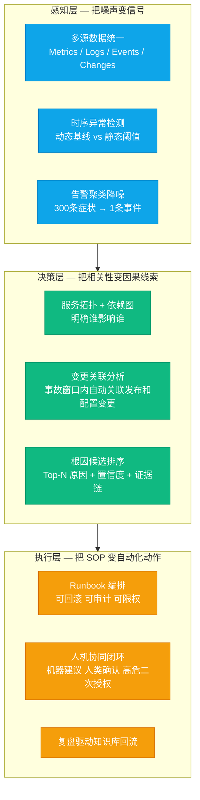
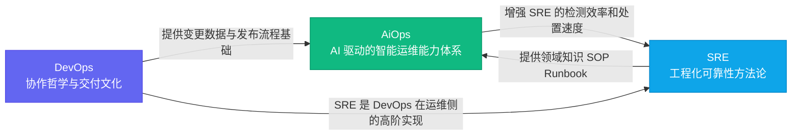

# 01 AiOps 是什么：从救火到防火的运维范式革命

**摘要：** 本文是「大数据集群 SRE 的 AiOps 工程实践」专栏的开篇认知奠基篇。文章从一个凌晨两点的告警轰炸场景出发，先还原传统运维面临的三大结构性困境，再梳理运维范式从工具化到自动化再到智能化的三代演进历史，说明每一代解决了什么、天花板又在哪里；随后给出 AiOps 的严谨定义与边界——它不是产品、不是更聪明的监控、不等于 LLM、也不替代人，并系统讲解感知层、决策层、执行层三层能力框架及其层层依赖的运行机制。在此基础上，文章厘清 AiOps 与 DevOps、SRE 的关系，重点剖析大数据集群 AiOps 与互联网微服务 AiOps 在拓扑基础、故障时间尺度、状态特征、资源调度等八个维度上的本质差异，并追到三重根因——批处理、队列与票据——说明它们如何塑造了大数据 AiOps 的独特形态。读完本篇，你应当能回答两个问题：AiOps 到底是什么、不是什么；以及大数据集群的 AiOps 为什么必然长成"拓扑建模加作业画像"这副样子，而不是微服务那套"Trace 加请求成功率"的配方。

---

## 第 1 章 那个凌晨两点的告警群

开始讲技术之前，先还原一个任何 SRE 都不陌生的场景。

凌晨两点，你的手机响了。打开企业微信，值班告警群里已经刷了三百多条消息。DataNode 磁盘 IO 告警、YARN ResourceManager 心跳超时、NameNode RPC 队列积压、HiveServer2 连接池耗尽、Spark 作业失败率飙升、Kafka 消费延迟暴增——每一条都像在独立地喊："快来看我，快来救我。"

你迷迷糊糊地开始逐条排查。十分钟过去了，你还没弄清楚这 300 条告警之间有没有因果关系。二十分钟过去了，你怀疑是某个 DataNode 的磁盘故障触发了连锁反应，但不确定。三十分钟后，你终于追溯到根因：某台物理机的一块磁盘出现了大量坏块，导致该磁盘上的三个 DataNode 副本写入失败，HDFS 的副本冗余度下降触发了告警，同时 NameNode 的 Block Report 处理队列积压，导致 RPC 处理能力下降，依赖 HDFS 的 HiveServer2 查询开始大量超时，进而引发了下游 Spark 批处理作业的连续失败。

这是一个典型的**因果链式故障**，根本原因只有一个：磁盘坏块。但你的告警系统给你推送了三百多条"独立"的症状告警。

值得追问的是：一个根因，为什么会在告警群里炸出三百条消息？这背后是故障在组件栈里逐层传导、逐层放大的过程。HDFS 为了容错，会把每个数据块复制成三个副本、分散在三台 DataNode 上，一块磁盘出现坏道，落在这块盘上的所有副本写入都会接连失败，而每一次失败都可能各自触发一条健康类告警；副本冗余度下降之后，NameNode 又要启动副本重平衡，把缺失的副本补到其他节点上，重平衡本身占用网络与磁盘 IO，反过来拖慢其他 DataNode 的块上报。于是存储、资源、查询、作业四个层次各报各的症状——存储层说磁盘坏了，资源层说心跳超时，查询层说连接池耗尽，作业层说任务失败。石头只有一块，涟漪却荡满了整片水面。

不过，并不是所有告警风暴都源自单一根因。有些故障是多个独立事件在同一个时间窗口里碰巧叠加：磁盘坏块、网络抖动、一次配置变更同时发生。这时候如果把所有告警强行聚成一条"主事件"，反而是危险的——两个需要分别处置的故障被埋进了同一张卡片，处理完其中一个，另一个还在原地流血。所以感知层做聚合降噪的第一件事，是先分辨眼前的告警群是一条因果链，还是多条独立链的偶遇。

这个场景里暴露的问题，不是"告警不够多"——告警已经多到让你认知过载了。真正的问题是：

1. **告警没有因果关系**：每个告警都在独立描述一个症状，没有系统能告诉你"这 300 条告警，其实是同一个磁盘故障在不同层面的体现"。
2. **排查没有路径向导**：你只能凭经验逐条排查，每次故障都像是第一次遭遇，团队的集体知识积累在告警群的洪流中反复淹没。
3. **处置没有自动化**：哪怕你早就知道"DataNode 磁盘故障 → 触发副本迁移 → 通知存储团队"这个 SOP，你也只能手动一步步执行。

这三个问题，正是 AiOps 要解决的本质问题。后面的所有章节，都是在回答"如何让系统自己把这三件事接过去"。

这个场景同时给了我们一把衡量后面所有章节的尺子：任何一项 AiOps 能力，最终都要能回答，它能否把"凌晨两点的三十分钟"压缩成"两分钟"——两分钟定位到根因，两分钟给出处置建议。判断标准越具体，越不容易被厂商的演示效果带走。

---

## 第 2 章 传统运维的三代困境

要理解 AiOps 是什么，必须先理解它要解决的是什么时代背景下的问题。

### 2.1 第一代：工具化运维的极限

2010 年代初期，大多数互联网公司运维的核心工作，是搭建和维护各类监控工具：Zabbix、Nagios、Ganglia、后来是 Prometheus、Grafana。这个时代的运维哲学可以用一句话概括：**"能监控到，就能处理。"**

工具化运维解决了"不知道发生了什么"的问题。在这之前，服务器挂了是靠用户投诉才知道的；有了 Zabbix 之后，至少 CPU 打到 95% 会有告警了。

但工具化运维有一个内在的天花板：**它的认知能力是静态的，是人工预设的**。每一条告警规则背后，都是工程师事先写好的 if 语句：`if cpu > 90% then alert`。规则的质量上限，取决于写规则的人的经验深度。

这套 if 规则体系还有两个绕不开的短板，一个是粒度，一个是频率。粒度上，规则本质上是把连续变化的指标硬压成布尔信号——阈值定在哪里，是在误报与漏报之间滑动；业务负载带周期、带趋势，白天高峰期与凌晨低谷期共用同一条规则时，任何一个固定阈值都只能照顾一端，另一端必然失守。频率上，规则是工程师手工维护的资产，集群每多一类组件、每多一种故障形态，规则就要跟着加；三千条规则背后是三千次人工判断，而每一次判断都可能在三五年后变成一条早该退役的过期规则，过期规则不会报错，只会沉默地误报。

与告警疲劳相对的另一个极端是**静默失败**：为了少被骚扰，把阈值一路调松，误报是压下去了，真正的高危故障也跟着漏掉——集群里某个组件已经挂了两个小时，指标图上却风平浪静。告警疲劳是阈值过紧的结果，静默失败是阈值过松的结果，它们是一枚硬币的两面，而工具化运维的规则体系同时把两面握在手里，无法只取其一。

随着系统规模的增长，这个天花板开始显现。一个有 300 个服务的大数据集群，可能有 3000+ 条告警规则。告警规则越多，误报越多；规则越严格，漏报越多。人工设定的阈值，在业务高峰期经常误告，在业务低谷期又经常漏测。工程师开始麻木，开始"告警疲劳"（Alert Fatigue）——他们不是不在意告警，而是每天被几百条无效告警轰炸，认知资源被消耗殆尽，等真正重要的告警来了，反应也慢了。

> [!warning] 告警疲劳是高危状态
> 告警疲劳不是"态度问题"，而是一个工程问题的系统性后果。当团队成员开始习惯性地忽视告警时，组织已经处于高度危险的状态——下一次重大故障的 MTTD（平均发现时间）将会急剧延长。

### 2.2 第二代：自动化运维的瓶颈

2010 年代中期，行业开始流行另一套理念：让机器代替人做重复性的操作。这就是以 Ansible、SaltStack、Chef/Puppet 为代表的自动化运维时代，以及以 Kubernetes 为核心的云原生基础设施自动化浪潮。

自动化运维解决了很多重复性体力劳动：批量部署、配置管理、服务重启、滚动发布。一个原来需要一个人花一天手工操作的集群升级任务，现在可以写成 Playbook 自动执行。

但自动化运维同样有一个内在的瓶颈：**它的决策逻辑是确定性的，是人工穷举的**。Playbook 只能处理你预先想到的情况，面对意外情况只能停止或报错。自动化的边界，是人类智慧的边界。

穷举这条路，在数学上注定走不完。假设一个集群有三百个组件、每个组件平均有五种值得关注的异常模式，两两组合的数量就已经非常可观，更不用说三因素、四因素交织的复合型故障。Playbook 能覆盖的，是工程师曾经见过、并且写成过剧本的路径；集群里每天发生的，却是剧本之外的即兴情节——而这恰恰是故障的常态。编剧提前写好的剧本再厚，也盖不住现实里层出不穷的即兴戏。

更根本的问题是，传统自动化压根儿无法应对**复杂的故障场景**。一个分布式大数据集群发生故障，其根因可能是多个因素交织在一起的：磁盘坏块 + 网络抖动 + 前一天的配置变更 + 当天特别大的批处理作业。这种"复合型故障"是无法预先穷举规则的。

需要澄清的一点是，三代范式之间不是替代关系，而是叠加关系。智能化运维并不是把阈值规则和 Playbook 扔进垃圾桶，恰恰相反，它把规则当作兜底、把 Playbook 当作执行骨架，在其上再叠加一层"从数据里学出来的判断"。这个认识很重要，它决定了第 4 章三层框架里每一层都保留着前两代的遗产。

### 2.3 第三代：智能化运维的机遇

智能化运维，即 AiOps，是在前两代运维工具积累了海量历史数据，以及机器学习、大语言模型技术成熟的背景下应运而生的第三代范式。

它的核心转变有三个维度：

| 维度 | 工具化运维 | 自动化运维 | 智能化运维（AiOps） |
|------|-----------|-----------|---------------------|
| **感知能力** | 静态阈值规则 | 静态阈值 + 脚本探活 | 动态基线 + 多维异常检测 |
| **决策能力** | 人工判断 | 人工编写的决策树 | 机器学习 + 因果推理 + LLM 辅助 |
| **执行能力** | 人工操作 | 预定义 Playbook | 动态 Runbook + 风险感知执行 |
| **知识积累** | 散落在个人经验中 | 部分固化在脚本里 | 结构化知识库 + 持续学习 |
| **适应能力** | 无法自适应 | 人工更新规则 | 数据驱动自我优化 |

三代范式并存共舞，还有一个现实的原因：数据不足的地方，智能化无从谈起。一个刚上线、只有三个月监控数据的新集群，动态基线还在冷启动，规则和 Playbook 依然是主力；只有当历史数据积累到一定程度，智能化的判断才有足够的燃料。所以这一节讲的既是演进史，也是每个集群都会重新走一遍的成长路径。

---

## 第 3 章 AiOps 是什么：一个严谨的定义

在业界，AiOps 这个词已经被过度消费。厂商的 PPT 里，任何加了点机器学习的运维工具都敢叫 AiOps。要建立清醒的认知，必须对这个概念做一个严谨的边界界定。

### 3.1 原始定义

AiOps 这个词由 Gartner 在 2016 年提出，最初全称是"Algorithmic IT Operations"（算法驱动的 IT 运维），后来演变为"Artificial Intelligence for IT Operations"（面向 IT 运维的人工智能）。

Gartner 的官方定义是：**AiOps 是将大数据、机器学习和其他人工智能技术应用于提升 IT 运营功能，包括可用性和性能监控、事件关联分析和 IT 服务管理。**

但这个定义高度抽象，对工程师的实际指导价值有限。让我们从工程视角给出一个更有操作意义的定义。

这个官方定义里其实藏着两个值得拆开的关键词。第一个是"大数据"——它强调的不是数据量大，而是运维数据的来源多样：指标、日志、事件、变更，每一种都有自己的格式、时间基准和语义，把它们对齐到同一个上下文里本身就是一项工程。第二个是"机器学习"——它暗示这套系统的判断不是人工逐条穷举出来的，而是从历史数据里学出来的。这两个关键词合在一起，决定了 AiOps 的根基是数据底座；这也是本专栏把[[02 数据地基优先：为什么垃圾进垃圾出是 AiOps 最大的坑]]放在第二篇的原因。

> [!info] AiOps 的工程定义
> AiOps 是一套以数据为驱动、以算法为决策核心的运维能力体系，它的核心目标是：
> 1. **感知**：从海量、多源、嘈杂的运维数据（指标、日志、链路、变更、事件）中，自动识别出真正值得关注的异常信号；
> 2. **决策**：基于历史知识、拓扑结构和实时数据，推断故障的根本原因，并给出可解释的证据链；
> 3. **执行**：将 SOP 知识转化为可编排、可审计、可回滚的自动化动作，在人机协同的框架下完成故障处置。

注意这个定义里的一个关键词：**人机协同**。AiOps 不是"无人值守自动化"——至少在目前的技术成熟度下，不是。它是让机器承担"搜索空间缩小""模式识别""重复操作执行"这些工作，把"最终判断""高风险决策""架构优化"留给人类。

把 AiOps 当成"无需人力的自动化运维"是最危险的误解，没有之一。

这里的分工界限值得再说透一层：人机协同的分界不是按"机器能干多少"来划的，而是按**可验证性**来划的。搜索空间缩小、模式识别、重复操作，这几类工作有一个共同点——它们的结果可以被低成本地复核（候选根因可以验证，执行日志可以审计）；而最终判断、高风险决策、架构取舍，一旦出错就是不可逆的，或者复核成本极高。把前者交给机器、把后者留给人，才是"协同"二字的本意。这就像气象预报系统，它告诉你"大概率要下雨、在哪个区域、几点开始下"，但要不要取消户外活动、要不要提前收摊，决定权始终在人手里。

### 3.2 AiOps 不是什么

理解一个概念，有时候需要先排除掉它不是什么。

**AiOps 不是一个产品**。不存在"装上这个软件你就有了 AiOps"的好事。AiOps 是一种能力体系，需要数据底座、算法模型、自动化执行、知识库的协同建设。

**AiOps 不是更聪明的监控**。Grafana 的告警规则做得再精细，也只是工具化运维做得好，不是 AiOps。AiOps 的核心是**跨数据源的关联推理**，是把本来孤立的信号串联成因果链的能力。这条分界线值得画清楚：单数据源内部的规则再精细，也跨不出监控的范畴；一旦系统开始把指标、日志、变更放进同一个上下文里寻找因果关系，它就迈进了 AiOps 的地盘。

**AiOps 不等于 LLM**。这是 2024-2026 年出现的新误区。把 ChatGPT 接进去，能回答"NameNode 是做什么的"——这不是 AiOps。把 LLM 接进告警群、让它把三百条告警"总结"成一段话，得到的也只是文本摘要，不是因果推理：摘要能压缩信息量，却不能解释"为什么"。LLM 只是 AiOps 能力体系中的一个增强模块，负责自然语言交互和基于知识库的推理辅助，不是全部。

**AiOps 不是替代人**。这个在前文已经提到了，但值得反复强调。任何试图通过"告诉管理层 AiOps 可以减少人力"来推动项目的做法，都在给项目埋雷——因为真正的 AiOps 落地早期，往往会短暂增加工程师的工作量，因为他们需要建设数据基础设施、标注训练数据、调试模型。

> [!info] 判断一个系统是不是 AiOps：问三个问题
> 面对任何一个号称 AiOps 的产品或内部平台，不妨问三个问题：其一，它是否做跨数据源的关联推理，把指标、日志、事件、变更放进同一个上下文？其二，它的行为是否从历史数据中学习、并随新数据自我调整，还是写死之后再也不动？其三，它是否形成了"感知→决策→执行→反馈"的闭环，还是停在"告警→通知人"就结束了？三个问题都答"否"的系统，多半只是换了个名字的监控看板。

---

## 第 4 章 AiOps 三层能力框架：感知、决策、执行

真正能在生产环境扛住压力的 AiOps 体系，一定不是单点能力，而是三层架构的协同。这三层分别是**感知层、决策层、执行层**，它们之间不是并列关系，而是严格的依赖关系：上一层的质量决定下一层的上限。

### 4.1 感知层：把噪声变信号

感知层是 AiOps 的数据入口，也是整个体系中最容易被忽视却最关键的层次。大多数团队在遇到 AiOps 落地瓶颈时，问题根源几乎无一例外地出现在感知层：数据质量不达标、数据来源不统一、告警信号太嘈杂。

感知层要处理的核心问题，不是"能不能检测到异常"，而是"能不能从海量嘈杂信号中识别出真正值得关注的异常"。这两者之间有巨大的差距。

感知层的核心能力有三个：

**多源数据统一**：将来自不同系统的数据统一格式、统一时间戳、统一命名空间。对于大数据集群来说，数据来源包括：Prometheus 采集的 JMX 指标（HDFS/YARN/HiveServer2/Kafka）、Loki 收集的日志（NameNode/DataNode/ResourceManager/NodeManager/SparkDriver/Executor）、Ambari 的配置变更记录、Foxeye 已有的告警事件，以及 Spark 作业调度事件。这些数据如果无法在一个统一的上下文中关联，任何后续的智能分析都是空中楼阁。

"统一时间戳"这四个字，做起来远比听起来复杂。不同数据源的采样周期不一样（有 15 秒的、有 60 秒的），日志时间来自组件进程所在机器的本地时钟，指标时间来自采集端，两者之间可能隔着几十毫秒到几秒的偏差，而 NTP 一旦失步，偏差会变成分钟级。多源统一的第一步不是建表、不是写 ETL，而是先把"同一个时刻"在不同数据源里究竟指什么这件事对齐，否则后面所有的关联分析都建立在一个错位的坐标系上。这个主题在本专栏第二篇会有完整展开，这里只需要记住：感知层的工程质量，决定了后面所有层的天花板。

**时序异常检测**：从"静态阈值"升级到"动态基线"。静态阈值的问题在于对业务模式无感：白天高峰期 CPU 85% 可能正常，凌晨低谷期 CPU 35% 可能就是问题信号（批处理作业异常停止）。动态基线通过机器学习（如 Isolation Forest、Prophet 时序预测）从历史数据中学习正常模式，对偏离模式的行为打分告警，而不是跟固定阈值比较。

动态基线的原理，是先把历史序列拆成趋势、周期、残差三部分——趋势是长期走向（集群规模在变大，指标整体在抬升），周期是规律波动（白天高峰、凌晨低谷、周末偏低），残差才是真正需要盯的东西；模型学习的是"正常残差长什么样"，新到的数据点偏离到残差分布之外，才触发告警。边界条件同样要讲清楚：一个刚上线的新组件没有历史数据，基线处于冷启动状态，此时必须回退到静态阈值兜底；集群做过一次大的扩缩容之后，历史分布整体漂移，基线需要重新学习的窗口，这个窗口期内动态基线的判断会短暂失真。所以动态基线不是"装了就灵"的算法，而是一个需要配套治理的工程能力。

**告警聚类降噪**：这是感知层的皇冠能力。它需要将数百条"症状告警"按照时间窗口、拓扑关系、相似模式这三个维度进行聚合，最终给值班人员呈现的不是告警列表，而是"事件摘要卡片"——这张卡片说的是：一个 DataNode 磁盘故障事件，影响范围是 3 个 DataNode，可能根因是磁盘硬件故障，关联 12 条衍生告警已被收敛。

这三个维度的机制各自不同：时间窗口解决"同时发生的告警"，窗口取 5 到 15 分钟是一个经验区间——太短聚不出因果，太长会把互不相干的故障并到一起；拓扑关系解决"有依赖的告警"，这依赖决策层将要讲到的组件依赖图；相似模式解决"长得像的告警"，做法是把告警文本里的主机名、IP、实例号归一化成通配符，再算文本指纹。三者叠加，才是从 300 条症状到 1 条主事件的技术底座。

不过聚合参数本身就是一把"收敛度"旋钮：拧得过度，会吞掉并发独立故障（第 1 章已经埋过这个雷）；拧得不够，降噪效果又无感。找到一个团队能接受的中间点，是感知层落地时最磨人的工作。

### 4.2 决策层：把相关性变因果线索

感知层解决了"什么出了问题"，决策层解决的是"为什么出问题"和"出问题的链路是什么"。

这里有一个非常重要的认知边界需要划清：**决策层的目标不是给出 100% 确定的根因结论，而是尽可能缩小工程师需要排查的搜索空间。**

一个工程师在没有任何辅助工具的情况下，面对一个 300 个组件的大数据集群故障，他的搜索空间是：300 个组件 × 每个组件若干指标维度 × 时间轴上的变化 = 极度复杂（这也是"凌晨两点排查三十分钟"故事的本质）。

决策层的核心价值，是让这个搜索空间从"300 个组件"缩小到"Top-3 个可能的根因节点"。即使准确率只有 60%（这在工程实践中其实已经很优秀），每次故障工程师的平均排查时间也会大幅缩短，因为他们只需要验证 3 个假设而不是排查 300 个组件。

决策层依赖三大核心能力：

**服务拓扑与依赖图**：这是决策层的骨架，后续将在[[04 组件依赖拓扑：SCMDB 是大数据集群 AiOps 的骨架]]中深度展开。没有拓扑，告警聚合只能靠时间窗口（两个告警在 5 分钟内出现就认为相关），这会产生大量伪关联和漏关联。有了拓扑，才能做因果推断：NameNode RPC 队列积压→HiveServer2 查询超时，这是因果关系，不是巧合。

**变更关联分析**：大数据集群运维中，70% 的重大故障直接或间接与变更有关（这个数据来自业界多家公司的事后分析，小红书、美团的 AiOps 实践报告中都有提及）。变更关联分析在故障时间窗口（通常是前 30 分钟到前 2 小时）内，自动关联 Ambari 的配置变更记录、集群扩缩容操作、作业参数修改，并按时间距离排序，把最接近故障时刻的变更排在最前面。

**根因候选排序**：综合拓扑传播路径分析、异常指标聚合、变更关联等多路信号，输出 Top-N（通常 Top-3 到 Top-5）的根因候选，每个候选配上置信度分数和具体的证据链（哪些指标异常、是什么模式的异常、与什么变更相关）。工程师拿到这张"根因候选卡"，就可以有的放矢地进行验证，而不是漫无目的地排查。

置信度分数不是拍脑袋出来的，而是多路信号按规则加权的结果：拓扑传播路径越短，说明离源头越近，得分越高；指标偏离基线的倍数越大，异常越显著，得分越高；变更与故障时刻的时间距离越近，嫌疑越大，得分越高。真正的难点在于证据链——每一条候选根因都要能指认"我凭什么怀疑它"：哪几个指标、什么异常模式、关联了哪条变更，时间戳全部可回溯。工程师第一次见到系统给出的根因时，一定会问"凭什么"；如果系统答不上来，第二次就没人再看了。所以决策层的产出不是"答案"，而是"候选加证据"，可解释性在这里比准确率更重要。

这里也有一个典型的反例需要警惕：纯时间窗口的关联会产生伪关联。两个互不依赖的组件恰好在同一分钟各自经历一次 GC 抖动，告警时间重叠，没有拓扑约束时会被聚成一条"根因"，把工程师的排查方向整个带偏。这也是为什么拓扑数据在决策层如此关键——它把"时间上的巧合"和"结构上的依赖"区分开。

### 4.3 执行层：把 SOP 变自动化动作

执行层是 AiOps 三层架构中最具争议的一层，也是大多数团队最保守、落地最慢的一层。

保守是对的。执行层意味着机器会对生产系统做出实际改变，一旦出错，后果可能比不自动化更严重。正因如此，执行层的设计必须遵循一个核心原则：**渐进式授权，可控可回滚**。

> [!note] 自动化执行的风险分级原则
> 生产运维中的自动化执行，必须按照风险等级分层授权：
> - **L0（完全自动，无需确认）**：发送通知、生成报告、查询状态、触发 Runbook 只读步骤
> - **L1（一键确认）**：重启某个无状态服务实例、短时间调整 YARN 队列参数（可回滚）
> - **L2（人工审批流程）**：NameNode HA 主备切换、DataNode 副本迁移
> - **L3（绝对禁止自动化）**：数据删除、跨集群迁移、核心组件版本升级

L0 到 L3 的分级，背后其实是一个统一的判据：影响范围乘以可逆性乘以恢复成本。影响范围越大、动作越难回退、做坏了之后恢复越贵，级别就越高。无状态实例的重启，做坏了无非再重启一次，代价低，所以可以放到 L1；NameNode 主备切换涉及整个集群的元数据服务，做坏了恢复成本极高，必须走人工审批；数据删除在任何时候都不可逆，直接打进 L3 永不解锁。分级不是流程主义，而是把"这次动作做坏了要付出什么"显式地摆到台面上。

执行层的落地还依赖 Runbook 的工程化程度。一个可编排的 Runbook 不是把操作文档贴出来，而是把步骤拆成带依赖的小 DAG：每一步都有超时、有幂等、有失败分支，执行前做前置条件预检，执行中写审计日志，执行后拿预期指标做结果验证。只读步骤（查询、通知、生成报告）与写操作分开编排，前者可以放心地交给 L0，后者才进入授权流程。这套工程化骨架，是"可控回滚"四个字落到地上的前提。

可审计是执行层一条常被忽略的隐性要求。每一次自动化动作，无论大小，都要留下"谁在什么时间、基于什么证据、执行了什么操作、结果如何"的完整记录。这不只是为了事后追责——只有每一次动作都看得见、查得到，工程师才敢把权限一步步交出去，放手才放得安心。

执行层的另一个关键设计是**复盘驱动的知识库回流**：每一次自动化执行，无论成功还是失败，都应该生成结构化的执行日志，供工程师事后审阅；工程师的修正和补充，应该回流到知识库，用于优化下一次的决策质量。这就形成了"执行→复盘→知识库→更好的决策→更好的执行"的正向飞轮。

如果跳过了这套骨架直接上全自动"自愈"，会是什么后果？最典型的场景是：自动重启脚本没有幂等保护，同一故障触发了三次重启，每次都把正在恢复的服务再打断一次，MTTR 反而被拉长；或者自动扩容脚本对队列参数做了不可回滚的调整，故障结束后参数没有还原，集群带着一个错误的配置运行了半个月。自动化没有回滚能力，等于把故障放大器的开关交到了机器手里——这正是执行层必须最保守的原因。

---

## 第 5 章 AiOps 与 DevOps、SRE 的关系

"AiOps"、"DevOps"、"SRE"这三个术语经常被混用，但它们描述的是完全不同维度的概念，理解它们之间的关系，有助于在组织内部准确定位 AiOps 的角色。

### 5.1 DevOps：协作哲学与交付文化

DevOps 是一种**组织文化和协作哲学**，它的核心主张是：开发（Development）和运维（Operations）不应该是两个对立的部门，而应该共同为产品的持续交付和稳定性负责。

DevOps 的产物是一套流程和实践：CI/CD、蓝绿发布、灰度发布、配置管理即代码（IaC）、故障后的无指责文化（Blameless Post-mortem）。

DevOps 是 AiOps 的基础，但不是 AiOps 的充分条件。一个没有良好 DevOps 能力的组织（发布流程混乱、没有变更记录、没有 CI/CD），是无法落地 AiOps 的——因为 AiOps 的决策层依赖变更数据，而没有 DevOps 就没有可靠的变更记录。这个因果在上一章的变更关联分析里已经显形：一个从不记录配置变更的集群，决策层就永远少一路最重要的信号。

大数据集群同样需要 DevOps 的这套资产，只是对象换了：不是微服务的代码发布，而是集群的配置变更、扩缩容操作、作业部署；Ambari 的审计日志、运维操作台账，就是大数据版的"变更记录"。没有这些，AiOps 的决策层就是断了一条腿。

### 5.2 SRE：工程化的可靠性文化

SRE（Site Reliability Engineering）是 Google 提出的一种岗位模式和工程实践框架：把软件工程方法论应用到运维领域，用代码和系统替代重复的运维操作，用 SLO（服务等级目标）量化可靠性诉求，用错误预算（Error Budget）在稳定性和创新速度之间取得平衡。

SRE 比 DevOps 更聚焦在运维质量的工程化方面。它的核心资产是：SLO 定义与追踪、Runbook 文档、故障复盘（Post-mortem）体系、自动化水平的持续提升。

AiOps 与 SRE 的关系最为紧密：**AiOps 是 SRE 能力的 AI 增强版本**。SRE 已经在做的事情（制定 SOP、写 Runbook、持续提升自动化水平），AiOps 通过机器学习、LLM 等技术把这些事情做得更好、更快、更智能。SRE 工程师是 AiOps 体系中最重要的人力资产——他们提供的领域知识（什么是异常、什么是正确的处置方式），是训练和优化 AiOps 算法的核心输入。

SLO 与错误预算在这里还有一层容易被忽略的关联：它们是 AiOps 的目标函数。智能检测做得再好，最终要落到 MTTD（平均发现时间）、MTTR（平均恢复时间）的改善上，而 SLO 把"系统健康"从一个模糊的主观判断变成了可度量的目标——AiOps 的每一项能力，最终都要能回答"它让哪项可靠性指标变好了"。这套主题在可观测性专栏里有完整的展开，这里只需要记住关系：SRE 定义目标，AiOps 是实现目标的手段之一。

### 5.3 三者的关系图

三者的定位可以这样理解：
- **DevOps** 解决的是"快速、安全地交付"的组织协作问题
- **SRE** 解决的是"如何用工程化手段保障可靠性"的方法论问题
- **AiOps** 解决的是"如何从复杂运维数据中提取智能"的技术能力问题

三者并不互相替代，而是层层递进、协同增效。在一个成熟的技术组织中，DevOps 是文化，SRE 是方法，AiOps 是工具——缺少任何一层，另外两层的效果都会大打折扣。

如果把组织比作一台车：DevOps 决定的是这台车怎么被造出来、怎么磨合保养，SRE 负责的是给它定性能指标、做定期检修、记录每次故障，AiOps 则是那套能提前预警、自动排查、按授权自动处置的智能诊断系统——三者缺一，这台车都跑不出既快又稳的结果。反过来也要泼一盆冷水：AiOps 不会替代 SRE 的组织职责，值班、复盘、容量规划这些工作依旧由人承担，智能系统改变的只是其中的信息密度与执行效率。

落到组织层面，还有一个常见的错位：把 AiOps 当成一个独立的团队去养，结果需求与一线脱节，平台越建越空。更合理的做法，是把 AiOps 作为 SRE 团队的能力底座来建设——工具可以独立成平台，但需求定义与效果评估，必须来自每天背值班、接告警的工程师。

---

## 第 6 章 大数据集群 AiOps vs 微服务 AiOps：一个被严重忽视的根本差异

这是本专栏最想强调的一个核心观点，也是大多数 AiOps 文章闭口不谈的地方。

当你看国内外各大互联网公司（小红书、腾讯、美团、Uber、Netflix）的 AiOps 实践分享，你会发现几乎所有的架构设计都建立在一个共同的假设上：**服务之间通过 HTTP/RPC 调用，存在完整的分布式链路追踪（OpenTelemetry / Jaeger / Zipkin）**。

这个假设对微服务架构完全成立——小红书的一个查看笔记请求，可以通过 Trace ID 串联起从 API Gateway 经过数十个微服务最终到 MySQL 的完整调用链路，每一个节点的延迟、错误率都有精确的量化数据。

但这个假设对大数据集群基础设施来说**完全不成立**：

| 差异维度 | 互联网微服务 AiOps | 大数据集群 AiOps |
|---------|-------------------|-----------------|
| **拓扑基础** | HTTP/RPC 调用链 Trace（完整、实时） | 无 HTTP Trace，依赖手工建模的组件依赖关系图（SCMDB） |
| **故障单元** | 微服务实例 (Pod) | 集群组件（NameNode/DataNode/RM/NM）+ 批处理作业（Spark/Flink Job） |
| **故障时间尺度** | 毫秒级请求超时 | 分钟级组件故障 + 小时级作业失败 |
| **故障类型** | HTTP 超时、服务 OOM、依赖服务抖动 | NameNode GC 风暴、DataNode 磁盘坏道、YARN 队列饱和、Spark OOM/数据倾斜 |
| **状态特征** | 无状态 HTTP 请求 | 有状态批处理作业（运行时间分钟到小时级） |
| **故障传播方式** | 请求级别的超时和重试 | 组件依赖的连锁反应（HDFS→YARN→HiveServer2） |
| **变更来源** | 代码发布、容器重启 | Ambari 配置变更、集群扩缩容、参数调整 |
| **资源调度** | K8s 弹性调度（Pod 级） | YARN 静态队列分配（队列级） |

这张表的每一行差异，都意味着照搬微服务 AiOps 方案会遭遇的工程陷阱。

以"拓扑基础"为例：微服务 AiOps 的根因分析，核心是沿着 Trace 调用链路做故障传播分析——哪个服务开始出现错误，错误如何沿调用链路向上传播，最终找到最早出现异常的节点就是根因。这套逻辑在有完整 Trace 覆盖的微服务架构里非常有效，小红书的实践显示 Trace 场景准确率可以做到 80%+。

但大数据集群根本没有 HTTP Trace，NameNode 与 DataNode 之间的通信走的是 Hadoop RPC，不是 HTTP，也没有 Trace ID 概念。ResourceManager 与 NodeManager 之间的心跳协议同样如此。你没有办法像微服务那样"从 Trace 链路上找到最早出现错误的节点"。

所以大数据集群的 AiOps 必须走另一条路：**预先建模组件依赖关系（SCMDB，即大数据集群版的 CMDB），然后基于这个依赖图做因果推断**。这条路效率较低（依赖图需要手工维护），灵活性也较低（新增依赖关系需要手工更新），但这是目前大数据集群场景下最可行的技术路径。

> [!warning] 照搬微服务方案的风险
> 如果一个大数据集群运维团队直接引入面向微服务设计的 AiOps 平台（如基于 Jaeger Trace 做根因分析的商业产品），几乎必然会遭遇以下结果：平台部署成功，但核心的根因分析功能因为没有 Trace 数据而完全失效，最终沦为一个昂贵的指标监控看板。

除了拓扑基础，"故障时间尺度"和"资源调度"两行也值得单独展开，因为它们决定了大数据的感知层该怎么设计。微服务场景里，故障的单位是毫秒级的请求——检测手段是请求成功率、P99 延迟这一类信号，异常在几分钟内就能被捕捉；而大数据集群里，一个组件从开始劣化到指标上可见，本身就要跨越若干采集周期，批处理作业的失败要等作业运行一段时间才会显性化，副本重平衡更是小时级的事件。所以大数据感知层的时间窗口、告警延迟容忍度，天然比微服务长一个数量级——这是场景决定的，不是工程能力落后。

资源调度行则解释了一类微服务场景没有的告警形态。微服务跑在 K8s 上，实例挂了可以快速拉起新 Pod，弹性调度把"资源不足"大部分消化在调度器内部；大数据集群跑在 YARN 上，队列容量、优先级都是配置里写死的静态分配，一个队列被占满，即使集群还有空闲资源，新作业也只能排队等着。于是"队列积压""容器等待"成了大数据特有的高频告警，而这些告警往往是指向同一个上游根因的症状——这正是第 7 章要讲的队列机制。

"故障类型"这一行同样值得琢磨。大数据集群的高频故障是 NameNode GC 风暴、DataNode 磁盘坏道、YARN 队列饱和、Spark OOM 与数据倾斜——几乎全是"容量与状态"问题，判断"正常还是异常"必须结合历史基线；而微服务的高频故障是 HTTP 超时、服务 OOM、依赖抖动，本质上都是"请求处理"问题，用错误率与延迟就能刻画。两类故障的判据完全不同，异常检测算法的选型自然也就分道扬镳——这也是本系列专门为"作业画像"能力留出一篇的深层原因。

"作业生命周期管理"差异同样值得深入理解。微服务的请求是无状态的、毫秒级的——一个 HTTP 请求要么成功，要么失败，没有中间状态。但一个 Spark 批处理作业可以运行 1 小时 42 分钟，在这段时间里，它可能经历多个 Stage、数千个 Task、N 次 GC 暂停。这种有状态的、长时间运行的"作业"的异常检测，需要完全不同的技术手段：基于历史执行画像的动态基线（这个作业通常在 2 小时内完成，今天已经跑了 4 小时，触发长尾异常告警），而不是简单的"成功/失败"二分类。

这正是本专栏将在[[08 作业画像与异常检测：Spark 和 Flink 的 AiOps 专属能力]]中深度展开的能力——**作业生命周期管理，是大数据集群 SRE 在 AiOps 领域的核心差异化优势，也是团队领域知识最密集的地方**。

最后补充一个边界，免得把差异夸大成鸿沟：并不是所有大数据组件都排斥容器化，Spark on K8s、Flink on K8s 都有成熟实践，部分批处理作业也完全可以享受弹性调度。但集群的核心组件（NameNode、DataNode、ResourceManager）到今天仍以传统方式部署，因为它们有状态、强耦合、对本地数据有依赖。这个事实说明，表里的差异来自大数据负载"有状态、长任务、强耦合"的本质，而非技术栈的暂时落后——选型的时候要区分"本质差异"和"技术演进"，前者决定架构，后者只决定工具。

---

## 第 7 章 三重根因：批处理、队列与票据如何塑造大数据 AiOps

第 6 章列了八个维度的差异，但这些差异只是表象。往深里问一层：为什么大数据集群会长成这个样子？追到源头，答案可以浓缩成三个词——**批处理（Batch Processing）、队列（Queue）、票据（Ticket）**。它们分别决定了大数据故障的时间尺度、传播方式与一类特殊的静默形态，也共同塑造了大数据 AiOps 的架构选择。

### 7.1 批处理：把故障的时间尺度拉长

大数据集群的主负载是批处理作业，而不是在线请求。Spark、Flink、Hive 的 ETL 作业一跑就是几十分钟到几小时，作业与作业之间还通过数据血缘形成依赖——上游作业的产出表，是下游作业的输入。这个事实直接决定了三件事。

第一，故障的时间尺度被拉长。微服务里一个请求毫秒级结束，故障在秒级显形；批处理世界里，一个作业从开始劣化到失败显性化，中间隔着成百上千个 Task 的执行时间。所以大数据感知层的采集周期、告警窗口、超时容忍度，都必须按分钟、小时来设计，这解释了第 6 章表格里的"故障时间尺度"一行。

第二，异常检测的语义完全不同。批处理作业的"异常"不是成功/失败二分类：跑得比历史基线慢、输入数据量异常膨胀、GC 时间占比飙升、某个 Stage 出现长尾，都是需要捕捉的异常形态，而捕捉它们的前提是理解作业的执行结构（Stage/Task）。这就是[[08 作业画像与异常检测：Spark 和 Flink 的 AiOps 专属能力]]要解决的问题，也是大数据 AiOps 与微服务 AiOps 分野最深的地方。

第三，重跑的代价很高。失败的批处理作业要重新申请资源、重新读一遍输入数据，代价远高于重试一次 HTTP 请求；更危险的是，没有幂等保障的作业重跑会造成数据重复写入。所以执行层的自动化动作（譬如自动重启失败作业）必须慎之又慎——它需要先回答"这个作业能不能安全重跑"，而这又是一个领域知识问题。

### 7.2 队列：故障在组件间传导的介质

大数据集群里的队列无处不在：组件内部的 RPC 队列（NameNode 处理心跳与块上报的队列）、资源队列（YARN 的容量队列）、消息队列（Kafka 的 topic 分区）。队列是故障传播的中间介质，也是一类高频告警的来源。

队列的机制可以这样理解：上游处理变慢，请求在队列里堆积，队列长度开始增长，下游等待超时——故障就这样沿着队列从上游传导到下游。反过来，队列深度又是极好的早期信号：它通常先于显性故障出现，上游刚刚变慢几十秒，队列已经开始积累。第 1 章凌晨两点的场景里，NameNode RPC 队列积压、HiveServer2 连接池耗尽、Kafka 消费延迟暴增，这三类告警其实都在描述同一个上游故障的不同切面——队列是那根把因果链串起来的线。这就像高速公路上的收费站，平时一马平川，一旦某个闸口放行变慢，车流立刻在闸口前堆积，后面的车全都排起长队——你看到的是一长串"排队"告警，但问题只在最前面的那个闸口。

但队列告警也是最容易误报的一类信号。同一个"积压"指标，可能来自上游生产变慢，也可能来自下游消费能力下降，两个方向指向截然不同的根因；只看队列长度而不看两端速率，等于只看到收费站前的车流，不知道是前面堵了还是后面不放行。更隐蔽的反向形态是：队列长时间为空，未必是好事，在批处理场景里它可能意味着上游作业根本没有启动——"生产不足"同样是故障，却往往没有一条醒目的告警。

从告警降噪的收益看，队列类告警是大数据集群里数量最大的告警族之一——第 1 章场景里的 RPC 队列积压、连接池耗尽、消费延迟暴增都属此类——把它们正确归并成"同一上游根因的症状"，压缩率的提升立竿见影。这也是告警聚合降噪被本专栏排在落地切入顺序第一位的原因之一：投入产出比最高的那个场景，恰好长在队列这根因果链上。

### 7.3 票据：一类指标测不出来的静默故障

大数据集群的安全认证普遍采用 Kerberos：服务与客户端先向 KDC 申请票据，之后凭票据完成服务间的相互认证。票据有有效期，过期之后服务间调用开始失败，但此时集群的 CPU、内存、磁盘、网络指标全部正常——这是一类典型的**静默故障（Silent Failure）**，指标图上风平浪静，实际的服务间认证已经在批量失败。

票据机制与微服务最大的不同在于信任模型。微服务常用的 JWT 是自包含、无状态的，服务端本地校验即可，不依赖任何中心节点；Kerberos 的票据则依赖集中式 KDC，票据的申请与续期（Renew）都围着这个中心转，一旦 KDC 侧或续期链路出问题，影响面是整个集群而不是单个组件。可见大数据集群的信任模型是中心化的，中心出问题的代价也被放大了。

这类故障对 AiOps 的含义是：它无法靠"指标异常"被发现，只能靠事件关联与日志证据。感知层之所以要把日志、事件、变更统一进同一个上下文，很大一部分原因就是给这类"指标正常但服务不可用"的故障留下侦破线索——当指标没有话说的时候，日志和事件是最后的目击者。

### 7.4 三者如何拧成大数据 AiOps 的形态

把三个根因放到一起看，大数据 AiOps 的形态就不是偶然的了：批处理拉长了时间尺度，所以感知层要按分钟级设计、作业要建画像；队列决定了传播方式，所以根因分析必须沿着依赖结构做因果推理，而不是沿 Trace 找最早出错的节点；票据贡献了一类静默故障，所以多源数据统一不是锦上添花，而是侦破这类案件的必需品。微服务那套"Trace 链路加请求成功率"的配方，在这里每一味都不对症；这不是某个团队选型失误，而是负载本质不同导致的必然分岔。

---

## 第 8 章 AiOps 的三个常见误区

明确了 AiOps 是什么、不是什么、以及大数据场景的特殊性之后，还有三个在具体落地中极其常见的误区需要提前规避。

### 8.1 误区一：把"模型准确率"当北极星指标

很多 AiOps 项目在 PoC（概念验证）阶段会以模型准确率为核心指标：根因分析准确率 85%、异常检测 F1 Score 0.92……数字漂亮，汇报也很好看。

但这些指标进入生产环境后往往会立即翻车，原因很简单：**运维的核心指标不是模型分数，而是业务恢复效率**。更实用的北极星指标应该是：

- **MTTD（平均发现时间）**：从故障发生到团队意识到故障，下降了多少？
- **MTTR（平均恢复时间）**：从发现故障到完成恢复，下降了多少？
- **告警压缩率**：有效告警（真正需要关注的事件）占总告警的比例，是否可持续保持在 80%+ 水平？
- **误报率**：被告警打扰但实际上没有问题的比例，是否在值班团队可接受的范围内？

准确率与业务恢复效率脱节，机制上一点都不难理解：准确率是离线评估的结果，用的是历史数据切片；而生产环境的数据分布一直在漂移——新组件上线、新故障模式出现、负载结构变化，都会让模型在离线集上的漂亮分数失真。离线 85% 的准确率，遇到一个没见过的故障类型，可能当场掉到 40% 以下；而 MTTD、MTTR 衡量的是真实故障的处置过程，它不会骗人。

告警压缩率和误报率之间存在天然的张力——告警压缩得越激进，漏掉真实故障的风险越高；误报容忍度越低，压缩效果越差。AiOps 工程师的核心工作之一，就是在这两者之间找到适合本团队的平衡点。

### 8.2 误区二：先上 LLM，再补数据

这是 2024 年以来最流行的错误方式。很多团队一看到 LLM 的强大，就迫不及待地把 ChatGPT 接进告警系统，让 LLM 分析告警然后输出根因分析报告。

结果几乎无一例外：LLM 能产出看起来头头是道的根因分析，但因为它根本不了解你的集群架构、组件依赖关系、历史故障模式，输出的结论往往是对通用知识的泛化，而不是真正基于当前上下文的精准诊断。

链条断在哪，其实可以一步步数出来：LLM 要做有根据的根因分析，输入至少需要三样东西——集群的组件依赖拓扑（SCMDB）、历史故障模式（故障知识库）、当前告警的完整上下文（数据底座）。这三样东西在多数团队手里一样都没有，LLM 当然只能拿通用知识来凑。先上 LLM 再补数据，等于让一个没有地图、没有病史、连病历都看不懂的医生做诊断，再聪明也没有用武之地。

正确的顺序是：**先建数据底座，再做传统算法，再接 LLM 增强**。

传统算法（基于规则的聚合、基于统计的异常检测）稳定、可解释、低风险，适合在数据底座建好之后快速验证 AiOps 的基础价值。当传统算法跑稳了，有了准确率基准，再接入 LLM 做精排和自然语言生成，效果才能真正显现。跳过传统算法阶段直接上 LLM，是在不稳定的数据基础上增加 LLM 的不确定性，两个不确定叠加，结果几乎必然是混乱。

### 8.3 误区三：大而全的平台主义

AiOps 落地初期，经常有工程师或管理者的野心很大：要做一个能覆盖所有集群、所有故障类型、所有处置动作的"全能 AiOps 平台"。这种平台式思维在初期几乎必然带来一个后果：项目工期无限延长，最终因为"道路太长"而失去动力。

一顿想做满汉全席，往往连第一道菜都端不上桌；先把一道拿手菜做到极致，客人才会再来。AiOps 落地最成功的方法，是"高频、高痛、好量化"的场景优先原则：选一个让团队最头疼的问题，深度解决它，产出可量化的效果（告警减少了 60%，某类故障的 MTTR 从 45 分钟降到 12 分钟），建立组织信心，再循环扩展到下一个场景。三个词各管一件事：高频保证样本量和反馈速度，高痛保证组织愿意持续投入，好量化保证效果能被证明——三者齐备，才值得作为第一个场景。

对于大数据集群 SRE 团队，最推荐的切入顺序是：

1. **告警聚合降噪**（ROI 最高，数据依赖门槛最低，效果最直观）
2. **Spark/Flink 作业异常检测**（领域知识积累最扎实，数据已有基础）
3. **故障根因分析**（数据依赖最重，算法最复杂，放在第三步）
4. **ChatOps 问答**（基础能力成熟后自然引入 LLM，水到渠成）

这四个场景不是并列的四条路，而是一条递进的链：告警聚合降噪先解决"看到什么"，数据底座在过程中被夯实；作业异常检测复用同一套数据，只是把视角从组件移到作业；根因分析在拓扑与历史样本齐备之后自然可用；ChatOps 问答则是前三步沉淀下来的知识库和工具链的自然出口。每一步都为下一步铺路，这才是"场景优先"背后真正的工程逻辑。

---

## 第 9 章 大数据集群 AiOps 的现实起点

本专栏的写作背景，是一个正在落地 AiOps 的大数据集群 SRE 团队。现实的基础设施状态是：

- ✅ **指标体系**：Prometheus + 各类 Exporter（Hadoop/Kafka/Spark JMX），VictoriaMetrics 存储，基本可用，数据质量有待提升
- ✅ **告警平台**：Foxeye 告警系统已在建设，Ambari 原生告警正在迁移
- ⚠️ **日志体系**：Loki 流水线建设中，全量覆盖尚未完成，日志模板化尚未实施
- ⚠️ **服务拓扑**：SCMDB 设计中但尚未落地，组件依赖关系暂时靠文档维护
- ✅ **工程能力**：Go + eino Multi-Agent 框架已在告警迁移系统中验证可行
- ❌ **故障知识库**：尚未结构化沉淀

这个现状意味着什么？意味着这个团队正处于 **Phase 0（数据地基建设）** 阶段——AiOps 的任何智能化功能，都需要等待数据底座的成熟才能构建其上。

数据地基之外的另一个现实是组织层面的：Phase 0 的工作要占用人手，Exporter 治理、日志流水线、SCMDB 建模，每一样都需要专门的工程投入，而 SRE 团队同时还在背值班、应对存量告警。所以数据底座建设从来不是"写几段脚本"的事，而是一次需要管理层知情并做出资源承诺的专项投入；这也是本专栏反复强调先要有可量化场景收益的原因——只有第一个场景拿出数字，组织才愿意持续加码。

为什么必须是这个顺序，回到第 3 章的结论就清楚了：AiOps 的判断是从数据里学出来的，感知层的数据质量直接决定决策层的上限。决策层的因果推理要吃拓扑数据，变更关联要吃变更台账，根因候选要吃历史故障样本——这些数据的任何一块缺失，都会让对应的能力变成摆设。

在数据底座未就绪时先建决策层和执行层，最典型的结局是：告警进得来、事件出不去，聚合依赖的拓扑不存在，关联依赖的变更数据是空的，最后整个系统退化成一套带 UI 的规则引擎——钱花了，智能却一步都没迈出去。这就是把系统建在沙滩上的代价，风平浪静时看不出问题，第一场大浪来的时候就塌了。

这不是坏事。恰恰相反，**知道自己在哪个阶段，是少走弯路的第一步**。很多团队的 AiOps 项目失败，正是因为在数据底座尚未就绪的情况下，就急于建设决策层和执行层，结果建在沙滩上的系统很快就崩塌了。

后续专栏中的所有技术讨论，都会立足这个现实起点，从"当下能做什么"的视角展开，而不是给一个完美状态下的理想方案。这是这个专栏区别于大多数 AiOps 文章的地方：**我们不是在卖概念，我们是在解决真实存在的工程问题。**

---

## 第 10 章 小结与下一篇预告

本篇是专栏的认知奠基篇，我们覆盖了以下核心内容：

1. **问题起点**：从凌晨两点的告警群还原 AiOps 所要解决的本质问题
2. **历史演进**：工具化 → 自动化 → 智能化的三代运维范式
3. **概念定义**：AiOps 的严谨工程定义，以及它不是什么
4. **三层框架**：感知层、决策层、执行层的协同机制
5. **生态关系**：DevOps / SRE / AiOps 三者的关系与边界
6. **本质差异**：大数据集群 AiOps 与微服务 AiOps 的 8 个维度差异
7. **三重根因**：批处理、队列与票据如何塑造大数据 AiOps 的形态
8. **常见误区**：把模型准确率当北极星、先上 LLM 再补数据、大而全平台主义
9. **现实起点**：当前团队的基础设施现状与所处阶段

如果只从本篇带走一句话，笔者希望是这一句：AiOps 不是装上就灵的软件，而是一套以数据为燃料、以算法为引擎、以人机协同为驾驶舱的能力体系——本篇的九个章节，就是这套体系的地基与梁柱。

建立认知的目的是指导行动。下一篇[[02 数据地基优先：为什么垃圾进垃圾出是 AiOps 最大的坑]]将进入第一个工程实践主题：**数据底座建设**。第 3 章里埋下的"感知层工程质量决定上层天花板"、第 7 章里点出的"多源数据统一是侦破静默故障的前提"，都会在那篇里落到具体的工程动作上——Metrics / Logs / Traces 三支柱在大数据集群中的具体实现、Loki 日志流水线设计、Drain3 日志模板化算法原理，以及 Exporter 采集质量治理的关键指标和方法。

更完整的阅读地图、各篇摘要与按角色划分的阅读建议，可以回到[[00 专栏导览：大数据集群 SRE 的 AiOps 工程实践]]查看；本系列后续的每一篇，都会沿用本篇建立的认知坐标系。

---

## 参考资料

1. Gartner. *Artificial Intelligence for IT Operations*（2016 年提出 AiOps 术语与原始定义）
2. Google SRE 团队. *Site Reliability Engineering*（O'Reilly, 2016）——SRE 岗位模式、SLO 与错误预算的理论源头
3. 小红书技术团队. 《AIOps 在小红书的探索与实践》——Trace 场景根因分析实践与准确率数据
4. 美团技术团队. AiOps 实践分享——"70% 重大故障与变更有关"的事后分析
5. 腾讯音乐. 智能告警实践
6. 内部资料：AiOps 可行性分析报告（本专栏作者对当前团队基础设施的完整评估报告）
7. 内部资料：AiOps 项目需求分析与设计（SRE-Copilot 项目的工程设计文档）

---

> [!note] 思考题
> 1. 第 1 章凌晨两点的告警群里，为什么大量告警是"队列积压""连接池耗尽"这一类？试着用第 7 章的队列机制，把那条因果链重新走一遍。
> 2. 你所在集群的告警，有多少能在 15 分钟内收敛到唯一根因？如果经常超时，问题出在感知层还是决策层，判断依据是什么？
> 3. 用第 3 章的三个问题检查你正在使用的"AiOps 平台"，它真的做了跨数据源关联推理吗？
> 4. 假设要把"DataNode 磁盘故障→副本迁移"做成自动化处置，按第 4 章的 L0-L3 分级，它应该落在哪一级？为什么？
> 5. 如果团队坚持要引入基于 Trace 的根因分析产品，最可能的结局是什么？提前想清楚这一步，能省下多少成本？
> 6. 批处理作业重跑代价很高，若 AiOps 要自动重启失败作业，需要先满足哪些前置条件（幂等、依赖、资源）？

---

*本文是「大数据集群 SRE 的 AiOps 工程实践」专栏第一篇。下一篇：[[02 数据地基优先：为什么垃圾进垃圾出是 AiOps 最大的坑]]*