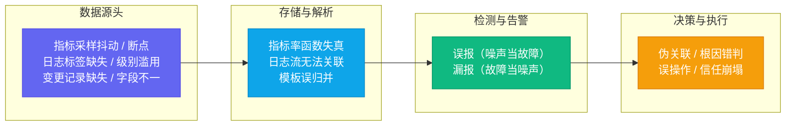
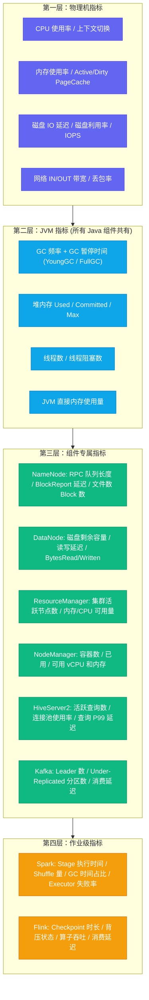
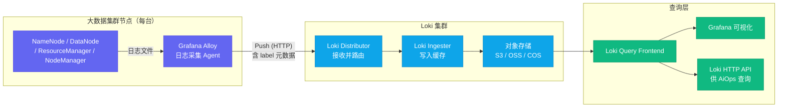
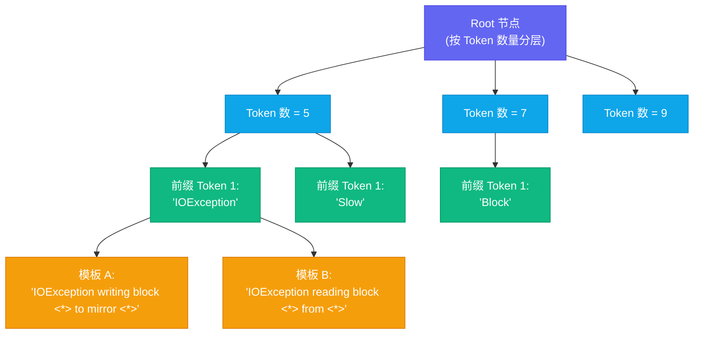
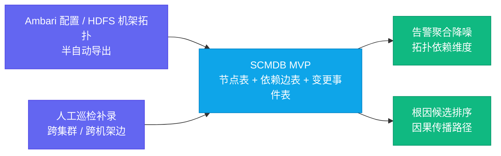

# 02 数据地基优先：为什么垃圾进垃圾出是 AiOps 最大的坑

**摘要：** 本文是「大数据集群 SRE 的 AiOps 工程实践」专栏第二篇，回答一个问题：为什么数据质量是 AiOps 最大的坑，以及如何用工程手段把它填平。文章先借「Garbage In, Garbage Out」这条六十多年前的老定律，剖析低质量数据的三副面孔（指标、日志、变更），并给出垃圾数据沿感知、决策、执行逐层传导的机制——误报消耗信任，信任崩塌比算法失效更致命。随后把可观测三支柱（Metrics / Logs / Traces）放进大数据集群里逐一对齐：集群没有 HTTP Trace，得用 SCMDB 拓扑与多维指标关联替代；Metrics 分四层体系；日志是价值最高也最难处理的维度。接着落到四块工程地基：Loki 日志流水线（从 Grafana Alloy 采集到标签体系、基数治理与日志量治理）、Drain3 日志模板化算法的原理与标定、Prometheus Exporter 采集质量治理（延迟、命名、缺失率、基数）、以及变更数据与 SCMDB 服务拓扑这两类被严重低估的数据源。最后给出一套可操作的最低就绪标准。核心主张：任何智能化模块上线之前，先把数据质量治理做到位，是一切 AiOps 投资中性价比最高的部分。

---

## 第 1 章 Garbage In, Garbage Out：数据质量为什么是 AiOps 的生死线

1957 年 11 月，一篇报道美国陆军电子计算机操作员的通讯稿，留下了这条定律最早可查的印刷记录——GARBAGE IN, GARBAGE OUT。它的思想萌芽其实更早：一百多年前，查尔斯·巴贝奇（Charles Babbage）向英国议会介绍他的差分机时，曾被议员问过一句让他匪夷所思的话——"如果把错误的数字放进去，机器会不会算出正确的答案？"差分机不会，后来的电子计算机也不会，今天的机器学习模型与大型语言模型，依然不会。机器只忠实地加工输入，输入是垃圾，输出就只能是垃圾；这句话在 1950 年代末被 IBM 的程序员讲师 George Fuechsel 在课堂上反复念叨，在 1963 年经美联社记者对 IRS 计算机处理中心的报道广为流传，从此成为计算机世界最朴素也最难被真正遵守的一条铁律。

在 AiOps 落地实践中，这条定律被反反复复验证：**数据质量问题，是 90% 的 AiOps 项目失败或跑偏的根本原因，而大多数团队都低估了它的严重性。**

这个定律有一个简洁有力的表达：**Garbage In, Garbage Out**（垃圾进，垃圾出）。机器学习算法再精妙，也无法从低质量数据中提炼出高质量的洞察。LLM 的推理能力再强，在面对标签混乱、字段缺失、时间戳不对齐的日志数据时，输出的也只会是语言流畅但事实错误的"自信胡说"。

笔者愿意用一个比喻来描画它的分量：算法之于数据，如同厨师之于食材。米其林三星的大厨拿到掺了沙子的米，锅气再足、火候再准，端上桌的蛋炒饭依然硌牙；反过来，好食材至少不会让平庸的厨师交出灾难性的答卷。数据质量之于 AiOps，从来不是锦上添花的"口味偏好"，而是算法赖以成立的输入分布假设——异常检测假设采样稳定，模板化假设前缀恒定，因果推断假设拓扑可信，这些假设一旦被垃圾数据击穿，再精巧的模型也只是在错误的地基上画楼。

### 1.1 低质量数据的三副面孔

什么叫"低质量数据"？在大数据集群运维场景中，低质量数据的典型表现可以归成三副面孔：

**指标维度**：Exporter 采集延迟不稳定（有时 10s，有时 120s），某些关键指标因为 JMX 连接超时而长时间断点（缺失率 5%），指标命名不规范（`hadoop_namenode_gc_time` 和 `namenode.gc.time.ms` 并存），不同集群间同名指标含义不同。

**日志维度**：日志文件路径和命名不统一，关键组件（NameNode/ResourceManager）的日志没有结构化标签（无法快速过滤出特定 `job_id` 的日志），日志级别滥用（大量 INFO 日志中夹杂着真正重要的 WARN/ERROR），日志采集管道不稳定（Kafka 积压时日志丢失）。

**变更维度**：Ambari 配置变更有记录，但字段不统一（有的记录变更组件，有的不记录），手工操作没有写入变更台账，扩缩容操作由不同系统触发但没有统一汇聚点。

这三副面孔之外，还有一个更隐蔽的陷阱值得单独提出来：**数据量足够不等于数据质量足够**。一个集群每天产出 TB 级日志、百万级指标样本，看起来"数据很全"，但缺失率 5% 的断点、错位的时间戳、缺失的标签，足以让下游算法系统性失效。笔者见过不少团队在汇报时展示"我们采集了 X TB 数据"的宏大数字，却答不出"关键指标缺失率是多少""日志能否按 `job_id` 关联"这类基本问题——前者是存储投入，后者才是数据质量。

当你用这样的数据训练异常检测模型，结果一定是：大量的误报（Exporter 采集延迟导致的"指标突降"被误判为组件故障），大量的漏报（关键故障发生时恰好是 Exporter 空白窗口），以及根因分析的严重失准（日志中找不到关键错误，因为没有 `job_id` 标签，无法和告警事件关联）。

这些问题的根本解决方案，不是调优算法参数，而是**在数据入口处治理数据质量**。

### 1.2 垃圾数据如何传导到 AiOps 的每一层

数据质量问题的可怕之处，在于它不会只停留在某一个环节，而是会沿着 AiOps 的流水线逐层传导、逐层放大。把它画出来，是一条从数据源头一直通向执行动作的传导链：



把这条传导链逐环拆开，每一环都有具体的机制。在数据源头，采样抖动与 JMX 超时制造的是时间空洞与断点，这是第 5 章要治理的对象；在存储与解析环节，日志标签缺失让 `job_id` 无法参与关联，模板误归并让两类不同的故障被当成同一个模板，指标命名混乱让同名指标在不同集群含义不同——这一环的问题在第 3、4 章治理；在检测与告警环节，误报把噪声当故障、漏报把故障当噪声，直接消耗值班资源；而在决策与执行环节，伪关联给出错误的根因候选，若再叠加自动化执行，误操作可能造成比故障本身更大的损失。

这条链传导到终点，还有一个最隐蔽的代价：**信任崩塌**。每一次误报都在消耗值班工程师对 AiOps 系统的信任，误报多到一定程度，工程师开始像对待传统告警轰炸那样无视系统输出——于是真正的漏报反而被接受了，系统退化成一套昂贵的装饰品。这套机制解释了为什么数据质量问题在 AiOps 语境下比在传统监控里致命得多：传统监控数据不准，最多是"少看到一个问题"；而 AiOps 数据不准，会"系统性地产出错误结论"，错误结论再被自动化执行放大一个数量级。

> [!warning] 一个残酷的现实
> 绝大多数大数据集群 SRE 团队在启动 AiOps 项目之前，可观测数据的实际质量都无法达到 AiOps 算法的最低要求。这不是批评，而是现实——因为可观测建设本身就是一个长期的专项投入，很少有团队在没有明确目标驱动的情况下把数据质量打磨到 AiOps 就绪的水平。承认这个现实，并把数据治理作为 AiOps Phase 0 的核心任务，是正确的工程决策。

---

## 第 2 章 可观测三支柱在大数据集群中的适配

可观测性（Observability）的三支柱是 Metrics、Logs、Traces。在云原生和微服务领域，这三个维度的定义和工具链已经非常成熟；但在大数据集群场景中，每个维度都需要针对性的适配和特殊处理。这种适配不是把同一套方案换几个组件名，而是每一支柱的语义都要重新对齐——什么数据存在、什么数据不存在、什么数据以什么代价才能拿到，三者完全不同。

### 2.1 为什么大数据集群没有 Traces（链路追踪）

先说最容易引起误解的 Traces。

在微服务架构中，Traces 是指分布式链路追踪——每一个 HTTP 请求都携带一个唯一的 Trace ID，请求流经各个服务时，每个服务都记录自己的处理时间和调用关系，最终形成一棵完整的调用树。这使得故障定位变得非常直观：沿着 Trace 树找到最早出现异常的节点，就是根因。

大数据集群的内部通信完全不走 HTTP。NameNode 与 DataNode 之间用的是 Hadoop RPC（基于 Protocol Buffers 的自定义二进制协议），ResourceManager 与 NodeManager 之间用的是 YARN 的 Heartbeat 协议，HiveServer2 接受用户的 JDBC 连接后内部走 Thrift 协议。这些协议都没有原生的 Trace ID 概念，也没有成熟的 OpenTelemetry instrumentation。

这意味着，大数据集群的 AiOps 必须放弃"基于 Trace 的根因分析"这条在微服务中最有效的路径，转而依赖**手工建模的组件依赖关系图（SCMDB）+ 多维指标关联分析**来还原故障传播路径。把微服务里顺着 Trace 树找根因比作沿着心电图波形找病灶，大数据集群则是一个没有电极可贴的病人——你只能靠手工画出的解剖图（SCMDB）推断哪条血管先堵了。这个话题将在[[04 组件依赖拓扑：SCMDB 是大数据集群 AiOps 的骨架]]中深度展开。

这条路放弃得干脆，但代价也要讲清楚：SCMDB 依赖人工维护，拓扑的时效性天生弱于自动传播的 Trace 上下文；多维指标关联分析在故障传播跨越多个组件时，只能给出"疑似路径"而不是"逐跳证据"。反过来，即便有人想在集群内部通信上强行植入 Trace——譬如给 Thrift 协议加 Trace ID、给 Hadoop RPC 做埋点——也需要同时解决协议兼容、采样成本、日志与链路关联三件事，收益却只是作业级关联，而这恰恰是 SCMDB 加上[[08 作业画像与异常检测：Spark 和 Flink 的 AiOps 专属能力]]里的作业生命周期数据已经覆盖的范围。投入与收益并不成比例。

有一个例外值得提及：**Spark/Flink 作业的内部执行 DAG**，可以视为一种特殊形式的"Trace"——Spark 的 History Server 记录了作业的 Stage 依赖关系和每个 Task 的执行时间。这份数据对于作业异常检测（长尾 Stage、数据倾斜 Task）非常有价值，是[[08 作业画像与异常检测：Spark 和 Flink 的 AiOps 专属能力]]的重要数据来源之一。

### 2.2 Metrics：大数据集群指标体系的完整结构

Metrics 是大数据集群 AiOps 中数据质量最容易量化、治理效果最直接的维度。

大数据集群的指标体系分为四个层次：



这四个层次中，第一层和第二层是各个 Exporter 都会采集的通用指标，第三层是各个大数据组件通过 JMX Exporter 暴露的专属指标，第四层是从 Spark History Server / Flink REST API 获取的作业运行时数据。

分四层不只是分类学上的方便，而是每一层对应一种不同的故障语义：物理层指标回答"机器是不是坏了"，JVM 层回答"进程是不是在慢吞吞地喘"，组件层回答"服务能力是不是受损"，作业层回答"任务是不是要失败"。根因分析时，这四层之间的异常时序本身就构成线索——先见 GC 暂停、再见 RPC 队列积压、最后作业失败，这条时序就是故障传播的证据链。反过来，如果某层数据缺失（譬如第四层根本没有接入），故障链就在这一环断掉，根因推断只能停在"NameNode 很慢"而不是"因为 Full GC 导致 NameNode 变慢，进而拖垮了作业"。

**哪些是 AiOps 最关键的指标？**

不是所有指标都对 AiOps 同等重要。从根因分析的视角，以下指标具有最高的**信号密度**（即出现异常时最有可能指向真实故障的指标）：

| 指标 | 组件 | 为什么重要 |
|------|------|---------|
| `NameNode_RPC_callQueueLen` | NameNode | 超过阈值意味着所有 HDFS 操作都将开始积压，是 NameNode 过载的最早信号 |
| `NameNode_GC_timeMillis` | NameNode | Full GC 时 NameNode 完全停止服务，是级联故障的主要触发源 |
| `DataNode_DataNodeDiskMetrics_diskIoTime` | DataNode | 磁盘 IO 饱和的直接指标，坏盘的最早信号往往在 IO 延迟 |
| `yarn_resourcemanager_activeNodes` | ResourceManager | 活跃节点数骤降意味着 NodeManager 大规模失联 |
| `kafka_server_BrokerTopicMetrics_UnderReplicatedPartitions` | Kafka | 非零意味着副本同步中断，是 Broker 过载或 Leader 选举风暴的信号 |
| `spark_executor_failed` | Spark Executor | Executor 失败率上升是 OOM 或 NodeManager 故障的下游表现 |

### 2.3 Logs：大数据集群日志体系的挑战

日志是大数据集群 AiOps 中**最有价值但最难处理**的数据维度。

为什么最有价值？因为所有故障的根因信息，最终都会以某种形式出现在日志中：NameNode 的 GC 暂停有完整的 GC 日志，DataNode 的磁盘错误有 `IOException` 堆栈，Spark Executor 的 OOM 有明确的 `OutOfMemoryError`。指标只能告诉你"某个值异常了"，日志才能告诉你"为什么异常"。

为什么最难处理？大数据集群的日志有以下四个特点让它成为工程上的老大难：

**高噪声**：一个有 500 个节点的大数据集群，正常运行时每天产生的日志量轻松超过 TB 级别。其中 99.9% 以上是 INFO 级别的正常运行日志（心跳、Block Report、定期快照……），真正需要关注的 ERROR/WARN 埋藏在这片海洋里。

**半结构化**：Hadoop/Spark 的日志格式虽然有固定的时间戳+级别+类名前缀，但消息体是完全自由格式的文本。同一类问题（如 DataNode 磁盘 IO 错误）在不同版本、不同配置下可能产生不同格式的日志行。

**高频变化**：每次升级 Hadoop/Spark/Flink 版本，日志格式可能发生变化，之前训练的日志解析规则可能失效。

**关联难度大**：一个 Spark 作业的日志分散在 Driver 节点和多个 Executor 节点的多个文件里，按 `job_id` 关联在没有统一采集标签的情况下几乎不可能。

这四个特点叠加的后果是：日志这一支柱的治理，不只是"把它采集上来"那么简单，而是要在采集、标签、解析、存储四个环节同时下功夫。接下来两章分别处理前两个环节（采集与标签）、后两个环节（解析与存储）——第 3 章讲 Loki 流水线，第 4 章讲 Drain3 模板化。

---

## 第 3 章 Loki 日志流水线：大数据集群的工程实现

Loki 是 Grafana Labs 开源的分布式日志聚合系统，它的设计哲学与 Prometheus 高度一致：**用标签（Labels）而不是全文索引来组织日志，低存储成本，高查询效率**。这个设计非常适合大数据集群场景——我们不需要对每一行日志都做全文索引（那样成本太高），我们需要的是按 `component`、`hostname`、`cluster`、`log_level` 这些维度快速过滤。

这里不妨与全文检索方案做一个直观对照：把 Loki 的标签想象成档案室的索引卡——查档案先查卡片，锁定哪几个抽屉，再打开抽屉翻纸质原件；如果每张纸都复印一份全文目录，档案室早就放不下了。这套"只索引标签、正文压缩存储"的取舍，正是 Loki 能把日志成本压下一个数量级的原因；而它对查询模式也有要求——查询必须先从标签过滤收窄范围，不适合无差别全文搜索。可观测系列的[[可观测/日志/03 Loki 架构与设计哲学——只索引标签|Loki 专篇]]已经把这套哲学讲透，本篇只聚焦它在大数据集群里的落地工程。

### 3.1 整体架构



把规模感先建立起来：500 个节点，每台节点一个 Alloy 采集器，每个采集器管理 NameNode、DataNode、ResourceManager、NodeManager 等多份日志，全集群汇聚到 Loki 集群，再由 Query Frontend 统一承接 Grafana 与 AiOps 的查询。这个架构里，真正决定成败的不是 Loki 集群本身，而是最左边那一列——每台节点上"采集什么、打了什么标签、丢没丢日志"，也就是数据质量治理的主战场。

### 3.2 标签体系：AiOps 的关键设计决策

在 Loki 中，标签（Labels）是流（Stream）的唯一标识。不同标签组合代表不同的日志流，查询时通过标签过滤日志。

对于大数据集群，**标签体系的设计直接决定了 AiOps 后续能做什么**。如果标签设计得不合理，很多关联分析将无法实现。

推荐的大数据集群 Loki 标签体系如下：

| 标签名 | 值示例 | 说明 |
|--------|--------|------|
| `cluster` | `prod-bigdata-01` | 集群标识，支持多集群部署 |
| `component` | `namenode` / `datanode` / `resourcemanager` | 大数据组件类型，用于按组件过滤 |
| `hostname` | `nn001.prod.example.com` | 主机名，用于定位到具体节点 |
| `log_level` | `ERROR` / `WARN` / `INFO` | 日志级别，用于快速过滤噪声 |
| `job_id` | `application_1234567890_0001` | YARN Application ID，用于关联作业日志 |
| `service_group` | `hdfs` / `yarn` / `hive` / `spark` | 服务组，用于按功能域聚合 |

这张表里有一个值得展开的设计决策：`job_id` 本质上是一个高基数字段——一个集群同时运行的作业有成百上千个，长期看它的取值集合几乎没有上界，而 Loki 的流数等于"标签取值组合数"，每引入一个高基数字段，流数就翻一个数量级。但 `job_id` 又是大数据集群日志关联的命根子——没有它，Spark 作业在 Driver 与各 Executor 上的日志就永远无法拼成一张图。处理这个矛盾的现代做法是**结构化元数据（Structured Metadata）**：把 `job_id` 这类"半高基"字段从标签降级为 chunk 内部的元数据，标签仍然负责快速定位日志流，`job_id` 则在该流内做字段过滤，既不污染索引，又能支撑按 `job_id` 关联查询。

标签体系里另一个常见的坑是**静态标签与动态标签的取舍**。`cluster`、`component` 这类静态标签在每个日志条目上附加的开销可以忽略；而 `log_level`、`job_id` 这类需要从日志行内容里用正则提取的动态标签，会占用采集端的 CPU——日志量越大，这个成本越不可忽视。工程上的合理次序是：静态标签一律注入，动态标签只提取真正用于过滤和关联的少数几个（`log_level`、`job_id`），其余信息一律留在正文里，等查询时再做解析，而不是全部变成标签。

> [!warning] 标签基数（Cardinality）陷阱
> Loki 的性能与标签基数强相关——标签值的唯一组合数越多，Loki 需要管理的流越多，性能越差。千万不要把高基数字段（如 `task_id`、`timestamp`、精确的 `ip:port`）放进标签。保持每台机器的流数量在 10-50 个，是合理的设计范围。

以 10-50 个流/节点计算，500 个节点的集群全量接入后大约产生 5000-25000 条日志流，这仍在 Loki 的舒适区里。一旦有人把 `task_id` 或精确的 `ip:port` 放进标签，流数会立刻膨胀到百万级，Loki 的索引与内存开销随之失控——这正是"一个错误的标签就能拖垮整个集群"的含义。标签设计完成后，应该把它固化成一份文档化的规范，作为集群上所有采集配置的强制约束，而不是靠每个工程师各自把握。

### 3.3 Grafana Alloy 配置要点

Grafana Alloy 是 Grafana Labs 的下一代遥测数据采集器（原 Grafana Agent Flow 的继任者），在 2024 年之后成为推荐的日志采集方案。

以 NameNode 日志采集为例，Alloy 配置的核心逻辑包括：

**文件发现**：通过 `local.file_match` 组件扫描 NameNode 的日志目录，匹配 `hadoop-hdfs-namenode-*.log*` 格式的文件，支持日志轮转后自动切换到新文件。

**多行日志处理**：Java 日志中的异常堆栈（Stack Trace）是多行的，必须配置多行合并规则，将属于同一个日志条目的多行合并成单行推送到 Loki，否则 Loki 会把每行堆栈都当成独立的日志条目，导致异常信息碎片化，无法用于根因分析。

**标签注入**：在 Alloy 的 pipeline 中注入静态标签（`cluster`、`component`、`hostname`）和从日志行内容提取的动态标签（`log_level` 从日志前缀提取，`job_id` 从日志行中的 Application ID 提取）。

```
// Alloy 伪配置示例（展示核心逻辑，非完整可运行配置）
// 1. 文件发现
local.file_match "namenode_logs" {
  path_targets = [{"__path__" = "/var/log/hadoop/hdfs/hadoop-hdfs-namenode-*.log*"}]
}

// 2. 日志读取 + 多行合并（Java 堆栈）
loki.source.file "namenode" {
  targets    = local.file_match.namenode_logs.targets
  forward_to = [loki.process.namenode_pipeline.receiver]
  // 多行合并：以时间戳开头的行视为新日志条目的开始
  decompression { enabled = true }
}

// 3. 处理 pipeline：标签提取 + 级别过滤
loki.process "namenode_pipeline" {
  // 从日志行提取 log_level
  stage.regex { expression = "^\\d{4}-\\d{2}-\\d{2} \\d{2}:\\d{2}:\\d{2},\\d+ (?P<log_level>\\w+)" }
  stage.labels { values = { log_level = "" } }
  // 注入静态标签
  stage.static_labels { values = { cluster = "prod-bigdata-01", component = "namenode" } }
  // 注入 hostname（从环境变量）
  stage.env { values = { hostname = "HOSTNAME" } }
  stage.labels { values = { hostname = "" } }
  forward_to = [loki.write.default.receiver]
}
```

三个配置要点背后，各有一段工程上的为什么。

多行合并之所以排在第一位，是因为 Java 生态的日志几乎必然带堆栈——一次 `IOException` 后面跟着十几行 `at org.apache.hadoop...`。如果不对齐合并规则，Loki 里的异常信息会被切成碎片，模板化算法（第 4 章）面对的将是几千个结构各异的"独立模板"，根因分析从第一步就失真了。合并规则本身也讲究边界条件：它以"时间戳开头"识别新日志条目的开始，这就要求日志格式里时间戳前缀稳定存在，一旦某个组件改了日志格式（日志行不以时间戳开头了），合并规则会静默失效，表现出来的症状是日志条目数量异常——这类症状应该纳入采集质量监控，而不是等故障时才发现。

`stage.regex` 提取 `log_level` 的表达式，是典型的"以解析换标签"：它每处理一行日志都要跑一次正则。日志量是 TB 级的，正则提取的 CPU 开销会真实地反映在节点负载上。所以动态标签的数量要克制，能用静态注入的绝不用正则提取；同一个正则要放在 pipeline 前面还是后面，也要按"尽早丢弃"的原则排——能被过滤掉的噪声日志，越早丢弃越省 CPU。

推送链路本身也不是天然可靠的：Alloy 推送到 Loki Distributor 失败时默认只在内存里短暂重试，持续失败就会丢日志。第 1 章提到的"Kafka 积压时日志丢失"，正是这类问题的变体——用 Kafka 做中间缓冲可以扛住短时抖动，但积压超过保留期后，最旧的日志同样会被丢弃。对 AiOps 而言，日志丢失与指标缺失是同一类质量事故：它在时间线上留下一个"空窗"，而这个空窗恰好是故障高发期。缓解手段是双重的：一方面监控采集端的推送失败率与积压量，另一方面在日志缺失率超过阈值时触发采集质量告警，让"数据没了"这件事本身变得可见。

### 3.4 日志量治理与降噪前置

日志采集上来之后，第一个现实问题是量。500 节点集群每天 TB 级日志，全量入库再全量长期保留，存储账单会吃掉数据底座的预算。日志量治理的目标不是"尽量少存"，而是"该丢的尽早丢、该留的按价值分层"：

**按级别分层**：ERROR/WARN 全量保留——它们是故障的主要载体；INFO 按策略采样，譬如按节点抽样（每 10 台留 1 台）或按作业抽样，健康检查、心跳这类周期性 INFO 可以直接丢弃。绝大多数集群的 ERROR/WARN 日志只占总量的千分之一量级，把这一部分完整保留的成本很低。

**按用途分流**：用于 AiOps 分析的信号流与用于合规审计的原始流分开——前者进 Loki，按标签组织、按保留期裁剪；后者进对象存储归档，只保证"存得住、查得着"，不参与实时分析。

**保留策略**：热数据保留 7-14 天供实时查询，冷数据在对象存储上按 30-90 天裁剪，更早的数据按需归档。Loki 的存储设计（chunk 压缩后通常还有 5:1 到 10:1 的压缩收益，正文又可以放对象存储）决定了它在"保留量大"这件事上比全文索引方案便宜一个数量级，但便宜不等于免费，保留策略仍然要写进规范。

这里有一个认知要提前摆正：日志量治理是数据质量的一部分，而不是数据质量的敌人。合理的采样与丢弃，恰恰是为了保证留下的数据是完整的、可关联的——与其把所有日志都堆进存储然后查什么都慢、标签全都丢失，不如只保留高价值层并确保它标签完整。治理的目标是"每一条留下的日志都值得分析"。

### 3.5 Loki 的适用边界

选 Loki 之前，值得把它的边界画清楚，避免"用了 Loki 才发现场景不匹配"的返工。

Loki 不擅长的是无差别全文检索与复杂聚合：如果集群的日志分析大量依赖"在整个日志库中搜任意关键词"或"按任意字段做 group by 统计"，全文索引方案（Elasticsearch）或列式存储（ClickHouse）在查询能力上更合适。大数据集群的日志分析恰恰以"先按组件/级别/主机过滤，再在小范围内看正文"为主，这是 Loki 的舒适区，也是我们选它的理由。

但边界从来不是一条绝对线。实践中常见的是混合架构：Loki 负责 AiOps 信号流（标签齐全、保留适中），Elasticsearch 或 ClickHouse 负责需要全文/聚合的分析场景（如 SQL 审计、慢查询分析）。两类系统共享同一套采集端（Alloy 可以同时向多个后端转发），标签体系也在采集端统一设计——这样数据源没有分裂，只是下游的消费方式不同。

---

## 第 4 章 Drain3：日志模板化的算法原理与工程实践

解决了日志的采集和存储问题之后，下一个关键问题是：如何从海量半结构化日志中提取有效的异常信号？

这里涉及一个重要的中间处理步骤：**日志模板化（Log Parsing / Log Templating）**。

### 4.1 为什么需要日志模板化

想象 DataNode 产生的以下几行日志：

```
2026-01-15 03:12:01,234 ERROR ... IOException writing block blk_1073741825 to mirror 10.2.130.160:50010
2026-01-15 03:12:03,891 ERROR ... IOException writing block blk_1073741842 to mirror 10.2.130.161:50010
2026-01-15 03:12:05,112 ERROR ... IOException writing block blk_1073741867 to mirror 10.2.130.165:50010
```

从语义上，这三行日志描述的是**同一类问题**：DataNode 写入副本时发生 IOException。它们之间的差异只是 block ID 和目标 IP 不同。

如果我们把每一行日志都当成独立的异常信息，那么在 300 个 DataNode 的集群里，一次磁盘故障可能产生数万条"不同的"日志行，爆炸式的异常数量让任何分析算法都无从下手。

日志模板化解决的正是这个问题：把具有相同语义结构的日志行归并到同一个**模板**下，将变化的部分（block ID、IP 地址、时间戳）识别为参数（wildcards），只保留不变的结构性部分。上述三行日志模板化后得到：

```
IOException writing block <*> to mirror <*>
```

这样，原来的数万条日志行，变成了这一个模板的 N 次实例化，后续的异常检测就简单得多了：统计这个模板在单位时间内的出现频率，偏离历史基线就触发告警。

### 4.2 Drain3 算法：前缀树 + 相似度匹配

Drain3 是目前工业界应用最广泛的日志模板化算法。它基于香港中文大学何品嘉（Pinjia He）、朱杰明（Jieming Zhu）、郑子彬（Zibin Zheng）、吕荣聪（Michael R. Lyu）在 2017 年 IEEE 国际 Web 服务大会（ICWS）上发表的论文《Drain: An Online Log Parsing Approach with Fixed Depth Tree》；Drain3 则是 IBM Research Haifa 的 David Ohana 等人把这套算法从 Python 2 移植到 Python 3、并针对流式生产环境做了工程化增强的开源实现，现托管在 LogPAI 组织下。论文在五个真实数据集（超过一千万条原始日志）上做了评测，Drain 在四个数据集上取得了最高的解析准确率，运行时间相比当时的在线解析器提升了 51.85%-81.47%——"在线且快"正是它被工业界选中的两个理由。

Drain 的核心数据结构是一棵**固定深度的前缀树（Fixed-depth Prefix Tree）**：



当一条新日志进来时，Drain 的处理流程如下：

**第一步：按 Token 数量路由**。将日志行按空格分词，根据 token 数量找到对应的第一层子树。Token 数量相同的日志行才有可能属于同一个模板（长度差异大的日志不会被错误地归并）。

**第二步：按前缀 Token 路由**。在同一 token 数量的子树中，按 token 的前缀逐层路由。Drain 的一个关键假设是：日志行开头的固定 token（如 `IOException`、`Slow`、`Block`）通常不会是变量，它们是区分不同日志类型的关键标识。

**第三步：相似度计算**。到达叶子节点的模板候选列表后，对新日志行与每个候选模板计算相似度（simSeq）：匹配的 token 数量 / 总 token 数量。如果最高相似度超过阈值（通常 0.5），则将该日志行归入对应模板；如果没有超过阈值，则创建新模板。

**第四步：模板更新**。将新日志行和已有模板比较时，对不匹配的位置，用 `<*>` 替换（即该位置是变化的参数）。

把"固定深度"这四个字拆开，是理解这套算法为什么快的关键。以最常用的 depth=4 为例：根节点之下第一层按 token 数量分桶，第二层按第一个 token 分组，再往下才是模板列表本身。深度固定意味着每条日志的查找路径长度是常数，不会像一般的 trie 那样随模板数量增长而越挖越深——单条日志的匹配开销与历史日志总量无关，近似 O(1)。这背后是一个巧妙的剪枝设计：token 数量这一层，一刀就把绝大多数候选排除了（同一类日志的 token 数通常一致，不同类日志的 token 数很少恰好相同）；第一个 token 这一层再排除一批。于是真正要做相似度计算的候选，往往只剩下几个，而不是全部模板。

Drain 把"前缀是常量"当成核心假设，这个假设在 Hadoop/Spark 日志上大体成立——级别、类名、动作动词（IOException、Slow、Block）都出现在行首且是固定词。但反例同样存在：当首 token 本身是变量时（典型的如 HiveServer2 里以 SQL 片段开头的执行日志、以用户名为前缀的应用日志），第一层路由就会失效，算法不得不退化成"大量模板互相比较"。这类日志需要在进入 Drain 之前先做预处理——把行首变量 mask 掉，或干脆单独走一条解析规则，而不是指望 Drain 自己兜住。

Drain 的另一半价值在于它是**在线处理（Online Processing）**：不需要批量处理历史数据，每条日志都实时归类，适合流式日志处理场景。这一点与大数据的"事后分析"直觉正好相反——日志是流进来的，模板库是边吃边长的。对比离线方案（把一批日志缓存下来再做聚类、LCS 或频繁模式挖掘），在线方案牺牲了一点批处理下的极致精度，换来了"任何时候都有最新模板可用"的实时性。模板库是系统的状态，需要持久化：Drain3 支持把模型存盘，进程重启后从快照恢复，否则每次重启都要重新学习一遍，模板 ID 全部漂移，下游的基线统计也会跟着乱。

有一个现实问题要提前说明：集群升级 Hadoop/Spark/Flink 版本后，日志格式会变，一批旧模板会逐渐失去新日志的匹配，同时新格式会催生一批新模板。Drain3 用 `max_clusters` 兜住模板总量——达到上限后按 LRU 策略淘汰最久未命中的旧模板，把容量让给新出现的日志类型。这意味着模板库不是静态资产，而是需要与集群版本同步演化的活体；版本升级后，值得专门跑一轮模板健康检查，看看有多少模板的命中率在下降、有多少新模板在快速膨胀。

生产级的配置、调优方法与异常检测接入，是[[07 日志智能化：Drain3 模板化与异常检测的工程实践]]的主题；本篇只把算法原理与标定的边界讲透，两者配合起来看，才能避免"跑通了但模板质量很糟"的尴尬。

### 4.3 Drain3 在大数据集群日志中的标定

Drain3 需要针对不同的日志格式进行配置。对于大数据集群日志，关键配置参数包括：

**日志预处理规则（Masking）**：在 Drain 解析之前，先用正则表达式将已知的变量替换为占位符，减少算法的模板爆炸问题。常用的 Masking 规则包括：
- IP 地址：`\d+\.\d+\.\d+\.\d+(:\d+)?` → `<IP>`
- Block ID：`blk_-?\d+` → `<BLK>`
- Application ID：`application_\d+_\d+` → `<APPID>`
- 时间戳：`\d{4}-\d{2}-\d{2}T\d{2}:\d{2}:\d{2}` → `<TIME>`

**相似度阈值（Similarity Threshold）**：这个参数需要根据日志样本调整。对于 Hadoop/Spark 这类格式相对规范的日志，0.4-0.6 通常是合适的范围；对于应用层日志（如 HiveServer2 的 SQL 执行日志），由于 SQL 语句的高变异性，可能需要调高到 0.7-0.8。

**最大 Cluster 数量（Max Clusters）**：防止模板无限增长。对于大数据集群日志，通常 500-2000 个模板就能覆盖 90%+ 的日志类型。

Masking 是把双刃剑，它的边界值得单独讲。Masking 不足，模板会爆炸——每来一个新 block ID 都生成一个新模板，模板库迅速失去统计意义；Masking 过度，语义差异会被抹平——把错误码、端口这类承载语义的数字统统换成 `<NUM>`，两类完全不同的故障就被归并进了同一个模板，误报漏报一起出现。标定的原则是"只 mask 被证明无区分度的变量"：IP、Block ID、Application ID 这类唯一标识符可以放心 mask，而错误码、状态值这类"取值有限且承载语义"的字段要保留在模板里。Drain3 还提供 `parametrize_numeric_tokens` 开关，默认把含数字的 token 视为参数——这个默认行为在大数据日志上通常要谨慎，因为 `blk_1073741825` 和 `GC (Allocation Failure)` 里的数字，前者该参数化，后者不该。

相似度阈值也不是设一次就完事。阈值过低，模板欠分割（不同故障被合并）；阈值过高，模板过分割（同一故障被拆开）。0.4-0.6 这个经验区间背后的机制是：同一类日志与它对应模板的相似度通常接近 1（只差几个参数位），而不同类日志的相似度通常显著低于 0.5，中间地带才是 0.4-0.6 需要试出来的地方。实操上建议取集群 10 万行代表性日志（覆盖正常运行与典型故障时段），用 0.3/0.4/0.5/0.6/0.7 各跑一遍，人工抽检模板质量，选出语义误归率最低的阈值。500-2000 这个模板上限的推算逻辑也很朴素：大数据集群组件的日志类型是有限的——NameNode 就那几十类消息，DataNode、ResourceManager 各自也是有限集合，500-2000 个模板足够覆盖 90% 以上日志类型；超出这个量级，往往意味着 Masking 没做到位，而不是模板真的需要这么多。

---

## 第 5 章 Exporter 采集质量治理

Prometheus Exporter 是大数据集群指标采集的核心组件。从 AiOps 的视角，Exporter 采集质量有三个关键维度需要持续治理：延迟与稳定性、命名规范、缺失率——它们分别对应"采集得准不准""命名得齐不齐""采没采全"三个问题。在这三者之外，还有一个容易在集群规模扩张后爆发的第四维度：指标基数。

### 5.1 采集延迟与稳定性

AiOps 的异常检测算法通常假设指标是以固定频率采集的（如每 30 秒一个 sample）。如果采集延迟不稳定（有时 15s，有时 90s，有时因为 JMX 超时而跳过），算法就会把"采集间隔变化"误判为"指标突变"。

把这里的机制讲透：当某轮采集缺失时，时间序列上出现的是一个时间空洞，而不是数值变化。如果系统用上一个 sample 的值把空洞填平（flatline 填充），下游的 `rate()` 就会把这段空洞当作"数值没变"——异常检测器看到的不是"数据缺失"，而是"指标平稳"，而这恰恰是最难识别的假象，因为正常系统的指标就是平稳的。正确的做法是让缺失显式化：在 VictoriaMetrics / Prometheus 侧配置 staleness 处理，将缺失的采集 point 标记为 NaN（Prometheus 语义里的 stale 标记），查询函数不再对空洞做外推。显式的 NaN 至少让下游知道"这里没数据"，而 flatline 则把质量问题伪装成了正常数据。

对于 Hadoop JMX Exporter，采集延迟不稳定最常见的原因是 JMX 端口的 GC 影响：当 NameNode 发生 Full GC 时，JMX 查询会超时，导致该轮次的采集失败。这个问题的缓解方案是：在 Exporter 侧设置合理的超时时间（建议 10-20s），并在 VictoriaMetrics / Prometheus 侧配置 `staleness` 处理。注意这个矛盾的本质：NameNode 越是在 Full GC（越需要数据），JMX 越可能采不到——所以治理目标不是"永不缺采"，而是"缺采要可见、可解释"，让 AiOps 算法在 NameNode 指标出现空洞时，知道这是 GC 的表现而不是它真的挂了。

**关键治理指标**：
- `scrape_duration_seconds`：每个 Exporter 的采集耗时，P99 应 < 5s
- `up`：Exporter 是否在线，持续 = 0 超过 2 分钟需要告警
- `scrape_samples_scraped`：每次采集到的 sample 数量，骤降说明 JMX 暴露有问题

采集间隔本身也是一个需要显式决策的参数，而不是随手填的 30s。间隔越短，越能捕捉分钟级故障演化（NameNode Full GC 往往持续 10-30 秒），但 JMX 查询开销与存储成本线性上升；间隔过长，短暂故障会被直接漏掉。对 NameNode、ResourceManager 这类关键组件建议 15-30 秒，对作业级指标（Spark History Server 拉取）可以放宽到 60 秒——作业本身以分钟到小时计，60 秒的采样粒度已经足够。

### 5.2 指标命名规范

指标命名混乱是大数据集群指标体系的常见问题，尤其是在多个版本的 Exporter 共存的环境下。

规范的指标命名应该遵循 Prometheus 命名约定：
- 格式：`{subsystem}_{component}_{metric_name}_{unit}`
- 例子：`hadoop_namenode_fsimage_last_loaded_timestamp_seconds`

如果同一类指标在不同版本的 Exporter 中有不同的名称（`namenode_gc_time` vs `hadoop_namenode_jvm_gctime`），需要在 VictoriaMetrics 的 recording rules 或 relabeling 配置中做统一映射，确保下游 AiOps 算法消费的是统一命名空间的指标。

统一映射放哪一层，是一个真实的工程取舍。放在采集端 relabeling，配置分散在各 Exporter 的采集目标里，好处是入库即统一，坏处是每加一个新集群都要同步一份映射规则；放在存储端 recording rules，集中在 VictoriaMetrics 一处维护，好处是单一事实源，坏处是存储里同时存在新旧两套名称，序列数翻倍。笔者的实践建议：短期先走 recording rules 快速止血，让 AiOps 算法有统一命名可用；中期把映射规则下沉到采集端 relabeling，从源头保证入库即统一。无论放哪一层，都别忘了第 1 章提到的另一类问题——不同集群间同名指标含义不同。命名规范解决的是"同一个指标叫什么"，语义规范解决的是"这个指标在什么口径下计算"，后者同样需要一份集中维护的指标字典。

### 5.3 关键指标缺失率监控

对于 AiOps 最依赖的核心指标，应该设置"缺失率告警"：如果某个关键指标在过去 5 分钟内的有效 sample 数量低于预期（譬如 30s 采集间隔，5 分钟内应该有 10 个 sample，少于 8 个就告警），则触发采集质量告警。

这里要强调"缺失率"与"指标值为 0"是两回事：缺失率是元数据层的问题（数据没采到），指标值为 0 是业务层的问题（数值真的为零）。把两者混为一谈，是采集质量监控最常见的设计错误——用"指标值是否为 0"来判断采集健康，会把"Exporter 挂了"和"业务真的归零"搅在一起，告警的语义就乱了。缺失率监控用的是采集元数据（每次 scrape 的成功与否、sample 数量），它与业务告警是正交的两套信号。

这一机制的目的不是为了替代其他告警，而是用于**在 AiOps 算法产生异常结果时，快速判断是真实的集群异常还是采集质量问题**——这是 AiOps 可解释性的重要组成部分。当异常检测器报出"NameNode RPC 队列长度骤降"，值班工程师的第一个动作不应该是打开 NameNode 排查，而是先看这段时间的缺失率与采集延迟：如果恰好是采集空洞，这就是一个需要标记为"采集事件"的假异常，而不是一次真实故障。让"数据没了"与"系统坏了"在告警体系里能被区分，是数据底座可解释性的地基。

### 5.4 指标基数与标签治理

采集质量治理的第四个维度——指标基数（Cardinality）——在集群规模扩张后几乎必然爆发，却很少被列入 Exporter 的检查清单。

指标的基数等于"指标名 × 标签取值组合"的时间序列数量。序列数直接决定 VictoriaMetrics 的内存占用（每条活跃序列都要在内存里维护状态）与索引体积；序列数膨胀到百万级，查询变慢、存储膨胀、甚至采集端自己先扛不住。基数爆炸的常见源头几乎都是标签设计事故：把全限定主机名（`nn001.prod.example.com`）而非短名（`nn001`）做标签，基数翻几倍；把每次重启都会变化的端口、容器 ID 写进标签，序列发生大规模 churn（旧序列过期、新序列建立），存储里留下大量无人查询的历史序列；更隐蔽的是把请求 ID、作业 ID 这类无上界字段塞进标签。

治理基数的黄金法则只有一条：**标签的取值集合必须有明确的上界**。组件名、级别、集群名、主机短名——取值集合都有限且可枚举，适合做标签；`job_id`、`task_id`、`ip:port`、时间戳——取值无上界，永远不该成为指标标签。判断一个标签是否安全，只需要问一句：这个标签一共可能有多少个不同取值？答案如果是"无限"，它就不该出现在标签里。基数的监控同样要常态化：观察指标总序列数与新增序列速率，序列数异常增长往往是标签事故的前兆——与其等存储告警，不如让基数本身成为一项看板指标。

### 5.5 Exporter 治理清单

把上述四个维度的治理落到每个 Exporter 上，可以得到一张可执行的检查清单：

| Exporter | 核心检查项 | 达标线 | 常见问题 |
|---------|-----------|--------|---------|
| Hadoop JMX Exporter（NameNode/DataNode/RM/NM） | `up`、`scrape_duration_seconds`、`scrape_samples_scraped`、缺失率 | `up==1` 稳定；P99 采集耗时 < 5s；核心指标缺失率 < 1% | Full GC 期间 JMX 超时断采；新扩容节点漏配采集目标 |
| Kafka JMX Exporter | `up`、Broker 指标覆盖（Leader/URP/消费延迟） | 所有 Broker 在线，URP 指标存在 | 新扩容 Broker 漏配；跨集群采集目标不一致 |
| 节点级（node_exporter） | `up`、磁盘/网络/内存指标 | 全节点在线，磁盘指标随 IO 变化 | 坏盘后磁盘指标静态化，无法发现"不动的坏盘" |
| Spark History Server 数据同步（作业画像上游） | 作业事件拉取延迟、Stage/Task 指标覆盖 | 作业结束后 1 分钟内可查 | 作业量大时拉取超时；长时间作业中途无快照 |

这张清单不需要每天手工过一遍——它的意义是把"数据质量"从抽象口号变成一组可以被自动化检查的量化线。指标覆盖率、采集延迟、缺失率、基数，都可以写成定期的巡检任务或看板项；真正的人力投入，应该留给"质量回退"时的归因：缺失率为什么涨了、基数为什么翻倍了，找到根因、修掉它，而不是反复手工救火。

---

## 第 6 章 变更数据：被严重低估的第四个数据源

在可观测三支柱（Metrics / Logs / Traces）之外，还有一个对大数据集群 AiOps 极其重要的数据源被大多数文章忽略：**变更数据（Change Events）**。

业界统计数据表明，大型数据基础设施的重大故障中，有 60-70% 直接或间接与变更操作相关。变更包括：Ambari 配置参数修改、集群扩缩容（新增/下线 DataNode/NodeManager）、组件升级、Kafka 分区扩展、YARN 队列参数调整、Spark/Flink 作业参数修改。

变更数据在 AiOps 中扮演两个角色：

**角色一：根因分析的关键线索**。当故障发生时，第一个检查的假设应该是"最近有没有做过变更"。如果故障时间与某个变更时间高度吻合（譬如配置变更 10 分钟后 HiveServer2 开始大量告警），这个变更就是强烈的根因候选。

**角色二：告警降噪的上下文**。某些情况下的指标抖动不是故障，而是正常的变更行为（譬如集群扩容时 DataNode 数量变化会触发 Block 重分配，这段时间内的 IO 指标波动是正常的）。如果 AiOps 系统知道当前有扩容操作，它就可以将相关的告警标记为"变更相关，低优先级"，而不是产生误报。

把变更数据比作手术记录再贴切不过：大多数术后并发症发生在手术窗口期，而没有手术记录的医院，事后复盘只能靠医生回忆。大数据集群也一样——变更之后的窗口期（通常是 30 分钟到 2 小时）是故障高发期，变更台账就是这段窗口期里的"手术记录"。第 1 章已经把变更维度的质量问题点出来了：Ambari 配置变更有记录但字段不统一，手工操作没有写进台账，扩缩容由不同系统触发但没有统一汇聚点。变更数据本身也逃不出数据质量的铁律——**没有结构化的变更台账，变更关联分析就是空中楼阁**。

对于 Ambari 管理的集群，变更数据可以通过 Ambari 的审计日志 API 获取。但 Ambari 审计日志的结构化程度不高（很多信息藏在 JSON 字符串里），需要做一层 ETL，提取出变更类型、变更组件、变更时间、操作人等关键字段，写入一个结构化的变更台账数据库，供 AiOps 的决策层查询。

变更台账的字段设计，直接决定关联分析能做什么：

| 字段 | 示例 | 为什么必须 |
|------|------|-----------|
| 变更类型 | 配置修改 / 扩缩容 / 升级 / 参数调整 | 决定关联分析时按哪类变更加权 |
| 变更组件 | HiveServer2 / YARN 队列 / DataNode | 与拓扑节点对齐，才能做链路推断 |
| 变更时间 | 2026-01-15 03:02:00 | 与故障窗口对齐的时间锚点 |
| 操作人 | username | 事后追责与流程审计 |
| 影响范围 | nn001-nn003 / 全集群 | 判断变更与故障的覆盖关系 |
| 回滚状态 | 已回滚 / 未回滚 | 已回滚的变更引起的告警应降权 |

这些字段里，"变更时间"的粒度最容易被低估——它至少要精确到分钟级，否则无法与故障窗口对齐；"影响范围"的缺失率是变更台账质量最重要的体检项——它缺失时，关联分析只能回答"变更发生过"，回答不了"变更是不是覆盖了故障节点"。变更台账建成后，同样要纳入数据质量巡检：字段完整率、时间戳对齐、跨系统汇聚延迟（第 7 章就绪标准里的"变更数据延迟 < 5 分钟"就是这条线）。

---

## 第 7 章 服务拓扑数据：SCMDB 最简 MVP

变更数据之外，第二个被严重低估的数据源是服务拓扑（Service Topology）。如果说第 2 章讲的是"没有 Trace 所以要用 SCMDB"，本章补上它在数据底座里的具体形态——它不是一个遥不可及的大系统，而是可以从最简 MVP 起步的一张依赖图。

先回答"为什么决策层必须依赖拓扑"。没有拓扑的告警聚合，只能靠时间窗口做相关性（两个告警在 5 分钟内出现就认为相关）——这会同时产生伪关联（两个无关组件恰好同时告警）和漏关联（真正有因果关系的告警时间差超过窗口）。有了拓扑，因果推断才有载体：NameNode RPC 队列积压 → HiveServer2 查询超时，这条链路在拓扑图上是有向边，推断结果才站得住。把服务依赖图比作电路图再恰当不过：没有电路图，电工只能沿着烧焦的味道逐段排查；有了电路图，才能一眼看出哪段线路先过载。SCMDB 与一般 CMDB 的差异（它是"服务调用关系"视角而非"资产清单"视角），[[04 组件依赖拓扑：SCMDB 是大数据集群 AiOps 的骨架]]会完整展开，这里只给出数据底座需要的 MVP。

**最简 MVP 只需要三张表**：

| 表 | 最小字段 | 说明 |
|----|---------|------|
| 节点表 | component_id、name、role、cluster、version | 每个组件实例一行，ID 稳定不变 |
| 依赖边表 | src_id、dst_id、dependency_type、updated_at | 谁依赖谁；类型如 RPC / 数据读写 / 队列消费 |
| 变更事件表 | 时间戳、组件、操作类型、操作人 | 与第 6 章变更台账对齐 |



MVP 的第一版不必追求自动化。节点清单可以从 Ambari 的服务配置与 HDFS 的机架拓扑半自动生成；依赖边先以架构师画出的主链路起步——HDFS → YARN → HiveServer2 → Spark/Flink → Kafka，外加少量跨机架、跨集群的关键边，人工补录即可。真正的难点不在建表，而在维护节奏：每次扩容、升级、参数调整后，拓扑都必须跟着更新，否则它退化成一张过期的组织架构图。

这里有一条底线原则要刻在 SCMDB 的设计里：**拓扑错误比拓扑缺失更危险**。缺失的拓扑最多让因果推断"没有输入"；错误的拓扑却会给出"自信的错误结论"——告警聚合把两个无关组件错误地连在一起，根因排序把真凶排在候选列表之外，而且因为输出看起来有理有据，工程师反而更容易采信。所以 SCMDB 的每一张表都要带数据来源与 updated_at，让整张依赖图可审计、可回滚；宁可让它"更新慢一点"，也不要让它"错得理直气壮"。

---

## 第 8 章 数据地基的就绪标准

在启动 AiOps 任何智能化分析模块之前，需要对数据底座做一次全面的就绪评估。以下是一套最低可用标准（Minimum Viable Data Platform）：

| 维度 | 就绪标准 | 验证方法 |
|------|---------|---------|
| **指标覆盖率** | 核心组件（NameNode × 2、DataNode 全量、RM × 2、NM 全量、HiveServer2、主要 Kafka Broker）的 JMX Exporter 全部在线 | `up{job=~"hadoop.*"} == 0` 查询应为空 |
| **指标采集稳定性** | 核心指标缺失率 < 1%，P99 采集延迟 < 5s | 对 `scrape_duration_seconds` 做 P99 查询 |
| **日志覆盖率** | NameNode / ResourceManager / DataNode / NodeManager 的 ERROR+WARN 日志全量进 Loki | 抽样验证 10 台节点 |
| **日志标签体系** | 每条日志都携带 `cluster`、`component`、`hostname`、`log_level` 四个必填标签 | LogQL 查询验证标签完整性 |
| **变更数据** | Ambari 配置变更可通过 API 查询，延迟 < 5 分钟 | 手动执行一次配置变更，验证 API 记录 |
| **指标命名统一** | 同一类指标在所有集群中使用相同命名，无冗余别名 | 指标名称 cardinality 分析 |
| **时间同步** | 所有节点的 NTP 同步偏差 < 100ms | `chronyc tracking` 批量检查 |

这张表里有一条横贯所有维度的暗线：时间。指标缺失、日志关联、变更对齐、拓扑更新的分析，全部依赖所有数据源的时间戳处在同一坐标系里——NTP 偏差超过 100ms，跨组件的时间关联就开始失真，偏差再大一点，故障传播的时序证据链就会被改写。所以时间同步看起来是最不起眼的一项，实际上是最不能跳过的一项。

就绪评估的执行方式也值得讲究。不必一次做完：先从指标覆盖率与时间同步这两项成本最低的开始，再补日志与变更，最后才是拓扑；每完成一项就冻结一份基线报告，后续 AiOps 上线时以基线为对照，任何一项回退都能被立刻发现。同时要警惕两种"为达标而达标"的失败模式：其一，把 90% 的精力花在让 `up` 查询返回空（指标全在线），却没人验证标签完整性，日志进了 Loki 却无法按 `job_id` 关联；其二，就绪评估只做一次，之后集群一扩容，新节点根本没接进 Exporter，指标覆盖率悄悄跌回 60%，而评估报告还停留在三个月前。就绪标准不是一次性的项目验收，而是一条需要持续巡逻的质量线。

> [!tip] Phase 0 的正确姿势
> 不要因为数据底座还不完善就推迟启动 AiOps 工作。"数据底座建设"和"AiOps 项目规划"可以并行进行——规划阶段不需要完整的数据，但到了决策层和执行层开发时，数据底座必须达到上述就绪标准。这意味着 Phase 0 的工作至少需要 2-3 个月，要在项目计划中给予足够的时间。

---

## 第 9 章 小结与下一篇预告

本篇的核心结论可以浓缩成一句话：**在 AiOps 的资源投入分配上，60% 的精力放在数据质量治理，30% 放在算法和系统建设，10% 放在 UI 和呈现——这才是符合 ROI 原则的正确分配。**

大多数 AiOps 项目的实际分配恰恰相反：把大量资源投入到算法模型和炫酷仪表盘，在数据质量上投入严重不足，最终在生产环境里碰壁。这个 60/30/10 不是数学上的精确值，而是一种投入取向——数据质量治理没有"做完"的一天，它随着集群规模、组件版本、团队动作持续变化，是需要长期巡逻的领地，而不是一次性完工的工程。愿意在这个方向持续投入，本身就是把 GIGO 这条老定律当回事的态度。

我们覆盖了：
1. **为什么数据质量是 AiOps 的生死线**（Garbage In, Garbage Out 铁律 + 垃圾数据的逐层传导机制）
2. **Traces 在大数据集群中的特殊处理**（无 HTTP Trace，用 SCMDB 替代）
3. **Metrics 四层体系**（物理机 / JVM / 组件专属 / 作业级，以及各层的故障语义）
4. **Loki 日志流水线完整设计**（Alloy 采集 + 标签体系 + 多行合并 + 基数治理 + 日志量治理）
5. **Drain3 算法原理**（固定深度前缀树 + 相似度匹配 + Masking 预处理，以及它的边界）
6. **Exporter 采集质量治理**（延迟稳定性 / 命名规范 / 缺失率监控 / 基数治理）
7. **变更数据的重要性**（被低估的第四个数据源，变更台账字段设计）
8. **SCMDB 服务拓扑的最简 MVP**（三张表起步，拓扑错误比缺失更危险）
9. **数据地基就绪标准**（可操作的 Checklist 与执行方式）

下一篇[[03 告警工程：从告警风暴到1条主事件的设计哲学]]将进入 AiOps 价值交付最快的领域：告警体系设计。我们将深度解析告警聚合降噪从原理到实现的完整路径，这是数据底座就绪后第一个可以产生可见价值的 AiOps 能力——数据地基打好了，告警工程这座楼才能盖得稳。

---

## 参考资料

1. Pinjia He, Jieming Zhu, Zibin Zheng, Michael R. Lyu. *Drain: An Online Log Parsing Approach with Fixed Depth Tree*. IEEE 24th International Conference on Web Services (ICWS), 2017.
2. IBM Research（David Ohana 等）. *Drain3: streaming log template miner*. https://github.com/IBM/Drain3（现托管于 LogPAI 组织，含算法实现与配置参数说明）
3. IBM Developer Blog. *Use open source Drain3 log-template mining project to monitor for network outages*. https://developer.ibm.com/blogs/how-mining-log-templates-can-help-ai-ops-in-cloud-scale-data-centers/
4. Grafana Labs. *Loki 官方文档*（标签、Stream、结构化元数据、保留策略）. https://grafana.com/docs/loki/
5. Grafana Labs. *Grafana Alloy 官方文档*（local.file_match / loki.source.file / loki.process 组件）. https://grafana.com/docs/alloy/
6. Prometheus 官方文档（scrape、staleness、relabeling、命名约定）. https://prometheus.io/docs/
7. VictoriaMetrics 官方文档（staleness 处理、基数监控）. https://docs.victoriametrics.com/
8. Word Histories. *'garbage in, garbage out': meaning and origin*. 2022；Atlas Obscura. *Is This the First Time Anyone Printed, 'Garbage In, Garbage Out'?*. 2018（GIGO 词源）

---

> [!note] 思考题
> 1. 你的集群里 Exporter 缺失率是多少？如果缺失率从 1% 涨到 5%，你的异常检测器会把哪些"指标突降"误判为故障？
> 2. 把 `job_id` 从 Loki 标签降级为结构化元数据之后，查询体验会损失什么？什么场景下你宁可接受标签基数，也要保留它？
> 3. Drain3 的 sim_th 设为 0.4 和 0.6，分别会在模板质量上付出什么代价？用你集群里 10 万行真实日志各跑一遍，模板数量差多少？
> 4. 你的变更台账里，"影响范围"字段缺失的比例有多高？缺了它，变更关联分析会把哪些误判当作结论？
> 5. SCMDB 的第一版，你会让哪两条依赖边由人工维护、哪些自动发现？怎么保证它在三次扩容之后不变成过期地图？
> 6. 数据质量治理投入与算法投入的比例，你的团队现在是多少？如果不得不从 60/30/10 往下砍，你会先砍哪一块？

---

*本文是「大数据集群 SRE 的 AiOps 工程实践」专栏第二篇。上一篇：[[01 AiOps 是什么：从救火到防火的运维范式革命]] | 下一篇：[[03 告警工程：从告警风暴到1条主事件的设计哲学]]*