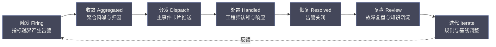
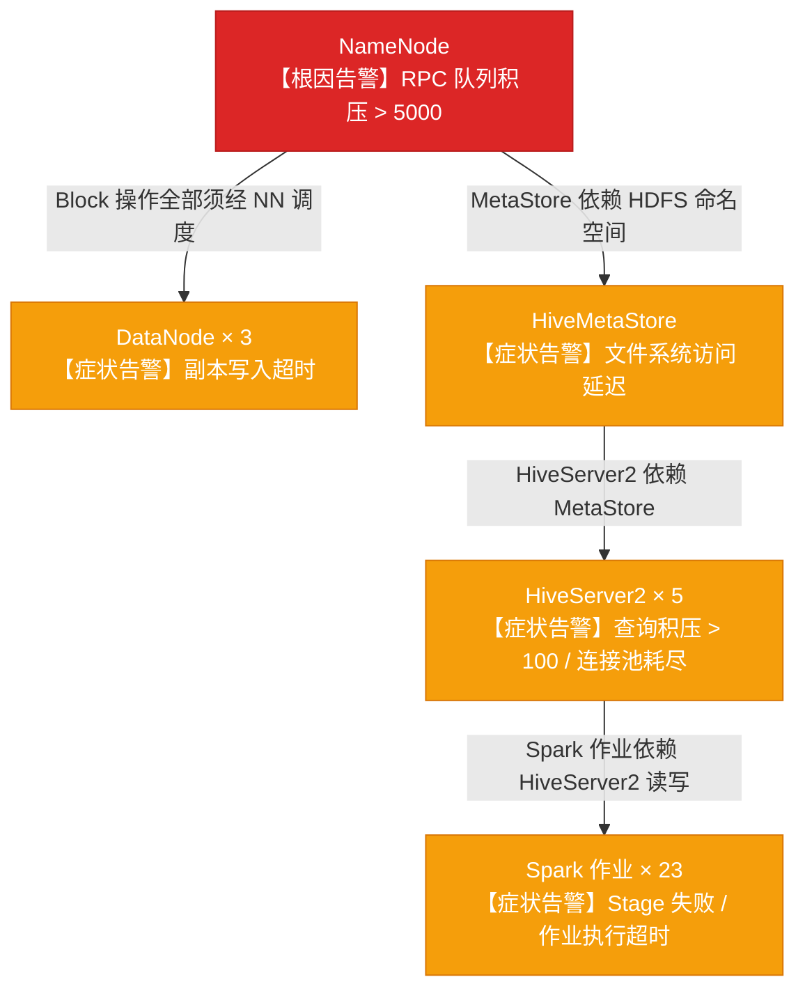
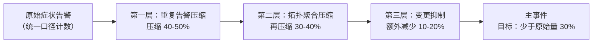

# 03 告警工程：从告警风暴到1条主事件的设计哲学

**摘要：**

本文是专栏第三篇，聚焦 AiOps 价值交付最快的领域：告警工程。文章先追溯告警体系的三代演进——从 Zabbix / Ambari 的阈值告警时代，到 Prometheus + Alertmanager 的多维监控时代，再到以主事件（Incident）为核心的 AiOps 时代，回答"告警为什么越建越多、价值却越来越低"这个根本问题；随后系统拆解告警聚合降噪的三个核心维度（时间窗口、组件拓扑依赖、相似模式）各自的算法机制、适用边界与配合关系，辨析静态阈值与动态基线的本质差异和组合选型逻辑，讲解变更关联分析的工程实现与"假关联"陷阱，给出从 Ambari 迁往 Foxeye 的双跑验证与规则清洗路径，并论证"告警压缩率 70%+"这一目标背后的三层叠加原理、度量口径陷阱与配套 KPI 体系。本文的核心主张：AiOps 对告警体系的第一个贡献，不是让告警更多更全，而是让值班工程师接收到的是"事件"而非"症状"——一个有完整上下文的主事件，远比三百条独立的症状告警更有价值。

---

## 第 1 章 告警体系的演进：从"尽量多报"到"只报关键"

如果一场重大故障的真相，一位有经验的工程师只需要五分钟就能讲清楚，那为什么同一场故障的告警，要花掉他半小时、一小时甚至更久去归纳？笔者见过太多这样的夜晚：根因就摆在眼前，却被三百条各执一词的症状告警淹没着，像一场所有目击证人同时开口的交通事故，每张嘴里都是真话，却没有一个警察在做笔录、理因果、定责任。告警体系这个"笔录官"角色的缺位，正是整篇讨论的起点。

### 1.1 第一阶段：阈值告警时代（2010-2018）

大数据集群告警体系的第一代范式，是以 Zabbix / Nagios / Ambari 原生告警为代表的**阈值告警系统**。它的核心逻辑极其简单：如果某个指标超过了某个预设值，就发送一条告警。`if cpu > 90% then alert`。

这个时代的告警哲学可以概括为：**"宁可有一千条误报，不能漏掉一条真报"**。不确定的情况下就配告警，结果是告警规则越来越多，告警数量越来越大，但工程师处理告警的效率却越来越低。这里面存在一个根本性的悖论：**告警越多，每条告警的关注度就越低；到了某个临界点，告警不再是有效的信号，而是背景噪声。**

这个悖论在运维圈之外早有先例，而且被研究得更透彻。民航领域比运维行业更早系统性研究**告警疲劳（Alert Fatigue）**：驾驶舱里的警报越响越频繁，机组对它的信任和反应反而越低，多起空难的事故调查结论里都出现过"机组对反复出现的警报已经麻木"的描述。医疗领域同样如此，美国医疗机构评审联合委员会（The Joint Commission）在 2014 年前后把告警疲劳列入了国家患者安全目标，起因正是重症监护病房里监护仪告警密度高到医护人员形成了"视而不见"的条件反射。

运维告警与这些场景共享同一个心理学机制：**告警是对人注意力的索取，而注意力是一种会被耗尽、且会自我保护地降低敏感度的资源。** 索取次数越多，单次索取成功的概率就越低——这个规律对驾驶舱、监护仪和值班群一视同仁。

阈值时代的问题还不止于疲劳。为什么规则会失控增长？因为新增一条告警规则的成本几乎为零——不需要评审、不需要测试、不需要清理，工程师在某个深夜按自己的直觉加了一条规则之后，几乎永远不会再去复核它。于是规则库像无人打理的杂草丛，只进不出。一个 Ambari 管理的大型大数据集群，原生告警规则轻松超过 300 条；每次大规模故障，几十条到几百条告警同时触发，全部发送到值班群——工程师面对的不是"有一个故障需要处理"，而是"有三百件紧急的事情需要处理"，认知负荷直接打满。

这里有一个更深层的结构性问题：**告警体系的复杂度增长没有反馈回路**——加规则的人不承担"告警太多"的代价，收规则的人又无法决定"什么不该报"，规则库只膨胀、不收敛。

不过，把阈值告警说得一无是处并不公平。对于磁盘剩余容量低于某个百分比、进程意外退出这类硬性资源约束，阈值告警到今天仍然是唯一合适的形态，动态基线在它面前反而显得笨拙。阈值时代的问题不是"阈值"这种形式本身，而是"只有阈值"这一种单一形态——它把"正常"看成了一条不会动的水平线，而真实的系统行为从来不是一条水平线。

### 1.2 第二阶段：多维监控时代（2018-2022）

随着 Prometheus + Grafana 生态的成熟，告警体系有了一次升级：从单维度阈值告警，变成了基于 PromQL 的多维度告警表达式，以及基于 Prometheus Alertmanager 的路由与聚合机制。

Alertmanager 引入了几个重要的概念：**分组（Grouping）**——将同一时间窗口内相同标签的告警合并；**静默（Silencing）**——在维护窗口期间批量屏蔽告警；**路由（Routing）**——按告警标签将不同告警发送给不同的接收人。

从机制上看，分组靠的是标签集合匹配，配合 `group_wait`（等待期内合并同类告警）、`group_interval`（重新评估合并条件的间隔）与 `repeat_interval`（重复提醒的间隔）三个时间参数，同一批标签的告警会先攒在一起再作为一条通知发出；静默靠的是标签匹配规则，在维护窗口内把符合规则的告警压下去；路由则把告警按标签树分发到不同的接收者。

这是一个明显的进步，但仍然停留在"症状告警"层面。Alertmanager 的分组是基于标签的简单聚合（譬如把所有 NameNode 的告警发给 HDFS 小组），但它无法做到"理解告警之间的因果关系"——它不知道 HiveServer2 的查询超时告警是 NameNode GC 的下游症状，因此这两个告警会分别发出，而不是被合并成一个"根因：NameNode GC，下游影响：HiveServer2 查询超时"的主事件。

用标签分组，本质上是把"告警之间的关系"寄托在工程师当初打标签时的一念之间；标签携带的是"这条告警来自哪个组件"，不携带"这条告警为什么发生、它会连累谁"。机器没有因果信息可依，自然无从推断。换言之，Alertmanager 解决的是"同一条规则反复报"的重复压缩，解决不了"不同规则同一根因"的因果归并——而后一个问题，才是告警风暴真正的来源。

### 1.3 第三阶段：AiOps 告警时代（2022-至今）

AiOps 告警的核心目标转变，是把关注点从"告警数量"转移到"事件质量"。它不再关心"所有的指标异常都被检测到了吗"，而是关心"当业务真正出了问题时，值班工程师能在最短的时间内理解发生了什么，并知道应该做什么"。

这里面有一个关键的认知升级：**告警的价值不是"告诉你出了问题"，而是"告诉你出了什么问题、影响了什么、可能是什么原因"。** 前者任何监控系统都能做，后者需要 AiOps 的能力。

在展开具体机制之前，先把三个容易被混为一谈的词界定清楚：**告警（Alert）**是"某个指标越界"的原始信号，是传感器读数；**事件（Event/Incident）**是"被归因、被收敛之后的故障抽象"，它回答了"发生了什么、影响了什么、可能因为什么"；**故障（Outage/Ticket）**则是进入处置与复盘流程的正式条目，是工单。

很多团队把三者当成一回事，这恰恰是告警体系设计混乱的根源——告警是症状，事件是诊断结论，故障是病历，三者混用，讨论"告警太多"时就会把"诊断太差"的问题掩盖掉。本专栏此后行文中，"主事件"一词专指第二种含义。

这个目标导向下，AiOps 告警体系的核心输出不是告警列表，而是**主事件卡片（Incident Card）**：

> **事件摘要**：HDFS 写入故障，影响 3 个 DataNode 上的副本写入
> **影响范围**：下游 HiveServer2 执行中的 47 个查询开始超时，预计影响数仓 ETL 批处理作业
> **可能根因**：`dn-003.prod.bigdata.com` 磁盘 `/data/disk3` SMART 预警，IO 延迟从基线 2ms 上升至 340ms
> **关联变更**：昨日 23:30 该节点进行了磁盘配额调整（Ambari 配置变更 #23891）
> **推荐动作**：检查 `dn-003` 磁盘健康状态；触发 HDFS 副本重均衡；通知存储团队
> **已收敛告警**：327 条相关症状告警已聚合到本事件

请注意这张卡片的信息结构：它不再是六条平级的告警，而是"根因 → 影响 → 证据 → 建议动作"一条完整的故事线。主事件卡片不是把告警排个序，而是一次信息结构的重组——从"各讲各话"到"一条主线"。本章之后的四章，全部是在回答一个问题：这张卡片上的每一行，是怎么从三百条原始告警里"长"出来的。

把三代演进放在一起对比，结构性的变化看得更清楚：

| 维度 | 阈值告警时代 | 多维监控时代 | AiOps 告警时代 |
|------|------------|------------|--------------|
| 告警形态 | 单指标越界 | 多维表达式 + 标签 | 主事件卡片 |
| 聚合机制 | 无（全量直发） | 标签分组 | 时间 + 拓扑 + 语义归因 |
| 输出物 | 告警列表 | 分组通知 | 事件 + 影响范围 + 根因 + 动作 |
| 主要局限 | 阈值僵化、告警疲劳 | 有归类、无归因 | 依赖数据质量（SCMDB） |

三个时代的差异不是工具的差异，而是"告警体系到底要对谁负责"这个问题的答案在变化：从对指标负责，到对规则负责，再到对"人的处置效率"负责。

---

## 第 2 章 告警聚合降噪的三个核心维度

从"症状告警"升级到"主事件"，核心技术是**告警聚合降噪**。告警聚合降噪的本质，是识别多条独立告警之间的关联性，将相关告警归并为一个事件，并提炼出这个事件的关键信息。

在进入三个维度之前，先把告警的完整生命周期（Alert Lifecycle）摆出来，聚合降噪只是其中的一环。一条告警从出生到死亡，大致经历六个阶段：



触发阶段产生的是"原始告警"，收敛阶段把它加工成"主事件"，分发与处置阶段是人工参与的部分，复盘与迭代阶段把经验写回规则。本文第 2 章到第 6 章讲的是"收敛"环节怎么做，第 7 章讲的是如何度量整条生命周期的质量。

需要特别强调的是，收敛环节的失败不会让告警消失，只会让告警以"未经归纳"的形态直接涌进分发环节——这就是为什么在很多团队里，聚合引擎宕机一天，值班群反而"安静得像没有故障"，告警被吞了，但故障还在。聚合系统是告警管道的咽喉，它吞掉的不该是告警，而是噪声。

### 2.1 降噪的四个基础操作：去重、聚合、抑制与静默

"聚合降噪"在工程讨论里常被当成一个整体动作，但严格来说，它由四个边界清晰的操作组成，混用任何一个，都会把"降噪"变成"误杀"或"漏报"。

**去重（Deduplication）**针对的是"同一条规则在短时间内反复触发"——`Recovery → Firing → Recovery → Firing` 的抖动循环。它的判断依据只有一条：规则名与标签集合是否相同，不需要任何语义理解。第 6 章的第一层压缩、Alertmanager 的 `group_wait` / `repeat_interval` 配置，干的都是这件事。它的风险在于窗口宽度：去重窗口设得太宽，会把"同一规则在不同时间段的两次真实复发"误并为一次，漏掉一次真实故障。

**聚合（Aggregation）**针对的是"不同规则、不同组件的相关告警"，把它们归并成一个事件。判断依据是因果、拓扑与语义关联——这是本章三维度的主体，也是四个操作里唯一"产出新信息"的一个：去重、抑制、静默都只是删减，聚合却把一堆症状"推导"成了一个有根因、有影响范围的事件。

**抑制（Inhibition）**针对的是"高严重级告警触发时，一批相关的低严重级告警"。判断依据是"根因恢复之前，这些低级别告警无论如何都无法修复，报了也白报"，Alertmanager 的 inhibition 规则就是为它设计的。抑制与聚合的区别要分清：抑制不归并、只是暂时压掉，且根因恢复后不会补报；聚合则是把下游告警作为"衍生症状"并入根因事件，一起呈现在主事件卡片上。

**静默（Silencing）**针对的是"人为声明的免打扰期"——维护窗口、计划变更。判断依据是人的意图，而不是系统推导。它与抑制的本质区别在于：抑制是系统自动判断"此刻不该报"，静默是人声明"这段时间别报"。静默是把双刃剑：窗口内真实故障同样会被吞掉，所以静默必须带到期提醒与审计，禁止"永久静默"。

| 操作 | 作用对象 | 判断依据 | 产物 | 典型误用 |
|------|---------|---------|------|---------|
| 去重 | 同规则重复信号 | 规则名+标签相同 | 保留首条 | 窗口过宽吞掉真实复发 |
| 聚合 | 跨规则相关告警 | 因果/拓扑/语义 | 主事件 | 误合并两个独立故障 |
| 抑制 | 高严重级下的低级别告警 | 根因未恢复不可修复 | 暂时压掉不补报 | 规则过宽掩盖次级故障 |
| 静默 | 声明期内的全部告警 | 人的意图 | 批量屏蔽 | 窗口吞掉真实故障 |

一个常见的反例：团队觉得"告警太多"时，最先想到的往往是加静默——在维护窗口、演练期间批量屏蔽。但静默规则本身会像告警规则一样长成新的杂草丛，而静默窗口里真实故障被误吞的案例在运维圈并不少见。静默应当是四个操作里最克制使用的一个，降噪的主力永远是去重与聚合，而不是屏蔽。

关联性有三个维度：时间维度、空间（拓扑）维度、语义维度。

### 2.2 时间维度：时间窗口聚合

最简单的聚合方式：在一个时间窗口内（通常 5-15 分钟）发生的所有告警，如果来自同一个集群/服务组，则归并为一个事件。

这个方法的机制细节值得多说两句。窗口有两种形态，固定窗口（Fixed Window）把时间轴切成对齐的段落（譬如每个 5 分钟整段），滑动窗口（Sliding Window）则每来一条告警就以它为基准向后看 5 分钟；固定窗口实现简单、便于统计，滑动窗口对告警落在窗口边界的场景更公平。

窗口的右边界还有一个工程问题：告警系统普遍存在"迟到告警"——采集器抽数延迟、告警评估周期跨过窗口边界，都会让一条实际发生于窗口内的告警在窗口关闭之后才到达，需要设置一个宽容期（Grace Period），或者在聚合判定时以"触发时间"而非"接收时间"为准，否则窗口边缘的告警会反复漏合并。这些细节单独看都不起眼，但在告警量大时，任何一个都会变成持续的误合并或漏合并来源。

这个方法简单高效，但有明显的局限性：

- **误合并**：时间窗口内两个不相关的告警（比如同时发生的磁盘告警和 Kerberos 票据过期），会被错误地认为是同一个事件
- **跨窗口的漏合并**：一个故障从触发到完全扩散可能需要 20 分钟，超出时间窗口的告警就无法归并到同一个事件

尽管如此，时间窗口聚合作为第一道粗筛，仍然有其价值：它能把短时间内的大量重复告警（同一个组件在 5 分钟内反复触发的同一条规则）压缩为单条。

这里有一个重要的定位问题：**时间窗口负责"降量"，不负责"归因"。** 它把所有"看起来同时发生"的东西堆到一起，至于这些告警之间是真因果还是假巧合，它既不知道也不负责——那是拓扑维度的活。如果把聚合降噪比作先排水再捞鱼，时间窗口就是那个快速降低水位的排水泵，拓扑维度才是后面精准下网的渔夫；指望排水泵把鱼也一起捞上来，只会捞起一网水草。

### 2.3 空间（拓扑）维度：组件依赖聚合

这是三个维度中工程价值最高、也最依赖前置条件（SCMDB）的一个维度。

基于组件依赖图的聚合逻辑是：当多个组件同时出现告警时，沿着组件依赖图追溯，如果告警组件之间存在上下游依赖关系，则将下游组件的告警标记为"衍生告警"，归并到上游根因组件的主事件中。

以大数据集群为例：



在这个场景里，只有 NameNode 的告警是真正的根因告警，DataNode、HiveMetaStore、HiveServer2、Spark 作业的告警都是衍生症状。如果按拓扑聚合，工程师接收到的应该是：

> **1 条主事件**：NameNode RPC 队列积压（根因），影响下游 3 个 DataNode + 5 个 HiveServer2 + 23 个 Spark 作业（已收敛 327 条衍生告警）

而不是 328 条独立的告警。

这就是基于拓扑依赖的聚合的威力：它把"多个症状"收敛成"一个根因"，直接将告警数量从 328 压缩到 1，压缩率 99.7%。

组件依赖图之于告警，就像自来水管网之于一户一表——上游主管爆裂时，下游每一家的水龙头都会出水异常，合格的维修工不会挨家挨户修水龙头，而是沿管线一路找到爆点。

但告警的"水压信号"传播是有延迟的，这引出了拓扑聚合最容易被做错的一个细节：**传播方向与告警时间顺序并不总是同向。** 磁盘故障的"症状"往往先出现在数据节点本地（IO 延迟、副本写入失败），NameNode 的 RPC 积压反而要滞后几分钟才达到告警阈值——也就是说，下游告警可能先于上游告警触发。如果聚合引擎按"谁先告警谁就是根因"来判，会把 DataNode 判成根因，把真正的根因 NameNode 漏掉。正确的做法是以依赖方向为准绳，时间只用来过滤"相隔太远、不可能是同一次故障"的告警，而不是用来断定方向。

拓扑聚合还有两个必须显式建模的边界情况。其一是 HA 主备拓扑：NameNode、ResourceManager 这类组件通常部署 Active/Standby 双实例，Active 故障时会发生主备切换，切换本身会制造一批"新 Active 接管"的告警——这批告警是切换过程的正常产物，不是故障的传播，必须在依赖规则里显式排除，否则主备切换会被误判成一次故障蔓延。

其二是"虚假上游"：当 SCMDB 建模不完整、某个根因组件的上游根本没被建模时，聚合引擎会退而求其次，把"能到达的最上游告警组件"误判为根因。拓扑聚合的质量上限，由 SCMDB 的完整性决定——这一点会在[[04 组件依赖拓扑：SCMDB 是大数据集群 AiOps 的骨架]]里详细展开，此处先埋下伏笔。

### 2.4 语义维度：相似模式聚合

时间窗口和拓扑聚合解决了"已知关系"的聚合问题，但有些告警之间的关联关系在 SCMDB 中没有建模（比如两个来自不同业务线、没有直接依赖关系的 Spark 作业，同时出现类似的 OOM 告警，可能都是因为 YARN 队列水位过高，但这个关联关系不在组件依赖图里）。

语义维度的聚合，通过计算告警的语义相似度（告警名称、告警标签的文本相似度，或者从历史数据中学习的告警共现概率）来识别这类关联。

实现手段大体有三类：文本相似度计算（对告警名称、标签取值做 Jaccard 相似度、编辑距离或向量化后的余弦相似度），告警共现挖掘（用频繁项集挖掘，譬如 Apriori、FP-Growth，从历史告警序列里找出"经常一起出现"的组合——这个算法家族在[[06 根因分析 RCA：传统算法与 LLM 融合的应用架构]]中作为 RCSF 的核心还会再次出现），以及无监督聚类（譬如 DBSCAN 按告警特征把相似告警归堆）。这是三个维度中算法复杂度最高的一个，通常在 Phase 2 阶段才引入，Phase 1 先用前两个维度的聚合作为基础。

语义维度最需要警惕的，是**共现不等于因果**。两条告警经常一起出现，可能因为它们共享同一个更上游的原因，而不是互为因果；两个无关业务线的 Spark 作业同时 OOM，可能只是恰好赶上了同一波集群资源紧张。

因此语义聚合产出的只能是"候选关联"，必须回到拓扑与时间维度去验证，或者交给后续的根因分析环节去证伪——它负责提出"谁和谁可能有关"的假设，不负责下"谁导致谁"的结论。也正因如此，语义聚合的落地位置被谨慎地放在 Phase 2：Phase 1 的聚合链路必须完全确定性、可追溯，不能引入"概率性归并"这种不可解释的行为，否则工程师连"为什么这两条被并在一起"都说不清，信任就无从谈起。

---

## 第 3 章 静态阈值 vs 动态基线：两种告警感知模式的本质差异

### 3.1 静态阈值的天花板

静态阈值的设置本质上是一个人工经验的外化：运维工程师根据自己对系统的了解，判断"什么水平是异常的"，然后把这个判断写成一条规则。这个过程有一个根本性的问题：**系统的正常行为不是固定的，它随时间、业务周期、访问模式而变化。**

以 NameNode 的 RPC 队列长度为例。一个大型生产集群，工作日白天高峰期的 RPC 队列长度可能正常在 1000-2000，这时候值班工程师看到队列长度 800 并不会紧张；而凌晨 3 点的基线则可能是 50-200，这时候如果队列长度突然到 500，就很可能是异常信号（可能有一个批处理作业使用了不当的参数，在凌晨发起了大量的 HDFS 小文件操作）。

如果用静态阈值，你要么把阈值设得很高（比如 3000），能覆盖白天高峰，但会漏掉凌晨的异常；要么设得很低（比如 300），能检测凌晨的异常，但白天会产生大量误报。

这个两难在数学上是无解的，因为它的本质是用一条水平线去切一个随时间移动的分布：正常行为的均值在白天和凌晨相差一个数量级，方差也不一样，无论水平线切在哪里，两侧总会出错——切高了漏报，切低了误报，而误报与漏报就像一枚硬币的两面，压低一侧必然抬高另一侧。更有甚者，不少指标的分布是多模态的（批量作业启动和结束时出现尖峰、空档期平坦如镜），对这类分布，单一阈值连"切在哪里"这个前提都不成立。

这个问题在所有具有周期性规律的大数据集群指标中普遍存在：YARN 队列使用率（工作日高峰 vs 周末低谷）、DataNode IO 吞吐（批处理作业运行时 vs 空档期）、Kafka 消费延迟（实时业务流量高峰 vs 夜间）。

### 3.2 动态基线的核心原理

动态基线的思路是：不要固定阈值，而是从历史数据中学习"正常"的范围，然后检测"偏离正常范围"的行为。如果说静态阈值是一把固定刻度的尺子，动态基线则更像一位熟悉某段河道的船夫——他不仅知道岸边那块"水深危险"的警示牌，还知道枯水期和汛期的水位本来就该不一样，涨水未必是险情，汛期里水位纹丝不动反而可疑。

但这个比喻有它的边界：动态基线只认识"历史里出现过的正常"，对于从未见过的新形态——缓慢劣化、新型故障——它同样是个瞎子，这一点在 3.3 节会专门讨论。

最常用的动态基线构建方法有三种：

**方法一：滑动窗口统计基线**

计算过去 N 周同一时间段的均值（Mean）和标准差（Std），以 Mean ± k×Std 作为正常范围（通常 k=3，对应 99.7% 置信区间）。"同一时间段"的实现细节很关键：它通常不是"过去 7 天的任意时刻"，而是"过去 4-8 周内，同星期、同时刻"的切片——只有这样才能保留日周期与周周期的形态。

工程上还有两个常见的加固手段：一是用中位数与绝对中位差（MAD）替代均值与标准差，因为均值对离群值敏感，而历史切片里混入故障期的脏数据是常态，中位数更抗污染；二是对切片做"剔除异常点后再统计"，避免上一次故障把这次故障的"正常范围"撑大。这种方法实现简单，适合有明显周期性规律的指标（如 YARN 队列使用率）。

局限：对于具有趋势性（长期增长）或异方差性（不同时间段波动幅度不同）的指标，固定 k 值的效果不好——趋势会让均值整体漂移，异方差会让"均值 ± 3 倍标准差"在波动大的时段宽得失去意义、在波动小的时段窄得频繁误报。

**方法二：Prophet 时序分解**

Facebook 于 2017 年开源的 Prophet 算法将时序数据分解为趋势项（Trend）、季节项（Seasonality，包括日周期和周周期）和残差项（Residual）。正常范围由前两项决定，残差超过一定阈值则触发异常。

Prophet 的机制值得拆开看一层：趋势项用分段线性或逻辑增长曲线拟合，并带**变点检测（Changepoint Detection）**，能自动发现趋势拐点；季节项用**傅里叶级数（Fourier Series）**拟合周期成分，日周期、周周期各取若干阶谐波；还支持节假日项，把春节、国庆这类中国特有的大周期影响因素显式建模。正是这"趋势 + 周期 + 节假日"的三件套，让 Prophet 特别适合 NameNode 的文件数增长趋势（长期上升 + 工作日/节假日周期），以及 YARN 队列使用率（明显的日周期规律）——这两个指标恰好都是"有趋势、有周期、偶尔被节假日打断"的典型。

**方法三：Isolation Forest**

适合没有明显周期规律的高维指标异常检测。Isolation Forest 通过随机分区树的方式，计算每个数据点的"隔离难度"——越容易被隔离的点（需要的分区次数越少），越可能是异常点。它的异常分数基于路径长度的统计量：一棵随机二叉树上，一个点被孤立出来所需的切分次数越少，说明它离"大多数正常点所在的高密度区域"越远，异常分数就越高。

Isolation Forest 的好处是不需要显式定义"正常范围"——它不需要假设数据服从某个分布，也不需要对周期建模，适合 DataNode 磁盘 IO 延迟（正常时稳定，坏盘时 IO 延迟会突然跳变，没有明显周期规律）和 NameNode GC 暂停时间（GC 风暴突然出现，没有周期性）。

三种方法的选型，可以归纳为一张表：

| 方法 | 原理 | 适合指标 | 主要局限 |
|------|------|---------|---------|
| **滑动窗口统计** | 同期切片均值±k×标准差 | 周期性明显的指标（YARN 队列、IO 吞吐） | 对趋势、异方差敏感 |
| **Prophet 时序分解** | 趋势+季节+节假日分解，残差超限触发 | 有趋势有周期的指标（文件数、队列使用率） | 需要足够历史、周期假设要成立 |
| **Isolation Forest** | 随机切分，路径长度越短越异常 | 无周期、突发性指标（IO 延迟、GC 暂停） | 对缓慢渐变型异常不敏感 |

> [!note] 动态基线的工程取舍
> 动态基线并非在所有场景下都优于静态阈值。对于"绝对不能超过某个值"的硬性约束（比如 DataNode 磁盘剩余容量低于 10%），静态阈值反而更合适，因为这个约束与业务周期无关。实际的告警体系往往是静态阈值（硬约束）+ 动态基线（行为异常检测）的组合使用。

### 3.3 动态基线的工程边界与反例

动态基线在落地时有一串容易被忽略的工程边界，它们决定了一条基线到底是"聪明"还是"添乱"。

**冷启动（Cold Start）**。基线需要历史数据，新上线的组件、新扩容的节点没有历史，怎么办？业界常见的做法是"借"——借用同类组件的基线（同一批配置、同一角色节点的统计特征高度相似），或者先回退到静态阈值兜底，攒够 2-4 周数据后再切换到动态基线。这两种方式各有代价：借用基线假设了同构性，配置差异大的节点会误报；回退静态阈值则暂时放弃了动态基线的好处。

基线漂移与模型更新。基线不是建好就不动的：集群扩容、业务形态变化都会让"正常"本身缓慢移动。

基线更新通常按天或按周滚动重训，但重训周期要和新数据量、指标变化速度匹配，否则会出现"基线追着数据跑"的滞后——故障期的脏数据如果被滚进训练窗口，会把正常范围撑大，让下一次同类故障"变得正常"。这需要训练数据清洗与异常点剔除，属于数据地基章节（[[02 数据地基优先：为什么垃圾进垃圾出是 AiOps 最大的坑]]）讨论的质量问题在基线场景下的具体表现。

节假日效应。大数据集群的业务负载与业务周期强相关，春节、国庆这类长假期间，集群负载形态与平时完全不同——用平日的基线去度量节假日，会满屏误报。Prophet 的节假日项是有意为之的设计，而滑动窗口基线则需要显式维护节假日白名单，把节假日切片从训练与判定中隔离出去。

缓慢劣化。这是动态基线一个结构性的盲区：磁盘坏道渐进恶化、容量缓慢爬升这类故障，每天的残差都在阈值之内，偏离检测永远不触发，等它真正越线时，故障往往已经持续了很久。对抗手段是叠加趋势/斜率检测——不只是问"现在偏离正常多少"，还要问"现在比上周同期恶化了多少"。这提醒我们，偏离检测不是异常检测的全部，动态基线也不是万能药。

> [!warning] 动态基线的敏感性陷阱
> 基线越敏感，误报越多；越不敏感，漏报越多——这个权衡与静态阈值的两难在结构上完全同构，只是把"阈值该设多少"换成了"偏离多少算异常"。不少团队上线动态基线后误报率不降反升，不是算法不好，而是把 k 值调得太小、把"异常"定义得太宽。动态基线的价值在于它自动适配了不同时段的正常水平，而不是它天生比静态阈值更准。

---

## 第 4 章 变更关联分析：告警降噪的关键上下文

### 4.1 为什么告警必须关联变更

想象以下两个场景：

**场景 A**：凌晨三点，HiveServer2 告警，50 个查询开始超时。没有任何最近的变更记录。→ 这大概率是真实故障，需要紧急响应。

**场景 B**：下午两点，HiveServer2 告警，50 个查询开始超时。30 分钟前有一条 Ambari 变更记录：`HiveServer2 hive.server2.thrift.max.worker.threads` 从 500 改为 200。→ 这很可能是配置变更引起的，应该第一时间检查该配置变更的影响，而不是漫无目的地排查。

在第二个场景中，如果告警系统能自动把"HiveServer2 超时告警"与"刚刚的 HiveServer2 线程数配置变更"关联起来，并在告警通知中显示"关联到变更 #23891：hive.server2.thrift.max.worker.threads 从 500 改为 200（30分钟前）"，值班工程师的排查时间会从"20 分钟盲目排查"缩短到"5 分钟定向验证"。

变更关联给告警带来的，是一种"先验概率"。运维圈有一个朴素的信念：故障很少凭空发生，绝大多数故障背后都站着一个"昨晚做过的操作"——变更关联把这个经验信念量化成了可排序的证据。从信息论的角度看，告警本身只携带了"哪里不对劲"的信息，变更台账则携带了"谁最近动过什么"的信息，两条信息的交汇处，就是排查的优先区域。

变更台账之于告警，就像案发地点的监控录像之于刑警——案件本身不会告诉你作案者是谁，但录像会告诉你最近谁来过；告警是案发现场，变更记录是出入记录，两者叠加，排查范围就从整座城市缩小到一张嫌疑人清单。但监控录像也会冤枉人：共现不等于因果，关联变更的职责是"缩小范围"，不是"定罪"。

> [!info] 变更关联的定位
> 变更关联是一条"相关性提示"，不是因果证明。它回答的是"最近的变更里，谁最可疑"，而不是"就是它导致的"。值班工程师拿到关联变更后要做的是定向验证——检查变更参数、回看变更前后指标曲线、必要时回滚——而不是直接下结论。把相关性当成因果性，是变更关联最容易被滥用的地方。

### 4.2 变更关联分析的工程实现

变更关联分析的核心思路：当一条告警触发时，查询固定时间窗口内（通常是告警时刻前 30 分钟到前 2 小时）的所有变更记录，按以下维度筛选相关变更：

**组件相关性**：变更的目标组件与告警的来源组件相同（或有依赖关系）。例如，HiveServer2 告警应该关联 HiveServer2 的变更；鉴于 SCMDB 中 HiveServer2 依赖 NameNode，也应该关联 NameNode 相关的变更。

**时间接近度**：变更与告警时刻的时间差越小，相关性越高。通常按时间差线性打分：30 分钟内的变更得分最高，2 小时外的变更降低权重。

**变更类型权重**：不同类型的变更对服务的影响程度不同。配置变更（直接影响进程行为，得分最高）> 扩缩容操作（影响资源分配，中等）> 版本升级（影响最大但通常有计划，可以单独标注）。

满足上述条件的变更记录，按综合得分排序后，最多取 Top-3 显示在告警卡片的"关联变更"区域。

几个机制细节值得展开。"前 30 分钟到前 2 小时"这个窗口不是拍脑袋定的：太近的变更（几分钟前）很可能尚未生效——配置变更通常需要滚动重启或延迟加载才作用于进程，把它算作"可疑"会频繁制造假阳性；太远的变更（数小时之前）与告警的因果相关性被时间稀释，且窗口内混入的日常操作噪声会显著增多。

时间衰减函数也有讲究，线性衰减实现简单，指数衰减更符合"影响随半衰期消退"的直觉，但对参数敏感，实际工程中线性打分往往够用。综合得分通常是组件相关分、时间衰减、类型权重三者的加权合成，权重本身也要有据可依，而不是随手拍——可以通过复盘历史上"告警-变更"的确证案例来标定。

变更关联同样有它的边界与反例。最典型的是**假关联**：同一时段内恰好有别人在做无关变更，纯按时间筛选会把不相干的变更拉进卡片。这就是组件相关性这一维必须存在的原因——它把"同一时段"和"同一组件"两个条件叠加，才勉强压得住假阳性。

反过来，没有关联变更也是一种信号：一个没有任何变更支撑的告警，往往意味着真实故障或未被记录的隐蔽操作，处置优先级反而应该更高——这与场景 A 的结论一致。另一个工程现实是，Ambari 只记录经由它执行的操作，手工 SSH 操作、自动化脚本的操作都不在台账里；变更台账的缺口本身构成一种运维风险，团队至少应该意识到"哪些操作没进台账"，并推动把高风险手工操作收拢进可审计的通道。

### 4.3 Ambari 变更数据的获取与结构化

Ambari 提供了完整的 REST API 用于查询变更历史（Operations 和 Config Track）：

```
GET /api/v1/clusters/{cluster_name}/requests?fields=Requests/operation_level,Requests/end_time,Requests/start_time,Requests/request_context,Requests/status
```

但原始数据的结构化程度不足以直接用于关联分析，需要提取以下关键字段并写入结构化存储：

| 字段 | 说明 | 示例 |
|------|------|------|
| `change_id` | 变更唯一标识 | `AMB-#23891` |
| `change_type` | 变更类型 | `CONFIG_CHANGE` / `SERVICE_RESTART` / `SCALE_OUT` |
| `target_service` | 变更的服务 | `HIVE` / `HDFS` / `YARN` |
| `target_host` | 变更的主机（如适用） | `dn-003.prod.bigdata.com` |
| `start_time` | 变更开始时间 | `2026-01-15T14:23:45Z` |
| `end_time` | 变更结束时间 | `2026-01-15T14:25:12Z` |
| `operator` | 操作人 | `admin@company.com` |
| `change_detail` | 变更内容摘要（JSON） | `{"key": "...", "old": "...", "new": "..."}` |

结构化的目的，是把"查询变更"从一次偶发的人工操作变成告警链路里可索引、可关联的数据资产。工程上通常是定时轮询 `requests` 接口做增量同步，用 `last_processed_id` 记录已处理位置，把解析后的记录写入 PostgreSQL 或 Elasticsearch 供聚合引擎按时间窗口查询；`change_detail` 里的 JSON 要保留 `old` 与 `new` 两个值，因为"从什么改成什么"比"改了什么"承载了更多的因果信息——线程数从 500 调到 200 是收紧，从 200 调到 500 是放宽，两者引发的故障形态完全不同。

---

## 第 5 章 Foxeye 告警平台：从 Ambari 到 AiOps 就绪的迁移

### 5.1 为什么要迁移告警平台

Foxeye 是基于 Prometheus Alertmanager 二次开发的内部告警平台（或类似商业产品），相对于 Ambari 原生告警，它具备以下关键优势：

**数据源丰富**：Ambari 的原生告警只能消费 Ambari 自己管理的检查结果，无法消费 Prometheus 指标和 Loki 日志。Foxeye 可以同时接入 VictoriaMetrics 的指标查询和 Loki 的日志查询，实现全数据源统一告警管理。

**告警即代码（Alerting-as-Code）**：Foxeye 支持将告警规则以代码形式管理（YAML 配置），可以做版本控制、Code Review、自动化测试，摆脱了 Ambari 告警"点击配置、难以追踪"的窘境。告警即代码的收益在多人团队里尤其明显：规则变更走 Git 流程，有 diff、有评审、有回滚，生产环境的规则库不再是一团"只进不出"的点击历史；规则还能按环境区分（dev/staging/prod 用同一份模板、不同参数），从源头减少"测试环境规则误伤生产"这类事故。

**Webhook 集成能力**：Foxeye 的告警可以通过 Webhook 推送到任意下游系统（企业微信、钉钉、AiOps 聚合服务），是接入 AiOps 聚合降噪流水线的必要条件。

顺带说一句，Alertmanager 本身是社区标准组件，功能可靠，Foxeye 这类二次开发平台的价值不在"重造轮子"，而在三件社区版做不到的事：多集群统一管理（大数据集群往往不止一套，Alertmanager 单实例天然是单集群视角）、与内部系统的深度集成（SCMDB、变更台账、企业微信、统一认证）、以及规则生命周期的平台化管理。**告警平台迁移的本质，是把告警从"组件自带的小功能"升级为"团队自有的基础设施"。**

### 5.2 告警迁移的双跑验证策略

告警迁移不是一次性工作，而是一个需要仔细设计的渐进过程。核心风险是：Ambari 原生告警与 Foxeye 告警规则的语义可能存在差异，直接切换可能导致漏报或误报。

最稳健的策略是**双跑验证（Dual-Run）**：

1. **并行运行期**：Ambari 告警和 Foxeye 告警同时运行，两者都产生告警，但只有 Ambari 告警发送到值班群，Foxeye 告警发送到一个单独的观察群
2. **统计对比**：持续统计两个系统在同一时间段内的告警数量和触发时机，识别差异点
3. **差异分析与修正**：对于 Foxeye 多报的告警（假阳性），调整阈值或添加过滤条件；对于 Foxeye 漏报的告警（假阴性），补充规则
4. **灰度切换**：当双跑对比的符合率超过 95%，且连续 2 周没有漏掉重大故障，开始逐步将值班群的告警来源切换到 Foxeye

双跑验证的做法，很像医院输血前的交叉配血——新血型能不能用，不能靠理论推断，而是让两者在试管里先实际相遇，观察有没有凝集反应；告警系统的迁移同理，两套规则的语义是否一致，只有让它们在真实告警流里并肩跑过才能下结论。配血在试管里进行、不碰病人血管，双跑在旁路观察群里进行、不碰值班主路——两者的共同点都是"旁路验证、主路不动"。

双跑在工程上还有几个容易被忽略的细节。其一是"符合率"的方向性：不仅要统计"两边都触发了"的正向一致，还要统计"两边都不触发"的负向一致，以及触发时间差——两个系统评估周期不同，同一指标触发的先后差几十秒属于正常，差到分钟级就要怀疑规则语义是否真的等价。

其二是双跑期间的成本：观察群里每天都会出现一批只在 Foxeye 侧触发的"多余告警"，需要有人持续消化和分类，这不是零成本的操作，要安排专人跟进，否则差异分析会流于形式。其三是切换的渐进性：即便符合率达标，也不建议一次性把全部规则切过去，按规则类别分批灰度（先切日志类、再切指标类），每批观察一段时间，是更稳妥的节奏。

### 5.3 告警规则的清洗与瘦身

在迁移过程中，最重要的操作是**告警规则清洗**：识别并删除"从不触发价值动作"的告警规则。

判断一条告警规则是否有价值的方法：

- 在过去 90 天内，这条告警触发了多少次？
- 每次触发后，值班工程师做了什么操作？（什么都没做，说明是误报；有实际操作，说明有价值）
- 如果删掉这条规则，有没有其他规则能覆盖同样的故障场景？

通常，一个有 300 条告警规则的 Ambari 集群，经过清洗后能剩下 80-100 条真正有价值的规则，其余的要么是从来不触发的僵尸规则，要么是高度重复的冗余规则。

清洗的目标大体有三类。**僵尸规则**：90 天不触发，无论当初写它的理由是什么，它现在对团队毫无价值，删掉不损失任何信息。**冗余规则**：多条规则从不同角度覆盖同一故障场景（磁盘利用率超过 90% 和超过 95% 同时存在），保留哪一条需要结合处置动作来定——如果 90% 那条触发了也没人处理，它就是纯噪声，删。**无效规则**：频繁触发但工程师从不处置的规则，这类规则是误报率的最大来源，也是最难下决心删的——因为它"确实在报"。

删除的时机与顺序也值得讲究。最稳妥的顺序是：先按触发频率把规则排序，再逐条核对处置记录，最后做"删除演练"——先把可疑规则灰度关闭一段时间，观察有没有真实故障因此漏报，确认安全后再正式删除。这本质上是一种带回滚的删除，给"删错了怎么办"留了后路。

> [!warning] 告警瘦身的心理挑战
> 删除告警规则往往会遭遇心理阻力：工程师担心"万一删了这条告警，之后就漏掉某个故障"。这种担心是合理的，但更大的风险是"因为告警太多而失去对所有告警的关注"。告警清洗需要数据支撑（过去 N 天的触发历史和处理记录），数据说话比经验判断更有说服力。

清洗不该是一次性的运动。规则库和系统一样会持续腐化——新加的规则、改版的组件、退役的服务，都会让规则库重新长出杂草。建议把规则清洗做成周期性的例行动作（每个季度做一轮"规则体检"），并配合一个简单约束：新增规则必须走评审，必须写明"触发后谁来处置、处置动作是什么"，没有处置动作的规则不允许进入生产。规则库的质量，是告警体系一切上层建筑的地基。

---

## 第 6 章 告警压缩率 70%+ 的工程路径

"告警压缩率 70%+"是一个经常被引用的 AiOps 目标数字（来自腾讯音乐、美团等公司的实践报告）。这个数字意味着：原来产生 1000 条症状告警的场景，经过聚合降噪后，值班工程师最终接收到少于 300 条主事件。

这个目标的实现路径，是三层压缩的叠加：



**第一层：重复告警压缩**（通常可以压缩 40-50%）

同一个告警规则在 5 分钟内重复触发，只保留第一条，后续的"Recovery → Firing → Recovery → Firing"循环被压缩为"持续触发"状态。这一层不需要拓扑或机器学习，Alertmanager 的 `group_wait` 和 `repeat_interval` 配置即可实现。

**第二层：拓扑聚合压缩**（通常可以再压缩 30-40%）

基于 SCMDB 组件依赖图，将下游衍生告警归并到根因告警。这一层需要 SCMDB 数据，是大数据集群 AiOps 的重点建设内容。

**第三层：变更抑制**（额外减少 10-20%）

在已知变更窗口内（比如计划内的集群扩容期间），自动静默与变更预期行为一致的告警。需要变更台账数据支撑。

三层叠加，理论上可以实现 70-80% 的压缩率。实际工程中，第二层的效果最依赖 SCMDB 的完整性——SCMDB 存在遗漏的依赖关系时，相关的衍生告警无法被识别，会继续作为独立告警发出。这也是 SCMDB 建设质量对 AiOps 告警体系有如此关键影响的原因。

三层压缩的结构，很像自来水厂的三级沉淀池——每一级滤掉一部分不同粒径的悬浮物：重复告警是大颗粒，拓扑衍生物是中颗粒，变更噪声是细颗粒，三级叠加才把浊度降到合格线。但滤得太狠也有代价：把水里该保留的矿物质也滤掉了，对应到告警体系，就是把本应分开处理的两个独立故障误并成一个复合事件。

这里有两个关键的工程认知。第一，三层之间不互相重叠，因为它们的滤除对象是不同维度的噪声：重复压缩处理的是"同一信号反复报"，拓扑聚合处理的是"不同信号同一来源"，变更抑制处理的是"预期内的扰动"。三层各司其职，缺了任何一层，压缩率都会塌一块。

第二，**"压缩率"是一个口径敏感的指标**——"原始告警数"按什么口径计数，直接决定压缩率的数字。同一份告警流，按"去重前"计数，压缩率轻松超过 80%；按"去重后"计数，可能只有 50%。各家实践报告里的 70%+ 是否可比较，取决于它们的口径是否一致。这个口径问题不解决，跨团队比较压缩率数字毫无意义，也是第 7 章 KPI 度量首先要回答的问题。

还需要警惕"压缩率崇拜"。压缩率不是越高越好：过度压缩意味着误合并，两个独立故障被拧成一个主事件，工程师以为在处理一个事件，实际上面对的是两个故障的复合体，排查方向一旦建立在错误的归并上，MTTR 反而被拉长。压缩率的正确目标不是"尽可能高"，而是**"事件与故障的对应关系尽量一一对齐"**——一个故障收敛成一条主事件，两个故障就必须是两条。前者是压缩，后者是准确，缺一不可。

---

## 第 7 章 告警体系的 KPI 体系

告警体系的质量需要可量化的 KPI 来衡量，否则优化工作缺乏方向和基准。推荐关注以下指标：

| KPI | 定义 | 目标值 | 测量方法 |
|-----|------|--------|---------|
| **告警压缩率** | （原始告警数 - 主事件数）/ 原始告警数 | ≥ 70% | 统计每周的告警总量和主事件总量对比 |
| **告警误报率** | 触发了但值班工程师判断无需处理的告警比例 | ≤ 10% | 要求值班工程师标注每条主事件的处理结果 |
| **MTTD（告警发现时间）** | 故障发生到告警触发的时间差 | < 2 分钟 | 通过人工注入故障（混沌工程）测量 |
| **告警覆盖率** | 生产故障中，有对应告警的比例 | ≥ 95% | 对每次故障复盘时检查告警记录 |
| **告警丢失率** | 告警系统的告警丢失比例 | < 0.1% | 对告警管道做端到端的 probe 测试 |

其中，**告警误报率**和**MTTD** 是最值得重点关注的：误报率高说明聚合降噪效果不足，MTTD 高说明感知层的检测延迟需要优化。

这五个指标各自都有度量陷阱，值得逐一拆开看。

告警压缩率的陷阱是口径。上一章已经讨论过"原始告警数"的去重口径问题，这里再补一刀：压缩率衡量的是"少报了多少"，但它完全不关心"少报得对不对"——压掉的全是噪声和压掉了半个故障，在压缩率这个数字上毫无区别。所以压缩率必须与误报率、事件-故障对齐度搭配使用，单看压缩率，等于只看油耗不看路线。

告警误报率的陷阱是人工标注。它的测量依赖工程师逐条标注"这条主事件是否有处置价值"，而值班人最缺的就是时间——标注率一低，分子分母都不准，数字就失真。更稳的做法是拿"处置动作"当判断依据：认领了、点了静默、查了日志、触发过 Runbook，都算"有处置价值"，比"让工程师打勾"更接近真实。即便这样，误报率的数字仍然有主观成分，它更适合作为团队内部的相对趋势，而不是跨团队的硬指标。

MTTD 的陷阱是测量成本。混沌工程（Chaos Engineering）注入故障是测量 MTTD 的主流方式，但注入故障本身就是风险——注入的频率太低，样本不足以支撑统计；注入的频率太高，又可能真的打断业务。2 分钟这个目标值也隐含着一个前提：告警评估周期（通常是 15-60 秒）加上链路延迟，必须压缩在目标值以内，否则检测再快也追不上评估节奏。

告警覆盖率的陷阱是幸存者偏差（Survivorship Bias）。覆盖率的定义是"生产故障中有对应告警的比例"，但一个从未被任何告警覆盖的故障，根本不会进入复盘样本——你统计不到"没有告警的故障"，因为连发现它都依赖告警。覆盖率能证明的只是"已发现的故障都告警了"，对"根本没被发现的故障"它天然是盲的。缓解手段是引入告警之外的故障发现渠道（用户投诉、作业失败率报表、业务监控），把这类样本也纳入复盘。

告警丢失率的陷阱是覆盖范围。端到端的 probe 测试要真的从采集、存储、规则评估、Webhook、聚合、推送全程模拟一条告警，任何一个环节漏掉，测出来的丢失率都只是"部分管道的丢失率"。probe 本身也要持续运行、定期校验，否则连 probe 的告警也会悄悄失效。

把五个指标放在一起看，会发现它们之间是相互制约的：压缩率压得越狠，误合并越多，误报率可能不降反升；MTTD 追求极致灵敏，会让基线更敏感，误报率跟着上升。

覆盖率要求规则更全，规则更全又给压缩率添压力。**告警体系的 KPI 是一套组合拳，任何单一指标的优化都可能以另一个指标的劣化为代价**——这恰恰是告警工程没有银弹的又一个证据。压缩率这个数字，很像汽车仪表盘上的油耗显示：市区拥堵和高速巡航的油耗本来就该不同，脱离工况谈油耗没有意义；同理，脱离口径与配套指标谈压缩率，数字再好看也只是自我安慰。

---

## 第 8 章 边界、反模式与设计哲学

### 8.1 告警工程的反模式清单

把前面几章的机制放到反面来看，能整理出一份高发的反模式清单，每一条都是真实团队踩过的坑：

反模式一：告警越多越安全。这是阈值时代"宁可一千条误报"哲学的直系后代，已被告警疲劳的心理学机制反复证伪——告警的价值随数量增加而递减，而不是递增。

反模式二：一上来就上 LLM 聚合。聚合的第一性原理是确定性规则（时间窗口、拓扑依赖、变更关联），LLM 的延迟与不确定性决定了它只适合做摘要生成、根因候选精排这类辅助环节。Phase 1 就依赖 LLM 做核心归并决策，等于把"为什么这两条被并在一起"的解释权交给一个概率模型，信任与追溯都无从谈起。这一点在[[05 智能告警降噪：工程落地全链路解析]]里有更完整的工程展开。

反模式三：压缩率 KPI 至上。上一章已经论证过，过度压缩的代价是误合并，误合并的代价是 MTTR 拉长。压缩率应该服务于"事件-故障对齐"，而不是反过来。

反模式四：聚合规则没有反馈闭环。聚合规则写死之后不做人工反馈、不根据误合并案例迭代，规则会随系统演进逐渐僵化——组件改了依赖、业务改了路径，规则还是老样子。工程师反馈（"这个聚合不对"）应该是一条进得来、记得住、改得动的数据通道。

反模式五：动态基线万能论。硬约束场景（磁盘容量、进程存活）必须用静态阈值，缓慢劣化场景需要趋势检测配合，动态基线只是"行为异常检测"的一种形态，不是全部。

### 8.2 设计哲学小结

告警工程的设计哲学总结：**告警的目的从来不是"完整记录所有发生了什么"，而是"在正确的时间，把正确的信息，发给正确的人，让他们知道需要做什么"。** 符合这个目标的告警体系，往往是"更少，但更准"的——100 条精准的主事件，远比 3000 条冗余的症状告警更有价值。

告警体系的设计，很像一栋楼的消防设计：安全程度不取决于喷头装了多少个，而取决于探测器、喷淋、疏散标识各自是否装在了对的位置、彼此是否联动——探测器失灵，喷头再多也只是摆设；喷头误喷，损失不比火灾小。一个"更少但更准"的告警体系，就是探测、归因、处置三层联动、各自克制的结果。

本篇我们覆盖了：

1. **告警体系三代演进**（阈值时代 / 多维监控时代 / AiOps 时代）
2. **聚合降噪三维度**（时间窗口 + 拓扑依赖 + 语义相似）
3. **主事件卡片设计**（从症状到事件的信息结构转变）
4. **静态阈值 vs 动态基线**（原理差异与选型逻辑）
5. **变更关联分析**（原理、API 实现、数据结构化）
6. **Foxeye 迁移策略**（双跑验证、告警瘦身）
7. **压缩率 70%+ 的三层路径**（重复压缩 + 拓扑聚合 + 变更抑制）
8. **告警体系 KPI 体系**（5 个关键量化指标）

行文至此，可以把全篇的结论收束成一句话：告警工程没有放之四海皆准的"最优配置"，只有与团队处置能力、SCMDB 数据质量、业务容忍度相匹配的配置——压缩率的目标、基线的敏感度、窗口的宽窄，每一项都是权衡，每一项都要因地制宜。这也呼应了[[01 AiOps 是什么：从救火到防火的运维范式革命]]的立论：AiOps 不是让系统自动做更多，而是让人的注意力花在值得花的地方。

下一篇[[04 组件依赖拓扑：SCMDB 是大数据集群 AiOps 的骨架]]将深度解剖 SCMDB 的设计：为什么大数据集群必须自建组件依赖图，如何从零设计一个大数据 SCMDB 的数据模型，以及如何把它对接到告警聚合和根因分析流水线。

---

## 参考资料

1. Rob Ewaschuk, *Practical Alerting*, Google SRE Book
2. Prometheus Alertmanager 官方文档（Grouping / Silencing / Routing）
3. Facebook Prophet 官方文档（Trend / Seasonality / Changepoint）
4. Liu F. T., Ting K. M., Zhou Z.-H., *Isolation Forest*, ICDM 2008
5. Apache Ambari REST API 文档（Requests / Config Track）
6. The Joint Commission, *National Patient Safety Goal on Alarm Fatigue*, 2014
7. 腾讯音乐、美团等公司 AiOps 实践分享（"告警压缩率 70%+"等公开报告）

---

> [!note] 思考题
> 1. 你的告警体系里有多少条规则在过去 90 天从未触发？如果全部删除，值班群会安静多少？删除带来的恐惧，有多少是数据能证伪的？
> 2. 如果暂时没有 SCMDB，拓扑聚合这一维完全缺失，你的压缩率还能到 70% 吗？缺掉这一层，代价会以什么形式暴露出来？
> 3. 动态基线在缓慢劣化场景下会失效，你还能想到哪些"偏离检测"天然覆盖不了的故障形态？
> 4. 变更关联给出的是相关性而非因果性，你的团队靠什么机制避免被"假关联"误导？
> 5. 压缩率的度量口径如果不统一，跨团队比较这个数字会得出什么结论？你的团队现在用什么口径？
> 6. 如果值班工程师从不标注处理结果，误报率 KPI 就名存实亡——你能想到什么低成本的方式拿到真实的误报反馈？
> 7. 双跑验证的 95% 符合率阈值，你觉得高了还是低了？判定"可以切换"还应该附加什么条件？
> 8. 压缩率的"最优值"该由什么决定？你如何判断自己的集群已经"压缩过头"了？

---

*上一篇：[[02 数据地基优先：为什么垃圾进垃圾出是 AiOps 最大的坑]] | 下一篇：[[04 组件依赖拓扑：SCMDB 是大数据集群 AiOps 的骨架]]*