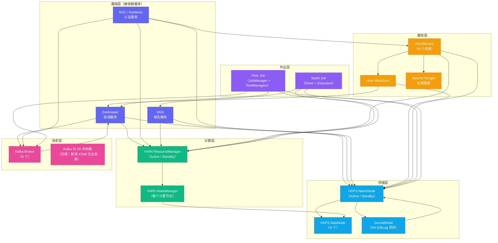
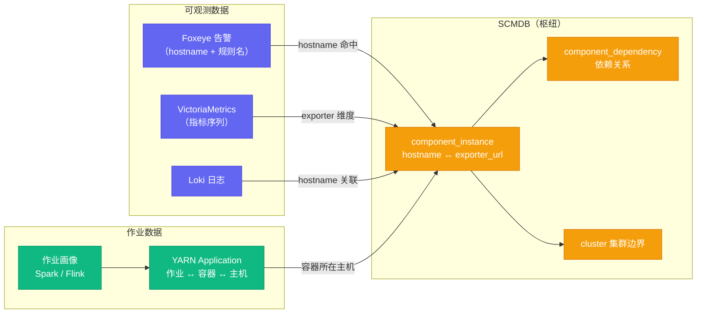

# 04 组件依赖拓扑：SCMDB 是大数据集群 AiOps 的骨架

**摘要：**

本文是专栏第四篇，聚焦大数据集群 AiOps 的"骨架"：组件依赖拓扑数据库（SCMDB，即大数据集群语境下的 CMDB）。文章从"为什么大数据集群的拓扑数据不能照搬微服务 CMDB"切入，先拆解微服务依赖图能自动发现的技术前提，以及大数据组件私有协议、长连接、进程内数据面带来的观测盲区，论证拓扑只能靠"声明 + 人工 + 半自动"建模；随后给出覆盖 HDFS / YARN / Hive / Spark / Flink / Kafka / ZooKeeper / Kerberos 的完整依赖关系建模方案，逐组件拆解故障传播语义，并厘清"依赖关系"与"因果关系"的边界——拓扑只是因果推断的搜索空间压缩器，不是因果判定器。文中还讨论了图数据库 vs 关系型数据库的选型逻辑、SCMDB 与告警/指标/日志/作业四类数据打通的链路、影响面评估的 BFS 实现与失效场景，最后给出一个可落地的 SCMDB MVP 实现路径。核心主张：没有 SCMDB，AiOps 的告警聚合只能靠时间窗口蒙，根因分析只能靠人工排查——SCMDB 是大数据集群 AiOps 实现"从相关性到因果性"这一关键跨越的基础设施。

---

## 第 1 章 为什么大数据集群需要自己的拓扑数据库

要不要给大数据集群单独维护一份组件依赖拓扑？笔者在内部评审会上听到最多的第一反应是：Ambari 里已经躺着主机与组件的分配关系，YARN 上跑着所有作业，Prometheus 的 target 列表就是每个进程的探针，为什么还要再多维护一个数据库？这个反应很合理，但它背后那个"我们好像已经有了"的错觉，恰恰是许多团队的告警聚合与根因分析长期停留在"按时间碰运气"水平的直接原因——有指标、有告警、有装配清单，唯独缺一张能把三者串起来的依赖图。

### 1.1 微服务 CMDB：为什么不能直接用

在微服务架构中，服务发现和依赖关系管理已经有了相对成熟的解决方案：Kubernetes Service Mesh（Istio/Linkerd）可以自动追踪服务间的 HTTP 调用关系，APM 系统（SkyWalking、Datadog APM）可以从 Trace 数据中自动构建服务依赖图，CMDB 则负责记录这些服务的配置信息（哪个版本、跑在哪些 Pod 上、依赖哪些中间件）。

这套体系能自动发现依赖关系，因为微服务之间的调用是可观测的 HTTP 请求——每一次调用都有 Trace ID，只要分析 Trace 数据就能知道"A 调用了 B，B 调用了 C"。

再往下想一层，自动化的前提其实有三个：调用是请求-响应式的，语义可被解析；协议头部留有可插桩的位置（HTTP Header）；网络流量有统一的出入口可以被 sidecar 或 agent 旁路。Service Mesh 的 sidecar 拦截进出 Pod 的全部流量，在七层插入 Trace 头并统计调用矩阵，APM 则靠 Trace ID 的父子关系还原整棵调用树。打个比方，微服务的每一次调用都像一件贴着快递单的包裹，从发出到签收，每一站都查得到中转记录；大数据组件的通信则更像工厂里的机械传动——齿轮咬合、皮带联动，动力一直在传，但你在车间门口只能看到电机在转（进程活着），看不到动力具体是怎么传到下一道工序的。

大数据集群的内部情况完全不同：

- NameNode 与 DataNode 之间通过 Hadoop RPC 通信，没有 HTTP，没有 Trace
- ResourceManager 通过心跳协议管理 NodeManager，同样没有 Trace 可观测
- Spark Driver 通过 Spark 自有的 BlockManager 协议与 Executor 通信
- HiveServer2 通过 JDBC 接受用户请求，通过 Thrift 与 HiveMetaStore 交互，通过 HDFS API 读写数据

这几类协议各有各的观测盲区，值得逐条说透。Hadoop RPC 是基于 Netty 的私有二进制协议，序列化走 Writable，连接被长期复用（IPC 连接池），一条 RPC 里没有可以跨组件流转的全局请求 ID；心跳协议是单向的定时短报文，语义只有"活着/失联"两态，从中读不出任何调用关系；BlockManager 协议在 Driver 与 Executor、Executor 与 Executor 之间直连搬运数据块，属于点对点的数据面流量；JDBC 与 Thrift 是查询语义而非调用语义——HS2 收到一条 SQL，背后要先后访问 MetaStore、调度引擎、HDFS，这条内部链路对客户端完全不可见。即便退一步在传输层抓包，看到的也只是 Kerberos 加密后的字节流，无法还原"谁在为了什么目的调用谁"。

这些通信协议都不在传统 APM 系统的 Trace 覆盖范围内。自动发现拓扑关系的技术路径在大数据集群里**根本走不通**。

> [!note] 为什么叫 SCMDB
> 本文使用 SCMDB（Service Configuration Management Database for Big Data Clusters）这个命名，而不是直接叫 CMDB，是为了强调它与传统 IT CMDB 的差异：大数据集群的 SCMDB 不关注物理资产（服务器、网络设备），而是聚焦于大数据**组件之间的逻辑依赖关系**。这是 AiOps 决策层需要的核心数据，而不是 IT 资产管理系统需要的数据。

### 1.2 拓扑数据对 AiOps 的具体价值

如果没有 SCMDB，AiOps 的能力边界是：
- **告警聚合**：只能用时间窗口聚合（同一时间段内的告警归为一组），无法做因果聚合（把 HiveServer2 的告警识别为 NameNode 故障的衍生症状）
- **根因分析**：只能靠人工经验判断"NameNode GC → HiveServer2 超时"的关联，无法自动化推断
- **影响范围评估**：无法快速回答"NameNode 发生故障，哪些下游业务会受影响"

有了 SCMDB，AiOps 的能力升级为：
- **因果告警聚合**：沿依赖图反向追溯，将所有下游衍生告警归并到根因节点的主事件
- **自动化根因定位**：沿依赖图正向追踪故障传播路径，找到最早出现异常的节点
- **影响面快速评估**：给定一个故障组件，立即查出所有直接依赖和间接依赖的下游组件，评估业务影响

两栏对照，差异的本质是"同时发生"与"因为所以"之别。时间窗口聚合回答"这几条告警是不是同一时刻冒出来的"，因果聚合回答"这几条告警是不是同一次故障的连锁反应"。举一个值班室里反复出现的场景：14:20 NameNode 触发 Full GC 风暴，14:21 HiveServer2 的连接池告警，14:22 一批 Spark 作业提交失败。没有拓扑时，时间窗口把三者归为一组事件，窗口里若恰好还夹着一条无关的 Kafka 消费延迟告警，整个事件组就被污染——值班工程师按"最早触发"的直觉去查，很可能先盯上 Kafka，白白浪费处置窗口。有拓扑时，系统沿依赖图反向追溯，把 HiveServer2 与 Spark 作业的告警标记为 DERIVED，归并到 NameNode 主事件之下，并顺带给出影响面：5 个 HS2 实例、47 个正在运行的 Spark 作业。影响面评估还要回答两层问题——类型层回答"所有依赖 HDFS 的服务"，实例层回答"具体是哪些集群、哪些租户、哪些作业"，两层都需要实例级的依赖数据支撑。

### 1.3 自动发现的三种路径为何全部失效

想用机器自动构建大数据拓扑，无非三条路，逐一核验都会撞墙。

第一条路是流量侧，即 sidecar 或抓包 agent 旁路所有通信。前面已经分析过，私有二进制协议、长连接复用、进程内点对点数据面、Kerberos 加密，这四重障碍叠加，抓包只能得到"这台主机在跟那台主机说话"的粗粒度连接信息，得不到"HS2 这条 SQL 的元数据查询走了 HMS、数据读取走了 HDFS"这样的语义依赖。

第二条路是注册侧，即让每个组件向统一的注册中心上报依赖。微服务有注册中心，是因为服务发现是架构的显式组成部分；大数据组件没有这样的约定——ZooKeeper 里存的只有 HA 角色的选举节点与锁节点，不是调用关系；YARN 上记录的是资源申请，不是组件间的语义依赖；各组件之间也没有一份共享的"我依赖谁"的清单协议。

第三条路是声明侧，即把 Ambari 的服务与主机分配关系当作依赖图。这条路的陷阱最隐蔽：Ambari 给出的是**装配清单**，不是**运行依赖**。它能告诉你 NameNode 与 DataNode 部署在同一批主机上、HiveServer2 由 Ambari 托管，但不能告诉你 HS2 发起查询时是先用 MetaStore 拿元数据、再向 YARN 提交作业、最后经 HDFS API 读写数据——这些是运行期行为，装配清单里没有。

由此可以得出一个关键的分工结论：自动发现能可靠提供的只有"组件与主机的从属关系"（实例层），而"实例与实例的语义依赖"（依赖层）必须靠人来建模。微服务 CMDB 之所以显得"自动"，是因为 Service Mesh 把依赖层也自动化了；大数据集群没有这个条件，拓扑数据只能走"声明 + 人工 + 半自动"的路线，这正是 SCMDB 与微服务 CMDB 在维护方式上的根本差异。

### 1.4 没有 SCMDB 时 AiOps 会退化成什么

反事实论证比正向论述更能说明拓扑的必要性。没有 SCMDB，不是少了一个模块，而是决策层失去了空间结构：

- 告警聚合退化为纯时间窗口：同一分钟内的告警归为一组，无论是否相关。告警风暴被"压缩数量"却无法"压缩维度"——风暴过后值班室看到的仍是一堆互不相关的条目，只是少了重复项。
- 根因分析退化为经验问答：工程师在小群里问"NN 挂了会影响 HS2 吗"，翻 runbook、翻历史工单，知识锁在个人脑子里，随人员流动而流失。
- 影响面评估退化为人工核对：逐服务打电话确认，等确认完，影响早已扩散。
- 变更关联失去锚点：无法回答"这次变更动了哪个组件、它又连累了谁"，变更与故障的关系只能靠事后对照时间线猜测。

把退化路径列出来，结论就很清楚：拓扑不是 AiOps 的锦上添花，而是让感知层数据获得空间坐标的前提。没有坐标的告警只是一串时间戳，有了坐标，告警才成为可定位的事件。

这里还值得补一条反向的收益，它藏在故障复盘的流程里。每次故障复盘都会得出"这次传播路径上哪条边被低估了、哪条边其实不存在"之类的结论，这些结论在没有 SCMDB 时只能写进文档吃灰；有了 SCMDB，复盘结论可以直接回写成依赖修正——漏掉的边补上、画错的边删掉、被高估的依赖降级。每一次故障都反向加固一次图，图的质量随运维实践单调提升，这是"从实践中来、回到实践去"的闭环，也是拓扑这份资产区别于普通配置表的地方。

---

## 第 2 章 大数据集群组件依赖关系的完整建模

### 2.1 完整依赖关系图

先看一张覆盖六层组件、按"故障传播路径"组织的完整依赖图（箭头表示"被依赖方 → 依赖方"，即 ZooKeeper 被 NameNode 依赖）：



这张图有一个容易看漏的构造原则：边是沿**故障传播路径**画的，而不是沿**数据流路径**画的，二者在 HDFS 上恰好相反。客户端读写数据时直连 DataNode，NameNode 只参与文件元数据的协商与块位置下发，数据面流量并不经过 NameNode——因此 DataNode 磁盘坏道这类数据面故障，其传播方向是"DataNode → 依赖它的作业"，而不是"DataNode → NameNode"；反过来，NameNode 故障却会波及所有走元数据的操作。许多团队第一次画图时，把"谁给谁提供服务"直接当成"谁挂了会影响谁"，在这条依赖上就把方向画反了。方向的语义必须统一为"上游故障 → 下游受损"，否则后续的告警聚合与根因回溯会沿着错误的边传播。

### 2.2 依赖关系的类型分类

在 SCMDB 中，组件之间的依赖关系不是单一类型的，需要按依赖性质进行分类。不同类型的依赖关系，对告警聚合和根因分析的影响程度不同：

| 依赖类型 | 说明 | 故障传播方式 | 聚合权重 |
|---------|------|------------|---------|
| **强依赖（Hard Dependency）** | 上游故障会立即导致下游不可用 | 瞬时全量影响 | 最高 |
| **弱依赖（Soft Dependency）** | 上游故障会降低下游性能，但不会立即导致不可用 | 渐进式降级 | 中等 |
| **HA 依赖（HA Pair Dependency）** | 主备切换关系，单点故障可自动切换 | 切换期间的短暂中断 | 低（可自愈） |
| **负载依赖（Load Dependency）** | 上游工作量变化影响下游 | 间接、延迟性影响 | 低 |

以 HiveServer2 对 NameNode 的依赖为例：这是**强依赖**。NameNode 如果完全不可用（譬如 Active NameNode 宕机且 Standby 没有及时接管），HiveServer2 的所有查询会立即全部失败，没有任何降级空间。

相比之下，Spark 作业对 HiveServer2 的依赖是**弱依赖**：HiveServer2 性能下降会导致 Spark 作业读取 Hive 表的速度变慢，作业运行时间延长，但通常不会立即导致作业失败（Spark 有内置的重试机制和超时配置）。

这种分类对告警聚合非常重要：**强依赖关系的向上传播才应该触发根因聚合**——HiveServer2 的告警因为 NameNode 故障被聚合到 NameNode 主事件是合理的；Spark 作业慢因为 HiveServer2 性能下降而被聚合则可能引入太多噪声。

分类不能拍脑袋，判定有两条途径。其一是故障注入验证：在测试集群模拟上游故障（kill 进程、停 ZooKeeper、模拟网络抖动），观察下游的行为是"立即不可用""渐进降级"还是"短暂中断后自愈"，据此定类型。其二是翻历史故障样本：把过去半年每次故障的告警序列与恢复时间对齐，反推传播模式。文档语义（"Spark 有重试机制"）只能作为初判，最终以实测为准。

这里还有一个容易被忽略的边界条件：**依赖类型不是静态属性**。HA 依赖在正常运行时自愈权重最低，但一旦 ZooKeeper 本身不可用，主备切换失去协调者，HA 依赖会瞬时升级为强依赖——Active NameNode 宕机后 Standby 无法接管，整个 HDFS 进入不可用。SCMDB 建模时如果只记"NameNode 对 ZK 是 STRONG、NameNode 内部主备是 HA"，就漏掉了这种"低权重依赖在高阶故障下的升级路径"。处理办法是允许依赖记录附加条件（譬如在 note 字段标注"ZK 不可用时 HA 依赖按 STRONG 处理"），或在聚合规则里显式配置这类升级逻辑。

### 2.3 组件实例级别的建模

依赖关系不仅要建模到**组件类型**（NameNode 依赖 ZooKeeper），还要建模到**组件实例**（`nn-001.prod.bigdata.com` 使用 ZooKeeper 集群 `zk-cluster-01`）。

为什么？因为大型大数据集群往往是多集群架构：生产环境可能有一个主集群（`prod-bigdata-01`）和一个离线集群（`offline-bigdata-01`），它们可能共享同一个 ZooKeeper 集群，也可能使用独立的 ZooKeeper 集群；不同的 HiveServer2 实例可能对应不同的租户隔离方案。

没有实例级别的建模，当 `zk-cluster-01` 发生问题时，无法准确评估哪些集群受影响、哪些不受影响。

实例级建模有两个实操中反复踩的坑。第一个是实例标识的稳定性：Ambari 记录的是短主机名（`nn-001`），Prometheus 标签里是 FQDN 或 IP，DNS 变更一次，三者的映射就可能错位——SCMDB 的 hostname 字段必须规定统一的归一化规则（建议一律 FQDN 小写），导入脚本统一转换，否则告警富化阶段会查不到实例。第二个是 labels 的用途要提前规划：rack_id、az、租户这些标签，最初看起来是可有可无的元数据，但影响面评估按租户维度过滤、按机架维度做故障域分析时都要靠它，建议 MVP 阶段就把标签结构定下来，避免事后返工。

### 2.4 六大组件的依赖机制与故障传播语义

上面的图是全景，这一节把六类核心组件各自的依赖机制与故障传播语义拆开讲。依赖关系建模得越细，告警聚合的归并依据和 RCA 的候选排序依据就越可靠。

**HDFS 内部**：NameNode 依赖 ZooKeeper（ZKFC 主备选举）、依赖 JournalNode（EditLog 同步）、依赖 KDC（Kerberos 握手）、依赖 DNS；DataNode 依赖 NameNode（心跳与块报告），但副本复制是 DN 之间的流水线直连。这里有一条值得强调的二级传播路径：ZooKeeper 本身不服务任何读写，但 ZK 不可用 → ZKFC 无法完成故障转移 → Active NameNode 崩溃后集群进入只读甚至不可用状态。也就是说，ZK 是通过瘫痪 HA 机制间接杀死 HDFS 的，依赖图上 ZK→NN 这条边的故障语义，远比"协调服务"四个字看起来重。

**YARN**：ResourceManager 依赖 ZooKeeper（RM HA 选举与状态存储）、依赖 HDFS（联邦场景的状态存储）、依赖 KDC；NodeManager 依赖 RM（心跳注册），还依赖本地磁盘（容器工作目录）与 HDFS（日志聚合上传）。YARN 的故障传播有一个容易被低估的特点：RM 故障只影响"新作业的提交与调度"，已运行容器会继续执行——所以 RM 挂掉的告警特征是"作业提交大面积失败，存量作业仍在跑"，这与 HDFS 的全量不可用形成鲜明对比；而 NM 挂掉则其上的所有容器当场失败，属于局部但剧烈的传播。

**Hive**：HiveServer2 依赖 HiveMetaStore（Thrift，库表元数据）、依赖 HDFS（读写表数据）、依赖 YARN（提交执行引擎作业）、依赖 Ranger（鉴权）；MetaStore 依赖 HDFS 与 ZooKeeper（高版本 MetaStore HA）。传播语义上，MetaStore 是整条链路上的"共享锁"——HS2 部署再多，MetaStore 故障也会让所有查询在第一跳就失败，所以 MetaStore 的告警优先级在 Hive 体系里最高。

**Spark**：作业（Driver/ApplicationMaster）依赖 YARN（资源）、依赖 HDFS（读源写结果）、依赖 DNS；Driver 与 Executor 通过 BlockManager 通信，shuffle 阶段 Executor 之间直连。Spark 对 HDFS 是"强依赖但可重试"——NameNode 故障时任务失败，恢复后依赖 Spark 自带的重试机制可重新拉起，因此它在依赖图上常被标为 SOFT；但要注意这只是"可重试"，不是"不受影响"。

**Flink**：JobManager 依赖 ZooKeeper（旧版本 HA；新版本可在 Kubernetes 上实现无外部协调的 HA）、依赖 HDFS（Checkpoint 存储）、依赖 Kafka（connector 消费与生产）；TaskManager 依赖 JobManager（心跳）与 HDFS（状态后端）。传播语义上，Kafka 故障时 Flink 消费作业在 consumer group 层面积压而非立即失败，Checkpoint 连续失败会按配置触发作业重启——"慢速退化"是 Flink 依赖故障的典型特征。

**Kafka**：Broker 依赖 ZooKeeper（旧版本，controller 选举与元数据；KIP-500 之后的 KRaft 模式改为内置 controller，无 ZK 依赖）、依赖 KDC。Kafka 在大数据生态里绝大多数时候是"被依赖方"——它是流式作业、下游数仓的上游，因此它的故障传播主要是"消费端卡顿 → 链路延迟累积"。Broker 故障触发分区 leader 重选，生产消费短暂阻塞后恢复；若 ISR 中副本不足则可能丢数据，这条语义要直接写进依赖的 note 字段。

六类组件的传播特征可以用一张总览表收拢：

| 组件 | 关键被依赖方 | 故障传播特征 |
|------|------------|------------|
| **HDFS NameNode** | ZooKeeper、JournalNode、KDC | 全量不可用；ZK 通过瘫痪 HA 造成二级传播 |
| **HDFS DataNode** | NameNode（控制面） | 局部剧烈：块读写失败、副本迁移 |
| **YARN ResourceManager** | ZooKeeper、HDFS | 增量作业中断，存量容器继续运行 |
| **YARN NodeManager** | ResourceManager | 局部剧烈：其上容器全部失败 |
| **HiveServer2 / MetaStore** | MetaStore、HDFS、YARN、Ranger | MetaStore 故障全链路第一跳失败 |
| **Spark 作业** | YARN、HDFS | 强依赖但可重试，任务级失败 |
| **Flink 作业** | HDFS（Checkpoint）、Kafka、ZK（旧版 HA） | 慢速退化：积压、重启 |
| **Kafka Broker** | ZooKeeper（旧版）/ KRaft、KDC | 消费端卡顿，ISR 不足可能丢数据 |

把这张表读进去之后，还要给建模立一条纪律：**能不加的边就不加**。每条边都有两笔隐性成本——维护成本（架构变更时要同步确认）与误聚合风险（多一条边，告警聚合就多一个错误的归并理由）。前文提过"ZK 万箭穿心"的教训，其实同一现象在建模侧也存在：一个人凭直觉画依赖图时，容易把"似乎有关联"的组件两两连线，图越画越密，最后退化成一张任何节点都可达的全连接图——它不再压缩搜索空间，反而把因果推断的候选集重新放回全量组合。判断一条边该不该加，标准只有一个：它是否描述了一条真实的故障传播通道，而不是一段亲疏远近的关系。

### 2.5 依赖关系与因果关系的边界

这是第 2 章最重要的认知，也是把 SCMDB 与第 6 篇的因果推断衔接起来的关键。

依赖图刻画的是**潜在失效传播**：若 A 不可用，B 是否受损——这是一个反事实问题，回答的是"结构上存在怎样的传播通道"。因果关系刻画的是**本次故障中谁实际导致了谁**——这是基于观测的推断。两者之间有距离，至少三类情况会让"依赖图上有边"与"本次故障中确有因果"不一致。

第一类是共同原因（Common Cause）：NameNode 与 ZooKeeper 部署在同一机架，交换机抖动让两者同时告警，依赖图上两者之间没有因果边（它们互不依赖），但它们确实同时异常。此时若直接按图回溯，系统会错误地把 ZK 当作 NN 的上游根因。识别共同原因要靠时间精确对齐与指标交叉验证，而不是图本身。

第二类是时序先行不等于因果：先告警的组件不一定就是根因。故障传播通常从根因向下游逐跳扩散，先触发者更可能是根因，但在共同原因、下游反压（HS2 的查询风暴把 MetaStore 拖垮）这类场景下，时序会撒谎。

第三类是中间变量（Mediator）：HS2 同时依赖 MetaStore 与 HDFS，当 HS2 告警时，到底是 MetaStore 故障还是 NameNode 故障传导过来的，依赖图上两条边都在，必须看中间节点的指标才能区分。

此外还有一种更隐蔽的伪相关，它来自共享的外部节拍。大数据集群里最常见的节拍是定时任务：每天 0 点的全量数据同步会让 NameNode 负载与 Kafka 消费量同时抬升，若只看指标曲线，两者高度相关，但这是同一个定时器驱动下的并行现象，不是因果。这种伪相关在时间窗口聚合里几乎无法过滤，只有把"是否落在同一条依赖路径上"作为硬约束，才能把它挡在主事件之外。

打个比方，依赖图像一张城市地图：地图上画着从 A 到 B 的每一条路，但这张图只说明"路存在"，不说明你这次出行真的走了哪条路，更不说明堵车的起因是路口事故还是高架限流。所以对 SCMDB 最准确的角色定位是：它是因果推断的**搜索空间压缩器**，不是因果判定器。没有它，RCA 要在全部组件对的组合里找根因；有了它，候选集被压缩到"依赖图上的可达路径"，再交给时间对齐、指标证据与算法（第 6 篇详述）做最终判定。依赖图能保证"根因一定在可达路径上"这一点成立，前提是图本身准确且方向正确——图错了，因果推断就在错误的搜索空间里打转。

---

## 第 3 章 SCMDB 的数据模型设计

### 3.1 核心实体

SCMDB 的数据模型围绕四个核心实体展开：

**组件类型（ComponentType）**：大数据生态中的组件定义，如 `HDFS_NAMENODE`、`YARN_RESOURCEMANAGER`、`KAFKA_BROKER` 等。这是静态的元数据，变化频率极低。

**组件实例（ComponentInstance）**：运行在具体物理机或虚拟机上的组件实例，如 `nn-001.prod.bigdata.com:HDFS_NAMENODE`。包含实例的状态（Active/Standby/Running/Down）、IP 地址、所属集群、关联的 Prometheus Exporter endpoint 等信息。

**依赖关系（Dependency）**：两个组件实例（或组件类型）之间的依赖关系，包含依赖类型（Strong/Soft/HA/Load）和依赖方向（从属组件 → 被依赖组件）。

**集群（Cluster）**：组件实例的聚合单位，代表一个逻辑上独立的大数据集群。所有的影响范围评估和跨组件关联分析，都以 cluster 为边界。

四个实体之外，还有三个建模约定值得一开始就定下来。其一，组件类型要克制：`HDFS_NAMENODE` 一种类型即可，主备角色放进实例的 `ha_role` 字段，不要在类型枚举里拆出 `HDFS_NAMENODE_ACTIVE` 之类，否则枚举爆炸、规则难以复用。其二，`labels` JSON 字段承载 rack_id、az、租户等维度，它决定影响面评估能否按租户、按故障域过滤，MVP 阶段就要定好结构。其三，共享资源的归属：跨集群共享的 ZooKeeper、KDC、LDAP 这类"公共底座"，建议单独建模为 global 资源实例，并允许依赖关系出现跨 cluster 的边——否则每次故障排查都要在"它到底属于哪个集群"上扯皮。

实体之间还有一个值得明确的继承规则：依赖关系可以定义在**类型对**上，也可以定义在**实例对**上。类型对（如 `HIVE_SERVER2 → HDFS_NAMENODE = STRONG`）是模板，批量生成实例对依赖时作为默认值；实例对是覆盖项，用来表达个体差异——某个 HS2 实例因为配置了不同的执行引擎，对 YARN 的依赖从 STRONG 降到 SOFT，就在实例对上单独记录。2.2 节提到的"HA 依赖在 ZK 故障时升级为 STRONG"，也适合作为类型对上的条件规则存储。把模板与覆盖分开，维护时只改特例，不用动全量数据，这是关系模型比"一条条手画边"更擅长的地方。

### 3.2 关系型数据库 vs 图数据库的选型

SCMDB 的数据本质上是一个图（节点是组件实例，边是依赖关系）。用图数据库（如 Neo4j / JanusGraph）存储图数据是最自然的选择，但在 AiOps Phase 1 阶段，引入图数据库会带来运维复杂性和学习成本。

对于大多数大数据集群 SRE 团队，**Phase 1 用关系型数据库（PostgreSQL / MySQL）存储 SCMDB 是更实际的选择**，理由如下：

1. **图的规模不大**：一个大数据集群的组件实例数通常在 50-500 之间，边的数量在 100-1000 之间。这个规模完全在关系型数据库的处理能力范围内，用 JOIN 查询就能完成依赖图遍历，不需要图数据库的图查询语言（Cypher/Gremlin）

2. **运维熟悉度**：团队对 MySQL/PostgreSQL 更熟悉，减少引入新技术的风险

3. **扩展时机**：当集群数量超过 10 个、组件实例数超过 5000、需要做多跳依赖查询（超过 5 跳）时，才是迁移到图数据库的合适时机

关系型数据库中的核心表结构：

```sql
-- 组件实例表
CREATE TABLE component_instance (
    id              BIGINT PRIMARY KEY AUTO_INCREMENT,
    cluster_id      BIGINT NOT NULL,         -- 所属集群
    component_type  VARCHAR(64) NOT NULL,    -- 组件类型（枚举）
    hostname        VARCHAR(256) NOT NULL,   -- 主机名
    status          VARCHAR(16) DEFAULT 'RUNNING', -- 状态
    exporter_url    VARCHAR(512),            -- Prometheus Exporter URL
    ha_role         VARCHAR(16),             -- 'ACTIVE' / 'STANDBY' / NULL
    labels          JSON,                    -- 额外标签（如 rack_id、az 等）
    updated_at      DATETIME NOT NULL
);

-- 依赖关系表
CREATE TABLE component_dependency (
    id              BIGINT PRIMARY KEY AUTO_INCREMENT,
    cluster_id      BIGINT NOT NULL,
    source_id       BIGINT NOT NULL,         -- 依赖方（FROM）
    target_id       BIGINT NOT NULL,         -- 被依赖方（TO）
    dep_type        VARCHAR(16) NOT NULL,    -- STRONG / SOFT / HA / LOAD
    verified        BOOLEAN DEFAULT FALSE,   -- 是否已人工验证
    note            TEXT,                    -- 备注（依赖的具体原因）
    created_at      DATETIME NOT NULL
);

-- 集群表
CREATE TABLE cluster (
    id              BIGINT PRIMARY KEY AUTO_INCREMENT,
    name            VARCHAR(64) NOT NULL UNIQUE,  -- 集群名称
    env             VARCHAR(16) NOT NULL,     -- PROD / STAGING / DEV
    ambari_url      VARCHAR(256),            -- Ambari API 地址
    updated_at      DATETIME NOT NULL
);
```

上面四张表构成了 SCMDB 的关系模型。再往深一层看，关系库做依赖图遍历有三种常规写法：其一是递归 CTE（PostgreSQL 的 `WITH RECURSIVE`），一次查询完成多跳展开；其二是逐跳 JOIN，代码直白但每跳一次查询；其三是预计算的物化路径表，用空间换时间。Phase 1 规模下递归 CTE 足够，且可以封装成视图复用：

```sql
-- 沿依赖图反向追溯所有上游（多跳），Phase 1 默认深度上限 5
WITH RECURSIVE upstream(id, depth) AS (
    SELECT cd.target_id, 1
    FROM component_dependency cd
    WHERE cd.source_id = :instance_id AND cd.dep_type = 'STRONG'
    UNION ALL
    SELECT cd.target_id, u.depth + 1
    FROM component_dependency cd
    JOIN upstream u ON cd.source_id = u.id
    WHERE u.depth < 5
)
SELECT ci.* FROM upstream u JOIN component_instance ci ON ci.id = u.id;
```

图数据库（Neo4j / JanusGraph）解决的是三个问题：多跳遍历的性能、可变深度查询的语法表达（Cypher/Gremlin）、内置图算法库（最短路、社区发现）。但它解决不了数据准确性与更新时效——把一张错图从关系库搬进图数据库，只是把错地图印得更大。所以"先关系库、规模到了再迁图库"的顺序，本质是先把数据质量与维护流程跑通，再谈查询能力。

### 3.3 SCMDB 的数据维护策略

SCMDB 的最大挑战不是设计，而是**保持数据的准确性和时效性**。一个集群的依赖关系会随着版本升级、架构调整、组件扩缩容而变化，如果 SCMDB 与实际状态长期不同步，基于 SCMDB 的 AiOps 分析就会产生错误的结论。

推荐的维护策略是：

**自动发现 + 人工确认的混合模式**：
- 物理机实例（ComponentInstance）的增减可以通过 Ambari API 自动同步（Ambari 有集群节点列表和组件分配信息）
- 实例状态（Active/Standby/Running/Down）可以从 ZooKeeper 的 NameNode HA 选举节点、ResourceManager HA 节点实时读取
- 依赖关系（Dependency）**必须人工建模和验证**——这是一次性的工作量，但此后只需要在架构变更时更新

**变更事件触发更新**：当 Ambari 的变更 API 检测到集群拓扑变化（新增节点、下线节点、服务迁移），自动触发一个"SCMDB 更新提醒"，让 SRE 确认依赖关系是否需要同步更新。

**定期一致性校验**：每周运行一个脚本，对比 SCMDB 中记录的组件实例列表与 Ambari API 返回的实际集群状态，找出差异并发出提醒。

三个自动来源各有分工，也可以互为验证。实例层以 Ambari API 为准（它知道服务装了哪些组件、跑在哪台主机），状态层以 ZooKeeper 为准（HA 角色与存活是运行期事实），存活层还可以用 Prometheus 的 target 列表反向核对——exporter 探不到的实例，多半已经不在拓扑里了。这里要提醒自动化带来的一个反例：如果把依赖关系也交给"自动发现"，最常见的产物是一张"ZK 万箭穿心图"——ZooKeeper 被几乎所有组件依赖，自动连线会把每条可能的边都画上，仿佛任何故障都源自 ZK（这与第 6 篇 RCSF 算法对拓扑中心节点的偏置是同一个现象）。依赖关系是语义事实，不是机械事实，"HS2 的元数据查询走 HMS 还是直读 HDFS"取决于配置与版本，机器从端口、进程、日志里都推断不出来，只能由人确认。这正是混合模式里"人工"二字不可替代的原因。

### 3.4 数据模型的变更管理与一致性

SCMDB 是活的数据，要按"配置即代码"的态度对待它的变更。

- **变更留痕**：`component_dependency` 表里已有的 `created_at`、`note` 字段要真正用起来——每条依赖写上"为什么"（配置出处、版本依据），架构变更评审时同步评审拓扑变更。
- **verified 的生命周期**：新录入的依赖标记 `verified = false`，仅作参考；经组件负责人确认后置为 `true`，才允许参与告警聚合。架构变更后，受影响的边应被自动置回待验证状态。
- **时间语境**：SCMDB 记录的是"某一时刻的拓扑视图"。告警聚合用当前视图，复盘分析要用历史视图——建议对依赖表做定期快照或审计表，否则三个月后的复盘无法回答"当时 HS2 到底依赖哪个 MetaStore"。
- **幂等与去重**：导入脚本必须幂等（重复执行不产生重复边）；A→B 反向录入、自环、跨集群重复建模都要有校验。一条简单规则：同一 cluster 内，`(source_id, target_id, dep_type)` 唯一。

---

## 第 4 章 SCMDB 在 AiOps 流水线中的使用

### 4.1 告警聚合中的 SCMDB 查询

当一条告警触发时（譬如：`HiveServer2_ConnectionPool_UsageRate > 90%`，告警主机：`hs2-001.prod.bigdata.com`），告警聚合服务的 SCMDB 查询流程如下：

```
第一步：通过主机名找到对应的组件实例
  SELECT * FROM component_instance WHERE hostname = 'hs2-001.prod.bigdata.com'
  → 得到：component_type = HIVE_SERVER2, cluster_id = 1

第二步：查询该实例的所有上游依赖（它依赖谁）
  SELECT ci.* FROM component_dependency cd
  JOIN component_instance ci ON cd.target_id = ci.id
  WHERE cd.source_id = {hs2_instance_id} AND cd.dep_type = 'STRONG'
  → 得到：HiveMetaStore + NameNode + YARN_RM

第三步：在这些上游组件中，查询过去 10 分钟内是否有触发的告警
  → 发现：NameNode 在 3 分钟前触发了 RPC 队列积压告警

第四步：判定：HiveServer2 的告警是 NameNode 告警的下游衍生症状
  → 将 HiveServer2 告警标记为 DERIVED，聚合到 NameNode 主事件
```

这个查询流程的时间性能要求极高：告警聚合必须在毫秒级完成，否则会拖慢告警推送。对于 Phase 1 规模的 SCMDB（几百个实例、几千条依赖关系），关系型数据库 + 合理的索引可以轻松满足这个要求。

性能设计有三个抓手。第一是索引：`component_instance(hostname)` 唯一索引、`component_dependency(source_id, dep_type)` 复合索引，外加 `cluster_id` 过滤列，覆盖查询的三种入口。第二是缓存：告警聚合是典型的读多写少，实例到依赖的映射可以用本地缓存（失效键用实例的 `updated_at`），把数据库查询压到每事件一次。第三是超时与降级：SCMDB 查询统一设 500ms 超时，超时后降级为纯时间窗口聚合——宁可损失聚合精度，也不能让告警积压（这条与第 5 篇的 Fallback 策略一脉相承）。

### 4.2 根因分析中的拓扑遍历

根因分析使用 SCMDB 的方式是**反向拓扑遍历**：从发生告警的组件开始，沿着"被谁依赖"这个关系向上追溯，找到依赖链的最上端节点（即最有可能是根因的节点）。

以上文的场景为例：

```
HiveServer2（有告警）
  ↑ 强依赖 NameNode（有告警）
      ↑ 没有强依赖上游组件也有告警
  → 根因候选：NameNode
```

在实际场景中，拓扑遍历会更复杂：
- 同一级可能有多个上游节点同时有告警
- 需要结合告警触发时间（先触发的更可能是根因）和告警严重程度（ERROR > WARN > INFO），对根因候选进行排序
- 某些路径可能存在环（虽然理论上不应该，但 SCMDB 数据错误时可能发生），需要处理循环引用

排序不是单维度的，实践里可以给四个信号加权：上游告警先于本节点触发（时间差）、上游节点告警严重度更高、依赖类型更强（STRONG 优先于 SOFT）、路径更短（跳数少者优先）。环的处理必须双保险：遍历时维护 visited 集合，同时设最大深度（默认 5 跳），两者任一命中即停止。这一节产出的不是"唯一根因"，而是 Top-N 候选与证据，正是第 6 篇 RCA 算法的输入。

这个算法的完整实现将在[[06 根因分析 RCA：传统算法与 LLM 融合的应用架构]]中详细展开。

### 4.3 SCMDB 与监控数据的打通

SCMDB 如果只是孤立地躺着，价值只有一半；它真正发力的位置，是告警、指标、日志、作业四类数据交汇的枢纽。打个比方，它在流水线里的角色像一名译电员——把主机名翻译成组件身份，把组件身份翻译成依赖关系，再把依赖关系翻译成指标查询，三层翻译任何一层出错，情报就失真。

打通的第一条链路是"告警 → 实例"：Foxeye 告警的标签里通常只有主机名与规则名，富化阶段靠 `component_instance.hostname` 找到实例，拿到 component_type、cluster_id、ha_role 等上下文——这正是第 5 篇告警流水线里 Enrich 步骤做的事情。

第二条链路是"实例 → 指标"：`exporter_url` 字段就是为这条链路预留的。拿到实例后，可以用 VictoriaMetrics 按 exporter 维度查询该实例的全部指标，判断"这个组件当前是不是真的异常"，而不是只信告警本身。这里有个粒度问题要处理清楚：`node_exporter` 是主机级的，`hadoop_exporter`、Kafka JMX Exporter 才是组件级的——指标绑定的粒度必须与拓扑节点一致，否则会把"主机网卡丢包"误当成"组件故障"。

第三条链路是"作业 → 组件"：Spark、Flink 作业没有固定主机名，它们实例化于 YARN 容器，绑定链是"作业 → YARN Application → NM 主机 → 主机上的组件"。这条链路在[[08 作业画像与异常检测：Spark 和 Flink 的 AiOps 专属能力]]中会完整展开，本篇只需要在 SCMDB 里预留作业维度的关联（由作业画像服务定期回写）。

第四条链路是"日志 → 实例"：Loki 里每条日志同样带 hostname 标签，[[07 日志智能化：Drain3 模板化与异常检测的工程实践]]中讲的 Drain3 模板化之后，可以按实例聚合出异常模式。拓扑在这里的作用是提供"该看哪些实例的日志"的候选集合——反过来说，如果某台主机不在 SCMDB 的任何实例里，它的日志通常也不值得进入根因分析的视线。四条链路共享同一个对齐锚点，才让跨数据源的关联不至于各说各话。

四类数据与 SCMDB 的关系可以用一张图表示：



这张图的要点是：SCMDB 不是单纯的数据消费者，而是**数据对齐的锚点**——告警、指标、日志靠 hostname 找到拓扑节点，作业靠容器绑定找到主机与组件，所有数据最终在拓扑坐标系上对齐，后续的聚合、溯源、影响面评估才有公共的参照系。

### 4.4 影响面评估的实现

影响面评估是 SCMDB 在值班室使用频率最高的查询，实现是一个带约束的反向 BFS：从故障实例出发，沿"被谁依赖"的方向逐层展开（对应第 5 篇 SCMDBClient 里的 `GetDownstreamImpact`），每层按依赖类型过滤——STRONG 依赖全部计入"确定受影响"，SOFT 依赖标记为"降级风险"，HA 依赖在正常状态下跳过；默认深度 3 跳；输出按 cluster 分组的影响组件清单。

用一个实例看它的输出形态：NameNode 故障，第一跳得到 HS2、HMS、YARN RM（部分）、所有运行中的 Spark/Flink 作业；第二跳沿 HS2 向下是 BI 报表的 JDBC 会话，沿 YARN 向下是所有提交中的作业；第三跳通常就到外部系统边界了。如果把这个全量清单原样推给值班室，仍然是一张"全图"，所以还要用告警时间窗口做一次收缩：只保留窗口内确有告警或异常指标的受影响组件。这样输出就从"拓扑上可能影响 80 个组件"收敛为"本次实际受影响 5 个实例 + 47 个作业"，值班室 30 秒内能建立完整上下文。

### 4.5 边界条件与失效场景

拓扑驱动分析最大的敌人是"图错了还自信"。SCMDB 在以下几类边界场景下会失效，需要提前设防。

**方向性错误的代价不对称**：多画一条不存在的依赖，代价是误聚合——两个无关告警被并成一个事件，人工复核时能发现；少画一条真实依赖，代价是漏聚合——故障传播被截断，根因候选丢失，这种错误隐蔽且长期存在。因此聚合策略上**宁可漏报不可误报**：置信度不足的聚合只作"相关告警"展示，不并事件（与第 5 篇的置信度阈值策略一致）。

**循环引用**：真实系统依赖无环，但建模错误或跨层依赖（如 HS2 依赖 HMS，HMS 又间接受 HS2 提交的作业影响）可能造出环。所有遍历必须带 visited 集合与深度上限。

**跨集群共享资源**：共享 ZK/KDC 的多个集群之间存在"跨集群依赖"，单一 cluster 边界会漏掉这类影响。建议共享资源建模为 global 实例，影响面评估时把 global 节点的下游跨集群展开。

**时基不一致**：告警时间来自 Foxeye，实例状态来自 ZooKeeper，依赖快照来自 SCMDB，三方时钟若有偏差，"谁先触发"的排序就会失真。部署统一 NTP 是使用拓扑做时间对齐的前提条件。

**拓扑过时**：第 5 篇复盘过真实的坑——集群架构调整后 SCMDB 未同步，测试集群的告警被错误聚合进生产集群的主事件。对策是自动同步 + 每周对账 + 变更提醒三件套，缺一不可。

---

## 第 5 章 SCMDB MVP 快速落地路径

理解了 SCMDB 的价值和设计之后，最重要的问题是：**如何在最短时间内建立一个够用的 SCMDB**，而不是陷入"SCMDB 设计完美主义"，结果建了一年还没有用起来。

### 5.1 最小化 MVP 范围

不要试图一次性建立所有组件的完整依赖关系。优先建立**最关键路径**上的依赖关系：

**第一优先级**（影响告警聚合效果最大的依赖）：

| 依赖关系 | 类型 | 优先级原因 |
|---------|------|---------|
| ZooKeeper → NameNode | STRONG | ZK 故障直接导致 NN HA 选举失败 |
| NameNode → DataNode | STRONG | NN 故障导致所有 DataNode 不可用 |
| NameNode → HiveServer2 | STRONG | 最常见的故障传播路径 |
| NameNode → HiveMetaStore | STRONG | MetaStore 依赖 HDFS 命名空间 |
| YARN RM → NodeManager | STRONG | RM 故障导致 NM 失联 |
| HiveServer2 → Spark Job | SOFT | Spark 读 Hive 表 |

这 6 个依赖关系覆盖了大数据集群中 80% 以上的告警聚合场景。以这 6 个为起点，SCMDB 就可以开始发挥价值。

为什么是这 6 条而不是别的？一个可复用的判断方法是翻历史故障样本：取最近三个月的故障复盘，把每次故障的告警传播链画出来，统计每条边被命中的频次——频次最高的就是告警风暴的主干（通常是 ZK→NN→DN 与 RM→NM 两条链），主干边优先建模，收益最高。如果团队还没有故障复盘记录，就从这 6 条公认主干起步，边用边补。这好比先修主干道再修支路——6 条依赖是连接各功能区的主动脉，支路可以等通行量上来再补。

### 5.2 用 Ambari API 快速导入实例数据

Ambari 的 REST API 可以快速导出所有集群节点和组件分配信息：

```bash
# 获取所有主机
curl -s "http://ambari-server:8080/api/v1/clusters/{cluster_name}/hosts" -u admin:password \
  | jq '.items[].Hosts | {hostname: .host_name, ip: .ip, status: .host_status}'

# 获取主机上运行的组件
curl -s "http://ambari-server:8080/api/v1/clusters/{cluster_name}/hosts/{hostname}/host_components" -u admin:password \
  | jq '.items[].HostRoles | {component: .component_name, state: .state}'
```

用一个简单的 Go/Python 脚本调用这两个 API，就可以在 5 分钟内完成 ComponentInstance 表的初始数据填充，覆盖所有 Ambari 管理的组件实例。

之后，手工补充 Dependency 表的依赖关系（用上面第一优先级的 6 个依赖作为起点），SCMDB MVP 就可以上线。

导入脚本有四个细节值得一开始就定好：其一是幂等，用 `(cluster_id, hostname, component_type)` 做 upsert，重复执行不产生重复行；其二是 hostname 归一化，Ambari 的短主机名统一转 FQDN 小写，与 Prometheus 标签对齐；其三是 labels 初始化，从 Ambari 的 host 信息里带出 rack 等字段；其四是 Ambari 覆盖不到的"非托管组件"（自建 Kafka、Flink on Kubernetes 等），单独维护一份手工录入清单，与 Ambari 同步的结果合并进同一张表。

### 5.3 依赖关系的人工建模方法

依赖层必须人工建模，但"人工"不等于"随缘"，建模要有流程、有责任、有验证。

责任分工上，建议 SRE 是生产拓扑的唯一权威——依赖图的 owner 必须有权限拒绝"先画上再说"的请求；每条依赖由组件负责人复核后置 `verified = true`；架构变更评审单里增加一栏"是否影响拓扑"，与代码变更同步流转。

建模顺序上，先画故障传播主干（ZK→NN→DN、RM→NM、HS2→HMS→NN），后补支路（Kafka 消费链、Flink Checkpoint 链、Ranger 鉴权链），与 MVP 的优先级保持一致。

验证方法上，把 SCMDB 的边接进故障演练：演练的故障传播路径与图不一致的地方，就是建模错误的地方，演练后立即修正。note 字段写清每条边的依据（配置出处、版本、演练结论），三个月后维护它的人（包括未来的自己）才看得懂。

### 5.4 SCMDB 的演进路线

MVP 不是终点，SCMDB 的演进要与整个 AiOps 链路绑定：

1. **MVP 阶段**：6 条主干依赖 + 关系库，跑通"告警富化 + 基础聚合"。
2. **接入告警聚合**：第 5 篇的流水线，拓扑因果分析成为聚合规则的一部分。
3. **接入 RCA**：第 6 篇的候选生成，反向遍历产出 Top-N 候选与证据链。
4. **接入作业画像**：第 8 篇的作业-组件绑定，把"作业受影响"从影响面清单升级为作业维度的异常检测输入。
5. **接入闭环**：第 10 篇的变更关联与自愈动作约束——自愈动作执行前用拓扑校验"这个动作会不会波及无关组件"。
6. **规模迁移**：集群超过 10 个、实例超过 5000、多跳查询超过 5 跳时，评估迁移图数据库。

另外建议把拓扑健康度纳入 SRE 的月度指标：verified 比例、每周对账差异数、误聚合反馈数。拓扑健康度不达标时，任何高级 RCA 模型的效果都要打折扣——这是把"数据地基优先"的原则（第 2 篇）落实到拓扑上的具体抓手。

MVP 上线后的第一个月，重点不是画更多边，而是验证三件事：其一，告警聚合是否把过去常被拆散的同源告警真正归到了一起（对比上线前后的主事件数量与告警压缩率）；其二，值班室的"首个告警定位时间"是否缩短——拓扑的价值最终要落在人的处置效率上，这个数字最有说服力；其三，误聚合反馈有没有被记录成案例，并回写为依赖修正。第一个月跑完这三项验证，SCMDB 才算从"建好了"变成"用起来了"，后续再谈扩边与接入 RCA 才有底气。

---

## 第 6 章 小结与下一篇预告

本篇的核心结论：**SCMDB 是大数据集群 AiOps 决策层的骨架，优先级高于任何复杂算法模型的引入**。一个简单的 SCMDB MVP（6 个核心依赖关系 + 关系型数据库实现）对 AiOps 告警聚合效果的提升，远超一个没有 SCMDB 支撑的复杂机器学习根因分析模型。

本篇覆盖了：
1. **为什么需要 SCMDB**（微服务 CMDB 无法复用；拓扑数据对 AiOps 的具体价值）
2. **完整组件依赖关系图**（HDFS/YARN/Hive/Spark/Flink/Kafka 的完整依赖建模）
3. **依赖类型分类**（Strong/Soft/HA/Load，对告警聚合权重的影响）
4. **实例级建模**（为什么要建到 hostname 级别）
5. **数据库选型**（Phase 1 用关系型数据库，条件满足后迁移图数据库）
6. **数据维护策略**（自动发现 + 人工确认 + 变更触发更新）
7. **在 AiOps 流水线中的使用**（告警聚合查询流程、根因分析拓扑遍历、监控数据打通、影响面评估）
8. **MVP 快速落地路径**（6 个优先依赖 + Ambari API 导入）

行文至此，回头再看开头的设问——要不要维护一份拓扑数据库？答案不是一个简单的"要"，而是：在感知数据已经铺好的前提下，拓扑是让这些数据获得空间坐标的最小代价路径。打个比方，它像手术前的那张血管造影——造影本身不治病，但没有它，医生只能在体内凭手感找病灶；有了它，切口下在哪一厘米都有了依据。拓扑之于告警聚合与根因分析，正是同一层关系：它不解决故障，只回答"故障发生在哪条链路上"；搜索空间压缩对了，后面的聚合、溯源、影响面评估才谈得上可靠。至于用关系库还是图数据库、先建哪几条边、人工确认到什么程度，都是因地制宜的权衡——唯一不能省的是"图必须是对的"这件事本身。

下一篇[[05 智能告警降噪：工程落地全链路解析]]将把前三篇（数据地基 + 告警工程 + SCMDB）的能力组合起来，展示一个完整的告警聚合降噪流水线的工程实现——从 Foxeye Webhook 触发，到查询 SCMDB，到关联变更，到推送主事件卡片的完整代码级设计。

---

## 参考资料

1. Apache Hadoop HDFS Architecture 与 NameNode High Availability 文档（NameNode/DataNode/JournalNode/ZKFC 机制）
2. Apache Hadoop YARN Architecture 文档（ResourceManager/NodeManager 心跳与 RM HA）
3. Apache Hive 架构文档（HiveServer2 / HiveMetaStore / Thrift 交互）
4. Apache Spark Cluster Mode Overview（Driver/Executor、BlockManager 通信）
5. Apache Flink 架构与 High Availability、State Backend 文档
6. Apache Kafka 架构文档与 KIP-500（KRaft Mode，移除 ZooKeeper 依赖）
7. Apache ZooKeeper 文档（Leader Election、Session）
8. Apache Ambari REST API 文档（hosts / host_components 接口）
9. Neo4j 图数据库文档（Cypher 多跳查询与图遍历）
10. 本专栏第 [[02 数据地基优先：为什么垃圾进垃圾出是 AiOps 最大的坑]]、[[03 告警工程：从告警风暴到1条主事件的设计哲学]]、[[05 智能告警降噪：工程落地全链路解析]]、[[06 根因分析 RCA：传统算法与 LLM 融合的应用架构]] 篇

---

> [!note] 思考题
> 1. 如果你的集群今天就要建 SCMDB，你会把哪些依赖放进第一优先级？试着用最近三个月的故障复盘验证你的选择。
> 2. 你的集群里有哪些组件之间存在"装配清单看不出来"的运行期依赖？它们应该被建模为强依赖还是弱依赖？
> 3. 依赖图上的强依赖边真的在每次故障中都构成因果吗？如何设计一种机制，避免共同原因把根因判断带偏？
> 4. SCMDB 的 verified 标志由谁负责置位？如果架构变更后没有重置它，会发生什么？
> 5. 你们的告警、指标、日志、作业四类数据，是否都能在同一个拓扑坐标系上对齐？对齐不了的环节在哪里？

---

*上一篇：[[03 告警工程：从告警风暴到1条主事件的设计哲学]] | 下一篇：[[05 智能告警降噪：工程落地全链路解析]]*