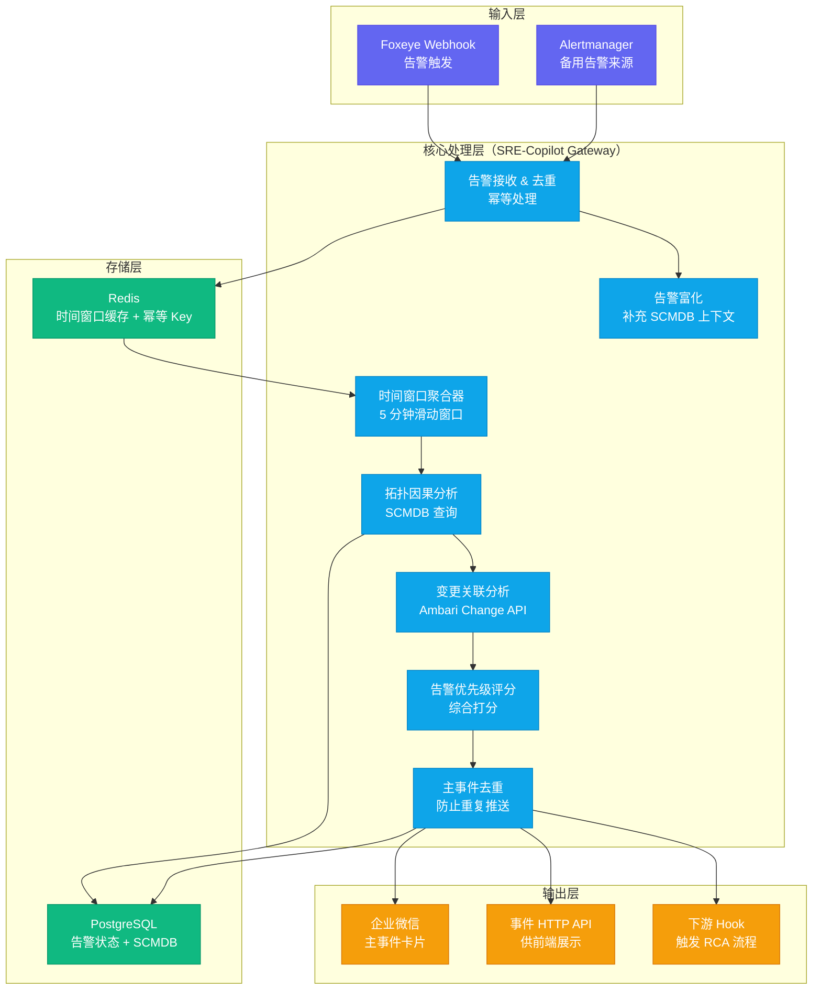
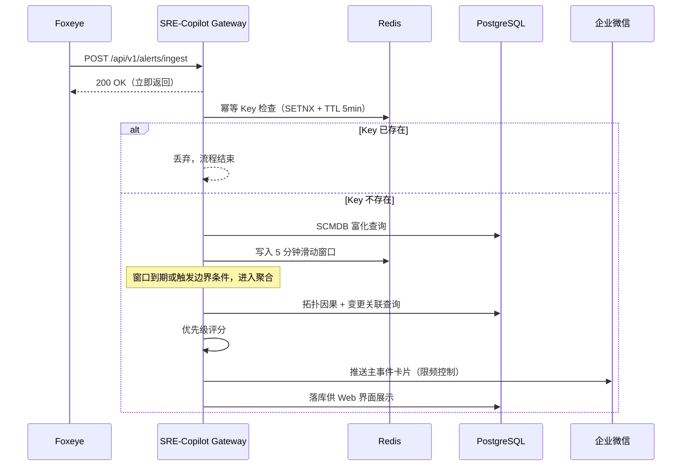
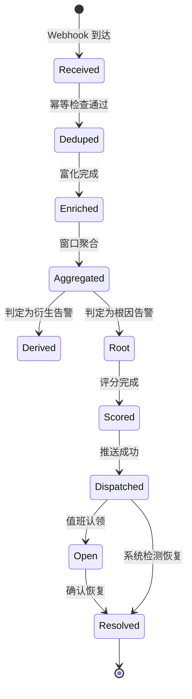
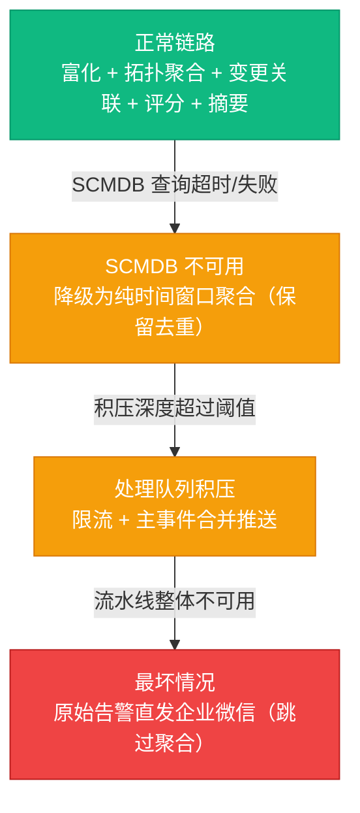

# 05 智能告警降噪：工程落地全链路解析

**摘要：**

本文是专栏第五篇，把前三篇积累的认知与方法（数据地基、[[03 告警工程：从告警风暴到1条主事件的设计哲学|告警设计哲学]]、[[04 组件依赖拓扑：SCMDB 是大数据集群 AiOps 的骨架|SCMDB 拓扑]]）组装成一个真正运行在值班链路里的系统。文章沿 Foxeye Webhook 入口到企业微信主事件卡片推送的整条流水线展开，逐环节拆解告警接收与幂等去重、SCMDB 富化、5 分钟时间窗口聚合、拓扑因果分析、变更关联、优先级评分与推送输出七个节点的工程实现，讲解 eino Multi-Agent 在摘要生成与根因精排中的合理边界，分析误报率控制的两类来源与三类手段，并以端到端延迟、消息丢失率、服务可用率三项 SLA 指标为纲给出可靠性设计。文末复盘时间窗口、SCMDB 时效性、企业微信限频三个线上坑。在方法层面，本文还提出"边界条件决定系统下限"的判断框架，并给出判断"哪个环节该引入 LLM"的四问清单，可供其他告警类系统的设计者直接套用。核心主张：告警聚合系统的难度不在聚合算法本身，而在幂等、降级、限频、时效这些边界条件——它们决定系统在真正故障时是救火队员，还是添乱者。

---

## 第 1 章 系统全景：告警聚合降噪流水线

告警聚合降噪的算法思想，前两篇已经讲透了：时间窗口、拓扑依赖、变更关联，三条线各自都能写成漂亮的方案。但把这三条线织成一张每天都要接住大量告警的网，是另一回事——笔者见过不少团队，单看每一块的设计都很完整，聚合规则有、拓扑图有、机器人接入也有，可拼在一起就是不稳定，不是漏告警，就是误聚合，最后值班组宁可用回最原始的告警群。问题几乎从不在算法，而在系统的边界条件：幂等怎么保证、窗口边界怎么切、SCMDB 查不到怎么办、企业微信限频了怎么办。本章先把整条流水线的全貌铺开，让后续每一章的细节都有一个落点。

### 1.1 系统架构图

图 1-1 是系统的完整架构。整条流水线可以看作一个漏斗：从多个告警源涌进来的原始告警，经过逐级收窄，最终以主事件卡片的形态抵达值班工程师——输入越大越杂，输出越小越精，这正是降噪的含义。



这张图自上而下其实是四层。输入层负责把不同来源的告警统一成同一种 JSON 格式，Foxeye 是主来源，Alertmanager 是备用来源；核心处理层是心脏，七个节点串成一条流水线；存储层为流水线提供状态与上下文，PostgreSQL 管事实、Redis 管临时状态；输出层决定告警以什么形态抵达工程师。四层之间的耦合刻意做得很松——输入层与处理层之间隔了一层队列，处理层与输出层之间也隔了一层推送队列，原因在第 6 章展开，这里先记住一个结论：**告警系统里每一个同步调用，都是未来一个故障点。**

### 1.2 数据流说明

一条告警从触发到推送，经过以下七个关键步骤。每一步在原理解之外，都附带笔者在生产中补上的边界条件——那才是本篇真正想讲的东西。

1. **告警接收（Recv）**：Foxeye 通过 Webhook POST 告警 JSON 到 SRE-Copilot Gateway 的 `/api/v1/alerts/ingest` 接口。Gateway 立即返回 200（保证 Foxeye 的发送性能），异步处理告警数据。幂等处理基于 Redis：每条告警生成一个唯一 Key（规则名 + 告警标签 hash），在 Redis 中检查是否已处理过（TTL 5 分钟），防止 Foxeye 重发导致的重复处理。这里有两个细节值得展开。第一，为什么必须立即返回 200——Foxeye 的 Webhook 发送是同步阻塞的，接收端如果拖得久，会反噬 Foxeye 自己的发送队列，让它在故障高峰期越积越多，异步化就是把这条耦合从中间斩断。第二，幂等 Key 的哈希输入必须对标签集合先排序再序列化——Go 的 map 遍历顺序是随机的，同一批标签两次进函数会算出两个哈希，幂等就失效了，这个坑只会在重发场景下以"告警重复推送"的形式暴露，定位起来非常隐蔽。

2. **告警富化（Enrich）**：从 PostgreSQL 的 SCMDB 中查询该告警来源组件的完整信息（所属集群、组件类型、HA 角色、Exporter URL 等），将这些上下文信息附加到告警数据结构中，供后续步骤使用。富化以主机名为索引，SCMDB 的 component_instance 表对该字段建了唯一索引，单次查询毫秒级。富化失败的告警不会被丢弃，而是带着"未富化"标记继续走完流水线——宁可上下文少一点，也不能让告警消失，这是告警系统第一条铁律：**先保证不丢，再谈降噪。**

3. **时间窗口聚合（Window）**：在 Redis 中维护一个 5 分钟的滑动时间窗口缓存，同一集群同一服务组的告警在窗口内聚合为候选事件组。窗口是滑动的而不是固定切割的。固定窗口在边界上会漏聚合——23:59 触发的告警和 00:01 触发的扩散告警被分到两个窗口，明明同源却被拆成两个事件；滑动窗口把聚合粒度从"时间段"变成"事件簇"，把边界问题转化为窗口重叠问题。Redis 缓存里放的是候选事件组而不是最终结论，后续的拓扑分析随时可能把候选组拆开重排，这也是它必须放在 Redis 而不是直接落 PostgreSQL 的原因——中间态的生命周期只有几分钟。

4. **拓扑因果分析（Topo）**：调用 SCMDB，查询候选事件组中每条告警的上游强依赖组件，判断是否有上游组件也在 5 分钟内有告警触发。如果有，则将当前告警标记为 DERIVED（衍生告警），关联到上游的根因告警。DERIVED 标记不是终态。上游根因告警如果快速恢复（譬如本身就是误报），被标记为 DERIVED 的下游告警就失去了归属，会被永远埋在主事件里。系统需要定期做一次孤儿回收：把长时间没有上游归属的 DERIVED 告警重新提升为独立事件，并保留原始关联信息。这个回收任务容易漏写，但漏写的后果很实在——一次误报会连带压住一批真实的下游告警。

5. **变更关联分析（Change）**：对根因告警（DERIVED 以外的告警），查询过去 30 分钟到 2 小时内的 Ambari 变更记录，按组件相关性和时间接近度排序，选出 Top-3 关联变更。变更窗口开在告警时刻前 30 分钟到前 2 小时，是刻意的不对称选择——太近的变更（几分钟内）容易被误判为因，太远的变更与故障的因果关联已经稀薄。Top-3 的截断也是一种务实：卡片上"关联变更"区域只放得下三条，多给反而稀释工程师的注意力。

6. **告警评分（Score）**：综合以下因素对主事件进行优先级打分：告警严重程度（ERROR > WARN）、影响组件数量、下游衍生告警数量、是否有关联变更（有变更则置信度提高）。评分输出的是优先级分数，不是最终的送达顺序。推送队列会按分数重排，保证高优事件在企业微信限频窗口内优先占位——这个设计的必要性，会在 7.3 节的企业微信限频坑里看到。评分公式的权重是拿来调的不是拿来定的，上线后要用历史故障复盘数据回测。

7. **推送输出（Output）**：将主事件卡片发送到企业微信对应告警群，同时写入 PostgreSQL 供 Web 界面展示，并向下游 RCA 服务发送 Webhook（如果有）。推送本身也要幂等：同一 Incident 的卡片如果因为网络重试发了两次，接收端要能认出来。企业微信端没有天然的幂等语义，幂等靠的是卡片里的事件 ID 与值班人员的直觉判断——重复卡片往往一眼就能看出来，这是第 6 章限频与合并设计的伏笔。

### 1.3 为什么必须是一条全链路

把流水线画成七步，读者可能觉得平平无奇——不就是几个查库、几个判断吗。但请回到一个事实：[[03 告警工程：从告警风暴到1条主事件的设计哲学|上一篇]]里讲过，Alertmanager 自带的聚合也能做，分组、静默、路由都内置了，为什么还要自己搭一条链路？

答案在于聚合的语义层级不同。Alertmanager 的分组是基于标签的语法聚合：相同标签归一组，它不知道 HiveServer2 的告警是 NameNode 故障的下游。而这条流水线的聚合是基于因果的语义聚合：拓扑分析回答"谁依赖谁"，变更分析回答"什么改变了系统"，评分回答"这件事多重"。前者只需要一套配置，后者需要 SCMDB、变更台账、状态机三层基础——这也是本篇与 03、04 两篇串起来的原因：**没有前面的数据地基，这一章的全链路就是空中楼阁。**

反事实地想一想不搭这条链路的代价：故障高峰时告警群每分钟刷出几十条，值班工程师只能按时间排序一条条点开，处理完 NameNode 的告警，还要再花 20 分钟确认那几十条下游告警是不是同一个原因——这就是"从救火到防火"之前的状态（01 篇讲的三大天花板）。全链路的本质，是把工程师从"看告警列表"升级为"看事件"，省掉的是每次故障都要重做一遍的关联判断。

### 1.4 时序视角：两个异步边界

图 1-2 用时序图画出同一份数据流，重点突出两个异步边界——接收与处理之间、处理与推送之间。看懂这两个边界，就理解了为什么系统能在 Foxeye 发送压力最大的时候依然稳定。



时序图里的 alt 分支就是边界条件的具象化。普通告警每天在这条分支上进进出出，任何一个分支处理错位，都会以"莫名少了一条告警"或"莫名多了一条告警"的形式被值班同事发现——而这些"莫名"，通常都比算法本身更难排查。

---

## 第 2 章 关键数据结构设计

数据结构是流水线的语言。三种核心类型——原始告警 AlertEvent（Foxeye 推送的一条告警）、聚合主事件 Incident（聚合后的一个事件）、变更记录 ChangeEvent（Ambari 的一次操作）——分别对应流水线的输入、中间产物与外部上下文。字段的取舍都藏在注释里：哪些字段参与幂等、哪些字段参与聚合、哪些字段只用于展示，读代码时一目了然。

### 2.1 告警数据结构

```go
// AlertEvent 代表一条从 Foxeye 接收到的原始告警
type AlertEvent struct {
    // 来自 Foxeye 的字段
    AlertName    string            `json:"alertname"`      // 告警规则名
    Status       string            `json:"status"`         // firing / resolved
    Severity     string            `json:"severity"`       // critical / warning / info
    Labels       map[string]string `json:"labels"`         // 所有标签
    Annotations  map[string]string `json:"annotations"`    // 告警描述文字
    StartsAt     time.Time         `json:"startsAt"`       // 告警开始时间
    GeneratorURL string            `json:"generatorURL"`   // Prometheus 查询链接

    // 富化后补充的字段（来自 SCMDB）
    ClusterID     int64   `json:"-"`
    ComponentType string  `json:"-"`             // HDFS_NAMENODE / YARN_RM 等
    Hostname      string  `json:"-"`
    HARole        string  `json:"-"`             // ACTIVE / STANDBY
}

// Incident 代表一个聚合后的主事件
type Incident struct {
    ID              string         `json:"id"`              // 唯一事件 ID
    ClusterID       int64          `json:"cluster_id"`
    Status          string         `json:"status"`          // OPEN / RESOLVED
    RootCause       *AlertEvent    `json:"root_cause"`      // 根因告警
    DerivedAlerts   []*AlertEvent  `json:"derived_alerts"`  // 衍生告警列表
    RelatedChanges  []*ChangeEvent `json:"related_changes"` // 关联变更
    Priority        int            `json:"priority"`        // 综合优先级分数
    ImpactScope     []string       `json:"impact_scope"`    // 影响的组件列表
    CreatedAt       time.Time      `json:"created_at"`
    UpdatedAt       time.Time      `json:"updated_at"`
    ResolvedAt      *time.Time     `json:"resolved_at,omitempty"`
}

// ChangeEvent 代表一条变更记录
type ChangeEvent struct {
    ChangeID      string    `json:"change_id"`
    ChangeType    string    `json:"change_type"`  // CONFIG_CHANGE / SCALE / RESTART
    TargetService string    `json:"target_service"`
    TargetHost    string    `json:"target_host"`
    StartTime     time.Time `json:"start_time"`
    TimeDelta     float64   `json:"time_delta_minutes"` // 距告警时刻的分钟数
    Score         float64   `json:"relevance_score"`    // 相关性综合得分
}
```

三个结构体的共同点是都带 CreatedAt 与 UpdatedAt——这不是装饰。聚合系统最频繁的操作就是"修改状态"，没有时间戳就无法审计状态流转，2.3 节的状态机也就无从谈起。Incident 里 RootCause 与 DerivedAlerts 的分立是聚合语义的骨架：主事件的"根"与"枝"必须分开存，否则后续 RCA 服务（[[06 根因分析 RCA：传统算法与 LLM 融合的应用架构|06 篇]]）无法直接复用这张表。

AlertEvent 里还有个容易被忽视的设计：富化后的字段全部标了 `json:"-"`。这意味着这些字段只存在于内存与 PostgreSQL，不会随 JSON 序列化回到 Foxeye 或任何外部系统——富化是系统内部的私密上下文，暴露出去既没有价值，还平添数据泄漏面。反过来说，Labels 与 Annotations 用 map 而不是结构体，是为了与 Prometheus 生态的标签模型天然对齐：Foxeye 告警的标签集合本来就不是固定 schema，任何新增的标签维度都不需要改代码。

### 2.2 SCMDB 查询接口封装

SCMDBClient 的接口只有三个方法，是刻意收敛的结果。告警聚合需要回答的问题一共就三个：这台机器上跑的是什么组件、它依赖谁、它倒了影响谁。三个方法分别对应三个问题的答案来源，后续 RCA 服务可以复用同一套接口——接口少，改动的波及面就小。

```go
// SCMDBClient 提供 SCMDB 的查询接口
type SCMDBClient interface {
    // GetInstanceByHostname 根据主机名查询组件实例
    GetInstanceByHostname(ctx context.Context, hostname string) (*ComponentInstance, error)

    // GetUpstreamDependencies 查询指定实例的所有强依赖上游实例
    GetUpstreamDependencies(ctx context.Context, instanceID int64, depTypes []string) ([]*ComponentInstance, error)

    // GetDownstreamImpact 查询受指定实例故障影响的所有下游实例（BFS 遍历）
    GetDownstreamImpact(ctx context.Context, instanceID int64, maxDepth int) ([]*ComponentInstance, error)
}

// GetUpstreamDependencies 的 SQL 实现（关键逻辑）
// SELECT ci.* FROM component_dependency cd
// JOIN component_instance ci ON cd.target_id = ci.id
// WHERE cd.source_id = $1 AND cd.dep_type = ANY($2) AND ci.status != 'DOWN'
```

### 2.3 告警与主事件的生命周期状态机

告警与主事件不是一次性数据，而是有生命周期的实体。状态机把生命周期显式化，相当于给每个事件建了一份档案袋，每一次状态迁移都留下一枚时间戳：



状态机解决的是"这个事件去哪儿了"的审计问题。工程师在企业微信里收到主事件卡片，顺手点进 Web 界面，能看到它从 Received 到 Resolved 每一步的时间戳——这种"可回溯"让工程师对系统的信任远高于"收到一条不知道哪来的消息"。状态迁移里有两个容易忽略的边界：其一，resolved 的告警重新 firing，会从 Received 重新走一遍，而不是从旧状态续走——因为窗口已经滑过去了，重新聚合是正确行为；其二，Open 状态如果长时间无人认领，系统要能升级（Escalation）到更高级别，否则卡片就成了"已读不回"。

### 2.4 幂等去重 Key 的工程细节

幂等 Key 是流水线上被访问最频繁的数据结构，也是最多隐藏坑的地方，值得单独一节。去重 Key 相当于告警的指纹：同一个指纹只能登记一次。

Key 的组成为 `alertname + 排序后的标签集合哈希`。选语义组合而不是告警 ID，原因在于去重要防的是"同一条告警重复进入"，而 Foxeye 重发时不一定保留同一个 ID，规则名加标签集合却天然稳定——同一时刻同一规则在同一些标签上触发的告警，语义上就是同一条。TTL 取 5 分钟与聚合窗口一致：窗口已经滑过，旧告警的重发到达时按新告警处理也是正确的，TTL 再长只会让 Redis 里堆满无人查询的死 Key。

并发是第二个坑。两个 Webhook 请求同时到达同一个 Key，必须用 SETNX 语义保证只有一个进入处理流程，另一个拿到"已存在"后直接丢弃。用"先查后写"的朴素写法，两次并发查询都返回不存在，就会放进来两条，幂等形同虚设。第三个细节是 Key 的存储与告警数据分离：Redis 里只存 Key，告警数据落在 PostgreSQL，这样即使 Redis 数据丢失，也只是失去去重能力（顶多多收几条重复告警），不会丢告警本体。

---

## 第 3 章 eino Multi-Agent 在告警聚合中的应用

eino 是 CloudWeGo 团队开发的 Go 语言 AI Agent 框架，与 LangChain 的定位类似，但在 Go 生态中是最成熟的选择。本专栏作者的团队已经在告警迁移系统中验证了 eino 的可行性。

在告警聚合降噪系统中，eino 的引入场景相对有限——因为告警聚合的大部分逻辑是确定性规则（拓扑依赖、时间窗口），不需要 LLM 参与。eino 的价值在以下两个环节体现。

先用一个比喻说清楚边界：整条流水线如果比作机场，塔台是确定性规则——所有航班的起降顺序由它计算，任何人不得临场发挥；LLM 只是广播员，负责把塔台的指令翻译成乘客听得懂的话。把广播员请进塔台参与指挥飞行，事故只是时间问题。告警聚合的七步里，去重、聚合、评分都是塔台的话，只有"把结构化事件翻译成自然语言摘要"这一句是广播员的话。

### 3.1 告警摘要生成

主事件卡片推送给工程师的"摘要文本"，需要将结构化的告警数据转化为自然语言描述。这是 LLM 擅长的任务，通过 eino 封装 LLM 调用来实现：

```go
// 告警摘要生成的 Prompt 模板（伪代码）
const summaryPromptTemplate = `
你是一名大数据集群 SRE，请根据以下结构化告警信息，
生成一段 2-3 句话的事件摘要，要求：客观、精确、信息密度高，
不要使用"严重"、"紧急"等感情色彩词汇。

根因告警：{{.RootCause.AlertName}} 来源：{{.RootCause.Hostname}}
衍生告警数量：{{len .DerivedAlerts}} 条
影响范围：{{join .ImpactScope "、"}}
关联变更：{{if .RelatedChanges}}{{index .RelatedChanges 0}.TargetService}} 于 {{index .RelatedChanges 0}.StartTime}} 发生 {{index .RelatedChanges 0}.ChangeType}}{{else}}无关联变更{{end}}

输出格式：直接输出摘要文本，不要加任何前缀。
`
```

摘要生成的工程约束有三条。其一，temperature 必须设为 0 或接近 0——摘要要的是稳定复现，不是创作，同一个 Incident 今天明天生成两份不一样的摘要，工程师会立刻失去信任。其二，eino 侧给 LLM 调用加 2 秒超时与失败回退：LLM 不可用时，用模板摘要兜底——"根因告警 X 于 T 时刻触发，衍生 N 条，影响 M 个组件"——保证卡片永远有摘要可看。其三，摘要结果缓存到 Incident 上，同一事件只生成一次，重发推送时直接复用。这三条合起来，把"引入 LLM"对流水线实时性的侵蚀控制在可接受范围内。

### 3.2 根因推断辅助（Phase 2 能力）

在传统规则（拓扑遍历）给出 Top-3 根因候选之后，LLM 可以作为"精排器"：给定候选列表和各自的证据，LLM 基于 SRE 领域知识对候选进行排序，并生成可解释的推断说明。

这个能力将在[[06 根因分析 RCA：传统算法与 LLM 融合的应用架构]]中详细讲解。这里只指出：在 Phase 1 阶段，告警聚合降噪系统不应该依赖 LLM 做核心决策——LLM 的调用有延迟（通常 1-5 秒），而告警聚合有实时性要求；LLM 的推理有不确定性，而告警聚合需要可追溯的确定性逻辑。精排器的输入不是原始告警，而是传统算法给出的候选与证据链——它的职责是在已知候选中排序并解释，而不是从零开始猜。这个定位差异，决定了 RCA 阶段引入 LLM 是增强而不是替换。

### 3.3 eino 的编排机制与"该不该用 LLM"的判断框架

为什么是 eino 而不是 LangChain？团队的存量服务是 Go 写的，内网 LLM 通过统一网关暴露，eino 恰好提供 Go 原生的模型调用、工具注册与图编排抽象，与存量微服务的部署、监控、日志体系完全同构。LangChain 生态更丰富，但引入它意味着在运维体系里多出一个 Python 技术栈孤岛——对一个没有 Python 服务团队的 SRE 组，这个成本是真实的。eino 的编排抽象（状态 State、组件 Component、图 Graph）足够表达"摘要生成"这种线性子流程，也足够后续在 Phase 2 把精排器挂进来，笔者没有再引入其他 Agent 框架。

判断"哪个环节该引入 LLM"，笔者用的是四个问题：

| 判断维度 | 问自己 | 告警聚合各环节的答案 |
|---------|--------|---------------------|
| 实时性 | 这个环节能不能容忍 1-5 秒延迟 | 去重/聚合/评分不能，摘要生成可以 |
| 可追溯 | 结果能不能逐步解释给值班工程师 | 聚合结论要能解释，摘要文本不需要 |
| 容错 | 模型答错一次，代价多大 | 聚合判错代价大，摘要措辞偏差可接受 |
| 成本 | 每次调用的 token 成本值不值 | 摘要文本短，token 成本低，值 |

四个问题里有任何一个答案倾向"不能/代价大"，就该用确定性规则；全部倾向"可以/代价小"，才考虑 LLM。按这个框架，告警聚合流水线里只有摘要生成一项过得了关——这解释了为什么 eino 在整条流水线里只占这么小的一块。这不是框架不够强，而是**在告警场景里，确定性才是最大的可靠性。**

---

## 第 4 章 误报率控制：工程上最难的问题

这一章是笔者最想写的一章。告警聚合降噪系统的算法可以抄，架构可以抄，但误报率控制抄不了——它依赖的是对自身数据质量的持续治理。误报率控制之难，在于"误报"这个词在聚合系统里有两个完全不同的含义，混为一谈就无从下手。

### 4.1 误报的两种类型

在告警聚合降噪系统中，"误报"有两种不同的含义，需要分别控制：

**类型一：原始告警的误报**（原始告警规则产生了假阳性）
这类误报来源于告警规则本身的阈值设置不合理，或者动态基线算法对正常业务波动的误判。解决方案是优化告警规则（调高阈值 / 改用动态基线），这是数据地基和告警工程章节的内容。

**类型二：聚合判断的误报**（聚合引擎错误地将两个无关告警归并为一个主事件）
这类误报来源于 SCMDB 数据不准确（两个组件实际上没有依赖关系，但 SCMDB 里错误地记录了依赖），或者时间窗口设置过宽导致不相关的告警被错误聚合。

两类误报的治理手段完全不同。类型一靠感知层修规则，类型二靠 SCMDB 质量与聚合策略。更关键的是它们的代价不同：类型一误报浪费的是一条告警的注意力，类型二误报浪费的是一次故障排查——一个主事件把两个无关故障捏在一起，工程师处理完一个，另一个还在持续，这种"聚合反噬"比不聚合更糟。所以聚合系统的误报控制，重点是类型二。

### 4.2 误报控制策略

**SCMDB 数据质量保障**：这是减少第二类误报的根本方法。每条依赖关系在录入时必须标注 `verified = true/false`，只有 `verified = true` 的依赖关系才用于生产环境的告警聚合。对于不确定的依赖关系，标注为 `verified = false`，先不用于自动聚合，只在诊断报告中作为参考信息显示。打个比方，SCMDB 是拼图的参考原图，verified 标记相当于给每块拼图盖上的"检验合格章"——没有盖章的拼图块，宁可不放进画面，也不能让它拼错位置。这个机制的代价是显而易见的：未验证的依赖关系越多，聚合能力越弱。因此 04 篇里讲的自动发现加人工确认的混合维护，本质上是给这个"盖章率"托底。

**告警聚合置信度阈值**：不是所有满足拓扑条件的告警都强制聚合，而是给每个聚合决策打一个置信度分数。置信度低于阈值（譬如 0.7）的告警，不自动聚合，而是以"相关告警（可能有关）"的形式显示在主事件卡片的附加信息区域，供工程师参考。置信度不是拍脑袋的，而是可计算的加权分：告警与根因的拓扑距离越近分越高、触发时间差越小分越高、上下游严重程度越匹配分越高。0.7 这个阈值的意思是"七成把握才合并"——宁可多显示几条相关告警，也不要错合一个主事件。阈值本身要用历史故障复盘数据回测调参，上线初期宁高勿低。

**工程师反馈机制**：在主事件卡片中提供快捷反馈按钮（"这个聚合正确" / "这两个告警无关"）。收到反馈后，系统记录案例，供后续优化聚合规则使用。反馈机制是聚合系统的"升级回路"：每一条负面反馈都对应一个聚合误判样本，定期汇总后按样本量排序——高频误判的依赖关系要降级为 verified = false，高频误判的窗口组合要收紧。没有这个回路，置信度阈值只能靠拍脑袋调。反馈的收集要克制：一次故障中让工程师点三次以上反馈就会变成骚扰，所以每张卡片最多一个反馈入口。这套机制与 03 篇定义的 KPI 体系是咬合的——那里把"告警误报率"的目标定为 ≤ 10%，统计口径是"值班工程师判断无需处理的主事件比例"，而聚合误报正是拖累这个指标的主要来源；反馈按钮的点击数据，恰好就是这条 KPI 的原始度量。

### 4.3 告警抑制：主动降噪的补充手段

除了聚合降噪，**告警抑制（Alert Inhibition）**是另一个减少告警噪声的手段：当某个高严重级别的告警触发时，自动抑制（静默）一批相关的低严重级别告警，防止它们占用值班工程师的注意力。

典型的抑制规则：
- 当 NameNode 触发 `CRITICAL` 级别告警时，抑制所有依赖 NameNode 的组件的 `WARNING` 级别告警（因为这些 WARNING 很可能是 NameNode 故障的直接后果，在 NameNode 恢复前无论如何都无法修复）
- 当集群处于计划内维护窗口时，抑制所有非 `CRITICAL` 级别的告警

抑制与聚合有一个根本区别：聚合是把告警收进一个事件里，抑制是直接不让告警出现。后者更激进，所以边界条件也更严格。第一条边界是"抑制必须有明确的解除条件"——维护窗口的抑制必须绑定开始与结束时间，超时自动失效，否则一次忘记关闭的维护窗口会静默掉整夜的告警，而工程师毫无察觉。第二条边界是"抑制规则要能溯源"——每条被抑制的告警都要记录"被哪条规则抑制、为什么"，复盘时可以查证，不能只留一个总数。第三条边界是抑制规则的自身治理：规则数量多了以后，要用 4.2 节同样的反馈回路来淘汰误伤率高的规则——抑制过头就是新的漏报。

四种手段经常被混用，它们的区别值得一张表：

| 手段 | 机制 | 针对的问题 | 副作用风险 |
|------|------|-----------|-----------|
| 去重（Dedup） | 同一条告警只处理一次 | 上游重发、重复触发 | 幂等失效导致重复 |
| 聚合（Aggregate） | 相关告警收进一个主事件 | 症状告警淹没有用信息 | 误聚合、孤儿衍生告警 |
| 抑制（Inhibit） | 高优告警压住低优告警 | 已知因果链上的噪声 | 抑制过头变成漏报 |
| 静默（Silence） | 维护窗口内批量屏蔽 | 计划内变更的预期告警 | 忘记解除静默 |

去重和静默可以靠 Alertmanager 原生实现，聚合和抑制则依赖 SCMDB 与规则治理——这正是本篇系统存在的理由。

### 4.4 误报与漏报的张力

控制误报的每一步，都在同时放缩漏报。这是这一章最根本的权衡。

用分类问题的语言说：告警聚合是一个二分类——"这条告警是某主事件的组成部分"还是"不是"。压缩率对应召回率，误聚合率对应 1 减精确率。窗口拉大、阈值放低，压缩率上去了，误聚合率也跟着上去；反过来，verified 门槛收紧、阈值抬高，误聚合降了，但真正相关的告警被拆散成多个主事件，工程师又回到一条条翻告警的状态。**在告警场景里，"多"的代价与"漏"的代价都是真实的，只是发生在不同人身上：漏报的代价由业务承担，误报的代价由值班工程师承担。** 团队要把这笔账算清楚，再决定聚合策略往哪个方向偏。

一个典型的反例是"为指标而聚合"：管理层把告警压缩率设成 KPI，系统为了凑数字把窗口放得很宽，两个独立故障被捏成一个主事件。值班工程师处理完第一个，第二个故障还在后台持续发酵——压缩率数字很好看，事故复盘一样难看。压缩率只是手段，**让工程师在 30 秒内建立事件上下文才是目的**，这句结论在下一章的卡片设计里还会再出现。

---

## 第 5 章 主事件卡片：工程师视角的信息架构

推送给企业微信的主事件卡片是告警聚合系统的最终输出界面，也是工程师唯一真正"看见"的东西——前面六步做得再好，卡片设计失败，前功尽弃。卡片的信息架构设计直接影响工程师的处置效率，值得认真设计。打个比方，卡片是发给值班工程师的作战简报：一份好的简报，指挥员扫一眼就知道战场态势、我方损失与下一步动作；一份差的简报，信息全但不分主次，扫三眼也抓不住重点。

推荐的主事件卡片结构（以企业微信 Markdown 消息格式为例）：

```
🔴 【P1 告警事件】HDFS 写入故障 - prod-bigdata-01
━━━━━━━━━━━━━━━━━━━━━━━━━━
**事件摘要**
DataNode `dn-003.prod.bigdata.com` 磁盘 /data/disk3 出现 IO 高延迟（当前 340ms，基线 2ms），导致 HDFS 副本写入失败，影响下游 HiveServer2 和 47 个正在运行的 Spark 作业。

**根因告警**
▸ `DataNode_DiskIOLatency > 100ms` — dn-003.prod.bigdata.com（触发时间：14:23:15）

**影响组件（4 个）**
▸ HDFS DataNode × 1 （副本写入失败）
▸ HiveServer2 × 5 （查询积压中）
▸ Spark 作业 × 47 （Stage 失败 / 等待重试）

**已收敛告警**
▸ 327 条相关症状告警已聚合到本事件

**关联变更**
▸ [#23891] dn-003 磁盘配额调整 — 昨日 23:30（13.5 小时前）by admin@company.com

**推荐动作**
1. 检查 dn-003 磁盘 SMART 状态：`smartctl -a /dev/sdc`
2. 查看 DataNode 日志：[Grafana Loki 链接](https://grafana.prod/...)
3. 如确认坏盘：触发 HDFS 副本迁移流程（Runbook #R-045）

**处置**   [✅ 认领] [🔕 静默 1h] [❌ 标记无效]
```

这个信息架构遵循"从高层到底层、从结论到证据"的阅读顺序：工程师先看到"发生了什么"，然后是"影响了什么"，再是"可能是什么原因和关联变更"，最后是"推荐做什么"。这个顺序让工程师在大脑刚从睡眠中唤醒时，也能在 30 秒内建立完整的事件上下文。

### 5.2 三问模型：发生了什么、影响了什么、该怎么办

卡片设计的认知依据可以概括为三问模型，对应三块信息：

| 信息块 | 回答的问题 | 卡片对应区域 | 信息来源 |
|--------|-----------|-------------|---------|
| 事件摘要 | 发生了什么 | 顶部摘要 | LLM 摘要生成（3.1 节） |
| 影响范围 | 影响了什么 | 根因告警 + 影响组件 + 已收敛告警 | 拓扑因果分析（1.2 节第 4 步） |
| 处置指引 | 该怎么办 | 关联变更 + 推荐动作 + 处置按钮 | 变更关联 + Runbook |

三个问题从认知上形成一条递进链，顺序不能乱。把"推荐动作"放在最前面是常见的错误——工程师还没确认发生了什么，就被推着做动作，反而延长了确认时间。另一个细节是"已收敛告警"的数字要可点开：327 条具体是哪些，工程师偶尔需要抽查其中一两条来验证聚合是否靠谱，这也构成对聚合质量的持续监督。

影响组件数字的来源是 SCMDB 的下游遍历：以根因组件为起点，沿依赖图 BFS 展开，限定深度与依赖类型，得到受影响组件清单。推荐动作则来自 Runbook 关联——每类根因告警预先绑定处置手册（譬如坏盘对应 smartctl 检查与副本迁移流程），卡片只是把手册第一条动作摘出来。

### 5.3 企业微信消息的格式与约束

企业微信的通知形态有两种选择：Markdown 消息与模板卡片（template_card）。Markdown 消息渲染自由、实现简单，但样式是固定的，交互能力弱；模板卡片可以嵌入按钮、跳转链接，交互强，但样式受模板约束，长文本展示受限。本系统第一阶段用 Markdown 消息承载主事件卡片，处置按钮用卡片下方的 URL 按钮跳转到 Web 界面实现——这个取舍的代价是"认领"动作多了一次跳转，但避免了为模板卡片的字段约束重新设计信息结构。

企业微信机器人还有两个硬约束必须正面处理。其一是消息频率限制（官方限制文本消息每分钟 20 条），故障高峰期主事件可能瞬间超过这个数；其二是消息长度限制，超长文本会被截断或推送失败。应对方式在 7.3 节展开，这里先记住结论：**输出层不是无限容量的，它需要自己的队列、限流与合并策略。**

---

## 第 6 章 SLA 保障：告警流水线的可靠性设计

告警聚合流水线本身必须高度可靠——如果聚合服务宕机，告警无法送达，后果比不聚合更严重。一个降噪系统如果自己成为故障源，那就是在给值班工作帮倒忙。这一章把可靠性设计讲透，从指标开始。

### 6.1 关键可靠性指标

| 指标 | 要求 | 为什么是它 |
|------|------|-----------|
| 端到端延迟（E2E Latency） | P99 < 30 秒 | 从 Foxeye Webhook 触发到企业微信收到消息的时间 |
| 消息丢失率 | < 0.1% | 告警入队后丢失的比例 |
| 服务可用率 | > 99.9% | 聚合服务自身的可用率 |

选 P99 而不是 P50 是有意的：平均值掩盖长尾，告警场景里最危险的就是"恰好那次没收到"。E2E 延迟的构成要拆开看：队列等待、SCMDB 查询、聚合计算、摘要生成（如果启用 LLM）、企业微信投递，五个环节里任何一个卡住，30 秒的预算都会被打穿。

### 6.2 可靠性设计要点

**异步处理 + 消息队列**：Foxeye Webhook 接收到告警后，立即写入本地消息队列（可以用 Redis 的 List 或 Stream 实现），然后立即返回 HTTP 200。聚合处理是异步的，即使聚合逻辑有延迟，也不会阻塞 Foxeye 的告警发送。队列选型上，Redis Stream 比 List 更适合这个场景：Stream 支持消费者组与 ACK 机制，消费失败的消息可以重新投递，而 List 的 RPOP/LPOP 一旦弹出就与队列无关，进程崩溃会丢消息。退一步说，即使只用 List，也必须配合 2.4 节的幂等 Key——重试导致的重投会被幂等挡在门外，这是"至少一次投递 + 幂等消费"的经典组合。

**告警状态持久化**：每条告警的处理状态（已接收、聚合中、已推送）必须持久化到 PostgreSQL，而不仅仅放在内存中。这样在服务重启后，可以从 PostgreSQL 恢复处理状态，防止因为服务重启导致的告警丢失。状态机（2.3 节）在这里兑现价值：重启后扫描处于聚合中状态的事件，把超过恢复阈值的重新送入队列即可，已推送的事件直接复用缓存的结果，避免重复推送。持久化要防的是"内存即真相"——进程一死，真相全丢。

**Fallback 策略**：当 SCMDB 查询超时（通常设置 500ms 超时）时，降级为简单的时间窗口聚合，而不是让告警积压。这保证了即使 SCMDB 数据库不可用，基础的去重降噪功能仍然工作。降级不是二选一的开关，而是一条阶梯，6.3 节专门展开。

**告警监控自监控**：告警聚合服务必须监控自己的健康状态，包括：消息队列积压深度（积压超过 1000 条说明处理能力不足）、E2E 延迟（P99 超过 60 秒触发告警）、SCMDB 查询成功率（低于 99% 触发告警）。自监控的输出必须走独立通道——告警系统不能拿自己的主事件卡片来告警自己，否则一次故障会同时压垮告警通道与告警通道的告警通道。6.4 节展开。

### 6.3 分级降级阶梯

Fallback 是一条阶梯，每一级牺牲一部分能力，换取流水线继续运转：



每一级降级都带一个"自动恢复"条件：SCMDB 恢复可用后，新告警自动回到正常链路；积压清空后，合并策略自动关闭。降级是运行时行为，不是运维手动开关——把降级做成手动，故障发生时根本没人来得及点。最坏一级（直发原始告警）的代价是告警风暴重现，但它的存在保证了一条铁律：**无论系统坏到什么程度，告警必须送达。** 这条铁律比聚合质量更重要，也是 6.1 节消息丢失率 < 0.1% 的底气来源。

### 6.4 告警系统的自监控

告警聚合服务的自监控，本质是"谁来看守看守者"的问题。答：一套独立于主链路之外的通道。

独立体现在三层。其一，通道独立——自监控告警直接调用企业微信 API 发送，不经过主事件的推送队列，避免故障时与业务告警抢同一个队列。其二，存储独立——自监控指标落在独立的 Prometheus 实例或直接进日志系统，不在主链路依赖的存储里，否则主存储故障时自监控先失明。其三，判定独立——自监控的阈值判断不做在聚合服务进程内，而是由外部探针（黑盒探测）周期性地从外部视角检查服务健康，进程内的检查会随进程一起死掉，黑盒探针不会。

自监控的具体项就是 6.2 节列的那三条：队列积压深度、E2E P99、SCMDB 查询成功率。再补一条黑盒探针：每分钟向 ingest 接口注入一条带特殊标记的测试告警，验证它能在限时内到达企业微信——测试告警携带标记，值班群里不会误认为是真实故障，但能精确度量"端到端是否通"。这条探针几乎等价于给流水线装上心跳。

容量规划同样依赖积压深度这个指标。积压阈值设多少，不能只拍脑袋：先压测出单实例的稳态消费速率，再用"阈值 = 消费速率 × 允许的排队时间"反推——允许 1000 条积压，意味着系统默认自己能在告警洪峰下坚持数分钟才告警，这个数字与 E2E 延迟预算（P99 < 30 秒）必须对得上。积压持续增长说明消费端是瓶颈，此时限流保护要优先于扩容——先拦住新的入口流量，再谈加机器，否则洪峰会把消息队列本身打穿。

可靠性设计最后要说的是演练。聚合系统的故障注入要定期做：杀掉 SCMDB、把企业微信限频打满、停掉一个 Gateway 实例，观察降级阶梯是否按预期工作。平时没演练过的降级路径，故障时大概率是坏的——这条经验来自第 7 章的踩坑复盘，也来自笔者的多次线上事故。

---

## 第 7 章 工程踩坑复盘

前三章讲的都是设计，这一章讲设计之外的现实。三个坑没有一个是算法问题，全部出在边界条件上——它们就是前面几章反复强调的"边界"二字的具体形态。

### 7.1 坑一：时间窗口设得太宽

最初将时间窗口设为 15 分钟，结果两个完全不相关的告警（一个是凌晨 3:00 的 DataNode 磁盘告警，一个是凌晨 3:08 的 Kafka 消费延迟告警）被错误聚合为同一个事件。调整为 5 分钟滑动窗口后，误聚合率显著下降。

**教训**：时间窗口不是越宽越好——宽窗口提高了聚合率，但也提高了误聚合率。5 分钟是一个经过实践检验的平衡点。

机制的层面看，时间窗口是用"时间接近"近似"因果相关"——同一时刻告警大概率同源，但这个近似只在窗口足够小时成立。窗口是渔网的网眼：网眼越大，捞上来的鱼越多，但小鱼小虾和垃圾也越多。15 分钟之所以出问题，是因为凌晨 3:00 到 3:08 之间的 DataNode 磁盘告警与 Kafka 消费延迟告警，除了时间接近之外没有任何共同点，宽窗口把这个"没有共同点"也放进了同一条鱼篓。

边界条件要说透：5 分钟不是普适常数。慢故障——譬如磁盘坏道逐步扩散、内存泄漏缓慢爬升——从触发到扩散可能超过 5 分钟，单一快窗口会把它拆散。笔者的做法是快慢双轨：默认 5 分钟快窗口做首轮聚合，对标记为"慢故障"的指标类型单独配置更宽的窗口做二次归并。多一个轨就多一份复杂度，所以只在确证过的慢故障类型上启用。

### 7.2 坑二：SCMDB 依赖过时导致误聚合

某次集群架构调整后，一个 DataNode 从生产集群迁移到了测试集群，但 SCMDB 没有及时更新，导致测试集群 DataNode 的告警被错误聚合到生产集群的 NameNode 主事件里。

**教训**：SCMDB 的时效性是告警聚合质量的关键。必须建立 SCMDB 与 Ambari 的自动同步机制，而不是完全依赖人工维护。

机制的层面看，SCMDB 是静态快照，集群是动态现实，两者之间永远有时差。快照的时差平时不咬人，一旦架构调整、组件迁移、扩缩容发生，时差就会转化为聚合误判。这就好比出门带了一张过期的地图——平时看不出问题，改建后的路口才会让你迷路。04 篇讲的自动同步、变更触发更新、每周一致性校验，就是为这个坑准备的；本篇再补一条兜底：聚合判定时把"依赖关系最后更新时间"纳入置信度计算——依赖越旧，聚合置信度越低，等于让系统自己感知地图的过期程度。

边界条件是：自动同步解决不了"架构意图"层面的变化。Ambari API 能告诉你节点增删，但告诉不了你"这个 DataNode 已经迁移到测试集群"这种业务语义的变更。所以依赖关系的 verified 标记必须由人维护，自动同步只覆盖实例层面的信息。

### 7.3 坑三：企业微信消息频率限制

在一次大型故障中，短时间内产生了大量主事件，导致企业微信 Bot 触发频率限制（每分钟最多发送 20 条消息），部分告警消息出现了 5-10 分钟的延迟。

**教训**：输出层必须做速率限制（Rate Limiting）和消息合并（Message Batching）——同一个 1 分钟窗口内的多条主事件，合并成一条消息发送。同时为企业微信接口实现指数退避重试（Exponential Backoff）。

机制的层面看，这个坑的根源是"容量幻觉"：系统内部处理能力充足，就默认输出通道也充足，实际上外部通道的容量瓶颈比内部更硬。企业微信限频是硬约束，打满了不会排队，而是直接拒绝——那些 5-10 分钟延迟的消息，就是被拒绝后重试的痕迹。指数退避重试能保证最终送达，但重试期间消息是失序的，工程师看到的时间线会乱，所以合并策略要与重试配合：同一个窗口内的高优事件先占位，低优事件合并成一条"另有 N 条事件"的汇总消息。

边界条件是：合并会损失可读性——一条消息里塞 5 个事件的摘要，阅读成本比 5 条独立消息更高，只是比"被限频拒掉"好。所以合并只应在触发限频时才启用，平时不做。重试也要幂等：同一 Incident 的卡片被重试投递两次，接收端要有识别手段（卡片里带事件 ID），否则降级链上又会长出新的重复告警。

### 7.4 踩坑的共同根源与方法论

把三个坑放在一起看，会发现它们有一个共同根源：**假设正常状态会持续。** 时间窗口假设"告警的因果关联在 15 分钟内成立"——正常状态是 5 分钟够用；SCMDB 假设"依赖关系与实际一致"——正常状态是同步没滞后；输出通道假设"容量充足"——正常状态是消息量在限频之内。三个坑都是假设在某个瞬间被现实打破的结果。

由此可以提炼出一条方法论：**告警系统的第一性原理是"先保证不丢，再谈降噪"。** 任何聚合、压缩、抑制的优化，如果以牺牲送达可靠性为代价，都是在透支系统的信用。落地的检查顺序是：先验证告警能否稳定送达（黑盒探针 + 丢失率指标），再验证降噪质量（压缩率 + 误聚合率），最后才谈体验优化（卡片设计）。顺序颠倒的团队，往往把大量精力花在把告警聚得漂亮上，然后在一次大故障里被"消息没送到"打得措手不及。

反例也是现成的：有的团队为了让压缩率报表好看，把降级直发链路设计成"最后手段"而不配置监控，结果降级发生时没人知道，告警风暴以原始形态冲进值班群，工程师一边处理故障一边疑惑"为什么今天的告警特别多"。降级链路不是不需要监控的逃生通道，它是可靠性设计的一部分，必须有同等的自监控。

---

## 第 8 章 小结与下一篇预告

本篇是专栏迄今工程密度最高的一篇，覆盖了一个生产可用的告警聚合降噪系统从输入到输出的完整设计：

1. **系统全景架构**（7 个核心处理节点 + 完整数据流 + 两个异步边界）
2. **关键数据结构**（AlertEvent / Incident / ChangeEvent 设计 + 生命周期状态机 + 幂等 Key 细节）
3. **eino 的应用边界**（Phase 1 只用于摘要生成，核心决策仍是确定性规则）
4. **误报率控制**（SCMDB 数据质量 + 置信度阈值 + 工程师反馈机制）
5. **主事件卡片信息架构**（从结论到证据的信息排列 + 三问模型）
6. **SLA 保障设计**（异步处理 + 持久化 + 分级降级 + 独立自监控）
7. **工程踩坑复盘**（时间窗口、SCMDB 时效性、消息限频三大坑）

贯穿全篇的其实是同一个判断：**告警聚合系统的成败，取决于对边界条件的敬畏程度。** 算法决定系统的上限，边界条件决定系统的下限，而生产系统真正被考验的，恰恰是下限。聚合窗口的宽度、幂等 Key 的组成、降级阶梯的每一级、限频合并的开关——这些细节单看都不起眼，合在一起才构成"可靠"二字。

下一篇[[06 根因分析 RCA：传统算法与 LLM 融合的应用架构]]将把能力从"告警聚合（知道发生了什么）"升维到"根因分析（知道为什么发生）"，这是 AiOps 能力体系中最复杂、也最有技术深度的一个模块。

---

## 参考资料

1. CloudWeGo eino：Go 语言 AI 应用开发框架官方文档（状态 State、组件 Component、图 Graph 等编排概念）
2. Prometheus Alertmanager 官方文档：分组（Grouping）、静默（Silencing）、路由（Routing）与 Webhook 机制
3. 企业微信机器人消息发送频率限制说明（文本消息每分钟 20 条）
4. Redis Streams 官方文档：消费者组（Consumer Group）与 ACK 机制
5. 系列前篇：[[03 告警工程：从告警风暴到1条主事件的设计哲学]]（聚合降噪三维度与压缩率 70%+ 行业数字的来源）

---

> [!note] 思考题
> 1. 为什么幂等 Key 用"规则名 + 标签集合"而不是告警 ID？TTL 设成 5 分钟的依据是什么，改成 1 小时会引入什么问题？
> 2. 如果只能保留一个降级级别，你会保留哪一级？为什么降级必须自动触发，而不能是运维手动开关？
> 3. "压缩率"与"误聚合率"此消彼长，如果让你为聚合系统设计一条新 KPI，你会怎么定义，才能避免"为指标而聚合"？
> 4. 假设 5 个集群共用一个企业微信机器人，你会怎么设计推送队列的优先级与合并策略，才能扛住多集群同时故障？
> 5. 慢故障会跨过 5 分钟窗口，快慢双轨的代价是复杂度翻倍——什么条件下你认为单轨快窗口就够用？

---

*上一篇：[[04 组件依赖拓扑：SCMDB 是大数据集群 AiOps 的骨架]] | 下一篇：[[06 根因分析 RCA：传统算法与 LLM 融合的应用架构]]*