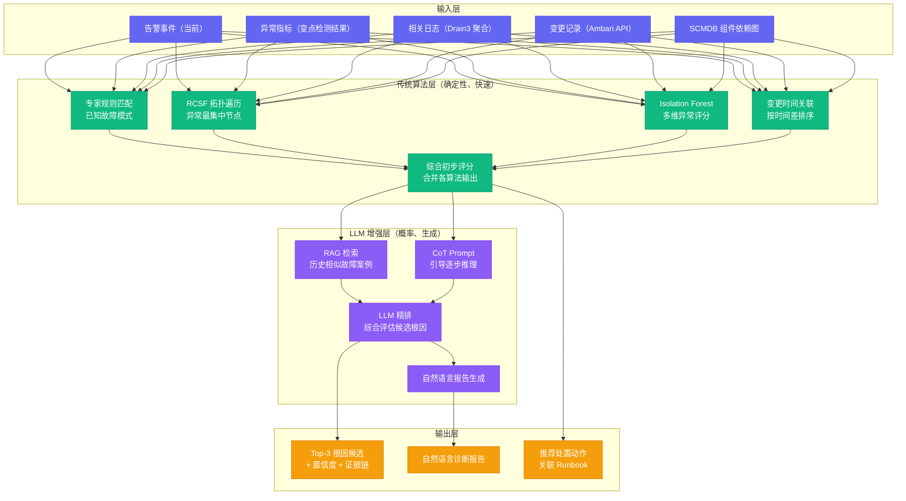
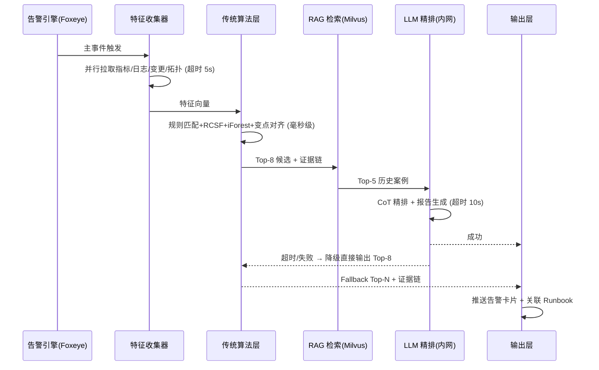

# 06 根因分析 RCA：传统算法与 LLM 融合的应用架构

## 摘要

本文是专栏第六篇，深度解析 AiOps 中最具技术挑战性的能力：根因分析（Root Cause Analysis，RCA）。文章从 RCA 的本质定义和工程边界切入，先厘清它作为一项"Top-N 候选 + 证据链"排序任务与学术研究的差异，再系统梳理传统 RCA 算法体系——图论方法 RCSF（频繁项集挖掘）、统计方法 Isolation Forest、时序方法变点检测、贝叶斯因果推断与专家规则，逐类拆解算法机制、适用场景与失效边界；随后讨论 LLM 介入 RCA 的合理边界，主张它应当是"精排器而非决策者"，并给出"传统算法粗筛 + CoT 推理 + RAG 历史案例检索"的融合架构与可落地的流水线时序设计；最后建立以 AC@K 为核心的验收与持续评估体系，指出评估本身存在的样本稀疏、标注一致性与确认偏误等难题。本文的核心主张：RCA 不是"用最先进的模型就能解决"的问题，而是"领域知识 + 数据质量 + 算法选择 + 工程约束"的综合工程问题；先把传统算法做扎实，LLM 才能真正发挥增强效果——这也是本文展开全部讨论时始终依托的底层视角。

---

## 第 1 章 RCA 的本质定义与工程边界

### 1.1 什么是 RCA

根因分析（Root Cause Analysis）在字面意思上很简单：找到问题的根本原因。但在大型分布式系统的运维场景中，这个问题的复杂性被严重低估——低估的方式通常有两种，一种是把它当成"告警聚一聚、日志翻一翻"的体力活，另一种是把它当成"上一个根因大模型就能一劳永逸"的魔法，而真实的处境，介乎两者之间，比前者深得多，又比后者浅得多。

在一个有 500 个组件的大数据集群中，一次故障事件可能同时伴随着：300 条告警、50 个可能相关的指标异常、10 个最近的配置变更、若干个可疑的日志错误。如果没有系统性的分析框架，工程师的"排查"往往是靠直觉和经验在这片信息海洋中寻找线索，效率极低——这不是工程师不努力，而是人类的工作记忆容量天然有限，面对几百路并行的信号流，注意力只能逐条扫描，而故障现场的窗口期又往往以分钟计。

RCA 系统的目标，就是把这个"海量信息 → 人工经验 → 结论"的过程，转化为"海量信息 → 系统算法 → Top-N 根因候选 + 证据链 → 工程师验证 → 确认结论"的过程。转化前后，最大的变化不在"算得快"，而在**把"凭经验下结论"改成了"给结论附证据"**——工程师的职责从"从零开始推理"变成了"在系统给出的候选上做验证"，后者的认知负荷低一个量级，出错的概率也随之下降。

这里有两个关键词需要强调。

**Top-N（不是 Top-1）**：生产环境的 RCA 不是考试出题有标准答案，而是在不确定性中寻找最可能的解释。给出 Top-3 到 Top-5 的候选根因 + 每个候选的置信度分数 + 支撑证据，是比强行给出一个"答案"更诚实、也更实用的输出格式。为什么这么说？因为真实故障往往存在多个同因共现的解释——一个 DataNode 慢盘，既可能是磁盘坏道，也可能是同机架交换机拥塞，还可能是父目录写入路径上的热点文件；三个解释都可能成立，系统如果强行断言其中一个，就是在拿运维的信任赌博。反过来，把三个候选连同证据一起摆出来，工程师花几十秒就能排除错误项、确认正确项，速度反而更快。

**证据链（而不是黑盒结论）**：每一个根因候选，系统必须给出它为什么排在这个位置的理由——哪些指标在什么时间出现了什么异常、与哪个变更有时间关联。没有证据链的 RCA 结论，工程师无法验证，也无法信任，最终会弃用。这一点再怎么强调都不过分：笔者见过不止一个团队，把根因定位的"准确率"做得很好看，系统却在线上无人问津，原因就是只给结论不给依据，工程师无法向自己和上下游解释"为什么是它"，于是宁可回到手工排查。RCA 系统的第一性约束不是准确率，而是**可验证性**。

如果把 RCA 系统比作一套刑侦辅助装置，那么告警是现场散落的痕迹，指标是物证，变更记录是嫌疑人的行踪表，证据链是完整的时间线，而 Top-N 候选是"最值得传唤的嫌疑人名单"——系统从不急着给"唯一的真凶"定罪，因为现场永远可能存在未被发现的线索，急于定罪只会制造冤案。

### 1.2 RCA 的难点：学术界 vs 工业界的鸿沟

关于 RCA 的学术研究非常丰富，但业界落地的实际效果往往跟论文数字有很大差距。这个鸿沟的主要来源是：

**数据分布差异**：学术研究使用的数据集（如 Alibaba Cluster Traces、Google Borg Traces）与特定公司的实际集群数据在统计特征上有显著差异。在公开数据集上准确率 90% 的算法，在私有集群上可能落到 40%。这背后的机制并不玄妙：公开数据集里的故障是"挑选过的"——规模适中、标注齐全、类型分布均衡；生产集群的故障是"野蛮生长的"——涉及老旧的版本、奇怪的配置组合、独特的业务负载模式，模型在校验集上学到的边界，在生产数据上往往对不上号。

**故障类型的长尾分布**：大数据集群的故障类型遵循帕累托法则（80% 的故障来自 20% 的故障模式）。对于头部 20% 的故障，很多算法都能做到较高准确率；对于尾部 80% 的罕见故障，算法往往束手无策。而故障复盘最有价值的，往往恰恰是那些罕见的、没有先例的故障类型——这构成一个悖论：**算法最擅长处理的是最不值得我们学习的故障，而最值得学习的故障恰恰是算法最不擅长的**。理解这一点，就能理解为什么"准确率"不应是 RCA 系统的唯一北极星，它只是众多约束中的一项。

**标签数据稀缺**：监督学习方法需要大量已标注的"告警 X + 根因 Y = 关联"的训练样本。大数据集群的故障复盘数据往往是非结构化的文档，不是可直接用于训练的标注数据。更麻烦的是，即便肯花人力去标注，一个 500 节点的集群一年也就积累几十次真实故障，标注出的样本量级远不足以支撑一个有泛化能力的监督模型——这也是本文推荐无监督/半监督路线（频繁项集、孤立森林、变点检测、规则匹配）而不是端到端监督学习的原因。

**系统动态变化**：大数据集群不是静态的——每次版本升级、配置变更、集群扩展，都可能改变故障模式的分布。在旧数据上训练的模型，在集群大改动后可能迅速失效。这相当于模型在跟架构演进赛跑，而架构演进从来不等人——模型刚拟合完昨天的故障画像，今天的集群已经换了模样。

正因如此，业界最有效的 RCA 实践，往往不是依赖单一的机器学习模型，而是**领域专家规则（覆盖已知故障模式）+ 统计异常检测（发现偏离基线的异常指标）+ 图论方法（沿拓扑传播路径溯源）+ LLM 精排（综合推理和自然语言生成）**的组合方案。每一类方法解决一个维度的子问题，再通过打分融合把子问题的答案拼成一个整体——这是"算法组合拳"的思维，而不是"模型越大越好"的单点思维。

### 1.3 RCA 的方法论谱系：从五问法到实时因果定位

在进入算法细节之前，有必要先厘清一个容易被忽略的事实：RCA 这个词并非 AiOps 或机器学习发明的，它有着远比"智能运维"更长的历史，理解这段历史，才能理解实时 RCA 系统在整个方法论谱系中的位置。

现代 RCA 方法论的源头在制造业与安全工程。丰田生产方式把"连续追问五个为什么"（5 Whys）作为现场改善的基本功——机器停了，问为什么，答超载了；为什么超载，答轴承润滑不足；为什么润滑不足，答油泵没吸上油；为什么没吸上油，答油泵轴磨损；为什么磨损，答没有装过滤器混入了金属碎屑——五次追问之后，对策从"重启机器"变成了"给油泵加装过滤器"。与五问法同源的手段还有故障树分析（Fault Tree Analysis，从顶层失效事件逐层向下分解为底事件组合）和石川图（鱼骨图，按人机料法环分类罗列可能原因）。这些方法论的共同特征是：**事后、人工、慢**——它们适合一个熟练的工程师花几小时做深度复盘，却不适合在故障发生的头几分钟内给出行动指引。

AiOps 语境下的实时 RCA，本质上是把这套慢工出细活的方法论**压缩进分钟级的自动流水线**：五问法的人工追问，对应算法在拓扑图上沿依赖路径逐层追溯；故障树的手工分解，对应专家规则对已知模式的条件匹配；石川图的头脑风暴，对应异常检测对多维指标的系统扫描。压缩是有代价的——机器不会像资深工程师那样理解业务语义，它只能依赖显式编码的结构与统计信号，所以实时 RCA 的定位从一开始就该是"辅助定位、加速确认"，而不是"取代人脑、直接处置"。

行文至此，还需要给本文划定边界：RCA 有实时定位、事后复盘（Post-mortem）、预测性分析三种时间尺度。事后复盘追求"彻底搞清楚"，可以容忍小时级甚至天级的分析周期，产出物是整改项与知识沉淀；预测性分析追求"提前发现苗头"，属于[[10 AiOps 闭环：从感知到自愈的完整链路设计|闭环]]篇讨论的范围；**本文讨论的 RCA 特指实时定位**——在告警触发后的分钟级窗口内，给出 Top-N 候选与证据链，帮助当班工程师尽快确认根因并处置，以压缩 MTTR（Mean Time To Repair，平均修复时间）。理解了这条边界，后面所有算法的选取逻辑就都有了解释：为什么要快、为什么要可解释、为什么要降级可用，都是实时性约束逼出来的。

---

## 第 2 章 传统 RCA 算法体系

第 1 章说过，实时 RCA 需要把"追根溯源"自动化。本章把主流做法拆成四类算法，逐类讲清楚机制、适用场景与失效边界——图论方法负责"沿着拓扑找传播源头"，统计方法负责"找出整体状态异常的组件"，时序方法负责"确定异常发生的先后顺序"，因果推断与专家规则负责"把相关关系解释成因果关系"。

### 2.1 图论方法：RCSF（频繁项集挖掘）

RCSF（Random Call-context Subgraph Filtering）是由微软等学术机构提出的基于告警调用路径的根因定位算法。其核心思想是：**在组件依赖图上，出现异常最集中的区域，最有可能包含根因节点**。

这话的逻辑链条是这样的：分布式系统的故障会沿依赖关系向下游传播，一个根因节点出问题，它的直接下游、间接下游会相继出现症状，于是在依赖图上，围绕根因节点会形成一个"症状密集区"；反过来，从某个症状节点出发沿调用路径向上追溯，所有可能路径的交集区域，就是异常最可能集中的地方。RCSF 的执行步骤如下：

1. 从最终用户感知到异常的组件（"症状节点"）出发，在依赖图上生成从症状节点到各个可能根因节点的所有调用路径
2. 将这些路径表示为路径序列（如：[HiveServer2, NameNode, ZooKeeper]）
3. 使用频繁项集挖掘（Apriori / FP-Growth）找出在所有路径中出现频率最高的节点集合
4. 出现频率最高的节点，就是最有可能的根因

第 3 步里的频繁项集挖掘值得多说一句。Apriori 是这类挖掘的经典算法，它先扫描路径集合统计每个节点的支持度（Support，即节点出现在多少条路径中），筛掉低于阈值的节点，再利用"频繁项集的子集必然频繁"这一反单调性质剪枝，逐层扩大项集；FP-Growth 则用一棵 FP 树（Frequent Pattern Tree）把路径集合压缩存储，一次扫描即可完成全部计数，避免了 Apriori 反复生成候选集的昂贵代价。在路径条数达到成千上万、路径长度达到十几跳的集群场景下，FP-Growth 的工程性价比明显更高。

RCSF 的优点：纯图论方法，不需要训练数据；可解释性强（能给出每个根因候选的"支持路径"作为证据）。

RCSF 的局限也很明确。第一，路径搜索的复杂度随着图规模的增加而急剧上升——从症状节点到所有可能上游的全路径枚举，在图又大又稠密时是指数级的，实际落地往往要限制最大跳数，而限制跳数又可能漏掉真正的根因。第二，对于拓扑中心节点（如 ZooKeeper，几乎所有组件都依赖）有过度偏置，容易将它排在根因候选最前面，即使 ZooKeeper 本身没有任何异常指标——中心节点的"支持路径"天然最多，频繁项集挖掘没有能力区分"被依赖得多"和"真的坏了"这两种情况。第三，也是经常被忽略的一条：**RCSF 只对传播型故障有效**。如果一个组件自身出了毛病且没有产生下游症状（譬如一个无人访问的作业服务悄悄 OOM），症状节点根本不存在，路径也就无从谈起；反过来，如果故障的源头根本不在调用路径上（譬如某个机架的网络抖动同时打挂了路径上的多个节点），RCSF 会把"症状密集区"误判成根因区。

在大数据集群的实际应用中，RCSF 是一个好的初步排序工具，但必须结合专家规则进行后处理（重排序），防止拓扑中心节点带来的偏置。它像是一张"顺着水流找污染源"的地图——下游的鱼都在翻白，逆流而上，污染最集中的那段水域最可疑；但地图不会告诉你，污染可能来自岸上倾倒的工业废料，也可能来自上游同时开了三座闸门，最终判断还得靠人对岸线的实际检查。

### 2.2 统计方法：Isolation Forest 多维异常检测

Isolation Forest（孤立森林，以下简称 iForest）是一种基于随机分区的无监督异常检测算法，特别适合高维数据中的异常点检测。其核心直觉是：**异常点在特征空间中是"孤立"的——需要很少的随机分区就能把它与正常点分开；正常点则需要更多的分区才能被孤立**。

机制层面的解释是：算法随机抽取特征维度和切分点，递归地把样本空间切成若干不相交的盒子，直到每个盒子只剩一个样本或达到深度上限，这棵递归树叫孤立树（Isolation Tree）；一个样本在这棵树上的路径长度（Path Length）越短，说明它越容易被孤立，就越可能是异常。最终异常分数由所有孤立树路径长度的均值换算而来——平均路径越短，分数越高。算法还做了两个实用化设计：其一是子采样（Subsampling），每次只取少量样本（论文默认 256 个）建树，因为异常检测不需要分辨正常样本的内部结构，只需要刻画"多数与少数"的边界；其二是并行化，几百棵孤立树天然可以并发构建，训练与推理都极快，这正是它适合运维在线场景的原因。

在 RCA 场景中，Isolation Forest 的使用方式是：

1. 对每个组件实例，收集其所有指标在故障时间窗口内的值，形成一个高维特征向量
2. 用 Isolation Forest 对这些特征向量计算异常分数（Anomaly Score），分数越高越不寻常
3. 异常分数高于阈值的组件实例，成为根因候选

Isolation Forest 的优点：训练速度快，推理速度快；不需要事先标注异常类型；对高维数据（多个指标同时检测）处理能力强。

局限也很突出。第一，Isolation Forest 只能说"这个组件的指标组合是异常的"，但不能解释"哪个指标为什么异常"，需要后置的特征重要性分析来提供解释——这对证据链的构建是个不小的负担。第二，它隐式假设异常是"少数派"，一旦故障是全局性的（整集群所有组件同时偏离基线，譬如一次大范围的网络分区），每个样本都"不正常"，孤立树的路径长度差异被压缩，异常分数的区分度急剧下降，排序意义随之消失。第三，高维特征对尺度敏感，各指标量纲差异巨大（GC 时间是毫秒级、RPC 队列长度是千级、磁盘使用率是百分比），如果不做归一化，量纲大的维度会主导随机切分，异常分数会被少数几个指标绑架。

对于大数据集群，Isolation Forest 最适合**检测组件状态的整体异常**（多个指标同时偏离基线），而不是单指标的异常检测（单指标用阈值或动态基线更高效）。

### 2.3 时序方法：变点检测（Change Point Detection）

变点检测是识别时间序列中"分布发生显著变化的时刻"的一类算法。在 RCA 中，它用于回答：**"这个指标是从什么时候开始异常的？"**

确定异常开始时间（Change Point）对根因分析非常关键：

- 如果多个组件的指标都发生了变化，**最早出现变点的组件**最有可能是根因（故障从根因组件向下游传播，有时间延迟）
- Change Point 时刻与变更记录的时间对比，可以判断故障是否由变更触发

这一节的推理逻辑其实很朴素：因果关系在时间上是不对称的——原因一定先于结果。把这条原则工程化，就是"变点时间最早 + 位于依赖链上游"的组件排最前面。但要注意，这里的因果推理成立依赖两个前提：其一是组件间的时钟必须同步（集群里 NTP 配置混乱时，A 组件比 B 组件早 3 秒的变点可能纯属时钟偏差）；其二是采样粒度必须足够细（VictoriaMetrics 的抓取间隔通常是 10-15 秒，两个变点差在 30 秒以内的先后顺序，可信度就要打折扣）。

常用的变点检测算法：

- **PELT（Pruned Exact Linear Time）**：精度高，适合批量处理，用于事后分析。它的思想是在动态规划求最优分割的基础上做剪枝——如果一个候选变点的损失函数下界已经不可能优于当前最优解，就直接丢弃，从而把精确解的计算复杂度降到线性。
- **BOCPD（Bayesian Online Change Point Detection）**：在线算法，适合实时检测，但计算成本较高。它维护一个"当前游程长度（Run Length）"的后验分布——这个长度度量"多久没发生变点"，每个新观测到来时同时更新"延续"与"重置"两种假设的概率，本质上是把变点检测当作贝叶斯状态估计问题来做。
- **SR（Spectral Residual）**：来自 MSRA 的论文，将时序做频域变换后检测突变，对趋势性时序特别有效（正如小红书论文中所描述）。它的做法是：把原始信号做傅里叶变换得到幅度谱，取对数后减去平滑版本得到谱残差，再逆变换回时域得到显著性序列，显著性的峰值就是变点候选。SR 的好处是不需要假设数据服从某种分布，对带有明显趋势和周期成分的指标（譬如每天凌晨的定时任务高峰、每小时级作业的周期波动）尤其稳健。

在大数据集群的实时 RCA 场景中，推荐使用 SR + Isolation Forest 的组合：SR 负责检测单个指标的变点时刻，Isolation Forest 负责在变点时刻附近对多个组件的多维指标进行异常程度排序。

不过，变点检测也有自己的失效边界。最典型的是**渐变型劣化**：内存泄漏、连接数缓慢爬升这类故障，指标是斜率很小的线性漂移，任何时刻的"分布突变"都不显著，变点检测会漏报——对付这类故障，靠的是[[08 作业画像与异常检测：Spark 和 Flink 的 AiOps 专属能力|动态基线]]而不是变点。其次是**周期性正常波动**：没有去除季节性成分的原始指标，每天固定时段都会出现"假变点"，需要先做季节分解或与同期基线对比。再其次是**传播时间差过小**：同一个进程内的级联故障（GC 风暴引发 RPC 超时、再引发连接池打满），各环节症状几乎是同时出现，变点的先后顺序淹死在采样粒度的误差里，此时变点检测只能给出"同时异常"的弱信号，定序还得靠拓扑方向。

### 2.4 因果推断：从相关性到因果性的跨越

前面三类算法都在回答"哪里异常、何时异常"，但"异常"不等于"原因"。两个组件的指标同时飙升，可能是 A 引起 B，也可能是 B 引起 A，还可能是共同的隐藏因素 C 同时拖垮了 A 和 B——只凭相关性与时间先后，无法区分这三种情形。这一节专门讨论因果推断（Causal Inference）在这类问题上的理论与工程现实。

学术界的因果推断体系里，贝叶斯网络（Bayesian Network）是核心工具之一：它把系统建模成一张有向无环图（Directed Acyclic Graph，DAG），节点是变量，边表示直接因果作用，每个节点关联一个条件概率表，联合分布被分解为各节点对其父节点条件分布的乘积。PC 算法（以作者 Peter Spirtes 与 Clark Glymour 命名）是学习这张图的主流方法：先从无条件相关出发，逐步用条件独立检验（譬如基于卡方统计量的 G² 检验）剔除"给定某些变量后已不相关"的边，得到骨架图，再通过识别对撞结构（Collider，两条边同时指向一个节点的结构）完成边的定向，最终输出一个与观测数据等价的 DAG 类。与 PC 同源的思想还有 Pearl 的 do 演算（do-calculus）——它回答的是"如果对某个变量施加干预（do(X=x)），其他变量会如何变化"的反事实问题。

这套理论很优雅，但把它搬到大数据集群的实时 RCA 上，会撞上几堵现实的高墙。其一，**样本量根本不够**：学习一张可靠的因果图需要成百上千次"干预实验"产生的观测，而生产集群一年只有几十次真实故障，我们不可能为了学图去主动制造故障。其二，**反馈回路破坏无环假设**：HDFS 副本复制风暴、GC 风暴引发 RPC 超时再引发重试洪峰这类故障，本身就是"故障引起故障"的循环，图论意义上的 DAG 装不下这样的环。其三，**隐藏变量无处不在**：未纳入监控的组件、调度器的内部决策、机房级的电力与网络事件，都可能同时是多个症状的共同原因，条件独立检验在隐藏变量存在时会产生系统性误判。其四，**结构本身在漂移**：集群拓扑随版本升级、节点扩缩而变化，学到的图隔一个季度就可能过时。

那因果推断在大数据集群 RCA 里就毫无用处吗？恰恰相反，笔者认为它给出了本领域最正确的**思维方式**，只是落地方式需要改写：与其用数据驱动的方式从零学习因果结构，不如**把 SCMDB 里的依赖拓扑当作先验的因果结构**——组件之间的强依赖关系本来就是设计者确认过的因果箭头（NameNode 挂了，HiveServer2 的查询必然失败，这不是统计发现，而是架构事实）。在这个先验结构上，把"算法推断因果"降级为"沿已知因果结构做传播追踪"，再结合 2.3 节的变点先后顺序完成方向性解释——这就是[[04 组件依赖拓扑：SCMDB 是大数据集群 AiOps 的骨架|第四篇]]所说的"用拓扑做因果推断"的真正含义。把这句话收拢成一个公式，就是**工程版的因果推断 = 拓扑先验 + 时间先后 + 统计信号**，三者缺一，推断就成了赌博。

### 2.5 专家规则：已知故障模式的最优解

对于大数据集群 SRE 而言，**专家规则（Expert Rules）**是 RCA 体系中成本最低、可靠性最高的组成部分。

大数据集群的常见故障模式是有限的且已知的，可以被编码为规则：

```yaml
rules:
  - name: NameNode Full GC 风暴
    conditions:
      - metric: hadoop_namenode_jvm_gctime
        condition: "> 5000"  # GC 时间占比超过 5 秒/分钟
      - metric: hadoop_namenode_rpc_callQueueLen
        condition: "> 3000"  # RPC 队列积压
    root_cause: NameNode Full GC
    action: "检查 NameNode 堆内存配置，考虑增加 -Xmx 参数"
    runbook: "R-012"

  - name: DataNode 磁盘坏道
    conditions:
      - metric: datanode_disk_io_latency_ms
        condition: "> 100"  # 正常基线通常 < 5ms
      - log_pattern: "IOException.*disk.*read error"
    root_cause: DataNode 硬盘故障
    action: "运行 smartctl 检查磁盘 SMART 状态，触发 HDFS 副本迁移"
    runbook: "R-033"

  - name: ZooKeeper Leader 选举风暴
    conditions:
      - metric: zookeeper_quorum_size
        condition: "< 3"  # 法定人数不足
      - metric: zookeeper_outstanding_requests
        condition: "> 1000"  # 请求积压
    root_cause: ZooKeeper Leader 选举
    action: "检查 ZooKeeper 网络连通性，检查 JVM 堆内存"
    runbook: "R-007"
```

专家规则的优点：完全可解释，零训练数据需求，对已知故障模式准确率接近 100%，工程师可以读懂和调试。

专家规则的局限：只能覆盖已知故障，无法应对从未见过的故障模式；规则库需要持续维护（随着集群架构变化），维护成本随规则数量线性增长。

这里值得把"规则工程"再说深一层，因为笔者见过太多团队在规则的数量与质量上同时失控。首先，规则的阈值不该是拍脑袋定死的，而应来自基线统计——譬如上例中 DataNode 磁盘 IO 延迟的正常基线通常 < 5ms，这个 5ms 就来自长期指标的分布统计，集群扩容或机型更换后基线会漂移，阈值需要跟着重算。其次，规则之间存在优先级与冲突问题：同一个故障可能同时命中"NameNode Full GC"与"NameNode RPC 队列积压"两条规则，引擎需要按规则的支持证据数、历史命中准确率做加权，而不是按规则表的书写顺序取第一条。再次，规则需要**回放验证**：把过去一年记录在案的故障逐个回放，检查每条规则是否正确命中、是否误伤正常时段，这是规则库能持续迭代而不腐化的前提。最后，规则的维护要有纪律——新增规则要有评审、每条规则要有负责人、每季度要回顾删除失效规则，否则规则库会像无人打理的代码库一样，越堆越乱。

> [!note] 专家规则与机器学习的最佳分工
> 专家规则负责高频已知故障（覆盖 70-80% 的故障类型），机器学习算法负责低频未知故障（覆盖剩余 20-30%）。两者互补，而不是相互替代。先把专家规则做全做准，再引入机器学习处理规则覆盖不到的情况。

### 2.6 四类算法的选型对照

第 2 章讲了四类方法各自的机制与边界，落到选型时，可以用一张对照表把它们放在同一个坐标系里比较：

| 算法 | 回答的问题 | 数据需求 | 主要失效场景 |
|------|-----------|---------|-------------|
| **专家规则** | 是否符合已知故障模式 | 阈值来自基线统计，无需训练样本 | 从未见过的故障、规则随架构过时 |
| **RCSF** | 异常沿依赖图最集中在哪里 | SCMDB 依赖图 + 症状节点 | 非传播型故障、拓扑中心节点偏置 |
| **Isolation Forest** | 哪些组件整体状态异常 | 多维指标特征向量 | 全局性故障（无"少数派"）、量纲未归一 |
| **变点检测** | 指标从何时开始异常 | 时间序列 + 采样粒度 | 渐变型劣化、周期性波动、传播时间差过小 |
| **贝叶斯因果（工程版）** | 相关性沿拓扑的方向解释 | 拓扑先验 + 时序先后 + 统计信号 | 反馈回路、隐藏变量、结构漂移 |

这张表至少说明三件事。其一，**这四类方法没有高下之分，只有分工之别**——它们回答的是四个不同的问题，互相之间是"拼图"关系而不是"竞争"关系，所以组合（如 SR + Isolation Forest）比单点最优更有意义。其二，**数据需求决定了引入顺序**——专家规则与 RCSF 几乎不依赖历史样本，变点检测需要干净的时间序列，Isolation Forest 需要多维特征工程，数据地基（见[[02 数据地基优先：为什么垃圾进垃圾出是 AiOps 最大的坑|第二篇]]）越扎实，可选的算法越靠后、越高级。其三，**失效场景是选型的决定性因素**——如果你的集群故障画像以孤立单点故障为主，RCSF 的优先级就该下调；如果告警经常整片出现，Isolation Forest 的排序价值就要打问号；选型不是挑"最先进"的，而是挑"失效场景最少撞上"的。

---

## 第 3 章 LLM 在 RCA 中的合理边界

传统算法把"定位根因"这件事做到了确定性与速度的极致，但它的天花板也很明显：只能做结构化的匹配与统计，理解不了半结构化的日志语义，拼不齐跨数据源的故事线。这一章讨论 LLM（Large Language Model，大语言模型）能为 RCA 补上什么，以及它必须被挡在哪些职责之外。

### 3.1 LLM 的能力与局限

LLM 在 RCA 中有几个真实的能力优势：

**综合推理**：能够同时考虑来自不同来源的多种信息（告警数据、日志摘要、变更记录、拓扑关系），做出整体性的推断，而不是只看单一维度。传统算法擅长"各自为战"——变点检测只看时间序列，RCSF 只看拓扑，专家规则只看预设模式；而一次真实故障的真相，往往藏在"拓扑上游 + 时间最早 + 日志里有一句 IOException + 三分钟前有个变更"这样的跨维度组合里，LLM 的注意力机制恰好能把这些异构信号放进同一个推理空间。

**自然语言生成**：能够将结构化的分析结果转化为可读性高的自然语言报告，省去工程师从数据到文字的转换成本。RCA 的最终消费者是人，报告写得清楚，确认就快，MTTR 就短。

**隐式知识调用**：LLM 在训练数据中见过大量的技术文档（Hadoop 文档、Spark 文档、优化指南），能够根据上下文调用相关的领域知识——"NameNode RPC 队列积压通常意味着什么"这类问题，模型可以直接给出教科书式的解释。

但 LLM 也有几个在 RCA 场景中必须重视的局限：

**幻觉（Hallucination）**：LLM 可能生成听起来合理但事实上错误的根因分析。在运维场景中，一个令人信服但错误的根因分析，可能让工程师往错误的方向排查，比没有分析更糟糕。需要强调，幻觉不是模型"撒谎"，而是概率采样的副产品——模型在生成时选择的是"最像正确答案的 token 序列"，而不是"被证据支持的答案"，一旦上下文里的证据稀疏，它就会用训练记忆里最相似的片段来填补空缺。

**缺乏实时数据访问**：LLM 不知道你的集群当前的真实状态（必须通过 Tool Call 主动查询），如果 Tool Call 设计不完善，LLM 会依赖其训练期截止时间的知识，产生与实际情况脱节的分析。训练截止日期之前的世界与今天的集群是两个世界，这一点在版本迭代飞快的大数据生态里尤其致命。

**推理的不可重复性**：相同的输入，LLM 可能在不同的请求中给出不同的输出（受 temperature 影响），这在需要一致性和可审计性的运维场景中是一个设计隐患。即使把 temperature 设为 0，采样过程中的非确定性算子仍可能带来微小波动；更重要的是，RCA 结论一旦要被当成审计记录，就必须保证"同样的输入永远得到同样的输出"，这对原生 LLM 而言并不成立。

### 3.2 "传统算法粗筛 + LLM 精排"架构

基于上述分析，推荐的 RCA 架构是：**用传统算法做粗筛，得到 Top-N 候选和证据链；再用 LLM 基于候选和证据链做精排，同时生成自然语言报告。**



这个架构的关键设计决策，不是"用了 LLM"，而是**把 LLM 的位置精确地焊死在"精排"这一格**。展开说有三点。

其一，粗筛的候选数量要大于最终输出数量。实践中一般让传统算法先给出 Top-8 到 Top-10 的候选，LLM 再压缩到 Top-3——之所以要留出中间冗余，是因为传统算法的排序在高置信度头部之外并不可靠，过早截断会把真实根因拦在门外；而 LLM 的排序能力恰恰体现在"对候选间的细微差异做权衡"，给它一个够宽但不过宽的候选集，是它发挥价值的条件。

其二，证据链是 LLM 的"紧箍咒"。送入 LLM 的每个候选都必须携带结构化证据（哪些指标在何时出现变点、哪个日志模板频率突增、与哪次变更时间差多少），并且明确约束模型只能在这些证据内排序、不许新增候选、不许引用证据之外的"常识"。这样一来，即便模型给出错误的排序，错误也是有限的、可追溯的，工程师永远能回到证据链上验证——**LLM 只能从给定的证据里做选择，不能发明新的证据**，这是融合架构里不可退让的底线。

其三，**降级路径必须预先设计**。内网 LLM 服务（本系列统一为 DeepSeek/Qwen 的私有化部署）可能出现故障或排队，此时 RCA 流水线应自动跳过 LLM 层，直接输出传统算法的 Top-N——系统的主干能力绝不能挂在任何一个概率性组件的可用性上。

### 3.3 RAG 历史案例检索：让 LLM 了解你的集群

RAG（Retrieval-Augmented Generation，检索增强生成）是让 LLM 在回答问题时，先从知识库中检索相关内容，再基于检索结果生成回答。在 RCA 场景中，知识库是**结构化的历史故障案例（Post-mortem）**。

每次故障复盘后，将以下信息结构化存储并向量化：

```yaml
incident:
  id: "INC-2026-0312"
  trigger_time: "2026-03-12T14:23:00Z"
  cluster: "prod-bigdata-01"
  root_cause_type: "NameNode Full GC"
  root_cause_component: "HDFS_NAMENODE"
  affected_components: ["HiveServer2", "Spark (47 jobs)"]
  key_signals:
    - metric: "hadoop_namenode_jvm_gctime > 5000ms"
    - log: "GC pause of 8.3 seconds"
    - change: "None"
  resolution: "增加 NameNode -Xmx 从 32G 到 64G；添加 GC 日志滚动配置"
  duration_minutes: 35
  mttr_minutes: 18  # 从根因确认到恢复
  summary: "周三下午 NameNode Full GC 风暴，触发 RPC 队列积压，下游 HiveServer2 和 Spark 作业大量超时..."
```

将 summary 字段向量化后存入 Milvus，当新的 RCA 请求来时，用当前故障的特征（告警名称、异常指标、组件名称）做相似度检索，取 Top-5 历史案例作为 LLM 的 Context。

这样，LLM 在生成根因分析时，会参考"两个月前发生过类似的 NameNode GC 问题，那次的根因是堆内存不足，解决方案是增加 -Xmx"，使 LLM 的推理更贴近实际集群情况，减少通用知识带来的偏差。把 RAG 比作给一个知识渊博但从不了解你所在病房的医生配了一摞本院病历——他仍然有扎实的教科书知识，但真正让他做出准确判断的，往往是那些似曾相识的既往病例。

RAG 做起来容易，做好很难，这里说三个工程要点。第一，**症状相似不等于根因相似**：一个"作业运行缓慢 + 大量 GC 日志"的症状组合，历史上可能对应三种完全不同的根因（堆配置过小、数据倾斜、下游 NameNode 抖动），如果只按症状向量检索，返回的 Top-5 案例会互相打架，反而干扰推理。缓解办法是把检索拆成两路——症状字段一路、根因字段一路，症状路负责"似曾相识"，根因路负责"曾经确诊"，再把两路结果合并打分。第二，**案例有时效性**：半年前的老案例建立在旧架构上，集群经过大版本升级后，案例里的结论可能已经失效，检索时需要按时间衰减权重，必要时对过时案例做冷标记。第三，**冷启动**：案例库刚建时几乎是空的，此时 RAG 检索不到东西，RCA 效果自然打折——所以案例库的建设应该从第 1 天就跟着复盘流程走，而不是等系统上线后才开始补。

除了这三条，检索通道本身也值得设计。Milvus 的向量检索对语义相近的表达鲁棒（"GC 停顿"与"Full GC 8 秒"在向量空间里距离很近），但它对精确条件不敏感——而案例库里的字段（root_cause_component、root_cause_type、cluster）恰恰是精确过滤的最佳索引。务实的做法是混合检索：先用字段过滤把候选案例压到同集群、同组件、同故障类型的小集合，再在这个小集合上用向量相似度排序；纯向量检索在案例库规模上千之后会混入大量"症状像、场景不像"的噪声，字段过滤这道闸门能挡住大半。

### 3.4 CoT Prompt 设计：引导 LLM 的推理路径

链式思考（Chain-of-Thought，CoT）是让 LLM 在给出最终答案之前，先输出中间推理步骤的技术。研究表明，CoT 能显著提高 LLM 在复杂推理任务上的准确率。机制上，CoT 相当于把"一次性作答"改成了"逐步演算"——模型在每一步推理时，把上一步的结论也纳入了注意力上下文，等于给推理过程加了中间缓存，复杂任务因此被拆解成了一系列更简单的小任务。

在 RCA 场景中，CoT Prompt 的关键是要让 LLM 按照 SRE 的排查思路逐步推理，而不是跳过中间步骤直接给结论：

```
你是一名资深大数据集群 SRE，请基于以下信息进行故障根因分析：

【故障信息】
- 触发时间：{{trigger_time}}
- 主要告警：{{root_alert}}
- 异常指标：{{anomaly_metrics}}
- 相关日志：{{log_samples}}
- 近期变更：{{changes}}

【预选候选根因（来自传统算法）】
{{top_n_candidates}}

【历史相似案例】
{{rag_results}}

请按以下步骤逐步思考：
1. 分析告警的时间序列：哪个组件最先出现异常？
2. 对照 SCMDB 拓扑：异常是沿依赖关系传播的吗？
3. 检查变更关联：异常开始时间与哪个变更最接近？
4. 对照历史案例：当前告警模式与哪个历史案例最相似？
5. 综合以上，排序候选根因（给出置信度 0-100）和理由。

要求：
- 每个推理步骤必须基于提供的数据，不要假设或编造数据
- 如果某个候选根因没有足够的证据支持，需要降低置信度并说明
- 最终输出格式：JSON，包含 top_causes (list of {component, confidence, evidence}) 和 summary (string)
```

这个 Prompt 的设计里有几个容易被忽略的细节。其一，**五个推理步骤的顺序本身就是 SRE 的排查规程**——时间序列 → 拓扑 → 变更 → 历史 → 综合，每一步都对应一个可解释的思维动作，而不是让模型自由发挥；这也是把专家经验注入 Prompt 的一种形式。其二，**输出被硬性约束为 JSON**，因为 RCA 流水线的下游是程序而不是人，机器可解析的结构化输出才能进入告警卡片、工单系统与评估数据库。其三，**"不要假设或编造数据"这句约束要配合输出校验落地**——流水线应校验返回 JSON 里的组件名是否存在于候选集、置信度是否落在 0-100、证据 ID 是否真实存在，任何一条不满足就视为一次失败调用，而不是信任模型的自我约束。

### 3.5 为什么不让 LLM 直接做 RCA 决策

可能有人会问：既然 LLM 这么强大，为什么不直接让 LLM 做 RCA，而要先走传统算法？

原因有三：

**速度**：传统算法是确定性计算，毫秒级完成；LLM 调用有网络延迟，通常 2-10 秒。在告警触发后，运维人员通常希望在 30 秒内看到初步的根因分析。如果全靠 LLM，响应时间无法保证——且这个 2-10 秒是单次调用的延迟，一旦需要多轮推理或工具调用，时间还要成倍放大。

**可靠性**：传统算法不会"宕机"（只要数据库在线就能运行）；LLM 服务有可用性风险（内网 LLM 服务出现问题时，RCA 系统不能因此完全失效）。传统算法作为 Fallback，保证了最基础的 RCA 能力始终可用。

**可解释性**：传统算法的每一步计算都是可追溯的（"这个组件的变点在 14:23:15，而变更 #23891 在 14:20:00，时间差 3 分 15 秒，得分最高"）；LLM 的推理过程在 CoT 模式下虽然有一定透明度，但不如确定性算法那样完全可追溯。对于会影响生产操作的 RCA 结论，可追溯性非常关键。

除了这三点，还有两笔账值得算。一笔是成本账：LLM 的 token 消耗与输入长度成正比，如果把全量告警、全量日志都塞给模型，一次分析的推理成本会高到无法按告警量常态运行；先粗筛到 Top-10 候选与精选证据，输入规模缩小两三个数量级，成本才落到可接受区间。另一笔是审计账：运维决策一旦牵扯到业务损失的责任认定，就需要"当时系统依据什么给出的这个结论"的完整快照——确定性算法的输入输出天然可重放，而 LLM 的非确定输出（即便保留日志）也难以在事后严格复现。把 LLM 放在精排与报告的位置，恰好避开了这两个雷区：**粗筛保速度与可靠，精排保理解与表达，决策权始终留在工程师手里**。

### 3.6 融合流水线的执行时序与降级设计

3.2 节给出了架构图，这一节把执行时序、超时控制与降级路径说清楚，因为它们决定了这套架构在真实告警洪峰里是"帮手"还是"拖累"。



执行时序上的几个设计决定，逐一说明。第一，特征收集必须并行且带超时——Loki、VictoriaMetrics、Ambari、SCMDB 四个数据源如果串行拉取，光这一步就可能吃掉几十秒，并行 + 5 秒超时（数据源失败时用空字段占位）才能保证整体节奏。第二，传统算法层不设降级——它是确定性计算，是这条链路里最不可能出问题的一环，任何告警都必须先过这一关。第三，LLM 层是唯一允许"失败即降级"的环节：精排超时、服务排队、输出校验失败，都直接回落到传统算法的 Top-N，保证 30 秒内必有结果——降级的代价只是少了一段自然语言报告和一轮细排，根因候选与证据链一个都不少。第四，每一步的中间产物都要落审计日志，为的是 4.2 节要讲的评估机制能够回放与度量。

---

## 第 4 章 RCA 的验收与准确率评估体系

RCA 系统上线后，必须有系统性的准确率评估机制，否则无法持续优化。这一章先讲清楚用什么度量，再讲怎么持续度量，最后讲评估这件事本身有哪些坑。

### 4.1 准确率定义：AC@K

学术界使用 **AC@K（Accuracy at K）**来评估根因分析的准确率：在系统给出的 Top-K 候选根因中，真实根因是否出现。

计算方式：
```
AC@K = (真实根因出现在 Top-K 候选中的故障数量) / (总故障数量)
```

为什么是 AC@K 而不是精确率、召回率或 F1？因为 RCA 的输出本质是一个**排序**，不是一次二分类：系统的职责是"把最可能的根因排到前面"，而不是"判定某个组件是不是根因"。对排序型任务，最自然的度量就是"真实项是否落在前 K 位"。更重要的是，AC@K 与运维的实际收益直接挂钩——工程师只会按 Top-K 顺序逐个验证，K 越小、命中率越高，确认时间越短，MTTR 越低；一个把真实根因排在第十位的系统，AC@10 可能很好看，但对当班工程师毫无价值，因为没有人会查到第十位。

K 取多大，本质是一个交互设计问题，这有点像高考志愿填报——不要求第一志愿一定命中，只要前 K 个志愿里有一个被录取就算成功，但 K 越大，录取概率越高，每个志愿的含金量却越低：第一志愿录取和第五志愿录取，对考生是完全不同的体验。K=1 最理想，但初期几乎不可能（见下文的行业数字）；把 K 设为 3 是一种稳妥的折中——三位候选足以覆盖"根因 + 两个强相关诱因"的典型结构，又不至于让工程师逐个排查到失去耐心；K=5 更保守，适合故障模式复杂、真实根因经常与诱因纠缠的场景。本文统一以 AC@3 作为主指标、AC@1 作为远期目标、AC@5 作为宽容度参考。

工业界的经验数字（来自小红书等公司的实践报告）：
- Phase 1（规则为主）的 AC@5 通常在 60-70%
- Phase 2（引入 LLM）的 AC@5 可以提升到 75-85%
- AC@1（唯一候选就是真实根因）的初期目标通常是 40-50%

这几组数字值得正确理解：它们刻画的是"系统给工程师的第一轮帮助"有多大，而不是"系统能否代替工程师"。AC@5 从 60-70% 提升到 75-85%，对应的实际收益是"每 4 次故障有 3 次以上系统给出了含真实根因的候选表"，工程师的定位动作从"大海捞针"变成了"三选一"。

### 4.2 持续评估机制

每次故障复盘后，SRE 需要标注"RCA 系统的输出是否有帮助"以及"真实根因是什么"。标注数据自动回流到评估数据库，定期运行评估脚本更新 AC@K 数字。

当 AC@K 在连续 4 周的数据中下降超过 5%，触发 RCA 模型的审查和优化流程——通常意味着集群架构有重大变化，SCMDB 或专家规则需要更新。

这套机制要真正运转起来，有三个配套设计缺一不可。其一是**标注要早于记忆衰减**：故障发生后 24 小时内让当班工程师完成标注，拖得越久，现场细节越模糊，标注质量越差；可以把标注表单直接挂在故障工单的关闭流程里，靠流程而不是靠自觉。其二是**区分"系统该会的"与"系统不可能会的"**：真实根因位于未监控组件、或是纯人为操作失误、或是外部供应商故障时，任何 RCA 系统都不可能命中，这类故障应从分母中剔除，否则会把系统的真实能力淹没在噪声里。其三是**回放式回归测试**：每次算法或规则变更，都把历史故障集完整回放一遍，确认 AC@K 没有回退——这相当于机器学习里"评估集固定不变"的纪律，防止"改一处好一处、坏三处"的累积恶化。

此外，评估数字不应该只报一个总体的 AC@K。按故障类型（GC 类 / 磁盘类 / 网络类 / 变更引发类）、按严重级别分层统计，往往能比总体数字更早暴露问题——总体 AC@K 会被高频且容易定位的那部分故障拉高，而真正难啃的尾部故障的 AC@K，可能早在总体数字开始下降之前就已经劣化，等到总体数字报警时，问题已经积累了好几周。务实的做法是把分层 AC@K 做成每周自动生成的报告，SRE 在周会上顺手扫一眼各层的趋势，比只盯一个平均数有用得多——毕竟 RCA 系统的建设投入，最终要花在那些"最难定位的 20%"上，而不是花在已经被规则覆盖得差不多的"80%"上。

### 4.3 RCA 评估的难题与常见误区

4.2 节的机制看上去顺理成章，实际推进时却会撞上一系列评估本身的难题，提前认清它们，能省掉大量返工。

**难题一：样本稀疏，统计显著性不足**。一个 500 节点的集群，一年真实故障几十起，AC@K 的一个百分点的波动可能只对应一两次故障——"连续 4 周下降 5%"的触发条件，在样本量极小时可能被一两起偶发事件误触发。缓解办法是把评估周期拉长、把同构集群的故障合并统计，同时保留"每起故障的人工复核"而非只信统计数字。

**难题二：标注一致性**。两个 SRE 对同一故障的"真实根因"口径可能不同——一个认为是 NameNode 堆配置问题，一个认为是"没有预留堆外内存的机型选型失误"，还有的认为根因是"变更未走评审流程"的人为因素。没有统一的标注规范，评估数据库里就是口径混杂的数据，AC@K 数字失去了可比性。务实的做法是给标注表单固定字段枚举（组件级根因 / 配置级根因 / 人为因素 / 外部因素），把模糊地带压到最小。

**难题三：评估污染（确认偏误）**。工程师是在看了系统输出的 Top-K 之后才去验证的，人类的验证很容易被"系统说它最可能"引导——系统把某个候选排第一，工程师就倾向于确认它，哪怕证据并不充分。这会让标注的"真实根因"悄悄向系统的输出倾斜，AC@K 被虚高。缓解手段包括抽样盲审（复审者不看系统输出独立标注）与对照样本（随机挑正常时段让系统"分析"，检验误报）。

**难题四：离线与在线的口径落差**。论文式的离线评估用历史故障回放，模型不会"作弊"，但也没有"上下文记忆"；生产在线评估则是在真实告警流上实时跑，两者结果常常差出 10 个百分点以上。发布一个 RCA 模型时，必须同时给出离线回放数字与在线抽样数字，并说明两者差异的来源（数据时效、特征缺失、标注口径），否则优化方向会被错误的数字带偏。

与之配套的，还有几个常见误区值得点名。误区一，拿"全部候选都包含真实根因"当 100% 准确率——把 K 放大到所有候选，AC@K 必然趋近 100%，这是自欺欺人。误区二，跨系统比较 AC@K 时不看分母——A 系统的 75% 建立在剔除了 30% 不可能故障的基础上，B 系统的 70% 是全量统计，两者不可比。误区三，对"系统从未见过的故障"苛求准确率——长尾故障本就该由人工复盘沉淀为新规则，指望 RCA 系统第一次见面就命中，是对算法能力边界的误判。

---

## 第 5 章 小结与下一篇预告

RCA 是 AiOps 中最难的问题，也是价值最高的能力。本篇的核心方法论是**分层建设、先稳健后智能**：先用专家规则覆盖已知故障（确定性高、可解释），再用统计方法覆盖异常模式（数据驱动），最后用 LLM 做精排和报告生成（提升体验和覆盖边界情况）。

把全篇压缩成一条主线，就是一句话：**RCA 的本质不是"找出唯一答案"，而是在不确定性的约束下，给工程师一份"最值得验证的候选清单 + 每条候选的完整证据链"**。围绕这句话，本篇覆盖了：

1. **RCA 的本质与工程边界**（Top-N + 证据链的正确范式）
2. **学术界 vs 工业界的鸿沟**（为什么论文数字不等于生产效果）
3. **RCA 方法论谱系**（从五问法到实时因果定位的演进，本文的实时 RCA 定位）
4. **RCSF 频繁项集挖掘**（原理 + 局限 + 适用场景）
5. **Isolation Forest 多维异常检测**（高维指标的整体异常评分）
6. **变点检测（SR/PELT/BOCPD）**（确定异常时刻，对齐变更时间）
7. **因果推断的工程化**（拓扑先验 + 时间先后 + 统计信号，而非端到端因果学习）
8. **专家规则体系**（高性价比的已知故障覆盖方案 + 规则工程纪律）
9. **LLM 的合理边界**（精排器而非决策者）
10. **传统算法 + LLM 融合架构**（完整流水线设计）
11. **RAG 历史案例检索**（让 LLM 了解你的集群）
12. **CoT Prompt 设计**（引导推理路径）
13. **AC@K 准确率评估体系**（度量 + 持续评估 + 评估难题）

至于"下一步做什么"，笔者不想给出一个放之四海皆准的路线图——集群规模不同、故障画像不同、团队的数据地基不同，RCA 系统的建设顺序与投入比例就该不同。规模小、故障以配置类为主的集群，专家规则做到位就能解决 80% 的问题，LLM 反而是锦上添花；规模大、故障长尾突出的集群，才值得把统计方法与 LLM 增强逐层铺开。**先把确定性算法的地基打牢，再谈智能化的上层建筑，因地制宜，永远是 RCA 落地唯一有效的顺序。**

下一篇[[07 日志智能化：Drain3 模板化与异常检测的工程实践]]将聚焦日志这个数据维度的完整智能化路径，从模板化到异常检测、从告警规则设计到接入 Foxeye 的完整工程实现。

---

## 参考资料

1. Kui Wang, Carol Fung, Chao Ding, et al. A Methodology for Root-Cause Analysis in Component Based Systems（RCSF 原始论文）. IEEE IWQoS, 2015.
2. Liu, F. T., Ting, K. M., Zhou, Z.-H. Isolation Forest. ICDM, 2008.
3. Killick, R., Fearnhead, P., Eckley, I. A. Optimal Detection of Changepoints with a Linear Computational Cost（PELT）. Journal of the American Statistical Association, 2012.
4. Adams, R. P., MacKay, D. J. C. Bayesian Online Changepoint Detection（BOCPD）. arXiv:0710.3742, 2007.
5. Ren, H., et al. Time-Series Anomaly Detection Service at Microsoft（SR 用于时序异常检测）. KDD, 2019.
6. Hou, X., Zhang, L. Saliency Detection: A Spectral Residual Approach（SR 的原始出处，视觉显著性领域）. CVPR, 2007.
7. Wei, J., et al. Chain-of-Thought Prompting Elicits Reasoning in Large Language Models. NeurIPS, 2022.
8. Lewis, P., et al. Retrieval-Augmented Generation for Knowledge-Intensive NLP Tasks. NeurIPS, 2020.
9. Spirtes, P., Glymour, C., Scheines, R. Causation, Prediction, and Search（PC 算法）. 2nd ed., MIT Press, 2000.
10. Pearl, J. Causality: Models, Reasoning, and Inference（do 演算）. 2nd ed., Cambridge University Press, 2009.
11. Alibaba Group. Alibaba Cluster Trace Program. 2018.
12. Wilkes, J. Google Cluster Data（clusterdata-2011）. Google Research, 2011.
13. He, P., Zhu, J., Zheng, Z., Lyu, M. R. Drain: An Online Log Parsing Approach with Fixed Depth Tree（Drain3 算法出处，详见[[07 日志智能化：Drain3 模板化与异常检测的工程实践]]）. ICWS, 2017.

---

> [!note] 思考题
> 1. 为什么 RCA 的输出应该是 Top-N 候选 + 证据链，而不是单一根因结论？如果业务方坚持要"唯一答案"，你会怎么设计折中方案？
> 2. 你所在集群的故障类型分布是怎样的？如果长尾故障占比远高于帕累托假设，第 2 章的四类算法各自的优先级该如何调整？
> 3. 拓扑中心节点偏置是 RCSF 的天然缺陷。除了专家规则后处理，还有哪些手段可以抑制这种偏置？
> 4. Isolation Forest 对全局性故障失效，因为此时没有"少数派"。结合你的监控体系，哪些故障场景会触发这一失效条件？
> 5. 变点检测的前提是时钟同步与采样粒度。你的集群 NTP 配置可靠吗？抓取间隔是多少？这会对变点先后顺序的因果判断造成多大误差？
> 6. 因果推断在工程上的落地是"拓扑先验 + 时间先后 + 统计信号"。试着用这个框架解释一次你经历过的故障传播过程。
> 7. 专家规则库的维护需要纪律。你的团队有规则的评审、负责人与季度回顾机制吗？如果没有，规则库会不会逐渐腐化？
> 8. 如果把 LLM 精排的输出限定为"候选内排序 + 报告生成"，哪些幻觉风险可以被结构性消除？哪些依然存在？
> 9. RAG 案例检索中"症状相似不等于根因相似"。你的历史故障案例里，有多少对案例符合这种"相似症状、不同根因"的模式？
> 10. AC@K 评估会受到样本稀疏与确认偏误的干扰。你的团队能建立"盲审 + 剔除不可判故障"的评估机制吗？成本是否可接受？

*上一篇：[[05 智能告警降噪：工程落地全链路解析]] | 下一篇：[[07 日志智能化：Drain3 模板化与异常检测的工程实践]]*