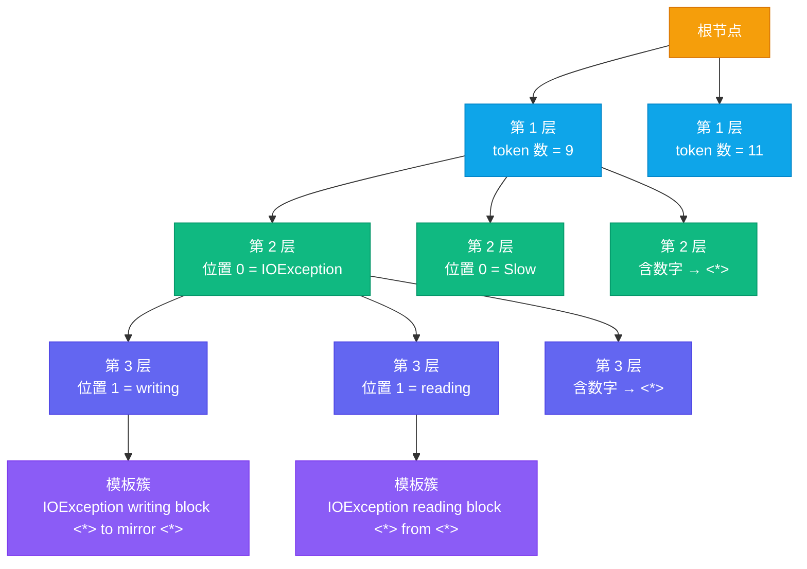

# 07 日志智能化：Drain3 模板化与异常检测的工程实践

## 摘要

本文是专栏第七篇，完整解析大数据集群日志从"原始文本"到"可用于 AiOps 的结构化信号"的全链路处理。文章以 Drain3 算法为核心，在第 02 篇讲清模板化原理的基础上，进一步深潜到前缀树分层路由、通配符参数提取与模板更新策略等算法机制，并给出从 Python 原型到稳定服务的生产配置方法。异常检测部分分三个层次展开：计数时间窗口（最可靠、优先落地）、语义向量距离（覆盖新型异常）、分类模型（依赖标注数据），三者在不同成熟度阶段分工协同，每一层都有独立的基线构建方式、误报来源与适用前提，文中给出三方案对比表与协同策略。随后给出从 Loki 到 Drain3、VictoriaMetrics、Foxeye 再到 SRE-Copilot 的完整接入路径，包括 Webhook 与周期评估两种触发方式的取舍、日志告警与指标告警联动的优先级规则，以及日志质量标签体系的设计——质量分级会反向约束异常检测结果的可信度。本文的核心主张：日志的智能化不是"把日志都喂给 LLM 让它读"，而是要先通过工程手段将半结构化日志转化为可量化的特征，再用算法检测异常，LLM 只在需要自然语言生成的场景中介入；文末以六个常见误区收束，提醒哪些"捷径"会让整套体系功亏一篑。

---

## 第 1 章 为什么日志分析比指标分析难十倍

同样是异常检测，为什么指标（Metrics）从采集到告警一天就能上线，日志（Logs）却要按周计算工期？这个差距在方案评审的 PPT 里常被一句话带过，真正动手做过的人，却会把它读成一句血泪总结。指标的格式规范、维度清晰，Prometheus 拉回来就能直接做统计建模与阈值判断，是最容易应用 AiOps 技术的数据类型；日志则是一大锅半结构化甚至无结构的文本，先要清洗、切块、贴标签，才有资格进入算法。一个直观的比喻是：**指标像体温计，日志像病历**——体温计给出一个数字，客观、无歧义；病历却要医生逐句研读，同样的字句在不同病人身上可能意味着完全不同的病，解读成本天然高出一个量级。

### 1.1 指标与日志：两种"可计算性"

把两类数据摆在一起看，差异是结构性的，不是某个环节可以修补的：

| 维度 | 指标（Metrics） | 日志（Logs） |
|------|---------------|-------------|
| 数据形态 | 数值时间序列 | 半结构化文本流 |
| 格式统一性 | Prometheus 命名 + 标签体系，天然统一 | Log4j2 / SLF4j+Logback / zap 多格式并存 |
| 采样节奏 | 固定周期（如 30s） | 无固定节奏，故障期突发密集 |
| 异常可计算性 | 可直接阈值、统计、机器学习 | 需先模板化 + 特征提取 |
| 噪声密度 | 低 | 极高（95%+ 为正常信息） |
| 存储成本 | 压缩后很小 | 原始文本大，依赖标签体系压缩 |

这一对比的结论很直接：**指标是"算出来的异常"，日志是"读出来的异常"**。前者喂给算法就能工作，后者必须先完成从"读"到"算"的转化，转化的质量直接决定下游检测的天花板。本节之后所有讨论，都是围绕这个转化展开的。

### 1.2 大数据集群日志的四个特点

继续以体温计与病历作比：指标的"病例"只有一张化验单，日志的"病例"却是一部没有目录的长篇小说。大数据集群日志具体难在四个特点上。

**高噪声密度**：集群日志中，95%+ 是 INFO 级别的正常运行记录（组件心跳、定期任务、NameNode Block Report、DataNode 注册……），真正代表故障的 ERROR/WARN 淹没在正常日志的海洋里。噪声不止于 INFO——还有一类"伪正常"日志，譬如重试机制第一次失败、第二次成功，日志里只留下一句 INFO 级别的成功记录，真正的异常被静默吞掉。这类日志最难处理，因为它既不报错，又不正常。

**高度冗余**：一个故障可能在几十秒内产生数千条相同或相似的错误日志。冗余的来源往往是并发：磁盘坏道时，多个 DataNode 同时向坏盘上的副本写数据，同一模板在 N 台节点上同时喷发。同一类错误的重复出现本身就是一种信号——频次突增正是后续计数检测的核心输入——但必须先识别出"相同"，才能把几千条日志压成一个可计数的对象。

**语义不连续**：日志行之间的语义关联不是线性的——行 N 和行 N+1 可能来自完全不同的线程，它们之间没有直接关系；但行 N 和行 N+100 可能是同一个异常的不同阶段，理解日志的真实含义需要线程级别的关联。在分布式系统里还要再难一层：一个 Spark 作业的日志散落在 Driver 和几十个 Executor 的文件里，没有统一的 job_id 标签就无从拼装，这一层在[[02 数据地基优先：为什么垃圾进垃圾出是 AiOps 最大的坑|第 02 篇]]的标签体系里已经铺垫过。

**格式多样性**：同一个 Hadoop 集群，NameNode 日志用 Log4j2 格式，某些 Flink 组件用 SLF4j + Logback，Go 实现的自研组件可能用 zap logger。格式不统一意味着解析规则需要分别维护；更麻烦的是组件升级会带来格式漂移——同一类日志换一个版本就换一副面孔，规则库与模板库都会随之失效。

### 1.3 不模板化会怎样

不妨先设想不经过模板化、直接把原始文本喂给异常检测的后果。第一种做法是拿正则逐类匹配已知错误，集群每增加一种新错误就要新写一条规则，规则库以月为单位腐烂，维护者最终失去信心；第二种做法是把每一行日志都当成独立事件去聚类，一次磁盘故障在 300 个 DataNode 上可能炸出数万条"各不相同"的日志行，任何频率统计都失去意义；第三种做法是把原始文本直接交给 LLM，先不论成本与时延，同一错误换几个参数就变成一个"新"样本，模型永远学不到稳定的模式。这三条路笔者都见过，结论是同一个：**模板化不是日志智能化的可选步骤，而是必经步骤**。它的作用是把"千变万化的文本"压缩成"有限且稳定的模板集合"，这一步做扎实了，后面的检测与告警才有计算基础。

### 1.4 全链路流水线

正因如此，日志分析需要一套专门的预处理流水线，才能将"原始日志文本"转化为 AiOps 算法可以处理的结构化特征。这条流水线包括：**采集 → 标签化 → 模板化（Log Templating，Drain3）→ 特征提取 → 异常检测 → 告警生成**。每一级都在为下一级"降熵"：采集层决定有没有数据，标签化决定数据能不能关联，模板化决定数据能不能计算，特征提取与异常检测才真正进入算法领域。


---

## 第 2 章 Drain3 机制深潜：前缀树、通配符与模板更新

### 2.1 承接第 02 篇：从原理到机制

第 02 篇已经讲清了 Drain3 的基本原理——固定深度的前缀树（Prefix Tree）加相似度匹配——并给出了 masking 规则与参数范围的初步建议。本章不再复述原理，转而回答生产工程师真正会追问的三个问题：树到底怎么长、通配符（Wildcard）怎么生成、模板怎么更新。理解了这三个机制，调参才有依据，而不是对着阈值瞎试；出了问题也才能判断是参数不合适，还是算法根本不适用于这类日志。前缀树的分层路由，像图书馆按索书号层层收窄——先按书架、再按分类号，最后在书架上抽出具体的书，每一步都在缩小搜索范围。

### 2.2 固定深度前缀树：分层路由机制

Drain3 的核心数据结构是**固定深度（Fixed Depth）的前缀树**，树的每一层只做一件事，把匹配范围逐层收窄。以 depth=4 的典型配置为例：

**第 1 层按 token 数量路由**。日志行按空白分词后，token 个数相同的日志才有机会进入同一棵子树。这一步用树的结构固化了"长度完全不同的日志不可能同属一个模板"的常识，也顺带拦掉了大量无效比较。

**第 2 层按第一个 token 路由**。Drain 有一个关键假设：日志开头的固定词（譬如 IOException、Slow、Registering）通常不是变量，而是区分日志类型的稳定标识，可以放心作为路由键。

**第 3 层按第二个 token 路由**，依此类推，直到 depth-1 层；最后一层的节点下挂着**模板簇（Log Cluster）**——一组已经收敛的候选模板，新日志到达叶子层后只需与簇内少数几个模板逐一比对。

这里有一个防止树爆炸的关键细节：路由过程中，如果某个位置的 token 含数字（譬如 blk_1073741825），Drain 不会为它单独建分支，而是**统一映射到通配分支 `<*>`**。否则每个新的 block ID、每个新的容器号都会长出一根新枝条，树会在几分钟内膨胀到无法维护。这层机制与第 02 篇讲的 masking 相互配合：masking 在入口处把已知变量先替换成占位符，树路由再用通配分支兜住漏网的动态 token——两道闸机，第一道拦下大部分"违禁品"，第二道兜住漏网的。



### 2.3 相似度计算与通配符生成

到达叶子层后，Drain3 把新日志与模板簇里的每个候选模板逐 token 比对，计算相似度 simSeq = 相同位置的匹配 token 数 / 总 token 数。最高相似度达到 sim_th（默认 0.5）就归并进该模板，否则创建新模板。

归并时并非简单的"认领"，而是可能触发**模板更新**：新日志与模板不一致的位置，会被替换成通配符 `<*>`。这个过程就是"参数提取"的实质——变化的部分被识别为参数，固定的部分保留为骨架。举一个具体的例子：假设既有模板是 `IOException writing block <*> to mirror <IP>`，新来一行日志经过 masking 后是 `IOException writing block <BLK> to pipeline <IP>`，7 个位置逐一比对，只有第 4 位（通配符与 `<BLK>`）与第 6 位（`mirror` 与 `pipeline`）不一致，5/7 的相似度已经越过阈值，归并后模板更新为 `IOException writing block <*> to <*> <IP>`——`pipeline` 这一处差异被吸收成新的通配符。两条句式略有不同的日志，从此共享同一个模板。

这段机制解释了模板化最反直觉的一点：**模板不是人工写出来的，是从日志流里"长"出来的**。工程师只提供 masking 规则和相似度阈值，剩下的归并与泛化都由算法在线完成。这也是它能应对未知错误类型的原因——只要新错误的句式与已有模板足够相似，就会自动收敛进既有模板；完全不相似，才会新开一个模板。

### 2.4 模板更新策略与状态持久化

模板更新有一个容易被忽略的性质：**通配符一旦产生就固化在模板里，不会还原成具体词**。这保证了模板库只增不"还原"，但代价是过度泛化无法自动纠正——譬如某类模板被不相关的日志污染、混入了错误的通配符，就只能靠人工调整或重建。理解这一点，就不会把模板库当成"永远正确"的资产。

另一个生产关键点是状态持久化。Drain3 支持把模板库定期快照到文件或 Kafka（FilePersistence / KafkaPersistence），按 snapshot_interval_minutes 保存；服务重启后从快照恢复，而不是每次重启都从零学一遍。笔者见过把 TemplateMiner 做成无状态服务的方案，结果每次发布后模板库清空，前一天的模板全部作废，检测结果断崖式失真——这个坑就出在忽略持久化上。配合消息队列的消费位点，服务重启后可以从断点继续消费暂停期间积压的日志，快照恢复的代价只有一次内存装载，通常秒级完成；真正值得演练的是"模板库被误删后能否从备份还原"，这类恢复演练应该像数据库备份一样定期做。另外，token 数过少的短日志（心跳、注册确认这类）会绕过树路由直接走默认模板通道，避免为每条短消息建树。

模板库一旦稳定，就变成了长期资产：模板 ID 成为日志的稳定特征，跨日、跨周、跨版本都可用同一个 ID 关联历史，异常检测与 RCA 都拿它当键。第 06 篇里 RCA 流水线消费的"Drain3 聚合日志"，本质就是这套模板 ID 体系的下游应用。

### 2.5 在线增量与时间复杂度的工程意义

Drain 的核心优势是**在线处理（Online Processing）**：每来一行日志立即归并或新建，不需要离线批处理历史数据。配合固定深度（通常 4 层）的限制，一次路由的路径长度是常数，查找复杂度接近 O(1)。在每秒数万行日志的集群上，这个特性意味着模板化可以作为流式环节嵌入采集链路，而不是一个每小时跑一次的批处理任务。批处理式模板化在笔者看来是退化方案——它让模板库永远滞后于实时日志，异常检测的信号也跟着迟到。

---

## 第 3 章 Drain3 生产实践：从 Python 原型到稳定服务

### 3.1 完整 Python 工程实现

```python
from drain3 import TemplateMiner
from drain3.template_miner_config import TemplateMinerConfig
import re
import json
from datetime import datetime

# 3.1.1 Masking 规则配置
class HadoopLogMasker:
    MASKING_RULES = [
        # IP 地址（含端口）
        (re.compile(r'\d{1,3}\.\d{1,3}\.\d{1,3}\.\d{1,3}(:\d+)?'), '<IP>'),
        # HDFS Block ID
        (re.compile(r'blk_-?\d+'), '<BLK>'),
        # YARN Application ID
        (re.compile(r'application_\d{13}_\d{4,6}'), '<APPID>'),
        # YARN Container ID
        (re.compile(r'container_\d{13}_\d{4,6}_\d{2}_\d{6}'), '<CTNR>'),
        # 时间戳
        (re.compile(r'\d{4}-\d{2}-\d{2}[T ]\d{2}:\d{2}:\d{2}[.,]\d+'), '<DATETIME>'),
        # 十六进制地址/哈希
        (re.compile(r'0x[0-9a-fA-F]+'), '<HEX>'),
        # 文件大小数字
        (re.compile(r'\b\d+\s*(bytes?|KB|MB|GB|TB)\b'), '<SIZE>'),
        # 纯数字（保留语义相关数字，过滤无意义序号）
        (re.compile(r'(?<![a-zA-Z_])\b\d{5,}\b(?![a-zA-Z_])'), '<NUM>'),
    ]

    @classmethod
    def mask(cls, log_line: str) -> str:
        result = log_line
        for pattern, replacement in cls.MASKING_RULES:
            result = pattern.sub(replacement, result)
        return result

# 3.1.2 Drain3 配置
config = TemplateMinerConfig()
config.load_defaults()
config.profiling_enabled = False
config.drain_sim_th = 0.5          # 相似度阈值（Hadoop 日志建议 0.4-0.6）
config.drain_depth = 4             # 前缀树深度
config.drain_max_clusters = 2000   # 最大模板数量

# 3.1.3 初始化 TemplateMiner（支持持久化）
template_miner = TemplateMiner(config=config)

# 3.1.4 日志行处理函数
def process_log_line(raw_line: str) -> dict:
    # 解析日志前缀（时间戳、级别、类名）
    prefix_pattern = re.compile(
        r'^(\d{4}-\d{2}-\d{2} \d{2}:\d{2}:\d{2},\d+) (\w+)\s+(\S+): (.*)$'
    )
    match = prefix_pattern.match(raw_line)
    if not match:
        return None  # 无法解析（可能是多行日志的延续行）

    timestamp_str, level, logger, message = match.groups()

    # 应用 Masking
    masked_message = HadoopLogMasker.mask(message)

    # Drain3 分类
    result = template_miner.add_log_message(masked_message)
    template_id = result['cluster_id']
    template_str = result['template_mined']
    is_new_template = result['change_type'] == 'cluster_created'

    return {
        'timestamp': datetime.strptime(timestamp_str, '%Y-%m-%d %H:%M:%S,%f'),
        'level': level,
        'logger': logger,
        'raw_message': message,
        'masked_message': masked_message,
        'template_id': template_id,
        'template_str': template_str,
        'is_new_template': is_new_template,
    }
```

这段代码把整条链路的核心逻辑浓缩在几十行里：前缀解析把"时间戳 + 级别 + 类名"拆出来作为标签，masking 把动态 token 换成占位符，`add_log_message` 返回模板 ID、模板字符串与"是否新建模板"的标记。注意 `is_new_template` 这个字段——它是第 4 章向量距离检测的重要输入，也是第 7 章误区五里"新模板 + 高距离"判断的基础。

### 3.2 Masking 规则的工程细节

Masking 不是"堆正则"，顺序、粒度、语义都有讲究，这里展开三个容易踩的细节。

顺序敏感。规则按列表顺序逐一执行，IP 规则必须放在纯数字规则之前，否则 IP 里的数字段会被先替换成 `<NUM>`，IP 规则永远等不到触发；Block ID 规则同理，`blk_1073741825` 里的长数字串一旦先被 `<NUM>` 吞掉，`<BLK>` 就形同虚设。十六进制与日期时间规则也要排在纯数字前面，它们各自的正则更长、更具体，理应优先。

语义相关的数字不能 mask。端口号、副本数、延迟毫秒数这类数字是分析的输入而非噪声。把 50010 端口 mask 成 `<NUM>`，就再也无法区分"连不上 50010"与"连不上其他端口"；把副本数 mask 掉，就无法统计"写入失败发生在第几个副本"。规则里保留语义相关数字，只过滤无意义的序号——这正是代码注释里"保留语义相关数字，过滤无意义序号"的含义，也解释了为什么纯数字规则用 `\d{5,}` 而不是 `\d+`。

正则要防误伤。`\d{5,}` 这类贪婪匹配会连 blk ID 中段、时间戳、十六进制地址一起吞掉，因此用负向断言 `(?<![a-zA-Z_])` 限定边界。实际生产中，每个组件维护一份自己的 mask 清单会更好：NameNode 关注 block/IP/inode，YARN 关注 application/container ID，Flink 关注 task/checkpoint 编号，各自的动态 token 形态不同，一份通用清单往往两头都不够准。

### 3.3 参数调优：相似度阈值、树深与模板上限

**相似度阈值（sim_th）是最关键的旋钮**。阈值过低，不同类型的错误被合并进同一个模板（欠分割），检测粒度变粗、告警定位不到具体错误；阈值过高，同一类错误被拆成多个模板（过分割），频率被稀释、误报被放大。调优的实践方法：

1. 收集代表性日志样本（至少 10 万行，覆盖正常运行和典型故障期间）
2. 用 0.3、0.4、0.5、0.6、0.7 五个阈值值各跑一遍，统计生成的模板数量
3. 人工抽样检查模板质量：是否有语义不同的日志被合并？是否有语义相同的日志被分裂？
4. 选择使语义误归率最低的阈值

对于 Hadoop NameNode 日志（格式较为规范），推荐 sim_th = 0.5。对于 Flink TaskManager 日志（自定义消息较多），推荐 sim_th = 0.6-0.7。

值得补充的是模板数量曲线这个观察法：把阈值与模板数量画成曲线，正常区域曲线平缓、边界区域陡升。如果某段区间模板数量暴涨，说明日志里存在大量未被 masking 覆盖的动态 token——先去补 mask 规则，而不是继续调阈值。树深（depth）决定路由层数：太浅（如 3）会让叶子层的候选模板过多、相似度比较变慢；太深（如 5-6）会过拟合到具体句式，轻微格式差异就路由到不同分支，4 是大多数场景的平衡点。最大模板数（max_clusters）则是安全阀：达到上限后算法不再新建模板，超出部分只能退化为与既有模板的近似归并——因此它既是防膨胀的手段，也是"模板库已饱和"的信号，饱和后的治理见 3.6。

### 3.4 多行日志的处理

Java 异常堆栈（Stack Trace）是典型的多行日志，Drain3 默认逐行处理会把每一行堆栈都当成独立日志，模板库立刻被 `at com.example.Foo.bar(Foo.java:123)` 这种高动态行污染。正确处理方式是在 Drain3 之前先做多行合并：检测到以 `\tat ` 或 `\tCaused by:` 开头的行，将其合并到前一个日志条目中，作为 `stack_trace` 字段单独存储，而不是送入 Drain3。此外还有两类多行问题容易被忽略：一是 JSON 日志在换行时被拆断，需要在采集端按括号配对合并；二是日志轮转瞬间的半行残留，需要在 Alloy 的 pipeline 里做超时闭合，这两类在[[02 数据地基优先：为什么垃圾进垃圾出是 AiOps 最大的坑|第 02 篇]]的 Alloy 多行合并配置里都有对应处理。

### 3.5 模板的语义分类与标签体系

Drain3 产生的模板是无标签的（只有模板 ID 和模板字符串），对于 AiOps 异常检测，需要对模板进行语义分类：哪些模板代表正常运行，哪些代表警告，哪些代表错误？对于大数据集群日志，可以基于规则进行初步分类（不完全依赖 LLM）：

- 日志级别为 ERROR 的模板 → `SEVERITY: ERROR`
- 包含特定关键词（IOException、OutOfMemoryError、GC overhead limit exceeded）的模板 → `SEVERITY: ERROR`
- 日志级别为 WARN 的模板 → `SEVERITY: WARNING`
- 其余 → `SEVERITY: INFO（正常）`

这个分类的结果可以用 LLM 做二次验证：对于规则无法确定的模板（譬如某些 WARN 级别的日志实际上是正常的自愈行为），LLM 可以基于模板字符串的语义判断它是否代表真实的问题。

这里要区分两套标签：日志标签（cluster/component/hostname/level/job_id，挂在每条日志上，来自第 02 篇的采集层）与模板标签（severity/category/component，挂在每个模板上，来自本节的语义分类）。检测层实际消费的是模板标签——按 severity 过滤检测范围、按 category 决定告警级别；模板标签错了，检测就会跟着错，所以模板语义分类的 review 要像代码 review 一样纳入日常，而不是上线一次就再也不管。

### 3.6 模板漂移与模板爆炸治理

模板库不是静态资产，它会随版本升级、配置变更、日志格式演进而漂移（Template Drift），它更像一本不断再版的词典——新词进来、旧词过时，从不修订的词典终会脱离现实的语言。典型场景是：Hadoop 升级后，某类错误日志的措辞从 `IOException writing block` 变成 `IOException while writing block`，旧模板不再命中、相似度不足，于是新建模板——表面上模板库多了一条，实际上旧的成了死模板。死模板积累得多了，就会出现"模板爆炸"：模板数量逼近 max_clusters，新模板被安全阀拒之门外，同时相似度比较的候选列表越来越长、处理延迟上升。

治理手段有四条，按性价比排序：

1. **新模板产生速率监控**：把每日新建模板数作为指标，突发增长往往对应格式变更或未覆盖的动态 token，第一时间补 mask 规则。
2. **死模板回收**：统计 N 天（譬如 30 天）零命中的模板，归档或合并，把配额还给活跃模板。
3. **人工 review 队列**：新模板产生时推送 SRE 抽样确认，判断它是"新错误"还是"旧错误的新写法"，后者直接合并回旧模板。
4. **升级窗口联动**：组件升级前后对比模板库基线，diff 出的新增模板集中在升级窗口内处理，避免混入日常噪声。

---

## 第 4 章 日志异常检测的三个层次

### 4.1 从文本信号到数值信号

模板化之后，每条日志被压缩成 `template_id + 时间戳 + level + 组件` 的数值记录，异常检测的全部工作就变成在这些数值特征上找偏离。检测方法按"成本—能力"递进分三个层次：**计数时间窗口**只看频率，最简单可靠；**语义向量距离**看内容，能发现没见过的异常；**分类模型**看模式，需要标注数据支撑。三者的关系不是替代，而是分工，本章末尾会给出对比与协同策略。

### 4.2 第一层：计数时间窗口（最简单，最可靠）

日志异常检测最简单的方法：统计每个模板在单位时间内的出现频次，与历史基线对比，发现突增。这个方法简单到令人惊讶，但在实际生产中效果出乎意料地好。原因是：大数据集群的故障，往往会导致某类错误日志在短时间内大量重复出现。DataNode 磁盘 IO 异常时，`IOException writing block` 模板的频次会从正常的 0-2 次/分钟，突然跳升到 500+ 次/分钟。这个信号极为清晰，任何算法都能检测到。

技术实现：在时序数据库（VictoriaMetrics 或 Prometheus）中为每个模板维护一个计数器，以模板 ID 和日志级别作为 Label：

```
# Loki Recording Rule（每 1 分钟计算一次）
# 统计每个模板 ID 在最近 1 分钟内的日志条数
sum by (cluster, component, template_id, level) (
  count_over_time({cluster="prod-bigdata-01"} |= "" [1m])
)
```

然后在 Foxeye 中配置基于这个指标的告警规则：
```yaml
alert: LogTemplateFrequencyAnomaly
expr: |
  # 当某模板的当前频率 > 历史同时间段基线的 5 倍时触发
  log_template_count > on(cluster, component, template_id) 
  5 * avg_over_time(log_template_count[7d:1h])
for: 2m
labels:
  severity: warning
annotations:
  summary: "组件 {{$labels.component}} 的日志模板 {{$labels.template_id}} 频率异常增加"
```

这一层有三个边界条件要讲清楚，否则会出现"算法对、结果错"的怪现象。

第一，基线必须按同时间段对齐。大数据集群有天然的昼夜节律，凌晨的批量作业、白天的交互查询，日志量差异巨大。基线若是全天平均，白天正常的高频会被判成异常，深夜的真实异常反而被日均值稀释。上例用 `avg_over_time[7d:1h]` 取"过去 7 天同一小时的均值"，正是为对齐节律——这相当于看潮汐表时拿"今年同月同日同时刻的水位"对比，而不是拿全年平均水位对比。

第二，频率骤降与频率突增同样可疑。模板频次突然归零，往往不是"日志变好了"，而是采集断点或组件假死。计数检测如果只做"突增"方向，就会漏掉日志静默（Log Silence）这类异常，需要在规则里补一条"低频率告警"。

第三，低频模板的基线不可靠。每秒 0-2 次的模板，其频次在泊松分布下天然有波动，偶尔跳到 10 次可能只是巧合。对低频模板要用更高的倍数阈值或更长的统计窗口，避免把统计噪声当故障。

这一层还有一个粒度选择的问题。组件级计数（把组件下所有模板加总）实现简单、波动平滑，但会掩盖单模板异常——300 个模板里只有一个异常，很容易被其余 299 个正常模板的基数摊平；模板级计数定位精准，但低频模板的噪声会被放大。实践中的折中是：组件级计数用于整体健康度与质量监控，模板级计数用于异常定位，两条线并行，在 Foxeye 里分别配置告警。`for` 持续时间的设置同理：指标告警常用 2 分钟过滤瞬时抖动，日志告警里的模板级规则建议用 0-1 分钟，因为日志异常往往是突发的，错过窗口就错过根因。

### 4.3 第二层：语义向量距离（适合检测新型异常）

频率计数只能检测已知模板的频率变化，无法检测从未见过的新型异常（譬如系统升级后出现的新错误模式，这些错误模式频率很低，但语义异常）。语义向量距离方法：将每条日志（模板化后的版本）用文本嵌入模型（Embedding Model）向量化，然后计算新日志向量与正常运行日志向量中心点的距离——距离越远，越可能是异常。这个思路像雷达测距：目标离正常编队的中心越远，越可疑。

实现要点：

- 使用轻量级的嵌入模型（如 `all-MiniLM-L6-v2`，维度 384），平衡推理速度和语义质量
- 以组件为单位维护正常运行的向量中心点（定期从最近 N 天的正常日志中采样计算）
- 只对 WARN 和 ERROR 级别的日志做向量距离检测，不对 INFO 日志做（INFO 量太大，计算成本过高）

此外还有一个容易忽视的适配问题：all-MiniLM-L6-v2 以英文语料为主，对中文与中英混合日志的语义表达有明显折扣。如果集群日志里中文占相当比例（Hive 查询日志、自研组件的提示语），建议评估多语言嵌入模型（如 paraphrase-multilingual-MiniLM-L12-v2）并重新计算距离阈值，否则第二层的检测质量会打折扣。

有几个工程细节决定这套方案的成败。其一，中心点必须随日志分布漂移而更新，否则升级三个月后，正常日志的向量分布已经整体移动，旧中心点会把所有新日志都判成异常；更新采用滑动窗口（最近 N 天）重算即可，不必引入复杂的在线学习。其二，阈值不要拍脑袋，先对历史正常样本算距离分布，取 P99 或均值加两倍标准差作为阈值，比拍一个"距离 > 0.5 就算异常"靠谱得多。其三，务必结合模板创建事件与频率一起看——向量距离大且是新模板，多半是新增的日志类型，需要人工确认；向量距离大但频率也高，告警级别应当上调。其四，版本升级窗口内要暂停或降级向量检测，升级后新格式日志的向量与旧分布必然有距离，此时的高距离大多是格式变更而非故障；升级前把新模板纳入白名单学习期，是最省事的做法。

这个方法能有效检测"从未见过的新型错误模式"，但要注意：高向量距离不一定代表故障，也可能是日志格式变化（版本升级后）。需要结合频率判断：如果向量距离大且频率高，则警告级别更高。

### 4.4 第三层：分类模型（需要标注数据）

在有足够标注数据（已知哪些日志模板代表问题，哪些是正常）的情况下，可以训练一个轻量级分类模型（逻辑回归或简单的神经网络）：输入是模板 ID + 频率特征 + 组件上下文，输出是"正常/异常"二分类的概率。这个层次有三个工程前提值得展开。

特征工程的粒度。模板 ID 是最稳定的特征（离散编码或嵌入），配合滑动窗口频率、级别分布、组件、作业阶段（与第 08 篇的作业画像衔接）。特征的时效性很重要——训练时的故障模式分布会随集群演进变化，模型需要定期重训，否则会悄悄变成"旧时代的裁判"。

标注数据的来源。直接标注模板费时费力，更现实的来源是两条回流通道：一是历史故障复盘，把"告警 X 真实根因 Y"整理成训练样本，这条通道在第 06 篇的标注回流机制里已经设计过；二是 Foxeye 里的告警确认反馈——工程师每次点掉一条误报，都是一条标注。这两条通道的价值在于标注随日常工作自然产生，而不是额外组织人力去贴标签。

类别不平衡。异常样本远少于正常样本，直接训练会让模型学成"全部输出正常"。需要重采样、代价敏感学习或对异常类加权；评估时按模板粒度算 precision/recall 而不是按样本粒度——模板才是稳定的分析单元，样本粒度的分数会被高频模板的基数带偏。

这个方法在已知故障模式上的精度高，但对新型故障覆盖不足，通常作为第一层频率检测的补充，而不是替代。

### 4.5 三层次对比与协同策略

| 维度 | 计数时间窗口 | 语义向量距离 | 分类模型 |
|------|------------|------------|---------|
| 检测对象 | 已知模板的频率突变 | 未知/新型日志的语义偏离 | 已知故障模式的判别 |
| 数据需求 | 模板库 + 计数序列 | 正常样本向量中心点 | 标注数据 + 特征工程 |
| 部署成本 | 最低 | 中（嵌入模型推理） | 高（训练与评估流水线） |
| 可解释性 | 高（频率数字直白） | 中（距离可量化） | 低（模型判据不透明） |
| 新型故障覆盖 | 无（没有历史频率） | 能发现，需人工确认 | 不足（依赖训练集） |
| 主要误报来源 | 基线失真 / 低频噪声 | 格式变更 / 新模板上线 | 标注偏差 / 概念漂移 |
| 适用阶段 | Phase 0-1 | Phase 2 | Phase 3 |

> [!note] 三层方法的适用阶段
> - **Phase 0-1（数据地基 + 告警降噪阶段）**：只引入第一层频率计数，足够简单可靠
> - **Phase 2（LLM 增强阶段）**：引入第二层语义向量距离，补充对新型异常的检测
> - **Phase 3（预测性运维阶段）**：在有足够标注数据后引入第三层分类模型

三层不是三选一，而是流水线式的协同：第一层作主检测，保证覆盖面与稳定性；第二层在"新模板 + 高距离"事件上补充人工关注；第三层对高频已知模式做精判，压低误报。三层的输出可以汇成统一的"日志异常评分"，作为后续告警聚合的输入。

---

## 第 5 章 日志告警接入 Foxeye 的完整路径

### 5.1 架构设计

```mermaid
%%{init: {'theme': 'dracula', 'themeVariables': {'primaryColor': '#6366f1', 'lineColor': '#94a3b8'}}%%
graph LR
    subgraph Collection["采集层"]
        Alloy["Grafana Alloy</br>日志采集"]
    end

    subgraph Processing["处理层"]
        Loki["Loki</br>日志存储"]
        Drain["Drain3 服务</br>模板化处理"]
        VictoriaMetrics["VictoriaMetrics</br>模板计数 metrics 存储"]
    end

    subgraph Alerting["告警层"]
        Foxeye["Foxeye</br>告警平台"]
        SRECopilot["SRE-Copilot</br>聚合降噪"]
    end

    Alloy -- "原始日志" --> Loki
    Loki -- "Loki Webhook / 实时查询" --> Drain
    Drain -- "模板 ID + 频率指标" --> VictoriaMetrics
    VictoriaMetrics -- "Recording Rule 生成的指标" --> Foxeye
    Foxeye -- "Webhook 触发" --> SRECopilot

    classDef collection fill:#6366f1,stroke:#4f46e5,color:#fff
    classDef processing fill:#10b981,stroke:#059669,color:#fff
    classDef alerting fill:#f59e0b,stroke:#d97706,color:#fff

    class Alloy collection
    class Loki,Drain,VictoriaMetrics processing
    class Foxeye,SRECopilot alerting
```



### 5.2 两种触发方式：Webhook 与周期评估

日志异常进入告警体系有两条路，架构图里都画了，值得把差异讲清楚。Webhook 推送：Loki 把满足条件的日志实时推给消费端（这里就是 Drain3 服务），延迟低、实时性强，适合需要立即模板化的场景，但要求自建稳定的消费服务，还要处理推量突增时的背压。周期评估：Loki Ruler 每隔一个评估周期（如 1 分钟）跑一次 LogQL 查询，把计数结果写入 VictoriaMetrics 或直接触发告警，实现简单、天然可恢复，但延迟等于评估周期。实际部署中两者常常并存：实时检测走 Webhook，周期统计与质量指标走 Ruler。下面 5.3 给出的是周期评估这一路的配置。

### 5.3 Loki Ruler 配置

Loki 2.x 支持 Ruler（类似 Prometheus 的 Recording Rules 和 Alerting Rules），可以直接在 Loki 层面基于 LogQL 查询生成指标或触发告警：

```yaml
# Loki Ruler 配置（日志告警规则）
groups:
  - name: hadoop_log_anomalies
    interval: 1m
    rules:
      # Recording Rule：计算每分钟各组件 ERROR 日志数量
      - record: log:error_count:rate1m
        expr: |
          sum by (cluster, component, hostname) (
            count_over_time({level="ERROR", cluster!=""} [1m])
          )

      # Alerting Rule：NameNode ERROR 日志突增
      - alert: NameNodeErrorLogSpike
        expr: |
          (
            sum by (cluster, hostname) (
              count_over_time({component="namenode", level="ERROR"} [2m])
            ) > 50
          )
        for: 0m   # 立即触发，不需要等待持续时间（日志错误应该即时响应）
        labels:
          severity: critical
          component: namenode
        annotations:
          summary: "NameNode {{ $labels.hostname }} ERROR 日志突增（过去 2 分钟 {{ $value }} 条）"
          description: "请检查 NameNode 日志了解错误详情"
          loki_query: 'sum(count_over_time({component="namenode",level="ERROR",hostname="{{ $labels.hostname }}"} [5m]))'

      # Alerting Rule：DataNode IOException 告警
      - alert: DataNodeIOException
        expr: |
          sum by (cluster, hostname) (
            count_over_time(
              {component="datanode", level="ERROR"} |= "IOException" [5m]
            )
          ) > 20
        for: 1m
        labels:
          severity: warning
          component: datanode
        annotations:
          summary: "DataNode {{ $labels.hostname }} 出现大量 IOException"
```

这段配置里的几个细节值得注意。第一条 Recording Rule 把"每分钟各组件的 ERROR 计数"固化成指标，供 Foxeye 与异常检测复用，避免每处都写一遍 LogQL——指标化之后，后续的基线对比、跨组件横向比较都发生在 VictoriaMetrics 里，比反复查询 Loki 快得多。第二条 `NameNodeErrorLogSpike` 用 `for: 0m` 立即触发——日志错误讲究即时响应，等 2 分钟再确认，故障可能已经蔓延，这与指标告警常用的 `for: 2m` 形成对比。第三条 `DataNodeIOException` 用 `|= "IOException"` 做内容过滤，与模板化配合时，这类内容过滤其实可以用"模板 ID + 级别"替代，但保留内容过滤作为双保险仍有价值——模板库重建或漂移时，内容过滤不会跟着失效。

### 5.4 日志告警与指标告警的联动

日志告警和指标告警通常是互补的：

- 指标告警先触发（如 `DataNode_DiskIOLatency > 100ms`）：说明有指标层面可量化的异常，但根因可能在日志里
- 日志告警先触发（如 `DataNodeIOException 大量出现`）：说明日志层面已经在报错，但此时对应的指标可能还没有到达阈值

两类告警的关系像体检报告与患者自述：体检报告给出数字异常，自述则描述症状细节，两者互为印证。当两类告警都触发时，在告警聚合流水线中，日志告警作为指标告警的佐证信息附加到主事件上：

```json
{
  "incident_id": "INC-20260113-0089",
  "root_cause_alert": "DataNode_DiskIOLatency > 100ms",
  "corroborating_evidence": {
    "log_alert": "DataNodeIOException × 847 次 (5分钟内)",
    "log_sample": "IOException writing block blk_1073741825 to mirror <IP>..."
  }
}
```

联动有两个工程细节。其一是时间窗口对齐：日志窗口与指标窗口的语义必须一致，都用"过去 5 分钟"而不是一个用 2 分钟、一个用 5 分钟，否则聚合时对不上，佐证关系会被时间错位破坏。其二是优先级规则：只有日志告警触发而指标未超阈值时，默认降级为 warning 并进入人工确认队列——单条日志告警的噪声太大，直接以它为主事件会放大误报；只有与指标佐证互为印证时才升级为主事件。这套"指标为主、日志为证"的聚合逻辑，正是第 05 篇告警聚合降噪流水线在日志维度的具体实现。

### 5.5 与告警降噪及 RCA 的衔接

日志告警进入 Foxeye 之后还有两站。一站是[[05 智能告警降噪：工程落地全链路解析|第 05 篇]]的聚合降噪流水线：同一模板在几秒内喷发的几百条日志只生成一条告警，模板 ID 就是天然的聚合键，这是"告警压缩率 70%+"（见[[03 告警工程：从告警风暴到1条主事件的设计哲学|第 03 篇]]）的主要贡献来源之一。另一站是[[06 根因分析 RCA：传统算法与 LLM 融合的应用架构|第 06 篇]]的 RCA：聚合后的主事件带着日志证据进入 RCA 流水线，作为"相关日志（Drain3 聚合）"输入——日志证据越干净（模板标签正确、质量标签正常），RCA 的 Top-N 候选就越可信。架构图里的 SRE-Copilot 承担最后一公里的聚合降噪：把同源日志告警合并成一条主事件，并生成自然语言摘要供值班人快速判断，这一层与第 05 篇的聚合流水线、第 09 篇的 LLM 交互层衔接。日志告警的最终出口不是告警平台本身，而是值班人收到的、已经降噪过的结论。

---

## 第 6 章 日志质量体系：保障日志可用性的工程基础

### 6.1 为什么日志质量决定异常检测的上限

第 02 篇反复强调过 Garbage In, Garbage Out 的铁律，日志维度是这条铁律最苛刻的考场。一个直观的类比是：再高明的厨师也做不出坏食材的菜——日志异常检测的质量上限，由日志质量本身決定，质量差的时候，再好的算法输出的也只是"数据问题的另一种表达"。本章的**质量标签体系**把这条铁律落到可操作层面：质量分级反向约束检测结果的可信度，质量为 C 的时段，检测结果默认不可信，优先排查采集链路而非集群本身。

### 6.2 五个评估维度

| 维度 | 评估方式 | 目标值 |
|------|---------|--------|
| **完整性** | 每小时每个组件需要产生的最少日志条数（根据历史基线） | > 95% 的时段达标 |
| **格式规范性** | 能被 Drain3 正常解析的日志行比例 | > 98% |
| **标签完整性** | 携带完整标签（cluster + component + hostname + level）的日志条数比例 | = 100% |
| **延迟** | 从日志产生到进入 Loki 的端到端延迟 | P99 < 30s |
| **重复率** | 相同时间戳的重复日志条数比例 | < 1% |

五个维度各自对应一类典型的"数据病"，逐一说明其机理。

**完整性**选"每小时"而非"每分钟"粒度，是因为分钟粒度受周期波动与瞬时抖动影响太大，误判率会高得没法用；而"连续一小时一条日志都没有"基本可以断定链路断了。它兜底的是静默故障——组件活着但不再写日志（日志缓冲泄露、磁盘写满后静默降级），这类故障在指标上往往看不出来，只能靠日志量归零暴露。

**格式规范性**的 98% 目标对应的是模板化的解析失败率。解析失败的日志进不了模板库，只能堆在"无法分类"桶里；这个比例一旦上升，往往意味着日志格式变更（版本升级）或 masking 规则失效，是质量劣化的第一信号，比延迟指标更早暴露问题。

**标签完整性**要求四个必填标签 100% 达标，理由来自第 02 篇：cluster/component/hostname/level 是模板计数、向量建模、告警路由的公共维度，任何一条日志缺标签，统计时就会落入"未知"桶，要么被漏掉，要么污染聚合。job_id 缺失不会致命，但会让作业级关联（第 08 篇）无从谈起。

**延迟**的 P99 < 30s 目标是"告警时效"的底线：异常检测的结论要赶在故障蔓延或自愈之前送达。延迟超标时，检测结果虽然正确，但价值大打折扣——晚到 10 分钟的确认，不如及时的疑似信号。

**重复率**对应的是日志框架批量 flush 和应用层重复打印造成的同内容多行。重复日志会虚增模板频率，直接污染第一层计数检测——频率检测的前提假设是"每条日志对应一次真实事件"，重复率超标等于打破这个假设，基线再准也会被虚高的计数带偏。

### 6.3 质量标签体系

把五个维度合成一个可消费的标签，就是**日志质量标签（Log Quality Label）**。设计上分三档：

- **A 级（正常）**：五个维度全部达标，检测结果可信
- **B 级（可容忍劣化）**：个别维度轻度超标（譬如延迟 P99 到了 45s），检测结果降权使用
- **C 级（不可用）**：任一关键维度严重超标（如格式规范性 < 90%，或采集中断），检测结果标记为不可信

质量标签挂在"component × 时段"粒度，随质量指标一起进 VictoriaMetrics，异常检测在基线对比之前先查标签：C 时段的异常结果只记不报，或标记"数据不可信"，把人工注意力引向采集链路。这比事后解释"为什么误报"要省事得多——**在源头把"数据坏"与"集群坏"分开**，是质量标签体系的核心价值，也是第 02 篇"先分清是真实异常还是采集质量问题"这一原则的工程化落地。

### 6.4 质量监控与处置闭环

在 VictoriaMetrics 中维护日志质量指标（通过 Loki Recording Rules 生成），在 Foxeye 中对日志质量指标配置监控告警：

- 当某个组件的日志延迟 P99 > 60s，触发"日志采集延迟"告警
- 当某个组件连续 10 分钟没有任何日志进入 Loki，触发"日志采集中断"告警
- 当日志完整性评分连续 3 天下降，触发"日志质量劣化"告警（供人工排查采集配置问题）

处置闭环与第 02 篇的采集质量治理一致：告警 → 检查 Alloy 配置、磁盘水位、网络链路 → 修复 → 质量指标回稳验证。质量告警的价值在于赶在故障告警之前报警——采集断了 10 分钟才被发现，比等检测算法报出"全集群异常"再回头排查要高效得多。质量指标本身也是检测结果解释的一部分：异常发生时先看质量标签，能省掉一半的排查弯路。这里有一个必须正视的盲区：质量指标由 Loki Recording Rule 生成，Loki 自身故障时质量指标会同源失真——采集断了，计数与延迟的统计反而"一切正常"。因此质量监控要落到组件 × 主机粒度，并把 Loki 侧查询可用性作为质量体系的第零维，否则会出现"用坏数据监控坏数据"的悖论。

---

## 第 7 章 边界与反例：日志智能化的六个常见误区

前六章讲的是"怎么做"，本章讲"什么不能做"。这六个误区像六条看着省力的岔路，走上去才发现绕了大圈——笔者都见过真实案例，也都在不同团队踩出过教训。

**误区一：把日志都喂给 LLM**。这是日志智能化最常见的想象。原始日志的量级是 TB/天，向量化加检索的成本先不谈，同一错误换几个参数就变新样本，LLM 在原始文本上学不到稳定模式。正确的分工是：工程手段把文本压成模板与特征，LLM 只在语义分类复核、告警摘要生成这类需要自然语言的环节介入——这与第 06 篇"LLM 是精排器而非决策者"的定位一脉相承。

**误区二：模板化之后丢掉原始日志**。模板是压缩视图，通配符把参数抹掉了，根因分析时工程师仍然需要回到原始日志行看上下文——堆栈细节、前后行关联，这些都藏在原始文本里。Loki 保留原始日志、Drain3 保留模板结果，两条通道并存互为备份，任何"只留一条"的做法都会在事后分析时追悔莫及。

**误区三：只盯着 ERROR 级别**。磁盘坏道往往先在 WARN 里露出苗头，ERROR 出现时坏道往往已经恶化；而 INFO 级别的突降（日志静默）本身就是异常信号。只按 ERROR 过滤，等于把预警窗口放弃了一大半。模板语义分类的价值正在于此：让每一级日志都进入检测视野，只是权重不同。

**误区四：把模板库当静态资产**。版本升级、配置变更都会引发模板漂移，模板库会缓慢腐烂（第 3.6 节讲过治理手段）。从不对比模板基线、从不回收死模板的团队，一年后会发现模板数量翻了几倍，检测精度却在悄悄下滑——模板库不是建好就完事的交付物，而是需要持续经营的资产。

**误区五：把"向量距离高"等同于故障**。格式变更、新版本日志、首次上线的新模板都会产生高距离，但它们不是故障。必须结合频率、模板创建事件、变更时间三者共同判断，单独看距离必然误报成灾。

**误区六：过度追求算法精度而忽视时效**。异常检测的价值有时效性，一个精确但晚到 10 分钟的结论，不如一个及时的疑似信号。日志智能化的整体投入分配是"基础工程 70%、算法 30%"（下文第 8 章还会重申），在算法上精雕细琢而让流水线拖沓，是本末倒置。

> [!warning] 误区背后的共同根因
> 六个误区指向同一个根因：**把日志智能化当成"算法问题"而不是"工程问题"**。算法只在数据被整理干净之后才有用武之地，而整理数据这件事，占了全部工作量的大头。

---

## 第 8 章 小结与下一篇预告

日志智能化是一个典型的"功夫在诗外"的领域——最终的异常检测效果，70% 取决于采集标签化和 Drain3 模板化做得好不好，只有 30% 取决于异常检测算法本身。把基础工程做扎实，比在算法上精雕细琢更有价值。

本篇覆盖了：

1. **日志分析的挑战**（高噪声 + 高冗余 + 语义不连续 + 格式多样性）
2. **Drain3 算法机制**（前缀树分层路由 + 通配符参数提取 + 模板更新与持久化）
3. **Drain3 生产配置**（完整 Python 实现 + Masking 细节 + 多行处理 + 相似度调优 + 模板漂移治理）
4. **异常检测三层次**（频率计数 → 语义向量距离 → 分类模型，及各阶段适用场景）
5. **接入 Foxeye 的完整架构**（Loki → Drain3 → VictoriaMetrics → Foxeye）
6. **Loki Ruler 配置**（实际可用的告警规则 YAML）
7. **日志与指标告警联动**（两类告警的互补与聚合）
8. **日志质量体系**（5 个评估维度 + 质量标签 + 质量监控告警）
9. **六个常见误区**（边界与反例）

行文至此，不妨把全文的主张收束成一句话：日志智能化本质上是一场**降熵工程**——把噪声密度极高的文本流，逐级转化为稳定、可量化、可解释的信号。模板化的粒度、检测的层次、质量的分级，每一处都在做权衡：模板归并得太粗会丢信息，分得太细会放大噪声；检测层做得复杂不一定更好，而是要与数据质量匹配；日志标签与模板标签、原始日志与模板结果、指标告警与日志告警，成对出现时才有完整的信息。没有放之四海皆准的参数，只有因地制宜的选择——这与本专栏一以贯之的立场一致。

下一篇[[08 作业画像与异常检测：Spark 和 Flink 的 AiOps 专属能力]]将转向大数据集群 AiOps 最具差异化的领域：作业生命周期管理。Spark/Flink 作业的 AiOps 是大数据集群与微服务 AiOps 在能力建设上差距最大的地方，也是本专栏最独特的技术视角之一。

*上一篇：[[06 根因分析 RCA：传统算法与 LLM 融合的应用架构]] | 下一篇：[[08 作业画像与异常检测：Spark 和 Flink 的 AiOps 专属能力]]*

---

## 参考资料

1. He P, Zhu J, Zheng Z, Lyu M R. *Drain: An Online Log Parsing Approach with Fixed Depth Tree*. IEEE ICWS 2017. https://jiemingzhu.github.io/pub/pjhe_icws2017.pdf
2. IBM Research. *Drain3: Log Template Miner Based on the Drain Algorithm*. https://github.com/IBM/Drain3
3. sentence-transformers. *all-MiniLM-L6-v2 Model Card*. https://huggingface.co/sentence-transformers/all-MiniLM-L6-v2
4. Grafana Labs. *Loki Alerting / Ruler 文档*. https://grafana.com/docs/loki/latest/alert/
5. Grafana Labs. *Grafana Alloy 文档*. https://grafana.com/docs/alloy/latest/
6. 本专栏第 02 篇《数据地基优先：为什么垃圾进垃圾出是 AiOps 最大的坑》——Drain3 算法原理、Loki 标签体系与采集质量治理的出处。

---

> [!note] 思考题
> 1. sim_th 调优时，为什么"模板数量最少"不等于"模板质量最好"？模板数量与语义误归率之间是什么样的关系？
> 2. 一条"向量距离高但频率低"的新日志，如何判断它是新故障、新日志类型，还是版本升级后的格式变更？
> 3. 如果某组件连续一周质量标签为 C，异常检测结果应该直接屏蔽还是标记不可信？两种做法的代价分别是什么？
> 4. 夜间批量作业密集的集群，频率检测的基线应当如何构建，才能既不误报白天的高频，又不漏掉深夜的真实异常？