# 08 作业画像与异常检测：Spark 和 Flink 的 AiOps 专属能力

**摘要：**

本文是专栏第八篇，聚焦大数据集群 AiOps 最具差异化的技术领域：作业生命周期管理。文章从大数据作业与微服务请求的本质差异切入，解释为什么「错误率、P99 延迟」这套微服务监控范式无法直接迁移到作业场景；系统设计 Spark 作业画像系统的指标维度体系，逐一说明每个维度对应哪一类故障模式；深度解析 P90 动态基线的统计学原理（右偏分布、分位数估计的样本要求、基线污染与净化），讲解 OOM / 数据倾斜 / GC 风暴 / Stage 长尾四类典型异常的检测实现与反例边界；最后讨论 Flink 流处理作业的特殊性——背压、Checkpoint 延迟、消费延迟的时段级动态基线，以及算子吞吐、状态增长等批处理不具备的画像维度。本文的核心主张：大数据集群 SRE 在 AiOps 领域的核心竞争力，不是告警降噪（通用能力），而是深刻理解 Spark/Flink 作业执行模型，并将这种理解转化为可量化、可检测的异常信号——这是任何通用 AiOps 平台都替代不了的领域知识壁垒。

---

## 第 1 章 为什么作业画像是大数据集群 AiOps 的差异化能力

### 1.1 大数据作业与 HTTP 请求的本质差异

在进入算法与系统设计之前，先问一个看起来不需要回答的问题：大数据集群的 AiOps，为什么不能把微服务那套监控思路原样搬过来用？

在微服务 AiOps 的世界里，"请求"是基本分析单元：一个 HTTP 请求要么成功（2xx）要么失败（4xx/5xx），持续时间是毫秒级，状态是无状态的。异常检测的核心就是：**错误率是否上升、延迟是否增加**。这套范式太成功了，以至于很多人默认它就是唯一范式——但大数据集群恰恰是它的反例。

大数据集群的基本分析单元是"作业（Job）"，它的特征与 HTTP 请求几乎截然相反：

| 维度 | HTTP 请求 | 大数据作业 |
|------|---------|---------|
| **持续时间** | 毫秒 ~ 秒级 | 分钟 ~ 小时级（ETL 作业常见 30 分钟到 4 小时） |
| **状态复杂性** | 无状态（成功/失败） | 有状态（提交→调度→运行→Stage 执行→完成/失败） |
| **内部结构** | 单一请求-响应 | DAG（有向无环图）+ Stage + Task，有内部并发和依赖 |
| **资源消耗** | 单次峰值资源消耗小 | 可能独占集群 40% 的计算资源（vCPU + 内存） |
| **失败语义** | 失败即失败，重试也是独立请求 | 失败可以有部分重试（Task 级重试，不是 Job 级重试） |
| **异常表现** | 错误率 / P99 延迟上升 | 执行时长超出历史基线 / Stage 长尾 / GC 异常 / 数据倾斜 |

这些差异决定了：**你不能用监控微服务请求的思路去监控大数据作业。**

进一步说，这些差异不是程度上的差异，而是分析对象本质上的差异。把微服务那套"错误率上升、P99 延迟上升"的判据套在作业头上，会遇到两个根本性的困难：其一，作业没有"请求"这样的自然单位可供采样，一个作业内部有成千上万个 Task，在什么粒度上统计、以什么为分母，本身就是需要设计的问题；其二，作业的失败不是二元的，Task 级重试把"失败"打散成"最终成功但过程曲折"的连续光谱，只看最终状态会漏掉大量过程性异常。由此可见，微服务监控回答的是"服务现在健康吗"，作业画像要回答的是"这次运行与它自己过去的常态相比，哪里偏了"——两者的参照系截然不同。

用一个比喻把这种差异钉住：微服务监控像医院门诊的常规体检，医生拿你各项指标跟化验单上的参考区间比对，参考区间来自人群统计；作业画像则更像私人教练的训练档案，同样的十公里跑，教练不看"标准时间"，而是看你过去的成绩曲线，这次比你自己慢了 20%，才值得停下来追问原因。技术限定在于，体检的参考区间来自人群样本，画像的基线来自同一作业自己的历史执行，样本总体完全不同，画像的统计口径因此只能以"同类作业"为单位，这一点在第 2 章的作业分类里会反复出现。

### 1.2 作业的生命周期：画像的对象长什么样

要画像一个对象，先得知道它长什么样。Spark 作业提交到 YARN 之后，会依次经历 SUBMITTED（已提交）、ACCEPTED（已接受）、RUNNING（运行中）、FINISHING（收尾中）直到 FINISHED（完成）几个阶段，中途任何一个环节都可能转向 FAILED（失败）或 KILLED（被终止）。这五个状态不是给人看的装饰，每一个都对应一种独立的等待原因：卡在 SUBMITTED，多半是 YARN 调度器在排队，要查队列容量与公平调度配置；卡在 RUNNING，才轮到分析 DAG 的 Stage 执行；FINISHING 阶段异常，往往是 Executor 清理或结果回写出了问题。

作业总时长其实是"调度等待 + 各 Stage 执行时长之和 + 收尾开销"的叠加，如果不把这张表拆开，"作业变慢"就只能是一个笼统的症状，无法回答"慢在哪个环节"——而答案恰恰决定了处置手段完全不同。这就像看病不能只看"体温升高"这一个数字，还要看是哪个器官在发热；画像体系里对时间维度的拆解，本质就是把"体温"细分成了"各器官的温度"。技术限定在于，这种细分要落到 History Server 的 stages 接口上，每个 Stage 的提交时间、执行时间都是可得的字段，拆解不是概念，而是可计算的分层指标。

### 1.3 作业画像的概念与价值

**作业画像（Job Profile）**的含义是：以历史执行数据为素材，为每一类作业（按作业名称/作业模板分类）建立一个"正常行为基线"的多维度描述。有了这个基线，当新的执行出现偏离时，就能量化地发现"这次运行比历史上同类作业慢了 2.3 倍"或"这次作业的 Shuffle 量是历史中位数的 8 倍，强烈怀疑数据倾斜"。

作业画像的价值体现在三个层面：

**运维效率提升**：作业长尾（运行超时）是大数据 SRE 最常见的告警类型之一。有了作业画像，当一个作业运行时间超过历史 P90 基线时，系统提前预警（而不是等到 SLA 超时才发现），给工程师争取到提前干预的时间窗口。这个提前量的价值在 ETL 链路上会被放大：上游作业超时，会连锁推迟下游所有作业的启动时间，越早发现，越容易把损失控制在单点，而不是让整个链路在清晨的告警轰炸里一起暴露。

**问题定位加速**：作业画像提供了多维度的健康分数，工程师不需要一个指标一个指标地翻，直接看画像的"数据倾斜分"和"GC 异常分"就能快速定位是哪类问题。这相当于把过去靠经验的"目测"升级成可检索的索引——多维度画像本身就是一个诊断入口，第 06 篇的 RCA 要做的因果推断，起点正是这些画像分数。

**容量规划辅助**：作业画像的历史数据可以帮助容量规划：哪类作业的资源占用正在长期增长（数据量增长导致），需要调整 YARN 队列配置；哪类作业的资源申请远超实际使用，可以优化参数节省资源。这里的长期趋势统计，与基线检测恰好用的是同一批历史数据，只是看的时间尺度不同——检测看短期偏离，规划看长期斜率。

### 1.4 作业画像的适用边界

作业画像不是放之四海皆准的，它的前提是"同类作业有稳定的历史形态"。有三类作业并不满足这个前提：

其一，一次性脚本和 ad-hoc 作业，它们的输入、逻辑、频率都不固定，没有足够的历史样本，画像只能退化成通用阈值，硬套画像反而制造误报。其二，业务逻辑频繁变更的作业，画像描述的是"这个逻辑的常态"，逻辑一变，旧画像立即失真，必须随版本发布重置基线，否则拿旧常态去度量新逻辑，必然天天告警。其三，低频作业，一个月才跑一次的作业在 30 天窗口里只有一两条样本，分位数统计无从谈起。

认清这个边界不是给画像泼冷水，而是把画像用在它该用的地方——生产集群里每天跑、每周跑的核心作业，正是画像收益最大的对象，边界外的作业本来也不需要那么精细的检测。反过来说，如果不对边界内的作业建画像，而用一套全局静态阈值覆盖所有作业，那么要么阈值定得太宽，核心作业的慢变成了"常态"无人过问；要么定得太紧，低频作业天天误报，把真正的信号淹没在噪声里。这个"精细画像 + 静态兜底"的组合思路，与第 03 篇对动态基线与静态阈值关系的结论是一致的。

---

## 第 2 章 Spark 作业画像系统设计

### 2.1 数据来源

Spark 作业画像系统的数据来源有三个，它们各自覆盖画像时间轴的一段：

**Spark History Server REST API**：Spark 提供了完整的历史作业数据 API，包括：
- `/api/v1/applications`：所有已完成的作业列表（状态、开始时间、结束时间）
- `/api/v1/applications/{appId}/stages`：每个 Stage 的执行数据（任务数、成功/失败数、总时间、GC 时间、Shuffle 读写量）
- `/api/v1/applications/{appId}/executors`：每个 Executor 的资源使用情况（内存使用、GC 时间、任务数、失败数）

**YARN ResourceManager API**：
- 作业的 YARN Application 信息（Application ID、队列、申请的 vCPU 和内存、实际使用的 vCPU 和内存）
- 作业的 Container 日志 URL（用于快速跳转到 Driver 和 Executor 日志）

**Prometheus / VictoriaMetrics JMX 指标**（实时监控，弥补 History Server 只有历史数据的局限）：
- `spark_executor_jvm_memory_used_bytes`：Executor JVM 内存实时使用量
- `spark_executor_jvm_gc_time_millis`：GC 时间（判断 GC 风暴用）
- `spark_sql_streaming_batchDuration`：Spark Structured Streaming 的 Batch 执行时长

三路数据源的分工值得展开一句：History Server 只保留"已经结束"的作业数据，是完成态的权威记录，字段结构化程度高，适合批量拉取做画像统计；但作业还活着的时候，History Server 里没有它的记录，实时态要靠 JMX 指标补齐。从这个分工看，History Server 提供事后的完整账单，YARN 提供资源与队列的上下文，JMX 提供运行中的实时血压。三者的口径并不完全一致——History Server 的时长以作业完成时刻结算，JMX 的采样是连续的时间序列，对账时要接受"完成态数据延迟几分钟到位"的现实，笔者建议检测逻辑为此容忍一个采集滞后窗口，这在第 6 章的采集工程里会再次出现。

### 2.2 作业画像的多维指标体系

```mermaid
%%{init: {'theme': 'dracula', 'themeVariables': {'primaryColor': '#6366f1', 'lineColor': '#94a3b8'}}%%
graph TD
    Profile["Spark 作业画像"]

    Profile --> T1["⏱ 时间维度"]
    Profile --> T2["💾 资源维度"]
    Profile --> T3["🔀 Shuffle 维度"]
    Profile --> T4["☕ JVM 维度"]
    Profile --> T5["📊 Task 分布维度"]

    T1 --> T1A["作业总执行时长</br>（P25/P50/P75/P90/P95）"]
    T1 --> T1B["各 Stage 执行时长</br>及占总时长比例"]
    T1 --> T1C["调度等待时长</br>（提交到 Executor 启动）"]

    T2 --> T2A["Driver 内存 Peak 使用量"]
    T2 --> T2B["Executor 内存 Peak 使用量</br>（Max / Avg / P90）"]
    T2 --> T2C["申请 vCPU vs 实际使用比"]

    T3 --> T3A["总 Shuffle 写入量（Bytes）"]
    T3 --> T3B["总 Shuffle 读取量（Bytes）"]
    T3 --> T3C["Shuffle Spill 到磁盘量"]

    T4 --> T4A["GC 时间占作业时长比例"]
    T4 --> T4B["Young GC 次数 + 平均暂停时间"]
    T4 --> T4C["Full GC 次数（应 = 0）"]

    T5 --> T5A["Task 执行时间分布</br>（识别长尾 Task）"]
    T5 --> T5B["Task 失败次数"]
    T5 --> T5C["数据读取量 per Task"]

    classDef root fill:#6366f1,stroke:#4f46e5,color:#fff
    classDef dim fill:#0ea5e9,stroke:#0284c7,color:#fff
    classDef metric fill:#10b981,stroke:#059669,color:#fff

    class Profile root
    class T1,T2,T3,T4,T5 dim
    class T1A,T1B,T1C,T2A,T2B,T2C,T3A,T3B,T3C,T4A,T4B,T4C,T5A,T5B,T5C metric
```



这五个维度的选取不是拍脑袋，背后有一条朴素的原则：每个维度都要能对应至少一类可处置的故障模式，且都能从现有数据源里零额外成本地拿到。逐一说来——时间维度对应长尾与调度拥塞，资源维度对应 OOM 前兆与资源浪费，Shuffle 维度对应数据倾斜与磁盘瓶颈，JVM 维度对应 GC 风暴与内存压力，Task 分布维度对应倾斜与基础设施长尾。反过来，也有一些维度被刻意排除：譬如按作业维度统计网络延迟没有意义，因为一个作业横跨几十个节点，聚合后的网络指标既不反映单个 Executor 的问题，也无法定位到节点；再譬如磁盘 IO 按作业维度聚合会淹没在大量 Task 的叠加里，这类细粒度指标应当留在节点级监控里（第 02 篇的数据地基体系），而不是塞进作业画像。画像维度选择的边界，就是"与作业整体的可处置性相关"这条线。这就像给一个人建档，不能只记身高体重，还要记心率曲线与体能测试——每个字段将来都要能回答某一种具体的问题，而不是为了齐全而齐全。

维度与故障模式的对应关系可以收进一张表：

| 维度 | 设计依据（为什么选它） | 主要覆盖的异常 |
|------|----------------------|---------------|
| **时间维度** | 总时长可拆解为调度等待 + 各 Stage 时长 + 收尾，回答"慢在哪个环节" | 长尾、调度拥塞、资源不足 |
| **资源维度** | 内存 Peak 逼近上限是 OOM 前兆，申请 vs 使用反映浪费 | OOM 前兆、资源浪费 |
| **Shuffle 维度** | 读写量与 Spill 量暴露数据搬运的异常放大 | 数据倾斜、磁盘瓶颈 |
| **JVM 维度** | GC 占比与 Full GC 次数直接量化内存压力 | GC 风暴、内存压力 |
| **Task 分布维度** | Task 时长分布识别"少数拖累多数"，失败次数识别重试 | 数据倾斜、基础设施长尾 |

### 2.3 作业分类：相似作业的识别

作业画像的前提是"同类作业"的正确定义。同一个作业在不同时间的执行，输入数据量可能差异很大，不能简单地把所有名为 `daily_etl_job` 的作业都混在一起建基线——输入 5GB 时 40 分钟跑完的作业，输入 200GB 时跑 3 小时是完全正常的，把它们混进同一个样本集，分位数基线会被拉得毫无区分度。

推荐的分类维度是**作业名称（Job Name）+ 输入数据量分桶（Bucket）**：
- 按历史执行的输入数据量，分成若干桶（如：< 10GB / 10-50GB / 50-200GB / > 200GB）
- 每个（作业名称, 数据量桶）的组合，作为独立的画像实体
- 新到来的作业执行，先判断数据量属于哪个桶，然后与该桶的历史基线对比

这样的分类，可以有效区分"数据量增长导致的正常变慢"和"同等数据量下的异常变慢"——这两者的处置完全不同，前者是容量问题，后者是执行问题。

分桶粒度本身又是一层权衡：桶太少，桶内混入不同量级的执行，基线被平均掉；桶太多，每个桶的样本稀疏，分位数估计的方差变大。实践上以"每桶至少几十条样本"为基准调整桶的边界，对数据量呈指数级增长的业务，用等比边界（10 / 50 / 200）比等差边界更贴合实际分布。此外还有两个容易被忽视的分类维度：队列与周期。同一作业跑在生产队列和测试队列，资源配置不同，时长基线理应不同；同一作业在工作日与周末的输入模式不同，必要时按天、按周切分建基线，这与第 5 章 Flink 消费延迟的时段级基线是同一个思想。最后要警惕模板化作业的陷阱——同一个 jar 用不同参数实例化出几十个"作业名"，或者不同业务共用一个作业名，都会让"同名即同类"的假设失效，这种情况要先在作业名上做归一化，把参数维度纳入分桶键，否则画像分桶从一开始就是错的。

### 2.4 画像的生成与维护流程

画像的生成不是一次性工作，而是一条每天循环的流水线：


作业结束事件到达后，采集器按增量策略从 History Server 与 YARN 拉取数据，规整阶段补全字段、标记失败，随后按（名称, 数据量桶, 时段）分桶，统计阶段计算百分位与 IQR 写入画像库，每天凌晨重算一遍活跃作业的基线。新作业进入学习期——样本不足 10 条之前，画像库标记为 `insufficient_data`，检测服务对这类作业降级为不告警或只做静态阈值兜底，避免在基线尚未成形时就产生噪声。这条流水线的运维要点是断点续采与失败补偿：采集是定时任务，任何一个环节中断都会在画像库留下空洞，为此要记录采集游标、失败重试，并对连续失败的采集任务本身发告警——画像系统的健康度，本身就是第 10 篇要讲的闭环里的一环。

---

## 第 3 章 P90 动态基线：作业执行时长的异常检测

### 3.1 为什么用 P90 而不是平均值

大数据作业的执行时长分布通常是**右偏的（Right-Skewed）**：大多数执行在正常时间范围内，偶有几次因为集群负载高或偶发 Task 失败重试而明显偏长。这种分布下，**平均值会被少数偏长的执行拉高**，不能准确代表"正常情况下应该是多长时间"——就好比一个小区里如果有一两套天价豪宅，"平均房价"就会被顶得脱离大多数人的真实购买力，而"中位房价"才接近普通人能接触到的水平。作业时长的分位数（Percentile）就是作业世界的"中位房价"。

P90（90th Percentile，第 90 百分位数）的含义是：在历史执行中，有 90% 的执行在 P90 时间内完成。用 P90 作为基线的告警逻辑是：如果当前执行已经超过了历史 P90 时间仍未完成，那么按历史分布，它只有 10% 的概率属于正常波动，大概率出了问题。

为什么不直接用中位数（P50）？中位数虽然稳健，但过于迟钝——正常作业只要被集群抖动拖慢一次，就可能超过 P50 的两倍，用 P50 做阈值会天天误报。P90 正处在稳健与灵敏的平衡点上。为什么不用 P95 或 P99？P95 / P99 过于宽松，可能错过早期异常；更麻烦的是，越靠尾巴的分位数估计方差越大，需要更多样本才能稳定，P99 在 30 天窗口里常常只被一两次极端执行支配，基线自身会抖动。可以根据作业 SLA 的严格程度调节：SLA 紧的关键作业用 P85，SLA 宽松的离线作业用 P95。

还要警惕一种让"分位数"失效的情形——双峰分布。如果同一个作业存在两种正常形态（譬如白天与夜里的输入模式差异巨大，或者代码里有明显的执行分支），历史时长会聚成两个峰，任何单一百分位都会落在两峰之间，"超过 P90"这个事件就失去了语义。解法不是换分位数，而是回到第 2 章的分类环节，先按周期或参数把两种形态拆成两个画像实体，再各自建基线——分类是基线的前提，这句话值得反复强调。

### 3.2 动态基线的计算实现

```python
import numpy as np
from datetime import datetime, timedelta
from typing import List, Tuple

class JobDurationBaseline:
    def __init__(self, db_cursor):
        self.db = db_cursor

    def compute_baseline(
        self,
        job_name: str,
        data_size_bucket: str,  # 如 "10-50GB"
        lookback_days: int = 30,
        percentiles: List[int] = [50, 75, 90, 95]
    ) -> dict:
        """
        计算指定作业类型的历史执行时长百分位基线

        排除策略：
        - 明确失败结束的执行（FAILED 状态）——失败执行的时长不代表正常完成时长
        - 异常短的执行（< P10）——可能是测试运行或者早期快速失败
        """
        # 查询近 N 天内，同类作业成功执行的时长（秒）
        self.db.execute("""
            SELECT duration_seconds
            FROM spark_job_executions
            WHERE job_name = %s
              AND data_size_bucket = %s
              AND status = 'SUCCEEDED'
              AND end_time >= NOW() - INTERVAL %s DAY
              AND duration_seconds IS NOT NULL
            ORDER BY end_time DESC
            LIMIT 500  -- 最多取 500 条，防止过早的历史数据影响基线
        """, (job_name, data_size_bucket, lookback_days))

        durations = [row[0] for row in self.db.fetchall()]

        if len(durations) < 10:
            # 历史数据不足，无法建立可靠基线
            return {"status": "insufficient_data", "sample_count": len(durations)}

        durations_arr = np.array(durations)

        result = {
            "status": "ok",
            "sample_count": len(durations),
            "job_name": job_name,
            "data_size_bucket": data_size_bucket,
            "computed_at": datetime.utcnow().isoformat(),
        }

        for p in percentiles:
            result[f"p{p}_seconds"] = float(np.percentile(durations_arr, p))

        # 计算 IQR（四分位距），用于识别异常值
        q25, q75 = np.percentile(durations_arr, [25, 75])
        result["iqr_seconds"] = float(q75 - q25)

        # 计算告警阈值（P90 × 1.2，给 20% 的缓冲）
        result["alert_threshold_seconds"] = result["p90_seconds"] * 1.2

        return result

    def check_running_job(
        self,
        job_name: str,
        data_size_bucket: str,
        current_runtime_seconds: float
    ) -> Tuple[bool, str]:
        """
        检查正在运行的作业是否超时

        返回：(is_anomaly: bool, reason: str)
        """
        baseline = self.compute_baseline(job_name, data_size_bucket)

        if baseline["status"] == "insufficient_data":
            return False, f"历史数据不足（{baseline['sample_count']} 条），无法判断"

        threshold = baseline["alert_threshold_seconds"]
        p90 = baseline["p90_seconds"]

        if current_runtime_seconds > threshold:
            excess_ratio = current_runtime_seconds / p90
            return True, (
                f"作业运行时长 {current_runtime_seconds/60:.1f} 分钟，"
                f"超出历史 P90 基线（{p90/60:.1f} 分钟）的 {excess_ratio:.1f} 倍"
            )

        return False, "运行时长在正常范围内"
```

这段实现里有几个数字值得解释。500 条样本上限与 30 天回看窗口，是一个"时效性"的旋钮：窗口太短，基线跟不上慢速漂移；窗口太长，过期历史会稀释最近的变化。10 条最小样本是统计意义上的一条底线——分位数估计的方差随样本量增大而减小，十条以下的分位数基本没有区分度。排除策略上，明确失败的执行不计入（失败执行的时长不代表正常完成时长），异常短的执行（低于 P10）也排除，因为它们往往是测试运行或启动即失败的空跑。IQR（四分位距，Interquartile Range）在这里的作用是刻画样本离散程度，为后续的异常值清洗与自适应阈值留出依据。告警阈值取 **P90 × 1.2**，给正常波动留 20% 的缓冲；更精细的做法是按 IQR 自适应——P90 + 1.5 × IQR——让阈值随样本自身的离散程度伸缩，样本越稳定阈值越紧，样本越发散阈值越松，笔者在长尾波动明显的作业上更倾向后一种做法。

### 3.3 运行中作业的动态判定

上面的基线是"完成态"的统计，而告警发生在作业还在跑的时候，这里有一个近似要做清楚。`check_running_job` 拿到的只是"当前已用时长"，拿它和完成态基线比较，语义是"如果作业现在就完成，它已经超出了历史上 90% 同类执行的时长"——这是一个保守的近似：作业仍可能提前结束，但超过 P90 本身已经值得怀疑。为了让这个判定可靠，工程上有三个配套动作：

其一，分级告警——P75 触发 warning（接近风险），P90 × 1.2 触发 critical，把"疑似"和"确信"分开，值班工程师不会被同一量级的告警反复轰炸。其二，去抖动——连续多次采样都超阈值才真正告警，避免单次采样恰好落在波峰上。其三，对超长作业辅以进度反推——根据已完成 Stage 占全部 Stage 的比例估算剩余时间，再判断总时长是否会越线，这比单纯看已用时长更准，但它依赖"作业推进速度均匀"的假设，遇到阶段间速度差异大的作业会失真。这些近似都不完美，但它们让"运行中判定"这个必须完成的任务变得可用——宁可要一个有明确近似边界的判定，也不要一个看似精确实则无用的判定。

### 3.4 基线的定期更新策略

作业画像基线不是一次性计算的，需要定期更新以反映最新的系统状态：

- **日常更新**：每天凌晨更新所有活跃作业的基线（基于最新 30 天数据）
- **触发式更新**：当集群发生重大配置变更时（增加 NodeManager、YARN 队列扩容），重新计算所有基线（因为整体资源增加会使所有作业基线时长下降）
- **版本迁移**：当 Spark 版本升级时，新版本的执行性能可能与旧版本不同，需要以升级时间为界限，只用升级后的数据建基线（使用 lookback_days 参数控制）

更新策略最容易踩的坑是**基线污染**：事故期间或慢窗口的异常执行混进样本，会把基线整体拉高，之后"慢"就变成了新的"正常"。解法是在更新时排除已被标记为异常区间的数据——这要求检测模块把每一次超阈值的执行记录下来，回写给画像库做排除标记，形成一条"检测→标记→净化"的回路。另一个坑是**趋势漂移**：业务数据量长期增长时，正常时长会缓慢上升，基线追得太紧会把"问题"当成"正常"，追得太松则天天误报；滑动窗口的长度就是这枚旋钮，30 天是"追得上慢漂移、又不会被单次波动绑架"的常见取值。遇到节假日或大促这类周期性事件，常规基线必然失真，要么单独建"特殊时期"画像，要么参考第 03 篇的 Prophet 式分解，把趋势项、周期项与残差项分开处理。最后，集群扩容、版本升级这类结构性变化发生后，与其等基线慢慢"爬"到新水平，不如用变点检测（Change Point Detection）在指标序列上找到突变时刻，直接触发基线重置——省掉一个长达数天的过渡期，也让扩容当天的执行不会被旧基线误判成"异常地快"。

### 3.5 基线失效的三个典型场景

有三种情况，基线本身是不可信的，检测服务应当主动降级，而不是硬着头皮告警。

其一是冷启动，样本不足 10 条时任何百分位都没有统计意义，此时宁可只报"数据不足"，也不要拿脆弱的基线制造误报——学习期的作业交给静态阈值兜底，等样本积累够了再切换画像。其二是**作业逻辑变更**，画像描述的是旧逻辑的常态，逻辑一改，旧基线立即失效，这要求作业发布流程与画像库联动，发布时清空该作业的历史窗口，重新进入学习期。其三是**样本被污染**，前面提到的基线污染如果没有及时净化，"异常"已经悄悄写进了"正常"，此时最该告警的其实是"基线本身变了"——把基线在时间轴上的位移本身作为监控对象，比盯着单次执行更有全局价值。这三条合起来指向同一个原则：**基线不是数据，是结论**——结论会过期、会失真，维护基线的状态，与维护基线本身同等重要。

---

## 第 4 章 四类典型 Spark 作业异常的检测

四类异常不是彼此孤立的事件，它们常常是同一根因果链上的不同阶段：内存压力升高，GC 变得越来越频繁，Task 变慢，Stage 出现长尾，最坏的情况下走向 Executor OOM。检测的设计因此要同时回答两个问题：用什么信号捕捉"当前这一环"，以及用哪个信号能更早地暴露"链条已经启动"。下文按 OOM、数据倾斜、GC 风暴、Stage 长尾依次展开，每类都会给出核心信号、设计依据与反例边界。

### 4.1 OOM（内存溢出）检测

Spark 作业 OOM 的典型表现：Executor 因 `java.lang.OutOfMemoryError` 退出，YARN 将其标记为 KILLED，作业开始 Executor 失败重试，最终可能整体失败或运行时间大幅延长。

要设计检测，先要理解 OOM 发生在 JVM 的哪一部分。Executor 进程的内存由几块构成：受 `-Xmx` 约束的 Heap（堆），存放对象实例；Metaspace，存放类元数据；还有一块 Off-heap（堆外），包括 Direct Memory 与 Spark 的网络缓冲。Spark 在 Heap 内部又用**统一内存管理器（Unified Memory Manager）**把空间划成 execution（计算）与 storage（缓存）两个区域，外加一块 reserved 保留区。所谓"Executor OOM"，绝大多数发生在 Heap——数据膨胀超过预估、UDF 在闭包里持有大对象、Broadcast 变量过大、join 或 groupBy 的中间结果失控，都会把 Heap 顶穿。

OOM 的检测依赖两个信号的组合：

**信号 1（指标）**：`spark_executor_jvm_memory_used_bytes` 在 Executor 退出前接近 `-Xmx` 配置值，Heap Used / Heap Max > 0.95。这是"高压预警"——它说明内存已经逼近上限，但还不到必然爆掉的程度，Spark 的内存压力有一部分会被 spill 到磁盘消化。

**信号 2（日志）**：Drain3 检测到 `OutOfMemoryError` 或 `GC overhead limit exceeded` 模板出现频次突增。这是"已发生确认"——`GC overhead limit exceeded` 是 JVM 自我保护的最后动作，花在回收上的时间超过 98% 时 JVM 主动抛错，它几乎是 OOM 的前一步。

两个信号一个偏早、一个偏准，组合起来才能兼顾灵敏度与误报率；单看指标会误报（高水位但能 spill），单看日志又会漏掉还没来得及抛错的场景。告警规则逻辑（伪代码）：

```
IF (executor_failed_count[作业X] > 2)
   AND (log:template:OOM_exceptions:count[作业X, 5m] > 3)
THEN
   alert("作业 X 可能发生 OOM，建议检查内存配置或数据分区")
```

反例边界有三处。其一，Heap 使用率高不等于 OOM——storage 区的缓存数据是可以被驱逐的，"高水位 + 持续不降"才是风险信号，只看瞬时值会误报。其二，还有一类 OOM 不在 Heap：YARN 通过 `spark.executor.memoryOverhead` 为 Executor 预留堆外内存，如果堆外用量（网络缓冲、Direct Memory 之类）超过预留，YARN 会直接把容器杀掉，此时 JVM 日志里没有 `OutOfMemoryError`，只能从 YARN 的容器诊断信息里看到 "Container killed" 之类的记录——检测规则要把这类事件单独建信号，否则会漏掉整整一类 OOM。其三，Task 失败的归因要小心：Executor OOM 引发的失败是"传染性"的，同一个 Executor 上所有 Task 一起陪葬，失败计数会突然跳高，别把它误判成数据质量问题。

### 4.2 数据倾斜（Data Skew）检测

数据倾斜是 Spark 作业性能问题的头号杀手，表现为少数 Task 处理了绝大多数的数据量，导致 Stage 整体时长被这几个 Task 拖长（因为 Stage 必须等待所有 Task 完成才能进入下一个 Stage）。

它的产生机制藏在 shuffle 的实现里：Spark 的 shuffle 写入端按 Key 做哈希分区，每个 Key 被映射到唯一一个分区，一旦某个 Key 的基数（Cardinality）远大于其他 Key——典型场景是 join 时关联键在一边大量重复、groupBy 时的热点键——这个分区就会拿到不成比例的数据，落在它身上的那个 Task 也就被"放大"成慢 Task。为什么一个慢 Task 能拖垮整个 Stage？因为 Stage 之间存在**同步屏障（Barrier）**：下一 Stage 必须等上一 Stage 的所有 Task 完成才能开始。这就像接力赛，队伍跑得再快，成绩也由最慢的一棒决定，其他 Task 早早完成也只能干等。

数据倾斜的检测指标：**Task 执行时间的偏斜度（Skewness）**

在作业画像体系中，对每个 Stage 的所有 Task 执行时间计算分布统计：

```python
def detect_data_skew(stage_task_durations: List[float], threshold: float = 5.0) -> dict:
    """
    检测 Stage 内的数据倾斜

    threshold: 最长 Task / P50 Task 时长比值，超过此阈值认为存在倾斜
    """
    if len(stage_task_durations) < 10:
        return {"is_skewed": False, "reason": "Task 数量不足，无法判断"}

    arr = np.array(stage_task_durations)
    p50 = np.percentile(arr, 50)
    p99 = np.percentile(arr, 99)
    max_duration = np.max(arr)

    if p50 == 0:
        return {"is_skewed": False, "reason": "P50 为 0，数据异常"}

    skew_ratio = max_duration / p50
    p99_ratio = p99 / p50

    is_skewed = skew_ratio > threshold
    return {
        "is_skewed": is_skewed,
        "skew_ratio": round(skew_ratio, 2),   # 最长 Task / P50 Task
        "p99_ratio": round(p99_ratio, 2),     # P99 Task / P50 Task
        "p50_seconds": round(p50, 1),
        "max_seconds": round(max_duration, 1),
        "recommendation": (
            "建议检查数据分区分布（可能存在 Key 倾斜），"
            "考虑使用 salting 或 repartition 优化"
        ) if is_skewed else "分布正常"
    }
```

这里用 `max / P50` 作为偏斜比，用 P50 而不是均值是有讲究的：均值本身会被那少数几个慢 Task 拉高，分母一高，比值反而失真；P50 代表了"大多数 Task 的水平"，拿最慢的 Task 对比大多数，才真正反映了"少数拖累多数"的程度。`threshold` 取 5.0 是经验值，笔者通常从 5.0 起步，再按作业特征调整——Task 数量多、单 Task 时长长的大作业可以放宽到 8-10，短作业则要收紧，因为短作业的时长噪声比例更大。仅看时间分布还不够，要与数据量指标交叉验证——慢 Task 的 `shuffleReadBytes`、`inputRecords` 是否真的远大于其他 Task——这一步把"数据倾斜"与"基础设施长尾"区分开（详见 4.4），也是代码里保留 `p99_ratio` 的原因。

自动化数据倾斜诊断报告示例（LLM 生成）：
> **Stage 7 数据倾斜诊断**：Stage 7 包含 200 个 Task，P50 执行时间 45 秒，但最长的 3 个 Task 分别耗时 380 秒、351 秒、329 秒（偏斜比 8.4x）。结合 Shuffle 读取量分析，这 3 个 Task 的数据读取量分别是 P50 的 12-15 倍，强烈建议检查 Group By 或 Join Key 的数据分布，考虑加入 KEY 扰动（Salting）处理。

反例上，代码已经处理了两种退化情形：Task 数少于 10 时统计无意义，P50 为 0 时除法会炸，都需要提前保护。此外，如果作业启用了 Spark 3 自适应查询执行（Adaptive Query Execution，AQE）的倾斜 join 优化，偏斜信号会被部分抹平——AQE 会自动把倾斜分区拆开，检测时要把这类优化开关纳入上下文解释，否则会误报"倾斜已消失"。检测到倾斜后的处置方向——salting 扰动 Key、repartition 重分区、小表广播——属于优化手段而非检测范围，但检测报告应当带着建议给出，方便工程师一步到位。

### 4.3 GC 风暴（GC Storm）检测

GC 风暴是指 Spark Executor 的 JVM GC 频繁且耗时极长，导致 Executor 花在 GC 上的时间远超花在实际计算上的时间，作业整体性能严重下降。

理解检测之前，先看 JVM 分代回收的基本面：新生代（Young Generation）的对象朝生夕死，Young GC 频繁但单次很短；老年代（Old Generation）的对象寿命长，Full GC 少但单次很长。所谓"GC 时间占比"，就是把所有 GC 暂停时间加起来除以作业总执行时间，它直接量化了"回收挤占了多少计算"——GC 占比高，就像厨房里洗碗的时间占了做饭时间的一半以上，说明厨具配置已经跟不上菜量了；技术限定在于，这个"厨具配置"既可能是数据量大，也可能是 `-Xmx` 配小了，两种原因的处置完全不同，检测报告必须能区分。

检测指标：**GC 时间占比 = 总 GC 时间 / 作业总执行时间**

从 Spark History Server 获取：
```
gc_ratio = sum(executor.totalGCTime) / job.duration
```

告警阈值：
- `gc_ratio > 20%`（Warning）：GC 压力较高，建议检查内存压力
- `gc_ratio > 40%`（Critical）：GC 风暴，作业性能严重受损，可能即将 OOM

同时检查 Full GC 次数：**Full GC 次数 > 0** 本身就应该触发 Warning（对于生产 Spark 作业，Full GC 意味着 Heap 已经接近上限，是强内存压力信号）。它的判断比 GC 占比更早、更确定——生产作业的正常形态是 Full GC 次数为零，出现任何一次都意味着老年代空间告急、对象在大量晋升。

GC 风暴与 OOM 在因果上是连续的：JVM 在内存耗尽前会反复尝试 Full GC 来腾出空间，因此 GC 占比上升往往是 OOM 的早期前奏，检测到 GC 风暴的处置优先级应当接近 OOM。反例边界同样要讲清楚：GC 占比高不一定是数据问题——Executor 的 `-Xmx` 配得比实际需要小，会人为制造高 GC；`spark.executor.memoryOverhead` 不足，堆外压力会透过本地内存分配反噬 GC；长期运行的作业存在内存泄漏（缓存未清理、静态集合持续增长），GC 占比会随运行时间单调上升——这三类原因对应的处置分别是调参数、调配置、查泄漏，检测报告里区分"数据侧原因"与"配置侧原因"，工程师才不会被误导。

### 4.4 Stage 长尾（Straggler）检测

除了数据倾斜导致的长尾，还有一类长尾来自于**外部因素**：某个 Executor 所在节点的磁盘 IO 性能突然下降，或者 Shuffle 拉取时某个 DataNode 超时，导致个别 Task 执行时间远超同 Stage 的其他 Task。

Stage 长尾的检测与数据倾斜使用相同的偏斜比公式，但必须区分两者的成因——这是下面这段代码存在的意义。区分的关键在数据量 vs 等待时间：数据倾斜的长尾 Task，处理的数据量（`inputRecords` 或 `shuffleReadBytes`）异常大，是"活多"；基础设施长尾的 Task，数据量正常但等待时间（Task 调度延迟、Shuffle 拉取延迟）异常长，是"干得慢"。

```python
def classify_straggler(slow_task: dict, median_task: dict) -> str:
    """
    区分数据倾斜 vs 基础设施长尾
    """
    data_ratio = slow_task["shuffle_read_bytes"] / max(median_task["shuffle_read_bytes"], 1)
    time_ratio = slow_task["duration_ms"] / max(median_task["duration_ms"], 1)

    if data_ratio > 5:
        return "DATA_SKEW"  # 数据量是中位数的 5 倍以上 → 数据倾斜
    elif time_ratio > 5 and data_ratio < 2:
        return "INFRA_STRAGGLER"  # 时间长但数据量正常 → 基础设施问题
    else:
        return "UNKNOWN"
```

两种长尾的处置完全不同：数据倾斜要动作业逻辑（salting、repartition），基础设施长尾要动集群（隔离坏节点、修磁盘、排查网络）。此外还要注意第三种长尾来源——重试：Task 失败后 Spark 会重新调度一个 Task 跑同一份数据，失败重试叠加推测执行（Speculation）的复制执行，都会让个别 Task 的有效耗时远大于单次执行时长，这类长尾伴随失败计数或"被推测的 Task"上升，处置要先看失败原因。反例上，"慢"与"失败"要分开：重试型长尾在最终统计里表现为完成时长超长，但它不是稳态行为，重试收敛后基线会自己恢复，如果拿它去调作业参数，反而会把问题带偏。最后一个工程约束来自采样：按第 6 章的策略，只采集 Top-5 长 Stage 的 Task 明细，这意味着长尾检测天然只覆盖关键 Stage——短 Stage 的偶发长尾会被漏掉，这是"存储成本可控"与"检测覆盖完整"之间的取舍，取舍的默认方向是保关键 Stage。

四类异常的信号强度与处置方向可以收进一张表：

| 异常类型 | 核心信号 | 常见误报/反例 | 处置方向 |
|---------|---------|--------------|---------|
| **OOM** | 内存高水位 + OOM 日志模板 | 高水位但有 spill；堆外被容器杀死 | 调内存参数、查分区与 UDF |
| **数据倾斜** | 偏斜比高 + 数据量异常 | 基础设施长尾、AQE 倾斜优化抹平信号 | salting / repartition / 广播小表 |
| **GC 风暴** | GC 占比高 + Full GC > 0 | 配置过小、内存泄漏 | 调 -Xmx / memoryOverhead、查泄漏 |
| **Stage 长尾** | 单 Task 远超 P50 | 数据倾斜、失败重试 | 按 DATA_SKEW / INFRA_STRAGGLER 分类处置 |

四类信号之间的关系还提示了一个工程原则：检测宁可"交叉验证"，也不要"单点断言"——OOM 看指标加日志，倾斜看时间加数据量，长尾看时间加节点健康，每一类异常都至少有两个独立信号相互印证，这是从第 03 篇告警降噪的教训里继承下来的设计习惯。

---

## 第 5 章 Flink 流处理作业的异常检测

相比 Spark 批处理，Flink 流处理作业的异常检测有以下几个关键不同点。进入细节之前，先澄清一个根本差异。

### 5.1 流与批：检测对象变了

Spark 批处理是"完成时评判"——作业总会结束，画像是围绕"一次运行"打分的，核心锚点是执行时长；Flink 流作业理论上永不结束，没有"完成时长"这个概念，画像是围绕"持续运行中的稳态"打分的，核心锚点是吞吐、延迟、状态与可靠性指标。打个比方，批处理像每学期一次的期末考试，看的是单次成绩；流处理像马拉松全程的心率监测，看的是整条曲线——你不能等马拉松结束再评判心率，只能实时看它偏离了本人常态多少。技术限定随之而来：Flink 的"基线"对象不是一次执行，而是指标序列在时段上的分布，检测逻辑从"超过阈值即告警"变成"偏离自身常态即告警"，这与第 3 章的百分位思想一脉相承，但采样单位从"一次执行"换成了"一个时间窗口"。

### 5.2 背压（Backpressure）

背压是 Flink 特有的概念：当下游算子（Operator）的处理速度跟不上上游的产出速度时，上游的缓冲区会被填满，导致上游被迫减速，最终影响整个 Pipeline 的吞吐量。

它的实现机制是 Flink **基于信用的流控（Credit-based Flow Control）**：下游算子通过 credit 通告自己还能接收多少条数据，上游严格按 credit 限额发送，一旦下游处理不过来，credit 收紧，上游的发送自然降速——就像银行给你的信用卡额度，额度收紧，消费自然降速。反压是这套流控机制的必然产物，而不是故障本身。

这就带来一个重要的检测哲学：**反压是"信号"不是"事故"**。上游流量突增造成短暂反压，系统自我调节后恢复，这完全正常；只有当关键算子持续处于 high 级别反压，才说明链路某个环节的容量长期不足。因此检测不能只看 `backPressureLevel` 的快照，要看它持续的时间。Flink REST API 提供了每个 Operator 的背压状态（`backPressureLevel`：`ok / low / high`）。当关键算子出现 `high` 级别的背压时，应该触发告警，并同时查询：
1. 该算子的下游算子的处理吞吐（是否下游成了瓶颈？）
2. 该算子所在 TaskManager 的资源使用情况（是否是资源不足导致处理能力下降？）

反压还有一个特别的位置意义：它沿链路向上游传播，最终在 Source 处表现为消费变慢——因此"背压出现"是结果，要顺着链路找最慢的算子，而不是在出现反压的地方停下来。与 Spark 的对比也值得一提：Spark 的 shuffle 拉取是"按需拉取"的批式模型，上游先落盘、下游要多少拉多少，天然有一层磁盘缓冲垫；Flink 的持续管道没有这个垫子，反压会立刻在链路上显形——这对检测其实是好事，问题暴露得快，但前提是检测系统能读懂它。

### 5.3 Checkpoint 延迟

Flink 使用 Checkpoint 机制保障 Exactly-Once 语义，Checkpoint 必须在超时时间（通常配置 10-30 分钟）内完成，否则会触发作业失败重启。

理解检测之前，先看 Checkpoint 的机制：系统定期向 Source 注入一个屏障（Barrier），Barrier 流经每个算子时触发状态快照，直到所有算子的快照对齐完成，这次 Checkpoint 才算成功。对齐（Alignment）期间算子要暂停处理来保证一致性，状态越大、链路越长，对齐时间越久，Checkpoint 就越慢。因此 **Checkpoint 延迟是"作业将要失败"的前兆信号**，检测价值非常高。

Checkpoint 延迟的异常检测：
- `last_checkpoint_duration > 配置的 checkpoint_timeout × 0.8`（Warning）：Checkpoint 时间接近超时，存在触发失败的风险
- `checkpoint_failure_count > 0 in 30m`（Critical）：Checkpoint 已经开始失败

Checkpoint 延迟的根因通常是：算子 State 过大（历史数据积累）、TaskManager 频繁 GC、磁盘 IO 瓶颈（State Backend 写入慢）。这些都可以从对应的指标中找到辅助证据。状态后端（State Backend）的选择还会改变 Checkpoint 的行为：RocksDB 状态后端做增量快照，只上传变化的部分，适合大状态，但本地磁盘 IO 慢会拖慢快照；Heap 状态后端快照快，但状态本身占 JVM 堆内存、受 GC 影响大，且全量快照对网络压力大。检测时要知道作业用的是哪种后端，否则同样的 Checkpoint 时长，含义可能完全不同。

这里与 Spark Structured Streaming 的差异很本质：Spark 的 checkpoint 主要把 offset 与元数据写 HDFS，量级很小，几乎不会成为瓶颈；Flink 快照的是算子状态本身，量级可能达到 GB 级，检测口径自然也不一样——前者监控"写 HDFS 是否成功"，后者监控"快照时长是否逼近超时"。

### 5.4 消费延迟（Consumer Lag）

连接 Kafka 的 Flink 作业，消费延迟（Consumer Lag，即 Kafka 消息的 Produce 时间与 Flink 消费时间的差值）是衡量作业是否健康的核心指标。

消费延迟的动态基线建设有其特殊性：Flink 作业的消费延迟有正常的周期性波动（业务流量高峰时延迟增大属正常），需要建立**时段级别**的基线（工作日白天高峰的 P90 延迟、夜间低谷的 P90 延迟分开建模），而不是一个全局基线。原因在于：如果建一个全局基线，高峰时段的"正常延迟"会触发告警，低谷时段的"真实异常"反而被平均掉的基线掩盖。这实际上是第 3 章百分位方法的直接复用，只是分组键从"作业名 + 数据量桶"扩成了"作业名 + 时段"。

反例边界同样要讲清楚：消费延迟大不一定代表作业异常。上游写入突增（数据源侧流量本身放大）、下游 Sink 写外部系统变慢（目标库慢查询、网络抖动）、消费并行度不足（partition 数与并行度不匹配），都会让 lag 上升而作业本身并无故障。因此检测要联合上游 produce 速率与 Sink 吞吐一起判断：produce 没变而 lag 上升，指向消费侧；produce 暴涨伴随 lag 上升，多半是流量现象。消费延迟与背压还是同一枚硬币的两面：持续的 lag 上升，往往就是反压从链路中段传播到 Source 后的外在表现——背压检测定位"哪里慢"，lag 检测定位"积压了多少"。

### 5.5 算子吞吐与状态增长：Flink 画像的额外维度

除了背压、Checkpoint 与消费延迟，Flink 画像还应包含批处理里不存在的三个维度。

其一是算子吞吐（records/s）：它是流作业"呼吸"的节奏，吞吐骤降说明算子被卡住（反压、GC、锁等待），吞吐骤升说明数据突增或上游节奏变化——结合第 2 章的原则，每个维度都要对应可处置的故障模式，算子吞吐对应的就是"定位卡点算子"。其二是水位线延迟（Watermark 延迟）：事件时间（Event Time）语义下，Watermark 表示"这个时间之前的数据都到齐了"，Watermark 长时间不前进，意味着窗口数据积压、计算结果永远迟到，这是批处理根本没有的维度。其三是状态大小（State Size）的趋势：RocksDB 状态随运行持续增长是内存与磁盘的隐患，单点值意义不大，要看增长曲线——无界增长往往是作业逻辑 bug（Key 设计不当导致状态膨胀、状态未按时间清理），这类问题在批处理里不存在，因为批作业每次结束状态就归零。把这三个维度与背压、Checkpoint、消费延迟合在一起，才是完整的 Flink 画像——它与 Spark 画像共享"分位数动态基线"这个统计学内核，但维度集合完全不同。

---

## 第 6 章 作业画像数据的工程存储方案

### 6.1 存储分层

存储分层回答的是"每种数据该住在哪、住多久"：

| 层次 | 数据类型 | 存储介质 | 保留周期 |
|------|---------|---------|---------|
| **实时作业状态** | 正在运行的作业的当前状态（进度、已用时间） | Redis | 24 小时 |
| **作业执行快照** | 每次作业执行的汇总数据（基线计算用） | Doris / PostgreSQL | 180 天 |
| **作业画像基线** | 按（作业名, 数据量桶）的百分位基线 | PostgreSQL | 持久化（每日更新） |
| **Stage 级别明细** | 每个 Stage 的 Task 分布数据（倾斜检测用） | Parquet / Doris | 30 天 |

这套分层的取舍逻辑值得展开：实时作业状态放 Redis，是因为运行中判定需要毫秒级读取，且只关心"现在"，24 小时 TTL 足够覆盖任何长作业的生命周期。作业执行快照保留 180 天，是因为基线计算需要滚动 30 天窗口，容量规划还需要跨月、跨季度的趋势对比，180 天是一个"能覆盖一年中任意两个月对比"的取舍。Stage 级别明细只保留 30 天，是因为 Task 级数据量爆炸（大作业动辄数万 Task），只保留近 30 天供倾斜检测回溯，更早的明细压缩归档。这套分层的本质，是把热数据与冷数据分开，让每种查询只面对合适的存储与保留期，避免用一套大而全的存储背着用不上的历史——档案馆的道理：常用档案放前台，次常用的放中层，历史档案进地下库，检索速度与存储成本各得其所。

### 6.2 从 Spark History Server 采集数据的工程细节

Spark History Server 的 REST API 访问有以下工程注意事项，每一条背后都是一个真实踩过的坑：

- **API 速率限制**：History Server 并发请求会影响 History Server 自身的性能，建议限制采集并发数（`max_concurrent_requests = 5`），设置合理的请求间隔（500ms）——History Server 是单进程按需解析事件日志的服务，并发请求会直接拖慢它自身，进而影响工程师用 Spark UI 排查问题的体验，宁可采得慢，不可把 History Server 压垮。
- **数据量控制**：Stage 级别的 Task 明细数据量巨大（大作业可能有数万个 Task），不要全量采集，只采样关键 Stage（时长最长的 Top-5 Stage）的 Task 数据——倾斜与长尾检测恰好最关心这些 Stage，代价是短 Stage 的偶发异常会被漏掉，这个取舍的默认方向是保关键 Stage。
- **增量采集**：基于 `endTime` 字段做增量采集，每次只拉取上次采集时间之后完成的作业，避免全量扫描——采集游标要持久化，中断后能断点续传，失败要重试并告警，否则画像库会出现无法自动补回的空洞。

还有一个容易被忽略的联动：History Server 本身有保留期配置（`spark.history.retainedApplications`），采集周期必须与其匹配，否则"作业已结束、数据已被淘汰"的空窗会让画像库留下永久缺口。采集任务的健康度本身也要监控——连续失败要告警，这与第 10 篇的闭环思想一致：画像系统也是被监控的对象。

---

## 第 7 章 小结与下一篇预告

本篇是专栏中"大数据集群专属视角"最浓厚的一篇，覆盖了在通用 AiOps 资料中几乎找不到的大数据作业异常检测技术：

1. **大数据作业 vs HTTP 请求的本质差异**（7 个维度对比，建立认知框架）
2. **作业生命周期**（五个状态与"慢在哪个环节"的拆解）
3. **作业画像设计**（5 个维度指标体系 + 设计依据 + 三路数据源）
4. **作业分类与分桶**（名称 + 数据量 + 时段的组合分桶）
5. **P90 动态基线算法**（统计学原理 + 完整 Python 实现 + 基线维护与污染净化）
6. **四类典型 Spark 异常检测**：
   - OOM：双信号（指标 + 日志）联合检测
   - 数据倾斜：偏斜比计算 + 数据量验证
   - GC 风暴：GC 时间占比 + Full GC 次数
   - Stage 长尾：数据倾斜 vs 基础设施长尾的分类
7. **Flink 专属检测**：背压 / Checkpoint 延迟 / 消费延迟动态基线 + 算子吞吐与状态增长
8. **存储方案**：分层存储 + History Server 采集工程细节

把全文的方法论收成一句话：作业画像的本质，是把"对 Spark/Flink 执行模型的理解"翻译成可计算的统计信号——同样的分位数思想，在批作业里以"一次执行为采样单位"，在流作业里以"时间窗口为采样单位"，剩下的维度取舍、阈值设定、污染净化，全是围绕"让基线始终代表当前常态"这个目标做的工程。它不完美：依赖稳定的作业形态、足够的历史样本与持续的基线维护，三个前提缺一个，画像就会失真；但在生产集群里，天天跑、周周跑的核心作业恰恰同时满足这三个前提，这正是画像体系能成为大数据 SRE 护城河的原因——任何通用 AiOps 平台都能给你告警降噪，但"读懂 Spark 的 Stage 屏障与 Flink 的 Barrier 对齐"并把它们变成信号，只能来自领域知识本身。

下一篇[[09 ChatOps 与 SRE-Copilot：LLM 驱动的运维交互新范式]]将把视角从"后台数据处理"转向"人机交互"，讲解如何用 LLM 构建一个真正能帮 SRE 解决问题的 ChatOps 系统，以及如何在保障数据安全的前提下将大数据集群的查询能力封装为 LLM 可用的工具。

---

## 参考资料

1. Apache Spark Monitoring Guide——Spark History Server 与 REST API（/api/v1）官方文档
2. Apache Flink Metrics 与 Monitoring——背压、Checkpoint、Consumer Lag 指标官方文档
3. Apache Flink Checkpointing——Exactly-Once、Barrier 对齐与 State Backend 官方文档
4. Apache Hadoop YARN ResourceManager REST API——作业与容器信息官方文档
5. 站内：[[03 告警工程：从告警风暴到1条主事件的设计哲学]]——指标级动态基线方法论（滑动窗口 / Prophet / Isolation Forest）
6. 站内：[[06 根因分析 RCA：传统算法与 LLM 融合的应用架构]]——异常信号如何衔接 RCA 与 LLM 诊断

---

> [!note] 思考题
> 1. 你负责的作业里，有没有"同名但输入差异巨大"的作业？试着按数据量分桶重新统计时长分布，看基线区分度是否改善。
> 2. P90×1.2 与 P90+1.5×IQR 两种阈值，各在什么分布形态下更合适？
> 3. 如果某天集群扩容后作业普遍变快，你的基线更新策略能在多久内跟上？旧基线期间会产生多少误报？
> 4. Flink 的背压是"信号"不是"事故"——你如何用持续时长而不是瞬时值来区分正常波动与容量瓶颈？
> 5. 基线污染是最隐蔽的失效模式——你的画像更新流程里，有没有"检测→标记→净化"的回路？

*上一篇：[[07 日志智能化：Drain3 模板化与异常检测的工程实践]] | 下一篇：[[09 ChatOps 与 SRE-Copilot：LLM 驱动的运维交互新范式]]*