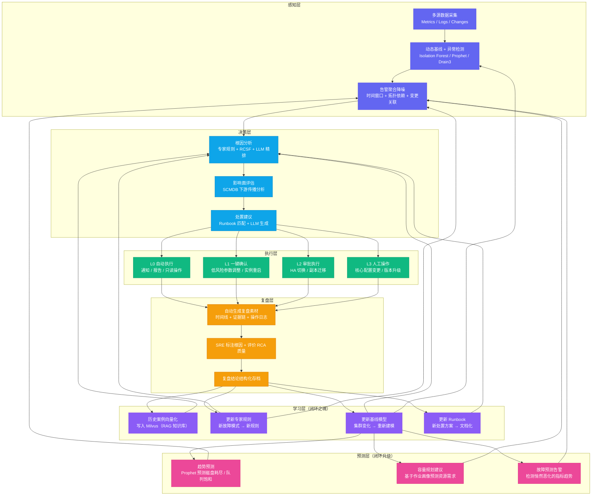
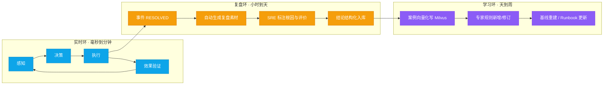
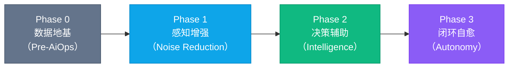
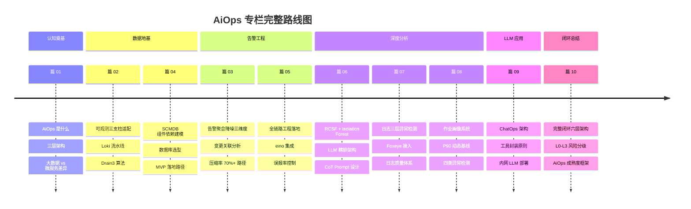

# 10 AiOps 闭环：从感知到自愈的完整链路设计

## 摘要

本文是专栏终篇，以"闭环"为核心主题，将前九篇所有技术模块整合成一个完整的系统视图。文章绘制从感知到自愈的完整闭环全景图，并深度解析"闭环"中最容易被忽视却最重要的两个环节：复盘驱动的知识库回流，以及预测性运维（从事后救火到事前预防）。同时建立 L0/L1/L2/L3 自动处置风险分级体系，给出大数据集群场景下可安全自动化的操作清单，以及一套可操作的 AiOps 成熟度评估框架（含 Phase 0-3 的核心 KPI 体系），帮助团队客观评估"我们现在处于哪个阶段、下一步该做什么"。文章进一步把闭环拆解为实时、复盘、学习三个反馈环，讨论自动处置分级的护栏与影子模式，以及知识库回流的质量治理；结尾回顾十篇主线，落笔于自动化与人的分工再平衡。本文的核心主张：**AiOps 不是一个有终点的项目，而是一个持续演进的能力飞轮——每次故障都是系统学习的机会，每次学习都让下一次故障更容易处理**。

---

## 第 1 章 闭环的全景视图

本专栏前九篇分别讲了告警降噪、SCMDB、RCA、日志模板化、作业画像与 ChatOps，能力清单看起来已经很完整了。但一个常见的现象是：把这些模块都上线之后，团队在深夜仍然睡不踏实——告警确实变少了，RCA 确实给出候选了，可每一次故障处置结束之后，系统本身几乎没有任何变化。问题出在哪里？出在"闭环"上。

### 1.1 为什么"闭环"是 AiOps 的关键词

大多数关于 AiOps 的文章，都把重点放在"感知"（异常检测）、"决策"（根因分析）和"执行"（自动化处置）这三个环节，但忽视了一个让整个体系持续进化的关键机制：**从执行结果回流到知识库，更新感知模型和决策规则，让系统在每一次故障处置后都变得"更聪明"一点**。

没有这个回流机制，AiOps 只是一个固定能力的工具集。有了这个回流机制，AiOps 才成为一个**持续学习的能力飞轮**。

这里值得把"开环"与"闭环"这对概念说透。所谓开环（Open Loop），指的是感知→决策→执行这条单向链路：系统发现问题、给结论、执行动作，动作执行完链路即结束。开环系统的行为完全由上线那一刻的规则决定，之后无论集群怎么演进、无论处置结果是对是错，系统自身都不会调整。开环的 AiOps 在工程上会有三种典型的退化：

**第一种退化，是知识不沉淀。** 每一次故障处理完，经验停留在参与者的脑子里和值班群的聊天记录里，系统没有留下任何结构化的东西。下次同类故障来临时，一切从零开始，排查路径和上次一模一样。

**第二种退化，是规则不更新。** 专家规则库的覆盖范围停留在它被写入的那一天。集群扩容了、组件升级了、新的故障模式出现了，规则库还是老样子，于是误判率随时间缓慢上升，工程师逐渐开始不信任系统的输出。

**第三种退化，是执行不收敛。** 自动化动作做错了，没有人把"这个动作在这个场景下无效"这条信息回灌给系统，于是同一个错误动作被反复执行——每隔几周，系统就对着同一个根因执行一次同样无效的处置，每次都制造一次小扰动。

把这三者合起来看，开环系统的本质是**没有记忆、没有纠错、没有演进**。而闭环（Closed Loop）的全部含义，就是补上"反馈（Feedback）"这一环：把每一次执行的结果——无论成功还是失败——以结构化的形式回灌到知识库，让感知层的模型、决策层的规则、执行层的 Runbook 都随经验而更新。

> [!info] 核心概念：闭环是"记忆"，不是"自动化"
> 很容易把"闭环"误读成"全自动"。其实闭环与自动化是两件事：自动化解决"由谁执行"，闭环解决"系统会不会因此变好"。一个全手动的团队，只要每次复盘都认真回灌知识库，它也是闭环的；一个全自动的团队，如果自动化动作做完就结束，没有任何反馈与修订，它反而是开环的。衡量闭环的指标不是自动化覆盖率，而是**知识回流率**——有多少处置经验最终变成了系统可用的规则、案例与模型。

把闭环比作人体免疫系统，最能讲清这套机制。免疫系统分成两层：固有免疫（Innate Immunity）像是预置的专家规则——对已知病原体反应快、无需学习，但刻板，对从未见过的病原体无能为力；适应性免疫（Adaptive Immunity）第一次遇到新抗原时需要几天才能产生有效应答，但应答结束之后，体内会留下记忆细胞（Memory Cell），同一抗原再次入侵时，应答速度和强度都远超第一次。AiOps 的专家规则对应固有免疫，而复盘、案例入库、规则修订、基线重建，对应的正是适应性免疫产生记忆细胞的过程。当然，这个类比有一个必须点破的边界：免疫系统的记忆来自"经历过"，AiOps 的学习也只能来自"已处置过的故障"——对于一个从未在集群里出现过的故障模式，在没有标注数据之前，再完善的学习层也无能为力。

从历史视角看，Gartner 在 2016 年提出 AiOps 术语时，给出的定义是"将大数据、机器学习和其他人工智能技术应用于提升 IT 运营功能"，这个定义并没有把"反馈"作为核心要素——因为在那个阶段，行业对 AiOps 的期待主要集中在"事件关联"与"告警自动化"上，反馈环是工程落地之后才自然浮现出来的需求。一个体系的生命力，不在于它定义了什么，而在于有没有把"经验"当成分内之事。

### 1.2 完整闭环架构

基于前九篇的技术模块，可以把大数据集群的 AiOps 组织成一张六层闭环全景图：



这个六层闭环架构与前九篇文章的对应关系：
- **感知层** → 02 数据地基优先 + 03 告警工程 + 07 日志智能化 + 08 作业画像
- **决策层** → 04 SCMDB + 06 根因分析 RCA
- **执行层** → 05 智能告警降噪 + 09 ChatOps（本篇第 2 章）
- **复盘层 + 学习层** → 本篇第 3 章（专栏首次深入讲解）
- **预测层** → 本篇第 4 章（专栏首次深入讲解）

从工程实现的角度，这六层之间必须定义清晰的**接口契约（Interface Contract）**，而不是让各层自由耦合。契约的核心内容是每一层向上游交付的产物格式：感知层交付"带时间、组件、严重级别的异常信号"，决策层交付"带证据链与置信度的候选根因"，执行层交付"可审计的操作记录"，复盘层交付"结构化案例"，学习层交付"更新后的规则、模型与 Runbook"。契约一旦定下来，每一层的实现细节就是可替换的——只要输出的信号格式不变，今天用 Isolation Forest、明天换更合适的算法，下游都无感。这个可替换性，正是把复杂度挡在层间边界之外的工程手段，否则六层系统很快就会长成一张无法维护的意大利面。

### 1.3 三个反馈环：实时环、复盘环与学习环

把全景图里的"回流"连线按时间尺度拆开，可以发现闭环实际由三个速度完全不同的反馈环（Feedback Loop）构成。理解这三个环的时标（Timescale），是理解整套系统行为的关键：



**实时环**以毫秒到分钟为周期，覆盖感知→决策→执行→效果验证。它的价值是"快"：L1 自动处置执行之后，系统必须在 10 分钟内验证指标是否回归基线，不回归就自动回滚或升级给人。这个环的关键约束是延迟预算——任何一个环节超时，都会让告警变成马后炮。

**复盘环**以小时到天为周期，覆盖事件 RESOLVED 之后从复盘素材生成到结论入库的过程。它的价值是"全"：把一次故障的全过程压缩成一份可复核的结构化记录。

**学习环**以天到周为周期，覆盖案例向量化、规则修订、基线重建。它的价值是"准"：把零散的案例沉淀成下一次可复用的知识。

三个环的时标差异决定了它们的定位：实时环追求响应速度，学习环追求准确率，复盘环居中起承转合。把三者的周期搞反，是闭环设计最常见的错误——如果把学习环的周期压缩到分钟级，系统会把单次噪声当成规律写进规则，规则库开始抖动；如果把实时环拖到小时级，告警降噪就失去了意义。接受学习环的"慢"反而是美德：周级节奏给了规则修订足够的样本量，也让每次改动能被审慎评审。

### 1.4 全景图里最容易误读的两条连线

六层图里有两组连线经常被工程团队误读，值得单独指出。

第一组是执行层到复盘层的连线（E1-E4 → R1）。很多团队把复盘的对象限定在"自动处置过的事件"，而人工处置的事件则靠工程师自觉补写报告。人工操作恰恰是知识密度最高的处置，不进复盘，学习层就永远学不到最复杂的故障。正确的设计是：无论事件最终由谁处置，只要被标记为 RESOLVED，复盘层就应当自动启动素材生成。

第二组是预测层回到感知层的连线（P1-P3 → S3）。预测告警如果直接推送到值班群、不经过告警聚合降噪流水线，它本身就是新的噪声源——笔者见过真实团队上线一周后工程师就把它们全部静默了。预测输出必须作为普通告警源接入降噪与分级体系，服从同样的压缩与优先级规则。

> [!note] 设计哲学：闭环是"接口"的胜利
> 这一章的结论可以浓缩为一句话：闭环不是把六层串起来画一张漂亮的图，而是每一层都向下游交付**结构化、可验证、可追溯**的产物，并接受上游的反馈修订自己。接口定了，层的替换、环的调速、模块的独立演进才成为可能。这条设计原则，和[[04 组件依赖拓扑：SCMDB 是大数据集群 AiOps 的骨架]]中"先定数据模型再谈算法"是同一个道理——先有稳定的边界，才有安全的变化。

---

## 第 2 章 自动处置的风险分级体系（L0-L3）

### 2.1 为什么需要严格的风险分级

自动处置（Automated Remediation）是 AiOps "执行层"的核心能力，也是最需要谨慎设计的部分。如果自动处置执行了错误的操作（对着错误的根因执行处置动作），可能把一个影响 10% 用户的故障，扩大成影响所有用户的灾难性故障。

典型的反面案例：一个 HiveServer2 连接池耗尽的告警，系统判断"连接池耗尽"，自动触发"重启 HiveServer2"恢复连接池。但实际根因是 NameNode GC 风暴导致所有 HDFS 操作阻塞，连接在等待 HDFS 响应时耗尽了连接池。重启 HiveServer2 不仅没有解决问题，反而：
1. 杀掉了所有正在执行的 Hive 查询（业务影响扩大）
2. 新启动的 HiveServer2 连接池立即又被耗尽（因为根因未解决）

这个例子说明，自动处置必须满足两个前提：**根因判断足够准确**，以及**处置操作的影响可控可回滚**。

把自动处置的失败模式穷举一遍，会发现远不止"根因误判"一种。至少还有三类同样致命：**处置动作本身有副作用**——譬如"重启"这个动作天然携带"中断全部在线会话"的副作用，即使根因判断正确，副作用也可能超过收益；**处置时机不当**——在业务高峰期执行资源密集型操作（副本迁移、队列调整），可能把一个局部问题放大成全局抖动；**处置成功但未验证**——副本迁移"执行成功"了，但根因还埋在那里，下一次同样的告警如期而至，系统的"成功"掩盖了真实的问题。任何一套自动处置体系，只要没把这四类失败模式都堵住，就谈不上"可控"。

> [!warning] 自动处置的信任是借来的
> 自动化执行对生产系统做出实际改变，一旦出错，后果可能比不自动化更严重。更关键的是，一次误处置（哪怕只误伤一次）对团队信任的打击，需要很多次正确处置才能修复。正因为如此，执行层设计的第一原则不是"自动化率有多高"，而是"错误代价有多大、能否兜底"。风险分级，就是把"错误代价"这个抽象概念翻译成可操作的授权边界。

对分级体系本身，可以借用自动驾驶的分级来做类比。汽车行业用 L2（辅助驾驶）到 L5（完全自动驾驶）来描述系统的自主程度，但更重要的是它提出了"设计运行域（Operational Design Domain，ODD）"的概念——每个自动化等级都必须明确声明"在什么路况、什么天气、什么速度范围内"才允许启用。AiOps 的 L0-L3 分级，本质也是在划定自动处置的"设计运行域"：什么信号、什么时段、什么影响范围之下，系统才被允许自行执行。脱离运行域谈自动化等级，和脱离路况谈自动驾驶一样，都是纸上谈兵。

### 2.2 L0-L3 分级定义与大数据集群示例

判定一个操作落在哪个等级，可以从四个维度打底：**可回滚性**（操作能否在分钟级恢复原状）、**影响范围**（影响单个实例还是整个集群）、**可验证性**（处置后是否有明确的成功判据）、**恢复代价**（如果处置失败，系统处于什么状态、谁来收拾）。四个维度都保守的操作才有资格进入低等级：

| 级别 | 风险定义 | 授权方式 | 大数据集群典型场景 |
|------|---------|---------|----------------|
| **L0** | 零风险信息操作 | 完全自动，无需任何确认 | 发送告警通知 / 生成事件报告 / 查询诊断信息 / 日志链接推送 |
| **L1** | 低风险，操作可立即回滚 | 自动执行，但实时通知 SRE | 调整 YARN 队列权重（有历史成功先例）/ 杀掉明显异常的 Spark 作业（已超时 3 倍以上）/ 触发 HDFS 副本再均衡（纯读）|
| **L2** | 中风险，操作需要确认 | SRE 点击确认，等待不超过 10 分钟 | NameNode HA 主备切换 / 重启某个 DataNode 上明确异常的服务 / 调整 HiveServer2 连接池上限 |
| **L3** | 高风险，需要多人审批 | 审批流，可能需要 30+ 分钟 | 修改 `hdfs-site.xml` 核心配置 / 下线一个 DataNode / 集群版本升级 / Kafka Topic 副本重分配 |

> [!caution] L4：永远不自动化
> 以下操作永远不允许自动触发，即使 AiOps 系统认为"确信无疑"：数据删除（HDFS 数据删除 / Kafka Topic 删除）、跨集群迁移、用户数据操作。这些操作的错误代价无法接受，必须由经验丰富的工程师在充分验证后手动执行。

注意这张表里"授权方式"一栏的渐进关系：L1 是"自动执行但实时通知"，L2 是"点击确认"，L3 是"多人审批"。这个渐进不是流程上的形式差异，而是**责任转移**的差异——L1 把执行责任交给系统，人负责事后校验；L2 把决定权留给人，系统只负责建议；L3 要求至少两人对操作负责。责任主体越靠后，对证据链的要求越高：L2 的确认页面上必须同时展示根因证据、影响面评估与回滚方案，否则"确认"就是盲目确认。

### 2.3 大数据集群 L1 自动化操作的安全约束

对于 L1 级别的自动化操作，必须配置安全护栏（Safety Rails），防止在不适合的时机执行：

```yaml
# L1 自动化操作的安全约束配置（示例）
auto_actions:
  - name: kill_straggler_spark_job
    description: "自动杀掉运行时间超过 P95 基线 3 倍的 Spark 作业"
    level: L1
    safety_rails:
      # 护栏 1：只在检测到明确的作业异常信号时执行（不仅仅是超时）
      require_signals:
        - "executor_failed_count > 5"
        - "OR stage_skew_ratio > 10"
      # 护栏 2：业务高峰期保守模式（延长倍数阈值）
      business_hours_multiplier: 5  # 工作时间段需要超 P95 基线 5 倍才触发
      off_hours_multiplier: 3       # 非工作时间 3 倍触发
      # 护栏 3：同一时间窗口内，不连续自动杀超过 N 个作业
      max_kills_per_hour: 3
      # 护栏 4：关键 SLA 作业豁免
      exempt_job_patterns:
        - ".*_sla_critical_.*"
        - ".*_realtime_.*"

  - name: adjust_yarn_queue_weight
    description: "当某队列过载时自动临时调整队列权重"
    level: L1
    safety_rails:
      require_signals:
        - "yarn_queue_utilization > 95%"
      max_adjustment_percentage: 20  # 单次调整幅度不超过 20%
      auto_revert_minutes: 60        # 60 分钟后自动恢复原值（防止遗忘）
      exempt_queues:
        - "critical"
```

这份配置里的护栏可以归成四类机制。**信号门控（require_signals）**要求不止一个异常信号同时成立才执行，用"证据组合"对冲单信号误判；**时段调制（business/off hours multiplier）**把"业务影响"这个维度量化进触发条件，高峰期阈值自动收紧；**速率限制（max_kills_per_hour）**防止自动化在故障级联时"火上浇油"——同一时间窗内连续杀作业，往往是在错误地处置更上层的故障；**豁免清单（exempt_job_patterns / exempt_queues）**用白名单保护业务关键路径。四条之外还有一条更底层的机制值得单独强调：**自动回滚（auto_revert_minutes）**——`adjust_yarn_queue_weight` 在 60 分钟后自动恢复原值。可回滚不能停留在文档承诺里，必须写进配置、由系统强制执行，否则"可回滚"就只是一句空话。

> [!warning] 护栏本身也需要验证
> 护栏是防误伤的最后一道闸，但它自己也可能出错。笔者见过一个团队把 `require_signals` 的表达式写反，导致自动杀作业在"无任何异常信号"时被触发，连误伤两天才发现。护栏配置应当与告警规则享受同等的工程待遇：走 Code Review、进版本管理、在预发集群上先用影子模式验证。把护栏当成一次性写完就再也不看的配置，是自动处置体系里最隐蔽的坑。

### 2.4 影子模式：自动化上线前的试运行

一个 L1 自动操作从"设计完成"到"可以信任"，中间必须经过**影子模式（Shadow Mode）**的试运行。影子模式的机制是：系统照常判断、照常生成处置指令，但不真正执行，而是把"如果执行会发生什么"以消息形式推送给 SRE 评审，同时记录系统决策与工程师实际决策的差异。

影子模式建议运行 2-4 周，收集的对比样本越多越好。切换半自动（真正的 L1）之前，需要满足两个判据：**决策吻合率**——系统决策与工程师决策一致的比例，通常要求超过 90%；**无高危误判**——影子期间不能出现"系统要执行、而任何一位工程师都认为绝对不该执行"的决策。两者缺一不可：吻合率只说明大部分时候对，无高危误判才说明错得可控。

这个机制与民航的模拟机训练、医疗的模拟手术是同一类思路——在真实代价发生之前，先用无代价的环境把边界摸清楚。自动驾驶领域把这种做法叫"影子模式"：量产车在后台默默运行候选算法，与真实驾驶员的行为对比，只有差异足够小才把新算法推向全量。跳过影子模式直接全自动，等于在第一次真实故障里让系统"边飞边学"，一旦误伤，团队信任崩塌，后续所有 L1 操作都会被打回人工。

### 2.5 分级是"操作 × 上下文"的函数，不是操作本身的属性

最后要破除一个常见误解：**同一个操作，在不同条件下属于不同级别**。重启某个 DataNode 上明确异常的服务，在深夜里通常可以按 L1 自动执行；但同样的操作发生在业务高峰期，影响面可能瞬间放大，理应降为 L2 由工程师确认。级别不是写死在规则里的静态标签，而是"操作 × 上下文"的函数——上下文至少包括时段、影响范围、当前集群健康度、历史上这个操作的副作用率。

成熟度提升的正确路径是渐进的：一个操作先在 L3（人工），反复安全执行 N 次、复盘确认无副作用之后，才能申请降级到 L2；再观察一段时间，才可能进入 L1。反向路径同样重要：一次误操作，应当立即把这个操作永久升回更高级别，并触发评审。把"做过一次成功了"当成"可以自动化了"的判断标准，是执行层最常见的冒进——单次成功没有统计意义，自动化决策需要的是成功率与副作用率两个指标的持续观测。

---

## 第 3 章 复盘驱动的知识库回流

### 3.1 为什么复盘是"闭环之魂"

在六层闭环架构中，"学习层"是让整个体系持续进化的引擎——但学习层的输入，来自于"复盘层"。没有高质量的复盘，学习层就没有高质量的训练数据，AiOps 的能力就无法提升。

传统的故障复盘往往是这样的：故障恢复后，写一份 Post-mortem 文档（通常格式混乱、详细程度不一、时间线不准确），在会议上讨论，然后……就没有然后了。文档存到 Confluence，再也没有人读。下次同类故障来临时，团队依然从零开始排查。

AiOps 语境下的复盘，必须是**结构化的、自动化辅助的、能够反哺系统的**。

为什么传统复盘会失效？拆开来看，它有三种典型的失效模式。**形式主义**：文档写完、会议开完就交差，复盘产出的"预防措施"无人跟进，下个季度回头看，行动项一个都没关；**失忆**：复盘结论只存在于文档里，没有进入任何系统——知识从"人"转移到了"纸"，但纸不会自动做事，系统该误判还是误判；**无量化**：复盘只描述"发生了什么"，从不回答"AiOps 在哪里表现好、在哪里表现差"，于是系统没有任何可依据的信号去改进自己。三种失效模式的共同根源，是复盘没有被设计成"系统的输入"，而是被当成了"流程的仪式"。

把复盘比作棋手复盘，有助于理解它到底该做什么。棋手复盘从来不是把棋谱抄一遍——那是记流水账；真正有价值的复盘是推演"当时那一步，还有没有更好的变着"。运维复盘同理：它的核心产出不是时间线的重述，而是对两个问题的回答——"当时的处置决策是否有更好的选项"与"系统下次如何自动做出这个更好的选项"。前者是给工程师看的，后者是给系统看的。一份复盘如果不能回答第二个问题，它对 AiOps 就没有产生任何价值。

### 3.2 自动生成复盘素材

当一个事件（Incident）被标记为 RESOLVED 时，SRE-Copilot 自动生成复盘素材草稿：

**自动生成内容**：
- **事件时间线**：从第一条告警触发，到最后一条告警恢复，所有关键事件（告警触发/恢复、工具调用、变更操作、工程师操作）按时间顺序排列
- **影响量化**：受影响的组件数量、影响持续时间、影响的作业数量（从作业画像数据获取）、MTTR 计算
- **告警质量评估**：这次故障中，哪些告警最先发现了问题（MTTD 最短）？哪些告警是噪声（触发后工程师没有执行任何操作）？
- **工具调用日志**：工程师在 SRE-Copilot 的完整查询历史，可以帮助还原"当时工程师在做什么分析"

**需要 SRE 补充的内容**：
- 最终确认的根因（AiOps 的 RCA 结论是否准确？如果不准确，正确的根因是什么？）
- 处置过程中的关键决策（为什么选择这个处置方案而不是另一个？）
- 预防措施（下次如何避免？）
- 对 AiOps 系统的改进建议（本次故障中 AiOps 哪里表现好 / 哪里表现差？）

自动生成的素材要真正可用，还有一个容易被忽略的前提：**素材必须可追溯到原始数据**。时间线上的每一条记录，都要能链接回对应的告警、日志或操作日志；SRE 标注的根因，要能对应到当时 RCA 输出的候选列表。为什么必须可追溯？因为复盘结论进入知识库后会变成下一次 RCA 的检索结果、下一条专家规则的依据——结论无法复核，错误就会沿知识库传播，所以可追溯是复盘素材的第一质量属性。

### 3.3 复盘结论回流到各个学习子系统

SRE 完成标注后，复盘结论自动触发以下学习动作：

**回流到 RAG 知识库**：将本次故障案例（触发条件 + 根因 + 处置方案 + 恢复时间）向量化，写入 Milvus，供下次 RCA 的 RAG 检索使用。

**回流到专家规则**：如果这次故障暴露了一个之前规则库没有覆盖的故障模式，自动生成"新增规则建议卡"，推送给 SRE 确认后，添加到专家规则库。

**回流到基线模型**：如果本次故障是由集群架构变化（扩容、版本升级）导致正常 baseline 发生漂移，触发对应组件的基线重新建模。

**回流到 Runbook**：如果本次处置中，SRE 使用了一个 Runbook 中没有记录的操作步骤，自动生成"Runbook 更新建议"，由 SRE 审核后合并。

四个回流通道各有一道必须守住的边界。RAG 知识库的边界是**准入门禁**：只有"根因已被确认、处置已闭环"的案例才允许入库，否则把一次误判也向量化进去，下一次 RCA 检索到错误先例，等于让错误知识主动出击。专家规则通道的边界是**防膨胀**：每一条新增规则都要登记触发统计，长期零命中的规则应当进入淘汰名单——规则库只进不出，两三年后就会变成一座没人敢删的化石山。基线重建的边界是**先确认原因**：baseline 漂移要区分是架构变化还是数据采集质量问题，后者重建多少次都没用。Runbook 通道的边界是**强制人工审核**：操作步骤一旦写错并流入自动处置，代价远超收益，因此 Runbook 的合并必须由人确认，且最好经过一次演练验证。

### 3.4 知识库的质量治理

知识库会随时间自然退化，这是所有知识型系统的宿命，表现为三个方向：**覆盖率不足**（大量故障模式没有案例覆盖）、**准确率劣化**（案例的根因标注不可信，因为入库时没经过确认）、**时效性衰减**（规则和基线追不上集群的演进，两年后还在用旧架构的故障模式指导新集群的排查）。对应地，知识库的治理需要三类机制：

**标注准入**。明确"谁能写入"与"写入前必须满足什么"。最简规则：根因标注必须由当值 SRE 确认，且至少经过一人复核；写入字段必须完整（触发条件、根因、处置、恢复时间四要素缺一不可）。

**衰减与淘汰**。案例的召回权重随入库年限衰减；规则库每季度扫描一次，连续 N 个月零命中的规则进入"待下线"名单，公示两周后删除。知识库不是档案馆，档案馆的价值在"存得全"，知识库的价值在"召得准"——存得越杂，召得越不准。

**抽样审计**。每季度随机抽取若干条案例与规则，由资深工程师人工复核，复核结论回写为知识库的质量指标。这个动作的成本很低，但它是"知识库可信度"的唯一事实来源。

> [!warning] 知识污染是闭环的负向反馈
> 学习层本身是放大器：输入的质量决定输出的质量。如果复盘标注是敷衍的、案例入库是不设防的、规则修订是无人评审的，那么学习层会把噪声放大成"越来越自信的错误判断"——系统每次给出的 RCA 结论都带着引用错误先例的自信，而这恰恰是工程师弃用整个体系的开始。闭环的反面不是没有反馈，而是**劣质反馈**。治理知识库，就是在治理整个闭环的信噪比。

### 3.5 复盘本身也要被度量

学习层不是黑盒，其健康度应有可量化的指标，至少跟踪四个：

| 指标 | 定义 | 目标量级 |
|------|------|---------|
| **复盘覆盖率** | 达到 RESOLVED 的事件中，进入结构化复盘的比例 | > 90% |
| **根因标注准确率** | SRE 确认的根因与 RCA 输出结论的一致率 | 与 AC@K 联动，持续上升 |
| **行动项闭环率** | 复盘产出的预防性行动项在下一迭代周期内完成的比例 | > 80% |
| **知识库年更新率** | 新增/修订/淘汰的案例与规则数 | 与故障模式演进出同步 |

这四个指标回答的是同一个问题：学习环到底在不在转。复盘覆盖率低，说明回流管道没有建立；根因标注准确率停滞，说明 RCA 模型没有被复盘信号驱动改进；行动项闭环率低，说明复盘沦为了形式主义；年更新率长期为零，说明知识库已经成了一潭死水。把学习层的运转情况本身放进监控大屏，是让闭环不流于形式的关键一步。

---

## 第 4 章 预测性运维：从事后救火到事前预防

### 4.1 预测性运维的三个能力维度

"预测性运维"是"事后分析"的上一个维度：不是等故障发生了再分析，而是在故障发生之前就发现趋势性风险，提前采取行动。

大数据集群的预测性运维，有三个最有价值的实现维度：

**维度一：资源耗尽预测**

HDFS 磁盘容量、NameNode 内存（受文件数增长影响）、YARN 队列资源利用率，这些资源有明显的趋势性增长。使用 Prophet 对这些指标做时序预测，可以提前 7-14 天预测"按当前增长趋势，哪个资源会在什么时候耗尽"。

```python
from prophet import Prophet
import pandas as pd
from datetime import datetime, timedelta

def predict_hdfs_disk_exhaustion(
    df: pd.DataFrame,  # columns: ds (datetime), y (disk_used_tb)
    horizon_days: int = 14
) -> dict:
    """
    预测 HDFS 磁盘容量耗尽时间

    df: 过去 90 天的磁盘使用量时序数据（每日采样）
    """
    m = Prophet(
        yearly_seasonality=False,  # 大数据集群的磁盘增长通常没有年度季节性
        weekly_seasonality=True,   # 有工作日/周末的数据增量差异
        daily_seasonality=False,
        changepoint_prior_scale=0.05,  # 低弹性，避免过拟合短期波动
    )
    m.fit(df)

    future = m.make_future_dataframe(periods=horizon_days)
    forecast = m.predict(future)

    # 找到预测值首次超过容量上限（假设 90% 告警阈值）的日期
    capacity_limit_tb = get_cluster_total_capacity_tb() * 0.90
    future_data = forecast[forecast['ds'] > datetime.now()]
    crossing = future_data[future_data['yhat'] >= capacity_limit_tb]

    if crossing.empty:
        return {
            "will_exhaust_in_horizon": False,
            "forecast_14d_usage_tb": float(future_data['yhat'].iloc[-1]),
        }
    else:
        exhaustion_date = crossing['ds'].iloc[0]
        days_until = (exhaustion_date - datetime.now()).days
        return {
            "will_exhaust_in_horizon": True,
            "exhaustion_date": exhaustion_date.strftime("%Y-%m-%d"),
            "days_until_exhaustion": days_until,
            "current_usage_tb": float(df['y'].iloc[-1]),
            "recommendation": f"预计 {days_until} 天后 HDFS 磁盘使用率达到 90% 告警线，"
                            f"建议在 {(exhaustion_date - timedelta(days=7)).strftime('%m月%d日')} 前完成扩容"
        }
```

资源耗尽预测有三个必须接受的边界。其一是**趋势突变**：新业务上线、大容量数据集导入，都会让磁盘使用曲线的斜率在一夜之间改变，90 天窗口训练出来的模型在突变后的头几天基本失效——所以预测必须每周重算，且要监控"预测与实际偏差"这个指标本身，偏差放大时自动调低预测的可信度。其二是**容量天花板非线性**：HDFS 总容量取决于 DataNode 数量，扩容会改变斜率，预测模型必须感知容量配置的变化，否则会把扩容前的曲线外推到扩容后的世界。其三是**预测周期不宜过长**：7-14 天是工程上比较合理的窗口，再长则误差累积到失去行动意义——提前 60 天告诉你"磁盘会耗尽"，和没告诉没什么两样。

**维度二：作业 SLA 风险预测**

对于有明确 SLA 的批处理作业（譬如"每天 T+1 日 8:00 前必须完成"），可以在作业运行中途预测"按当前进度，能否按时完成"，提前预警。

实现方式：基于作业画像的历史基线，结合作业当前的 DAG 进度（已完成的 Stage 数量、剩余 Stage 的预估执行时间），给出完成概率和预估完成时间。

这里的关键工程决策是**输出区间而不是点值**。预估完成时间本质上是"剩余工作量 / 当前速率"的除法，而当前速率受集群负载波动影响，是一个随机量——所以 SLA 预测的输出应当是一个置信区间，譬如"75% 概率在 07:40 前完成，若 YARN 队列出现竞争则可能推迟到 08:20"。把它当点值输出，就等于把一个概率问题伪装成确定性问题。把区间如实交付，业务方反而可以依据它做决策：区间压线时提前加资源，区间宽裕时按兵不动。

**维度三：集群健康趋势预警**

某些指标的异常不是突变，而是渐进的恶化。譬如：
- NameNode 的 GC 频率在过去两周间歇性增加（每次 GC 时间从 500ms 上升到 1500ms），但还没有到阈值
- DataNode 的磁盘 IO 延迟在过去一周缓慢上升（从 2ms 到 8ms），可能是磁盘开始老化

这类"悄然恶化"的趋势，静态阈值和点异常检测都无法发现，需要专门的趋势检测算法（如 Mann-Kendall 趋势检验），在趋势确立早期（还在正常范围内）就触发预警，给团队足够的提前干预时间。

Mann-Kendall 检验的原理值得一句点透：它不依赖数据服从正态分布，而是对序列中所有"后一个值 vs 前一个值"的大小关系做非参数统计，检验序列是否存在单调上升或下降的趋势。但它有一个必须遵守的工程前提——**趋势判定的时间窗长度**。窗口太短，正常的周期性波动会被当成趋势，产生一堆假警报；窗口太长，趋势确立时已经错过了干预窗口。实践中通常取 7-14 天窗口与"持续恶化"的条件叠加：不仅趋势显著，而且恶化在多个连续窗口延续，才触发预警。

### 4.2 预测性运维的工程约束

预测性运维有两个容易被忽视的工程约束：

**假阳性（False Positive）的心理成本**：如果预测性告警经常不准确（预测"明天磁盘会耗尽"，但实际上一周后都没有），工程师会开始忽视预测告警，整个预测体系就失去了意义。预测性告警的设计必须保守：宁可漏掉一部分风险，也不要产生大量误报，破坏工程师对系统的信任。

**行动闭环**：预测告警的价值在于"提前有时间做些什么"。如果预测告警触发了，但工程师收到通知后不知道该做什么，这个告警是没有价值的。每个预测告警必须配套"推荐操作"（容量扩展申请流程、参数调整建议），让工程师看到告警就知道下一步行动。

把预测性运维比作气象预报，这两条约束的份量会更直观。天气预报从来不是"明天一定下雨"的断言，而是"明天下雨概率 70%"的概率陈述；气象台会不断用实况校准预报模型；更关键的是，狼来了式的假警报会让民众在真龙卷风来临时也不躲避——信任一旦破产，再准的预报也推不出去。预测性运维完全相同：要给概率、要持续校准、要珍惜每一次触发对信任的消耗。这与实时告警有本质区别——实时告警触发即处理，预测告警触发只是"进入待办队列"，需要有生命周期管理（创建 → 评估 → 行动或挂起 → 关闭），否则预测告警会堆积成第二片噪声。

### 4.3 预测质量的校准与评估

预测性运维上线后，必须建立与实时告警不同的评估体系。核心动作是**校准（Calibration）**：预测"7 天后磁盘耗尽"，就把它记下来，7 天之后回看实际发生了什么，记录预测与实况的偏差。校准的意义在于，预测模型不是"建完就完"的，它需要持续用实况修正——Prophet 的 changepoint 参数、Mann-Kendall 的窗口长度，都应当在校准数据的驱动下调整。

推荐的评估指标有三个：**预测命中率**（预测了并且实际发生了的比例）、**提前量**（预测比实际故障提前多少天，衡量"早"的价值）、**假警报率**（预测了但没发生的比例）。三者需要放在一起看：命中率高但提前量只有 2 小时，说明预测没有给行动留出时间；提前量漂亮但假警报率 80%，说明系统在消耗信任。每月复盘一次预测清单，对连续出错的高阶预测源调参或下线，是预测体系保持可信的例行体检。

> [!note] 预测不是越准越好，而是在可接受的误报率下尽可能早
> 预测性运维的正确目标是"在可接受的误报率下，把预警提前到行动来得及的时间点"。为了准而缩短提前量，预测就退化成实时告警；为了早而牺牲准确率，预测就退化成噪声。每个团队要做的，是结合自己的扩容/调整流程耗时，找到那个"提前量与误报率"的平衡点——扩容申请要 3 天审批，提前量就必须大于 3 天，为此付出一些误报率是值得的。

### 4.4 预测性运维的落地路径

预测能力不要一步到位，建议分三步走。第一步**观察性预测**：预测结果只进内部 Dashboard，不产生任何告警，跑 4-8 周，验证预测准确率与校准曲线的形状——目标是先"知道系统会怎么说"，而不是"让系统说话"。第二步**行动性预测**：准确率达标后接入告警流水线，但只发给平台团队，且每条预测告警必须携带推荐操作与置信度，观察工程师的采纳率。第三步**协同性预测**：预测输出与容量规划、作业画像联动，预测结果直接进入容量评审会的输入材料，成为变更计划的一部分。

为什么不能直接跳到第三步？因为预测一旦进入业务决策流，它的错误会被放大成业务影响，而团队对预测可信度的认知还没有建立起来——跳过前两步的团队，往往在第一步的"不准确"还没被消化之前，就被业务方一票否决。预测性运维的价值最终要在协同中兑现，但它的可信度只能在观察与校准中积攒。

---

## 第 5 章 AiOps 成熟度评估框架

### 5.1 成熟度模型定义

基于前九篇的技术内容，以及业界实践经验，可以把大数据集群 AiOps 的成熟度划分为四个阶段：



先明确这个模型的定位：它不是"成绩单"，而是**地图**。把成熟度模型比作登山者的等高线地图——地图只描述地形（哪段是缓坡、哪段是悬崖、营地之间隔多远），不替你决定路线，更不承诺你多久登顶。四个 Phase 是四个营地，但营地之间不是必须逐级经过：数据条件好的团队可以从 Phase 1 起步，被业务倒逼的团队可能先做 RCA 再补数据地基。模型的价值在于让你知道"此刻站在哪、下一步往哪走"，而不是给团队贴标签。

从结构上看，这个模型有两根轴。**能力轴**是感知、决策、执行、学习四个维度的完备程度——它是横轴，决定"系统能做什么"；**组织轴**是数据、自动化、团队技能三个维度的支撑程度——它是纵轴，决定"能力能不能落地"。KPI 体系主要落在能力轴上，但任何一个阶段的跃迁，实际上都需要两根轴同时进步：数据地基没完成就上 LLM，等于在流沙上盖楼——这一点在[[01 AiOps 是什么：从救火到防火的运维范式革命]]里已经反复强调。

### 5.2 各阶段详细描述与 KPI 体系

**Phase 0：数据地基（Pre-AiOps）**

| 维度 | 要求 |
|------|------|
| **核心能力** | 完整的可观测数据底座（Metrics + Logs + Changes），统一告警平台 |
| **SCMDB 状态** | MVP（6 个核心依赖建模，实例级别） |
| **告警体系** | 完成 Foxeye 迁移，完成告警瘦身（删除 50%+ 无效规则） |
| **当前我的团队状态** | ✅ 指标体系基本完成 / ⚠️ Loki 建设中 / ⚠️ SCMDB 设计中 |
| **关键 KPI** | 核心指标覆盖率 > 95% / 日志采集延迟 P99 < 30s / 告警平台可用性 > 99.9% |
| **典型耗时** | 2-4 个月 |

**Phase 1：感知增强（Noise Reduction）**

| 维度 | 要求 |
|------|------|
| **核心能力** | 告警聚合降噪（告警压缩率 > 60%），动态基线告警（核心指标），Drain3 日志模板化 |
| **SCMDB 状态** | 完整建模，覆盖所有生产集群 |
| **自动化能力** | L0 操作全自动，主事件卡片推送 |
| **关键 KPI** | 告警压缩率 > 60% / 误报率 < 15% / MTTD < 3 分钟 / 主事件 E2E 延迟 P99 < 30s |
| **典型耗时** | 3-5 个月（在 Phase 0 基础上） |

**Phase 2：决策辅助（Intelligence）**

| 维度 | 要求 |
|------|------|
| **核心能力** | 根因分析（AC@5 > 70%），SRE-Copilot ChatOps，作业画像异常检测，LLM 增强 |
| **知识库** | 历史故障案例库 > 50 条（RAG 可用），所有核心故障模式有专家规则覆盖 |
| **自动化能力** | L1 操作自动执行，L2 操作人工确认 |
| **关键 KPI** | 告警压缩率 > 75% / AC@5 > 70% / MTTR 相比 Phase 1 下降 30% / ChatOps 使用率（工程师主动使用频率） |
| **典型耗时** | 4-6 个月（在 Phase 1 基础上） |

**Phase 3：闭环自愈（Autonomy）**

| 维度 | 要求 |
|------|------|
| **核心能力** | 预测性运维（资源/SLA/趋势），复盘自动化，知识库持续回流，L1 操作成功率 > 90% |
| **闭环完整性** | 感知→决策→执行→复盘→学习全链路贯通 |
| **自动化能力** | L1 自动化覆盖率 > 80%，L2 审批时间 < 5 分钟 |
| **关键 KPI** | 告警压缩率 > 85% / MTTR 相比 Phase 0 下降 70% / 预测性告警提前发现比例 > 30% / 自动化处置成功率 > 85% / 值班工程师被凌晨告警唤醒次数下降 60%+ |
| **典型耗时** | 持续演进，无明确终点 |

KPI 体系里藏着两个必须提前说破的度量陷阱。其一是**口径必须统一**：告警压缩率的分子分母（原始告警数 vs 主事件数）、MTTR 的起止定义（从发现还是从告警触发开始计时）、"预测提前发现"的时间窗口（提前 24 小时还是 7 天），都必须写进团队约定，否则跨团队对比、跨季度对比都会失真。其二是**对比基准要写明**：Phase 2 说"MTTR 相比 Phase 1 下降 30%"，基准是 Phase 1 末期的水平；且 MTTR 是均值敏感指标，少于 10 次故障的均值没有统计意义，样本不足时要注明。为达成 KPI 而调整口径，是体系里最快的自我欺骗。

### 5.3 快速自评方法

用以下 10 个问题评估你的团队当前处于哪个 Phase：

1. 所有关键集群组件是否都有 Prometheus Exporter，且指标缺失率 < 1%？（Phase 0）
2. 关键组件的 ERROR 日志是否全量进入了统一的 Loki？（Phase 0）
3. 是否有统一的告警平台（Foxeye 或同类），迁移率 > 95%？（Phase 0）
4. 是否建立了 SCMDB，覆盖核心组件依赖关系？（Phase 0 → Phase 1）
5. 每次故障，工程师接收到的是"主事件卡片"而不是"300 条独立告警"？（Phase 1）
6. 核心告警是否有动态基线（而不是纯静态阈值）？（Phase 1）
7. 是否有 RCA 功能，能在故障发生 5 分钟内给出根因候选？（Phase 2）
8. 工程师是否在使用 ChatOps 做日常诊断（而不是只在大型故障时才用）？（Phase 2）
9. 是否有作业画像系统，能主动发现 Spark/Flink 作业异常？（Phase 2）
10. 是否有预测性运维能力，每月能提前发现并解决至少 1 个潜在故障？（Phase 3）

回答"是"的数量：1-4 个 → Phase 0；5-7 个 → Phase 1；8-9 个 → Phase 2；10 个 → Phase 3。

建议每季度跑一次并记录得分轨迹；关注"否"的分布，总分落在 Phase 边界附近时看短板在哪根轴上。自评的价值不在于精确，而在于让团队对"我们现在在哪"有可讨论的共同语言。

### 5.4 成熟度模型的正确用法与常见误用

正确用法有四条：**定位**（我们现在在哪个 Phase，哪个维度是短板）、**排优先级**（下一步做什么，资源往哪投）、**对齐**（给管理层一个共同语言，把"我们要建 AiOps"翻译成"我们先补日志覆盖、再上告警降噪"这种可执行的台阶）、**设里程碑**（把 KPI 拆成阶段性的验收点，而不是一年后的总目标）。

常见误用也有四类。**当成绩单**：把 Phase 数字拿来做团队间比较、贴标签，模型立刻从工具变成政治，谁都不愿意承认自己还在 Phase 0，自评就失真了。**跳级**：数据地基没完成就上 LLM、SCMDB 没建就做 RCA 精排——每一个跳级都以后续返工为代价。**KPI 游戏**：只追数字不追能力，告警压缩率靠调口径做上去，真实故障还是压不扁。**静止看待**：模型反映的是评估时点，集群演进、团队流动之后要重新评估，把半年前的自评结果当成现在的能力，等于拿旧地图走新路。

最后要声明这个模型的能力边界：它回答"能力到了哪个阶段"，**不回答"业务风险有多大"**。一个 Phase 3 的团队，如果核心作业的 SLA 还在用静态阈值兜底、或者最近三个月没有新的故障案例进入知识库，它照样可能出大事——成熟度是必要条件，不是充分条件。

---

## 第 6 章 团队能力建设：技术之外的关键因素

### 6.1 AiOps 对 SRE 技能栈的影响

AiOps 的落地会对 SRE 的技能栈提出新的要求，但这是"扩展"而非"替代"：

| 传统 SRE 技能（保留）| AiOps 时代新增技能 |
|---------------------|-----------------|
| 大数据集群运维经验（HDFS/YARN 原理） | 时序数据分析（异常检测算法基础） |
| SOP 编写与 Runbook 维护 | LLM Prompt 工程（如何让 LLM 输出准确有用） |
| 告警规则配置 | 机器学习基础（模型评估、防止过拟合） |
| 故障排查能力（不可替代） | 数据工程（Loki 流水线、Exporter 调优） |
| 系统架构理解 | Python/Go 编程能力（数据处理 + 算法实现） |

SRE 不需要成为机器学习专家，但需要能够"看懂"算法的输出，知道什么时候该信任系统的结论，什么时候应该质疑。

这里可以借一个木匠与电动工具的类比。传统 SRE 像用双手和传统工具干活的老木匠——手艺是核心资产；AiOps 给的是电动工具，木匠不会因此失业，但不会用电动工具的木匠，在工期和质量上必然落后。这个类比的技术限定同样重要：电动工具带来了新的安全规范——电锯需要护罩、需要双手操作规则，AiOps 技能同样需要配套的流程约束（护栏、影子模式、审计），否则工具越锋利，误伤越深。技能栈扩展的落点，不是让 SRE 变成算法工程师，而是让 SRE 成为"能读懂算法、能校验模型、能对系统结论负责"的工程师——新增技能全部集中在"把数据变成决策"这一层，而"对生产系统的最终判断"依然留在人的手里。

### 6.2 组织层面的关键支撑

AiOps 落地是一个跨团队的系统工程，需要以下组织层面的支撑：

**管理层支持**：Phase 0（数据地基）需要 2-4 个月的专项投入，期间没有明显的"可见成果"，需要管理层给予足够的时间窗口。用"MTTR 下降多少"和"凌晨告警减少多少"作为向管理层汇报的核心指标，而不是"我们有 AiOps 了"。

**数据/平台团队协同**：Loki 流水线的建设通常需要数据平台团队的配合（存储容量规划、Loki 集群运维），内网 LLM 的 GPU 资源需要 IT/数据中心团队支持，这些跨团队依赖需要提前对齐。

**业务方参与 SLA 定义**：作业画像和 SLA 预测需要和下游的业务方共同定义"什么是正常"和"SLA 的具体数字"。这个共识的建立需要业务方的参与，不能由 SRE 单方面定义。

向管理层汇报值得多说一句。管理层不关心"我们上线了异常检测模型"，关心的是"它让业务少受了多少损失、让工程师少熬了多少夜"。把技术指标翻译成业务语言——"告警压缩率 75%"翻译成"值班工程师每天处理的告警从 200 条降到 50 条"，"AC@5 提升到 75%"翻译成"一半以上的故障，工程师在 5 分钟内就能拿到根因候选"——是 AiOps 项目持续获得资源的关键。用"模型准确率 92%"这种数字汇报，管理层无法验证也无从共情，项目容易被当成"技术自嗨"。

### 6.3 组织信任：比技术更难的一关

AiOps 落地真正的瓶颈，往往不是算法不够好、平台不够稳，而是**工程师愿不愿意把操作交给系统**。自动化一旦误伤一次（自动杀错了作业、自动调整错了队列），团队对它的信任就会产生裂缝；而信任的重建，需要很长一段时间的稳定表现。这不是心理问题，而是工程问题——它要求自动化体系在设计时就把"信任基础设施"内置进去：全量的审计日志（每个自动动作都可回查谁在何时触发了什么）、随时可切回手动的开关（出问题时可一键回到人工模式）、误操作后的公开复盘（复盘系统设计缺陷，而非追责操作者）。

> [!warning] 行政命令推不动自动化
> 用行政命令强制推广自动化工具，最可能的结果是表面合规、私下绕过——工程师在系统里点"确认"，然后在系统外面手动操作，系统的决策质量因为收不到任何真实反馈而停滞，闭环从这里开始断裂。自动化的采用率不是考核出来的，是"足够可信、足够省力、足够可解释"之后自然发生的。信任只能靠一次次正确处置累积，一次误处置的代价远大于它看起来的样子。

---

## 第 7 章 专栏总结：AiOps 的终局不是无人值守

### 7.1 重申核心主张

在这个专栏的最后，值得重申一个贯穿始终的核心主张：**AiOps 的终局不是"无人值守的自动化运维"，而是"工程师把精力从消防员式的应急响应，转移到系统设计者式的架构演进"。**

在一个成熟的 AiOps 体系中，机器负责的是：
- 24×7 不间断地监控所有指标和日志
- 在毫秒内对异常模式做出响应
- 把 300 条症状告警收敛成 1 条有完整上下文的主事件
- 在历史知识库中快速检索相似案例
- 执行已被证明安全的低风险处置动作

工程师负责的是：
- 对复杂、模糊、高风险的故障做最终判断
- 持续优化 AiOps 系统本身（更新规则、改善模型、扩展知识库）
- 从宏观视角优化集群架构，减少故障发生的根本诱因
- 在重大变更前进行系统性的风险评估

这种分工让 SRE 从"每天被告警追着跑"变成"有时间和空间做真正有价值的事情"。

### 7.2 专栏完整路线图回顾



这张时间线不是十个并列的主题，而是一条递进的主线：01 定认知；02-04 打地基，数据、告警、拓扑三块垫脚石，任何一块缺失，上面的能力都站不稳；05-08 建能力，降噪、RCA、日志、作业画像，把数据变成可用的决策；09 接交互，ChatOps 把能力交到工程师手里；10 成闭环，本篇把碎片拼成系统。每一个阶段解决的问题，都是上一阶段暴露出来的下一个瓶颈。

### 7.3 给当前团队的具体行动建议

基于专栏技术体系与团队当前实际状态，以下是最实际的阶段性行动建议：

**接下来 3 个月（Phase 0 收尾）**：
1. 完成 Loki 全量接入（NameNode + DataNode + RM + NM 全覆盖）
2. 完成 SCMDB MVP（6 个核心依赖，Ambari API 自动导入实例）
3. 完成 Foxeye 告警迁移，告警瘦身（目标：告警规则数量减少 50%）

**第 4-8 个月（Phase 1 建设）**：
4. 上线告警聚合降噪流水线（目标：告警压缩率 > 60%）
5. 为 NameNode / YARN 核心指标配置动态基线
6. 完成 Drain3 日志模板化，接入 Foxeye 日志告警

**第 9-14 个月（Phase 2 建设）**：
7. 上线专家规则 RCA（覆盖 Top 10 故障类型）
8. 建立 Spark 作业画像系统（P90 基线 + OOM / 数据倾斜检测）
9. 上线 SRE-Copilot MVP（3-5 个核心工具，内网 LLM 接入）

**持续演进（Phase 3）**：
10. 引入 Prophet 预测磁盘耗尽和 NameNode 内存压力
11. 建立结构化复盘流程，RAG 知识库积累
12. 逐步扩展 L1 自动化操作覆盖范围

### 7.4 十篇主线的三个转折与一个落点

作为收官篇，把这条主线上的关键转折点再梳理一遍：

**转折一：从"告警"到"事件"**（01 → 03 → 05）。运维对象从几百条互不相干的症状告警，变成一条带上下文的主事件。这个转折的价值不只是数量上的压缩，而是认知上的升维——工程师开始用"事件"而不是"告警"来思考故障，这是后续一切智能化的前提。

**转折二：从"事件"到"根因"**（04 → 06 → 07 → 08）。有了 SCMDB 骨架、RCA 的算法与 LLM 融合、日志模板化与作业画像，事件第一次可以被还原成因果链——"是谁先坏的、往哪里传的、影响到了谁"。这个转折把 AiOps 从"更好的监控"推进到"可以解释的监控"。

**转折三：从"根因"到"自愈"**（09 → 10）。ChatOps 把诊断能力交到工程师手里，闭环与预测把处置从手动推向半自动、从被动推向主动。这个转折是"从知道到做到"，也是全专栏工程复杂度最高的一段。

三个转折对应的落点，是一个权衡：**这条主线每一步都不是"替代"，而是"分工的再平衡"**。机器接管确定性高的部分（感知、聚合、检索、低风险执行），人保留判断与决策（复杂故障、高风险操作、系统本身的演进）。自动化边界划在哪里，取决于团队的信任、数据的质量、故障的代价三者的实时权衡。没有放之四海皆准的"闭环比例"，只有因地制宜的取舍。

> [!info] 一个诚实的边界
> 本专栏描述的完整闭环，在真实团队里大概率只能走到"半闭环"——复盘覆盖率到不了 100%，知识库里会有噪声，预测会有误报，L1 自动化也永远只是一部分操作。这并不妨碍体系的价值，因为它改善的是概率分布：告警噪声的概率、根因找错的概率、凌晨被唤醒的概率。闭环的意义不是消灭故障——故障是分布式系统的常态，而是让每一次故障都变得"更便宜"，也让每一次处置都让下一次更便宜。

---

## 第 8 章 写在最后

这个专栏写给一类特定的人：不满足于"看板式运维"（只盯着 Grafana 大屏），但也清楚地知道 AiOps 不是"买个软件就能解决问题"的工程师。

大数据集群 SRE 需要同时具备深度领域知识（Hadoop 生态、JVM 调优、存储系统）与工程化思维（把经验沉淀成可量化、可自动化的系统），AiOps 是把这两者结合、产生乘数效应的最好场景。

没有任何人能在短时间内把 AiOps 从零做到终态，这是一个以年为单位演进的系统工程；但每一个小步骤——多覆盖一个 Exporter、多定义一条依赖关系、多沉淀一个历史案例——都在悄悄改变团队的运维能力曲线。从凌晨两点的告警群到一张精准的主事件卡片，从盲目翻日志到五秒内 LLM 给出根因候选，这段距离不是一步跳过去的，而是靠无数次迭代走过来的。

走完这十篇，值得记住的或许不是任何一张架构图，而是一个朴素的判断尺度：**运维自动化的每一步，都应该以"减少不确定性"为标尺**。无论是把三百条告警收敛成一条事件，还是把一次复盘沉淀成一条规则，做的都是同一件事——把"我不知道发生了什么、不知道为什么会发生、不知道该做什么"压缩成"我知道、我理解、我有方案"。这个尺度没有终点，但每前进一步，凌晨两点的手机就会少响一次。至于这条路走到多远，每个团队的答案不同；但起点相同——承认故障必然发生，然后决定用什么代价去应对它。这个起点，比任何终点都重要。

> [!note] 延伸阅读
> - AiOps可行性分析报告：团队当前基础设施的完整评估
> - AiOps项目需求分析与设计：SRE-Copilot 工程设计文档
> - 业界参考：《AIOps在小红书的探索与实践》、《从告警风暴到自愈闭环：AIOps在真实生产中的落地路径》

---

## 参考资料

1. Gartner, Inc., AiOps 术语与市场定义（2016）——"Algorithmic IT Operations" 的提出，专栏第 01 篇引用
2. Liu, W., et al., *Drain: An Online Log Parsing Approach with Fixed Depth Tree*（2017）——Drain3 日志模板化算法，专栏第 02/07 篇引用
3. Taylor, S. J., Letham, B., *Forecasting at Scale*（2017）——Prophet 时序预测算法，专栏第 03/10 篇引用
4. Liu, F. T., Ting, K. M., Zhou, Z.-H., *Isolation Forest*（ICDM 2008）——多维异常检测，专栏第 01/06 篇引用
5. Mann, H. B., *Nonparametric Tests Against Trend*（Econometrica, 1945）——Mann-Kendall 趋势检验，本篇第 4 章引用
6. 小红书技术团队，《AIOps 在小红书的探索与实践》——业界参考，专栏第 01/06 篇引用
7. 腾讯音乐技术团队，智能告警降噪实践——告警压缩率 70%+ 业界参考，专栏第 01/03 篇引用

---

> [!note] 思考题
> 1. 你的团队目前的"闭环"停在哪一环？如果感知、决策、执行都已经有系统支撑，复盘和学习环节是否还完全依赖人工？
> 2. 把团队最近一次故障处置完整走一遍：从告警到复盘，哪些环节产生了"可回流的结构化数据"，哪些环节的数据只存在于工程师的聊天记录里？
> 3. 团队里"做过一次成功"就想自动化的操作有哪些？用 2.1 的四类失败模式逐条审一遍，它们真的满足"影响可控可回滚"的前提吗？
> 4. 如果明天上线第一个 L1 自动操作，你会为它配哪几道护栏？影子模式要跑多久、决策吻合率达到多少，才敢切换到半自动？
> 5. 你的知识库里，案例的根因标注是否经过二次确认？未经确认的结论直接向量化入库，下一次 RCA 检索到错误先例的概率有多大？
> 6. 预测性告警上线三个月后，用什么指标能提前发现"团队正在忽视它"？误报率、命中率还是采纳率？
> 7. 用 5.3 的 10 个问题做一次自评：得分落在哪个 Phase 不重要，重要的是哪一个"否"拖慢了整个体系的下一步？
> 8. 成熟度模型的 KPI 里，哪个指标最容易被"调口径"美化？你们团队对它的定义是否写成了文档并全员一致？

---

*这是「大数据集群 SRE 的 AiOps 工程实践」专栏的最后一篇。感谢阅读。*

*上一篇：[[09 ChatOps 与 SRE-Copilot：LLM 驱动的运维交互新范式]]*