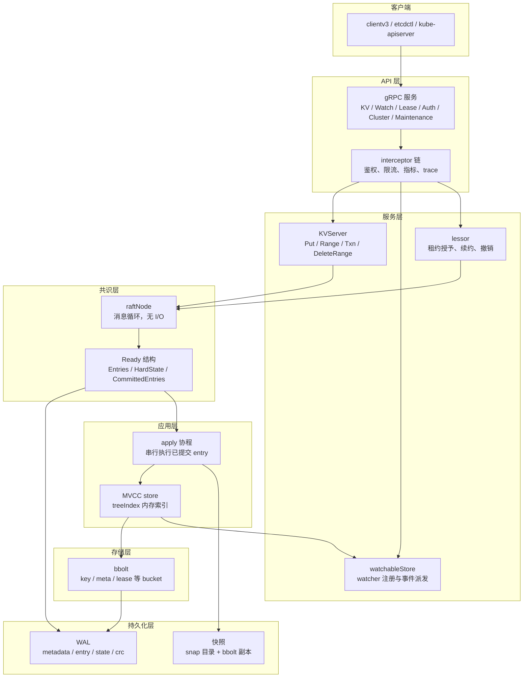
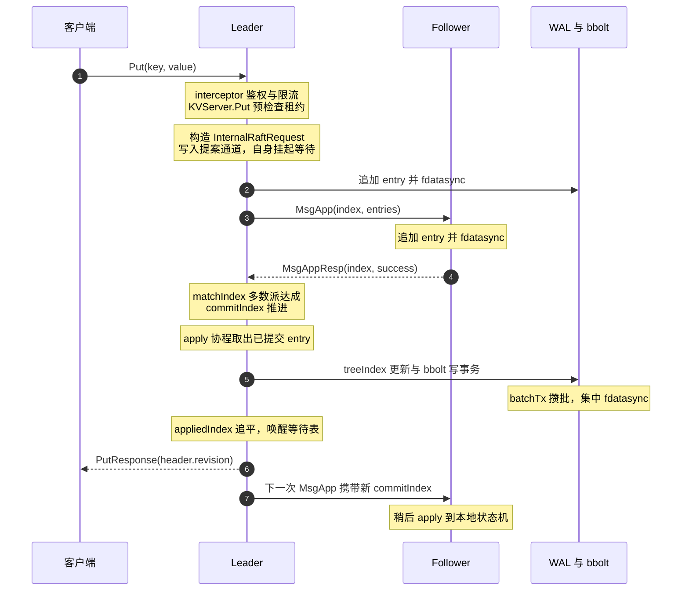
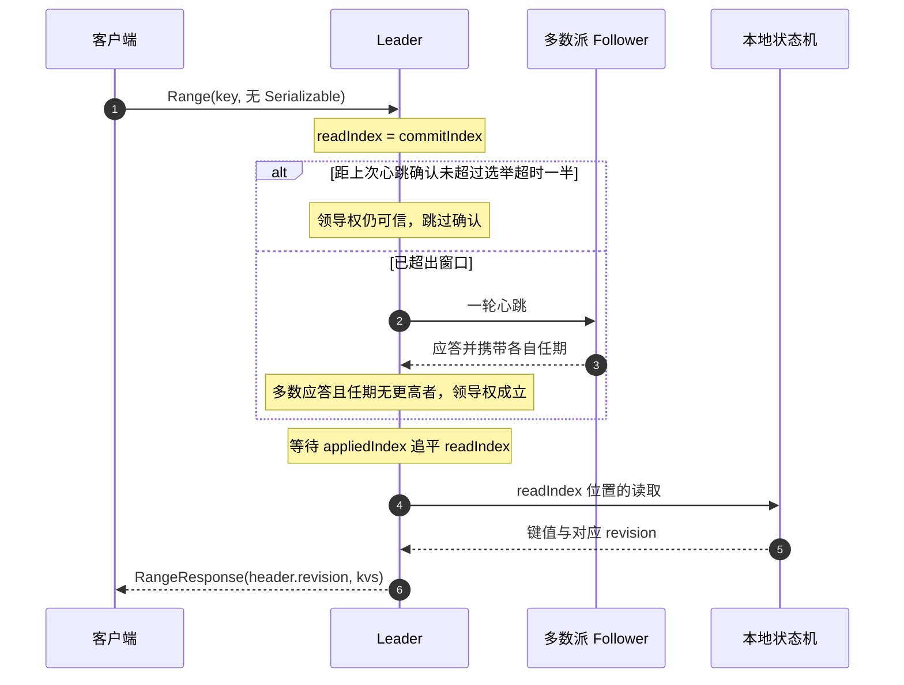

# 01 etcd 全局架构——从配置存储到控制面账本

**摘要：**

2013 年，CoreOS 团队把一个新项目挂到了 GitHub 上，它的全部使命是给机器集群里的一份份配置文件找一处集体存放的地方，名字由 Unix 的 `/etc` 与表示 distributed 的字母 d 拼成，读起来像「每个机房里都要有的一本小册子」。十年之后，这本小册子变成了整个世界云原生基础设施的唯一账本：你在 `kubectl apply` 里写下的每一个字段、每一次滚动更新留下的旧版本、每一个对象上那个被反复比较的 `resourceVersion`，最后都落成 etcd 里一条被多数节点确认过的键值对。名字与角色之间的这道裂缝，是理解 etcd 全部设计的起点，也是本篇要回答的第一个问题：一个为共享配置而生的键值库，凭什么被选中去承担控制平面的全部真相。

本文以 etcd v3.6 与 v3.7 的实现为准，涉及 v3.5 差异之处单独标注。全文按五问推进。第一问是出身与选型：Fleet 的配置共享如何催生这个项目，Kubernetes 在 2014 年前后面对 ZooKeeper、配置文件与若干早期方案时，用怎样一张需求清单做出了选择，以及「配置存储」如何一步步滑向「控制面账本」。第二问是反事实：如果抽掉全局 revision、多版本与持久 Watch 这三件东西，控制器模式会退化到什么地步；如果抽掉共识，多副本读写会怎么撞上脑裂。第三问是骨架：扁平键值模型、Revision 的语义与键空间布局，gRPC 到 Raft 到 WAL 到 MVCC 到 bbolt 的分层结构。第四问落到最重的一条链路——一次写请求从 gRPC 拦截器进入，经 KVServer、提案、WAL 批量提交、多数派确认、apply，直到唤醒等待中的请求，再到一次线性一致读的 ReadIndex 流程，并把最短延迟逐段算清。第五问是边界：Kubernetes 在 etcd 里留下的真实布局、三节点与五节点的取舍、2GB 配额背后的三重限制，以及几个最常见的误判。

读完应当能回答两个问题：etcd 把复杂性转移给了谁，这份转移的账单最后由哪些人在付。

---

## 第 1 章 从 `/etc` 到账本

### 1.1 一本被两次扩写的小册子

2013 年的数据中心里，运维人员最熟悉的一个目录是 `/etc`。它装着主机名、网络配置、服务启停脚本，是「这台机器该是什么样」的书面说明。多机部署开始流行之后，这份说明从一台机器扩散到几十台、上百台，管理方式也随之退化：有人用 `scp` 批量推，有人用配置管理工具渲染模板，有人在机器上放一个 cron 去 `git pull`。所有这些办法都在同一个问题上吃亏——它们没有「谁是当前版本」的仲裁机制，同一份配置在两台机器上可以长得完全不一样，而没有任何地方能权威地回答「正确的样子应该是哪种」。

CoreOS 团队做了一个叫 Fleet 的集群管理器，用途是把 systemd 单元分发到 Container Linux 机器上并按角色调度。Fleet 需要一个共享的、一致的配置存放点，于是 etcd 被造了出来，名字取 `/etc` 加字母 d 的组合，字面意思接近「分布式的 etc 目录」。这个命名带着一种刻意的朴素：它不承诺成为一个数据库，不承诺做数据分析，只承诺让一群机器对同一个目录达成一致。2013 年项目对外开源，用 Go 写成，单二进制，Apache-2.0 许可证。

这个故事到此为止都还平淡。转折发生在 2014 年：Google 主导的 Kubernetes 进入公开视野，并在同年确定把 etcd 当作集群状态的唯一后端存储。从那一刻起，etcd 的用户画像彻底换了——它开始为几万个不断增删的对象、上百个并发写入的控制器、上千个持有的 watch 流服务，而它最初的设计者想的是几十台机器上几百份配置。

不妨把这次角色的转变想成一次从「社区公告栏」到「不动产登记处」的升格。公告栏的职责是把最新通知贴出去，旧通知被新通知盖住并不算什么损失；登记处的职责完全不同，它要回答「这套房子现在是谁的」「上个星期是谁的」「谁在什么时候改了产权」，三个问题都得有据可查，而且任何一次回答都要经得起事后审计。技术上的限定是：etc 目录式的配置共享对应前者，多版本、全局序号、事件流这三样东西才把 etcd 推向后者，而这三样全都来自 API v3 的重新设计。

### 1.2 2014 年那张需求清单

选型的讨论放在今天回看，最容易被简化成一句「ZooKeeper 太老，etcd 是新的」。这种说法既有失公允，也解释不了事后发生的那些麻烦。更可靠的做法，是把 Kubernetes 对存储的实际依赖拆成一份可以逐项打钩的清单，再拿候选方案一项一项对过去。

第一项要求是强一致读。控制器每次做决策前都要读状态，它读到的必须是「此刻之前所有已提交写入的结果」，不能出现「写入成功、紧接着的读却看不到」这一段窗口。这一条排除掉的不是某个产品，而是一整类实现——任何把读请求走副本、走异步复制的方案都会在边界情况下违反它。第二项要求是可断点续传的 Watch：客户端从某个明确的位置订阅变更，断线重连后能从那个位置继续，中间一条都不漏。第三项要求是与 Go 生态的契合：Kubernetes 自身用 Go 写成，一个能以库的方式嵌入、又能以单二进制方式部署的存储，会让开发与打包都轻一个量级。第四项要求是轻量：不引入 ZooKeeper 那样的 JVM、不做复杂的运维编排，控制平面组件越少越好。第五项要求是可运维：备份、恢复、扩容有明确的语义，出故障时有清晰的修复路径。

候选方案可以分成三类。第一类是 ZooKeeper，当时分布式协调事实上的标准，Yahoo 在 2008 年开源，论文发表在 2010 年的 USENIX ATC 上。第二类是不上协调服务，直接把状态保存成配置文件或简单的关系库——Borg 与 Omega 留下的经验里明确有一条：状态需要事务、需要版本，文件系统做不到。第三类是若干早期方案，包括 Consul 一类的新项目与自研路径，它们要么诞生太晚、要么在某个单项上与清单差着一截。

| 需求 | etcd（v3） | ZooKeeper | 配置文件 | 关系数据库 |
| --- | --- | --- | --- | --- |
| 强一致读 | 默认线性一致，读走 ReadIndex | 读可能落在 Follower 上读到旧值 | 依赖同步机制，无仲裁 | 可以做到，但需额外保证 |
| 可续传的 Watch | 持久流，携带 revision，可从历史点重放 | 一次性触发，触发后需重新注册 | 无原生能力，靠轮询或 inotify | 无原生能力，靠轮询或触发器 |
| 全局顺序 | 全局 revision，写入流水号 | ZXID 全局有序，但未暴露给客户端语义 | 无 | 事务 ID 无跨表语义 |
| Go 生态 | 原生 Go，客户端与服务端同一语言 | Java，跨语言客户端质量参差 | 无 | 驱动层语言绑定 |
| 部署形态 | 单二进制，无外部依赖 | 需 JVM，需适配两套 API | 最低 | 需要数据库运维体系 |
| 乐观并发 | Txn 比较 ModRevision 与 CreateRevision | `setData` 携带版本号做 CAS | 无 | 行级版本或时间戳列 |

这张表格里真正区分胜负的是第二行。ZooKeeper 的 Watch 是一次性的，触发之后要重新注册，而且触发时不带数据，客户端还得再发一次 `getData`；两段之间的窗口里发生的变更会被永久错过。Kubernetes 需要的是「一直跟着走」的事件流，而不是「提醒你去看一眼」的门铃。这一条差异在 2014 年被放大到了决定性的程度，因为控制器模式的所有正确性论证都建立在「事件不丢」之上。

关于选型过程，Kubernetes 社区公开的讨论反复提到同样的理由：项目新，可以按需改造；协议简单，团队能读得懂；用 Go 写成，与主干代码同构。这些是方向性的表述，具体是谁在哪一次会议上拍板、谁说了什么原话，公开材料并不完整，本篇不做补全。

> [!info] 版本口径
> 本篇以 etcd v3.6 与 v3.7 的实现为准。v3.6 起 `go.etcd.io/raft/v3` 取代了 v3.5 内部打包的 raft v2 实现，两者在选举与复制上的语义一致，但在批处理与 `Ready` 结构的组织上不同；凡涉及此处会单独标注。运维侧的 `snapshot` 与 `defrag` 从 v3.5 起迁到了 `etcdutl`，而 `etcdctl` 不再需要设置 `ETCDCTL_API=3`——这一点在 v3.4 之后就成立了。

### 1.3 从「存配置」到「记账」的三掉头

Kubernetes 真正把 etcd 从公告栏推向登记处的动作，是 API v3 的三项重新设计。它们不是为 K8s 定制的，但 K8s 是它们最大的受益者，也是它们被验证得最彻底的地方。

第一项，协议从 HTTP/JSON 换成 gRPC。v2 时代 key 直接编进 URL 路径，读一个前缀要发一次 HTTP 请求，Watch 是一条长轮询式的连接。v3 改成 protobuf 描述的双向流，一个连接上可以复用成百上千个 watcher，每次响应带固定的头部，客户端不必再自己解析 URL 编码。K8s 一个中等规模的集群里，API Server 到 etcd 的连接只有几条，而它们承载的是一秒内可能上万次的对象变更通知，这个数量级的差距完全靠协议层吃下来。

第二项，单版本键改为**多版本（MVCC）**。v2 的每个 key 只有当前值，覆盖就是覆盖，历史不可见。v3 把每次写入变成一个不可变的新版本，全部版本按一个全局递增的 revision 排列，旧的仍留在存储里等压缩来回收。这一个改动同时给了 K8s 三样东西：`resourceVersion` 有了物理锚点，乐观并发有了比较对象，Watch 有了续传位置。

第三项，TTL 键改为 Lease。v2 给每个 key 单独设过期时间，意味着过期管理是「一 key 一定时器」的模型，开销随 key 数线性增长。v3 把过期时间抽象成一个独立对象，多个 key 绑定同一个 Lease，续约一次全部延后。心跳类对象因此从中受益：一个服务注册十几种 key，续一次约全部续上。

这三项改造合起来，让 etcd 第一次有了「账本」所需的那种可追溯性——能回答「现在是什么」「什么时候变成这样的」「从某个时刻之后变过什么」。账本比喻的技术限定也在此：etcd 的账本不是复式记账意义上的长期流水，历史版本会被压缩抹掉，能追溯的时间窗口由压缩策略决定，这一点在第 8 章会再回到。

### 1.4 名字与角色的错位，代价在哪里

名字里写着「配置」，实际干的是「账本」，这个错位不是文字游戏，它直接决定了运维上的很多默认值该不该改。

配置类系统的典型负载是低频、少量、读多写少，丢了可以从别处重新生成。账本类系统的负载完全不同：写入频率随集群规模上升，历史版本堆积产生空间压力，任何一个控制器的不当行为都会被放大成整个控制平面的抖动。etcd 的默认值是按前者设的——`--quota-backend-bytes` 默认 2GB，`--snapshot-count` 默认 10 万条，压缩默认不开启，需要显式配置 `--auto-compaction-mode` 与 `--auto-compaction-retention`。这些默认值在「存几百份配置文件」的场景里绰绰有余，在「存百万级对象」的集群里就必须逐项重新评估。

所以本篇后面所有机制讨论，都可以看作在回答同一个问题：账本的本职工作是把每一次写入确认下来并留下痕迹，而它的每一层实现都在为这件事付代价——共识层付网络往返，存储层付 fsync，索引层付内存，压缩机制付历史窗口。**etcd 的设计价值不在于某一层做得快，而在于它把这几笔代价清晰地分配到了不同的层，每一层都有独立的开关和观测手段。**

---

## 第 2 章 抽掉它们会怎样

### 2.1 控制器模式的三个支点

要理解 etcd 为什么必须同时提供全局 revision、多版本与持久 Watch，最省力的办法是做一次减法：假设这三样东西只有两样，Kubernetes 的控制器模式会退化成什么样。

Kubernetes 的控制器大体是一个循环：读现状、与期望比、做出改动、等待反馈。这个循环之所以能稳定运行，靠的不是控制器自己聪明，而是它站在三个支点上。第一个支点是**一致性快照**：它某一轮读到的所有对象必须来自同一个逻辑时刻，否则会出现「读到 Pod 已经存在、但所属的 Service 还不存在」这种中间态，控制器据此做出一个错误的判断。第二个支点**收敛判定**：它必须能判断「我上一次的改动生效了没有」，这需要有一个只增不减且全局有序的标记来对照。第三个支点**增量通知**：它不能靠全量轮询感知变化，否则每一次感知的代价与集群规模成正比。

三个支点对应三样东西。一致性快照对应「读也经过共识」，收敛判定对应「全局单调的 revision」，增量通知对应「从任意位置续传的 Watch」。缺一个，整套模式就会从「最终一致」退化成「经常不一致」。

### 2.2 没有全局 revision：每一轮都要重新认识世界

假设只有多版本和 Watch，但没有一个全局单调的序号。每个 key 的版本各管各的，客户端无法表达「从整个集群的第 N 次变更之后开始」。这种系统在工程上有两种实现方式，两种都很难看。

第一种，给每个 key 一个独立的版本号，Watch 时按 key 订阅。断开重连之后，客户端手里握着几千个 key 各自的版本，需要逐一向服务端确认「这个 key 现在到第几版了」，一次重连产生与 key 数量同级的往返。集群里有十万个对象，重连一次就是十万次状态询问，这在任何一个大集群里都是不可接受的开销。

第二种，索性不追踪版本，每次通知到达就重新 List 一遍全量，用全量结果做对比。这一条路的代价随集群规模线性增长，而且会把控制器的正确性建立在「全量结果与本地缓存逐字段比较」之上。比较的压力从存储层转移到了每一个控制器进程里，集群里有五十个控制器，就有五十份全量比对在同时跑。

全局 revision 把这两个问题一起解决了。集群的每一次写入共享同一条流水号，于是「从某个位置继续」只需要一个数字；重连只需发一个请求「给我 revision N 之后所有被改动的 key」，服务端从自己的历史里回放，客户端拿到的是一份确定的、有序的增量。K8s 把 revision 暴露成 `resourceVersion` 字符串，正是这个设计在 API 层的投影。

### 2.3 没有多版本：断线与通知之间那道缝隙

持久 Watch 听起来像是「服务端记住谁订阅了什么」，真正难的是客户端断开的那段时间。断开期间发生的变更，服务端必须能在客户端回来之后补发，这意味着变更不能只是一条被消费掉的通知，必须在存储里有据可查。多版本就是这份「据」。

没有多版本的系统只能给出两种妥协。一种是「通知即丢弃」：服务端推出去就完了，客户端没收到是自己的事，重连之后必须全量重来。另一种是「内存里留一段缓冲」：服务端把最近的若干条事件放一个环形缓冲里，重连时从缓冲里补发，缓冲溢出就退回全量。后一种方式在多数消息系统里都见过，它的致命处在于缓冲的容量与事件的产生速率没有稳定关系——一个突发写入把缓冲冲掉，客户端就从「增量续传」掉回「全量重来」，而这个回退的时机恰好与集群最忙的时刻重合。

etcd 的选择是把历史放进存储。每一次写入都产生一个不可变的版本记录，按 revision 排序落在 bbolt 里；Watch 的续传位置就是这个 revision；压缩策略决定历史的保留窗口，窗口之外的续传会被明确拒绝，错误是 `ErrCompacted`，客户端据此决定是否重来。这套机制把「能续传多久」变成了一个可以配置、可以观测的量，而不是一个由缓冲大小和流量偶然决定的量。

> [!warning] 压缩窗口就是续传能力
> `ErrCompacted` 不是故障，它是设计的一部分。ash 客户端看到的 `etcdserver: mvcc: required revision has been compacted`，含义是「你要求的位置已经被回收了」。K8s 侧的应对逻辑是丢掉本地缓存、用 `resourceVersion=0` 重新 List 再重新 Watch。理解这一点的价值在于：调压缩策略时，你调的不是磁盘占用，而是「控制器断线多久之后必须全量重来」。

### 2.4 没有共识：三个副本三种说法

把 Stacked etcd 的部署图摊开，三台控制面机器上各跑一个 etcd 进程，每个进程各持一份数据文件。没有共识层的世界里，这三个文件会各自演化。

最自然的写法是主从复制：选一个主，所有写先落主再异步推给从，读可以落脚在任何一台。这套写法在正常网络里运行良好，故障场景下会立刻分叉。网络在中间断开，主那一侧继续接受写入，从那一侧在主失联后推举出一个新主也开始接受写入，两个主各自带着一群客户端往前跑。等网络恢复，两条写入历史需要合并，而同一条 key 在两个分叉里的值可能完全冲突——系统此时能做的只有选择一条历史作废，而被作废那条历史里的写入，客户端早就收到过「成功」的回执。

共识层要堵死的就是这条路径。Raft 的复制是「多数派确认才算提交」，任何一条写入要成功，必须被超过半数的节点落进日志；任何一次选举要成功，必须拿到超过半数的票。两个 quaorum 都是超过半数，所以它们的交集里必有一个节点，而这个节点在同一任期里只会给一个候选人投票，它也只会在自己的日志里保存一份提交过的记录。这就是「已提交的写入不会丢」的论证骨架，细节在 [[02 Raft 共识协议——选举、日志复制与安全性]] 里展开。

代价是很直接的：一次写入必须等到多数派确认，节点越多、跨的距离越远，这段等待越长；并且可用性被 quorum 卡住，三节点集群里挂掉两台，剩下那一台虽然有全部数据，却不能服务写入，也不能在没有确认的情况下服务线性一致读。etcd 选择了 CP 这一侧，Kubernetes 的整个控制平面因此也就跟着站在了 CP 这一侧。

### 2.5 一次修整，三笔账

把前三节合起来看，三样东西各解决了一种失败：全局 revision 解决「重连时无从下手」，多版本解决「断线期间的事件无处可寻」，共识解决「多副本各说各话」。它们不是三个可以随手拆掉的功能模块，而是同一条链上的三个环节——revision 是历史的位置标记，多版本是历史本身，共识是让历史唯一的那道闸门。

这三笔也正好对应专栏导览里列出的三本账：确认成本（共识）、存储成本（多版本与压缩）、可见性成本（Watch 与缓冲）。三本账在 etcd 的每一个参数上都被重新分配过一次，第 6、7 章会把这些参数逐个对应回去。

---
## 第 3 章 数据模型与 revision

### 3.1 扁平的键空间，靠前缀切出层次

etcd 的键空间是一维的：所有 key 都是字节序列，按字典序全局有序，没有目录，没有父子节点，没有内置的 schema。用户需要层次时，自己在 key 里用 `/` 拼出路径，再用前缀查询把一棵子树捞出来。etcd 不解释 `/` 的含义，它只负责排序。

这个决定看起来比 ZooKeeper 的树形 znode 寒酸，收益却相当具体。树形结构里，一个节点的存在意义同时承载着「数据」与「容器」两种角色，删除一个还有子节点的节点需要额外语义；扁平结构里没有这种耦合，一个 key 存在与否是唯一的事实，前缀只是查询的便利。范围查询的实现也因此极其廉价：`--prefix` 在服务端被翻译成一次 `[key, key+0xFF..)` 的区间扫描，扫的是一棵按字节排序的 B 树，从起点顺序走到终点即可，不需要在树结构里做任何回溯。

对 Kubernetes 而言这个设计还有一个副作用值得一提：一个资源类型的所有对象天然聚在同一个前缀下，一次范围查询就是一次「这个类型的全量 List」。这个性质后面在第 7 章的 key 布局里会反复出现。

### 3.2 Revision：一条全体共享的流水号

etcd 里有两个容易混淆的序号：Raft 日志索引（index）与 MVCC 的 revision。前者是共识层的位置，后者是账本层的位置，二者差着不止一个数量级——一次 Raft 提案可以携带多条写操作，而一次 apply 也可能一次性推进多个 revision。

Revision 的规则可以用四句话讲完。第一，它是一个从 1 开始、全局单调递增的计数，整个集群只有一条。第二，每一次事务提交都会获得一个新的 main revision，同一个事务里的所有写操作共享它，再用从 0 开始递增的 sub revision 区分彼此。第三，删除操作也占用 revision，删除之后 key 在存储里留下一条墓碑记录，而不是凭空消失。第四，压缩会抹掉旧 revision 对应的版本，但不会让这个计数器回退。

主 revision 与子 revision 的拆分，解决的是「一次事务写多个 key，它们必须对读方看起来同时生效」这个问题。假设一个事务同时改了 `/a` 和 `/b`，如果给它们分配两个独立的主 revision，那么读方在中间时刻可能读到「新的 /a 配旧的 /b」，这在加了事务的系统里是明显违背直觉的。共享主 revision 之后，读方按 revision 观察，要么看到两者都是旧值，要么看到两者都是新值，不存在混合状态。子 revision 则保证了同一事务内多个写操作在存储里各有唯一的定位键。

存储层的编码就建立在这两个数字上。bbolt 的 `key` bucket 里，键是 17 字节：8 字节的主 revision 大端编码，一个下划线分隔符，8 字节的子 revision。之所以要用大端的固定宽度整数，是为了让字节序与数值序一致——bucket 按字节排序，编码后的顺序恰好就是 revision 的顺序，范围扫描从「revision N 之后」直接顺序读下去即可，不需要做任何比较函数的转换。

### 3.3 四元组：CreateRevision、ModRevision、Version、Lease

一个 key 在任何一个时刻，除了值本身，还带着四个可以用来判断的元数据。这四个字段是 etcd 全部并发控制的基础，值得逐个说清。

`CreateRevision` 是这个 key 当前这一代生命期的起点，也就是它被创建（或被删除后重建）时的 revision。`ModRevision` 是它最近一次被修改时的 revision。`Version` 是它在当前这一代里被修改过的次数，从 1 开始计数。`Lease` 是绑定在其上的租约 ID，未绑定时为 0。

关键在于「代（generation）」这个概念。删除一个 key 之后重新创建，`CreateRevision` 会变成新一次创建的 revision，`Version` 会归零后重新从 1 开始计，`ModRevision` 也随之刷新。删除之后重新创建，会开出新的一代，Version 从零重计，而不是接着上一代往上加。 这一条是很多自研控制器读错的地方：它们拿 `Version` 判断「这个对象被改过几次」，却在对象被删了又建之后得到了一个看起来更小的数字。

| 字段 | 含义 | 比较操作 | 典型用途 |
| --- | --- | --- | --- |
| `CreateRevision` | 当前这一代的起点 revision | `=` 结合 0 判断不存在 | 创建即占有、乐观锁抢占 |
| `ModRevision` | 最近一次修改的 revision | `=` 或 `>` | 乐观并发、把 revision 传下去做续传 |
| `Version` | 当前这一代内的修改次数 | `=0` 判断不存在，`>` 判断有修改 | 幂等写入、变更计数 |
| `Lease` | 绑定的租约 ID | `=` | 判断是否绑定过租约、租约迁移 |

值的部分还要多说一句。etcd 本身不关心 value 的内容，它把这些字节原样存储；但 value 的大小会一路影响 Raft 提案的体积、WAL 的记录数、`MsgApp` 的分片与 bbolt 的页分配。Kubernetes 默认用 protobuf 序列化对象，又在前面加了一段魔数，第 7 章会展开。

### 3.4 存储的两半：内存的索引与磁盘的版本

etcd 的 MVCC 不是一个模块，而是两个模块的组合，这一点很像一本账需要「索引」与「账页」两样东西。

索引那一半在内存里，是一棵按 key 排序的 B 树（用的是 google/btree 的实现），每个 key 对应一个 `keyIndex` 结构，里面按代组织了这个 key 的全部历史 revision。查找「/registry/pods/default/nginx 现在的值是什么」时，先在内存里定位到这个 key，取出它最近的 revision，然后拿着这个 revision 去磁盘查。

账页那一半在 bbolt 里，键是前面说的 17 字节 revision 编码，值是 `mvccpb.KeyValue` 序列化后的字节。查「revision R 时 /a 的值」时，用索引拿到不大于 R 的那个 revision，再用它去 bbolt 里做一次点查。bbolt 是单文件、mmap 只读、写时复制、写事务全局串行的 B+ 树引擎，[[中间件/深入浅出存储引擎/06 BoltDB 源码剖析——页、节点与写事务|BoltDB 源码剖析]] 已经把页、节点与写事务拆得很细，本篇只关心 etcd 怎样用它，细节留给 [[03 存储引擎——WAL、BoltDB 与 MVCC 的持久化链路]]。

这个两半结构解释了一个常被忽略的现象：**etcd 的重启时间与库的大小成正比，而主要时间花在重建内存索引上。** 重启时，bbolt 恢复是全文件层面的、常数级的（取两个 meta 页里校验和正确的那个），但重建 treeIndex 必须把 `key` bucket 里的每一条版本记录都读一遍——因为内存索引里要记录每个 key 的每一代、每一代的每一个 revision。库里有几百万条版本记录，这一步就要扫几百万条。

### 3.5 键空间：bucket 的分工

bbolt 里的 bucket 相当于命名空间，etcd 把不同性质的数据分在不同的桶里。

| bucket | 内容 | 写入频率 | 备注 |
| --- | --- | --- | --- |
| `key` | 17 字节 revision 到 `mvccpb.KeyValue` 的映射 | 每次写事务 | MVCC 的账页本体 |
| `meta` | `consistent_index`、`term`、`confState` | 每次快照、部分状态推进 | 与 Raft 状态对齐，恢复时用 |
| `lease` | leaseID 到 `leasepb.Lease` 的映射 | 授予与撤销 | 租约的权威记录 |
| `auth` 系列 | 用户、角色、权限 | 鉴权配置变更 | 规模很小但必须一致 |
| `alarm` | 告警记录 | 空间或损坏告警 | NOSPACE 之后在这里留痕 |
| `cluster` | 成员与集群 ID | 成员变更 | 与 `meta` 配合完成成员加入 |

把 `key` 与 `meta` 分开有一个直接后果：写事务的 bbolt 提交是整库一次的（bbolt 的写事务全局串行），所以无论这次提交改了 `key` 里的三条对象还是改了 `lease` 里的一条租约，最终都落在同一个 `fdatasync` 上。这一点在第 5 章算写延迟时会再出现，它是「批量化」之所以有效的根本原因。

---

## 第 4 章 分层：谁该知道一致性

### 4.1 一条从 gRPC 到磁盘的路

etcd 的进程内部有一条很长的数据通路，从上往下依次是协议层、服务层、共识层、日志层、应用层、存储层，每一层只把下一层当成黑箱。把这条通路画出来，后面所有讨论都可以挂在这张图上。

这张图里最值得停留的是共识层与持久化层之间的关系。很多初学者会把 Raft 想成一个「在网络上跑来跑去的模块」，实际上 etcd 里的 raft 状态机不做任何 I/O：它把要写的日志、要改的 term、要持久化的快照，全都装进一个 `Ready` 结构里交给外层；外层负责把 `Entries` 与 `HardState` 写进 WAL、把 `CommittedEntries` 交给 apply 协程、把快照交给快照模块，完成之后再回来通知「已经处理完毕，可以推进」。这条分界线是 etcd 可测试性的来源，也是 [[02 Raft 共识协议——选举、日志复制与安全性]] 里要展开的重点。

### 4.2 服务层的六个门面

gRPC 层暴露的服务不止一个 KV，而是六个，每个服务负责一类语义。把它们列清楚，有助于理解「一致性」这个概念在不同服务上是有不同代价的。

| 服务 | 核心方法 | 是否经过 Raft | 一致性含义 |
| --- | --- | --- | --- |
| `KV` | Put、Range、DeleteRange、Txn、Compact | 写经过，读按选项 | 默认线性一致，可降级为串行化 |
| `Watch` | 一条双向流，多路复用多个 watcher | 否 | 事件有序，按 revision 对齐 |
| `Lease` | Grant、Revoke、KeepAlive、TimeToLive | 授予与撤销经过 | 租约是账本对象，续约走单独的轻量路径 |
| `Cluster` | MemberAdd、MemberRemove、MemberList、MemberPromote | 成员变更经过 | 影响 quorum 计算，代价最高 |
| `Maintenance` | Status、Defragment、Snapshot、Alarm、Hash | 否或部分 | 直接操作本地成员，不改变全局状态 |
| `Auth` | AuthEnable、UserAdd、RoleGrantPermission | 经过 | 鉴权配置本身也是一致性数据 |

这张表能解释几种常见的困惑。为什么 `Maintenance` 的 `Defragment` 在任何一个成员上执行都行、但执行期间该成员不可用——因为它操作的是本地文件，不经过共识，代价落在本地。为什么 `Lease.KeepAlive` 不产生大量的 Raft 提案——续约只在本地修改租约的到期时间，不写日志，只有授予与撤销才是账本变更。

### 4.3 apply 串行化的理由

apply 协程是整条通路上唯一一个把「已提交」变成「可见」的地方。它按日志顺序逐个取出已提交的 entry，交给对应的 handler 执行，执行结果写进 MVCC，然后更新 `appliedIndex`。

这个协程严格串行，任何时刻只有一个 entry 在被应用。这个约束看起来保守，但它是一致性的必要条件：apply 的结果必须对所有副本完全相同，而只有严格按照日志顺序、单线程地执行，才能保证每个副本在应用完第 N 条 entry 后，状态与其它副本在这个位置上完全一致。假如允许多个 entry 并发应用，彼此之间有依赖的写操作就可能在不同副本上以不同顺序生效。

串行也带来一个性能上的推论：写吞吐的上限被 apply 的速度卡住，而 apply 的速度又受 bbolt 写事务的限制。第 5.6 节会把这一条落成具体的延迟分段。

> [!important] 三层各自推进的进度号
> etcd 进程里有三个与「进度」有关的数字：Raft 的 `lastIndex`（本地日志写到哪）、`commitIndex`（多数派确认到哪）、apply 的 `appliedIndex`（状态机应用到哪）。三者严格满足 `appliedIndex <= commitIndex <= lastIndex`。客户端看到的 `header.revision` 来自 apply 层的 MVCC revision，与这三个数字都不相等，但单调对应。运维时看到 `etcd_server_slow_apply_total` 上涨，意味着第三个数在追赶，通常是 bbolt 提交过慢。

---

## 第 5 章 一次写请求的全部环节

### 5.1 从 `client.Put` 到提案

这一节跟着一条具体的请求走：客户端调用 `client.Put(ctx, "/config/timeout", "30")`。请求首先被编码成一个 `PutRequest`，通过 gRPC 发到 Leader 的 KV 服务。如果客户端连的是一个 Follower，Follower 不会替它转发，而是返回一个错误，错误体里带着当前 Leader 的 ID 与地址，客户端库据此重新连接。这个设计很朴素：把「找 Leader」的责任放在客户端，服务端就不需要维护转发链路，少了转发就少了一跳延迟，也少了一类「转发到一半 Leader 变了」的状态。

请求进入 Leader 之后，第一道关是 gRPC 拦截器链。这里做三件与业务无关但缺一不可的事：检查连接是否已经完成鉴权、从 context 里取出客户端身份、记录指标与 trace。鉴权通过之后，请求进入 `KVServer.Put`。

`Put` 做的事情比名字听起来多。它先检查 key 的合法性，再处理 `IgnoreValue`、`IgnoreLease` 这类选项，然后把请求转换成一个内部表示。接下来它会做一次「预检查」——主要是确认请求里带的租约是否存在、是否仍然有效。这个预检查不改变任何状态，它是为了在付出共识代价之前，先把明显会失败的请求挡回去。

预检查通过之后，请求被包装成一条 Raft 提案。这个包装有一个关键设计：**提案的内容是一个 `InternalRaftRequest`，KV 请求被塞进它的某个字段里，而不是直接作为 Raft 日志的 payload**。这样做的原因是 Raft 层的日志只需要能装下不透明的字节，不需要理解里面是什么类型的操作；将来要加新的操作类型（譬如 Lease 的续约、成员的变更），只要在 `InternalRaftRequest` 里加一个字段，Raft 层完全不用改。同一个结构里还带着 `Header` 与一个请求 ID，便于 apply 之后回填结果。

提案交给 `raftNode` 之后，写请求的 goroutine 就挂在一个等待队列上，等待 apply 完成之后被唤醒。这个「挂起—唤醒」的模式是理解 etcd 写延迟的第一步：客户端的请求线程没有阻塞在 Raft 循环里，也没有阻塞在 apply 里，它只是把一个标识放进等待表，然后睡下。

### 5.2 Raft 循环：批量写 WAL 与广播

`raftNode` 的运行方式是「select 一个消息，处理后进入下一轮」。需要处理的输入有三类：来自网络的消息（`MsgApp`、`MsgVote`、`MsgHeartbeat`）、来自本地提案通道的请求、来自 tick 通道的定时触发。

Leader 收到本地提案后，把请求 append 到自己的日志尾部，然后把新产生的 entry 通过 `MsgApp` 发给所有 Follower。这个动作本身很快，真正的成本在持久化：**在把 entry 发给别人之前，Leader 必须先把它们写进本地 WAL**，Raft 的正确性要求「已发送的日志必须能在崩溃后恢复」。

etcd 在这里做了一件很有工程味的事：多次 `wal.Save` 会被合并成一次 `fdatasync`。具体地说，WAL 的写入路径是先 `write` 到文件缓冲区，然后调用 `Sync` 触发同步；当上一批 `Sync` 还在进行中时，后续的 `Save` 请求会在 `syncNotifier` 上排队，等前一次同步完成之后，把排队期间攒下的所有数据一次性刷下去并只做一次同步系统调用。结果是：在磁盘 fsync 的几百微秒到几毫秒里到达的所有写入，共享同一次 fsync 的等待时间。

这个批量化对延迟的影响是两面的。对单个请求来说，它可能需要等上一次 fsync 完成才能开始自己的那个，最坏情况下等待时间翻倍；对整体吞吐来说，它把「每秒 fsync 次数」这个硬上限变成了一条可以摊薄的曲线。etcd 的写吞吐之所以能从「单条 fsync 的倒数」提升到可观的数量级，靠的就是这一层合并。

Follower 收到 `MsgApp` 之后做同样的事：把 entry 写进自己的 WAL 并同步，然后回一个 `MsgAppResp` 表示「我已经收到了到了第几条」。Leader 收集这些回应，维护每个 Follower 的 `matchIndex`。

### 5.3 多数派确认与提交

当 Leader 发现某一条日志的 index 已经被多数派（包括自己）确认，它就把 `commitIndex` 推进到这个位置。注意这里是「多数派」，不是「所有人」：三节点集群需要两个，五节点需要三个。慢的 Follower 不会拖慢提交，除非慢的那些加起来已经超过少数。

commitIndex 推进之后，Leader 需要做两件后续动作。一是通知 apply 协程「可以应用到第 N 条了」，二是把新的 commitIndex 随下一次 `MsgApp` 或心跳带给 Follower，让它们也能应用。后者不是实时的，所以 Follower 的状态机总会比 Leader 落后一点点，这段差距是后面讲 Follower 读时要考虑的因素。

这里要纠正一个非常常见的误解：「Leader 本地写完就能返回」这个说法**是错的**。本地写完 WAL 只意味着这一条日志不会丢，不意味着它已经生效。如果 Leader 在本地写完、但还没等到多数派确认的时候崩溃，这条日志可能被新 Leader 的日志覆盖掉——因为它从未被多数派备份过，Raft 不保证它存活。只有 commitIndex 越过它的位置，这条写入才算真正成为集群历史的一部分。

### 5.4 apply：把日志变成账页

apply 协程从 `CommittedEntries` 里按顺序取出 entry，解析出 `InternalRaftRequest`，交给 `applyV3`，后者再分发到 `applierV3` 的具体方法上。

一次 Put 的 apply 要做四件事。第一，在 MVCC 里分配新的 revision：如果是 Leader 首次应用，revision 从当前值加一；如果这个 entry 里包含多个操作，所有操作共享这个 revision 并用 sub revision 区分。第二，更新内存索引：在 treeIndex 里找到这个 key 的 `keyIndex`，追加新的一代或新的 revision，更新 `modified`、`ver`、`created`。第三，把新的 `KeyValue` 序列化，以 17 字节的 revision 键写进 bbolt 的 `key` bucket，同时更新 `lease` bucket 里对应租约的 `keys` 集合。第四，把这次变更推送给所有匹配的 watcher——但推送的实际发生在 apply 层之外，通过 `watchableStore` 的 `notify` 完成。

前三步都发生在同一个 bbolt 写事务里吗？不完全是。MVCC 的存储层在 apply 时会开启写事务，把这次 apply 产生的所有修改都塞进去，然后调用 `commit`。而 `commit` 是否立刻触发 `fdatasync`，取决于批量策略：etcd 的 `batchTx` 会把多个 apply 的修改攒到一起，在满足条件时统一提交一次。这就是「apply 的 bbolt 提交」这一段延迟的由来。

写入完成、`appliedIndex` 推进之后，等待表被唤醒，写请求的 goroutine 拿到结果，构造响应，带着 `header.revision` 返回客户端。

### 5.5 时序：一次 Put 走过的八个点

把上面几节连成一条时序，会看得更清楚。下面的图里只画三节点集群，且假设客户端连的就是 Leader。

这张图里有两个细节容易被一眼扫过，却直接决定了对线上延迟分布的解释方式。

第一个是 `MsgAppResp` 的回程与 commitIndex 的通知是分离的：Leader 在本地推进 commitIndex 之后立刻开始 apply，不等 Follower 也知道。所以 Follower 上的状态机永远落后于 Leader，落后多少取决于多少次心跳的间隔。这个落后对 Watch 没有影响（watch 事件由各自节点的 apply 推送），对 Follower 上的串行化读有直接影响。

第二个是 apply 的 bbolt 提交与 Raft 的日志写入是两次独立的持久化。写 WAL 那一次是「这条日志不能丢」，写 bbolt 那一次是「这次状态变化要能被读到」。理论上第二次可以延迟（因为它前面有 WAL 兜底，崩溃后重放即可），etcd 的批量策略正是利用了这一点：apply 的提交不必每一条都同步，攒一批一次性刷下去，崩溃之后未提交的部分从 WAL 重放补齐。

### 5.6 最短延迟由哪几段组成

把这条链路压到最短，一次 Put 的延迟由四段构成：

| 段 | 内容 | 决定因素 | 可优化吗 |
| --- | --- | --- | --- |
| 1 | 客户端与 Leader 之间一次往返 | 网络距离 | 部署位置决定，跨地域就无解 |
| 2 | Leader 本地 WAL 一次 fdatasync | 磁盘的同步写延迟 | 换盘、把 `--wal-dir` 放到独立设备 |
| 3 | Follower 收到并持久化 entry 的时间 | 网络加对端磁盘 | 同上，且慢节点会拖累整体 |
| 4 | apply 到状态机并完成 bbolt 提交 | bbolt 写事务与批量策略 | 调批量间隔，代价是崩溃后重放更多 |

严格来说，第 2 段与第 3 段可以并行：Leader 在 fsync 自己的 WAL 之前就可以把 entry 发出去，两边的持久化同时进行。所以一次写的最短延迟接近于「一次 RTT + 一次 fsync + 一次 apply 提交」，而不是四段相加。这个结论在工程上的意义是：**如果一次写入的延迟明显高于「一个 RTT 加两次磁盘同步」，问题几乎一定不在网络上，而在磁盘或 apply 环节。**

这也解释了为什么 etcd 的运维建议里反复强调「所有成员的磁盘要同规格」。第 3 段走的是多数派里最快的那几个，但慢节点的存在会影响另一件事——Leader 需要收集回应才能推进 `matchIndex`，如果某个 Follower 的磁盘抖动导致回应迟迟不来，而它恰好是凑够多数派的最后一票，那么整个写入就要等它。这不是「平均值」的问题，是「最慢的那个多数派成员」的问题。

### 5.7 Follower 上的写会怎样

客户端连到 Follower 时，写请求不会成功。Follower 的 KVServer 收到 Put 之后，发现本地不是 Leader，直接返回一个错误，错误里包含 `leader` 字段。客户端库解析这个字段，把连接切到新地址，重发请求。

有一次重试，就有一次额外的 RTT。所以在写密集的场景里，客户端与 Leader 之间的连接质量直接决定了写入的末尾延迟分布。这也是为什么 etcd 的客户端会在后台维护一个「谁是 Leader」的缓存，并在连接建立时主动查询这个信息——它宁愿在建立连接时多花一次往返，也不愿在每次写入时才发现连错了人。

`--strict-reconfig-check` 之类的参数与这里无关，但 `--initial-cluster-state` 与客户端行为有一个容易混淆的地方：集群刚起来时还没有 Leader，此时所有写都会失败并返回「无 Leader」，客户端会退避重试，直到选举完成。这段时间在监控上表现为 `etcd_server_leader_changes_seen_total` 的跳变与一段写入错误率，属于正常启动过程。

### 5.8 攒批与同步的几个开关

前文反复提到批量，值得把相关的开关集中说清，因为它们直接改变了延迟与吞吐的曲线形状。

`--batch-commit-interval` 一类参数控制 bbolt 写事务的攒批时长，默认按毫秒计，调大则单次 fsync 摊薄更多写入、吞吐上升，但单条写入的等待时间可能变长。`--snapshot-count` 控制 apply 了多少条 entry 之后触发一次快照，默认 10 万；它不直接改变写延迟，但它决定了 WAL 的截断频率与快照时的 I/O 峰值。`--unsafe-no-fsync` 是一个危险开关，它让 WAL 的 `fdatasync` 在非 Leader 上被跳过，只在没有其他意义的地方换取吞吐，官方文档对它的定位是「只在测试或可丢失数据的环境使用」。

还有一个不在命令行里、但在代码里体现出来的批：一次 Raft 提案可以携带**多条写操作**，etcd 的提案通道在取请求时会尝试一次取多个，把多个客户端的写请求打包成一批 entry，于是多个 client 的写入共享同一次 WAL 同步与同一次广播。这一层批量的存在，使得 etcd 的实际吞吐远高于「单条写入延迟的倒数」——但前提是写入是并发的，串行发请求的客户端享受不到这份收益。

> [!note] 一次写入的账该怎么算
> 如果有人告诉你「etcd 一次写入大约几毫秒」，这个数字只有在给定的集群形态、磁盘型号与并发度下才有意义。更有用的问法是：这个集群里，一次写入要经过几个网络往返、几次同步写盘、几次 bbolt 提交，每一段各自花了多少。对照 `etcd_disk_wal_fsync_duration_seconds`、`etcd_disk_backend_commit_duration_seconds`、`etcd_network_peer_round_trip_time_seconds` 三个指标，可以把「几毫秒」拆回具体的段。

### 5.9 一条命令背后的一整条往返

`etcdctl put /config/timeout 30` 这个命令的完整生命周期大约是这样。etcdctl 先解析命令行参数，构造一个 `clientv3` 客户端（因为 v3.4 之后不再需要 `ETCDCTL_API=3` 这个环境变量，它默认就是 v3 API），建立到端点的 gRPC 连接。连接建立之后，客户端会做一次端点探测，确认谁是 Leader；这一轮探测在正常情况下只发生一次，但连接断开重连时会重来，它是很多「偶发慢」的来源——一次写入慢了几百毫秒，日志里却没有任何 fsync 的异常，多半是重连。

探测完成之后，Put 被编码进 `PutRequest` 并通过 HTTP/2 发出。etcd 侧的 HTTP/2 服务在同一个连接上多路复用所有请求，因此这个命令与同一连接上的其他请求共享一条 TCP 流，不存在队头阻塞的问题（HTTP/2 的流是多路的），但共享同一条链路的带宽与拥塞窗口。

请求到达 KVServer 之后，前面说的预检查、提案、等待这一串动作发生。值得注意的地方在于：提案被放入通道之后，这个 goroutine 并没有真正「睡死」，它是在一个带 context 的等待上阻塞，如果 context 超时或者连接断开，它会取消等待并从等待表里删除自己。这一点对容量规划有直接影响——一个客户端设置了很短的超时，它的请求可能仍然被应用，但客户端已经走了，于是这次写入的延迟对客户端来说是无意义的，只是给集群增加了一次负担。

响应返回之后，etcdctl 把 `header.revision` 打印出来。这个数字就是本次写入所在的主 revision。如果连续执行两次 put，能看到 revision 恰好相差 1；如果中间有别的客户端写过，就会跳号。**revision 跳号不需要担心，它只表示这段窗口里还有其它写入。**

## 第 6 章 一次读请求：为什么线性一致不是免费的

### 6.1 ReadIndex：先确认资格，再回答内容

读请求的路径比写短得多，但它在一致性上的论证一点也不比写简单。etcd 的默认读是线性一致的，实现方式是 ReadIndex。

收到一个 Range 请求、且客户端没有指定 `WithSerializable` 时，处理流程如下。第一步，Leader 记录当前的 `commitIndex` 作为这次读的 `readIndex`——这个数字代表「在发起这次读之前，所有已经提交的写入」。第二步，判断是否需要一轮确认：如果这个 Leader 在最近一个心跳周期内已经向多数派确认过自己的领导权，它可以跳过；否则需要发一轮心跳，收到多数派的回应之后才能确信自己没有在面对一个更晚任期的 Leader。第三步，等 apply 的 `appliedIndex` 追平 `readIndex`，然后从本地状态机读。

第二步的条件值得展开。Raft 的 Leader 并不是永远知道自己还是 Leader。网络分区时，多数派那侧会选出新 Leader 并接受写入；少数派那侧的旧 Leader 还认为自己有效，它的本地状态机还完整，它完全可以正常地回答读请求——只是回答的内容已经过期了。这种「读到了旧值但看不出来」的失败模式，比报错危险得多。一轮心跳的作用是：如果对端已经进入更新的任期，它会拒绝这次心跳并告知新任期，旧 Leader 收到之后立即退位。

`checkQuorum` 默认开启，它的作用是让 Leader 定期主动确认多数派的可达性，一旦失联超过选举超时的一半就主动退位。所以在 checkQuorum 开启的情况下，Leader 只要维持着正常心跳，它在最近一次心跳之后的一小段时间窗口内，就可以跳过读前的那轮心跳确认。etcd 里的判据是「最近一次心跳与提交的时间是否超过选举超时的一半」——如果在这段窗口内，说明领导权刚刚被多数派确认过，可以直接读；如果超过了，就要补发一轮。

### 6.2 线性一致读的成本

关于线性一致读，最需要纠正的一句误解是「它不写日志，所以没有成本」。不写日志是对的，没有成本是错的。

成本主要有三处。第一处是**网络往返**：在需要确认的情况下，Leader 必须发一轮心跳并收到多数回应，这是一次 RPC 的完整往返，与一次写广播的往返量级相当，只是不携带真正的数据。第二处是**等待 apply 追平**：如果 Leader 上刚好有一批已提交但未应用的 entry，读请求必须等它们应用完，这段等待与 apply 的速度相关，在 bbolt 提交慢的时候会很明显。第三处是**可观测的阈值判断**：checkQuorum 的窗口判断带来了一个「时快时慢」的模式——刚刚发过心跳的读很快，超过窗口的读要多一次往返，表现为读延迟分布上的双峰。

所以更准确的说法是：线性一致读把成本从「写一次日志并持久化」换成了「一次网络往返加一次本地等待」，成本确实降低了一个量级，但没有降到零。这个定性判断在容量规划时很重要——一个每秒几十万次读的客户端如果全部走线性一致读，它给 Leader 带来的不只是 CPU，而是一轮又一轮的心跳往返。

### 6.3 Follower 上的读与串行化读

客户端连到 Follower 时，有两种读法可选，它们在一致性上差着一整轮共识确认。

第一种，Follower 把请求转给 Leader，由 Leader 完成 ReadIndex 之后把结果返回。这条路径的代价是两次跨节点往返，好在 etcd 的客户端库一般会倾向连接 Leader，这种情况不常见。

第二种是显式降级：客户端带 `WithSerializable()` 选项，请求不经共识，直接读本地状态机。语义变成串行化一致，也就是「读到的值至少是本节点已经应用过的某个状态」，但可能落后于全局最新的已提交状态。落后的程度取决于本节点 apply 的进度，而 apply 进度由 Leader 的 `MsgApp` 与本地持久化速度决定。

串行化读的用途比想象中窄，也比想象中有用。它的正确用法是在「不需要读到最新，只需要读到某个自洽的状态」的场合，譬如后台扫描、监控采集、批量导出。它的错误用法是在控制器里用——控制器必须基于最新状态做决策，否则会重复创建资源或者误判收敛。

`serializable` 在 K8s 侧的对应物是 `resourceVersion="0"`，含义是「任意较新版本都可以」。API Server 用这个选项去 etcd 拉全量，因为它紧接着就要建立 Watch，全量与 Watch 之间的缝隙由 Watch 补上，所以它不需要一次严格线性的全量读。这个用法是经典的「快照加增量」模式，代价被巧妙地转移到了下一次 Watch 上。

| 读模式 | 入口 | 经过共识 | 可能读到旧值 | 典型场景 |
| --- | --- | --- | --- | --- |
| 线性一致读 | 默认 `Get` | 是，一轮心跳确认 | 不会 | 控制器决策、写入前的比较 |
| 串行化读 | `WithSerializable()` | 否 | 会，落后本节点 apply 进度 | 后台扫描、监控、导出 |
| 从 Follower 转发读 | 客户端连错端点 | 是，经 Leader | 不会 | 客户端负载均衡的副产物 |

### 6.4 事务与比较：把读和写绑在一起

单独的读与单独的写各有一个语义，把它们组合起来才有并发控制。etcd 的事务语法是 If-Then-Else：条件部分是一组比较，支持对 key、value、version、create revision、mod revision、lease 这六类对象的比较，操作符包括等于、不等于、大于、小于；Then 与 Else 各自最多 128 个操作。整个事务原子执行，共享同一个主 revision。

这个语法足够表达两种最常见的并发原语。第一种是「不存在才创建」：比较 `CreateRevision(key) == 0`，成立则 Put。第二种是「读到的版本没被别人改过才更新」：比较 `ModRevision(key) == 读到的值`，成立则 Put。前者用于抢占，后者用于乐观并发。

Kubernetes 的 API Server 两种都在用。创建对象时用前者，冲突返回 `AlreadyExists`；更新对象时用后者，把对象上的 `resourceVersion` 作为比较值，冲突返回 `409 Conflict`。关于 `resourceVersion` 与 `modRevision` 的对应关系，第 7 章会单独展开。

事务的边界也要说清楚：etcd 的事务没有隔离级别选项，也没有「读已提交」与「可重复读」的区分，它只有一种语义——整个事务在一个 revision 上原子生效。这既简化了实现，也限制了表达力：想在事务里做「读 A 的值再据此写 B」，做不到，因为事务里没有跨操作的读结果传递；只能在客户端先读一次，把读到的 revision 带进比较条件里，用一次重试弥补竞争。

### 6.5 一次读的时序

下面的图把线性一致读的两种情形合在一起画：窗内直接读，窗外补一轮心跳。

### 6.6 读放大：一次 List 背后发生了什么

Range 请求可以带前缀。带前缀时，服务端把前缀翻译成一个区间，在 bbolt 的 `key` bucket 里做范围扫描——注意扫的是 revision 排序的版本记录，而不是 key 排序的对象。要回答「前缀下所有 key 的当前值」，etcd 的做法是先在内存 treeIndex 里定位这个前缀对应的所有 key（B 树的范围遍历），再对每个 key 取其最新的 revision，最后逐个去 bbolt 里点查。

这个顺序决定了 List 的成本结构：内存索引的范围遍历很快，bbolt 的点查每个都要一次页查找，而页查找在 mmap 上通常是纯内存操作（如果页在缓存里）。所以一次「几百个对象」的 List，实际是几百次内存页查找，在页缓存命中的情况下非常快；但在库很大、页缓存装不下的时候，每次查找都可能触发真实 I/O，List 就会变成灾难。

K8s 侧应对这个问题的方式是分页：API Server 用带 `limit` 与 `continue` 的 Range 请求，把一次大 List 切成若干次小的。分页同时把内存压力从服务端转移到了客户端，客户端必须自己拼装。

---
## 第 7 章 Kubernetes 在 etcd 里留下了什么

### 7.1 key 布局：一条能看出历史的路径

kube-apiserver 是 etcd 唯一的直接客户端，它把每个 API 对象映射成一个 key，路径的形式是 `/registry/<resource>[/<namespace>]/<name>`。集群级的资源没有 namespace 这一段，命名空间级的资源有。

这条路径里有几处值得单独看。第一处是 `/registry` 前缀本身，它把 K8s 的对象与其它使用同一个 etcd 的应用隔开，便于做前缀级的鉴权与备份。第二处是复数形式：资源类型用复数，`pods`、`services`、`configmaps`，这与 API 的 URL 路径一致。第三处是一个历史遗留的例外——**Node 对象的路径是 `/registry/minions/<name>`，用的是 `minions` 这个旧称**，而不是后来统一规范的 `nodes`。这个拼写从早期版本就固化在存储层，改动它意味着一次全量数据迁移，代价远大于收益，于是它就被保留了下来。任何直接用 etcdctl 操作 K8s 数据的人，都应该先记住这一条。

| 对象 | key 路径 | 说明 |
| --- | --- | --- |
| Pod | `/registry/pods/default/nginx-7d9c8` | 命名空间级，带 namespace 段 |
| Service | `/registry/services/specs/default/web` | 多了一层 `specs`，与 Endpoints 等同组对象分开 |
| Node | `/registry/minions/node-1` | 历史遗留拼写，不是 `nodes` |
| Namespace | `/registry/namespaces/default` | 集群级，无 namespace 段 |
| Node Lease | `/registry/leases/kube-node-lease/node-1` | 命名空间是 `kube-node-lease` |
| ConfigMap | `/registry/configmaps/kube-system/coredns` | 与 Secret 同样的扁平命名 |

### 7.2 value 的编码：protobuf 与那段魔数

value 不是 JSON，而是 protobuf 序列化后的对象，前面还带一段固定的魔数 `k8s\x00`，后面跟 proto 封套。这一段 4 字节的魔数不只是装饰，它的用途是让存储层能在不解码的情况下判断「这条记录是不是 protobuf 编码的」——历史上 K8s 支持 JSON 与 protobuf 两种存储格式，读取时需要知道该用哪个解码器；魔数给了这个判断一个极便宜的入口。

protobuf 的选择带来了空间与 CPU 的双重收益：同样的对象，protobuf 序列化比 JSON 小一截（具体比例随对象类型而异，笔者不做统一估计），而 CPU 侧的编码解码也更快。这两项收益在集群规模上升时会线性放大——每一秒都有上万次序列化在 API Server 里发生。

### 7.3 resourceVersion 就是 modRevision

API 对象上的 `metadata.resourceVersion` 是一个字符串，官方文档只说它用于乐观并发控制，没有说它到底是什么。它就是 etcd 返回的 `ModRevision`，由 API Server 读出来时写进对象、写回去时取出来作为比较条件，这个映射由 API Server 内部的 etcd3 存储实现在读写两端各做一次转换。

理解这一点，几个看起来奇怪的现象立刻就能解释。为什么它不连续？因为中间那些 revision 被其它对象的写入占掉了。为什么不保证单调对应资源的创建顺序？因为它是全局的写入流水号，不是资源自己的事件序号。为什么不能拿它做「谁更新」的比较？因为它只说明「这次写入发生得比另一次晚」，不说明任何业务语义。

写入路径上的机制是这样：客户端带来一个对象，里面带着上次读到的 `resourceVersion`；API Server 把它转成一个条件，发起一个事务，比较 `ModRevision(key)` 是否等于这个值，相等则写入新值，不等则返回冲突。创建路径上比较的是 `CreateRevision(key) == 0`，确认 key 不存在。删除路径上比较 `ModRevision` 与对象上的值，避免误删一个已经被别人更新过的对象。

`resourceVersion` 的三种特殊取值也各有对应：不设置表示线性一致读；`"0"` 表示任意较新版本，在 API Server 侧可能由缓存直接服务，根本不到 etcd；一个具体数值表示「不早于这个版本」，用于分页续读与 Watch 起点。

> [!warning] Node Lease 不是 etcd Lease
> `/registry/leases/kube-node-lease/<node>` 里的对象是 Kubernetes 的 `coordination.k8s.io/v1` Lease，是一个普通的 API 对象，有自己的 `resourceVersion` 与 watch 事件。它与 etcd 的 Lease 是两回事：后者是键值库提供的带 TTL 的租约原语，通过 bbolt 的 `lease` bucket 管理，与 key 绑定并在过期时撤销。kubelet 靠前者做节点心跳，API Server 通过 watch 后者感知对象变化，两者的实现、语义与故障模式都不同。把它们混为一谈，是排查节点 NotReady 时最常见的思路跑偏。

### 7.4 额外存储与 Event 的清理

有两类数据在 etcd 里占的空间比直觉上多。

第一类是 Server-Side Apply 引入的字段管理记录。从 1.24 起，Server-Side Apply 全面可用，它需要知道「哪个字段是谁管的」，才能正确地合并多方写入。这份「谁管哪些字段」的元数据必须在多次请求之间保持，所以 K8s 在 etcd 里为对象额外存了一份历史记录。这是 etcd 里除对象本体之外的又一层写入，频繁 SSA 的集群要把它算进容量估算。

第二类是 Event。Pod 创建、探针失败、调度决策都会产生 Event，这类对象的写入频率远高于其它对象，而且天然是「写得多、读得少、很快过时」。它们长期是 etcd 数据量的主要来源之一。K8s 从 1.25 起对 Event API 做了调整，1.26 之后 `events` 资源的清理由 `--event-ttl` 控制，默认 1 小时。把 TTL 缩短能显著降低空间占用，代价是排障时只能看到更短的历史窗口。

### 7.5 apiserver 与 etcd 之间的那两个间隔

`kube-apiserver` 有两个与 etcd 直接相关的参数，常被忽略，但它们的默认值塑造了很多线上现象。`--etcd-compaction-interval` 控制 API Server 定期向 etcd 发起压缩的频率；`--etcd-servers` 配置多个端点后，API Server 内部做负载均衡，不同资源的请求可能落在不同的 etcd 成员上，跨资源的「同一时刻读」因此并不被 K8s 保证。前者决定了 etcd 里保留多久的历史，后者决定了「读写分离」这件事在 K8s 这一侧其实并不成立——所有成员的负载是大致均衡的。

---
## 第 8 章 规模的边界与几个误判

### 8.1 三、五、七：quorum 的算术

etcd 的容错能力由 quorum 直接决定，而 quorum 的公式是 `(N+1)/2` 向下取整再加一，也就是「超过半数」。每增加一个节点，quorum 与容错各变化一点，但代价不对称。

| 节点数 | quorum | 可容忍故障 | 写需等待的确认 | 说明 |
| --- | --- | --- | --- | --- |
| 1 | 1 | 0 | 无 | 仅开发与测试，没有可用性 |
| 3 | 2 | 1 | 1 个对端 | 生产主流，容错与延迟平衡 |
| 5 | 3 | 2 | 2 个对端 | 容错更高，但每次写多等一个 |
| 7 | 4 | 3 | 3 个对端 | 延迟与运维复杂度上升，少见 |

为什么七节点少用，原因有三层。第一层是延迟：多数派从三个变成四个，一次写要等的回应更多，而在同一个机房内，这四个回应里最慢的那个决定了整体。第二层是运维成本：七个成员意味着七份磁盘、七份监控、七次逐个升级与碎片整理。第三层是收益递减：容错从「挂两台」变成「挂三台」，但真正的故障域往往是机架、可用区与网络，三个节点分布在三个机架已经能覆盖单机架故障，再多加节点并不会把跨可用区故障的容错也一并提升——除非你恰好把七个节点铺在七个故障域里，而那样的延迟代价又不可接受。

原则也可以反过来表述：**跨故障域的能力应该由「节点分布在几个域」而不是「节点总数」来提供**，而每加一个域，就要为那次跨域的同步等待买单。这也是为什么官方建议把成员均匀铺在三个可用区，而不是堆七个节点在同一个机房里。

### 8.2 为什么 etcd 不是数据库

etcd 的定位是元数据存储，这个定位由三个硬边界共同划定。

第一个边界是数据量。默认配额 2GB，技术上最大可以调到 8GB。这不是一个可以靠调参突破的限制，而是一个有意设置的护栏——库越大，重启时重建内存索引越慢，快照越大，压缩与碎片整理的开销越高，整体可用性越差。8GB 是工程上可接受的极限，不是容量规划的目标。

第二个边界是写吞吐。所有写入都经过一次多数派确认与至少两次持久化，写吞吐的上限由 fsync 的频率与网络往返决定，与 CPU 关系不大。

第三个边界是单条 value 的大小。etcd 官方给出的推荐上限是 1.5MB。超过这个尺寸带来的问题不只是提案变大，还有 sequencing——大的提案在 `MsgApp` 里需要分片、在 bbolt 里需要跨页、在 watch 的推送缓冲里占更多内存，任何一个环节都会把单条大写入放大成整个集群的一次抖动。

这三个边界合起来决定了 etcd 能做什么。集群配置、leader 选举记录、服务注册、分布式锁、元数据目录都在范围内；用户数据、日志、图片、镜像层不在范围内。把它们放进去，一倍的空间会被放大成两倍或三倍的代价。

### 8.3 几个常见的误判

一个常见的误判是把 etcd 当**配置中心**，然后再用高频、大体积的配置去喂它。配置中心的正确用法是低频、小体积、读多写少。一旦配置按秒级更新，或者单份配置达到几百 KB 并且有几百个客户端 watch，etcd 立刻会遇到三个压力：写入的 fsync 次数、watch 推送的内存、以及压缩窗口与重连速度之间的矛盾。这不是 etcd 实现得不好，而是配置中心与账本的负载形状根本不匹配。

第二个误判是**把 etcd 当缓存**。缓存的典型特征是允许丢、允许旧、读远多于写。etcd 的每一层实现都在往反方向使劲：写要多数派确认，读要一轮心跳或至少一次本地等待，历史版本要留在磁盘上占空间。用 etcd 做缓存，等于用账本的价格买公告栏的服务。

第三个误判是**把 etcd 当跨地域强一致的方案**。跨可用区的 etcd 可以接受，因为同城数据中心的往返通常在几毫秒以内；跨城市的 etcd 会非常痛苦，一次写入要等一个跨城的往返，而这个往返是同步阻塞在每一次写上的。想要跨地域，正确的做法是在每个地域放独立集群，用异步手段同步必要的数据。

第四个误判是**把 2GB 配额当成可以调的靶子**。空间告警处理的正确顺序是「查清什么东西在增长」，而不是「先调大配额」。空间告警之后集群进入只读（只允许读和删除），要恢复写入必须先压缩、再碎片整理、最后解除告警，这个顺序错了会白忙一场。

### 8.4 一个边界里的比喻

etcd 的合适的定位，不妨用银行的柜台来比。柜台上的业务是开户、销户、改密码、调整授权，每一笔都要双人复核、留底、按序号入账，慢但确定；日常的存取现在都走 ATM 与网银，不经过柜台。如果把存取款也压到柜台上办，排队的长度会从几分钟变成几小时——而且增加柜台的数量并不能解决，因为每一笔业务都要走一遍复核流程，复核流程正是柜台的立身之本。

技术上的对应是：故障域与运维开销对应「柜台的数量与复核的纪律」，数据量与写入频率对应「单笔业务的规模」。etcd 的边界不是它做不到更大的量，而是做更大的量必须放弃复核纪律，而那正是它存在的理由。

---

## 小结

etcd 的故事可以概括成一次角色的错位与一次责任的重分。CoreOS 造它时只想要一本共享的小册子，Kubernetes 需要一本能回答「现在是什么、什么时候变成这样、之后变过什么」的账本，后者把前者推进了 API v3 的重新设计：全局 revision 给了历史一个位置，多版本给了历史一个载体，持久 Watch 给了客户端一个续传的入口，共识给了多副本一个唯一的说法。这三样东西合起来才让控制器模式成立，缺任何一样，K8s 的控制器都会退化成「每轮全量、无法判断收敛、断线即丢」的样子。

这套能力不是凭空出现的，它被清晰地在层与层之间分了工。gRPC 层只负责协议与鉴权，共识层只负责「这一条日志是否成立」且不做任何 I/O，WAL 负责「不能丢」，apply 负责「变成可见」，bbolt 负责「留下来」，每个层都有自己的进度号、自己的参数、自己的指标。一次写入因此可以拆成四段可观测的延迟，一次线性一致读可以被精确地算成「一轮心跳加一次本地等待」。这种分层的价值在故障时才显现：出问题时你能立刻知道该看哪一层的哪一个指标。

复杂性没有消失，只是被转移了。写延迟从应用层的网络请求转移成了多数派确认与两次持久化，历史窗口从应用层的缓存转移成了存储层的压缩策略，可见性从应用层的轮询转移成了服务端的 watcher 与缓冲。理解这一点之后，etcd 的每一个参数都不再是孤立的性能开关，而是一笔账的位置调整——调大 `--quota-backend-bytes` 是把存储成本的账单延后，调小压缩窗口是把可见性成本的账单提前，调大批量间隔是把确认成本的账单摊薄。只有选择，没有免费。

---

## 参考资料

1. etcd 官方文档（v3.5、v3.6、v3.7 三条版本线）。https://etcd.io/docs/
2. etcd 官方文档：API references 与 API guarantees。https://etcd.io/docs/v3.6/learning/api/ ，https://etcd.io/docs/v3.6/learning/api_guarantees/
3. etcd 官方文档：etcd persistent storage files（WAL、快照与数据目录布局）。https://etcd.io/docs/v3.6/learning/persistent-storage-files/
4. etcd GitHub 仓库与发布说明（截至 2026-10-22 的 v3.5.35、v3.6.16、v3.7.3）。https://github.com/etcd-io/etcd/releases
5. etcd/raft（`go.etcd.io/raft/v3`）源码与 etcdserver 的 raft 循环实现。https://github.com/etcd-io/raft
6. bbolt 仓库（etcd 维护的 BoltDB fork）。https://github.com/etcd-io/bbolt
7. Diego Ongaro, John Ousterhout. *In Search of an Understandable Consensus Algorithm*. USENIX ATC 2013. https://www.usenix.org/conference/atc13/technical-sessions/presentation/ongaro
8. Kubernetes 官方文档：Operating etcd clusters for Kubernetes。https://kubernetes.io/docs/tasks/administer-cluster/configure-upgrade-etcd/
9. Patrick Hunt et al. *ZooKeeper: Wait-free coordination for Internet-scale systems*. USENIX ATC 2010.
10. Martin Kleppmann. *Designing Data-Intensive Applications*. O'Reilly, 2017.（第 9 章一致性模型；用于线性一致性与串行化一致的定义口径）

---

> [!note] 思考题
> 1. 如果把 etcd 的压缩策略设置为「每隔一小时压到当前 revision」，一个断线 70 分钟才恢复的控制器会发生什么，这与把压缩窗口调到 8 小时相比，哪一种配置对控制平面的整体负载更低？
> 2. 一次写入的最短延迟可以拆成「一次 RTT 加一次 fsync 加一次 apply 提交」，如果你的集群延迟异常高，你会先看哪个指标来判断是哪一段出了问题？
> 3. ZooKeeper 用一次性 Watch，etcd 用持久流。如果让 etcd 也改成一次性 Watch，K8s 的控制器还能工作吗，需要付出什么改造成本？
> 4. 七节点 etcd 的容错比五节点高，为什么生产上反而少见，这与「故障域」的关系是什么？
> 5. 默认 2GB 配额与「技术上最大 8GB」之间差了四倍，为什么官方不直接把上限设得更高，这个限制背后是哪些成本在起作用？