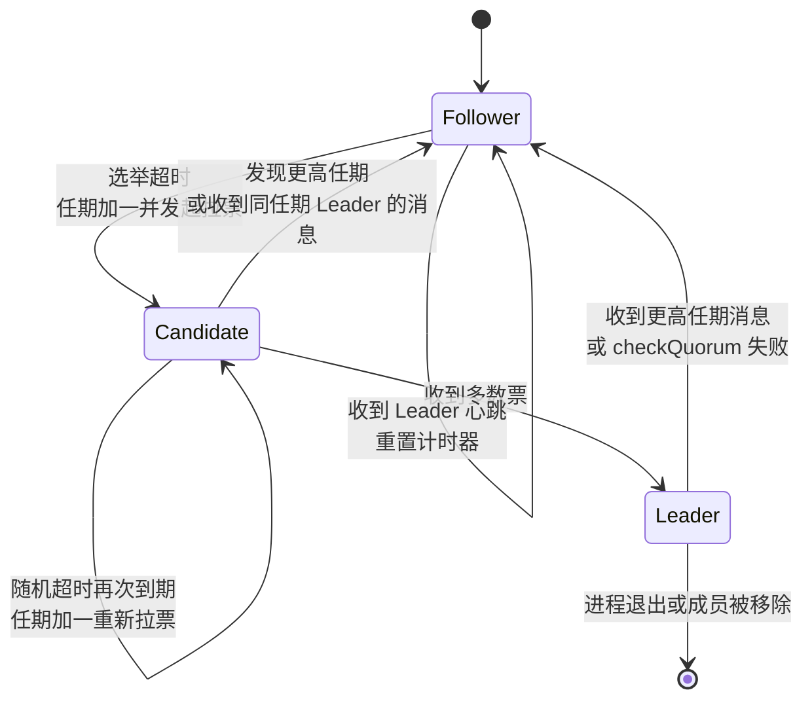
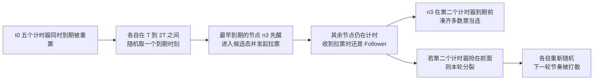
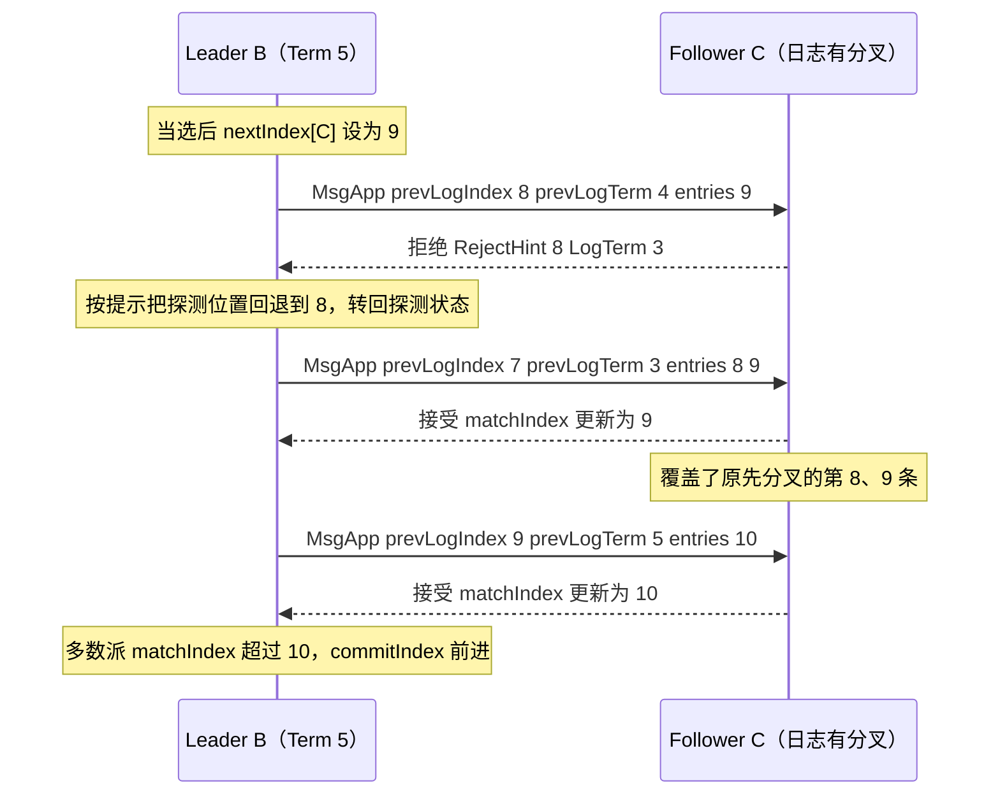
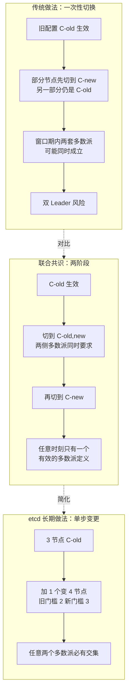

# 02 Raft 共识协议——选举、日志复制与安全性

**摘要：**

2013 年的 USENIX ATC 会议上，Diego Ongaro 与 John Ousterhout 提交了一篇标题略带挑衅的论文《In Search of an Understandable Consensus Algorithm》，他们想证明的事情很朴素：Paxos 已经解决了共识问题，但绝大多数工程师学不会它、也实现不对它，而「学得会」本身应当被当作协议的设计目标来对待。Raft 的全部取舍都从这里生长出来——强 Leader、三种角色、把时间切成任期、把一致性规则收敛成几条可逐条检验的论证。本文不去复述论文，而是问一个更具体的问题：当这套论证被搬进 etcd 之后，它长成了什么样。

文章从 Paxos 留下的两处空白讲起，说明「可理解性」为何不是副产品；随后拆开选举（随机超时、投票条件、PreVote 与 CheckQuorum）、日志复制（一致性检查、冲突回退、no-op entry 与提交规则）与安全性（quorum 交集反证、状态机安全），再进入 etcd/raft 的工程实现：无 I/O 库、Ready 与 Advance 的契约、单协程推进、批处理与流水线、日志压缩与成员变更。读完应当能回答两个问题：etcd 集群在分区、重启与扩容时为什么还能守住「已提交不丢」，以及这份保证在跨地域、只读集群与客户端重试面前为什么不够用。

---

## 第 1 章 一场关于「学得会」的赌局

2007 年，Google 的 Chubby 团队在 OSDI 上发表了一篇论文，讲他们如何用一个基于 Paxos 的粗粒度锁服务支撑 Bigtable、GFS 和 MapReduce。论文里有一句被后人反复引用的话：在 Chubby 的工程实践中真正遇到了哪些问题，与「真实系统里 Paxos 究竟能走多远」这件事几乎没有关系。这句话读起来像自谦，实际上是警告——Paxos 作为协议早已被证明正确，但从那个数学模型走到可以运维的软件之间，横着一道谁都不愿公开承认的沟。

2013 年，斯坦福的两名研究者 Diego Ongaro 与 John Ousterhout 决定认真对待这道沟。他们在 USENIX ATC 上发表《In Search of an Understandable Consensus Algorithm》，并且在论文里放了一个不太常见的实验：把同一组学生分成两拨，一拨先看 Paxos 的课程材料，一拨先看 Raft 的，然后让每个人回答同一套关于协议的问题。结论是 Raft 在可理解性、实现完整度与动手实操三个维度上都拿到了更高的分数。这个实验谈不上严谨，样本也小，但它把一件长期被默认的事摆到了明处：**可理解性**成了共识算法除了「正确」之外必须认真对待的属性，它决定了协议被正确实现的概率。

Raft 的每一次设计选择几乎都能回溯到这个属性。Paxos 之所以难有两层原因：第一层是论文本身，Lamport 的叙述以「议会」为隐喻，把正确性证明与故事推进缠在一起，读者得自己把协议从故事里提取出来；第二层更隐蔽也更要命，Paxos 只规定「一个值怎样被选定」，至于日志怎么组织、Leader 怎么选、成员怎么改、客户端怎么跟 Leader 打交道，全留给实现者发挥。在共识这种一错就丢数据的领域里，自由意味着每个实现者都要独立解决同一批难题，任何一个人的解法出错都不会在单测里暴露。

不妨把 Paxos 比作一份只规定「决议怎样才算通过」的议事规则：它没说谁来主持、主持人失联怎么办、有人中途退席怎么办、纪要按什么顺序归档。规则本身无懈可击，可一旦真开会，这些没写下来的部分才是最容易吵起来的。Raft 做的就是把它们全写下来，并为每一条配上可验证的论证。

所以本章的观点只有一句：Raft 的可理解性来自一套刻意收敛的论证结构，而并非简化协议换来的。它没有把问题变小，只是把不确定性收拢到少数几处，其余部分压成可以逐条检查的规则。

### 1.1 三个被收拢的不确定性

Raft 把分布式共识拆成三个相对独立的子问题：选出一个 Leader（选举，Leader Election）、把日志复制到多数派（日志复制，Log Replication）、保证被替换的 Leader 不会让已提交的日志丢失（安全性，Safety）。论文称之为「可分解为相对独立的子问题」，这个措辞很关键——子问题之间仍然相互约束，但它们各自都可以单独拿一张纸来论证。

三条主线对应三类不确定性：时间上的「谁来发号施令」，靠随机计时器加投票规则收拢成「任意时刻至多一个合法 Leader」；数据上的「谁的日志算数」，靠强 Leader 模型与一条前缀检查收拢成「Follower 的日志是 Leader 日志的前缀」；时序上的「Leader 是否过时」，靠单调递增的任期变成一次整数比较。收拢干净之后，安全性论证只需盯住两处，即投票条件里的「日志新旧比较」与提交规则里的「只能通过当前任期的条目提交」，其余机制都在为它们服务。

Paxos 同样能保证安全性，但那套论证散布在整个协议的行为里，读者很难一眼看出「哪几行真正决定数据安不丢」。Raft 把这几个地方标了出来，代价是放弃了一些灵活性——日志位置不能有两个有效值、Leader 是强制的、读默认要经过 Leader。这些代价在第 8 章逐一兑现。

> [!info] 与站内理论篇的分工
> 站内 [[分布式架构/分布式系统原理与协议/05 Raft 共识算法深度解析|Raft 共识算法深度解析]] 已经把论文层面的选举、复制、安全性讲了一遍，那篇的重点是「协议为什么这样设计」。本篇的重点是「协议搬进 etcd 之后发生了什么」：PreVote 与 CheckQuorum 为什么被默认打开，Ready/Advance 这套接口为什么长成这个样子，单步成员变更与 Learner 如何配合，以及这些工程约束又在哪些地方反过来限制了 Raft 的适用范围。两篇对照着读，效果最好。

---

## 第 2 章 状态、任期与那三项必须落盘的东西

Raft 里每个节点在任意时刻只处于三种角色之一：跟随者（Follower）、候选者（Candidate）与领导者（Leader）。三种角色的差别不在职责描述，而在它们各自接受哪些消息、发出哪些消息。

Follower 是被动角色，只接受 Leader 的日志复制与心跳，以及 Candidate 的拉票请求，从不主动发起 RPC。Candidate 是过渡角色，它在选举超时后出现，向全集群拉票，等到多数票或者等到别人当选。Leader 是唯一的写入入口，所有客户端提案必须由它转成日志条目并推给其他节点。

三种角色之间的迁移可以用一张状态图说清，箭头上的文字标明了触发条件：

这张图里没有画出来的一条迁移同样重要：Leader 在发现集群中已经存在一个更高任期的 Leader 时，并不会「打一架」争出胜负，而是无条件退位。Raft 里没有平局，只有任期比较。

### 2.1 任期作为逻辑时钟

任期（Term）是一个单调递增的整数，每次选举开启时加一。它的作用有三层，而且这三层常常被混为一谈。

第一层是序号：每一轮选举都对应一个唯一的 Term 值，同一 Term 内最多产生一个 Leader——这一条要靠投票规则来保证，每个节点在一个 Term 内只能投出一票，多数派不可能把票同时投给两个人。

第二层是比较基准：消息里携带的 Term 就是发送者所处的「时代」，接收者发现对方的 Term 更大，就知道自己过时了，立刻降为 Follower 并把 `currentTerm` 更新为对方的值；反过来，收到 Term 更小的消息，直接忽略或者回一条拒绝。

第三层常常被忽略，那就是「不活跃的证据」。一个节点收到的最高 Term 长期不增长，说明集群里没有人在发起选举；一旦 Term 跳了一截，说明中间发生过若干次失败的选举尝试。etcd 在 `/metrics` 里暴露的 `etcd_server_term` 就是各成员当前的 `currentTerm`，它若在短时间内连续跳变，通常意味着集群里有一个节点在不断重启或不断发起无效选举，而不是正常的 Leader 切换。

任期是逻辑时钟而非物理时钟，它不关心一轮选举花了多少毫秒，只关心「谁的回合更新」——这一点在后面的 PreVote 讨论中会派上大用场。

### 2.2 持久化与易失：状态清单

论文把 Raft 的状态分成两类，分类依据是「进程重启后还要不要」。这个划分不是学术洁癖，它直接决定了崩溃之后集群还能不能守住安全性。

| 状态 | 归属 | 崩溃后是否保留 | 谁维护 | 丢失后果 |
| :--- | :--- | :--- | :--- | :--- |
| `currentTerm` | 全部节点 | 必须持久化 | 每次变更先落盘再回复 | 可能在同一 Term 内重复投票，双 Leader |
| `votedFor` | 全部节点 | 必须持久化 | 投票前落盘 | 同上，且可能投给日志更旧的候选者 |
| `log[]` | 全部节点 | 必须持久化 | Leader 追加时落盘 | 已提交条目丢失，直接破坏安全性 |
| `commitIndex` | 全部节点 | 易失 | Leader 计算后广播 | 重启后重新推导，不影响安全 |
| `lastApplied` | 全部节点 | 易失 | 状态机推进时更新 | 重启后从快照重建，不影响安全 |
| `nextIndex[]` | 仅 Leader | 易失 | 当选时初始化为 `lastLogIndex+1` | Leader 换代后重新探测 |
| `matchIndex[]` | 仅 Leader | 易失 | 根据 AppendEntries 响应更新 | 同上 |

把 `commitIndex` 标成易失常让人不安：提交状态丢了也没关系？关系不大，因为它靠下一任 Leader 重新推导——新 Leader 在日志末尾追加以当前 Term 的空条目，多数派确认后 `commitIndex` 自然回到正确位置，前一任期里「已被多数派接受、却来不及声明提交」的条目随之提交。这条恢复路径正是第 5 章要论证的部分。

etcd 的落盘形态与这张表并不完全一一对应。etcd 往 WAL 里写一个叫 `HardState` 的结构，含 `Term`、`Vote`、`Commit` 三个字段：前两个对应表格的头两行，第三个却把易失的 `commitIndex` 也持久化了。这不是破坏论文的划分，而是工程上的顺手——提交索引本来就要随快照元数据写入，顺势记进 HardState 可以把重启后 apply 的起点提前一些，省掉一部分重算；即便这个字段丢了，安全性也不受影响。WAL 的格式与写入时序在 [[03 存储引擎——WAL、BoltDB 与 MVCC 的持久化链路]] 里展开。

## 第 3 章 选举：让「谁来领导」变成一道概率题

共识协议里最难处理的是「恰好同时」。两个节点同时发现 Leader 失联，同时宣布参选，各自给自己投一票，再各自拿到一张反对票——这一轮谁都没赢。若两边节奏完全同步，下一轮还会重演，集群就此卡在死循环里，即**选举活锁**（livelock）。

Raft 对这个问题的处理方式很直接：给每个节点的选举计时器加上随机量。每个 Follower 在重置计时器时，从 `[electionTimeout, 2 × electionTimeout)` 这个区间里取一个值作为本次的等待时长，先到期的那位第一个站出来拉票。

### 3.1 随机化为什么有效：一个概率直觉

假设集群有 5 个节点，所有节点的计时器在同一个瞬间被 Leader 的崩溃「重置」，然后在长度为 T 的窗口里各自独立地均匀取一个到期时刻。我们要问的是：最早到期的那位，能不能在其他人到期之前凑齐三票。

先算清竞争关系：五个人里要凑三票才算过线，候选者自己一票当场就有，还差两票，它只有赶在别人醒来之前抢到这两票才算赢——第二早的节点一旦也宣布参选，就会拿走一票，最早那位就凑不齐了。

所以成功率取决于两件事：一是第一个到期者与第二早到期者的时间差，要足够走完两轮网络往返；二是抢不到的那几张票要能被重新聚到同一个人身上。把 N 个到期时刻看成均匀撒在窗口里的点，最早与第二早之间的缝隙往往很短（五节点时期望只有窗口的几十分之一），于是第一次拉票常常抢在别人醒来之前完成，也常常抢不完。

不过这个结论并不吓人：分裂的代价低得出奇，每分裂一次，各节点各自重新随机，下一轮不再是同一批人同时醒来。把单轮失败概率记作 p，连续 k 轮都失败的概率大致按 p^k 衰减，p 即便有几分之一，几轮之内收敛也是常态。

真正起作用的不是数字而是结构：随机化把「同时」从确定性事件变成了低概率事件，而低概率事件可以靠重试消化——随机化不是让冲突消失，而是让冲突变得可以靠耐心解决。

把单程时延记作 d、选举窗口记作 T，候选者从拉票到收到多数响应大约要走两趟网络。只要 T 是 d 的若干倍，第一个到期者赶在第二位之前完成拉票就是大概率事件。

### 3.2 etcd 的两个参数：区分推荐值与默认值

论文的推荐值常被误当成 Raft 的「标准配置」，于是有人看到 etcd 默认 1 秒的选举超时，就得出「etcd 实现得比论文慢」的结论。两个数字回答的其实是不同问题：150 到 300 毫秒是给通用实现的经验区间，前提是局域网、亚毫秒级时延；etcd 面对真实集群，虚拟机会被宿主机抢 CPU，网络抖动尾部能到几十毫秒，Leader 所在机器可能正在做一次很慢的 fsync。

| 维度 | 论文推荐 | etcd 默认 | 说明 |
| :--- | :--- | :--- | :--- |
| 心跳间隔 | 比选举超时小一个数量级 | `--heartbeat-interval=100ms` | etcd 内部换算成 tick，心跳占 1 个 tick |
| 选举超时 | 150 到 300 毫秒 | `--election-timeout=1000ms` | 内部换算成 `ElectionTicks`，是心跳的 10 倍 |
| 两者的约束 | 未写死 | 选举超时不得小于心跳间隔的 5 倍 | etcd 在参数校验阶段就会拒绝 |
| 随机化方式 | `[T, 2T)` | `[ElectionTicks, 2 × ElectionTicks)` | etcd/raft 里由 `resetRandomizedElectionTimeout` 生成 |

`server/config/config.go` 的 `NewServerConfig` 给出的默认值就是 `TickMs: 100` 与 `ElectionMs: 1000`，参数校验里还有一条硬检查：`5 × TickMs > ElectionMs` 时报错退出。1000 除以 100 得 10，落在安全区间里；若有人为切换更快把选举超时压到 200 毫秒而心跳仍是 100 毫秒，etcd 会直接拒绝启动。道理很朴素——选举超时只比心跳大一点点时，一次 jitter 就足够让 Follower 误判 Leader 已死，集群陷入反复选举。

心跳间隔也不是越大越好，它同时决定了「Leader 失联到 Follower 开始选举」这段盲区长度，以及线性一致读的判定窗口。100 毫秒心跳配 1000 毫秒选举超时，在局域网里是一组偏保守的参数；跨地域或高延迟链路上应当按实测时延上调，而不是照搬默认值。

### 3.3 四种可能结局

一次选举发起之后，结局不外乎四类，想清楚它们，读 etcd 日志会轻松很多：第一类是顺利当选。候选者拿到多数票成为 Leader，随即广播心跳与一条空条目，让日志末尾带上当前 Term 的标记，为提交旧条目铺路（第 5 章详解）。

第二类是被更高任期打断。拉票途中收到 Term 更大的消息，无论来自新当选的 Leader 还是更激进的候选者，它都立刻降为 Follower 并更新 Term。

第三类是任期不够让对方让位。拉票请求的 Term 比接收者大，但接收者在那个 Term 里已经投过票，只能拒绝，拒绝票里通常还带着对方的 Term，候选者据此发现自己已经过时。

第四类是选票分裂，谁都没过半，只能等下一个随机超时再战。开启了 PreVote 的集群里这类结局的日志形态会变——看到的是 `became pre-candidate` 而不是 `became candidate`，因为第一轮只算试探。

### 3.4 RequestVote 的三条条件

投票逻辑是 Raft 安全性最集中的地方之一。一个节点 B 收到节点 A 的拉票请求时，只有同时满足三个条件才会投赞成票。

第一条，A 的 Term 不小于 B 的当前 Term。这条看起来是在防止过时的候选者捣乱，但它真正的作用是保证 B 不会为一个还没到期的时代投出票。B 若收到 Term 更小的请求，直接拒绝；Term 更大则 B 先把自己的 Term 更新为 A 的 Term，清空投票记录，再进入下一条件的判断。

第二条，B 在这个 Term 里还没有投过票，或者已经投给的就是 A。这条是「一 Term 一票」的落地。它的正确性直接决定了不可能在一个 Term 内产生两个 Leader：如果有两个候选者都拿到了多数票，那么至少有一个节点同时给两人投票，违反第二条。

第三条分量最重：A 的日志至少和 B 一样新。判定先比最后一条日志的 Term，大者更新；Term 相同再比索引。etcd/raft 的 `isUpToDate` 写的就是这句：对方的 `lastTerm` 更大，或者 `lastTerm` 相等而 `lastIndex` 不小于自己的，才算「不比自己的旧」。

直觉可以分两种情形：若 A 的末尾 Term 更大，说明它接触过一个更晚任期的 Leader，而那位能当选本身就说明它当时握着最全的日志；若末尾 Term 相同，规则退化成比长度，长的一方至少含有短的一方在同一 Term 内的全部记录——一个 Term 只有一个 Leader，它的日志只追加不覆盖。

这条规则比直觉更严：它只比较「末尾长什么样」，不问内容是否重叠。于是完全可能出现 A 的日志其实包含了 B 的全部已提交内容、只因末尾少几条未提交条目就被判成不够新的情形。这种严格是必要的——Raft 无法从日志形态判断内容重叠，只能用最保守的比较换取「新 Leader 一定拥有全部已提交条目」。第 6 章的 quorum 交集证明会用到它。

### 3.5 PreVote：分区掉队的节点为什么不该参选

前四节讲的是论文里的选举。etcd 在此基础上多做了两件事：**预投票**（PreVote）与**法定人数检查**（CheckQuorum），两者默认都开启。

PreVote 要解决的问题，可以从一个 5 节点集群说起：，某个节点因网络抖动被隔离了大约 30 秒，期间收不到任何心跳，于是一次次超时、一次次参选，每次把 Term 加一，却一张票也拿不到。按 1 秒的选举超时估算，30 秒足以把它的 Term 推到 20 甚至更高。

网络恢复后，这个节点带着 Term=20 重新出现，向其他节点拉票。其他节点的 Term 还停在 5，看到 20 立刻接受并投票；现任 Leader（Term 5）收到任何一条 Term=20 的消息，只能立即退位。一次毫无必要的切换就此发生，而这个刚恢复的节点日志落后很多，即便当选也要先追上大量日志才能服务。

etcd/raft 的注释把这段因果写得很直白：被隔离的 Follower 很快会参选并把 Term 推高却拿不到足够的票，恢复后带着更高的 Term 回来，迫使现任 Leader 退位。

PreVote 的做法是把投票拆成两个阶段。节点超时后先进入「预候选者（Pre-Candidate）」状态，发出的预投票请求（`MsgPreVote`）携带的是 `当前 Term + 1`，却不真正修改自己的 Term；接收者以「假如你现在真要参选，我会不会投你」的逻辑回答，而自己既不增加 Term 也不改变投票记录。只有预投票拿到多数票，节点才真正把 Term 加一、自投一票，发起正式选举。

那个被隔离 30 秒的节点恢复后，预投票会被拒绝：接收者看到对方 Term 很高，但自己这一届有活跃 Leader 的心跳，对方日志又落后，两条理由都足够，Term 因此传不出去。

代码层面有两处关键实现，一是 `campaign` 函数：预选举走 `campaignPreElection` 分支，消息里的 Term 取 `r.Term + 1`，而 `becomePreCandidate` 不改 `r.Term`。二是 `Step` 里对消息 Term 的处理：收到 `MsgPreVote` 时注释明写「永不因 PreVote 改变自己的 Term」，收到同意的 `MsgPreVoteResp` 也不立即改，要等 `poll` 里汇总出多数才真正进入新 Term。两处合起来让预投票只是「问一句」，不产生任何持久化副作用。

预投票携带 `当前 Term + 1`，接收者回答「假如你真参选，我会不会投你」，因此日志判据与正式投票完全一致，唯一不适用的是「这一届是否已投过票」。判据一致，安全性不会因为多一轮而放宽。

### 3.6 CheckQuorum：孤立 Leader 为什么要主动退位

PreVote 防的是「掉队节点骚扰集群」，CheckQuorum 防的是反方向的问题——「孤立 Leader 赖着不走」。

Leader 被隔到少数派一侧后依然认为自己活着，照常回应客户端。若读操作走「直接查本地状态机」的路径，它就会返回过时数据而毫无察觉——分区另一侧可能早已选出新 Leader 并写入大量新数据。

CheckQuorum 的思路是让 Leader 定期向多数派确认自己的健康状态。etcd/raft 的 `raftConfig` 里把 `CheckQuorum: true` 写死了，同时 `PreVote` 从配置项读取，etcd 的默认配置 `PreVote: true`。CheckQuorum 生效后，Leader 每个心跳周期都会检查：过去一个选举超时的时间内，是否收到了多数派节点的响应？如果没有，它就主动降为 Follower。

这个检查的判据是回应者的数量而非内容，在 etcd/raft 里由每个 `Progress` 的 `RecentActive` 字段维护；被隔开的 Leader 最多等一个选举超时（默认 1 秒）就发现响应者不足，主动退位，此后读请求只能返回失败，由客户端重试到真正的 Leader。

CheckQuorum 还有一层不显眼的作用：防御「已删除成员」。被移出集群的节点看起来一切正常，只是没人再回应它，若继续参选就会带来无关 Term 增长。etcd/raft 的注释把两个特性合起来的效果写成「最小化被移除节点造成的扰动」——它发的 `MsgVote` 与 `MsgPreVote` 被忽略，也收不到 `MsgApp` 与 `MsgHeartbeat`。

### 3.7 两个特性的协同与代价

PreVote 与 CheckQuorum 单独打开时各有短板，配合打开才完整。PreVote 阻止掉队节点把 Term 推高，但它无法阻止已当选的 Leader 在被隔离后继续以为自己合法；CheckQuorum 让 Leader 在响应者不足时退位，但它对「还没当上 Leader 的节点疯狂加 Term」无能为力。两者结合之后，集群里的 Term 增长就基本只发生在真正的 Leader 失效之后。

代价也有两处。其一，故障切换多了一轮往返——预投票本身不发持久化、不改 Term，但它是实打实的一次网络交互；局域网里可以忽略，高延迟链路上会叠加。其二，主动转移领导权（Leader Transfer）必须绕开租约保护：etcd/raft 在收到 `MsgVote` 或 `MsgPreVote` 时，若处于「租约未过期且对方不是强制转移」的状态会直接忽略，转移请求因此在 `Context` 里带 `campaignTransfer` 标记，接收者即便刚听过心跳也得响应，代码里的 `force` 变量就是为这条路径准备的。

运维提示：发现「Leader 切换特别慢」时，别急着调小选举超时。某些定制构建里 `--pre-vote=false` 会让切换少一次往返、看起来更快，代价是分区恢复后的抖动重新回来。

---

## 第 4 章 日志复制：把不一致收敛成前缀

选举解决「谁说了算」，日志复制解决「说了算的话怎么传达下去」。Raft 的模型极其朴素：所有日志条目都由 Leader 产生，一律从 Leader 流向 Follower，Follower 从不反向推送。Leader 的日志是权威版本，Follower 的日志最多只能是它的前缀，不会是它的变体。

这与主从复制表面相似，却有一处根本不同：主从复制里从库落后就补、多出来一条就报错，而 Raft 里 Follower 多出来的条目会被 Leader 直接覆盖，并且这是安全的——能被覆盖的条目一定没被提交过。

### 4.1 AppendEntries 的六个字段

日志复制的载体是追加日志请求（AppendEntries，etcd/raft 里叫 `MsgApp`）。它的字段不多，但每一个都承担着明确职责。

| 字段 | 含义 | 谁来用 |
| :--- | :--- | :--- |
| `term` | Leader 的任期 | Follower 用来判断合法性，更大则降级 |
| `leaderId` | Leader 的成员 ID | 用来重置计时器与转发客户端请求 |
| `prevLogIndex` | 紧邻新条目之前那一条的索引 | Follower 用来做一致性检查 |
| `prevLogTerm` | 上一条的任期 | 同上，与索引一起构成前缀定位 |
| `entries` | 要追加的条目，心跳时为空 | Follower 追加或覆盖 |
| `leaderCommit` | Leader 已知的提交索引 | Follower 据此推进自己的提交索引 |

**一致性检查**是 Raft 日志复制的枢纽。Follower 收到请求后，先定位自己日志里 `prevLogIndex` 位置上的条目，比对它的 Term 是否等于 `prevLogTerm`；位置不存在或者 Term 对不上，就拒绝这次请求，一条数据都不追加。

一次比对能覆盖整个前缀，靠的是一条归纳性质：如果两个日志在某个索引上的条目具有相同的 Term，那么它们从开头到这个索引的所有条目都相同。归纳起点是「同一个 Term 内，Leader 在某个索引上只创建一条日志」，这是每任期至多一个 Leader 的直接结果；归纳步骤是：假设 i 之前已经相同，若两者在 i 上的 Term 也相同，则写入 i 的是同一个 Leader，内容自然相同。所以一致性检查不需要逐条比对，只需要校验一个锚点。

### 4.2 nextIndex 与 matchIndex：Leader 的两个记账本

Leader 给每个 Follower 维护两个数：`nextIndex` 与 `matchIndex`。前者是「下一次该从这个位置开始发」，后者是「我确信它已经收到了哪里」。

Leader 当选时把所有 `nextIndex` 置为自己日志末尾加一、把所有 `matchIndex` 置为 0（自己除外），这是一个刻意的乐观假设——先假设所有人都跟自己一样全，再靠失败响应逐步纠正。

发送流程是这样的：Leader 取 `nextIndex[F] - 1` 作为 `prevLogIndex`，取自己在那个位置上的 Term 作为 `prevLogTerm`，把 `nextIndex[F]` 之后能装进一个消息的条目一次性带上发出去。Follower 检查通过就返回成功，Leader 把 `matchIndex[F]` 更新为最后一条被确认的索引，`nextIndex[F]` 同步推进到其后一位。

检查失败就返回拒绝，Leader 把 `nextIndex[F]` 往回退。最朴素的退法是一次退一格，落后一千条日志的 Follower 就要来回一千次。etcd/raft 用「带回退提示的快速回退」替代：Follower 在拒绝响应里带上 `RejectHint` 与 `LogTerm`，告诉 Leader「在这个位置我的 Term 是多少」，Leader 据此一次跳过整段同 Term 的日志。

Leader 侧调用 `findConflictByTerm(m.RejectHint, m.LogTerm)` 来找下一次探测的位置，然后在 `Progress` 上执行 `MaybeDecrTo`。函数名里的 `Maybe` 表示它只在「建议位置比自己当前认为的位置更靠前」时才接受，防止双方来回震荡。如果这次回退让这个 Follower 从「复制中（StateReplicate）」状态掉回「探测中（StateProbe）」，Leader 还会立即补发一次探测请求，加快收敛。

一次冲突修复可以画成时序图。图中假设集群有三个节点，节点 C 在旧 Leader 任期内多出了两条未提交条目：

时序图里的第二次交互体现了快速回退的价值：只需两次往返，而不是逐条回退到公共前缀。注意这里回退的是 Follower 侧的状态，Leader 从未修改自己的日志——这也就是「Leader 的日志是权威」的具体含义。

### 4.3 commitIndex 的推进规则

`matchIndex` 是 Leader 的私人记账，什么时候把它变成集群的公共事实？这是 Raft 论文讨论得最细的地方之一。

Leader 把自己这一侧所有节点（含自己）的 `matchIndex` 排序取中位数，中位数大于当前 `commitIndex` 时理论上就可以推进。但 Raft 加了一条限制：只有当前 Term 的条目才能用来推进提交索引。

排序取中位数这件事，其实就是「过半」的另一种说法：五个人里排第三的那个，恰好是至少三个人都到达的位置。

etcd/raft 把这条限制写进了 `maybeCommit`：Leader 侧传入的 `entryID` 是 `{term: r.Term, index: r.trk.Committed()}`，而 `raftLog.maybeCommit` 里先检查 `at.term 非零、at.index 大于 l.committed 且 l.matchTerm(at)`，`matchTerm` 要求「本地在 `at.index` 上的条目 Term 恰好等于 `at.term`」。换成日常语言：Leader 只有当多数派确认的那一点落在自己当前任期的条目上时，才会推进提交索引。

至于为什么必须这么限制，下一章用一条完整的时间线讲清楚。

### 4.4 no-op entry：新 Leader 上任的第一件事

按上一条规则，新 Leader 上任时日志末尾可能是若干旧任期未提交的条目。若直接对这些旧条目做「多数派确认即可提交」的判断，就会踩到安全性的坑；若老实等当前任期出现新日志，那么在客户端不写入的情况下，`commitIndex` 永远停住，前一个任期的日志也永远不会被提交。

解决办法是 Leader 当选后立即追加一条空条目。etcd/raft 在 `becomeLeader` 里调用 `appendEntry(&pb.Entry{Data: nil})`，这条条目的类型是 `EntryNormal`，数据为空，Term 是新的任期。然后 Leader 把这条空条目复制出去，一旦多数派确认，`maybeCommit` 就会通过，`commitIndex` 前进到空条目的位置，前一个任期内所有已经被多数派接受的条目因为「前缀性质」被一并提交。

细节在于：空条目的索引是 `lastLogIndex + 1`，位于旧条目之后；它被提交时 `commitIndex` 跳到它的位置，Follower 在下一次 `MsgApp` 里收到 `leaderCommit`，用 `min(leaderCommit, 自己最后一条索引)` 更新提交索引，全集群的提交状态一起前进。

还有一条容易忽略的优化：Follower 处理 `MsgApp` 时不必总等 Leader 明确告知提交位置。若某条条目的 Term 小于当前 Term（Leader 已换代）且索引不大于 `leaderCommit`，Follower 就可以认为它已提交。这条规则避免「Leader 已提交、通知未到」期间的读请求读到旧数据。

### 4.5 leaderCommit 的传播与 apply 的推进

Follower 的 `commitIndex` 更新规则很简单：取 `leaderCommit` 与「自己日志最后一条索引」的较小值。这个 `min` 是必要的——Follower 的日志可能还没跟上 Leader，如果直接采用 `leaderCommit` 就会越过自己的日志末尾。

提交之后是应用（apply）。etcd 里 `commitIndex` 与 `lastApplied` 之间那段尚未应用的条目，由 apply 协程按序取出，交给 `applySnapshot` 或 `applyEntryNormal` 处理。`delete`、`put`、`lease revoke`、`conf change` 这些操作都在这里落地到 MVCC 与 bbolt。

apply 的顺序严格递增，不跳跃也不乱序。这不是性能优化而是正确性前提：状态机是确定性函数，只有输入顺序与日志顺序一致，各节点算出的状态才一致，第 6 章会把它作为「状态机安全性」单独论证。

---

## 第 5 章 那条空条目：提交规则的反例与绕法

第 4 章末尾留下一个问题：Leader 为什么不能用旧任期的条目推进提交索引。答案不能靠一句「可能有风险」糊弄过去，需要一条具体的时间线，让读者自己看到「如果这么干，哪一步会出大问题」。

### 5.1 一个五节点集群的时间线

设想五个节点 A、B、C、D、E，初始时日志都为空，任期都从 0 开始。

第一步，A 在 Term 1 当选 Leader，在索引 1 追加一条条目，只来得及复制给 B 就崩溃了。索引 1 上的条目只在 A 和 B 手上，没有达到多数派，未提交。

第二步，超时之后 C 发起选举。为了不让 PreVote 干扰这条故事线，先假设它尚未开启。A 已崩溃，B 的日志是「Term 1、索引 1」，C、D、E 的日志都空着。B 的日志更新，会拒绝 C；但 B 只有一票，C 从 D、E 各拿一票，加上自己正好凑齐三票，当选 Term 2 的 Leader。

第三步，C 在 Term 2 的索引 2 上追加一条新条目，只复制给 D 就崩溃了，同样没有提交。

第四步，B 发起选举。此时活着的只剩 B 和 E，B 的日志比 E 新，拿到两票——存活侧两票即多数，B 当选 Term 3 的 Leader。这是整条时间线里最让人不舒服的一步：日志并不完整的节点，只要幸存者恰好没有更完整的日志，就能合法当选。

第五步，B 在 Term 3 的索引 3 上再追加一条新条目，只复制给 E 就崩溃了，依旧没有提交。

问题在这里显形。索引 2 上站着两条冲突条目：C 和 D 手里是「Term 2」，B 和 E 手里是「Term 3」。两边各两人，都只覆盖五个节点中的两个，谁也不占优势——这正是 Raft 必须避免的局面。

故事的收尾更耐人寻味：若任何一任 Leader 采用「多数派持有即可提交」的朴素规则，它就把索引 2 上自己那一版当成永久真相，另一批节点也这么想。灾难不在当下爆发，而在下一次选举——C 若在 Term 4 重新当选，会用它那版 Term 2 覆盖 B 的 Term 3；反过来也一样。两边都曾对外声称索引 2 已提交，状态机就此分叉。

论文把这个反例画成 Figure 8，它是全文被引用最多、也最容易被跳过的一张图，建议与上面的时间线逐格对上。

### 5.2 为什么「多数派持有」不足以保证提交

从上面的时间线可以看出，问题出在一个隐含假设上：多数派持有某条目，是否等价于该条目永远不会被覆盖？

答案是否定的。多数派持有只说明「那一刻它被足够多的节点记住了」，却拦不住这些节点在某次选举里把票投给一个日志更差的候选者；而后者之所以能当选，恰恰因为它没有那条条目——投票规则比较的是日志末尾的 Term 与长度，不问内容。

再往根源追一层：Raft 的选举与日志复制是两条相互独立的通道。一条条目最终能否保住，取决于「持有它的那批节点会不会在未来某次选举里输给日志更差的候选者」。把这个模糊的条件变成可检查的规则，Raft 的做法是——提交只能由当前任期的条目宣告。

在反例里看得更清楚：B 当选 Term 3 之后若立刻追加一条 Term 3 的空条目并复制到多数派，`commitIndex` 就能越过空条目的位置，它前面的旧任期条目随之进入提交状态，从此不可覆盖。

### 5.3 空条目如何绕开反例

空条目的巧妙之处在于它给「提交」这件事加了一个人工的时间戳。在没有空条目的情况下，新 Leader 想提交旧条目，只能宣布「多数派已经持有，所以可提交」，而这个宣布本身没有任何约束力；有了空条目，新 Leader 必须先让一条 Term 等于本届的条目被多数派确认，这件事本身就排除了上一届那种「一批节点持有旧条目、另一批节点持有新条目」的混乱局面。

从代码看，etcd/raft 的 `becomeLeader` 在完成状态切换后用 `appendEntry` 追加一条空条目，给它打上当前任期与递增索引，放进 `unstable` 等待下一次 `Ready()` 交出。这一行没有任何注释解释它的安全性意义，真正的因果藏在 `maybeCommit` 里：它传入的 `term` 是当前任期，`matchTerm` 要求本地在这个索引上的条目 Term 与之相等。于是，旧任期的条目即便被所有节点持有，也不会让 `commitIndex` 前进一步；只有等空条目被确认，`commitIndex` 才会越过它，顺带把旧条目带入提交状态。

> [!important] 一句话记住提交规则
> 提交只能由「当前任期的条目被多数派确认」宣告；旧任期的条目再多人持有也不算数，它们要等新 Leader 的空条目被确认时才被顺带提交。这条规则是 Raft 与「朴素的多数派复制」最重要的分界线。

这个机制还把「日志恢复」与「提交推进」解耦：Follower 只管追平日志、按 `leaderCommit` 推进提交，Leader 只管让当前任期条目被多数派确认，整个恢复路径都能用「探测态回退、复制态追平」统一处理，不必为旧任期条目写特殊分支。

### 5.4 空条目带来的两个副作用

第一个副作用是每次 Leader 切换都会多出一条日志条目。这在数据量上可以忽略，但它对 etcd 的 revision 有影响：etcd 把 Raft 条目应用到状态机时按顺序分配 revision，空条目虽然不含 KV 操作，却依然消耗一个 Raft 索引，于是 revision 上留下一个没有对应键的缺口。在 etcd 的 `watch` 里偶尔看到的「空跳」，多半就是一次 Leader 切换留下的痕迹。

第二个副作用在 apply 时序上：空条目提交后，apply 协程也要把它跑一遍——没有任何键值操作，但 `applyEntryNormal` 依然被调用一次，`appliedIndex` 随之前进。对正常请求影响微乎其微，etcd 也没有为此做特殊优化。

这两个副作用与「安全性」相比都不值一提，但它们解释了一个常见的困惑：为什么一个几乎不写的 etcd 集群，日志依然在增长。只要 Leader 换过一次，日志里就会多一条记录。

---

## 第 6 章 安全性：两份多数派名单的交集

到此为止，选举与日志复制各自都讲通了，但它们合起来不会出问题，还需要证明。Raft 的安全性由几条互相支撑的性质构成，其中最重要的是**领导者完备性**（Leader Completeness）——已经提交的日志一定出现在未来所有 Leader 的日志里。

### 6.1 领导者完备性：一次反证

论文的证明用反证法，笔者把它拆成一条可读的推理链，每一步只依赖前一步。

先固定符号：某条目在任期 T 被提交，提交的含义是「Leader 在任期 T 内确认它被多数派持有」；T' 是大于 T 的第一个「Leader 日志里没有这条条目」的任期，记该 Leader 为 L'。

第一步，任期 T 到 T' 之间的 Leader 日志里都有这条条目，这是 T' 的最小性决定的。

第二步，看 L' 当选的那次选举。投票给它的节点集合 V 超过半数；而条目的提交意味着存在一个多数派 C，其中每个节点都持有它。两个多数派必然相交：若 V 与 C 毫无交集，两者相加会超过节点总数。于是至少有一个节点 X 既在 V 中（投了 L'），也在 C 中（持有该条目）。

第三步，X 投出赞成票必须满足投票条件第三条：L' 的日志至少和 X 一样新。`isUpToDate` 把它写成两个分支——L' 的末尾 Term 更大，或末尾 Term 相等而索引不小于 X。X 持有该条目，其末尾 Term 至少是 T、末尾索引至少是该条目索引。

第四步，对 L' 的日志末尾分类讨论。若末尾 Term 大于 T，L' 在某个位置上有 Term 大于 T 的条目，而日志 Term 单调不减，L' 必然包含所有 Term 不大于其末尾的条目，包括被提交的那条。若末尾 Term 恰为 T，L' 与 X 处在同一个 Term，按索引比较 L' 不短于 X，而同一 Term 内的日志是唯一片段，于是 L' 的日志是 X 的超集。

两种情形都与「L' 没有这条条目」矛盾。证明完成。

这个证明把多条性质全部压到了投票那一步：领导者完备性不依赖日志复制的细节，只依赖「多数派交集」与「投票条件第三条」。投票条件写得这么严，就是因为任何一次选举放松一点，第三步就会断。

不妨把这件事比作仓库交接时的签字簿：每次交接要过半数的人签字，规矩是「谁的东西比你新，你才能签给他」。只要规矩被遵守，就永远不会出现「某笔资产被上一个保管人移走、下一个保管人却说自己没见过」的情况——签字那个人一定同时出现在两份名单里，而他的签字本身就说明后一个保管人的东西不比他旧。

补一句技术限定：现实中的签字簿可以伪造，Raft 里不行。`votedFor` 是持久化状态，节点重启后依然记得这一届投过谁；若它没落盘，节点重启后可能忘记投票、在同一 Term 内再投一次，两个节点同时给两个人投票，证明就在第二步失效。这正是第 2 章把 `votedFor` 列为「必须持久化」的原因——安全性的每一环都扣着持久化细节。

### 6.2 状态机安全性：顺序决定结果

领导者完备性保证日志不丢，状态机却是另一层：两个节点拥有完全相同的日志，是否一定算出相同状态？在 Raft 里是的，前提是两条纪律。

一条纪律是 apply 按索引严格递增、连续进行。etcd 的 apply 循环从 `commitIndex + 1` 起逐条取，不跳过也不并行；即便底层存储支持并发写，apply 这一层也会把顺序压平。

另一条纪律是状态机函数必须确定：同样的输入，任何合法实现都算出同样输出。约束通常落在应用层，但 Raft 日志里还有一类特殊条目——配置变更（ConfChange），它也要经 apply 生效。etcd 应用配置变更时会校验合法性，校验失败的那条被当作空操作丢弃，而这个「丢弃」的决定必须被所有节点一致做出，否则成员配置会分叉。

两条合起来给出一个可检验的推论：若两个节点的日志在某索引之前完全相同，则应用完这些条目后状态机也相同。推论由归纳法给出，起点是初始状态相同，每一步由确定性保证。它对 etcd 的意义很具体：任意时刻，任意两个 apply 到同一 revision 的成员，状态机数据完全一致——这正是备份能在任意成员上执行、`hash-kv` 校验能直接比对的原因。

### 6.3 一条被忽略的保证：任期单调

Raft 还有几条不起眼却很实用的性质，其一是「任期单调不减」：节点认过的最高 Term 是 t 之后，不再接受更小的 Term。这让「拒绝」可以推理——A 一直收到 B 的拒绝，说明 B 的日志比 A 新。

etcd 在成员管理上利用了它。节点被移出集群后仍维持本地状态，却再也收不到心跳，Term 不再被集群事件推动；若日后被误加回来，日志往往已严重落后，必须靠快照追上。Learner 与成员变更的细节留到第 9 章。

### 6.4 raftLog 的三段式与快照

Raft 库内部的日志被切成三段，这是理解 etcd 内存与磁盘行为的关键。第一段是快照之前、已被压缩掉的日志；第二段是 `storage`，即 `MemoryStorage` 保存的「快照之后到已落盘」那一段；第三段是 `unstable`，即刚从 Leader 收到或刚被提议、尚未落盘的那一段。

三段的边界由三个索引界定：`committed` 是「已知在多数派上落盘的最高位置」，`applying` 是「已交给状态机、可能还没应用完的最高位置」，`applied` 是「状态机确认应用完成的最高位置」，不变式是 `applied ≤ applying ≤ committed`。`unstable` 单独存在的原因是：Leader 收到 Follower 确认时，那条条目可能还没写进本地 WAL，`Ready()` 把两者一起交出、由调用方先落盘再发消息。

快照触发点由 `--snapshot-count` 控制，默认 100000：每应用 10 万条日志触发一次，把状态机的 bbolt 文件复制一份、写入快照元数据、再截断 WAL，`raftLog` 的起点随之前移，`unstable` 不必保留太远的历史。调小则快照频繁、每次都要复制 bbolt 文件，压力被摊散，但 WAL 更短、重启更快；调大则写放大减少，代价是 WAL 变长、重启重放更久。默认的 10 万是多年前的保守值，不少生产环境把它调到 1 万到 5 万，理由与安全性无关，只为控制 WAL 目录的增速。与之搭配的还有 `SnapshotCatchUpEntries`（etcd 侧默认 5000）：快照之后并不立刻压到快照点，而是多留 5000 条，给慢 Follower 一个不发快照就追上的窗口。快照文件的构成与 WAL 截断的细节，在 [[03 存储引擎——WAL、BoltDB 与 MVCC 的持久化链路]] 里展开。

---

## 第 7 章 虫洞与时序：这些机制缺了会怎样

前六章讲的都是「有什么」，这一章反过来问「要是没有会怎样」。三个反事实场景各对应一类真实故障。

### 7.1 没有 PreVote：一次分区恢复的完整故事

设想五节点集群 n1 到 n5，n1 是 Leader，Term 一直是 12，时间参数用默认值。某个凌晨交换机抖动，n2 与其余节点断开三分钟——三分钟对 etcd 极长，选举超时只有 1 秒。

断开约 1 秒后它的计时器到期，进入 Term 13 参选；拉票请求发不出去，或者发出去了收不到回应；再等 1 到 2 秒，进入 Term 14；如此往复。三分钟足以把 Term 推到一百多。

恢复的瞬间 n2 并不知道自己掉队，仍按自己的节奏参选。它的拉票请求携带的 Term 远高于 12，接收者看到后立刻把 `currentTerm` 更新为这个值并投票——Raft 的规则是「Term 更大就先认」，本意是让集群跟上时代，在这里却成了传染源。n1 同样只能退回 Follower，全集群的 Term 一起跳到一百多。n2 日志落后、拿不到多数票，但 Term 已被推高，下一轮要从新 Term 重来；集群有几秒钟没有 Leader，写请求与线性一致读全部失败。若还有别的节点在重启，每个都要走一遍「旧 Term → 认领高 Term → 再选举」。

开启 PreVote 之后，同样的三分钟里 n2 一次都不会把 Term 13 及以上写进持久状态。它每隔一两秒发一次预投票，写着的 Term 一路上涨，接收者看到的是「你想参选，但我这一届有活跃 Leader，你的日志也不比我新」，于是回绝；回绝没有副作用，两边都不改 Term。恢复后 n1 的心跳照常到达，n2 的 Term 被更新回 12、日志补齐，集群没有一次多余选举。

n2 参选的次数取决于「离线时长 ÷ 选举超时」，与网络恢复的时刻无关，恢复时的 Term 落差因此与分区时长成正比：几百毫秒的分区看不出抖动，几分钟的分区在没有 PreVote 时几乎必然触发一次切换。

### 7.2 没有 CheckQuorum：孤立 Leader 会怎样回答读请求

第二个场景反过来，被隔离的是 Leader。

n1 被隔到只剩自己。没有 CheckQuorum 时它依然认为自己合法，因为 Raft 的基本规则里没有「定期证明自己还在多数派中」这一条——它只认「收到更高 Term 就退位」，而孤立期间它收不到任何消息，Term 不变。

此时若有客户端的读请求落到 n1，且走的是序列化读路径（`clientv3.WithSerializable()`），n1 会直接查本地状态机，把一个陈旧结果返回，客户端分辨不出它是否过时。Kubernetes 里不少组件使用 `resourceVersion="0"` 的列表请求，语义是「任意较新的版本即可」，落在 etcd 上就是序列化读，正好踩中这一点。

写请求会失败，因为 `Propose` 之后要多数派确认，n1 凑不齐。这常被误读为「孤立 Leader 无法作恶」，但从一致性看，能返回旧读已经足够致命：客户端先通过 n1 读到「服务 A 还在」，再从别处发现 A 已被删除，两个操作的先后可以任意解释，线性一致性被打破。站内 [[分布式架构/分布式系统原理与协议/09 分布式系统的一致性模型谱系|一致性模型谱系]] 把这类保证分成会话级与系统级两层，孤立 Leader 的破绽正在系统级：对单个客户端而言读是单调的，对整个系统而言已经过时。

打开 CheckQuorum 之后，n1 在每个选举超时窗口内检查一次活跃度，发现回应者不足半数就主动退位，此后读请求一律返回 `etcdserver: no leader`，客户端重试后落到真正的 Leader。etcd 的 `raftConfig` 把这个开关硬编码为 `true`，没有对外参数——它不接受「一个无法确认自己是否合法的 Leader 继续服务读」。

### 7.3 没有空条目：新 Leader 会卡多久

第三个场景要把时间尺度拉到「多久」。

先排除一种情况：若客户端持续写入，第一批当前任期条目被确认时 `commitIndex` 就会前进，旧条目随之提交，没有空条目也不会卡住。

真正会卡住的是安静的集群：一个几乎不写的 etcd，只有控制器隔一阵的心跳更新，若 Leader 切换恰好发生在「只写了一条日志就崩溃」的时刻，`commitIndex` 停在崩溃前的位置。新 Leader 若没有空条目，只能等下一次客户端写入；而那次写入很可能本身就依赖这次提交（写完立刻回读），于是互等，等待时长等于「下一次外部写入的间隔」，从几秒到几分钟不等。

空条目把这个等待压缩到一次心跳往返：L' 上任即追加空条目，随下一批 `MsgApp` 发出，多数派确认后 `commitIndex` 前进，被阻塞的客户端立即唤醒。代价是一条日志，收益是切换后立刻恢复可读写——论文对「活性」的表述只到「最终会选出 Leader」，而工程上真正在意的是切换后的恢复延迟。

---

## 第 8 章 边界与反例：Raft 管不到的地方

前七章讲的是 Raft 能做什么，一个负责任的结论必须同时说清它做不到什么，否则读者会把「日志一致」误读成「一切都对」。

### 8.1 保证的是日志，不是延迟

Raft 的保证只关乎「已提交的条目不会被撤销」，与写入快慢无关。写延迟由三部分构成：多数派确认的网络往返、多数派的磁盘同步、本地 apply；前两项由多数派规则决定，第三项由存储引擎决定。

跨地域部署时，这个下界可以算出来。设三个成员分布在三个机房，A 到 B 往返 2 毫秒、A 到 C 往返 30 毫秒、B 到 C 往返 31 毫秒，Leader 在 A。写入只需 A 加任意一个成员，最快路径是 A 到 B，延迟下界约等于「2 毫秒网络 + 两端各自的 fsync」。若 Leader 落在 C，最快路径变成 C 到 A 的 30 毫秒，下界立刻抬高一个量级；若三个成员分处两个大洲，跨洲往返在百毫秒以上，写入下界也就是百毫秒加磁盘同步。任何参数都绕不开它，因为多数派的定义就写在那里。

| 部署形态 | 成员分布 | 写延迟下界的决定因素 | 容错 |
| :--- | :--- | :--- | :--- |
| 单机三副本 | 同机架或同机房 | 局域网 RTT 加两次 fsync | 容忍一个节点失效 |
| 同城双机房 | 2 加 1 或 1 加 2 | 跨机房 RTT | 容忍单机房断电 |
| 三机房 3 节点 | 各 1 个 | 最近两个机房之间的 RTT | 容忍单机房故障 |
| 三机房 5 节点 | 2 加 2 加 1 | 多数派跨越的两个机房的 RTT | 容忍单机房故障，多一份确认余量 |
| 跨大洲 | 分散部署 | 跨洲 RTT，百毫秒量级 | 容错很高，延迟难以接受 |

表格最后一列值得多看两眼。5 节点比 3 节点多一层冗余，多数派门槛从 2 变成 3，「任意两个节点同时失效」仍可用，代价却不只是一台机器：每次写入要多等一个确认，而跨机房部署里这个确认往往落在最慢的链路上。这正是 Kubernetes 文档反复强调 etcd 成员应放在同城或同区域的原因——容灾与延迟在 Raft 里是直接兑换关系，没有第三种选择。

### 8.2 只读集群为什么也要拆 Raft 组

有一种误解：只读就不写，不写就不会出问题，Raft 组怎么放都行。这个推理漏了两件事。其一，只读不等于不写——Lease 续约、Node Lease 心跳、事件记录、状态更新都在产生写入，一个看似只读的 etcd 每分钟也常有几十条写入；其二，线性一致读也有成本，即使不写日志，也要走一次「确认自己仍是 Leader」的流程，跨地域部署时同样受多数派往返制约。

由此引出一种常见做法：按业务域把 etcd 拆成多个独立的 Raft 组，而不只是把同一组成员分散部署。譬如 APISIX 用独立 etcd 存路由配置（见 [[中间件/Nginx/Nginx深度解析专栏/14 APISIX 架构：etcd 配置中心与插件体系|APISIX 的 etcd 配置中心]]），与 Kubernetes 主 etcd 分开，换来故障域隔离：一个组选举卡住不会连累另一个，代价是成员管理、备份与监控都要做两套。

### 8.3 客户端重试带来的重复写

Raft 能保证「同一条日志被应用一次」，保证不了「同一个客户端请求只产生一条日志」。

设想客户端发出 `Put`，Leader 转成日志，多数派确认、提交、应用全部完成，却在返回响应前崩溃。客户端超时重试，新 Leader 收到同样的请求，又生成一条日志、又应用一次——从 Raft 看两条日志都合法，从业务看这次写入做了两次。

etcd 对此不做去重。`Put` 本身幂等，同样的 key 与 value 写两次和写一次结果相同；但 `Txn` 里的自增、Lease 续约、计数器类操作并不幂等。Kubernetes 用 `resourceVersion` 做乐观并发控制，本质上是在应用层做去重——第二个请求带着过时的 `resourceVersion` 会失败，而不是重复执行，去重的责任由此推回了客户端。同样的道理适用于分布式锁：etcd 的 `concurrency` 包实现的租约锁防不住「持锁者挂起、租约过期、别人拿到锁、原持锁者恢复后继续写」，要防住它必须在被保护的资源上加 fencing token，站内 [[分布式架构/分布式锁/08 分布式锁的边界与替代方案|分布式锁的边界与替代方案]] 有完整展开。

### 8.4 什么时候不该用 Raft

把上面几条合起来，会得到一个不太受欢迎的结论：etcd 适合「少量、关键、需要强一致」的数据，不适合「大量、可容忍短暂不一致」的数据。

数据量上，默认配额 2 GB、技术上约 8 GB，超出即触发 NOSPACE 让集群只读；写放大上，每次写入都要过 WAL 与 bbolt 再广播到多数派；延迟上，下界由多数派的地理分布决定。三条一起，决定了它不适合当缓存、消息队列或海量日志存储。

Raft 也不是唯一选择。Kafka 用 KRaft 取代 ZooKeeper（[[中间件/Kafka/06 Controller 与集群管理——从 ZooKeeper 到 KRaft|Kafka 的 KRaft 演进]]），把元数据共识与数据复制分开；ZooKeeper 的 ZAB 与 Raft 同源而细节不同（[[中间件/Zookeeper/02 ZAB 协议——Leader 选举、崩溃恢复与消息广播|ZAB 协议]]）；TiKV 把每个分片独立成 Raft 组，切分给不同节点。它们在同一个前提上做了不同取舍——共识是必要的，但不一定需要「全局一个共识组」。

---

## 第 9 章 成员变更与 Learner：在共识协议上改共识配置

到这里为止，集群的成员名单一直被当作常量。真实世界里它是变量：扩容、缩容、节点损坏替换、跨机房迁移，每一次都要在「集群正在服务」的前提下改变「谁是多数派」的定义。这件事比看上去危险得多，因为多数派是安全性的地基，改地基的时候房子不能塌。

### 9.1 直接切配置为什么危险

最直觉的做法是「所有节点同时切换到新配置」。问题在于「同时」在分布式系统里不存在。节点收到新配置的时刻各不相同，中间存在一段「一部分节点用旧配置、另一部分用新配置」的窗口。

在这段窗口里，两套多数派的门槛可能同时被满足。设想 3 节点集群 {A,B,C} 扩到 5 节点 {A,B,C,D,E}：旧门槛 2、新门槛 3，若 A 与 B 已切到新配置而 C 还没切，A 与 B 在两套配置里都是多数派，能在旧配置下选出一个 Leader、在新配置下再选出一个，双主就此产生。缩容时更糟，新旧配置可能互不相交，双主几乎无法避免。

一次性切换与两种安全方案的区别，可以并排看：

### 9.2 单步变更为什么安全：3 到 4 到 5 的推导

Raft 论文给出的解法叫**联合共识**（Joint Consensus），分两个阶段：先切到一个同时包含新旧成员的特殊配置，任何决策都需要两侧多数派同时成立（etcd/raft 里把它建模成 `JointConfig [2]MajorityConfig`，字符串形式写成 `旧配置&&新配置`），再把特殊配置切到新配置。这个方案正确，但实现复杂，需要处理「联合配置期间又来了新的变更请求」这类边界。

etcd 长期走的是另一条路——一次只增删一个成员。这条规则看起来只是限制，实际上它就是安全性证明。

从 3 节点变 4 节点看起：旧配置 {A,B,C} 的门槛是 2，新配置 {A,B,C,D} 的门槛是 3；旧配置下 A 与 B 选出 Leader 后，新配置要求的 3 票无论怎么凑都包含 A 或 B，而同一个节点不可能在两届里都是 Leader。从 4 到 5 更简单，门槛同为 3，任意两个 3 人多数派在 4 个节点上必然相交。5 到 4、4 到 3 依此类推。

用一句话概括：在「一次只变一个成员」的前提下，新旧配置的任意两个**多数派必然相交**，这个结论逐个验证即可，不需要复杂的联合共识机制。

验证方式很朴素：旧成员 n 个，新成员 n+1 或 n-1 个，旧多数派至少 ⌊n/2⌋+1 个、新多数派至少 ⌊(n±1)/2⌋+1 个，而两个集合的并集最多 n+1 个，只要两者大小之和大于 n+1，交集就不可能为空。n 取多少都成立。

这一切依赖一个前提：变更顺序被严格遵守。etcd 把每条成员变更编码成日志条目（`EntryConfChange`），与普通条目共享提交规则，于是「先加 A 还是先删 C」被 Raft 自身的日志顺序解决，所有成员按同一顺序应用变更。`ProposeConfChange` 还加了一道保护：Leader 日志里若已有未应用的配置变更，新请求被丢弃，同一时刻最多一条未决变更。

### 9.3 etcd 的版本演进：从单步到联合共识开关

etcd 早期还有一条更严的约束：两次变更之间要留足间隔，让新的多数派被感知到，也就是官方文档里「一次一个、等健康后再做下一个」的建议。

v3.5 引入实验性特性门（feature gate）`EnableJointConsensus`，打开后 etcd/raft 的 `ConfChangeV2` 接口生效，支持真正的联合共识。官方升级文档称，v3.6 起支持一次变更多个成员——措辞上要小心：库里的能力与服务器上的开关之间仍隔着一层，实际使用应按你所跑版本的官方升级文档核实，别假定「装了 v3.6 就能批量改成员」。

> [!info] 版本之间的一句话差异
> 「v3.6 起支持一次变更多个成员」这句话在不同文档里出现时的语境并不相同：它可能指 etcd/raft 库里的 `ConfChangeV2` 已经可用，也可能指 etcd 服务器的联合共识开关默认打开。前者是能力，后者才是行为。升级之前，请以你所跑版本的官方升级文档为准，并在测试集群上实际跑一次多成员变更，观察 `etcd_server_proposals_failed_total` 与成员列表的变化。

对生产环境来说，稳妥的做法仍然是「一次一个，健康后再做下一个」。原因不在安全性，而在可观测性——批量变更一旦出错，很难从监控里分辨是哪一步导致的。

### 9.4 Learner：只收数据不投票的成员

扩容还有一个次生问题：新加入的节点日志是空的，它要追上多少日志才能参与投票？追赶期间它会拖慢提交——Leader 要等它确认才算多数派，而它很慢。

**Learner**（学习者）就是为此设计的中间态。它是这样一个成员：收到 Leader 的日志复制、显示在成员配置里，但不投票、不能被选举，也不改变 quorum 的计算。etcd 从 v3.4 引入 Learner，并用 `MaxLearners` 限制同时存在的数量（v3.4/v3.5 为 1）。

用法上有一套固定套路：先 `member add --learner` 加入，等它追平进度后再 `member promote` 转正。etcd 源码里有个 `readyPercentThreshold = 0.9` 的常量，意思是追上九成即可转正——留出余量，避免 Leader 持续写入时新成员永远追不上。

Learner 的限制不止「不投票」：它不能服务客户端读请求，读到的数据可能落后很多；它被提交规则完全排除，全部宕机也不影响集群。这些限制合起来定义了「只进不出」的角色。

> [!warning] 两个最常见的误用
> 其一，把 Learner 当成扩展读能力的手段——它不服务客户端读，能做这件事的是 gRPC proxy 或者多套独立集群；其二，趁 Learner 没追上就 promote 转正，结果新成员刚加入就拿不到多数票，集群短暂失去 Leader。等待指标到位再转正，是这条流程里唯一不能省的步骤。

### 9.5 成员变更与快照的配合

**成员变更**不是「改一个变量」那么简单——它会被写进日志，也会被写进快照。etcd 的快照元数据里有一个 `ConfState` 字段，记录快照那一刻的成员配置（投票成员、Learner 等），新节点通过快照追上时据此重建成员视图。

容易出问题的地方在于：被删除的成员若一直离线、后来带着旧数据目录重启，`ConfState` 还停在被删除之前，于是反复参选、反复失败。PreVote 与 CheckQuorum 让这些尝试不污染 Term，它自己却一直处于「无主」状态，直到有人用 `member remove` 清理或用新数据目录重建。遇到「某节点日志刷屏参选失败」，第一反应应当是核对成员列表。

把这一章放在最后，是因为成员变更是最容易被低估的部分。前述所有安全性论证都默认「多数派是哪一群人」固定不变；承认名单会变，就需要额外论证。Raft 的做法是把名单也当成日志、用同一套提交规则管理，恰好呼应了第 1 章的观点。

---

## 小结

Raft 的可理解性来自一套刻意收敛的设计：把不确定性收拢到「谁说了算」「谁的日志算数」「Leader 是否过时」三处，再为每一处配上可逐条检验的论证。选举把时间上的不确定性变成一道概率题，随机化让冲突可以靠耐心消化；日志复制把数据上的不确定性变成前缀收敛，一次锚点比对覆盖整段历史；提交规则与领导者完备性把安全性压到「多数派交集」与「投票条件第三条」两件事上。这几条性质合起来，才撑得起「已提交不丢」这句承诺。

etcd 的工程实现则在论证之外又叠了一层约束。PreVote 与 CheckQuorum 是给论证管不到的现实场景打补丁，掉队节点与孤立 Leader 都不是协议错误，而是运维日常。Ready 与 Advance 的三步契约把持久化、发送、应用排成一个有依赖的序列，单协程推进让状态机不必加锁，批处理与流水线把往返次数压下来，快照与日志压缩把不稳定段控制在可接受的长度。这些机制没有一个改善正确性，它们改善的是「正确性在多大规模、多恶劣的网络上还能维持」。

代价同样清楚。Raft 保证日志一致，不保证低延迟，多数派的地理分布直接给写延迟划下下界；它保证一条日志只应用一次，不保证一个客户端请求只产生一条日志，重试去重必须由应用层承担。它保证成员变更时不分叉，但单步变更与联合共识的取舍、Learner 与 PreVote 该不该关，都提醒我们共识协议的「安全」从来不等于「好用」。

由此看来，Raft 的价值不在于比其他协议更快或更强，而在于它让「为什么这样是对的」变得可讲、可查、可争论。etcd 敢把整个集群的真相托付给它，靠的也正是这一点——不是相信某个实现不会出错，而是相信出错的地方能被定位到少数几处论证上。至于参数怎么调、成员怎么放、日志怎么拆组，答案都得回到你的网络拓扑与故障模型里去算，没有放之四海而皆准的配置。

---

## 参考资料

1. Diego Ongaro, John Ousterhout. *In Search of an Understandable Consensus Algorithm*. USENIX ATC 2013. https://www.usenix.org/conference/atc13/technical-sessions/presentation/ongaro
2. Diego Ongaro. *Consensus: Bridging Theory and Practice*. 博士论文, Stanford University, 2014. https://web.stanford.edu/~ouster/cgi-bin/papers/OngaroPhD.pdf
3. etcd 官方文档（v3.6 / v3.7），含 Tuning 与 Disaster Recovery 章节. https://etcd.io/docs/
4. etcd/raft 源码仓库（模块 `go.etcd.io/raft/v3`），`raft.go`、`log.go`、`node.go` 中的 Ready/Advance 契约与提交规则. https://github.com/etcd-io/raft
5. etcd 源码仓库，`server/config/config.go`（默认值与 `--election-timeout` 校验）、`server/etcdserver/bootstrap.go`（`raftConfig`）与 `server/etcdserver/api/rafthttp`（消息批处理）. https://github.com/etcd-io/etcd
6. etcd 官方文档：etcd persistent storage files. https://etcd.io/docs/v3.6/learning/persistent-storage-files/
7. etcd 官方文档：API guarantees 与线性一致读. https://etcd.io/docs/v3.6/learning/api_guarantees/
8. etcd GitHub 发布说明（v3.5.35 / v3.6.16 / v3.7.3）. https://github.com/etcd-io/etcd/releases

---

> [!note] 思考题
> 1. 如果一个五节点 etcd 集群的 `--election-timeout` 设为 1000 毫秒、`--heartbeat-interval` 设为 500 毫秒，etcd 会在启动时报什么错，它想防的是什么？
> 2. 第 5 章的时间线里，B 在 Term 3 当选时日志并不完整。如果此时开启了 PreVote，这条故事线还能成立吗？为什么？
> 3. 某集群把三个成员分别放在北京、上海、深圳，测得的写入延迟中位数是 40 毫秒。如果改成北京两个、上海一个，延迟下界会怎样变化，容错能力又损失了什么？
> 4. 一个业务用 etcd 的 `Txn` 做「读计数、加一、写回」，客户端在超时后无条件重试。这个设计在 Leader 切换时会出现什么问题，可以在哪一层修掉？
