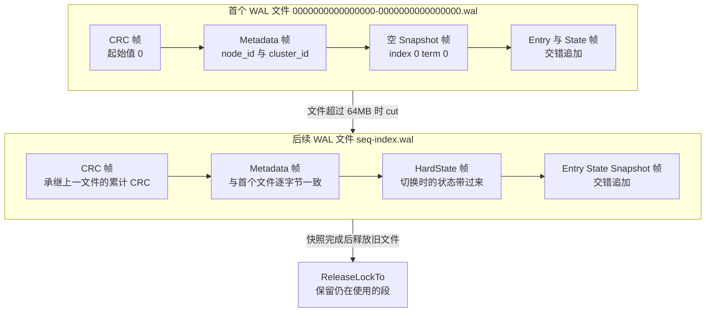
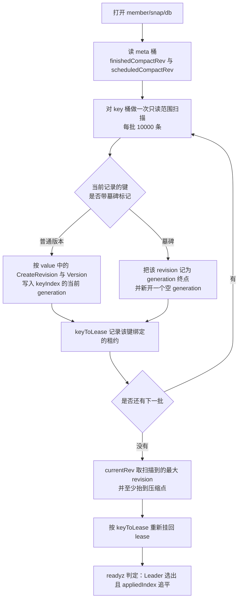
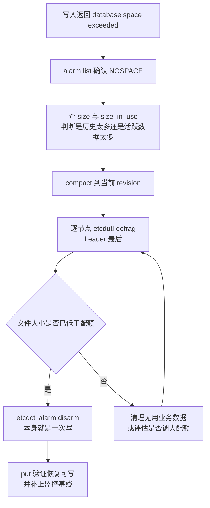
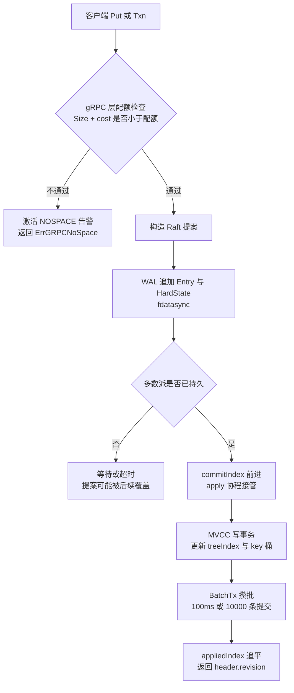

# 03 存储引擎——WAL、BoltDB 与 MVCC 的持久化链路

**摘要：**

etcd 的写请求要在两个子系统的确认之后才能向客户端返回：一个是只追加的预写日志（Write-Ahead Log，WAL），一个是基于 B+ 树的嵌入式数据库 bbolt。两者看起来都在做「把数据写进磁盘」，于是很容易被误解成同一件事的两份保险。这个直觉一旦形成，容量规划、压缩节奏、碎片整理顺序、备份范围都会跟着错位。本文要说明的是：这两份持久化分别服务于两种不同的需求——Raft 共识需要的是「未提交的提案也不能丢」，状态机需要的是「任意历史版本都能被随机定位」——把二者分开，是这个存储层的根本设计。

全文按一次写入的生命周期推进：先论证为什么一个 append-only 日志做不了随机读、一个 B+ 树文件也保存不了未提交的历史；再拆解 WAL 的目录布局、分帧格式、`fdatasync` 的时机、快照之后的截断与保留策略，以及 `--wal-dir` 分离对备份范围的连带影响；接着只从使用者的角度看 bbolt，讲清桶布局、`meta` 桶里三个键各自守着什么不变量、写事务的串行模型、批量提交与 `--unsafe-no-fsync` 的真实语义；然后落到 MVCC 的两层结构，解释内存 treeIndex 与磁盘 revision 编码如何配合完成「按 revision 读取」，以及重启时为什么要逐条重放整个 `key` 桶。后半程处理运维现场：Compaction 的语义与自动模式、Defragmentation 为什么是唯一能让文件缩小的手段、配额触发之后只读状态的形成与恢复顺序，以及 `etcdutl snapshot` 的真实链路。读完应当能回答两个问题：写路径上的每一笔持久化开销应该记给谁，以及容量告警出现时，第一步该动哪个参数而不是动 quota。

---

## 第 1 章 两份持久化，两种需求

先说一个场景。一个跑在 Kubernetes 上的中等规模集群，控制面每隔几周就要重启一次。重启通常是「例行内核升级」或者「节点被驱逐」，本身没什么稀奇，真正让人紧张的是重启之后的那几分钟：`kubectl get nodes` 能动，但 `readyz` 一直在报 `etcdserver: no leader`，或者虽然选出了 Leader，`kubectl apply` 却持续返回 `Timeout: request did not complete within the requested time`。有人第一反应是「etcd 坏了」，查日志却只看到一行 `kvstore restored` 花了好几秒。这个场景里的每一环——重启、恢复、就绪判定——都直接指向本篇的主题：磁盘上到底存了什么，重启时又要从磁盘里重建什么。

很多人第一次读 etcd 的磁盘目录，会被两个东西同时出现搞糊涂。一个是 `member/wal/` 下面那些名字奇怪的 `.wal` 文件，另一个是 `member/snap/db` 这个几 GB 的单文件。直觉的解释是「写了两次，更安全」。可如果只是为了冗余，为什么不直接给 WAL 做两份副本，或者干脆用 RAID？答案藏在两个无法互相替代的需求里：**一个 append-only 的日志做不了随机读，一个 B+ 树文件也不会替你保存「未提交」的历史**。

Raft 对持久化的要求，和普通数据库不一样。普通数据库关心的是「已提交的事务不能丢」，Raft 关心的是「已经向别的节点作出的承诺不能忘」。一次投票、一条日志的接收确认，都是节点对外做出的承诺，这些承诺在大多数情况下还远没有到达「提交」这个状态，只是「可能被提交」。Raft 的持久化清单也就只有三项：`currentTerm`、`votedFor`、`log[]`。etcd 把这套东西统称为 HardState（硬状态）与日志条目，它们必须比「应用」更早、更频繁地落盘。

状态机的要求则完全是另一回事。客户端问的是「`/registry/pods/default/nginx` 在上一个 revision 时的值是多少」「从 revision 100 开始的所有变更是什么」，这些问题无法用顺序扫描一个日志来高效回答——日志里的每一条记录都带着「相对于上一条发生了什么」的语义，要得到某个时刻的完整状态，你得从头重放到那一刻。更麻烦的是，日志里还混着大量从未提交、后来被 Leader 覆盖掉的记录，它们本来就不该出现在状态机里。

不妨把这两套东西比作一家餐厅的后厨与前厅。后厨的流水单（WAL）记的是「第 17 号桌点了什么、这份单是不是已经确认过」，它必须可追溯、逐条追加、不能涂改；前厅的账本（bbolt）记的是「17 号桌现在需要做什么菜、这一桌累计消费多少」，它要求能随时翻开某一页查到某一桌的当前账。流水单不能拿来当账本翻，账本也不能替你回答「刚才那份单有没有被确认过」。这两本册子服务于不同的读者，任何一本缺失都会让流程断掉，但它们绝不是同一本册子的两份复印件。

把两者的分工摊开，差异是一目了然的。

| 维度 | WAL | bbolt（`member/snap/db`） |
| :--- | :--- | :--- |
| 谁在读它 | Raft 循环、重启时的恢复流程 | MVCC 读路径、watch 回放、快照导出 |
| 记录什么 | HardState、未应用的日志条目、轻量快照标记 | 已应用的状态机数据、集群成员、告警、鉴权 |
| 访问模式 | 顺序追加，几乎只读一遍 | 随机点查、范围扫描、按 revision 定位 |
| 淘汰方式 | 快照之后截断，保留 `--max-wals` 个 | 只能靠压缩逻辑删除，靠碎片整理收缩 |
| 崩溃语义 | 尾部可能有未同步的残帧，可截断修复 | 双 meta 页，取校验和正确且 txid 较大的一个 |
| 单条写入的成本 | 一次 `fdatasync`，可按批摊薄 | 一次写事务提交，可批量合并 |

这张表揭示了一个容易忽略的事实：**这两份持久化的写入频率和写入量并不相同**。WAL 记录的是「提案」，每次选举、每次心跳推进的 commitIndex 都可能需要一次状态写入；bbolt 记录的是「应用结果」，只有当一条条目真正被 apply 到状态机时才会动。在网络抖动频繁的集群里，WAL 的写入次数可能远多于 bbolt 的写入次数，这也解释了为什么 WAL 的 `fdatasync` 延迟会成为写入延迟里最不可预测的那一段。

### 1.1 HardState 为什么必须持久化

反过来问：如果 HardState 不持久化，会出什么事？Raft 论文里的安全性论证给出两处不能松的地方，都直接依赖这三个字段的持久性。

第一处是「一个任期只能投一票」。候选人在任期 T 里把票投给了节点 A 之后，如果这个决定只活在内存里，节点崩溃重启会从磁盘上读到一个不认识 A 的状态，于是在同一个任期 T 里再次投票给 B。假设 A 与 B 各自拿到了一票并且都以为自己过半，两个 Leader 就会在同一任期里并发存在——分区恢复之后，两份日志里同一 index 上挂着不同内容，这种冲突在 Raft 的设计里是「不应该发生」的。这不是概率极小的边界情况，而是每次「投完票立刻断电」都会触发的路径。

第二处是「已提交的条目不能回退」。`commit` 字段（在 etcd 的 `raftpb.HardState` 里对应 `Commit`）记录的是节点已经确认被多数派复制的最大 index，它一旦回退，节点就会认为某些实际上已经提交的条目仍处于「未提交」状态。如果这样的状态被用来响应客户端，就会出现「读到了比已经承诺过的更旧的状态」，或者在成为 Leader 之后错误地覆盖掉真正已提交的条目。重启之后，节点会用磁盘上的 `commit` 作为下界的起点，重新从 Leader 那里确认进度——起点错了，后面的所有推导都会错。

这里有一个常被误读的细节：易失状态和持久状态的边界并不是「重要程度」，而是「能否从别处重新获得」。`commitIndex` 看似也是个进度指标，但它在 Raft 里其实是持久字段——因为一个节点的 `commitIndex` 反映的是「多数派曾经确认过的事实」，这个事实不能靠重新询问得到，别的节点可能已经忘记了。真正可以易失的是 `lastApplied`、`nextIndex[]`、`matchIndex[]`，它们要么可以从 `commitIndex` 与已应用的条目推出，要么可以从对端的响应重新计算。

`--unsafe-no-fsync` 之所以被冠以「unsafe」，正是因为它直接违反了上面两条：关闭刷盘之后，`HardState` 和条目在崩溃时会回到更早的状态。它没有让共识变得「不正确」，却把「已 ack 即持久」降级成了「已 ack 即大概率持久」，适用边界留到第 8 章展开。

### 1.2 为什么状态机不能是另一个日志

假设有人真的用一个 append-only 日志来做状态机，把每次 `Put` 都追加进去，查询时从后往前找每个 key 的最后一条记录。小数据量下这甚至能跑得不错。问题出在三个地方。

其一是随机定位。读路径要回答「key K 在 revision R 时的值」，用日志就得「扫到 R 为止再对 K 做一次 fold」，代价正比于历史长度，而线性一致读容不下让读延迟随运行时长线性增长的成本。

其二是 revision 语义。MVCC 要求每个 key 的每个历史版本都能被单独定位到，也要回答「早于 R 的最近一次修改是哪个版本」，而这需要按 key 建立索引，日志天然按时间排序，没有 key 的维度。

其三是快照。给一个日志做快照，要么记录「从哪个 offset 开始」，要么把整段历史重新压成当前状态——前者不能让 WAL 被截断（快照之后仍得保留全部历史），后者实际上就是在写一个新文件。bbolt 之所以合适，是因为它本身就是某时刻的完整状态，任何一次提交之后，这个文件都是一份自洽的、可以独立打开的数据库。

这也解释了 etcd 的一个设计取舍：它没有走「LSM-Tree 存状态机、WAL 兼做 LSM 的日志」这条路。LSM-Tree 擅长的是高写入吞吐，代价是读要跨多层、空间要靠 compaction 回收；而 etcd 的负载特征是写不密集、读非常密集、数据量通常几十 MB 到几 GB，恰好落在 B+ 树引擎更舒服的区间。站内 [[中间件/深入浅出存储引擎/07 LSM-Tree 原理——用顺序写换取写吞吐|LSM-Tree 原理]] 与 [[中间件/深入浅出存储引擎/10 结语——存储引擎的六组权衡|存储引擎的六组权衡]] 对这两条路线的对账更细，这里只取结论：选 BoltDB 是基于负载形状的决策，而不是对「更先进」的偏好。

### 1.3 一次写入要经过两笔持久化

把抽象的分工落回到一次具体的 `Put` 上，这条链路上会出现两次「数据已经进磁盘」的时刻，先后顺序和各自的读者都不一样。

第一次发生在 WAL。客户端请求被封装成一条 `InternalRaftRequest` 提案之后，Leader 把它追加到本地 WAL 并 `fdatasync`，同时通过 rafthttp 把 `MsgApp` 发给其他成员，各成员收到后同样先写 WAL 再回 `MsgAppResp`。等到包括自己在内的多数派确认，这条提案才算「被共识接受」，`commitIndex` 随之前进。这一刻数据已在多数派机器上持久，却还不在任何成员的状态机里，也不在 `member/snap/db` 里。

第二次发生在 apply。commitIndex 前进之后，apply 协程按顺序取出条目，解析成具体的 `mvccpb.KeyValue`，在 bbolt 的写事务里写入 `key` 桶、更新内存索引。这次提交由 `BatchTx` 攒批触发，未必立即执行；但即便它还没有提交，客户端也已经可以收到成功响应——因为响应等待的是 `appliedIndex` 追平，而读到「缓冲区里已经写进去的值」同样满足线性一致。

两段结构也解释了 etcd 写延迟的构成：端到端可以粗略拆成网络往返加多数派确认（含各自一次 WAL 刷盘）、从 commit 到 apply 的排队时间、apply 内部对 bbolt 写事务的等待。SSD 上第一块通常稳定在几毫秒，第三块则取决于有多少写入在抢同一把写锁；现场常见的「写延迟抬高而网络与 CPU 都正常」，多半是第三块被慢事务、压缩或 defrag 拖长了。

反过来看它对持久性的意义也很清楚：在第一次持久化之后、第二次之前崩溃，WAL 会把条目重放出来，数据不丢；在第二次之后崩溃而 WAL 已被截断，bbolt 里已是完整状态，同样不丢；只有当两次都完成后仍未刷到磁盘时才会丢——这正是 `--unsafe-no-fsync` 打开后的风险窗口。

> [!info] 版本说明
> 本篇以 etcd v3.5 至 v3.7 的实现为主，涉及 v3.6 的代码路径按 `release-3.6` 分支核对。v3.5 的 `meta` 桶没有 `term` 与 `confState` 两项，成员配置仍写在 `cluster` 桶里；v3.6 起 `etcdctl` 只负责取快照，恢复必须交给 `etcdutl`。读到参数或行为对不上时，先确认版本，再看机制。

---

## 第 2 章 WAL：写给共识的一份流水账

WAL 的目录默认在 `<data-dir>/member/wal`，可以用 `--wal-dir` 指到别的物理设备上。它底下通常躺着一串形如 `0000000000000010-00000000000bf1e6.wal` 的文件，文件名两段都是十六进制：前一段是该文件的序号（从 0 开始递增），后一段是这个文件里第一条记录对应的日志 index。第一个文件永远是 `0000000000000000-0000000000000000.wal`，里面装着 index 为 0 的空快照记录，作用是把「每条条目都排在一个快照之后」这个不变量钉死。

目录里还常能看到一个 `0.tmp` 或 `1.tmp`。这是下一个 WAL 文件的预分配空间：etcd 会提前把 64MB 的文件创建出来并占满磁盘，这样在日志切换的那一瞬间不必临时申请空间，也就不会因为磁盘满而让 Raft 卡住又发不出告警。官方文档对这个设计有一句很克制的说明——预分配的 `0.tmp` 并不提供完整的「磁盘写满保护」，因为每个文件的切割是按「超过 64MB 就切」做的，实际单文件可能略大于 64MB，而且 `--max-wals` 之外的旧文件也不会被立即删除。

### 2.1 一个文件的内部结构

每个 WAL 文件是一串帧（frame）。每帧由两段组成：一个 8 字节的小端长度字段，后面跟着按 protobuf 序列化的 `walpb.Record` 数据以及对齐用的填充字节。长度字段的高 8 位里还塞了填充字节的数量，这样读取方不需要额外的对齐记录就能找到下一帧的边界——这个技巧的目的很实际：长度字段本身不能被撕裂写，一旦长度写了一半、数据写了另一半，读的时候就会跑到错误的位置上去。

下图画出一个 WAL 从创世到滚动的完整形态，重点在「哪些帧是每个文件都有、哪些只出现一次」。

五类记录各司其职，它们的语义差别比名字看起来更大。

| 记录类型 | 写入时机 | 持久化它解决什么 | 对应的字段 |
| :--- | :--- | :--- | :--- |
| Metadata | 创建 WAL 时、每次切文件时 | 校验「这个日志属于哪个节点、哪个集群」 | `node_id`、`cluster_id` |
| Entry | 每次有新的提案需要追加 | 让未提交的日志在崩溃后仍能被重放或被覆盖 | `raftpb.Entry`，含 term、index、data |
| HardState | 状态变化时与条目一起写 | 记住投过谁的票、已确认的提交位置 | `term`、`vote`、`commit` |
| Snapshot | 完成一次快照、或 WAL 重建时 | 标记「此前的条目已经进入状态机」，作为读起点 | 快照的 term 与 index |
| CRC | 每个文件开头一条 | 续接跨文件的一致性校验，检出静默损坏 | 累计 CRC-32（Castagnoli） |

CRC 帧的设计值得多说一句。etcd 在每次写记录时都会把 `data` 字段喂进一个滚动的 CRC，单条记录里也带着自己的 CRC，但一个是「这条记录本身坏没坏」，另一个是「从创世到此刻，整个日志流有没有出现缺失或错位」。第二个值在每个新文件开头存一份，读取时先用它对齐到上一个文件的终点校验值，再继续往后校验。如果某天有人从中间截掉了半个文件，第二个校验值一定对不上——这就是为什么 `wal.ReadAll` 可以在不解码全部内容的前提下判断出「这个日志被人动过手脚」。

### 2.2 三次 fsync 与一次真正重要的 fsync

`Save` 是 WAL 唯一的写入口，它在持锁状态下依次做三件事：给每个条目编码一帧并更新内存里的 `enti` 游标、写入 HardState（非空时）、检查当前文件偏移是否还小于 64MB。

这里出现了 `raft.MustSync(st, w.state, len(ents))` 这个判定。它的含义可以粗略理解为：如果这次 Save 带来了任期或投票的变化，或者带来了新的条目，就必须刷盘；如果只是一次没有实质变化的空状态，可以跳过。所以 WAL 的刷盘并不是「每次调用都刷」，而是「有实质变化才刷」——这是 etcd 为减少空洞写入做的一层过滤。

真正的刷盘发生在 `w.sync()`：先把编码器里 1MB 的缓冲刷到内核，再对文件调用 `fdatasync`。注意这里用的不是 `fsync`。`fsync` 除了把数据刷下去，还要把文件的元数据（inode 里的修改时间、大小等）一并落盘；`fdatasync` 只保证数据区和「读取这段数据所必需」的元数据（譬如文件大小变化）已经持久，省掉了那些与数据完整性无关的 inode 更新。对追加写的日志来说，后者已经足够——文件大小是随数据区一起变化的，而 mtime 这类字段丢了不影响正确性。

`sync()` 里还埋了两个工程细节。一个是慢刷盘告警：如果 `fdatasync` 耗时超过 1 秒，日志里会出现 `slow fdatasync`。etcd 官方硬件建议里反复强调「磁盘必须能支撑每秒大量的小 fsync」，这条告警是最直接的证据。另一个是 `--unsafe-no-fsync` 的短路：当这个开关打开时，`sync()` 刷完编码器缓冲就直接返回，不碰 `fdatasync`。

还有两次刷新容易被忽略。一是切文件时的 `cut()`：它先把旧文件的预分配尾巴截断到实际写入位置，然后同步一次；接着创建新文件、写入 CRC 帧、写入 Metadata 帧、写入当前 HardState，再同步一次；最后 `os.Rename` 到正式文件名，并**对目录本身 fsync 一次**。对目录 fsync 是因为 rename 这个动作的持久性由目录项决定，只刷文件不刷目录，掉电后可能看到「文件内容在、名字没了」。二是 `SaveSnapshot`：每次记录快照标记之后都会无条件同步一次，因为这条记录决定了后续读取的起点，不能悬在缓冲里。

### 2.3 多次 Save 如何合并成一次刷盘

单看 `Save` 的实现，它内部是「先写缓冲、再逐次判断、可能刷盘」。这么一来，如果 Raft 循环每次只提交一条条目就调用一次 `Save`，刷盘次数就会与条目数一比一。实际上不会，原因在于调用方的节奏：`etcdserver` 的 raft 循环在每次迭代里把所有待处理的 `Ready` 合并后一次 `Save`，而且多个 Ready 之间还会因为「apply 协程来不及消化」而被主动攒批。社区把这个称为流水线（pipeline）优化——Leader 不必等上一个提案被提交就接受下一个提案，一批 Ready 一起落盘，一次 `fdatasync` 覆盖了 N 条条目。

这个设计有一个不那么直观的副作用：**写入延迟与写入吞吐在这里是同一枚硬币的两面**。攒批越激进，单次 `fdatasync` 摊到的条目越多、吞吐越高，但最早进来的那条提案要等更久才能被 ack，尾延迟变长。批量窗口因此总在「等更多请求」和「尽快确认」之间摆动。

`--snapshot-count` 控制的是另一个维度：应用了多少条条目之后做一次快照，默认 100000。快照会往 WAL 写一条 `SnapshotType` 记录，并把状态写到 `member/snap/` 下，随后 `wal.ReleaseLockTo(index)` 被调用，把 index 之前的文件句柄关掉。注意这里「关掉」只是放下锁、不是删文件，删除动作由 `snap` 包的清理逻辑按 `--max-wals` 与 `--max-snapshots` 执行，两者默认都是 5。

官方文档里有一句很值得抄在运维手册上的话：如果快照太稀疏，WAL 文件可能超过 `--max-wals` 个，因为文件锁还在保护着它们，不能提前删。也就是说，把 `--snapshot-count` 调得特别大以「减少快照开销」，换来的可能是磁盘被 WAL 吃掉几十 GB——`--max-wals` 是「保留几个」，不是「最多几个」。

### 2.4 把 WAL 挪到别的盘之后

`--wal-dir` 的存在理由，是让 WAL 的 fsync 落在独占的设备上：`fdatasync` 的延迟对同盘上的其他写入非常敏感，一块盘上如果还有容器日志、镜像拉取、kubelet 的临时文件，排队效应会让延迟抖动到让 Raft 心跳超时的程度。把 WAL 单独放一块盘，是官方推荐里最有效的做法之一，站内 [[06 etcd 运维——磁盘、成员与灾备的边界]] 会把设备选型与延迟指标的细节展开。

不过这带来一个必须写在脑子里的连带后果：**从这一刻起，单纯拷贝 `member/snap/db` 不再是完整的备份**。`--wal-dir` 分离之后，WAL 里包含着「已提交但尚未应用」的条目；如果只搬走 bbolt 文件，恢复出来的集群会丢掉最后那一小段状态。反过来说，只搬 WAL 也没有意义，因为 WAL 需要一份基线快照才能重放出完整状态。

在讨论备份之前，得先把 WAL 的恢复路径讲清：重启时 etcd 先加载 `member/snap/db`，读取 `meta` 桶里的 `consistent_index`，然后从 `member/wal/` 找「文件名里的 index 不大于快照 index、但文件本身覆盖到快照之后」的那一段，从快照位置开始往后重放。重放时会遇到两种「不完整」：一是最后一个文件尾部有一段写了一半的帧，二是切文件时新文件的预分配区里全是零。前者返回 `io.ErrUnexpectedEOF` 被容忍，后者会从零字节处开始把残留的非零字节清零，避免下次写入时校验失败。这份宽容是有边界的：如果损坏出现在中间、而不是尾部，`ReadAll` 会直接报 CRC 不匹配，此时正确的做法是 `etcdutl snapshot restore`，而不是手工去截文件。

---

## 第 3 章 bbolt：状态机的那一本账

这一章只讲 etcd 怎么用 bbolt，不重复引擎内部的页、节点与写事务细节。B+ 树的页布局、COW 的复制路径、spill 与 split 的时机，站内 [[中间件/深入浅出存储引擎/06 BoltDB 源码剖析——页、节点与写事务|BoltDB 源码剖析]] 已经拆到了源码级，这里只保留一个足够支撑后文的概述：bbolt 把文件切成固定大小的页（跟随操作系统页大小，常见 4KB），读通过 mmap 直接访问页内字节，写走写时复制——修改落在新页上，旧页等到没有读事务引用它了才回到 freelist；写事务全局串行，提交时把新的根指针写进两个 meta 页中的一个。

桶之间彼此隔离，让不同生命周期的数据（历史版本、租约、告警、鉴权）可以分开维护、分开遍历、分开删除；etcd 的许多数据结构演变也就可以在「新增一个桶」的层面完成，不必修改已有数据的布局。

先说一个容易忽略的配置事实：etcd 打开 bbolt 时并没有把初始 mmap 大小设为 quota，而是固定为 10 GiB（`backend.InitialMmapSize`），只有当你显式设置了 `--quota-backend-bytes` 且不等于默认值时，才改成「配额 + 10%」。这个 10% 的余量有明确用途：它允许文件在触发告警之后还能稍微长一点，好让删除操作有机会落盘。而 Linux 上 etcd 还会额外加上两个选项：`MmapFlags: MAP_POPULATE` 让内核在建立映射时预读整个文件，以及 `NoFreelistSync: true`——后者意味着 freelist 不再持久化，每次打开数据库时从数据页重新推导。

`NoFreelistSync` 是个很有说明性的取舍。持久化 freelist 能加快打开速度，却要求每次提交额外写一份空闲页清单，空闲页越多清单越大、写放大越明显。关掉之后每次打开都要扫一遍整棵树重建空闲页集合——这是「大库重启慢」的第一层成本，与文件大小成正比。

### 3.1 桶布局

etcd 把所有的状态机数据分成十个桶，其中真正与日常运维相关的是前五个。

| 桶名 | 主键 | 值 | 用途 |
| :--- | :--- | :--- | :--- |
| `key` | 17 字节的 revision 编码（墓碑多 1 字节） | `mvccpb.KeyValue` 序列化 | 所有历史版本，MVCC 的主体 |
| `meta` | `consistent_index`、`term`、`confState` 等 | 8 字节大端整数或序列化结构 | 状态机与 Raft 的对齐信息 |
| `lease` | lease ID | `leasepb.Lease`（ID、TTL、剩余 TTL） | 活跃租约，供过期检查使用 |
| `alarm` | 成员 ID | `rpcpb.Alarm`（`NONE`、`NOSPACE`、`CORRUPT`） | 告警持久化，重启后仍然生效 |
| `auth` | 键名如 `authRevision` | 8 字节整数 | 鉴权变更的单调版本，供乐观并发 |
| `authUsers`、`authRoles` | 用户名、角色名 | `authpb.User`、`authpb.Role` | RBAC 定义 |
| `cluster` | `clusterVersion`、`downgrade` | 版本字符串、JSON | 共识层同意的集群版本与降级意图 |
| `members`、`members_removed` | 成员 ID 的十六进制 | 成员 JSON、`removed` 标记 | 成员配置与「已移除成员不得复用 ID」 |

`key` 桶是整个 etcd 里唯一一个 `IsSafeRangeBucket` 为真的桶。这个标记解决的是一个非常具体的正确性问题：bbolt 的 `Bucket.Get` 与「range 到单个 key」在遇到重复键时行为不同，前者返回第一个，后者可能返回第二个。`key` 桶的设计保证了同一个 revision 编码不会出现两次——每个 revision 至多对应一次写入——于是 range 语义是安全的，而其他桶（例如某个成员的告警状态被多次覆盖）就必须用 `Get` 的语义去读。

### 3.2 meta 桶里的三个不变量

`meta` 桶看起来只有几个字节，但它承担着三件彼此独立的事情。

`consistent_index` 记的是「已经应用到状态机的最大 Raft index」，值是大端编码的 8 字节整数。它解决的是重启幂等性：重启之后，etcd 从快照加载 `db`，读到这个值，就知道「这个状态机已经被应用到第几个条目」，WAL 里小于等于它的条目不需要再应用一次。没有它，要么重复应用（对 `Put` 而言结果是错的，因为会多生成一个 revision），要么靠别的方式推断（例如从 `key` 桶里最大的 revision 反推，但 revision 与 index 并非一一对应）。`schema.UnsafeUpdateConsistentIndex` 里还有一段 `allowDecreasing=false` 的断言：正常情况下这个值只能前进，任何回退都会直接 panic。`v3_snapshot.go` 里调用的是 `UpdateConsistentIndexForce`，这是恢复流程中唯一允许「强行写入」的位置。

`term` 是 v3.5 起才进入 `meta` 桶的。它记录应用进程当前所处的任期，用来做一致性校验：快照里 `term` 与 WAL 里 HardState 的 `term` 不匹配，说明两者不是同一个时间线上的一致点，应当拒绝启动而不是硬着头皮继续。这个字段的出现本身就说明了一个判断——「只有 index 不够，任期也是这个状态机身份的一部分」。

`confState` 同样是 v3.5 起的新成员，保存的是「这个状态机在被快照下来的那一刻，投票成员是谁」。它要解决的问题在 v3.5 之前很实际：成员配置在那时写在 `cluster` 桶里，而 `cluster` 桶的内容是可以被机械地复制、导入、迁移的，一旦有人复制了一个 db 文件却忘了同步成员信息，节点就会以错误的成员身份启动，可能导致 quorum 计算错误。把 `ConfState` 塞进 `meta`，等于让「成员配置」成为状态机自身的一部分，与 Raft 快照里携带的 `ConfState` 互为对照。v3.5 之前恢复出来的集群偶发的「成员 ID 冲突」问题，很大一部分就来自这里。

这三个键还共同构成了一个「防御性检查三角」。启动时如果 `consistent_index` 指向的条目在 WAL 里找不到对应的 index，说明快照与日志脱节；如果 `term` 与 HardState 的 `term` 矛盾，说明两个文件来自不同的时间线；如果 `confState` 里的成员集合与 `members` 桶不一致，说明有人手动改过其中一份。三者中任何一条不成立，etcd 都会在启动阶段拒绝继续，而不是带着可疑的状态加入集群。恢复流程里的 `RecoverSnapshotBackend` 就是这套检查的一个分支：当 `snapshot.Metadata.Index > consistent_index` 时，说明「快照已经落盘、但状态机还没来得及更新」这个中间态出现了，此时不能直接用旧 db，而要用 Leader 发来的快照 db 替换掉本地的。

### 3.3 一次写事务的边界在哪里

从 apply 协程的视角看，一次 `mvccpb.KeyValue` 的落地是这样一个序列：`store.Write` 拿到 `BatchTx` 并加锁，`put` 内部先查一次 treeIndex 拿到 `CreateRevision` 与 `Version`，构造出完整的 `mvccpb.KeyValue`，然后 `UnsafeSeqPut(schema.Key, ibytes, d)` 把新 revision 写进 bbolt 的写事务、`kvindex.Put` 更新内存索引、`changes` 追加一条。`End()` 里如果这次事务确实产生了变更，`s.currentRev++` 并解锁。

注意 `UnsafeSeqPut` 与 `UnsafePut` 的区别。前者把 bucket 的 `FillPercent` 设成 0.9，后者用默认值（通常是 0.5）。注释写得很直白：对「主要按追加顺序写」的负载，填得满一些可以推迟页分裂、降低空间占用。`key` 桶几乎全是追加（新 revision 总比旧的大），所以用 `SeqPut`；`lease`、`alarm` 这类桶是覆盖写，用普通 `Put`。

真正决定写延迟的只有一句：写事务只有一个。所有 apply、lease 过期删除、成员变更、告警写入最终都排到同一个 `batchTx` 上，这把锁是写路径上最硬的串行点，也是「一次 apply 变慢」会直接表现为「所有写入变慢」的原因。

### 3.4 批量提交：时间与条数的双阈值

如果每次 apply 都立即提交，那么每个 KV 都要一次 `fdatasync`，写入延迟会随条目数线性累加。etcd 的对策是把提交攒起来，攒的规则有两条：一个是 `BatchInterval`（默认 100ms，由 `backend.run()` 里的定时器驱动），一个是 `BatchLimit`（默认 10000 条，由 `Unlock` 里的 `pending >= batchLimit` 触发）。任何一条满足就会提交。

两条规则分别对应两种负载。写入稀疏时，100ms 也只攒下一两条，定时器决定延迟上限；写入密集时，攒到 10000 条就立刻提交，此时条数上限保护了内存——bbolt 的写事务在提交前把所有修改留在内存里，几万条的写事务会占用可观的堆内存，`pending` 计数就是拿来拦这个的。

不过批量提交会带来一个性质上的问题：在两次提交之间，bbolt 文件里还没有这些数据，但读请求却应该能读到。etcd 的解法是在 `batchTxBuffered` 里加一层写缓冲（`txWriteBuffer`），`Unlock` 时把缓冲写回 `readTx` 的读缓冲，这样读路径可以同时看 bbolt 与缓冲区，不需要等提交完成。删除操作则不同——`UnsafeDelete` 会让 `pendingDeleteOperations` 加一，而 `Unlock` 里只要 `pendingDeleteOperations > 0` 就立刻提交，因为删除无法用「读缓冲里加一条覆盖」来表达，如果延迟提交，在下一次请求里就可能读到已被删除的旧数据，直接违反线性一致性。这段逻辑在 v3.4 之后被专门修补过，源码注释里写明「bbolt 的缓冲只覆盖 put」。

> [!warning] 延迟提交与持久性的错位
> 批量提交意味着「客户端收到成功响应」与「数据真正落盘到 bbolt」之间有一个最长约 100ms 的窗口。这个窗口里的数据在 WAL 里是有的（WAL 已经 fsync 过，否则多数派不会 ack），所以断电之后重启会通过 WAL 重放把它补回来。但如果你在这一刻用 `cp` 拷走了 `member/snap/db`，拷到的就是「落后 100ms 的旧状态」——这正是第 6 章要讲的「不能在运行中直接拷贝 db 文件」的第一个原因。

### 3.5 `--unsafe-no-fsync` 到底牺牲了什么

这个参数的描述很容易被误解成「关掉刷盘，性能大幅提升」。它实际改动的只有一处：`backend` 把 bbolt 的 `NoSync` 与 `NoGrowSync` 设为 true，`wal.sync()` 在刷完编码器缓冲后直接返回。结果是 WAL 与 bbolt 都不再调用 `fdatasync`。

它没有改动的部分同样重要。Raft 的投票、日志追加、提交判定逻辑照常运行，多数派确认仍然是一次真实存在的网络往返；`apply` 仍然会依次把条目应用到状态机；revision 依然单调递增；线性一致读依然需要 ReadIndex。也就是说，**集群层面的共识正确性没有变化，变的只是「单个节点的持久性」**。

这个区分能解释一些看似矛盾的现象。在开了 `--unsafe-no-fsync` 的节点上，如果只是单个节点重启，它从 WAL 里能重放的条目回到了上一次刷盘的位置（可能是几秒之前），而它当初 ack 过的条目里有一部分已经丢了。但集群仍然是对的：Leader 的 `nextIndex` 会把这个节点退回到它真实拥有的位置，重新把条目发过去。可如果整个集群的三个节点同时断电（机房掉电、宿主机集体故障），每个节点都丢了最后几秒的条目，而客户端已经收到了「成功」——这就是真正的数据丢失，且没有任何机制能补回来。

所以这个开关的合理使用条件是：集群中至少有一个节点保持 `fsync` 开启，或者三个节点位于不同的故障域，且你能接受「全集群同时断电时丢最后几秒」这一风险。它最常见的用途是「一个跟不上的 learner 或 standby 节点用低延迟追数据」以及昂贵的 CI 环境。Kubernetes 控制面绝对不能开。

---

## 第 4 章 MVCC：让每个版本都能被单独找到

etcd 的 MVCC 由两个互补的部分组成：磁盘上的 `key` 桶按版本存所有历史，内存里的 treeIndex 按用户键存索引。前者提供「按版本找到字节」，后者提供「按用户键找到版本」。少了任何一个，MVCC 都无法工作。

先看磁盘侧。`key` 桶的键不是用户键，而是一个 revision 编码：8 字节的大端 `main`、一个 ASCII 的 `_` 分隔符、8 字节的大端 `sub`，共 17 字节。删除不删除记录，而是再追加一条「墓碑」（tombstone）——在同样的 17 字节后面再加一个字节 `t`，值为 `'t'`。这样一来，`key` 桶里同一用户键的所有版本会按 revision 顺序紧挨着排列，`_` 的作用是在纯字节比较下让 `main` 与 `sub` 之间有一个清晰的分界，也顺带保证 `main` 相同而 `sub` 不同的版本顺序正确。

用大端编码的动机很浅显但很关键：bbolt 的键按字节字典序排列，大端整数在字节序上保持数值序，因此 revision 越大，键在桶里越靠后。于是「取出某个 revision 之前的所有版本」就是一次范围扫描，压缩可以高效执行。

墓碑末尾那个 `t` 同样服务于排序：同一个 revision 下，`...0017`（普通的版本）与 `...0017t`（墓碑）在字节序上后者紧邻前者，两者不会与下一个 revision 交错。这也让「按 revision 精确查找」可以写成「以 17 字节精确匹配」，而不会意外命中墓碑。

值那边是 `mvccpb.KeyValue` 的序列化，字段是 `key`、`value`、`create_revision`、`mod_revision`、`version`、`lease`。用户键被完整地存在于值里，因为它才是「这个版本属于谁」的唯一依据；`version` 是该键在当前 generation 里的第几次写入，`create_revision` 与 `mod_revision` 分别是创建与最后修改的 revision。

### 4.1 内存索引的两层结构

treeIndex 是一棵 `google/btree` 的泛型 B 树，键是用户键的字节串，值是一个 `keyIndex`。`keyIndex` 里有两样东西：一个 `modified` 字段记最后修改的 revision，一个 `generations` 切片，每个 generation 记着自己的 `created` revision、`ver` 计数和一组 revision。

为什么要分 generation？因为 `Version` 的语义是「在同一个 generation 内的第几次修改」，而「删除后再重建」会开启一个新的 generation，`Version` 从 1 重新计数，但 `CreateRevision` 与 `ModRevision` 都是全局的。如果只有一层「所有 revision 的列表」，那么在压缩删掉中间版本之后，`Version` 就无法从剩余记录中正确推出。generation 把「一段连续存活的区间」显式记录下来，压缩时以整个 generation 为单位删除，`Version` 与 `CreateRevision` 都能保持正确。

官方源码里有一段注释把这个结构说得很清楚：对一个 key 依次执行 `put(1.0)`、`put(2.0)`、`tombstone(3.0)`、`put(4.0)`、`tombstone(5.0)`，得到的 `generations` 是 `{empty}`、`{4.0, 5.0(t)}`、`{1.0, 2.0, 3.0(t)}`。注意顺序是倒着的：最新的 generation 在最前面，最老的在最后。执行 `compact(2)` 之后变成 `{empty}`、`{4.0, 5.0(t)}`、`{2.0, 3.0(t)}`——每段只保留「压缩点及之后最近的那一个版本」，因为更早的版本已不可能被任何合法的读请求访问到。执行 `compact(6)` 之后只剩 `{empty}`，此时这个 `keyIndex` 应当从树里删掉——因为它所代表的所有历史版本都不再可读。

为什么必须两层，而不是把它们合并成「一层 B 树，键是用户键，值是版本列表」？合并在逻辑上是可行的，etcd 也确实这么做（`keyIndex` 里就有版本列表）。问题的关键在于「一次事务的原子性」和「按 revision 回放」这两件事需要不同的访问路径。一次 Txn 里的多个写共享同一个 main revision、sub 从 0 递增，如果只按用户键索引，就无法回答「revision 100 这一刻，哪些键被写了」——而这正是 watch 回放和快照导出的核心需求。反过来若只按 revision 索引，就无法高效回答「键 K 的所有版本」。treeIndex 解决前者（按 key 找版本），`key` 桶的顺序解决后者（按 revision 扫全量），两个视角在 revision 这一点上对齐。站内 [[云原生/Kubernetes/Kubernetes架构深度剖析/07 etcd 深度剖析：Raft 共识、MVCC 与 Watch 机制|etcd 深度剖析]] 从另一个角度讲过这套模型，可以拿来交叉印证。

### 4.2 读路径：从 revision 到字节

一次 `Get` 的路径可以分为四步，缺一不可。第一步，`rangeKeys` 检查 `ro.Rev`：如果它大于当前 revision，返回 `ErrFutureRev`；如果它小于压缩点，返回 `ErrCompacted`；如果为 0，取当前 revision。第二步，在 treeIndex 里以 key 与 revision 做一次 `Get`，得到 `(modified, created, ver)`——这正是「该键在 atRev 时刻最后被修改的那个版本」。第三步，把 `modified` 编码成 17 字节的 revision 键，在 `key` 桶里做一次精确查找，读到 `mvccpb.KeyValue`。第四步，若值是墓碑，表示这一刻该键不存在，返回空。

范围读（`--prefix`、区间）的路径稍微不同：先用 treeIndex 的 `unsafeVisit` 在 B 树里做一次有序遍历，收集每个键在 `atRev` 时刻的 revision，然后对每个 revision 在 `key` 桶里单独查询一次。也就是说，一个 N 个键的前缀查询会变成「N 次内存索引查找 + N 次 bbolt 单键查找」。这解释了为什么 etcd 的大范围读在键数很多时性能会明显下降，以及为什么 Kubernetes 会严格使用 `--limit` 分页。

`treeIndex.Get` 要找「小于等于 atRev 的最后一个版本」。`generations` 倒序排列，算法从最新 generation 起找第一个 `created <= atRev` 的段，再在该段的 revision 列表里从后往前找第一个不大于 atRev 的版本；若它恰好是墓碑，这个 key 在 atRev 时刻就不存在。

这里有一个 web 开发者容易踩的坑：`--rev` 参数能读到历史值，但并不保证「读到的历史值之后没有再被删掉」。要判断一个 key 在某个 revision 是否存在，正确做法是用 `--rev` 读一次，判断返回的 `kvs` 是否为空，而不是用 `--rev` 加上比较 `mod_revision`。

### 4.3 重启：从 bbolt 重放重建 treeIndex

treeIndex 是纯内存结构，每次进程启动都要从 bbolt 里重建。重建过程在 `store.restore()` 里，逻辑可以用下面这张图概括。

这段逻辑里三个细节值得单独拎出来。

第一个是分批扫描与索引构建的并发。`restoreIntoIndex` 起了一个协程消费 `revKeyValue` 通道，边扫边建索引；`restoreChunk` 负责把读到的 KV 推进通道，并维护 `keyToLease`。这么做是为了避免把整个 `key` 桶的数据一次性读进内存——对一个大库来说，光是 KV 的原始字节就可能有几 GB。但分批次并不能改变总工作量：每一批 10000 条都要在 B 树里插入或更新 `keyIndex`，而这些插入是随机分布在 B 树上的。

第二个是恢复路径与正常写入路径的不对称。正常写入时，`put` 会先查 treeIndex 拿到「旧的 created 与 ver」，然后写出一个新的 `mvccpb.KeyValue`；恢复时没有「旧的索引」可查，所以只能反过来读：从 value 里读出 `CreateRevision` 与 `Version`，用它们来构造 `keyIndex`。`restore` 方法要求传入的 `keyIndex` 是空的，并直接把 `created`、`ver`、`modified` 一次写进去；遇到同一个键的后续版本，则走 `put` 而非 `restore`。这种「首个版本特殊处理、后续版本正常追加」的分支，是恢复逻辑里最容易写错的地方，也是 etcd 曾在恢复路径上出过 revision 回退类 bug 的原因之一。

第三个是索引构建的缓存层。协程里维护了一个 `kiCache`（容量同为 10000），缓存「最近见过的 keyIndex」。如果一批数据里同一个键的多个版本连续出现，缓存命中就能省下一次 B 树查找。但当键的数量远大于 10000 时，缓存几乎完全不命中，每次插入都是一次 B 树搜索。这就是「一百万个小键」与「一千个大值」在重启时间上差异巨大的根本原因——前者每一条记录都要付一次索引插入的代价，后者的记录数可能只有前者的千分之一。

第四个是 `currentRev` 的恢复。扫描结束后取「见到的最大 revision」，但如果最大 revision 小于压缩点（例如所有版本都被压缩删光了），就取压缩点；如果小于 `scheduledCompact`（一次压缩的意图已经落盘但结果还没写完就崩了），也取它。后一条来自一个真实的 bug：如果最新 revision 恰好是墓碑、且刚好被压缩掉，重启后的 `currentRev` 会比压缩点小，就会导致后续 revision 倒退。

### 4.4 快照与 WAL 如何接上

只看 treeIndex 的重建，会漏掉恢复流程的前半段。一个节点重启之后真正要做的事情有两件：把状态机恢复到「最后一个应用过的 Raft 条目」的位置，再把内存索引搭好。前一件由快照与 WAL 共同完成，后者才是 4.3 节讲的那一段。

加载状态机之前，etcd 先挑 meta 页：读第 0 页与第 1 页，各自校验魔数、版本号与校验和，取 txid 较大的那个。这一步的代价是常数，与 db 多大无关——这是 bbolt 这套 COW 设计最直接的回报。接着读 `meta` 桶的 `consistent_index` 与 `term`，得到「这个状态机已经被应用到哪儿」的基准，这个值会成为后续 apply 的起点，也是幂等性的保证：WAL 里 index 小于等于它的条目一律跳过。

然后是从 WAL 接续。etcd 在 `member/wal/` 里按文件名排序，解析每个文件里的 index 段，用 `walpb.Snapshot` 标记读取的起点——通常是「文件名 index 不大于快照 index、但覆盖范围伸到快照之后」的那一个文件。从这里往后解码，遇到 Entry 就交给 apply 逻辑，遇到 HardState 就更新本地状态，直到读到 `io.ErrUnexpectedEOF`（尾部未写完的帧）或全零记录为止。后者是预分配区的正常形态：文件被预先撑到 64MB，未写到的部分全是零，解码器看到零长度帧就认为「这里到头了」。

这里有一处决定了恢复健壮性的细节。如果快照之后应有的第一个 WAL 文件被截掉了，或者快照 index 比任何一个 WAL 文件的名字 index 都大（意味着快照比日志还新），`ReadAll` 会返回 `ErrFileNotFound` 或者找到错误的段落，etcd 只能报错退出。这解释了为什么 `--max-wals` 不能设得太小：把它调到 1，一旦发生在「快照刚完成、新 WAL 尚未切割」的边界上，重启时就可能找不到可接续的日志段。官方文档对预分配的 `0.tmp` 也有一句提醒——它并不提供完整的「磁盘写满保护」，因为文件的切割是按「超过 64MB」做的，单个文件可能略大于 64MB。

最后一步是把恢复出来的 `commit` 与 `appliedIndex` 交给 Raft，决定下一次 Ready 里包含哪些条目。到这里，状态机的「已应用位置」和 Raft 的「已提交位置」重新对齐，节点才可以参与投票与日志复制。

为什么这段时间里的 `readyz` 不通过？因为 etcd 的就绪判定要求三件事同时满足：成员已加入集群、Leader 已经选出、`appliedIndex` 已经追平当前的提交索引。第三件事在重启之后要等两段工作完成才算数：一是从 WAL 重放快照之后的条目，二是在每次快照恢复时重建 treeIndex。大库在这两段上花的时间可能是几十秒到几分钟，「重启后服务一段时间」并不是故障，而是恢复的必然过程。

> [!note] 大库重启的时间账
> 很多人以为重启慢是「WAL 太长」。对一块 SSD 上的 etcd 来说，WAL 的顺序重放通常不是瓶颈，真正的瓶颈在 bbolt：`NoFreelistSync` 要先扫一遍树重建 freelist，`restore` 要逐条重放 `key` 桶建索引，两者都随 db 文件大小增长。把 db 从 500MB 扩到 1.5GB 再重启一次，你会看到恢复时间大致跟着涨——这也是「8 GiB 配额不是免费午餐」的第一个具体表现。

---

## 第 5 章 Compaction 与 Defragmentation：删得掉与放得回

到这里，前四章讲的都是数据怎么进去。从这一章开始，讲数据怎么出来。MVCC 保留所有历史版本，这既是 etcd 能支持 `--rev` 读与 watch 从历史回放的基础，也是所有容量问题的源头。

### 5.1 为什么必须压缩

先算一笔账。一个 5000 个 Pod 的集群，每个对象序列化后几 KB，即便只有 10% 的对象每分钟更新一次，一分钟也会产生几百次写入、几 MB 的新版本，一天下来就是几百 MB 到上 GB 的增长——放在默认 2 GiB 的配额上，这点余量撑不了多久。

除了磁盘，还有内存。watch 的回放路径（第 4 篇会展开）会把 `startRev` 落后于当前 revision 的 watcher 放进 unsynced 组，从 bbolt 里扫历史补发。压缩点越靠前，可回放的历史越长，unsynced watcher 可能挂起的时间也越长。极端情况下，一个需要从很老的 revision 开始追的 watcher 会长时间占据着内存缓冲。

### 5.2 `compact` 的语义

`etcdctl compact <rev>` 的语义是「把历史压缩到 rev 这个点」，也就是**保留 rev 及之后的所有版本，删除 rev 之前的旧版本**。官方文档的措辞是「丢弃在这个 keyspace revision 之前被取代的所有键的信息」，其中最微妙的部分是「被取代」三个字：一个键如果在 rev 之前没有被取代（即它的最新版本早于 rev），那么这个版本必须保留，否则 rev 时的读取会找不到它。

在 treeIndex 层面，`compact(rev)` 对每个 `keyIndex` 调 `doCompact`：找到包含 rev 的那个 generation，把该 generation 内 `main <= rev` 的版本收进 `available` 集合，然后只保留 `available` 里的最新一个。`scheduleCompaction` 随后按 revision 顺序扫 `key` 桶，凡是落在压缩点之前、且不在 `available` 里的键都删掉。删除分批进行，`defaultCompactionBatchLimit` 默认 1000 条、`defaultCompactionSleepInterval` 默认 10ms，这种限速是为了避免压缩把磁盘 IO 与写事务锁全占满。

执行之前，`updateCompactRev` 会先把 `scheduledCompactRev` 写进 `meta` 桶并强制提交一次，压缩完成后再写 `finishedCompactRev`。这两个键的存在，是为了处理「压缩到一半进程挂了」的情况：重启时如果发现 `scheduledCompact` 比 `finishedCompact` 更靠后，就说明上次压缩没做完，需要重新执行。

这里要纠正一个很常见的说法。有人认为 `compact` 会在 bbolt 里「立即释放空间」，或者 `compact` 之后 `db_size` 会下降。两句都错：`compact` 删的是逻辑记录，bbolt 的 COW 把受影响的页标记为可复用，文件长度不变。真正的表现是两个指标之间的差距被拉大——`db_total_size_in_bytes` 不动，`db_total_size_in_use_in_bytes` 掉下来，后者才是被数据真正占用的量。

### 5.3 自动压缩的两种模式

`--auto-compaction-mode` 有两个取值：`periodic`（默认）与 `revision`。`--auto-compaction-retention` 的含义随模式变化。

`periodic` 模式下 retention 是时间窗口。机制是记下「窗口起点的 revision」，等时间过去、并确认这段历史已可丢弃之后才压缩。官方的例子很具体：`10h` 时，etcd 到第 10 小时才第一次压缩（压 rev=1），之后每小时压一次；retention 不超过 1 小时时，以该窗口为间隔，且间隔下限就是 1 小时，写 `30m` 实际也按小时做。

`revision` 模式下，retention 是一个数量，例如 `1000`。机制是：etcd 每 5 分钟检查一次，计算 `当前最新 revision - retention`，在这个点上压缩。文档里的例子是「最新为 30000 时压缩到 29000」。

两种模式的取舍很清晰。`periodic` 适合「访问模式与时间相关」的场景：控制器重启后从几分钟前的 revision 续订 watch，只要还在保留窗口内就不会被迫重新 List。`revision` 适合「写入速率稳定」的场景：每秒写入量恒定时，revision 窗口等价于时间窗口，且不受时钟漂移影响。

Kubernetes 场景下的经验值，社区讨论中常见的是 `periodic` 配合 1h 到 8h 的窗口，或者 `revision` 配合几十万的计数。这个范围背后的权衡并不复杂：窗口越短，磁盘占用越小，但控制器重启时越可能撞上 `ErrCompacted` 而被迫重新 List；窗口越长，watch 续订越稳，磁盘增长得越快。官方文档给的建议是「同一批键频繁更新时用短窗口（1h 或 30m），更新稀疏时用长窗口（24h、48h、72h），通用的默认约 10h」——这个默认值本身就是「大多数集群的写入速率与控制器行为在同一个量级」的折中。

不过得说清楚：8h 从来不是官方背书的「Kubernetes 最佳实践」。它之所以被反复提起，是因为既够长、能覆盖大多数控制器重启的时间，又够短、不至于在库里留下几百 GB 历史。Kubernetes 官方文档那一页只强调「必须开启自动压缩」，并没有给统一窗口；把 8h 当起点再按实际增长曲线调整，比抄数字可靠。站内 [[云原生/Kubernetes/kubernetes之API Server/05 List-Watch 机制与 Informer 框架|List-Watch 与 Informer]] 从客户端一侧解释了这条线的另一端：控制器每次重启时从哪里续订，决定了窗口的下限。

### 5.4 压缩与 watch 的耦合

压缩会改变「哪些历史可读」，于是它必然与 watch 产生耦合。一个 watcher 如果订阅的 `startRev` 小于压缩点，服务端会在回放时返回 `ErrCompacted`，客户端收到的错误是 `etcdserver: mvcc: required revision has been compacted`。K8s 侧的表现是 `watch chan error: etcdserver: mvcc: required revision has been compacted`，随后 informer 会退回到一次全量 List。

这个错误本身不是故障，而是协议的一部分：它告诉客户端「你要的那段历史我已经不记得了，请从当前状态重新开始」。真正成为故障的是「压缩得太激进，导致大量客户端同时撞上」，例如在写入高峰把 retention 从 8h 调到 10m，几十个控制器同时失去 watch，全部退化为 List，etcd 的读负载会瞬间翻几倍。所以在生产上调整压缩窗口，应该选择在低峰期、并且以「一次调一个量级」的方式小步调整。

还有一处与 watch 耦合的实践细节：服务端在处理 `Watch` 请求时会比较 `startRev` 与 `compactMainRev`。`startRev` 恰好等于压缩点是被允许的（因为压缩点本身保留），小于压缩点才报错。这个边界决定了「压缩到当前 revision」之后，一个带着 `startRev = 当前 revision` 的 watcher 仍然能正常订阅。很多客户端重连逻辑为了保险会退一步到 `startRev - 1`，结果正好撞在压缩点的另一侧——这是一个在 K8s 生态的客户端库 bug 报告里反复出现的模式。

### 5.5 碎片整理：唯一能让文件变小的手段

压缩删掉记录，文件却不变小。原因在 bbolt 的页模型：删除只意味着「这些页不再属于任何一棵树」，它们被放回 freelist 等下次写入分配。写入量远小于空闲页数量时，这些页就永远空着；一个被压缩掉 80% 内容的文件，长度仍是原来的 100%。

更麻烦的是 mmap 的映射长度。Linux 上 bbolt 的映射长度在数据库打开时就定了（etcd 给的是 10 GiB 的 `InitialMmapSize`），之后文件只要还在增长，映射就够用；但如果文件长度已经超过了映射长度，bbolt 会在写事务提交时重新映射。重新映射需要在写事务提交期间把已有的映射换掉——这个动作会影响正在进行的读，于是 bbolt 需要等待所有读事务结束。在 etcd 里，这个等待可能被一个很慢的读（例如正在进行的快照导出）拖长，进而把写延迟顶上去。

一个常见误解是「压缩之后 freelist 变少，mmap 就不需要增长了」。事实恰恰相反：压缩把大量页变成空闲，写入时优先复用这些页，文件长度随之停止增长——**这才是压缩对 mmap 的真正贡献**。它没释放磁盘，却阻止了文件继续膨胀，这也是「配好自动压缩」比「定期跑 defrag」更重要的原因之一。

`etcdutl defrag` 做的事情，是把整个文件重写成一份只有「在用页」的新文件。过程在 `backend.defrag()` 里，步骤是：创建同目录下的 `db.tmp.*` 临时文件；对老 db 开一个只读事务、对临时 db 开一个写事务，按桶逐个 `ForEach` 复制，每 10000 条提交一次（`defragLimit`）；复制完成后关闭老 db、关闭临时 db；`os.Rename` 把临时文件替换成正式文件；重新 `bolt.Open` 打开，重建读事务与写事务，并把 `sizeInUse` 与 `size` 重新算一遍。

注意图里的前三步：`batchTx` 的锁是先拿的，然后是 `b.mu` 的写锁，最后是 `readTx` 的锁。这个顺序不是随意排的，是为了避免与其他路径形成环。代价是从这三把锁落下的那一刻起，这个成员的**写事务全部阻塞、线性一致读全部阻塞**。串行化读（`WithSerializable`）是否也阻塞，取决于它走的是哪条读事务路径——在 v3.5 之后的实现里，读到被重建中的库上仍然会被挡住，只是它不像线性一致读那样先要向 Leader 确认，所以表现上更容易「看起来没坏」。

在健康检查层面，`maintenanceServer.Defragment` 会在开始与结束时通知 `healthNotifier`，`readyz` 因此在 defrag 期间会返回不健康（`etcdserver: defrag in progress`）。这个设计的意图很明确：如果这个成员是 Leader，它知道自己要长时间不可用，于是主动让健康检查失败，客户端与负载均衡会把它摘掉；如果它同时还是 Leader，check-quorum 也可能会让它 step down。这解释了为什么「Leader 最后做」是一条硬规则——每次做 Leader 都会触发一次选举，做 n 个节点就是 n 次选举，压力会叠加。

实务上有几条必须一起遵守的操作纪律。第一，逐节点执行，绝不要用 `--cluster` 一次把所有成员都做一遍。第二，Leader 放到最后一个做。第三，保证目标节点有至少 2 倍当前 db 大小的空闲磁盘——`db.tmp` 与旧文件会同时存在。第四，执行期间监控 `etcd_server_health_failures` 与 `etcd_disk_wal_fsync_duration_seconds`，确认没有引发连锁反应。

把上面这几段合起来看，会得到一个不太直观的结论：压缩与碎片整理在「文件是否继续增长」上是互补的，在「释放磁盘」上却只有后者有效：压缩让写入复用空闲页，把长度增长停下来；碎片整理把空闲页从文件里抹掉，把长度降下来。前者是日常动作，后者是周期性的、需要窗口的维护动作。压缩决定「文件最终会有多大」，碎片整理决定「文件现在看起来有多大」。

在操作形态上，离线与在线两条路径最终会合流：`etcdutl defrag --data-dir <path>` 面对的是「已停止的 etcd」，`etcdctl defrag` 则通过 Maintenance gRPC 让运行中的节点自己做，两者最终调用的都是 `backend.defrag()`，区别只在入口。

最后还有一条被反复误传的说法需要纠正：defrag 之后「Leader 会切换」。准确的说法是，在 Leader 上做 defrag 会让它先退出健康状态，而 check-quorum 机制会让长时间无法完成多数派健康确认的 Leader 主动 step down，选举随之发生；对 Follower 做则不触发任何选举。这也是「Leader 最后做」的真正理由——它避免的是「每次 defrag 都触发一次选举」的累积效应，而不只是避免某一次选举。

### 5.6 压缩挂住时会怎样

压缩的限速策略有一个不算隐蔽、但很少被讲的后果：一次对「很久没压缩过」的库执行的压缩，可能耗时几分钟甚至更久。1000 条一批、每批之间歇 10ms，折算下来每秒也就只能删除十万条量级的记录，而一个几个月没压过的库可能积着上千万条待删记录。

在此期间，几件事会同时发生。`compactMainRev` 已经在压缩开始前就被推进到目标值，所以新来的、`startRev` 落在压缩点之前的读请求会立刻拿到 `ErrCompacted`；而落在压缩点之后的读请求正常服务。`scheduledCompactRev` 与 `finishedCompactRev` 之间的差距持续存在，监控上表现为一个需要人工关注的指标。如果此时节点重启，重启时的检查会发现两者不一致，于是重新执行一次同样的压缩——这对一个正在被反复重启的集群来说，等于每次启动都要重做一次长压缩。

还有一个与内存有关的后果。压缩过程中 `treeIndex.Compact` 会先把整棵 B 树 `Clone` 一份再遍历，目的是「不在遍历时持有全局写锁」。克隆本身在内存里做，对一棵有几十万个 `keyIndex` 的树来说，这会短暂地把索引的内存占用翻倍。所以在内存已经吃紧的节点上，一次积压已久的压缩有可能直接触发 OOM，而这种 OOM 在监控上看起来会像是「内存泄漏」，因为真正的触发点是一次后台的删除作业。

这些细节指向同一条运维结论：**压缩应当设计成「持续、小步、不断线」，而不是「事到临头一次压到底」**。把 retention 配成合理窗口，让工作平时就分摊掉，比在 NOSPACE 现场执行一次 `compact` 安全得多。

---

## 第 6 章 Quota 与 NOSPACE：只读状态的来路与退路

之前的章节都在讲「怎么写得进去」，这一章讲「写不进去的时候会发生什么」。

### 6.1 2 GiB 与 8 GiB 这两个数字

`--quota-backend-bytes` 的默认值是 `2 * 1024 * 1024 * 1024`，即 2 GiB。源码里同时还有一个 `MaxQuotaBytes = 8 * 1024 * 1024 * 1024`，注释写的是「建议的最大值」，配置超过它时 etcd 会在启动时打一条 warning。官方文档的说法是「正常环境下建议 8 GiB 为上限」。

先说一个容易误读的点。「配额」检查的是 bbolt **文件大小**，而不是「数据量」。文件里有大量空闲页时，配额照样会被算满。所以两个指标要分开看：`etcd_mvcc_db_total_size_in_bytes` 是文件大小，`etcd_mvcc_db_total_size_in_use_in_bytes` 是实际占用。前者接近配额、后者还很小，意味着该做的是压缩与碎片整理，而不是调大配额。

还有一层是「配额」这个词本身的误导性。它限制的是单个成员的 bbolt 文件大小，不是集群的磁盘总量。三个节点各自有各自的 8 GiB，任何**一个**成员触线，整个集群都会进入只读——因为告警是通过 Raft 广播的集群级状态。所以在监控上，你不能只看 Leader 的 `db_total_size_in_bytes`，而是三个成员都要看，并且任何一个成员逼近阈值（行业里常见的做法是 80%）就该介入。

### 6.2 配额在哪里被检查

配额检查发生在两个层面，这一点常被弄混。gRPC 层的 `quotaAlarmer.check` 在 `Put`、`Txn`、`LeaseGrant` 三个方法入口先做一次估算：`Put` 的成本是 `kvOverhead(256) + len(key) + len(value)`，`Txn` 取 `Success` 与 `Failure` 两个分支里较大的那个，`LeaseGrant` 固定 64 字节。判断条件是 `Size() + cost < maxBackendBytes`。若不满足，就激活一个 `NOSPACE` 告警并返回 `ErrGRPCNoSpace`。

apply 层还有一次检查：当 apply 过程中发现 backend 大小已经超过配额，也会触发告警，但**不会阻断这次事务本身**。官方文档对这一点有一句非常明确的提示：一次 `Put`、`Txn` 或 `LeaseGrant` 可能返回 `ErrGRPCNoSpace`，但这次写入在 backend 里实际上仍然成功了，因为 API 层的检查与 apply 层的检查是两个独立动作。这解释了为什么「告警触发之后数据还在微涨」——那是已经提交但尚未 apply 的条目在增加文件大小。

配额被触发之后，etcd 进入一个官方称为「维护模式」的状态：只接受键的读与删除。这条规则不是靠「网关拦截」实现的，而是靠 gRPC 层对写请求的检查。

### 6.3 告警为什么会「持久化」

`alarm` 桶里按成员 ID 存着 `rpcpb.Alarm`，类型可以是 `NONE`、`NOSPACE`、`CORRUPT`。当某个成员触发 NOSPACE，它会写一条告警记录并通过 Raft 提案广播给整个集群——所有成员都会在各自的 `alarm` 桶里记下这条告警。这就是为什么这个状态能在节点重启后依然存在：它不是内存里的标志位，而是一条已经提交的日志条目所带来的状态机变更。

由此引出一个容易被忽略的点：清除告警（`etcdctl alarm disarm`）也是一次 Raft 提案，也要写进 bbolt。所以在「写不进去」的状态下，disarm 同样可能失败——如果它恰好又触发了一次配额检查。

### 6.4 恢复顺序为什么不能反

正确顺序是三步：先压缩、再逐节点碎片整理、最后 disarm。每一步都在解决一个不同的问题。

压缩解决「逻辑数据太多」。库里堆着大量历史版本时（只有压缩点非常靠后才会如此），压缩把它们删掉，让 `size_in_use` 降下来。

碎片整理解决的是「文件里空闲页太多」。压缩之后文件长度不变，如果此时就 disarm，下一次写入检查的仍然是文件大小——它依旧大于配额，于是立刻重新触发。这就是「顺序不能反」的真正原因：**disarm 的前提不是「已经压缩过」，而是「文件实际大小已经低于配额」**。压缩只是把逻辑数据放走，只有 defrag 才能把文件缩小。

压缩之后文件仍大于配额（说明活跃数据本身就很大），才谈得上「配额设小了」，此时要么清理业务数据，要么调大 `--quota-backend-bytes`。评估调参这个动作应当放在压缩与 defrag 之后，因为压缩常常已经把问题解决了。

另一个几乎每次都会踩到的细节是参数范围。`compact` 的参数必须落在 `(compactMainRev, currentRev]` 之内：等于当前 revision 合法（只保留最新版本），小于等于上次压缩点会返回 `mvcc: required revision has been compacted`，大于当前 revision 会返回 `mvcc: required revision is a future revision`。所以现场的第一条命令通常是先取一次 `endpoint status` 拿到 revision，再对它压缩。

另一个坑是执行次数。压缩是一条 Raft 提案，提交后各成员本地删除，对一个集群执行一次即可，不必逐节点做。把压缩与 defrag 的操作单位搞混，第二、三次压缩就会直接报错，操作者往往误判为「压缩失败」而去做更激进的动作。需要逐节点执行的是碎片整理，它是本地文件重写，与共识无关。

配额溢出的另一个常见诱因是短命的键没有及时删除或过期。Kubernetes 事件对象在 TTL 到期前一直占着 revision，`--event-ttl` 默认 1 小时看似不长，在高频调度的集群里却足以把 revision 推高几百万，调短事件 TTL 往往比调大配额有效。

注意 A7 那一步的括号：`alarm disarm` 是一次写提案，如果此时配额仍然被占满，它会和普通写入一样失败。这也是「先确认能写，再 disarm」这一纪律的来源。

### 6.5 告警之后还能读吗

很多人的第一反应是「进入只读，那 `kubectl get` 还能用吗」。答案是能用，而且这正是 etcd 选择只读而不是直接拒绝服务的原因：读路径不经过配额检查，`Range` 与 `Watch` 照常工作，已经存在的对象仍然可以被查询、被列出、被 watch；被拒绝的只有 `Put`、`Txn` 与 `LeaseGrant` 三类会增长数据的请求。

不过「读能用」不等于「系统行为不变」。Kubernetes 的很多操作表面上是读、实际上是写：`kubectl delete` 要走删除路径（mutable），`kubectl apply` 与 `kubectl scale` 当然是写，但更隐蔽的是控制器自己——ReplicaSet 会因为「期望副本数与实际不符」持续尝试创建 Pod，每次尝试都是一次写请求、都会失败、都会在控制器日志里留下一条错误。于是只读状态下最先爆炸的不是用户操作，而是控制器日志量与 API Server 的错误率。

删除为什么还被允许，这背后有一个很实际的考量：如果只读连删除都拒绝，你就没有任何办法通过业务操作把数据量降下来，只能依赖后台的压缩与碎片整理。允许删除意味着运维在 `quit` 集群之前可以先删掉一批无用对象（例如大量 Completed 的 Job、历史 ConfigMap），给后续的压缩腾出一点空间。但从 etcd 的实现看，删除同样要写一条墓碑记录、同样要经过配额检查中的 `Cost` 计算——只是删除操作的 `Cost` 不包含 value，相对小一些，才更有可能通过。

这也是为什么「配额算的是文件大小而不是活跃数据」这件事在恢复阶段格外刺眼：即便删掉了一半对象，文件也不会缩小，配额依然被占着。删除只是让后续的压缩与 defrag 有东西可回收。

### 6.6 告警之外的 CORRUPT

`alarm` 桶还支持 `CORRUPT` 类型，用于哈希校验失败的情况（例如启动时 `etcdutl hashkv` 或集成校验发现状态机与预期不一致）。它的处理方式与 NOSPACE 完全不同：不是限制写入，而是要求用快照恢复。之所以把它放进同一个桶，是因为「集群需要知道成员处于异常状态」这个信息本身需要被持久化、被广播、被统一查看，而告警是这个信息的自然载体。

---

## 第 7 章 快照：备份的真实语义

很多团队对 `etcdctl snapshot save` 的想象，是「让 Leader 在内存里做一次一致性快照，然后把结果写下来」。这个想象有三个地方是错的：它不是在 Leader 里做的，不是在内存里做的，也不是「一致性快照」这个词在分布式系统里的那个意思。

### 7.1 工具的分家

v3.5 之前，`etcdctl` 同时承担客户端操作与离线工具两种角色。v3.5 起，`snapshot`（`save`/`status`/`restore`）与 `defrag` 从 `etcdctl` 搬到了 `etcdutl`，原因很直接：`etcdctl` 的核心职责是与运行中的集群交互，而快照恢复、离线 defrag 这类操作作用于数据目录，不需要也不应该依赖集群连接。官方文档里有一句很干脆的说明：从 etcd v3.6 起，用户只能用 `etcdctl` 取快照，而用 `etcdutl` 从快照恢复。

命令层面的分工如下：

| 操作 | v3.5 之前的入口 | v3.5 起推荐入口 | 是否需要集群在线 |
| :--- | :--- | :--- | :--- |
| 取快照 | `etcdctl snapshot save` | `etcdutl snapshot save` | 需要（对成员发 gRPC 流） |
| 查看快照 | `etcdctl snapshot status` | `etcdutl snapshot status` | 不需要 |
| 从快照恢复 | `etcdctl snapshot restore` | `etcdutl snapshot restore` | 不需要 |
| 在线碎片整理 | `etcdctl defrag` | `etcdctl defrag` | 需要 |
| 离线碎片整理 | `etcdctl defrag` | `etcdutl defrag --data-dir` | 不需要（进程须停止） |

### 7.2 `snapshot save` 到底做了什么

在 `maintenanceServer.Snapshot` 里，RPC 的处理是：先读 `storage-version`，然后 `bg.Backend().Snapshot()`，后者会先提交当前批事务、再开一个**只读事务**并返回一个 `snapshot` 结构。接着起一个协程把 `snap.WriteTo(pw)` 写进一个 `io.Pipe`，主协程一边从管道读、一边计算 SHA-256、一边按 32KB 的块 `Send` 给客户端。

这说明三件事。第一，快照的数据来源是这个成员本地的 bbolt 文件，读事务保证了「读到的是某个提交点的状态」，而不是「写到一半的中间态」。第二，因为走的是本地只读事务，这个操作可以在**任意成员**上执行，不需要是 Leader——每个成员的 bbolt 都是各自状态机的一份完整副本，只要这个成员的状态是健康的。第三，`snapshot save` 的完整性由追加在文件末尾的 SHA-256 保证，`restore` 时会校验它。

`snapshot status` 则是完全离线的：它用只读模式打开快照文件，先对 `tx.Check()` 做一次结构校验，然后遍历所有桶计算 CRC-32，同时对 `key` 桶维护一个 `seenKeys` 集合（遇到墓碑就删除对应键），最后输出四个字段。

| 字段 | 含义 | 读法 |
| :--- | :--- | :--- |
| `HASH` | 所有桶名、键、值的 CRC-32 | 用于比对两份快照是否等价 |
| `REVISION` | `key` 桶里最大的 main revision | 与当前 `endpoint status` 的 revision 比对，判断快照有多旧 |
| `TOTAL KEYS` | 按墓碑规则净算后的键数 | 与预期对象数量比对，粗筛数据丢失 |
| `TOTAL SIZE` | bbolt 的事务大小 | 用于评估恢复后的磁盘占用与 defrag 时长 |

「`REVISION` 与当前 revision 差多少」这件事，在恢复时非常关键，第 7.4 节会说明它为何会引发 K8s 控制器的一致性问题。

### 7.3 `snapshot restore` 重建了什么

`Restore` 做的事情，比「把 db 文件拷回去」复杂得多。它先在目标目录上建立一套全新的数据目录结构：复制快照文件到 `member/snap/db`（并剥掉末尾 32 字节的哈希）、用 `TrimMembershipFromBackend` 清理旧的成员信息、用传入的 `--initial-cluster` 重建成员、再 `wal.Create` 出一个全新的 WAL。

新 WAL 的内容是根据传入的成员列表「伪造」出来的：为每个成员生成一条 `EntryConfChange`，`Term` 为 1，`Index` 从 1 开始递增，`HardState` 里的 `Commit` 等于成员数、`Term` 为 1、`Vote` 为第一个成员。然后 `snap.SaveSnap` 写一份 Raft 快照，`updateCIndex` 把 `consistent_index` 设为那个 commit 值。也就是说，恢复出来的集群是一个**在 term 1 重新开始的全新 Raft 集群**，带着一份从旧集群继承来的状态机。

这里有一个必须解释的现象：**恢复出来的集群 member ID 变了**。原因是 `membership.NewClusterFromURLsMap` 按 `--initial-cluster` 里的名字与 URL 重新生成成员，没有沿用快照里的成员 ID。官方文档的说法是「恢复会覆盖快照中的部分元数据（member ID 与 cluster ID），成员失去原有身份；这个覆盖可防止新成员误加入已有集群」。

这个设计既是保护也是麻烦。保护在于：旧集群若还有成员活着，新集群的成员不会因 ID 相同而被接纳。麻烦在于：所有指向旧 member ID 的东西都要重新对账，包括监控面板的 member 维度、`member list` 的输出，以及启用对等 TLS 时的 peer 身份校验。

也正因为要形成「一个全新的逻辑集群」，恢复时必须给一个新的 `--initial-cluster-token`。这个 token 决定集群 ID，旧的成员若还活着、拿着旧 token，就无法与新集群通信。把它理解为「给新集群起一个新名字」是准确的。

### 7.4 恢复之后 K8s 会出什么事

如果恢复到的快照比较旧（例如一小时前），恢复出来的集群 revision 会比故障前小很多。这在 K8s 里是一个真实的问题：控制器与 kubelet 的 informer 缓存里存着「已经看到的 resourceVersion」，而 resourceVersion 对应 etcd 的 revision；revision 倒退之后，一些对象在缓存里的版本号可能比恢复后的 revision 还大，控制器会认为「世界退化了」。

官方文档给的处理办法是带两个参数恢复：`--bump-revision` 把最新 revision 抬到一个足够大的值，`--mark-compacted` 把抬升之后的 revision 标记为「已压缩」。两者必须一起用，因为标记压缩会让所有 watch 收到 `ErrCompacted` 并强制重新 List，从而让缓存重新与恢复后的状态对齐。文档给的经验值是「一周前的快照，按每秒不到 1500 次写来估算，加 10 亿就够」。

这与前面讲的压缩语义形成了呼应：压缩不只是省空间，它还是「让客户端知道历史已不可读」的唯一手段。恢复之后，`--mark-compacted` 正是用这个手段强制客户端放弃旧缓存。

### 7.5 为什么不能直接 `cp` 那个 db 文件

官方文档里确实写了「也可以直接从数据目录拷贝 `member/snap/db`」，但紧跟着一句：「从 `member/snap/db` 取快照可能丢掉那些还没写进 db、但已经写进 WAL 的数据」。这句话只说了第一个风险，实际上直接拷贝还有两个风险。

第一个是批量提交窗口。bbolt 的提交是每 100ms 或每 10000 条一次，窗口里的 db 文件不含最新数据，拷到的是一份「合法但落后」的状态，落后几毫秒到一百毫秒不等。

第二个是 mmap 与页面切换的时序。bbolt 的写是 COW：新页先写到文件尾部，再切换 meta 页。如果拷贝恰好落在「新页已写入、meta 未切换」之间，拷到的文件是自洽的；可如果拷贝工具不是按同一时刻的一致视图抓取的，就可能出现「meta 已指向新页、而新页只拷了一半」，打开文件时就是校验和错误。

第三个是 `--wal-dir` 分离：此时 bbolt 文件只是「已经应用」的部分，WAL 里还压着未应用的条目，只拷 db 就丢掉了这一段。

所以在运行中的集群里做备份，正确做法永远是 `etcdutl snapshot save`（或 `etcdctl snapshot save`）——它读的是只读事务的快照视图，附带 SHA-256，且包含「提交点之前的全部已应用状态」。只有在「etcd 已经停止」的情况下，直接拷贝整个 `data-dir` 才是安全的，而且这种情况下要连同 `wal-dir` 一起拷。

> [!important] 备份范围取决于部署形态
> 默认部署下，`member/wal` 在 `data-dir` 之内，备份 `data-dir` 就等于备份了全部。但一旦启用 `--wal-dir` 指向另一块盘，「备份 data-dir」与「备份 wal-dir」都必须做，或者统一改用 `snapshot save`。检查清单里应当有一条：「是否设置了 `--wal-dir`，备份脚本是否覆盖了它」。

---

## 第 8 章 边界与反例：六个容易想反的地方

前面七章讲的是机制，这一章讲「机制在什么条件下不成立」。每一个反例都对应一个真实见过的误判。

先给出全篇的机制全景。下面这张图把一次写入经过的确认点与两个存储的相对位置画在一起，读者可以用它对照后面的反例。

### 8.1 反例一：把配额调到 8 GiB 就安全了

把 `--quota-backend-bytes` 从 2 GiB 提到 8 GiB，看起来只是「把天花板抬高」。实际上库变大同时抬高四项成本：重启恢复（重建 treeIndex 与 freelist，随记录数增长）、defrag 时长（全量复制，随文件大小增长）、快照传输（`snapshot save` 与 Leader 给落后成员补数据都随大小增长）、以及 mmap 的内存压力（`MAP_POPULATE` 会尝试预读整个文件）。

一个 8 GiB 的库做全量 defrag 需要 16 GiB 磁盘，耗时可能十几分钟；这段时间里该成员不能写、不能线性一致读，三节点集群等于损失三分之一的写能力。把 2 GiB 提到 8 GiB 本身没有错，错的是以为提完就不用再管——文件大小应当是一个主动管理的指标。

### 8.2 反例二：`--unsafe-no-fsync` 可以提升吞吐所以应该开

这个开关确实能提升写入吞吐，它省掉的是整条写路径上最贵的一次系统调用。但正确用得上的范围很窄：开发测试、CI、以及已经有别的节点保底的闭环验证场景。生产上的三个节点如果都开了它，全集群断电就等于「接受丢失最后几秒的已确认写入」，对控制面而言等于丢失若干 Pod、Service、RBAC 对象的创建记录，而 API Server 早已把「创建成功」返回给了用户。

更危险的是它改变了「多数派」这个概念的质。Raft 的 quorum 语义建立在「ack 意味着已持久」之上；关掉 fsync 之后，一个节点在崩溃前 ack 过的条目，崩溃后就没了。多数派机制不会因此出错（它仍然按「已收到」来计算），但它所承诺的持久性被削弱了：一个条目可能被三个节点 ack 过，而三个节点同时崩溃时一个都没留下。

### 8.3 反例三：拷贝数据目录是最简单的备份

这一条在 7.5 节已经展开，这里补一个更隐蔽的变体：用存储层的快照（例如 LVM、云盘快照）给 `data-dir` 做备份。这种做法在一次写入的不同阶段拍快照，结果可能是「db 文件自洽但落后于 WAL」，也可能是「WAL 与 db 的进度不匹配」。前者在恢复时会被 WAL 重放补齐，后者则会触发 `consistent_index` 上的断言失败或者重放出错误的状态。存储快照只在「文件系统已经冻结（frozen）」的前提下才等价于一致快照，而 etcd 并没有提供「暂停写入以配合快照」的接口。

### 8.4 反例四：一百万个小键和一千个大值一样难处理

从「总字节数」看，这两者可能一样大。但从存储引擎的角度，它们的成本结构完全不同。

一百万个 100 字节的小键，意味着一百万条 `key` 桶记录、一百万个版本、一百万个 `keyIndex`。bbolt 的页内要存下一百万个键值对，B+ 树会分出多层分支页，每个键至少占一个叶元素（页头之外，叶元素有固定的头部开销外加键和值）。重启时，这一百万条记录每一条都要做一次索引插入。treeIndex 的内存占用也是与键数成正比的——一个 `keyIndex` 至少包含一个 `generation` 切片，即便只有一个版本也要占一百多字节，一百万键就是上百 MB 常驻内存。

一千个 1MB 的大值，则是一千条记录、一千个版本。每次写入都要复制整条 1MB 的 value 并写进 bbolt，WAL 里也要落一份 1MB 的条目；一次事务里的几条写入很容易突破 `--max-request-bytes` 的 1.5 MiB 限制。而重启时的索引重建只需要一千次插入。

结论是：**小键多伤重启与内存，大值伤写入延迟与 WAL 带宽**。这也解释了为什么 etcd 从来不建议存大对象——它的设计目标是「元数据」，`metadata` 这个词在官方文档里反复出现，不是修辞。

这条规律可以拆成三个能拿去做容量估算的量：每条记录的固定开销（叶元素头部加 protobuf 编码，几字节的键值实际可能占到十倍以上）、每页的填充率与页内布局决定的放大倍数、以及索引的常驻内存（百万级的键会带来百 MB 量级）。

Kubernetes 的负载恰好落在「中等键数、中等值大小」的区间，这是它能在 etcd 上跑得起来的根本原因：一个几千个节点的集群，对象数量在十万量级，每个对象几 KB 到几十 KB，正好处在 B+ 树与页缓存的舒适区。而把这个数量级放大十倍，或者把对象大小放大十倍，都会踩在上面三条的某一条上。真正需要存大对象的场景（镜像清单、日志片段、CRD 里塞的配置文本），正确的做法是把大对象放在对象存储或独立数据库里，etcd 只存指针——这和「etcd 是控制面账本而不是对象仓库」的定位是一致的。

### 8.5 反例五：WAL 预分配浪费了 SSD 寿命

`0.tmp` 预分配 64MB 这个设计，在机械硬盘时代有明显收益：一次大块写入比多次小块写入的寻道成本低得多。到了 SSD 时代，预分配仍然有价值，但理由变了——它保证「切文件那一刻」不会因为磁盘满而失败，因为空间已经提前占了。

有人担心这会带来写放大。实际上预分配用的是 `posix_fallocate` 一类的接口，在支持它的文件系统上只更新元数据、不写数据块；在 ext4 上 `fallocate` 会真正分配（但不写入零），在 xfs 上也类似。所以它并不会对 SSD 产生 64MB 的实际写入，只是让这块空间对其他进程不可见。真正影响 SSD 寿命的是 fsync 的频率与每次写的数据量——这恰恰是批量提交要优化的东西。

真正要注意的是 `--max-wals=5` 与「预分配尾巴」的叠加：五个 WAL 文件加一个预分配临时文件，单节点最多可能占着 6 × 64MB ≈ 384MB 的磁盘，这还不算快照目录里可能存在的 `*.snap.db`（每个都可能是 GB 级）。容量规划时不能只算 db 文件。

### 8.6 反例六：`compact` 是异步的，所以可以随时执行

压缩是异步的：`Compact` 先把 `compactMainRev` 更新并把 `scheduledCompactRev` 落盘，然后把真正的删除工作丢进 FIFO 调度器里的一个 job。`mvcc` 层的 `Compact` 返回时，删除并没有完成。

这带来两个后果。第一，压缩之后立刻查 `db_total_size_in_use_in_bytes`，可能看不到变化——索引的删除是同步的，但 bbolt 里的删除要经过若干批才完成。第二，如果在这期间重启，重启逻辑会检查 `scheduledCompact` 与 `finishedCompact` 是否一致，不一致就重新执行压缩。这个设计让压缩是「可续跑的」，但也意味着「反复重启的集群可能反复重新执行同一次压缩」，进一步拖慢恢复。

对这个反例的正确理解是：压缩是「一次需要被完成的状态转换」，不是一个「立即腾出空间的指令」。期待它像 `rm` 一样立刻释放空间，是把它当成了 defrag。

---

## 小结

把这篇的线索收回到一句话上：**etcd 的持久化不是写两份保险，而是把「共识需要什么」和「服务需要什么」分给了两个子系统**。WAL 负责让节点在崩溃之后仍能重放出一致的共识状态，它的成本属于「确认成本」——每一次 fsync 都直接写在写延迟上；bbolt 负责让状态机可以被随机读、被按 revision 快照，它的成本属于「存储成本」——文件只能长大、不会自己缩小。两者的交界处，就是 etcd 所有容量告警与延迟抖动的现场。

由此可以推出几条实践上的判断。压缩与碎片整理是一组必须配对的动作，前者删逻辑数据、后者收缩文件，任何一步单独做都只会让指标好看一阵；配额是硬线，但撞线之后正确的第一步是查「文件大小与在用大小差多少」，而不是调大配额；快照的语义是「本地 bbolt 的只读导出」，因此可以在任意健康成员上做，也因此「直接拷贝 db 文件」永远只是它的劣化近似。

更深一层的认识是，这里的每一个参数——`--snapshot-count`、`--batch-commit-interval`、`--auto-compaction-retention`、`--quota-backend-bytes`——都能还原成「把哪一笔成本挪到了哪里」，没有哪一个能同时压低全部成本。选择哪一个，取决于你的集群是「写多、库大、重启频繁」中的哪一种，而不是取决于公式。

---

## 参考资料

1. etcd 官方文档：etcd persistent storage files（磁盘文件布局、WAL 帧结构、bbolt 桶列表）. https://etcd.io/docs/v3.6/learning/persistent-storage-files/
2. etcd 官方文档：Maintenance（历史压缩、两种自动压缩模式、碎片整理、空间配额与恢复顺序）. https://etcd.io/docs/v3.6/op-guide/maintenance/
3. etcd 官方文档：Disaster recovery（快照状态、恢复、revision bump 与成员更新）. https://etcd.io/docs/v3.6/op-guide/recovery/
4. etcd 官方文档：System limits（默认 1.5 MiB 请求上限、2 GiB 配额与 8 GiB 建议上限）. https://etcd.io/docs/v3.6/dev-guide/limit/
5. etcd GitHub 仓库（`release-3.6` 分支）：`server/storage/wal/wal.go`、`server/storage/wal/encoder.go`. https://github.com/etcd-io/etcd/tree/release-3.6/server/storage/wal
6. etcd GitHub 仓库（`release-3.6` 分支）：`server/storage/backend/backend.go`、`batch_tx.go`、`server/storage/quota.go`. https://github.com/etcd-io/etcd/tree/release-3.6/server/storage/backend
7. etcd GitHub 仓库（`release-3.6` 分支）：`server/storage/mvcc/kvstore.go`、`index.go`、`revision.go`. https://github.com/etcd-io/etcd/tree/release-3.6/server/storage/mvcc
8. etcd GitHub 仓库（`release-3.6` 分支）：`etcdutl/snapshot/v3_snapshot.go`. https://github.com/etcd-io/etcd/blob/release-3.6/etcdutl/snapshot/v3_snapshot.go
9. bbolt 仓库（etcd 维护的 BoltDB fork）. https://github.com/etcd-io/bbolt
10. Diego Ongaro, John Ousterhout. *In Search of an Understandable Consensus Algorithm*. USENIX ATC 2013. https://www.usenix.org/conference/atc13/technical-sessions/presentation/ongaro

---

> [!note] 思考题
> 1. 一个集群的 `db_total_size_in_bytes` 是 1.8 GiB，`db_total_size_in_use_in_bytes` 只有 400 MiB，自动压缩一直开着但从未做过 defrag。此时最危险的下一步操作是什么，为什么？
> 2. 如果把 `--auto-compaction-mode` 从 `periodic` 改成 `revision=100000`，一个写入速率为每秒 50 次的集群，watch 可回放的时间窗口大约是多长？这个窗口对 Kubernetes 控制器的重启意味着什么？
> 3. 某团队用 `--unsafe-no-fsync` 换来了明显的写入吞吐提升，并把三个节点都部署在同一台物理机的三个虚拟机上。一次主机故障之后，他们应当如何评估数据损失范围？
> 4. 从快照恢复之后，K8s 中有哪些缓存（控制器 informer、kubelet、scheduler）会因为 revision 变化而失效，`--mark-compacted` 的作用是让它们如何恢复？