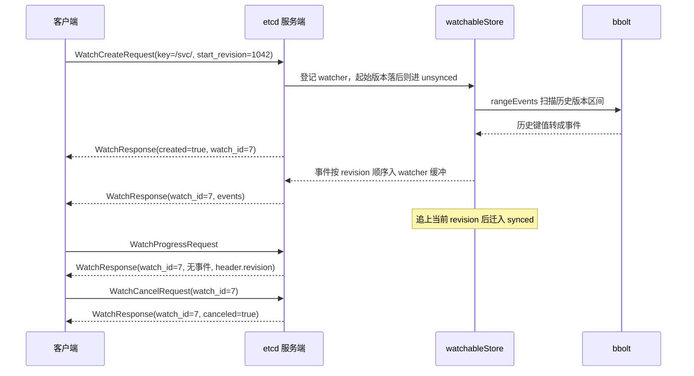
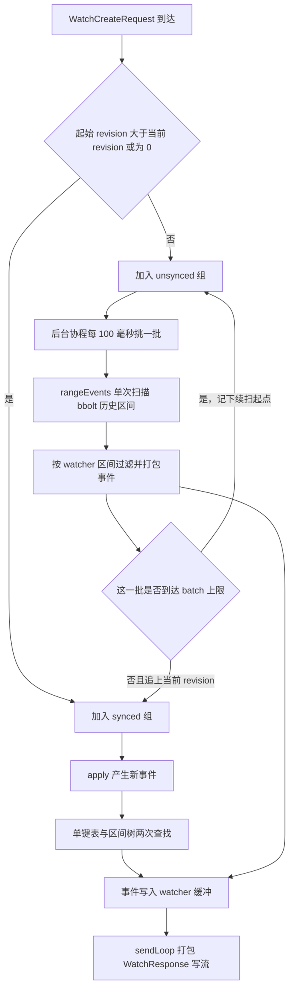
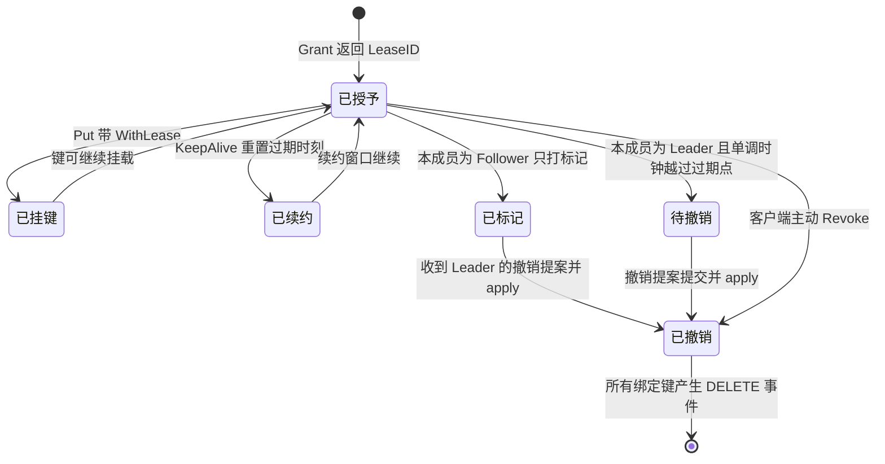
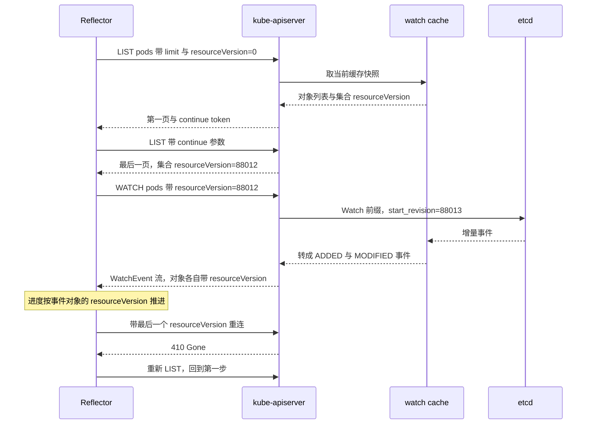

# 04 Watch 与 Lease——事件流与带时限的键

**摘要：**

etcd 主要面向五个动词，Put、Delete、Get 已经足以解释一个键值存储，剩下两个，也就是 Watch 与 Lease，才是它从「能存数据」跨到「能协调进程」的全部凭据。这一篇不走 API 手册的路子，而是把两件事拆到机制层：Watch 是一条以全局 revision 为坐标的事件流，客户端带着上次的坐标续订，服务端据此决定是从内存里的实时队列取事件，还是回头翻 bbolt 里的历史版本；Lease 则把一批键的生命周期交给一个倒计时，倒计时由 Leader 的单调时钟推动，但到点之后的删除必须走一条 Raft 提案，才能在每台机器上落在同一个日志位置。两条线共用同一个前提，那就是多版本存储与单调递增的 revision，而同一个前提也划出了各自的失效边界：压缩策略决定了事件能回溯多远，检查周期与提案延迟决定了过期能有多准。全文沿「为什么出现、语义是什么、服务端怎么做、Kubernetes 怎么用、用错了会怎样」展开，其中专门用一章澄清一个被反复写错的概念，即 Kubernetes 的 Node 心跳所用的 Lease 对象与 etcd 的 Lease 原语是两件完全不同的东西。读完之后，应当能独立判断一条 Watch 该从哪个 revision 起、一个租约的 TTL 该定多少秒，以及在什么条件下应当放弃 etcd 改用别的组件。

---

## 第 1 章 从一次性通知到可续订的坐标

### 1.1 高并发的心跳为何只能异步表达

2015 年 4 月的第一届 KubeCon 上，Google 的工程师做了一场演示，一千个 Pod 在大会上被一次性启动起来，全部负载由云厂商赞助，现场观众通过手机参与调度。这个演示在当年引起了不少震动，但真正决定 Kubernetes 后来架构走向的，并不是它能拉起多少容器，而是它如何在这么短的时间里把「要做什么」传达给分布在不同机器上的一批代理进程。

背后的机制有一个名字，叫水平触发（level-triggered）。监控系统里有一组经典对照：边沿触发只在状态变化的瞬间给一次通知，错过了就永远错过；水平触发则持续地问「现在是不是这个样子」，来得晚也不影响判断。Kubernetes 的控制器全按后者设计，每个组件只关心「现在应该是什么样」，同一个期望状态被反复读、反复收敛，结果都一样。这种设计对传输层提出的要求因此非常具体：快照必须能廉价地取，变更必须能持续地追，两者之间的接缝处不能漏。

这就撞上了一个旧伤。当时能被拿来当协调底座的开源方案只有 ZooKeeper，而它的监听原语，也就是 Watcher，是另一个模型。Yahoo 在 2008 年开源了 ZooKeeper，2010 年的 USENIX ATC 论文《ZooKeeper: Wait-free coordination for Internet-scale systems》把它介绍成一套适合大规模协调的无等待原语，Watcher 是其中使用最频繁的一个。

### 1.2 一次性 Watcher 的三道缝

Watcher 的语义很紧：一次注册、一次通知、注册自动作废。客户端要知道「变了之后是什么」，得再发一次 `getData`；要重新开始监听，也得自己再注册。两个动作拆开看都不算错，放在一起就露出三道缝。

第一道缝在「触发即失效」与「重新注册」之间。从通知抵达、读数据、到重新注册这一段里，如果被监听的节点又变了两次，客户端读到的很可能是第二次之后的值，而重新注册之后才开始接收通知，中间那一次变化没有任何途径被感知。第二道缝在「通知不带数据」上，服务端只告诉你「变了」，不告诉你「变成什么」，读与通知之间必然有一个时间差。

前两道缝还能勉强绕过去，第三道绕不过去。它不在客户端而在服务器：ZooKeeper 的协调请求会写进事务日志、参与 Zab 广播，最终落到每一个跟随者上，而最直接的反应，也就是变更通知，却在每台服务器本地触发。这种「写全局、通知本地」的结构在讨论 Zab 的论文里被当成性能优势来论证，代价是客户端必须理解「我收到的通知来自我连的那台服务器」。对 Kubernetes 这类需要跨集群做全局决策的负载，这种模糊性很难接受。

不妨把 Watcher 想成楼道里的声控灯：有人经过，灯亮一次，照亮的是「现在」，灯灭之后发生过什么没人知道；控制器需要的不是一盏灯，而是一份按时间排好的访客记录，翻到哪一页都行。

### 1.3 把「变化」变成公开记录

etcd 换的不是 Watcher 的某个参数，而是这份记录本身。v3 引入多版本存储之后，每一次写事务都从整个键空间申请一个新的主版本号（revision），同一个事务里的多个键共享这个 revision、用子序号区分；旧版本不立即删除，而是保留在 bbolt 里，直到被压缩。这三个性质在 [[03 存储引擎——WAL、BoltDB 与 MVCC 的持久化链路]] 里已经展开过，这里只取它们的组合后果：任意一个历史 revision 都能还原出那一刻的键空间，而这段历史能留多久，由压缩策略决定。

这份记录与 ZooKeeper 的 zxid 有一个差别，zxid 标识一次事务，revision 标识键空间的一个版本切片，前者回答「第几次事务」，后者回答「那一刻每个键分别是什么」，正是后者让「从某个坐标恢复」成为可计算的事。有了这份记录，订阅就变成了「从第几号开始，把后面的都给我」，注册窗口从语义里消失了，断线期间发生的变更并没有被扔掉，它们只是排在记录里，等你回来按编号领取。同一条底座上还长出了第二个能力：给一批键规定一个期限，到期之后一起消失。前者是 Watch，后者是 Lease。两者在 API 层面看起来毫不相干，实现上却互相借力：Watch 等的那条删除事件，可能来自一次显式的 Delete，也可能来自租约到期；而租约想让一批键同时消失，这件事最终要变成一条写进日志的删除，删除又必然产生 Watch 事件。**全局 revision 与多版本存储是协调能力的来源，也是协调能力失效的边界**。---

## 第 2 章 Watch 的语义：一条可以被坐标定位的事件流

### 2.1 一条流、三类消息、若干个 ID

Watch 在 gRPC 里是一条双向流，客户端在这一侧写 create、cancel、progress 三类请求，服务端在另一侧回 `WatchResponse`：

```protobuf
rpc Watch(stream WatchRequest) returns (stream WatchResponse);
```

双向流意味着同一条 HTTP/2 连接上，客户端可以不断往里写新请求，服务端也可以不断往外推响应，而不是一问一答。于是同一条连接能同时挂很多订阅：客户端发一个 `WatchCreateRequest` 登记「关心 `/registry/pods/` 这个区间」，服务端回一条 `created: true` 的响应，里面带着分配好的 `watch_id`，此后这条订阅的所有事件都打上同一个 ID 回流。`watch_id` 就是多路复用的粘合点，客户端库内部维护一张「ID 到回调」的表，收到一条响应就按 ID 投递，一条流上的几十个订阅互不干扰。

多路复用的价值不在协议优雅，而在资源。一千个客户端各自订阅一片前缀，如果每个订阅单独开一条连接，服务端要维护一千条流、一千份流级别的状态；合成一条流之后，服务端内部的 watcher 对象数量不变，但分摊在每条流上的固定成本只剩一份。官方文档介绍这点时说得很直白，多路复用降低了核心集群上的内存占用与连接开销。

三类请求里，`WatchCreateRequest` 带键、键区间、起始 revision 与一组开关（`progress_notify`、`filters`、`prev_kv`）；`WatchCancelRequest` 只带 `watch_id`，服务端停止推送并回一条 `canceled: true`；`WatchProgressRequest` 最特殊，它请求服务端立刻为这条流上已同步的 watcher 生成一条不带事件的响应，把当前 revision 报回来，用于判断「我追平了吗」。



图中省略了最关键的一层：历史事件不是创建那一刻一次性灌完的，而是由后台协程分批回放，每批之间隔着 100 毫秒的周期，追平当前 revision 之后才转入实时组。这一层留到 2.5 再说。

### 2.2 start_revision 的三种取值

`WatchCreateRequest` 里最容易被误读的字段是 `start_revision`。官方 API 文档的定义是「可选，表示从哪一版（含）开始监听，不给则从创建请求响应头的那个 revision 之后开始」。落到实现上它有三种用法，混用会直接导致丢事件或者重复处理。

第一种，不填，表示「从现在开始，我对过去不感兴趣」。服务端在 `watchableStore.watch` 里把当前 revision 加一记作这个 watcher 的起点，之后的新事件才会推给它，watcher 直接进实时组，不需要翻历史。第二种，填一个具体 revision，表示「从这一版开始补发，然后接实时」。这里的「含」很要紧，实践约定是客户端记住「我处理到的最后一个 revision」，重连时传这个值加一，既不重复处理最后一条，也不漏掉紧接着的下一条，对应的选项是 `clientv3.WithRev(rev)`。有一个边界值得记住：传给 `WithRev` 的 revision 若正好是 0，客户端只能走「未指定」的近路，仍然得等服务端在创建响应的头部回报真正的起点。

第三种，也是最容易写错的一种，是先 Get 一次拿到当前 revision，再从它加一起订阅。Kubernetes 的 List-Watch 走的就是这条路，但它依赖一条承诺，这条承诺写在 etcd 的 API 保证里：对同一个成员，`Range` 响应里的 `header.revision` 一定不小于所返回键值里的最大 `mod_revision`；反过来，返回的每一个键值的 `mod_revision` 一定小于等于 `header.revision`，而 revision 更大的键不会被返回。有了这条保证，「先 Get 后 Watch」才是安全的，读到的快照正好对应 revision R，从 R+1 订阅，之后发生的一切都会补齐，不重不漏。

「先 Watch 后 Get」在多数情况下也能跑，但需要额外的去重逻辑，Watch 建立之后、Get 发出之前写入的键，会同时出现在 Get 的结果和 Watch 的事件里，应用必须容忍同一条变更被处理两次。Reflector 坚持 List 在前，就是为了避开这份去重负担，而它对「重复」的容忍交给了下游做幂等合并。这里还有一层常被忽略的细节：List 带 `limit` 分页时要循环取 `continue` 直到取完，每页取到的对象并不保证来自同一快照，只有最后一页返回的集合级 `resourceVersion` 才是整次 List 的一致点，所以一定要等 List 全部完成才建 Watch。

> [!warning] 别把 start_revision 当成「从哪一版开始翻」
> 一个常见的误读是「`WithRev(R)` 表示读一遍 R 之前的历史」。实际语义是从 R 这一版开始、往后的都推给你，R 之前的不管。要看历史某个时刻的值，那是 `RangeRequest.revision` 的事，与 Watch 无关；两者都受压缩影响，但失败的形态不同，前者是响应被取消并带上 `compact_revision`，后者是 Range 直接返回已压缩错误。

### 2.3 事件里装了什么，以及那个被误用的 revision

`WatchResponse` 的 `events` 是一组 `mvccpb.Event`，每条只有三个字段：`type`、`kv`、`prev_kv`。`type` 只有两个取值，PUT 与 DELETE。`kv` 在 PUT 事件里是写入后的键值，在 DELETE 事件里只带被删的键和删除那一刻的 revision，`value` 为空。`prev_kv` 默认不填，除非创建时显式打开（Go 客户端是 `clientv3.WithPrevKV()`），打开之后，PUT 事件里的 `prev_kv` 是这次写入之前的那一版，DELETE 事件里的是删掉的那一版完整内容。

`prev_kv` 不是免费的。服务端在发送前要为每个打开 `prev_kv` 的 watcher 额外做一次范围查询，也就是在 `sendLoop` 里对每条非创建事件以「该事件 revision 减一」为参数回查一次 MVCC，把上一版补进事件里。这个实现细节直接影响成本估算，带 `prev_kv` 的 watch 会在服务端引发与事件数同阶的额外读。

`kv` 里还有一个 `version` 字段容易被误读，它统计这个键在当前这一代里被改过几次，删除之后重建，`version` 会重新从 1 开始，`create_revision` 也换成新值，所以「version 为 1」并不代表「键从未存在过」。`kv.mod_revision` 与 `header.revision` 是两个完全不同的数，这是新手最常踩的坑。事件的 `mod_revision` 是这条事件发生时的 revision，按事件顺序严格递增；`header.revision` 是这条响应发出那一刻整个键空间的最新 revision。由于服务端批量聚合，一条响应里的 `header.revision` 往往大于等于其中所有事件的 `mod_revision`。客户端如果拿 `header.revision` 当作「我已经处理到哪」的水位线，就会跳过尚未收到的事件，缓冲里那些事件的 `mod_revision` 全都小于这个值，重连时按「`header.revision` 加一」续订，它们永久丢失。正确的做法只有一条：进度水位线永远取自**事件**的 `mod_revision`，响应头只用来判断服务端已经走到哪了。

> [!important] 一条可以直接背下来的规则
> `header.revision` 是「当前」，`kv.mod_revision` 是「那一次」。用来续订的水位线，只能是后者。

### 2.4 删除的墓碑、原子性与分片

删除事件在 etcd 里有两个容易踩空的细节。其一，它携带的 `kv` 仍然带着被删除那一刻的 revision，但不带 `value`，`prev_kv` 也不一定有，客户端若想知道「被删的是什么」，只有两条路，提前打开 `prev_kv`，或者在自己的本地缓存里保存一份副本。其二，etcd 不区分「客户端主动 Delete」与「Lease 过期导致的删除」，两者都是一条普通的 DELETE 事件，业务若要判断实例是主动下线还是失联，必须结合租约状态或业务侧写入的标记。而「同一键的删除与重建」会表现为流上前后相邻的两条事件，中间没有「键不存在」的间隙，只按事件做增量更新的应用会把「先删后建」处理成「一次更新」，最终状态一致，但删除时的副作用会漏掉。

同一个事务写多个键，会变成「同一 revision 上的一串事件」。协议并不把同一事务的事件打包成一个原子批次，客户端收到的是若干条普通事件，它们的 `mod_revision` 完全相同，于是仅凭单条事件无法判断中间是否存在中间状态：如果事务同时写了 A 与 B，客户端先收到 A 的事件、再收到 B，在收到 B 之前本地视图是「A 已变、B 未变」，而服务端从未存在过这个状态。服务端对此的处理是在响应层面聚合，`sendLoop` 把某个 watcher 的一批事件打包成一条 `WatchResponse`，客户端看到的 `events` 数组里躺着若干条 revision 相同的事件，于是「原子性」的判断落在应用一侧，发现相邻事件 revision 相同就知道它们属于同一个事务。

### 2.5 服务端怎么组织：两组 watcher 与两个后台协程

etcd 服务端的 Watch 逻辑集中在一个叫 `watchableStore` 的组件里，它维护两组 watcher：`synced` 的成员「已经和当前 revision 同步」，只等新事件；`unsynced` 的成员「落后于当前 revision」，需要先把历史补齐。分组的判断在 `watch` 注册的那一刻完成，起始 revision 大于当前 revision、或者干脆是 0，直接进 `synced`，否则进 `unsynced`。

`synced` 组里，单键 watch 被放进一张按键索引的映射表，区间 watch（前缀、范围）被放进一棵按区间排序的区间树。每次 apply 产生新事件时，`notify` 拿着事件的键先查单键表，再在区间树里做一次相交查询，两次查到的集合并起来，就是这个事件该投递的 watcher 集合。单键表的好处是「只看某一个键」的订阅完全不必进树，一次哈希查找就能命中，所以「前缀匹配」在服务端的实际形态是一次区间相交，而不是字符串前缀扫描，`--prefix` 被翻译成 `range_end = key 之后的下一个可表示字节序列`，匹配成本与键的长度、以及树中区间的数量相关，与键空间的总大小无关。

`unsynced` 组由一个后台协程照顾，它以 100 毫秒为周期醒来一次，每一轮挑出一批 watcher（单批上限约 512 个），取其中最早的起始 revision 作扫描下界，向 bbolt 发起一次「revision 区间内全部键值」的范围查询，把查到的键值转成事件，再按每个 watcher 的观察区间过滤、分发。回放也是分批走的，每个 watcher 的事件批次有上限，超过之后记下「下一批从哪个 revision 继续」，留在 `unsynced` 等下一轮，进度追上当前 revision 之后才迁进 `synced`，这样一个落后很多的 watcher 不会把整段历史一次读进内存。



### 2.6 慢消费者：从受害者到被取消

Watch 最容易被低估的成本在发送缓冲。服务端给每个 watcher 准备了一个定长缓冲，默认 128 个响应，入队用的是非阻塞投递，塞得进去就成功，塞不进去立刻返回失败，绝不阻塞 apply 线程。失败之后，这个 watcher 被从 `synced` 组摘出来，打上「受害者」（victim）标记，连同这批事件放进一个受害者队列，由专门的协程稍后重投，写得进去就把它放回 `unsynced` 或 `synced`，写不进去就继续等下一轮。慢消费者于是不会阻塞别人，也不会立刻丢事件，而是被降级到一个慢速通道里反复尝试。

降级不是无限的。受害者队列里的 watcher 仍然在按降级之后的状态推进自己的最小 revision，一旦这个 revision 被压缩点越过，服务端就不再为它保留事件，而是直接发一条带 `compact_revision` 的响应然后把它删掉。这就是运维日志里那句「watch is slow」一族错误的来源，它不是某一刻的突然失败，而是反复投递失败积累到被压缩点追上的结果。

再往上一层，阻塞会传播到 gRPC 流。客户端应用迟迟不消费事件，客户端库的接收侧就会停止从流上读，服务端的发送迟早被流控住，`sendLoop` 卡在发送上，连带这条连接上其他 watcher 的推送一起停住。此时客户端如果还在用这条连接发其他请求，就会撞上 `etcdserver: too many outstanding requests`，这个报错说的是「服务端上属于你的请求还在排队，你又塞了新的进来」，它是服务端在 apply 进度与 Raft 提交进度差距过大时对所有请求统一返回的保护。它常被误认成 `--max-request-bytes`（约束单个请求体积）或 `--max-txn-ops`（约束单个事务操作数）的同类限制，但三者的对象不同，混在一起调通常一处都修不好。

| 表现 | 触发层次 | 常见原因 | 应对 |
| :--- | :--- | :--- | :--- |
| `too many outstanding requests` | 服务端流控 | 应用不消费，在途响应堆积 | 让消费与产生解耦，或按频率拆分多条流 |
| watcher 被取消并带上 `compact_revision` | 受害者队列 | 长期落后，被压缩点追上 | 重新 List，并从新的 revision 续订 |
| 服务端内存线性上涨 | 服务端内存 | watcher 数量多、观察区间过宽 | 收敛订阅面，在客户端做多路复用 |
| 单条响应触发 `fragment` 拆分 | 响应打包 | 同一 revision 事件过多或键值过大 | 客户端按 `fragment` 拼接逻辑响应 |

这三层之间有一个容易忽视的耦合：同一条流上的多个 watcher 共享同一个发送通道，所以一个慢 watcher 会拖慢这条流上的所有 watcher。把变化频率相差很大的订阅混在同一条流上，等于让最慢的那个决定全部的下限；按频率分组，热数据一条流、冷数据一条流，阻塞发生时影响面才可控。

### 2.7 压缩之后的两种错误，以及静默期的进度

历史能保留多久由压缩策略决定，而压缩有两层。集群层的自动压缩由 `--auto-compaction-mode` 与 `--auto-compaction-retention` 控制，周期模式下服务端每过一段保留期的十分之一就把当前 revision 记进滑动窗口，窗口填满后按最早的记录执行一次压缩；Kubernetes 场景下这个参数常常是 5 分钟，而且即使自己不配，apiserver 也会通过 `--etcd-compaction-interval`（默认 5 分钟）主动发起压缩。第二层是「压缩进行到哪」的持久化记录，meta 桶里的 `finishedCompactRev` 保存已经压缩完成的 revision，重启恢复时据此确定历史下界。

对 Watch 来说，压缩带来两件事。一是「追得太远」：客户端带着一个早于压缩点的 revision 请求 Watch，服务端凑不出完整序列，只能拒绝，回一条 `canceled: true` 并且带上 `compact_revision` 的响应，文档对客户端的建议很明确，把这个 watcher 当成已取消，**不要用同一个起始 revision 重试**，压缩不会倒退，重试必然失败。二是「追不上」：起始 revision 本身没过期，但客户端落后得太久，压缩点在一轮轮回放里一步步逼近、最终越过它的起点，于是同样收到 `compact_revision`，这条路径在 Kubernetes 里的错误文本是 `watch chan error: etcdserver: mvcc: required revision has been compacted`。

两种情况的恢复路径相同且只有一条：放弃增量，重新做一次全量列表，拿新的 revision 再从那里开始。许多线上事故的根因，是应用把 Watch 当成「断线重连一次就好」，重连失败就原地重试，于是在压缩窗口之后持续报同一句错误，直到有人介入。与它相对的另一个错误是「未来 revision」，客户端申请一个比服务端当前 revision 还大的起点（通常是本地持久化的进度被污染，或者连到了数据落后的成员），服务端不等待，直接返回 `ErrFutureRev`，客户端的处理是换一个端点重试，因为另一个成员可能已经追上。

静默期的问题是另一面：客户端在等一个 revision 被推进，而恰好这段时间没有写入，键空间越安静，越无法判断「我是否已经追平」。`progress_notify` 就是为此准备的，创建时打开它，服务端会在空闲期周期性发一条不带事件的 `WatchResponse`。这个周期默认为 10 分钟，实际发送时还会叠加最多十分之一的随机抖动，源码注释解释了原因：客户端重启往往成群发生，若没有抖动，几万个进度通知会在同一时刻涌出；配置项可以把它调短，低于下限会被服务端抬回并打一条警告。官方对这一项的措辞比多数教程更死，它「适合从某个已知的近期 revision 恢复断线的 watcher」，也就是说它瞄准的是「重连之后如何确认自己已追平」，而不是健康检查或保活。`unsynced` 组的 watcher 也会收到进度通知，但语义不同，在它追平之前服务端不为它发通知，所以刚重连的那段时间，通知要么不来，要么来了就代表已经追平。

---

## 第 3 章 Lease 的语义：一个会倒计时的对象

### 3.1 把时间收进键空间

一个键值存储只能回答「现在有什么」，回答不了「还有谁在意」。服务发现要判断一个实例还在不在，分布式锁要知道持有者是不是还活着，这类问题都属于活性（liveness）判断，与数据本身无关。没有租约时，只剩两条粗糙的路径：让每个实例周期性写心跳键，再让观察者扫描时间戳；或者干脆不判断，把失效判定散落到每个调用方。Lease 的做法很干脆，把「时间」收进键空间：授予（Grant）一个 TTL，得到一个租约 ID；把若干键通过 `WithLease(id)` 挂上去；租约到期，键一起消失。「谁还在」于是被翻译成「租约还在不在」，而租约的维护只需要一个定时发出的续约请求，**存活判定从「到处找证据」变成「本地维护一个倒计时」**。不妨把租约想成输液袋：标签写的不是「几点几分拔掉」，而是「这袋还够用多久」，护士隔一阵来看一眼、换一袋，只要没人换，它迟早见底，而见底那一刻是报警器按实时流量判断的，不是护士算出来的。

### 3.2 授予、挂载、续约、撤销

`LeaseGrant` 的请求只有一个必填字段 `TTL`，单位秒。官方 API 文档给它的定语是「建议性的」（advisory），这个词值得停下来想，它暗示「你要求的 TTL 只是请求，不是承诺」。服务端在响应里回报实际 TTL，请求过大时会按集群上限截断，所以「我申请了 3600 秒」不等于「我拿到了 3600 秒」。`Put` 的 `lease` 字段把键与租约关联，约束是每个键最多挂一个租约，一个租约可以挂任意多个键；如果对一个已挂租约的键再次 Put 而不带租约，它会从原租约上摘下来，变成一个「永生」的键，这条细节在服务发现里非常常见，注册的键被某个运维脚本手改一次却没带租约，此后它就不再随实例消失。`LeaseKeepAlive` 是一条双向流，客户端把多个租约的续约请求写进同一条流，服务端把每个租约的新剩余 TTL 写回来，一个进程可能同时持有多把锁、多个注册，一条流续约比每个租约一条流省得多。文档对「过期」的定义也写在这条链上，集群在 TTL 周期内收不到某租约的 keepAlive，它即过期。`Lease.TimeToLive()` 提供同步查询，适合诊断，不适合放进热路径。`LeaseRevoke` 是主动放弃，撤销之后挂在上面的键立刻被删，撤销与过期在实现上走同一条路，区别只在触发者。

### 3.3 续约间隔：一个属于客户端库的约定

关于续约间隔，「TTL 除以三」几乎成了行业常识，但它属于**客户端库的行为约定，服务端对此一无所知**。Go 客户端的续约循环里，下一次续约时间被算作「本次响应给出的 TTL 的三分之一」之后，这样即使第一次续约丢了、第二次也丢了，第三次才轮到失败。一旦你写的是裸 gRPC 客户端，这个比例就得自己定，而且要考虑的因素比「除以三」更多：请求在网络、服务端、客户端线程池三处都可能排队，安全余量至少应覆盖三者延迟之和。

### 3.4 过期判定：Leader 的单调时钟与一条 Raft 提案

租约到期之后谁去删那些键？直觉答案是「服务端某个定时器，时间一到就删」。真实做法绕了一圈，而这一圈恰好体现了 etcd 把「时间」与「共识」隔开的用心。每个成员的内存里都有一份租约表，过期时刻是**单调时间点**，Go 的 `time.Time` 自带单调读数，用它做减法可以避开系统时间被 NTP 校正时的跳变；成员周期性扫描租约表找过期者，但只有 Leader 的扫描结果会变成行动，其他成员即便扫到过期，也只把租约标记一下，不发起删除。Leader 扫到过期之后的动作，是构造一条 Raft 提案，内容是撤销这个租约 ID，这条提案与其他写请求走完全相同的路径，写 WAL、广播、多数派确认、提交、apply。apply 那一刻，每个成员执行同一段逻辑，从这个租约的绑定键集合里取出所有键，逐个生成删除事件、删除 MVCC 版本、清理索引，最后把租约本身从表里删掉，因为所有成员在同一条日志处执行同一个操作，它们删的是同一批键，产生的 revision 也完全相同。



为什么撤销必须走 Raft？如果 Leader 在本地直接删掉过期租约的键，会出现两种不可接受的情况。其一，Follower 不知道这批键已被删除，它们的内存索引与本地 bbolt 里仍然留着这些键，任何从 Follower 读的串行化请求都会读到「已过期却仍在」的数据，与线性一致的假象直接冲突。其二，Leader 在提交之前崩溃，新 Leader 可能从未见过这次删除，如果它那边的租约表里这个租约还在、或者也已过期，它会再删一次，两次删除对应两个 revision，同一个逻辑事件在日志里出现两遍，而中间收到第一次删除的客户端可能已经基于它做出了反应。走 Raft 之后，删除动作变成日志里的一条记录，只在提交后被应用，所有成员应用同一条记录，重复提交会被 apply 时的「租约不存在」检查拦掉。顺带的好处是恢复路径统一了，成员重启后只要把日志重放到原位，就得到与 Leader 相同的删除结果，不必额外维护「待删除的租约」清单。整个设计的关键在于把「何时删」与「删什么」分开，**何时删是本地时间问题，可以由每个成员各自判断；删什么是共识问题，必须由多数派共同确认**。

一个常被追问的问题：既然删除必须走 Raft，Leader 的时钟偏快或偏慢会怎样。如果某次续约只是晚到、租约还没被判过期，服务端会把过期时间往后推，客户端几乎察觉不到；如果租约已越过过期点、撤销提案已经提交，这次迟到的续约就只能被拒绝，响应里的剩余 TTL 为负值，客户端据此判定租约失效并关闭续约流，随后对挂载键的读返回「不存在」。悬在租约头上的那把剑，不在「时钟快慢一秒」上，而在「过期判定与续约到达之间的赛跑」上，唯一可靠的防线是让续约间隔与 TTL 之间留出足够余量。

### 3.5 续约成本、租约配额与重启恢复

租约与键的绑定关系在 bbolt 的 `key` 桶里逐条保留，恢复时先重建内存索引，再把每个键挂回它所属的租约，任何一步错位都会让「键还在、租约没了」或反之的错配留在库里。续约不分配 revision，但它仍然要推进一次批量提交，租约数量乘以续约频率，会让它在写路径上占据可观的份额。集群对每个成员的租约数量有硬上限，达到上限之后新的 Grant 直接失败，客户端拿到的是「租约数量超限」一类的错误，而不是等一个超时，这个限制在排查「服务注册突然失败」时经常被忽略，应用日志里只有一行 grant 失败，etcd 日志里往往没有任何显眼异常。还有一层配额不在租约数量上，而在「单个租约挂多少键」上，协议没有硬性限制，但每个租约挂上千个键会让撤销变成一次巨型删除，apply 的耗时、产生的事件量、下游 watcher 的缓冲压力都随之放大。按「谁应该一起消失」划分租约，比按「谁属于同一个服务」划分更稳妥。

> [!info] 关于续约量的一点算术
> 一万个进程各自持有三个租约、每 10 秒续约一次，稳态续约速率约为每秒三千次。这不是一个能随手忽略的量级，它与集群的真实业务写入共享同一条 Raft 日志。把租约数压到「每个进程一个」，同规模下就是每秒一千次。

租约的权威状态有两份，内存里的租约表，以及 bbolt 里名为 `lease` 的桶。桶里保存租约 ID 到元信息的映射，键到租约的绑定则体现在 `key` 桶里每个键值的 lease 字段上。成员重启时，从 bbolt 读回租约表与绑定关系，重新开始计时，重启过程中流逝的时间并不精确计入剩余 TTL，所以一次计划外重启可能让租约多活一小会儿，也可能让它提前到期。这也解释了为什么重启之后客户端的第一件正确事是「重新授予、重新挂载、重新续约」，而不是指望旧租约还在。集群成员的崩溃与客户端进程的崩溃，影响并不相同，前者带走的是这个成员内存里的租约表，租约本身由 Raft 日志与 bbolt 保管，被中断的只是「检查」这个动作；后者发生在集群外部，它的租约仍会被 Leader 正常判过期并撤销，挂在上面的键按时消失，这正是租约能替代「主动注销」的地方。

---

## 第 4 章 两个 Lease 不是一回事

### 4.1 名字撞车的地方

Kubernetes 从 1.13 起引入了一种叫「Lease」的 API 对象，放在 `coordination.k8s.io/v1` 这个组里，用来承载节点心跳与组件选主；etcd 也有一个叫 Lease 的东西，是带 TTL 的租约原语。两者共享名字，机制与层级完全不同，混为一谈会推出完全错误的结论，譬如「kubelet 续约失败会导致 Node 对象被 etcd 删掉」，这件事不会发生。

一句话区分，**Kubernetes 的 Lease 是一个普通的 API 对象，etcd 的 Lease 是一个存储层原语**。前者在 etcd 里对应一个键（`/registry/leases/kube-node-lease/<node>`），这个键与其他对象没有任何性质上的不同，它有 value、有 revision、可以被 Watch；后者的身份不在键空间里，它是与键平行的一张表，通过租约 ID 把若干键绑在一起。

### 4.2 节点心跳的真实链路

kubelet 在 `KubeletConfiguration` 里有一个 `nodeLeaseDurationSeconds`，默认 40，它用这个名字在 `kube-node-lease` 命名空间里创建或更新 Lease 对象，把 `spec.renewTime` 改成当前时间。更新节奏参照 KEP-0009 的设计是每 10 秒一次，与 `nodeStatusUpdateFrequency`（默认 10 秒）同频，但这个 10 秒是 kubelet 自己的行为，不是从对象里的 `leaseDurationSeconds` 推导出来的。Node 控制器（跑在 kube-controller-manager 里）定期巡检，`--node-monitor-period` 默认 5 秒同步一次，`--node-monitor-grace-period` 默认 50 秒，超过这个窗口没看到 `renewTime` 推进，就把节点标记为 `NotReady`。50 秒与 40 秒的关系不是随便定的，官方对 grace period 的说明是「必须是 kubelet 上报频率的若干倍」，而且要大过 HTTP/2 的 ping 超时与读空闲超时之和，因为 kubelet 到 apiserver 的长连接本身可能静默一段时间。

真正带来收益的是「写了什么」。在 Lease 之前，kubelet 的心跳是更新整个 Node 的 `status`，里面装着容量、可分配量、每个 Pod 的状态、各种 conditions，一次更新可能几 KB 到几十 KB，而每一次都是一次完整的 etcd 写入、一次完整的变更广播。改成一个只有几个字段的小对象之后，每次心跳写的字节数降了一到两个数量级。**写放大的下降不来自「写入次数变少」，而来自「每次写的对象变小」**。

### 4.3 一张对照表

| 维度 | etcd Lease（租约原语） | Kubernetes Lease（API 对象） |
| :--- | :--- | :--- |
| 归属层次 | etcd 存储层原语 | apiserver 管理的 API 对象 |
| 定义位置 | `etcdserverpb` 的 `LeaseGrant` 等服务 | `coordination.k8s.io/v1` 的 Lease 类型 |
| 在 etcd 里的形态 | 独立的租约表加键上的 lease 字段 | 一个普通键，路径形如 `/registry/leases/...` |
| 过期后发生什么 | 绑定键被自动删除并产生 DELETE 事件 | 对象不会自动删除，只是没人再更新 `renewTime` |
| 谁来判定过期 | etcd 的 Leader，按本地单调时钟 | Node 控制器或选主逻辑所在的上层组件 |
| 续约方式 | `LeaseKeepAlive` 双向流 | 对 Lease 对象的一次 Update 请求 |
| 续约间隔由谁决定 | 客户端库，Go 客户端约为 TTL 的三分之一 | kubelet 的固定节奏，约 10 秒 |
| 失效的后果 | 键消失，服务发现与锁状态随之变化 | 节点被判不健康，Pod 可能被驱逐 |

读表时最该盯住的是「谁来判定过期」这一行。etcd Lease 的判过期在 Leader 里，是一个被多数派背书的动作；Kubernetes Lease 的判过期在 Node 控制器里，是一次普通的本地比较，比较的结果只影响「Node 对象的 condition 怎么写」，不会触发任何删除。同一件事「Node Lease 过期」在两层看来完全不同，在 etcd 看来 `renewTime` 只是某个键上的一次普通 PUT，没有任何计时器在等它；在 Kubernetes 看来，那个时间戳是「kubelet 最后一次证明自己活着」的证据，判定的后果是标记状态、触发驱逐，而不是删除对象。

### 4.4 这层区分为什么重要

混淆两者，典型的错误有四种。第一种是把「Lease 对象用的是秒级时间戳」误读成「etcd 给这个对象提供了秒级 TTL」，于是期望节点故障的发现速度与 etcd 判过期一样快，把 `--node-monitor-grace-period` 调到几秒，实际上发现延迟的下限由心跳节奏与巡检周期共同决定。第二种是以为「Node 不健康就等于 Node 对象被删掉」，节点被判 `NotReady` 之后，真正的删除动作发生在 Pod 驱逐之后由控制器逐个 Pod 处理，而 Node 对象本身还在。第三种是看到 etcd 里那个键上挂着非零的租约 ID，就以为「这个对象有 TTL」，那个租约 ID 是 apiserver 自己维护的内部租约，不是「kubelet 的存活租约」。第四种更隐蔽，把 Kubernetes 的选主（`leaderelection` 包）也说成「用了 etcd Lease」，`leaderelection` 用的是 Lease 对象加上乐观并发，整个逻辑运行在 apiserver 之上，与 etcd 的租约表毫无交集，混淆这两者，会让人误以为「etcd 集群抖动会直接影响 kube-scheduler 的主备切换」。

---

## 第 5 章 Kubernetes 一侧的映射：resourceVersion 与 List-Watch

### 5.1 三档语义

Kubernetes 不直接暴露 revision，它把 etcd 的 `mod_revision` 包装成 `resourceVersion`，一个字符串形式的十进制数。官方文档对它的描述是「标识对象最后一次被修改时对应的版本」，对集合的描述是「该集合被构造时对应的版本」。这两个值在 apiserver 内部就是 etcd 的 revision，但在语义上，Kubernetes 引入了 etcd 没有的档位划分。

`resourceVersion` 不设值的 List 与 Get 是最强的语义，apiserver 必须保证返回的结果反映了发起请求那一刻之前的全部写入，一次线性一致的读（在 [[01 etcd 全局架构——从配置存储到控制面账本]] 里讲过的 ReadIndex 路径）。`resourceVersion="0"` 的语义是「任意较新」，官方措辞是「Any」，apiserver 可以直接从 watch cache 里取当前缓存的版本返回，不保证是集群里最新的，代价是可能读到略旧的数据，收益是省掉一次多数派确认，这也是为什么 List-Watch 的 List 通常用 `resourceVersion=0` 起步，它只需要一个「足够新」的起点，一致性由「List 与 Watch 首尾相接」保证。`resourceVersion` 取一个非零具体值时，语义是「不旧于某个版本」，apiserver 要等到本地状态至少推进到这个版本才返回。对 List 来说，从 v1.19 起还有 `resourceVersionMatch` 参数，把「任意较新」与「不旧于」区别开，官方文档有一句直白建议，没有强一致要求时用 `resourceVersionMatch=NotOlderThan` 配合一个已知的 `resourceVersion`，性能与可扩展性都优于不设参数（后者需要多数派读）。

### 5.2 List-Watch 的时序

Kubernetes 的 List-Watch 是一套「先快照、后增量」的协议，正确性由三个动作的组合保证：List 分页完成后拿到集合级 `resourceVersion`；Watch 从这个版本之后开始；Watch 的每条事件携带对象级 `resourceVersion`，进度按事件推进而不是按响应头推进。



这条链路里有一层常被忽视，apiserver 并不总把 Watch 直接转发给 etcd。watch cache 会为每种资源维护一份本地缓冲，先向 etcd 建一个 watch，把事件写进本地缓冲，再向客户端广播，收益是「一个 etcd watcher 服务大量客户端」，代价是内存与一致性窗口。控制这一层规模的参数是 `--watch-cache-sizes`，按资源指定缓冲大小，文档说明其中唯一有实际差异的取值是 0，也就是对某类资源彻底关掉缓存。watch cache 的初始化也有代价，apiserver 启动时先让所有已注册的缓存完成与 etcd 的初始同步，再对外报告就绪，在此之前抵达的请求会被拒绝，这解释了运维上一个常见现象，apiserver 重启后的头几十秒 `/readyz` 一直不通过，看着像卡住，实际是缓存在逐个资源类型地追赶。

### 5.3 410 Gone 与 Bookmark

etcd 用 `ErrCompacted` 表达「你要的历史已经不存在」，Kubernetes 在上层用 `410 Gone` 表达同一件事。官方文档对客户端的要求非常明确，识别 `410 Gone`，清空本地缓存，重新做 Get 或 List，从响应里带回来的 `resourceVersion` 重新开始 Watch。文档还给出了一个口径，Kubernetes 使用 etcd 3 时默认只保留最近 5 分钟的变更历史，这条口径来自 apiserver 默认每 5 分钟的一次压缩，而非 etcd 自身的默认，后者的自动压缩默认关闭。文档里另一句提醒容易被跳过，**一个给定的 Kubernetes 服务端只保留有限时间的历史**，所以客户端必须能容忍 410，而不能指望重试到成功。断线时长与压缩窗口的比值因此决定了恢复代价，这个比值应当被当成容量规划的一部分，而不是事故之后才发现的问题。

为了缓解历史窗口太短的问题，Kubernetes 引入了 Bookmark 事件，一个只有 `metadata.resourceVersion` 的特殊事件，标记「在你要的这个版本之前的所有事件都已经发给你了」。把 Bookmark 与 etcd 的 progress notify 放在一起看，会发现它们是同一思路在两个层次上的实现，一个是空响应携带进度，一个是空事件携带进度。这一整章在 [[云原生/Kubernetes/kubernetes之API Server/05 List-Watch 机制与 Informer 框架|List-Watch 与 Informer]] 里有更完整的展开，本篇只关心它与 etcd 原语的接口处。

---

## 第 6 章 两种正确写法：服务发现与分布式锁

### 6.1 服务发现：要的是对齐，不是聪明

服务发现的构造可以拆成两半，提供者把自己挂上去，消费者看见变化。

提供者一侧的顺序有讲究，先 Grant 拿到租约，启动 KeepAlive，再 Put 带 `WithLease` 的键。如果先 Put 再 Grant，中间那一小段时间里键是一个没有租约的永生记录，进程在启动阶段崩溃，它就永久留下；如果 KeepAlive 还没起来就 Put，从 Put 成功到续约流建立之间租约在走表而没有人在续，进程卡久了就会先过期再登记，得到一个「注册了但立刻消失」的幽灵。两种顺序错误的共同点，都是让「键出现在键空间里」与「有一个东西在维护它」之间出现了时间差。

这段顺序用四步表达就够了：Grant 拿到租约 ID；KeepAlive 建立续约流并起一个消费协程；在这个协程里读续约响应，一旦响应变成空值或者剩余 TTL 为负，立刻调用「丧失处理」；只有前两步都成功，才执行带 `WithLease` 的 Put。这段控制流里唯一需要记住的语义是，孤立的 Put 成功并不代表注册稳固，只有续约流仍然活着、并且最近一次回包的剩余 TTL 为正，才说明这个键有人在维护。

消费者一侧是 revision 对齐，先 Get 拿全量，记下 `resp.Header.Revision`，再从它加一订阅，这条路径依赖「Range 的 header revision 不小于返回键值的最大 mod revision」这条保证。断线之后的重建是另一半，也最容易写漏，正确的重建循环包含三种分支，收到事件时把进度推进到事件的 `mod_revision`；收到「已压缩」时退化为全量 Get；收到连接错误时用最后进度重订。只写第一个分支的实现，在服务端压缩或集群抖动之后会静默停止更新，直到有人重启进程。提供者一侧的失效路径同样需要设计。一个进程从「租约过期」到「重新注册」之间要经过三个动作，发现续约失败、放弃旧状态、以新身份重新注册，「放弃旧状态」常被跳过，而它往往是安全生产里最关键的一步，如果进程在租约丢失后仍抱着「我还在名单里」的假设继续接收负载，它就变成了一个活着但已失效的幽灵。更稳妥的写法是把「租约是否有效」放进请求处理的前置检查，一旦失效立刻把本地健康检查标记为不健康，让流量自然被摘除。还有一类失效来自时钟与网络之外，容器环境里进程可能被 `SIGSTOP` 挂起、可能因内存压力被换页、可能被 CPU 配额限流几十秒，这些暂停不会断开 TCP 连接，续约逻辑仍然在跑，只是没有机会被调度，这就是为什么只靠「连接是否还在」判断租约健康是不够的。

### 6.2 分布式锁：不是「最小 CreateRevision」，而是「等前任」

etcd 官方仓库里有一个 `concurrency` 包，内含 `Mutex` 与 `Election`。网上关于 etcd 分布式锁的写法里，「`CreateRevision` 最小者持有锁」流传最广，也最不完整，它描述的是**结果**，而不是**实现**；照它写代码，通常会写出「所有等待者都 watch 整个前缀」的实现，任何一个持锁者释放时都产生一次广播风暴。

真实的实现对每个等待者做三件事。第一，生成**唯一键**，键名由「锁前缀」加「租约 ID 的十六进制表示」拼成，绑定到自己的租约上，写入用一个事务，条件是「这个键不存在」，因为租约 ID 全局唯一，键名不会冲突。第二，键创建成功后**按 `CreateRevision` 排序**，同一锁前缀下的所有键按创建顺序获得 revision，revision 的大小顺序就是到达顺序。第三，如果自己的键排第一，加锁成功；如果不是第一，**只 watch 排在自己前一位的那个键**，等它被删除。

第三点是整个设计的心脏。只 watch 前一个键，意味着等待者被唤醒的唯一原因就是「排在我前面的人走了」，唤醒次数与等待者数量同阶，不会出现「一个人走、所有人醒」的惊群。这与 ZooKeeper 用临时顺序节点实现的排队锁在结构上完全一致，区别只在底层机制，ZooKeeper 用「会话」作为到期判定的载体，etcd 用「租约」。ZooKeeper 侧的完整推导在 [[分布式架构/分布式锁/04 基于 ZooKeeper 的分布式锁原理深度解析|基于 ZooKeeper 的分布式锁]] 里，两边对照着读，会更容易看清「顺序加前任通知」这一结构是共通的。

| 环节 | `concurrency.Mutex` 的实现 | 稳健性来源 |
| :--- | :--- | :--- |
| 生成唯一键 | 前缀加租约 ID 的十六进制 | 租约 ID 全局唯一，天然去重 |
| 创建锁键 | 事务中判断键不存在再写入 | 原子性，避免并发下重复创建 |
| 排队次序 | 按 `CreateRevision` 排序 | revision 全序，顺序即公平 |
| 持锁判定 | 排第一者持锁 | 与前缀下最小 revision 等价 |
| 等待机制 | 只 watch 前一个键的删除 | 唤醒数量与等待者数量同阶 |
| 到期释放 | 租约到期后撤销，键被删除 | 无人续约即自动让出 |

### 6.3 TryLock、Session 与 fencing

`Mutex.TryLock` 是「非阻塞尝试」，创建键、检查自己是不是第一，如果不是第一就把刚创建的键删掉并返回 `ErrLocked`。它更接近抢占而非排队，用它的场景通常是「拿不到就做点别的」，而不是「必须等到前一个人走」。`Lock` 与 `LockWithLease` 的区别也值得记一笔，`Lock` 用的是 `Mutex` 自己的会话，锁的存续完全由这个会话的租约决定；`LockWithLease` 允许调用方把锁挂在自己的一个已存在的租约上，让「锁」与「其他注册」共享同一条续约流，好处是续约请求更少，坏处是耦合更强，那条租约一失效，锁与注册会同时消失。

`Session` 是租约之上的一层封装，负责 Grant、KeepAlive、Revoke 的完整生命周期，并提供一个 `Done()` channel，它在两种情况下关闭，会话被主动关闭，或者续约失败，后者是关键，当续约流断开、服务端返回租约不存在、或者本地检测到续约超时，`Session` 会关闭 `Done()`。对使用方来说，`Done()` 是唯一的「丧失」信号，也是最容易被忽略的信号，一个典型错误写法是「加锁成功后开一个 goroutine 消费续约结果，只打日志不处理」，它在正常情况下运行良好，直到某次网络抖动让租约过期，锁已经在服务端被释放、另一个节点拿了锁，而第一个节点还在用「我持有锁」的假设写共享资源。把这个场景推到底，就是 fencing 存在的理由。节点 A 持有锁，正在做一件需要几秒钟的写操作；此时一次长时间的停顿或网络分区让续约发不出去，租约在 10 秒后过期，节点 B 拿到锁开始工作；20 秒后 A 的停顿结束，它并不知道自己已不是持有者，继续写入了共享状态。锁没有坏，坏的是「判定过期」与「实际打断」之间那段无法消除的间隙，这段间隙的根源不在 etcd，而在任何租约类锁的固有结构里。消除间隙的方法不在锁里，在资源一侧，**资源侧要能拒绝来自旧持有者的写入**。这就是 fencing token 的思路，锁服务授予锁时返回一个单调递增的令牌（在 etcd 里最自然的是锁键的 `CreateRevision`），持锁者每次写资源都带上它，资源侧只接受比已见令牌更大的写入。从 revision 的角度看会更清楚，A 第一次写入产生 revision 100，B 写入 105，A 重新写入 110，若 A 的每次后续写入都声明「我认为自己是 100 号持有者」，而资源侧拒绝任何仍声称 100 的请求，那么 A 恢复后的第一批写入就会被毫无歧义地挡住，关键在令牌必须来自**共识系统分配的全序**，而不是持有者自己的本地序号。

Jepsen 对 etcd 的分析记录过旧版本锁实现的一致性缺陷，这类材料的价值不在「哪个版本有问题」，而在「它证明了什么条件下锁的语义会露出破绽」。站内的 [[分布式架构/分布式锁/08 分布式锁的边界与替代方案|分布式锁的边界与替代方案]] 把这一类问题作为整篇落脚点展开，本篇只留一句结论，**Lease 让「无人持有」这个状态能被自动识别，但不让「持有者不会误解自己还持有」自动成立**。

---

## 第 7 章 边界与反例：Watch 与 Lease 不该被用来做什么

### 7.1 把 Watch 当消息队列

这是最常见、后果也最严重的一种误用，业务需要事件驱动，看到 etcd 有 Watch，觉得省了一个中间件，于是用 Put 写事件、用 Watch 消费，演示环境里它工作得很好，到生产会出三类问题。第一类是回放窗口的硬约束。etcd 的「消息」没有单独存储，它们就是键的版本历史，消费者能回溯多久完全由压缩策略决定，一个断线五分钟的消费者可能需要一次全量重扫；如果为了照顾消费者把压缩窗口调大，就换来磁盘与内存的持续增长，而这两项是 etcd 最贵、最容易触上限的资源。第二类是没有确认语义，消息队列的核心契约是「消费确认」，处理失败时消息回到队列、被重新投递，至少一次（at-least-once）是基本保证；而 Watch 没有 acknowledgment 的概念，客户端收到事件、崩溃、重启、从自己的进度续订，这期间「处理到一半」的那条事件是丢了还是重了，服务端无从知道，应用只能靠「把进度写回 etcd」模拟确认，而这个写回与「读事件」不是原子操作。第三类是语义错配，etcd 的键空间是「当前状态的集合」，消息队列是「事件的序列」，用键表达事件时多个事件可能落到同一个键上、被压缩成一个版本，而推送只对「正在订阅的人」有效，对「后来的人」只能靠历史版本重扫。

比较合适的分界线是，etcd 承载「状态」以及「状态的最近一次变化」，不承载「事件流」。确实需要可靠事件流时，Kafka 或其他日志型中间件是更自然的答案，etcd 可以承担「谁在消费、消费到哪了」这类元数据。

### 7.2 无限制的 wildcard watch

Watch 的成本有一个常被低估的部分，服务端侧的开销与观察区间的宽度、watcher 的数量相关，而不是与事件数量相关。一个常见的坏模式是「每个 Pod 的 sidecar 都去 watch 整个 `/registry/` 前缀」，理由是「我需要感知集群里的任何变化」，sidecar 涨到几千个时，每个写事件都要对上几千个 watcher 做匹配与入队，服务端的 CPU 与内存会以肉眼可见的速度上涨，这种失效在指标上的形状也很有辨识度，静态指标毫无变化，而 Watch 类调用的处理速率随时间线性增长，同时进程 RSS 与 GC 停顿一起往上走。反向的坏模式同样值得对照，为了省资源把所有订阅合并成「一个客户端、一个巨大的前缀」，看似优雅，实际把风险集中到一个进程上，它一挂，所有订阅同时重建，重连风暴与压缩窗口叠加，往往比分散订阅更难恢复。更好的做法有三条，在客户端侧多路复用，一个进程只建一条 Watch 流，在本地按需过滤分发；收窄区间，只要某个命名空间的对象就订阅到命名空间一级；把广播交给 apiserver 的 watch cache 或一个专门的消息组件，etcd 只服务有限个 watch 消费者。

### 7.3 Lease TTL 的两难与经验区间

TTL 短了会误删，这是最痛的失效模式，一次节点级的 GC 停顿、一次时钟校正、一次网络拥塞都可能导致续约迟到，租约被撤销，键消失，服务被摘除，锁被抢走，而进程本身还活着、还自以为持有，更麻烦的是这种误删往往不可逆，键被删之后即便进程恢复运行也需要重新注册、重新加锁，而在这段真空里其他节点可能已经接管。TTL 长了则故障感知慢，一个真正崩溃的进程，它的键要在 TTL 之后才消失，期间流量仍然被打到一台死掉的机器上，锁仍然被一个不在的持有者占着。感知延迟的下界是「TTL 加检查周期加提案延迟」，而检查周期与提案延迟都是秒级，所以**总延迟大致是 TTL 加上一到两秒**。Kubernetes 给出了一个不错的参考区间，心跳 10 秒，`nodeLeaseDurationSeconds` 40 秒，宽限期 50 秒，含义是能承受连续丢三次心跳才判定不健康，判定之后还有一段宽窗口才触发驱逐。对一般的服务注册与锁，十秒量级是常常被选作起点的值，续约间隔取 TTL 的三分之一时，十秒 TTL 对应约 3.3 秒一次续约，能容忍约 6 秒的网络抖动，再短就容不下一次容器调度或一次 DNS 抖动。调参之前先把三个量测出来比拍脑袋有效，集群内部往返时延的 P99 决定一次续约请求的正常往返；客户端到 etcd 的连接建立耗时决定断线重连时那段「没有人在续约」的空窗；应用自身的 GC 停顿分布或容器被限流的时长，决定续约逻辑可能被冻住多久。三者之和才是 TTL 的理论下限。

### 7.4 续约失败与重新注册的正确姿势

续约失败后「重新 Grant 一个租约、把同一个键重新 Put 上去」是最常见的自愈路径，看起来合理，实际有一个尖锐问题，**这个键可能已经属于别人了**。设想两个进程都用普通 Put 抢同一个键，A 的租约过期，键被删除；B 的租约还在，在 A 的键消失之后 Put 了同一个键；此时 A 恢复，用新租约重新 Put 同一个键，它会成功，因为普通 Put 不检查「这个键之前是不是我写的」，于是 B 以为自己持锁，A 也以为自己持锁。

正确的做法是把「重新注册」写成条件写入，只有当 `CreateRevision` 仍是我上次写入的值、或者键不存在时才写，即便如此也只能解决一半，因为 A 在发现自己失联之前可能已经写入了其他状态。这也可用来回答一个常被问的问题，**Lease 过期后立刻用同一个键重新注册，会不会抢到别人**。如果「别人」是用普通 Put 写的键，会抢到，且双方都不知道；如果「别人」是 `concurrency` 的锁实现，因为有唯一键与排序，不会发生覆盖，但 A 会排到队尾；如果「别人」是服务发现，同名注册其实是个业务问题，etcd 只能保证后写覆盖前写，无法替你裁决「谁更应该占这个名字」。

### 7.5 把 Watch 当心跳

还有一种不那么常见但值得指出的误用，用 Watch 的静默期推断「对端是否存活」。思路是「我 watch 了某个键，半小时没事件，说明它很稳」，这当然推断不出活性，键不变不代表写入方活着；反过来，用「我能收到事件」推断「我的连接是好的」也有同样漏洞，连接断了，你收不到事件，也收不到错误，除非开了进度通知或主动健康检查。对于「我的 Watch 还健康吗」，etcd 侧的正规答案是进度通知与主动的进度请求，如果一段时间内没有任何事件（包括空事件），客户端可以认为这条订阅需要重建。把「有没有事件」等同于「连接是否健康」，是很多自研客户端里隐藏的 bug。


### 7.6 结论：只有选择，没有高下

把这一章列出的失败模式并排看，会发现它们几乎都不是「用错了 API」，而是把某一方的成本算到了另一方头上。把事件临时存进 etcd，省下的是引入消息中间件的运维成本，付出的是 etcd 自己的存储与可见性成本；把 wildcard watch 交给每个 sidecar，省下的是架构分层，付出的是服务端的扇出成本；把 TTL 压短，省下的是故障感知延迟，付出的是误删与重复执行的风险。etcd 的设计没有承诺消除这些成本，它只是给了一套机制，让这些成本可以被看见、被配置、被度量。称职的使用者要做的不是找到一组最优参数，而是把每项成本放到它最该被承担的那一层，这套安排没有普适的最优解，只有选择，没有高下。

---

## 小结

Watch 与 Lease 之所以能把 etcd 从键值存储推成协调服务，靠的是同一个底座，全局单调的 revision 与多版本存储。Watch 把 revision 序列变成可订阅、可定位、可续订的事件流，于是「不丢事件」不再依赖注册窗口的配合；Lease 把时间变成键空间里的一个对象，于是「谁还活着」不再需要四处扫描。两者的实现都刻意守在「本地判断、共识执行」的边界上，Watch 的进度推进依赖事件的 `mod_revision` 而不是响应头，Lease 的过期判定可以在本地完成，但删除动作必须走一条 Raft 提案。

这条底座同时决定了它们的失效边界。压缩策略限定了事件能回溯多远，一旦落后到压缩点以下，唯一的恢复路径就是全量重列；Leader 的检查周期与提案延迟限定了过期能有多准，TTL 因此只能被当作「至少多久」而不是「恰好多久」；服务端发送缓冲与可见性成本，最终都要落在某一层的内存或磁盘上。至于那些看起来像 etcd 能力、实则是上层构造的部分，Kubernetes 的 Lease 对象、apiserver 的 watch cache、`resourceVersion` 的几档语义，它们的价值恰恰在于把 etcd 的机制翻译成了更适合大规模集群的形态，分不清「原语」与「上层构造」的边界，是误解这一整层设计的最主要来源。

---

## 参考资料

1. etcd 官方文档：API 总览（Watch 与 Lease 一节），https://etcd.io/docs/v3.6/learning/api/
2. etcd 官方文档：API Guarantees（Range 响应头与 revision 的保证），https://etcd.io/docs/v3.6/learning/api_guarantees/
3. etcd 官方文档：gRPC API 参考（WatchCreateRequest、WatchResponse、LeaseGrant 等消息定义），https://etcd.io/docs/v3.6/dev-guide/api_reference_v3/
4. etcd 源码：`server/storage/mvcc/watchable_store.go` 与 `watcher_group.go`（synced 与 unsynced 分组、区间树、批量回放），https://github.com/etcd-io/etcd
5. etcd 源码：`server/etcdserver/api/v3rpc/watch.go`（sendLoop、进度通知周期与抖动、响应分片），https://github.com/etcd-io/etcd
6. Kubernetes 官方文档：API Concepts 中的 resourceVersion 语义与 410 Gone 处理，https://kubernetes.io/docs/reference/using-api/api-concepts/
7. Kubernetes 官方文档：Leases（`coordination.k8s.io/v1` 的 Node 心跳与选主），https://kubernetes.io/docs/concepts/architecture/leases/
8. Kubernetes 官方文档：kubelet 配置参考（`nodeLeaseDurationSeconds` 默认 40 秒）与 kube-controller-manager 参数（`--node-monitor-grace-period` 默认 50 秒），https://kubernetes.io/docs/reference/config-api/kubelet-config.v1beta1/
9. Patrick Hunt et al. *ZooKeeper: Wait-free coordination for Internet-scale systems*. USENIX ATC 2010.
10. Kyle Kingsbury. *Jepsen: etcd 3.4.3*. https://jepsen.io/analyses/etcd-3.4.3

---

> [!note] 思考题
> 1. 如果你的服务注册用 30 秒 TTL，而某次发布中实例平均要停顿 8 秒用于加载模型，你会缩短 TTL、延长 TTL，还是保持不动？请用「误删风险」与「感知延迟」两条曲线给出理由。
> 2. Node Lease 把心跳从「大对象更新」改成「小对象更新」，但它仍然是一次 etcd 写入。在节点规模很大、心跳频率很高时，你认为瓶颈会先后出现在哪几层？
> 3. 一个消费者断线 4 分钟后重连，而压缩窗口是 5 分钟，它能否用上次的进度继续？如果断线 6 分钟呢？两种情况它分别需要做什么？
> 4. 只用「`CreateRevision` 最小者持锁」、等待者都 watch 整个前缀，这个实现在什么规模下会开始出问题？问题会以什么形式暴露出来？
> 5. fencing token 在你的系统里可以怎样落地？如果资源侧是一个没有条件写入能力的旧系统，有什么折中办法？