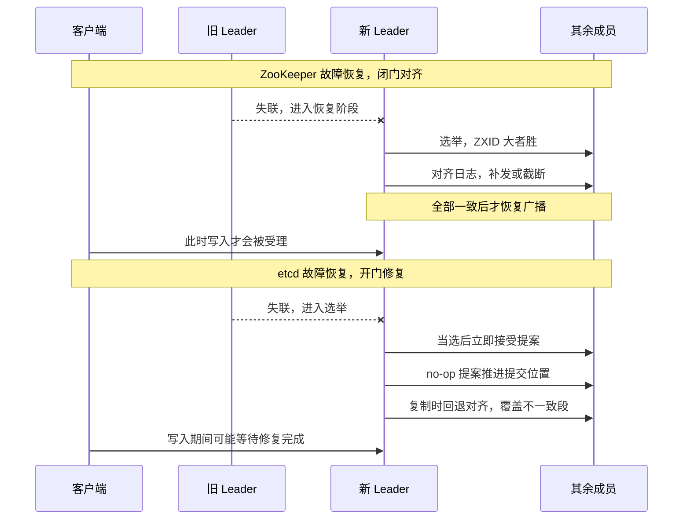
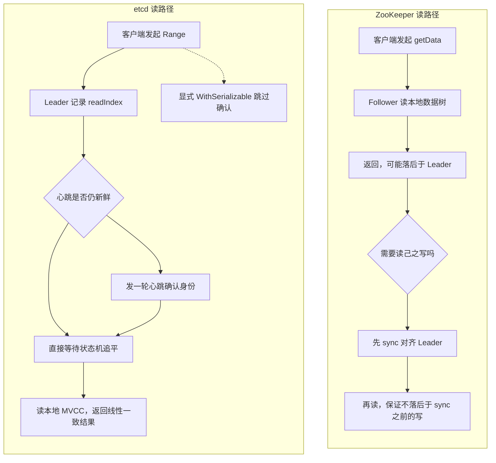
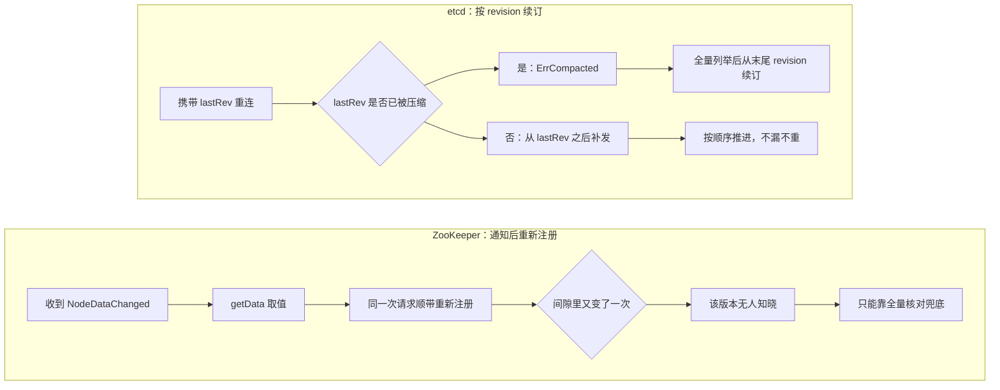
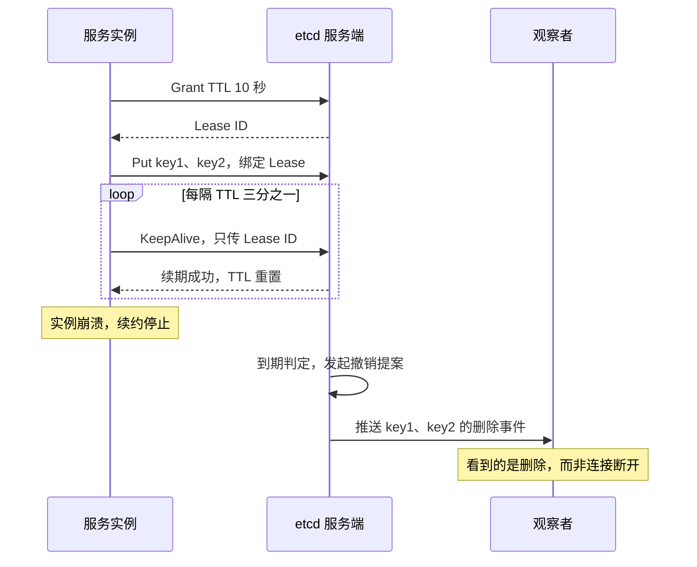

# 05 etcd 与 ZooKeeper——一代协调服务的分野

**摘要：**

两个出生年份相差五年、却都长成了「集群大脑」的项目，被放在同一张表格里比较了十几年，多数比较止步于「谁的 QPS 更高」「谁的一致性更强」。本文尝试换一个坐标系：ZooKeeper 与 etcd 的分野，不在先进与落后，而在两代需求给它们划出的不同原点——2008 年的 ZooKeeper 把「一组协调原语加一个会话」当作坐标，2013 年的 etcd 把「一本能同步、能对账的键值账本」当作坐标，此后两者在协议（ZAB 与 Raft）、读一致性（默认可能读到旧值与默认线性一致）、通知机制（一次性 Watcher 与带 revision 的持久 Watch）、数据模型（ZNode 树与扁平键值加全局 revision）、临时语义（会话绑定的临时节点与可跨连接的 Lease）五个方向上各自越走越深，深度恰好对应各自被要求解决的问题。

文章按「出身—协议—读与通知—模型与临时语义—性能与运维—去依赖的真实动因—选型」的顺序展开，并集中纠正三类流传很广的误读：ZooKeeper 并非不支持「读己之写」、etcd 的 Watch 并非永不丢事件、去 ZooKeeper 化并非因为外部协调中心太慢。读完这一篇，应当能把「选哪个」的问法，替换成「我的协调需求被哪一种语义假设整除得最干净」。

---

## 第 1 章 两条出身线

### 1.1 一块共同的疼点

要理解两个项目为什么长成今天的模样，得先回到它们共同面对的那道题。

2006 年前后的数据中心里，同一个团队往往同时维护着十几套分布式系统：文件系统要有 NameNode 选举，作业调度器要知道哪些机器还活着，消息队列要决定哪个 Broker 当主，配置服务要把数据库连接串推给几十台机器。这些需求的技术名字各不相同，底下的动作却高度雷同——都要在一片不可靠的网络里，就「谁是主」「谁在线」「配置是什么」这三类极小状态达成一致。

麻烦在于，一致性问题极难一次做对。多数团队的做法是各写一份：一个临时文件加心跳、一把 Redis 锁、一段轮询数据库的循环，各系统拼装出的协调逻辑互不兼容，出了问题谁也说不清是谁的锅。ZooKeeper 的起点就落在这里——把重复实现的协调逻辑收敛成一个独立的、被所有人复用的服务。

五年之后，CoreOS 面对的是同一道题的另一面。彼时容器刚刚兴起，Fleet 要把一批机器当成一个整体来调度，第一件要解决的事是「这组机器上现在跑着什么、配置是什么」的一致性视图。这份视图的读者不是人，而是调度器和系统服务；它的更新频率不高，但任何一个消费者看到的版本都必须一致。etcd 最初的名字就透露了出身：Unix 的 `/etc` 目录里放系统配置，后面加一个 d 表示 distributed，合起来就是「分布式的那份配置目录」。

两个出发点之间的区别，一句话就能分开。ZooKeeper 想给的是**一组原语**；etcd 想给的是**一个可被多方同步的配置账本**。前者把表达能力的负担交给使用者，后者把语义的边界收进服务端自己手里。

### 1.2 原语路线的代价

ZooKeeper 的核心 API 少得惊人：`create`、`delete`、`exists`、`getData`、`setData`、`getChildren`、`sync`，加上 `multi` 做批量。分布式锁、Leader 选举、配置中心、服务发现，都是使用者用这七八个操作组合出来的。

这种克制背后有明确的工程动机。原语越少，服务端要做的事越少，越容易在最极端的规模下保住正确性；至于「公平锁怎么排队」「注册中心怎么感知下线」，属于应用层的业务判断，服务端不该替使用者做决定。用临时顺序节点实现公平锁，是最经典的产物：客户端在锁目录下创建带序号前缀的临时节点，序号最小的持锁，其余客户端只监听紧邻自己的前一个节点，于是解锁时只唤醒一个人，避免惊群。

不过这项操作手法带来的连带代价也很实在。正确组合出这些语义需要理解节点类型、Watcher 的触发时机、会话过期后临时节点的清理顺序，其中任何一环理解偏了，得到的都是一个只在压力下才暴露的死锁。为此 Java 生态后来普遍改用 Apache Curator 提供的高层封装，把锁、主从、缓存这些模式固化下来；其他语言的客户端则长期缺乏同等质量的封装。原语路线的账，最后记在了使用者的人力上。

### 1.3 账本路线的代价

etcd 的原点不同，它要回答的问题是「怎么让一组机器对同一份配置达成一致」，答案自然就是**一个带版本号的可复制键值库**。v3 API 的几个核心概念——全局递增的 revision、条件事务、带租约的键、可断点续传的 Watch——没有一个是「协调原语」，它们都是账本必须具备的记账设施。

于是 ZooKeeper 生态里靠组合实现的东西，在 etcd 里有一部分变成了服务端内置。分布式锁不必自己设计排队协议，`concurrency` 包已经按「等前任」的办法封装好；服务发现不必自己处理临时节点的重建，Lease 与 Watch 的组合就是标准写法。同等能力需要的自研代码少了很多，代价是语义口径由 etcd 规定，遇上它没有考虑的形态时，绕路反而更贵——譬如需要「按目录树做递归监听」或者「按子节点列表做精确感知」时，etcd 只能用前缀 Watch 近似，语义并不完全等价。

### 1.4 2014 年的那一次选中

2013 年 etcd 对外开源，真正的分水岭出现在 2014 年：Kubernetes 选定 etcd 作为唯一的状态存储。此后集群里每一个 Pod、Service、ConfigMap，最终都落成 etcd 里一个带 revision 的键值对，kube-apiserver 把租约、版本、监听这一整套语义直接建在 etcd 之上。

这次选择在技术上有迹可循：Kubernetes 需要的是一个能存下任意 Protobuf 对象、能按前缀分页列举、能被成千上万个控制器同时监听的存储，而 ZooKeeper 的设计里没有「一个大对象值加上一次原子批量读」的用法，树形模型也不是为此准备的。

2018 年 Red Hat 收购 CoreOS，etcd 项目随后捐给 CNCF，如今已是毕业项目。它身上背的负载，也从一份集群配置，变成了全球相当一部分容器的「唯一真相」。

| 维度 | ZooKeeper | etcd |
|---|---|---|
| 首次开源 | 2008 年（Yahoo），2010 年 USENIX ATC 论文 | 2013 年（CoreOS），为 Fleet 共享配置而写 |
| 原始目标 | 收敛各系统重复实现的协调逻辑 | 给一组机器一份可同步的配置视图 |
| 对外承诺 | 一组原语，上层自行组合协调语义 | 一本带版本号的账本，附条件事务与监听 |
| 标志性消费者 | HBase、Hadoop HA、早期 Kafka、Dubbo | Kubernetes、APISIX、Milvus |
| 语言与部署形态 | Java，需要 JVM 与独立配置目录 | Go，单二进制 |

---

## 第 2 章 协议层：ZAB 与 Raft 的分寸

### 2.1 同一副骨架

把两套共识协议并排放在一张白纸上，重复的部分比差异多得多：都有一个 Leader 负责接收写请求，写请求先变成一条带序号的日志追加到本地，再复制给其余成员，多数派确认之后才算提交；都要求成员数为奇数，三个成员容忍一个故障，五个容忍两个；Leader 失效之后，都要靠一次新的选举把某台机器的日志提升为权威。ZooKeeper 用事务标识（ZXID）给日志编号，etcd 用「任期加日志下标」编号，语义上是同一件事。

真正有分工的地方只有一处：**Leader 换了之后，那批「已经复制出去、但尚未确认提交」的日志该怎么办**。两边给出的答案不同，而这个不同恰恰决定了两者在恢复阶段的行为差异。

### 2.2 ZAB 的两段式

ZooKeeper 的广播协议叫 ZAB（ZooKeeper Atomic Broadcast），论文里把它拆成两个显式阶段：恢复（Recovery）与广播（Broadcast）。集群启动或者 Leader 失效，就进入恢复阶段，选举依据是 ZXID 最大的节点优先——ZXID 由「纪元」与「事务计数器」两部分拼成，纪元在每次换主时递增，比较时先比纪元、再比计数器。新 Leader 选出之后还要拉着所有 Follower 对齐日志：自己多出来、尚未提交的提案要补发出去确认，Follower 多出来的提交提案则必须被截断，直到每个节点都与新 Leader 的历史一致，才允许进入广播阶段。

这段「先对齐、再服务」的解释，论文给出的理由是正确性——只有把日志补齐，新 Leader 才能保证自己提交的任意一条提案，都不会被后续的 Leader 推翻。代价是恢复期集群不可写，且恢复时间随日志落后程度增长。ZooKeeper 这一侧之所以要显式对齐，是它对「主备复制」模型的整体选择所决定的；ZAB 的选举、恢复与事务编号在站内 [[中间件/Zookeeper/02 ZAB 协议——Leader 选举、崩溃恢复与消息广播|ZAB 协议]] 里有完整展开，ZooKeeper 的会话与节点体系则在 [[中间件/Zookeeper/01 ZooKeeper 全局架构——数据模型与会话机制|ZooKeeper 全局架构]] 里从数据模型一端讲透，本篇只取两者对选型可见的部分，机制细节不再重复。

### 2.3 Raft 的隐式修复

Raft 没有单独的「恢复阶段」。新 Leader 上任之后立刻进入服务状态，两件事同时发生：一是被动的日志修复，Follower 收到的复制请求里带着 Leader 认为它应该有的前一条日志位置，对不上就回退一格重试，直到找到双方一致的断点，把中间不一致的部分覆盖掉；二是主动提交一条空的 no-op 日志，把当前任期的日志推进到可提交位置。

这条 no-op 日志的设计值得多说一句。Raft 只允许 Leader 通过「当前任期的日志被多数派复制」来推进提交位置，前任任期的日志即便已经在多数派手里，也不能直接判定为已提交——因为无法排除「另一条更长的日志正在别处酝酿」。任期号大的节点之间，修复过程本身既是对齐也是覆盖，所以不需要先对齐再开门，门开着也能修。

两个做法对使用者的差异，主要落在**恢复期的服务形态**上：ZAB 在恢复阶段拒绝写请求，换来一个逻辑上更干净的状态切换；Raft 在修复过程中照常接受提案，可用性更连续，但 Leader 切换瞬间可能出现「客户端以为自己写成功了，其实要等修复完成」的观感问题。

### 2.4 成员变更的分寸

协议层最实际的一处差异，不在选举与提交，而在成员变更的支持方式。

ZAB 在很长一段时间里只支持静态配置，改集群成员要改配置文件并滚动重启；ZooKeeper 3.5 引入动态重配置（reconfig），把配置版本也当作一种特殊的 ZAB 事务广播出去，才算补上了这块。

Raft 论文本身给出了联合共识（Joint Consensus）的方案：先进入一个新旧配置叠加、两组都很话的过渡期，再切到新配置。etcd 的实现却长期选择了更保守的一条路——**一次只变更一个成员**。理由是这样一个安全性论证最简单的不变式：新旧配置的多数派在这个变更下必然有交集，无论怎么并发都不会出现两个 Leader。联合共识的特性门在 v3.5 里以实验形式出现，v3.6 起则支持在一次操作中增删多个成员，具体行为要按版本核实。

两边最终走向一致：都在协议里给了动态成员变更的位置，只是 ZooKeeper 走的是「把配置当作事务」，etcd 走的是「限制变更的原子性、把复杂留给人」。

### 2.5 五处对照

把协议层对使用者真正可见的部分摊开，得到下面这张对照表。

| 维度 | ZooKeeper（ZAB） | etcd（Raft） |
|---|---|---|
| 选举触发 | 心跳超时后重新选举，ZXID 最大者优先 | 选举超时随机化，收到多数派选票者当选 |
| 日志提交规则 | Leader 收到多数派确认即提交，按 ZXID 顺序广播 | 只提交当前任期的日志，靠 no-op 推进前任日志 |
| 恢复流程 | 显式恢复阶段：选主、对齐日志，完毕才恢复服务 | 隐式修复：复制时回退对齐，服务不中断 |
| 成员变更 | 3.5 起支持动态重配置，配置本身也是一条事务 | 长期一次变更一个成员，新版本提供联合共识 |
| 读路径 | 默认读本地副本，成立与否取决于副本新旧 | 默认走 ReadIndex，显式降级才读本地 |

### 2.6 一张图看清分岔

协议层面的分岔，可以用一张时序图（Sequence Diagram）概括：ZooKeeper 在故障后先完成一段「闭门对齐」，再开门营业；etcd 全程开门，把对齐藏进复制过程里。



看待这张图时不妨记住一点：闭门与开门之间的取舍，判定标准是「恢复期内要不要接客」，而两者的恢复时长没有通用的数值——它取决于日志差量、磁盘与网络，任何脱离具体硬件的「恢复需要几秒」都是估算。

---

## 第 3 章 读一致性：默认值决定习惯

### 3.1 默认值是最长的路

两套系统在写入上都一样谨慎，在读取上却分道扬镳，而这件事的影响比协议差异大得多。

ZooKeeper 的读请求可以在任意一台 Follower 上完成，读的是这台机器本地的数据树。Follower 的提交进度天然落后于 Leader——Leader 已提交的事务，要等下一次广播把它带到 Follower 才可见——所以从 Follower 读到的值可能是旧的。ZooKeeper 为此提供了 `sync()`：它把客户端连接到的那台服务器与 Leader 对齐，返回之后，客户端后续的读不会漏掉 `sync()` 之前已经完成的所有写。

但 `sync()` 给出的并不是线性一致的读。它给出的保证是「读己之写」——你在 `sync()` 之前成功完成的写，之后一定读得到；它没有给出「读到的就是此刻全局最新的值」——`sync()` 返回之后、真正读之前，别处完成的写仍然可能看不到。这条界线很细，却决定了 ZooKeeper 在「必须读到最新」的场景里需要额外的确认逻辑。

etcd 则把默认值设在了另一边。一次普通的 `Get` 默认就是线性一致读，走 ReadIndex：Leader 记下当前提交位置，若最近一次心跳认定自己还有多数派联系，就直接等待状态机追平到该位置再返回；若心跳过期，则先发一轮确认自己仍是合法 Leader 的心跳，再读。整个过程不写日志，只要一次网络往返，代价与语义的完整推导见 [[02 Raft 共识协议——选举、日志复制与安全性|Raft 共识协议]]。想省掉这一次往返，得显式调用 `WithSerializable()`，代价是可能读到旧值，且从 Follower 读时落后程度不可控。

### 3.2 为什么 Kubernetes 需要最新值

把默认值差异放进 Kubernetes 的场景里，后果立刻变得具体。

设想一个四节点的集群，其中一个 Node 因为磁盘压力被标记为不可调度。kube-scheduler 在为一个新 Pod 找落脚点时，会读取节点列表并过滤掉不可调度的节点——在 etcd 里，这份信息就是 `/registry/minions/` 前缀下若干 Node 对象的 `spec.unschedulable` 字段。如果这一次读落到了一台落后了两个提交位置的 Follower 上，它看到的是十分钟前的世界：那个节点还健康、还空着；调度器会把 Pod 绑到它身上，并把这个决定写回账本。

真正的后果不在绑定动作本身，而在绑定之后。被选中的那台机器已经处于不可调度状态，kubelet 不会去拉镜像，Pod 会一直停在等待状态；控制器的调和循环读到的又是账本里已经写下的那条绑定记录，于是它「正确地」认为这个 Pod 已被安排妥当，不再重新调度，直到有人手工删除或者驱逐机制介入。表象是「Pod 一直 Pending」，根因却是十分钟前一次读过期，走进了故障排查的第一个岔路。分布式系统里最难查的故障，多半都是这种「每个组件都按自己看到的真相正确行事」的形态。

ZooKeeper 生态里大量使用者并不需要最新值。HBase 的 RegionServer 上报状态、Dubbo 的消费者拉取提供者列表、Kafka 的 Broker 注册，这些场景共同的特征是：**消费方要的是一份最终正确、大概足够新的地址清单**，早看到一两百毫秒的新数据没有收益，晚看到的代价也能被重试机制吸收。在这种负载上，从任意节点读带来的横向扩展能力，远比「读到最新」更有价值。

### 3.3 读路径的分岔

下图把两条读路径的分岔画在一处，便于对照代价与语义。



这张图隐含一条判断：两个系统的读语义差异，不是某一方「更强」，而是**默认值把注意力引向不同的位置**。etcd 的默认值让使用者几乎不用想读一致性问题，代价是每次读多一次往返，且 Leader 承担了全部线性一致的读流量；ZooKeeper 的默认值让读可以廉价扩展，代价是把「这一次读需不需要最新」的判断题交给每个调用点。

### 3.4 开销落在谁身上

从部署形态上看，这个差异会演变成两个不同的容量问题。

ZooKeeper 集群可以通过加 Observer 节点扩展读能力。Observer 不参与投票、不进入多数派，只是跟着 Leader 同步日志并对外提供读服务，加几个 Observer 就在物理上多出几份读副本，而不会改变 quorum 的大小与写延迟。代价是 Observer 的数据同样是滞后的，以及集群里多了一批需要监控、需要定期压缩事务日志的成员。

etcd 在这一点上的读扩容手段要少得多。Learner 与 Observer 形似而神异：**Learner 只是不参与投票**、用来给新成员低速追赶数据，**它不对外提供客户端读取**，设计定位与选举阶段的一致性论证见 [[02 Raft 共识协议——选举、日志复制与安全性|Raft 共识协议]]，而在 etcd 的成员分工里它怎样参与数据追赶，见 [[01 etcd 全局架构——从配置存储到控制面账本|etcd 全局架构]]。真正可行的分散读的办法只有两条，要么在客户端用 `WithSerializable` 把只读流量故意降级到各成员，要么在前置一层代理把读取摊开，把压力留在 Leader 上靠纵向扩容消化。

两种形态没有高下，适用面不同，**读扩展的代价与语义强度在这条线上做了对调**。读多写少、读者不需要最新值的场景，ZooKeeper 加 Observer 的成本曲线非常平；写不密集、但每个读者都要求最新值的场景，etcd 的形态反而更简单——毕竟 K8s 的控制器并不在意多花一次往返。

> [!info] 关键判断
> 读一致性默认值的差异，本质是把「这一次读要不要付确认成本」的判断权，从调用点挪到了集群默认配置里，而这一挪动会通过使用习惯一路传导到设计：ZooKeeper 的用户天然会为每次读问「这段旧数据可以接受吗」，etcd 的用户天然不会问，直到某一天他打开了 `WithSerializable`。

---

## 第 4 章 通知：一次性与可续订

### 4.1 两种记账办法

协调服务的另一半价值在「变更怎么被看见」。两套系统在这里的设计差异，比协议与读一致性更直接的塑造了上层代码的形状。

ZooKeeper 的通知叫 **Watcher（监听器）**，注册在一个具体的操作上：`getData` 带监听、`getChildren` 带监听、`exists` 带监听。它有三个方面彼此咬合的特征。**一次性的**，触发一次就自动失效，想继续听必须重新注册。**不带数据**，通知里只有一个事件类型（节点创建、删除、数据变更、子节点变化）和路径，新值要再发一次 `getData` 去取。**托管在会话里**，Watcher 存在服务端的会话表里，会话结束就随之消失，服务端也因此必须为每个会话维护一棵监听树。

etcd 的通知叫 **Watch（监听）**，是一个独立的双向流，三个特征恰好相反。**持久**，注册一次持续生效，直到客户端主动取消。**带数据**，每个事件都包含键、值、事件类型和修改它的 revision。**可按 revision 续订**，注册时指定起始 revision，断线重连时带上最后处理到的 revision，服务端从那个位置之后开始补发。

### 4.2 注册窗口与断点续传

差异的物理后果集中在两个时间窗口上。

ZooKeeper 的风险窗口在「通知已到、重新注册未完成」之间。客户端收到通知，发一次 `getData` 拿到新值，同时重新挂上监听；在这两次往返的间隙里若再发生一次变更，这一次的通知没有任何人收到，而下一次 `getData` 拿到的已经是最新值，中间那个版本就永久地消失了。对「只关心最终值」的场景这无所谓，对「必须知道中间发生了什么」的场景就是数据丢失。弥补的办法只有一个：每次收到通知之后，除了读当前值，再做一次全量核对——这等于把增量通知退化成周期性轮询。

etcd 的风险窗口在「事件已被压缩」处。Watch 的事件来自 MVCC 的历史版本，而历史版本会被 compaction 清理；服务端把数据压缩到 revision R 之后，任何请求从 R 之前开始监听的客户端都会收到 `ErrCompacted`，此时唯一正确的做法是重新做一次全量列举，把本地状态与库对齐，再从列举末尾的 revision 继续监听。这不是「永不丢事件」的实现，而是有明确的失败信号与恢复动作的实现。



### 4.3 内存压力落在谁那里

服务端成本的分担对象不同，这是两种 Watch 最容易被忽略的差别。

ZooKeeper 的服务端保存的是「谁在监听哪个路径」的集合，而不是「每个路径历史上的值」。于是它的内存占用与监听者数量、路径数量成正比，而与变更频率无关——一个每秒变更一千次的节点，在 ZooKeeper 里的存储成本几乎为零。代价是变更历史不存在，于是也不可能补发。

etcd 的服务端保存的是「所有版本的键值」，Watch 只是从这份历史里取一段推送出去。于是它的存储成本与变更频率、保留窗口成正比，一个高频更新的键会在 bbolt 里留下几十上百个版本，在压缩之前全部占着空间；而只要在这个窗口之内，任何一次断线都能被精确弥补。

### 4.4 同一需求的两段代码

设想一个再普通不过的配置中心需求：应用需要读取 `/apps/order/db-url` 处的数据库连接串，并在它变化时立即感知。

ZooKeeper 的写法大致如下（Java 伪代码，用 Curator 的模式表示，去掉异常处理）：

```java
// 为什么需要一个循环：Watcher 触发一次就失效，
// 读值与重新注册必须捆绑在同一轮里，否则中间的空档会丢事件。
while (running) {
    Stat stat = new Stat();
    byte[] data = zk.getData(PATH, this::onEvent, stat);   // 读值 + 注册监听
    apply(data);
    latch.await();      // 等 onEvent 通知，或者超时后主动补读一次
    latch.countDown();
}
```

这段代码最短也要写成一个状态机：读值与注册必须原子地绑定，通知丢失要靠超时补读兜底，重建会话之后所有监听都要重新挂上——这也是 Curator 的 `NodeCache` 只封装了一部分场景的原因。

etcd 的写法（Go 伪代码，clientv3）：

```go
watchStart := revFromGet
for {
    // 为什么带 WithRev：断线重连时从上次处理到的位置续订，
    // 服务端据此补发，客户端只需维护一个整数。
    r := cli.Watch(ctx, "/apps/order/db-url", clientv3.WithRev(watchStart), clientv3.WithPrevKV())
    for resp := range r {
        if resp.Canceled {
            if resp.Err() == rpctypes.ErrCompacted {   // 历史已被压缩
                kv, _ := cli.Get(ctx, "/apps/order/db-url")     // 全量重新对齐
                apply(kv.Kvs[0].Value)
                watchStart = kv.Header.Revision + 1
                break
            }
            return resp.Err()
        }
        for _, ev := range resp.Events {
            apply(ev.Kv.Value)                 // 事件自带新值，无需再读
            watchStart = ev.Kv.ModRevision + 1 // 断点就记录在这里
        }
    }
}
```

两段代码的信息密度差不了多少，差别在**断桩的位置**：ZooKeeper 把状态维护的负担给了调用方（监听表、通知间隙、会话重建），etcd 把负担收进了服务端的 revision 账本（历史、压缩、补发），调用方只需要记住一个整数。代价也很清楚——你必须在代码里认真处理 `ErrCompacted`，否则断线久了之后的「重新全量」就不会发生，客户端会停在一个永不更新的旧值上。

### 4.5 事件粒度

还有一处容易被忽略的差异：监听的对象粒度。

ZooKeeper 的 `getChildren` 可以直接监听「某个节点的子节点列表变化」，这对「服务注册表新增了一个实例」这类场景是精确的。etcd 没有子节点的概念，前缀 Watch 是对区间内所有键的监听，语义上覆盖了同样的需求，但事件的形式不同：ZooKeeper 告诉你「子节点集合变了」，etcd 告诉你「这个键被创建了」。

对消费者来说，后者的信息更完整（键和值都在事件里），前者更节制（只暗示变化，细节要另取）。哪一种更好，取决于消费者是否真的需要那个值——控制器式的消费者需要，而缓存式消费者往往只需要更新标记。

> [!warning] 一个真实的误读
> 「etcd 的 Watch 永不丢事件」是流传很广的说法。准确的说法是：只要事件还在压缩窗口里，断线重连能够精确补发；一旦超出窗口，服务端会明确返回 `ErrCompacted`，此时不重新做全量对齐，客户端就会永久停在旧状态。把这个错误提示当成异常抛掉、或者简单重试，是 K8s 运维里「某些对象更新了但控制器没反应」的常见根因。

---

## 第 5 章 数据模型：树与账本

### 5.1 ZNode 的四副面孔

ZooKeeper 的数据组织成一棵树，每个节点叫 ZNode，既可以是容器，也可以直接携带数据——这一点和文件系统不同，目录本身也能存内容。节点按生命周期分成四类：持久节点，创建后一直在；临时节点，与会话绑定，会话结束即删除；顺序节点，创建时由服务端自动追加一个单调递增的序号；临时顺序节点，把前两者的特性合在一起。

顺序节点的序号来自每个父节点名下的一个计数器，永久递增、不会被回收，这就是 `getChildren` 天然有序、公平锁能靠序号排队的原因。每个 ZNode 还带着一组独立的元数据：版本号、创建时间与修改时间、以及与最近一次修改绑定的事务标识。这组元数据有几个用途：用版本号做乐观并发控制，`,` 带版本号的 `setData` 就是一次比较并交换；用子节点版本感知目录变化；用事务标识判断某个副本是否落后于另一次读。

树形模型最舒服的地方是表达「父子关系」。`/dubbo/com.example.OrderService/providers/` 下每一个临时节点就是一台提供者，列举目录就得到全量列表，节点删除就代表下线，不需要约定任何命名规范。

但它最别扭的地方也在这里：**树操作在跨节点时没有原子性**。`create`、`delete` 都只作用于一个节点，删除一个非空目录必须先删子节点。`multi` 批量操作能一次提交多个操作并保证原子，但它只是在同一个事务里打包若干单节点操作，并不提供「以子树为单位」的语义。任何需要「一次性改整棵树」的需求，都得在应用层用临时节点加切换指针的方式模拟。

### 5.2 扁平键值的三件武器

etcd 没有树，只有键值对，key 是任意字节串，层次关系靠命名约定与前缀模拟。Kubernetes 用的就是最朴素的一套：`/registry/<资源>`、`/registry/<资源>/<命名空间>/<名字>`，列举某个命名空间下所有 Pod，就是对 `/registry/pods/default/` 做一次前缀 Range。

放弃树换来了三样东西，而这正是「账本」路线真正需要的。

全局 revision 是其中对上层影响最直接的一件。每一次写事务给整个库分一个单调递增的版本号，同一次事务内所有写共享这个版本号，子序号只用来区分同一事务里的多个操作。于是「某个时刻的全库快照」可以用一个整数表达，「读取某个 revision 的数据」也有了确切含义，Watch 的断点续传只是这个能力的一个用法。

第二件是单次 Txn 的原子性，一次事务里可以先比较若干个键的状态，再决定执行 Then 分支还是 Else 分支，每个分支最多一百多个操作，整批写共享一个 revision。这就是「列举某个目录下所有节点」之所以能做得可靠的根本——前缀扫描拿到的是一致快照，而不是扫描过程中被并发修改过的拼接结果。

第三件是结构上的解耦，扁平模型里没有父节点，也就没有父节点带来的协调成本。树形模型里，修改一个子节点在某些实现中需要与父节点协调；扁平模型里每个键独立，写入之间没有结构性的依赖，唯一的结构性约束来自 bbolt 的单写事务。

### 5.3 容量的两种记法

两套系统对单个值的限制方式，也能看出设计取向。

ZooKeeper 的单个 ZNode 数据上限是 1MB，这个数字背后是「整棵树常驻内存」的前提：数据要能被全量加载、定期序列化快照、跨网络传输给新加入的成员。官方文档建议单个节点的值控制在几十 KB 以内，真实使用中大多数 ZNode 只有几百字节。

etcd 的单个值受 `--max-request-bytes` 约束，默认 1.5MB，可调。整个库受 `--quota-backend-bytes` 约束，默认 2GB，技术上可以调到 8GB 左右。这两个数字都不是「能力上限」，而是工程上的安全线：超过配额会触发 NOSPACE 告警，集群进入只接受读与删除的状态，必须先压缩、再碎片整理、最后手动解除告警才能恢复写入。

| 维度 | ZNode 树 | 扁平键值 |
|---|---|---|
| 组织方式 | 父子目录，节点可以同时是容器 | 任意字节键，前缀即命名空间 |
| 列举方式 | `getChildren` 原生操作 | 前缀 Range 扫描 |
| 版本 | 每个节点独立的版本号 | 全局 revision，事务内共享 |
| 原子性 | 单节点操作，`multi` 批量 | 单次 Txn 可跨多个键比较并写入 |
| 单值上限 | 1MB，建议几十 KB | 由 `--max-request-bytes` 决定，默认 1.5MB |
| 容器本身的状态 | 目录节点也带数据与元数据 | 没有目录，父路径可以不存在 |

### 5.4 列举目录的两条路

一个具体的对比：找出某服务当前所有健康的实例。

ZooKeeper 的做法是 `getChildren("/services/order/providers")`，返回一个字符串数组，再对每个子节点 `getData` 拿元信息。两步之间的时间差意味着，你在读第二个子节点时，第一个可能已经下线了——除非把整个操作放进同一个事务，否则列举本身就是一次弱一致的快照。这也是为什么 ZooKeeper 的客户端普遍采用「先 `getChildren` 建立列表、再逐个挂监听」的模式，把一致性交给通知机制去持续修正。

etcd 的做法是一次前缀 Range，返回的所有键值来自同一个 revision，一致性由服务端保证。但这个「更强的一致性」并没有带来「更强的结构语义」：拿到一份列表之后，你怎么知道里面某个键对应的是一个实例、还是一个没清干净的残留，完全取决于你自己的命名约定。树替你记住的东西，扁平模型要求你写进代码里。

> [!note] 一处常见误判
> 「etcd 更适合存 K8s 对象，所以它也适合做通用存储」。这个推断的前半句成立，后半句并不成立。etcd 之所以适合存 K8s 对象，恰恰是因为对象数量有限、对象体积小、写入频率被 API Server 的限流与合并压得不高；它的容量上限、单写者事务、以及「历史版本必须靠压缩清理」这三条，都与通用存储的负载模型相反。

---

## 第 6 章 临时语义：会话与租约

### 6.1 用时间换正确性

服务注册、选主、分布式锁，这三个需求共享同一个隐含要求：判断一个进程还在不在。

网络不可靠，你无法从外部区分「进程死了」和「进程只是慢了一拍」。任何方案都只能退一步：让进程定期发出「我还活着」的信号，超过一段时间没有信号就判定它已经离开。这段时间就是判定阈值，而阈值的选择天然是一个两难——太短，误判频繁，好端端的服务被踢；太长，真正宕机之后的感知延迟不可接受。

两套系统的临时语义都是这个思路的产物，取值的差别就在「谁来计时」与「超时之后发生什么」。

### 6.2 会话绑定

ZooKeeper 把生命周期绑在会话上。客户端连上一台服务器之后，会拿到一个会话标识和一段协商出来的超时时间；会话的心跳由客户端库负责维持，通常是每三分之一超时时间发一次 ping。会话有效期间，它创建的所有临时节点都存活；会话过期，服务端清理这台机器的会话记录与它名下的临时节点，并向关注这些路径的客户端推送事件。

这套机制在 JVM 上有一个人所共知的弱点：**长 GC 会造成假下线**。一次 Full GC 停顿几秒到十几秒，客户端的 ping 线程同样被挂起，服务端在超时时间内没有收到任何心跳，判定会话过期，删掉临时节点——其它节点看到的是「这台服务下线了」，于是流量被摘走、锁被抢占、主从切换被触发。GC 结束之后，客户端发现会话已经不在，只能重建，而重建期间它对外的身份已经变了。

工程师们对此的应对是调大超时时间，通常从几秒调到三十秒甚至更多；但超时一调大，真正的宕机也要等同样久才被发现。这个两难在 ZooKeeper 上无法靠调参消除，它属于「用会话承载一切」这个设计的结构性代价。

### 6.3 独立租约

etcd 选了另一条路：把生命周期从连接上摘出来，做成一个可以独立存在的对象，这就是 **Lease（租约）**。

Lease 由服务端授予，带一个以秒为单位的 TTL，拥有一个全局唯一的标识。它和连接无关——网络断开不影响租约存在，只要租约还在续，它就活；也不要求「一个客户端一个租约」，同一个 Lease 可以同时绑定任意多个键，续约一次，绑定的所有键一起续命。续约本身只传一个 int64 标识，心跳包小得几乎可以忽略。

租约到期由 Leader 判定，判定依据是服务端的时钟，而不是客户端上报的时间。过期之后，撤销动作是一条普通的 Raft 提案：Leader 提出「撤销这个租约」，多数派确认后，系统状态机才把绑定在这个租约上的所有键删除，并把删除事件通过 Watch 推送给订阅者。这意味着租约过期与键被删除在账本上是同一个事件，任何观察者看到的顺序都一致。



### 6.4 时间的计量方

把两者放在一起，差别不在「谁的 TTL 更短」，而在计量方。

ZooKeeper 的会话超时，计量的对象是「客户端与某一台服务器之间的连接活跃度」。客户端库需要为它选择一个服务器、需要处理重连、需要在重连期维持会话，任何环节的停顿都可能被误计为死亡。etcd 的租约超时，计量的对象是「服务端视角下最后一次续约的时间戳」，客户端是哪台机器、走哪条连接、中间换了多少次代理，都与判定无关。

这个差别对失败模式的影响非常具体。ZooKeeper 的失败模式是「客户端误会话」，断线重连之后可能发现临时节点消失，需要重新创建并重新竞争；etcd 的失败模式是「续约来不及」，如果网络抖动长于一整个 TTL，租约确实会过期，但客户端可以立即重新授权、重新绑定，用键的 `CreateRevision` 判断自己是否仍是「新的那次注册」。

### 6.5 租约的边界

租约机制的边界常常被忽略：它只保证不早于 TTL 过期。

etcd 的租约判定是秒级的，判决发生在 Leader 的本地时钟上，检查间隔与 Raft apply 的时间都会让实际过期时间略晚于名义上的 TTL。因此指望「TTL 一到，锁立即释放」的代码在极端情况下会读到「已经超过 TTL 但键还在」的状态。

正确的心智模型是这样的：租约把「我现在还在」变成一个可以被时间证明的命题，而不是把「我已经走了」变成一个可以被立即观测的事实。所以在锁的实现里，持锁方仍然需要检查键的归属与 revision，抢夺方也不能只看「键没了」，而要确认「拿到的是一个新的键」。

| 维度 | 临时节点 | Lease |
|---|---|---|
| 归属 | 绑定会话，会话即生命周期 | 独立实体，可跨连接存在 |
| 计量方 | 客户端心跳到达服务端的时间 | 服务端时钟上的最后续约时间戳 |
| 心跳内容 | 会话 ping | 只传一个 int64 租约标识 |
| 绑定范围 | 会话内创建的所有临时节点，自动归属 | 显式绑定任意多个键 |
| 典型失败模式 | 长 GC 触发会话过期，节点被误删 | 续约间隔内抖动过长，租约真的过期 |
| 过期后的可见性 | 节点删除事件 | 撤销提案提交后的删除事件 |

---

## 第 7 章 性能模型：账该怎么算

### 7.1 先划一条数据线

在讨论性能之前，先立一条规矩：**本篇不给出任何未经限定条件的 QPS 或延迟数字**。

笔者的立场是，脱离硬件、负载形态与客户端并发度的 QPS 数字不具备可比性，公开材料里流传的那些「某系统十万写、某系统三万写」，多数是在截然不同的测试条件下得到的，硬摆在一起只会误导选型。下文所有的性能判断都是定性结论，凡是需要给量级的地方，都会明确标注「官方基准在特定硬件上的量级」或「工程经验估算」，并说明它随什么而变。

### 7.2 写路径的同一个闸门

两套系统的写路径有同一个瓶颈：**Leader 必须在返回成功之前，让日志落到持久介质上**。

**ZooKeeper 的 Leader 把提案写进事务日志**，日志的刷盘决定了一条提案什么时候能被计入已提交；一批提案可以合并成一次刷盘，批越大，平均每条提案分摊的刷盘成本越低。etcd 的 Leader 把提案写进 WAL，WAL 的 `Save` 可能带 `Sync`，引擎会把连续多次 `Save` 合并为一次 `fdatasync`；无论哪一侧，**一次写的延迟最终都由「一次持久化需要多久」加「一次往返多数派需要多久」构成**，而前一项完全受磁盘支配。

因此有一条共同的运维结论：**磁盘的 fsync 延迟是写吞吐的硬上限**。etcd 官方文档给出的建议是使用专用 SSD，并把 P99 的 fsync 延迟作为一个必须紧盯的指标；ZooKeeper 的部署建议里同样强调事务日志要落在独立磁盘上。

### 7.3 写侧的两道内部闸门

闸门之后，两者的内部结构不同，瓶颈的位置也不同。

etcd 的一次写入要依次穿过两层串行化。第一层是 Raft 的日志追加，一次提案对应一条日志，日志下标单调递增；第二层是 apply，一个协程按顺序把已提交的日志应用到 MVCC，再经由 bbolt 的批量写事务落盘，而 **bbolt 的写事务本身是全局串行的**——同一时刻只有一个写事务在跑。这两层串行化把「增加客户端并发」的收益压到了一个很小的区间：并发上去了，只是让提案队列变长，WAL 的批量刷盘变大，端到端延迟被拉长。

ZooKeeper 的写入同样串行，但串行化所在的位置不同。Leader 把收到的请求做成提案、按顺序编号，批处理（`preAllocSize`、`maxBatchSize` 一类参数）决定了一次网络往返能带走多少提案；提交之后，apply 到内存数据树是纯内存操作，写事务日志才是要落盘的那一步。它的 apply 没有落盘的第二次等待，因为数据树本身不是持久化结构。

这条差异有一个可以观察到的后果：用同样的客户端并发压测，etcd 的吞吐曲线会更早地饱和，表现为延迟随并发线性上升而吞吐停滞；ZooKeeper 的吞吐在批处理调大之后还能往上走一段，但代价是单条请求的延迟变大。两者都在同一块磁盘上撞到同一道墙，只是撞墙的姿态不同。

### 7.4 读侧的扩展方式

读侧的模型差异，上一章已经埋下伏笔，这里把它算成账。

etcd 的线性一致读每一次都要与 Leader 交互一次：要么等 Leader 的心跳新鲜度判定，要么发起一轮心跳确认，然后等待本地状态机追平到 readIndex。这意味着 **etcd 的线性一致读不能通过加机器横向扩展**——所有线性一致读最终都排到 Leader 门口。唯一的出路是把一部分只读流量显式降级为串行化读，直接读本地状态机，不经过任何网络往返。

ZooKeeper 的默认读完全不经过 Leader，每一台 Follower 与 Observer 都是独立的读副本，加节点就是加读能力，成本曲线接近线性。它用「可能读到旧值」换来了这个扩展性，而这个交换在多数协调场景里是划算的。

所以选型时「读吞吐」这个指标常常被误用：如果需求是「大量读取、可接受毫秒级滞后」，ZooKeeper 的读扩展几乎没有对手；如果需求是「每次读都必须最新」，那么「读吞吐」这个指标本身就没有意义，因为瓶颈不在读副本的数量，而在 Leader 的一次往返。

### 7.5 延迟的三段构成（Latency Breakdown）

无论哪套系统，一次写的端到端延迟都可以拆成三段，而三段的可优化程度完全不同。

| 延迟构成 | 内容 | 可优化程度 | 主要手段 |
|---|---|---|---|
| 客户端到 Leader 的网络往返 | 请求发出与响应返回 | 取决于部署拓扑 | 客户端就近接入、减少中间层 |
| Leader 落盘 | WAL 或事务日志的一次持久化 | 主要取决于磁盘 | 专用 SSD、批量刷盘 |
| 多数派确认 | Follower 确认的一次往返 | 取决于成员的地理分布 | 成员放在同一可用区、控制成员数 |

三段里，第二段的优化空间最大——换磁盘带来的收益是数倍级的；第三段的优化空间最小，跨机房部署会让它变成毫秒到几十毫秒级的固定成本，而这恰恰是「协调服务不该跨地域部署」的物理依据。

### 7.6 能力边界与量级的诚实说法

如果一定要给一个量级，笔者的说法是这样的：**两套系统在普通 SSD 上都能做到每秒万级的写入**，具体是几万取决于批处理、客户端并发与对象大小，这是工程经验判断，不是官方基准；官方基准测试给出的数字在特定硬件与特定负载下能更高，但那些条件与生产环境相去甚远。etcd 官方文档的硬件建议里从不承诺具体 QPS，只给出磁盘延迟的推荐值，这个态度本身值得学习——它承认了性能由瓶颈决定，而不是由配置决定。

需要补一句边界的说明：上面的判断都建立在「3 个或 5 个成员、同一机房、专用 SSD」这三个前提上。一旦成员跨可用区，多数派确认的往返会从亚毫秒级跳到毫秒级以上，第二段与第三段的优化收益立刻此消彼长；一旦磁盘换成网络存储，fsync 延迟的方差会主导一切，吞吐曲线不再是「随并发上升而饱和」，而是随机地掉到谷底。把性能结论搬出它的前提，是选型讨论里最常见的一种失真。

---

## 第 8 章 运维：两种「日常」

### 8.1 运行时的重量

ZooKeeper 运行在 JVM 上，这一条几乎决定了它运维模型的全部特征。

JVM 带来的是调优问题：堆不能太大，因为堆越大，一次 Full GC 的停顿就越长，而停顿会直接威胁会话存活；堆又不能太小，因为整棵树常驻内存，太小会频繁 GC 甚至 OOM。于是 ZooKeeper 的部署建议里有一条看似矛盾的经验——三节点集群的堆设置往往在几个 GB 的量级，而不是越大越好。这背后是同一个「用时间换正确性」的逻辑：GC 停顿会打断心跳，心跳中断会触发会话过期。

etcd 是 Go 编译出的单二进制，没有虚拟机，没有堆大小这种参数，内存问题换了一种形态——RSS 主要由 mmap 的 bbolt 文件、MVCC 的历史版本树与 Watch 缓冲决定，历史版本不压缩，内存与磁盘一起涨。

### 8.2 成员管理的路径

ZooKeeper 的集群成员写在 `zoo.cfg` 里，每个成员一行地址与端口。最传统的扩容做法是改配置、滚动重启；ZooKeeper 3.5 引入的 reconfig 让成员可以在线变更，但它对版本有要求，对「一次改几个」也有约束，且生态里大量部署仍沿用静态配置的方式，变更是计划内的运维动作而非随手一条命令。

etcd 则把成员变更做成了 API，`member add`、`member remove`、`member promote`。加入一个新成员时，先把它以 Learner 身份加入并让它追赶数据，追平之后再提升为投票成员，这样避免了「新成员刚加入就把 Leader 拖垮」。成员变更的原子性约束在协议一章里已经讨论过：变更期间集群仍要满足多数派可用，一次只动一个成员是更稳妥的做法。

### 8.3 观测的两套语言

ZooKeeper 的观测传统是四字命令（Four Letter Words）：`stat`、`mntr`、`ruok`、`srvr`、`conf` 等，通过 TCP 直接发给服务器端口，返回一段人类可读的文本。这种做法上手极快，但结构化程度低，接入 Prometheus 需要额外的 exporter 来解析这些文本，且 exporter 自身成为新的故障点与版本适配负担。

etcd 原生暴露 Prometheus 格式的 `/metrics`，关键指标几乎是标准答案：`etcd_server_has_leader`、`etcd_disk_wal_fsync_duration_seconds`、`etcd_disk_backend_commit_duration_seconds`、`etcd_mvcc_db_total_size_in_bytes`、`etcd_server_proposals_failed_total`。**K8s 生态里几乎每一个 Kubernetes 集群的监控面板都直接消费这些指标**，这一点在可观测性上与 ZooKeeper 拉开了差距。

### 8.4 备份与恢复

etcd 的备份由 `etcdutl snapshot save` 完成，它的真实语义是对某个成员的当前数据目录做一次 bbolt 只读事务导出，并附带元数据，因此可以在任意成员上执行，不需要停写（导出与恢复的完整动作见 [[06 etcd 运维——磁盘、成员与灾备的边界|etcd 运维]]），也不需要 Leader 配合。恢复则是 `etcdutl snapshot restore`，它不会改动旧快照，而是另外生成一个全新的数据目录，并带入新的集群标识，防止误把一个旧快照恢复到正在运行的集群上造成「双头」。这套工具在 v3.5 起从 `etcdctl` 拆分出来，备份与恢复的命令归属因此需要按版本核对。

ZooKeeper 的备份要朴素得多：数据目录里的快照文件与事务日志需要人工或脚本打包，`autopurge` 负责清理旧的日志，恢复就是把文件放回去重启。它没有「带集群身份的快照」这种概念，因此恢复时的误操作防护完全依赖运维纪律。

### 8.5 磁盘的脆弱性

etcd 对磁盘的敏感度高于 ZooKeeper，这一点值得单独说。

etcd 的每一次写都要落 WAL，WAL 与 bbolt 在同一个数据目录（除非用 `--wal-dir` 分离），而后端的 bbolt 文件在 compaction 之后不会缩小，需要 `etcdutl defrag` 重写文件才能真正释放空间，且 defrag 期间该成员的写与线性一致读会被阻塞（这一条与磁盘选型的关系，不再在这篇里展开）。磁盘一旦出现慢盘、坏块或者写放大严重，先出问题的是 `etcd_server_proposals_failed_total`，再往后是心跳超时、Leader 反复切换；这类故障的处理顺序与判定标准，不属于选型讨论的范围，留到运维那篇去拆。

ZooKeeper 同样依赖事务日志的性能，但它的数据树在内存，重启时从快照加日志重放即可，恢复路径对磁盘的依赖没有 etcd 那么持续。

### 8.6 运维动作对照

把日常会做的动作排成一张表，两边的差异就非常直观。

| 运维动作 | ZooKeeper | etcd |
|---|---|---|
| 部署形态 | JVM 进程，`zoo.cfg` 与数据目录 | 单二进制，`--data-dir` 与若干环境变量 |
| 关键调优 | 堆大小与 GC 策略，会话超时 | 心跳与选举超时、配额、压缩周期 |
| 成员变更 | 改配置滚动重启，3.5 起可 reconfig | `member add/remove/promote`，先 Learner 后提升 |
| 健康检查 | `ruok`、`stat`、`mntr` 四字命令 | `/health`、`/livez`、`has_leader` 指标 |
| 监控接入 | 依赖 exporter 解析文本 | 原生 Prometheus 指标 |
| 备份 | 打包快照与事务日志 | `etcdutl snapshot save`，带集群元数据 |
| 恢复 | 放回数据目录重启 | `etcdutl snapshot restore` 生成新目录 |
| 空间回收 | `autopurge` 清理旧日志 | compaction 加 `etcdutl defrag`，两步缺一不可 |
| 扩容读能力 | 增加 Observer | 无等价角色，靠降级读或纵向扩容 |

---

## 第 9 章 去 ZooKeeper 化，真正被换掉的是什么

### 9.1 一个流行的误解

「大家都在去 ZooKeeper 化，说明 ZooKeeper 慢了」——这个因果关系是错的。

回顾那些真正完成了迁移的系统，会发现它们的动机高度一致：协调需求被内化进了系统自身的共识层，而不是换了一个更快的中心。Kafka 从 ZooKeeper 迁到 KRaft 是这个模式最典型的样本，迁移过程中的元数据建模与故障恢复细节，站内 [[中间件/Kafka/06 Controller 与集群管理——从 ZooKeeper 到 KRaft|Kafka 的 KRaft 演进]] 已经从 Kafka 一侧完整写过。

### 9.2 Kafka 的迁移到底换掉了什么

Kafka 对 ZooKeeper 的依赖曾经很深：Broker 注册、Controller 选举、Topic 与分区的元数据、ISR 变化，全部以 ZNode 的形态存在于 ZooKeeper 里。这套组合在有几十个 Broker、几千个分区的集群上跑得很好，但当集群膨胀到几千个 Broker、几十万个分区时，问题开始出现。

问题不是「ZooKeeper 的写太慢」，而是元数据规模与控制器故障恢复时间。Kafka 的 Controller 在 ZooKeeper 里维护的是一棵庞大的元数据树，每次选举新 Controller 时都要把这棵树全量读进来重建内存状态；分区越多，这颗树越大，重建越慢，而重建期间整个集群不可管理。元数据变更还要在两处写（ZooKeeper 与 Broker 内部状态），一致性窗口存在的每一毫秒都是潜在的不一致来源。

KRaft 的答案是：把元数据也做成一个日志，用 Raft 复制，Controller 就是日志的消费者，元数据规模从「一棵需要全量加载的树」变成了「一段可以快照和压缩的日志」。它把协调能力从外部服务搬进了 Kafka 自己内部，路径变短了，写一致性也顺带解决了。

### 9.3 去依赖的三种形态

把同类迁移放在一起看，可以归成三种形态，其中两种常被混为一谈。

第一种是内化，把共识能力做进系统自己内部，Kafka 的 KRaft 是代表；第二种是多选，应用层把注册中心抽象成插件，Dubbo 的注册中心从 ZooKeeper 扩到 Nacos、etcd 等多个实现，让使用者按场景挑；第三种是保留，Hadoop 与 HBase 至今仍深度绑定 ZooKeeper，HDFS 的 NameNode 高可用依赖 ZooKeeper 做主备切换，HBase 把 RegionServer 存活、表状态、分布式锁全部放在 ZooKeeper 里，替换成本远高于收益。

ClickHouse 曾用 ZooKeeper 做副本协调，后来推出了将其替换为内置 Keeper 的部署形态——这仍然属于「内化」思路，只是换了个名字和实现位置，副本协调这件事依旧存在，只是不再需要单独维护一套 JVM 进程。

| 系统 | 曾经的依赖 | 现在的形态 | 归类 |
|---|---|---|---|
| Kubernetes | 无，一开始就用 etcd | 仍是 etcd | 原生选择 |
| Kafka | ZooKeeper 存元数据与选主 | 2.8 引入 KRaft，3.3 生产可用，4.0 移除 ZooKeeper | 内化 |
| Dubbo | 早期几乎绑定 ZooKeeper | Nacos、etcd、ZooKeeper 多选 | 多选 |
| Hadoop HDFS | ZooKeeper 做 NameNode 选主 | 仍依赖 ZooKeeper | 保留 |
| HBase | ZooKeeper 承担存活检测与元数据 | 仍深度依赖 ZooKeeper | 保留 |
| ClickHouse | ZooKeeper 做副本协调 | 推出内置 Keeper 形态 | 内化 |

这张表的规律是：被内化掉的是协调事件的传递，因为它是系统内部的事，内化之后调用链更短、故障面更小；被保留下来的多半是对外暴露的命名空间，因为后者是使用者与系统之间的契约，一旦换成别的形态，所有客户端都要跟着改。

### 9.4 选型清单

回到实际决策，把常见需求列成一张表。

| 需求 | 建议方案 | 理由 |
|---|---|---|
| 强一致配置、每次读都要最新 | etcd | 默认线性一致读，无需调用方拼接确认逻辑 |
| 高频写入的元数据 | 重新审视 | 两者都受 Leader 落盘支配，先考虑把写入合批或降频 |
| 跨机房读扩展 | ZooKeeper 加 Observer | etcd 没有对外的只读副本角色 |
| 强依赖临时节点语义 | ZooKeeper | 会话与临时节点是原生能力，etcd 要用 Lease 模拟 |
| 已有 Hadoop、HBase 生态 | 保留 ZooKeeper | 生态绑定与替换成本压倒技术对比 |
| 多语言、云原生环境 | etcd | 单二进制、gRPC API、原生 Prometheus 指标 |
| 运维人力有限 | etcd 或托管服务 | 无 JVM 调优、无 exporter、成员变更是一条命令 |
| 需要 AP 型注册中心 | Nacos 一类 | 两者都是 CP 系统，分区时宁可不可写也不返回脏数据 |

### 9.5 同一条路上的误读

关于 ZooKeeper 与 etcd 之间，还流传着几种说法，大多数是误读。它们之所以流行，多半是因为被压缩成了适合放在一页幻灯片上的一句话，而压缩过程中丢掉的那半句，恰好是整件事的关键。

第一种是「ZooKeeper 不支持强一致读」。准确的说法是：默认读不保证线性一致，`sync()` 之后能保证「读己之写」，但它给不出「读到的就是此刻全局最新的值」。这个区别在实践中往往体会不到，因为它只在「先由别的客户端写，再要求本客户端读到」这类交错场景里才会暴露。

第二种是「etcd 的 Watch 永不丢事件」。上面已经拆过：压缩之后会返回 `ErrCompacted`，处理不当就永久停在旧状态。

第三种是「两者都可以当数据库」。两套系统都不适合：单值上限、库容量上限、写吞吐的硬约束，加上「历史版本必须清理」的维护动作，都指向同一个结论——它们是账本，不是数据库。大对象应该放在对象存储里，账本里只放引用。

第四种是「去 ZooKeeper 化说明 ZooKeeper 过时了」。Kafka 4.0 移除 ZooKeeper 是同一年里最容易被读错的信号——它移除的是一层外部依赖，而不是 ZooKeeper 的能力。HBase 与 HDFS 还在原地用它，说明它在「协调事件的命名空间」这件事上依然没有便宜的替代品。

> [!important] 边界与反例
> 判断一项技术是否该被替换，标准应当是「它的语义假设是否仍然匹配负载」，而不是「它是否还在增长」。ZooKeeper 的语义假设是**读多写少、读者容忍滞后、写者需要原语**；etcd 的语义假设是**写者为对象、读者要最新、消费者需要全量事件**。任何一个系统，只要它的负载能被其中一套假设整除，就不该为了「看起来更现代」去换另一套。

---

## 小结

ZooKeeper 与 etcd 的区别，不是同一个问题的两个答案，而是两代需求各写了一遍自己的题面。2008 年的题面是「怎么让十几个系统不再各写一份协调逻辑」，答案是一组原语加一个会话；2013 年的题面是「怎么让一组机器对同一份配置达成一致」，答案是一本带版本号的账本。此后两条路线在七个方向上分了岔：显式恢复与隐式修复、默认读旧值与默认读新值、一次性通知与可续订监听、树形模型与扁平键值、会话绑定与独立租约、Observer 扩展与 Leader 集中、静态配置与成员 API。

每一处分岔都不是「更强的语义」，是把成本挪到了另一边。读旧值换来了读的横向扩展，一次性通知换来了服务端不存历史，会话绑定换来了 API 的简洁，扁平键值换来了全局 revision，单二进制换掉了 JVM 调优却换来了对磁盘的持续敏感。

去 ZooKeeper 化的浪潮，真正的动因是协调能力被内化，而不是外部中心太慢。这意味着未来的选型题不会消失，只是会以另一种形式出现：当你要在「内置共识的系统」与「通用协调服务」之间做选择时，你选的其实还是那件事——**这份状态需要被谁看见、被多快地看见、看见时允许多旧**。

---

## 参考资料

1. Patrick Hunt et al. *ZooKeeper: Wait-free coordination for Internet-scale systems*. USENIX ATC 2010. https://www.usenix.org/conference/usenix-atc-10
2. Flavio P. Junqueira et al. *Zab: High-performance broadcast for primary-backup systems*. DSN 2011. https://ieeexplore.ieee.org/document/5958223
3. Diego Ongaro, John Ousterhout. *In Search of an Understandable Consensus Algorithm*. USENIX ATC 2013. https://www.usenix.org/conference/atc13/technical-sessions/presentation/ongaro
4. etcd 官方文档：API guarantees 与 concurrency API. https://etcd.io/docs/v3.6/learning/api_guarantees/
5. etcd 官方文档：Hardware recommendations 与 Maintenance. https://etcd.io/docs/v3.6/op-guide/hardware/
6. Apache ZooKeeper 官方文档：Programmer's Guide 与 Administrator's Guide. https://zookeeper.apache.org/doc/current/
7. Apache Kafka 官方文档：KRaft 模式与元数据管理. https://kafka.apache.org/documentation/#kraft
8. Martin Kleppmann. *Designing Data-Intensive Applications*，第 9 章一致性模型.
9. Kyle Kingsbury. *Jepsen: etcd 3.4.3*. https://jepsen.io/analyses/etcd-3.4.3
10. Kubernetes 官方文档：Operating etcd clusters for Kubernetes. https://kubernetes.io/docs/tasks/administer-cluster/configure-upgrade-etcd/

---

> [!note] 思考题
> 1. 如果把 ZooKeeper 的默认读改成「经过 Leader 确认的读」，它需要付出什么代价？这个假设下的集群还能用 Observer 来扩展读能力吗？
> 2. Kafka 的 KRaft 把元数据从 ZNode 树换成了 Raft 日志，这种「内化」是否意味着任何依赖外部协调服务的系统最终都会被内化？HBase 为什么至今没有走这一步？
> 3. etcd 的 `WithSerializable` 带来的读扩展能力，在什么负载下是安全的、在什么负载下会直接变成 bug？请给出一个界面上难以察觉但后果严重的例子。
> 4. 假设你接手一个已有 Dubbo 加 ZooKeeper 的系统，要在半年内把注册中心换成 etcd，迁移成本里最容易被低估的是哪一部分？
