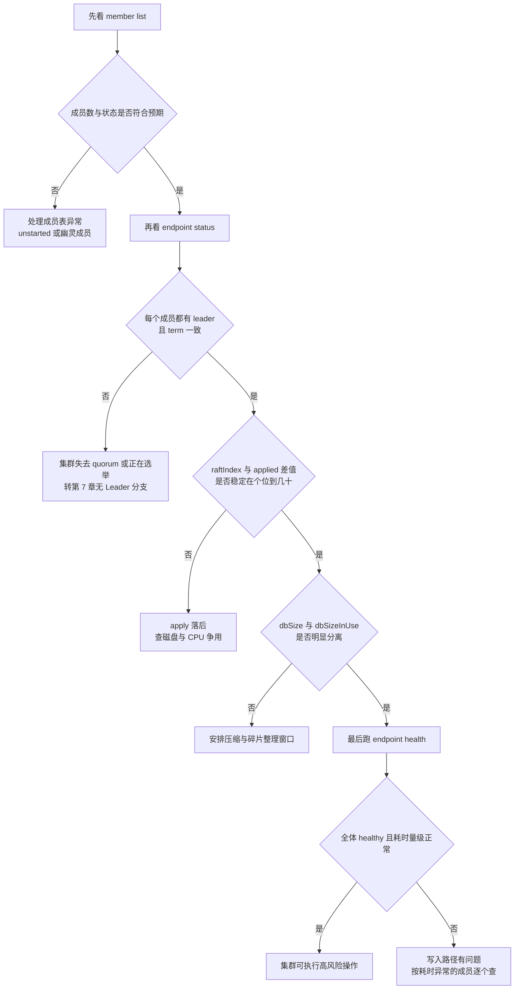
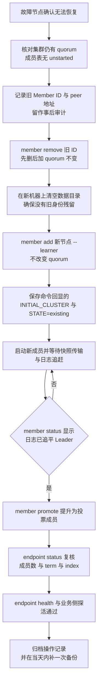
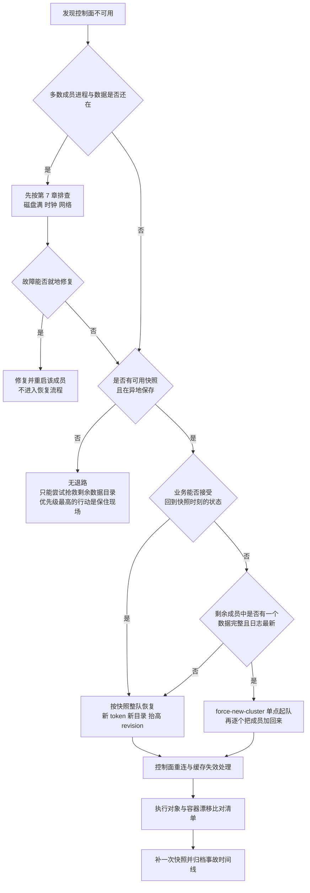
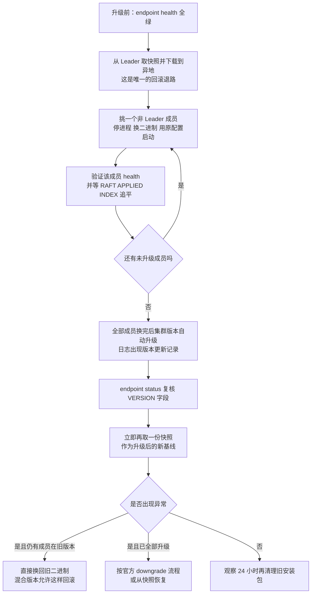

# 06 etcd 运维——磁盘、成员与灾备的边界

**摘要：**

etcd 的日常动作其实很少，看健康、加成员、做备份、偶尔整理磁盘。真正让人在凌晨三点做出错误决定的东西，藏在另一类动作里：有些命令一旦提交就没有撤销键，有些参数调大一点就会让另一个参数失去意义，有些「修一修」的直觉会把一个节点的问题升级成整个控制面的问题。本文沿这条界线展开，先回答 etcd 为什么不能按普通服务的经验来运维——它是有状态的共识服务，quorum 一破控制面就停摆，磁盘延迟直接等于写延迟，恢复意味着重造数据目录而不是重启进程。

接着把磁盘放到第一位，拆开写路径上的两次刷盘，解释 `--wal-dir` 分离的收益与代价，给出磁盘选型对照，并说明跨机房与带宽的取舍。中段进入可观测性与成员管理：健康检查三件套各自在测什么、`raftIndex` 与 `raftAppliedIndex` 的差值该往哪看、为什么要先以 Learner 加入再提升、删节点之后为什么不能就地重启、替换故障节点的完整步骤，以及 `INITIAL_CLUSTER_STATE` 写错会怎样。随后是备份与恢复，重点不在 `etcdutl` 的参数，而在恢复之后 Kubernetes 一侧需要做哪些人工补救。末段给出一张监控指标清单、一份告警规则、五类故障的处理 SOP 与升级降级顺序，最后用一组反例收束全文。读完应当能回答两个问题：哪些操作在你的集群里是不可逆的，以及用什么可验证的前置条件把它们围起来。

---

## 第 1 章 一份不会给人第二次机会的账本

### 1.1 从一张出事才被翻开的清单说起

2019 年前后，kubeadm 把 etcd 作为静态 Pod 塞进控制节点，几乎所有自建集群都默认背上了一个三成员 etcd。
副作用是运维手册开始把它当成「另一个 systemd 服务」来写：卡住了就重启，坏了就重装，实在不行就清空目录重来。

这套经验在无状态服务上大体成立，因为重启的代价只是几分钟的流量损失；etcd 不是这样——它的每个成员都持有一份必须与其余成员逐条对得上的日志，一旦清空目录，读回来的就是「我什么都没见过」，用这台机器顶替旧成员，等于让一个失忆的人去接管账目。

更麻烦的是 etcd 承载的往往不是自己的数据，而是 Kubernetes 全部对象的唯一真相：它停止服务，后果不是「读不到配置」，而是 `kubectl` 全线超时、控制器停止协调、调度器不再派活。
把这条因果链压成一句话：**etcd 的可用性上限，就是整个控制面的可用性上限**。

### 1.2 四个不适用于普通服务的性质

把前面对比往下推，会得到四条需要写进值班手册的性质。
第一条，它是有状态的共识服务。状态不是「缓存里的东西」，而是三个成员之间必须达成一致的日志与快照；成员之间也不是可以任意切换的主从，而是靠多数派投票决定谁说了算。
第二条，quorum 一旦破裂，集群立刻进入不可写、不可线性一致读的状态，而且不会自愈，必须有人介入。
第三条，磁盘延迟直接被算进写延迟里——官方性能文档把一次请求的最小耗时拆成两段，成员之间的网络往返加上 `fdatasync` 落盘的时间，两者相加就是理论下限，SSD 的 fsync 通常在 1 毫秒以下，机械盘大约 10 毫秒。
第四条，恢复不是重启：从快照重建意味着生成新的数据目录、新的成员标识，以及一个与业务侧缓存不再对得上的 revision。

这四条解释了同一件事：etcd 极少因为代码缺陷出事，几乎每次事故都能追到某个运维动作或某台机器的磁盘、时钟、网络——所以本篇不按「命令手册」组织，而按「操作风险」组织。

### 1.3 你可以撤销什么，不能撤销什么

如果把 etcd 的运维动作按「能不能反悔」排一遍，会得到下面这张表。
它的用途不是给你背，而是让你在执行任何一个动作之前先问一句：这条属于哪一行。

| 动作 | 可逆性 | 反悔的方式 | 反悔的代价 |
| :--- | :--- | :--- | :--- |
| 滚动重启单个成员 | 可逆 | 换回旧二进制重启 | 秒级不可用，无数据影响 |
| `member add` 一个新成员 | 可逆 | `member remove` 掉它 | 需要集群仍有 quorum |
| `member remove` 一个成员 | 部分可逆 | 用原数据目录、按新地址重新加回 | 该成员须仍在线且地址可用 |
| `etcdutl defrag` | 不可逆但无数据风险 | 无 | 单节点阻塞读写，期间该成员不可用 |
| `etcdctl compact` | 不可逆 | 无 | 旧历史版本永久消失，老 watcher 收到 `ErrCompacted` |
| `etcdutl snapshot restore` | 不完全可逆 | 用旧数据目录重新恢复 | 快照之后的写入丢失，集群标识改变 |
| `--force-new-cluster` 启动 | 不可逆 | 无 | 丢弃成员表，单成员组队，其他节点全体作废 |

这张表里真正要盯的是最后三行，它们共同的形态是：一条命令把「可能性」本身消耗掉了。
压缩掉的历史版本无法再被重放，恢复出的集群无法再变回原来的身份，`--force-new-cluster` 之后那些还活着、还认为自己属于这个集群的旧成员，在集群眼里再也不存在。

把这类动作想成给一份账本加盖公章：盖章之前可以随便涂改、可以换页；印章一旦落下，这一页就封存了。
技术上的限定在于，etcd 并不提供「撤销章」这种机制，它只提供备份——而备份能不能救你，取决于上次备份是什么时候、是否经过验证。

### 1.4 用可验证的前置条件围住不可逆操作

既然不可逆动作无法反悔，唯一能做的就是把它前面放一排检查，并要求这些检查的结果能通过命令观测到，而不是凭印象。笔者把这类检查分成三类。

第一类是**一致性前提**：`endpoint health` 三台都 healthy，各成员的 `RAFT APPLIED INDEX` 差距在个位数，`member list` 里没有 `unstarted`。
第二类是**容量前提**：数据盘剩余空间大于库体积的两倍（`defrag` 要写一份完整新文件），`etcd_mvcc_db_total_size_in_bytes` 距离配额有足够余量。
第三类是**退路前提**：最近一次备份的时间与哈希、能否在本机之外的介质上找到它、恢复演练是否在最近一个季度真的跑过。

不妨把这三类检查设想成手术前的核对流程：麻醉师、主刀、器械护士各自报一遍患者身份、术式、器械清点结果。
这不是形式主义，而是把「我记得应该没问题」换成「我刚才用命令确认过」。

> [!important] 本篇的版本口径
> 全文以 etcd v3.6 与 v3.7 的默认值与行为为准，涉及 v3.5 差异的地方单独标注。备份相关的命令在 v3.5 起从 `etcdctl` 迁移到 `etcdutl`，本文统一按新命令书写，旧路径在对应章节说明。`ETCDCTL_API=3` 这个环境变量从 v3.4 起已不再需要，后文出现的命令都不带它。

---

## 第 2 章 磁盘：写在关键路径上的两次刷盘

### 2.1 一次写入要等两次落盘

要理解 etcd 为什么对磁盘格外敏感，得把一次 `Put` 的路径重走一遍。
请求经 gRPC 到达成员后被包装成一条提案交给 Raft 循环，Raft 把它追加进 WAL 并要求 `fdatasync` 真正写到介质上——因为 Raft 的安全性建立在「一条日志被多数派持久保存之后才算数」之上。
本地落盘后，日志广播给其余成员，拿到多数派回应后提交点推进；提交只确定了「会被应用」，真正把数据写进 bbolt 的是随后的 apply，bbolt 在自己的写事务里再做一次 `fsync`，把改动写回 `member/snap/db`。

两个动作对应两个指标：WAL 的 `fdatasync` 记在 `etcd_disk_wal_fsync_duration_seconds`，bbolt 提交的 `fsync` 记在 `etcd_disk_backend_commit_duration_seconds`。
它们都在客户端拿到响应之前发生，所以磁盘延迟不是「拖慢后台整理」，而是直接加在每一次写的时间上。

一个容易被忽略的细节：etcd 会把多个提案攒成一批，用一次 `fdatasync` 覆盖多条日志，这是它高并发下仍有吞吐的原因。
攒批意味着单条写入的延迟随并发上升而变长，但吞吐上升，所以看直方图时 P50 与 P99 的差比绝对值更有信息量。

### 2.2 经验阈值从哪来，该怎么用

官方没有给硬性告警阈值，社区与文档长期沿用的经验值是：`etcd_disk_wal_fsync_duration_seconds` 的 P99 在 10 毫秒量级算正常，超过 25 毫秒该排查，超过 100 毫秒基本意味着这个成员随时会丢 Leader；`etcd_disk_backend_commit_duration_seconds` 量级相近，在写压力大、单次事务大的集群里更宽。
这些是经验值而非规范，价值在于给出量级坐标——让人知道 10 毫秒与 200 毫秒之间隔着一整个数量级的问题。

etcd 自己也会做类似判断：apply 耗时偏长时打警告，官方 FAQ 对它的解释是「即便慢速机械盘或虚拟化网络盘，apply 一次请求通常也应少于 50 毫秒，平均超过 100 毫秒就说明有问题」。
日志警告与指标 P99 可以互相印证，前者适合事后翻，后者适合实时看。

### 2.3 一个被 FAQ 明确承认的设计选择

有一类现象最让人费解：磁盘卡住时，Leader 明明网络通畅、心跳也在发，为什么还会被赶下台——FAQ 直接回答了，这是有意为之，**磁盘延迟是 Leader 存活判定的一部分**。
设想 Leader 要一分钟才能 fsync 一条日志，而选举超时只有一秒：即便它按时发出心跳，也无法提交任何新提案，对客户端而言和宕机没有区别，让这种 Leader 退位比让所有写请求排队等一分钟要好。

理解这一条之后，「磁盘慢导致 Leader 切换」就不再是异常，而是设计意图在指标上的呈现；反过来，集群频繁丢 Leader 而网络看不出问题时，几乎可以直接把怀疑对象锁到磁盘上。

### 2.4 磁盘选型的对照

官方硬件建议给的是量级而不是品牌：顺序 IOPS 至少 50 即可运行，负载较重的集群建议 500 以上，带宽方面 10MB/s 大约能在 15 秒内恢复 100MB 数据。
这些数字很朴素，但足以区分不同介质。

| 介质类型 | 典型 fsync 量级 | 适用性 | 主要风险 |
| :--- | :--- | :--- | :--- |
| HDD（机械盘） | 约 10 毫秒 | 仅限开发、测试、演示环境 | 随机写延迟大且方差大，一次备份或快照的突发写就能把 fsync 推到几十毫秒，引发选举抖动 |
| SATA SSD | 通常低于 1 毫秒 | 中小规模生产集群的基本盘 | 消费级盘在写满或掉电保护缺失时出现长尾，TRIM 与垃圾回收会造成周期性抖动 |
| NVMe SSD | 通常在百微秒量级 | 大规模集群、写压力高的控制面 | 多数场景下已不是瓶颈，问题往往转移到 CPU 与 bbolt 的单写锁上 |
| 网络盘（云盘、分布式块存储） | 取决于后端与网络 | 云上部署的常态，需要实测 | 厂商公布的多是并发 IOPS，与顺序 IOPS 可能相差一个数量级；多租户后端在高峰期的长尾极难预测 |
| 共享文件系统、NFS | 不可控 | 不应承载 etcd 数据目录 | 文件锁、缓存语义与 mmap 的一致性都无法保证，故障时的行为不可预期 |

最值得展开的是网络盘那一行。官方硬件文档特意提醒，多数云厂商公布的是并发 IOPS，它可以比顺序 IOPS 大十倍，判断一块盘够不够快得用 `fio` 之类工具实测，而不是看规格页。
云盘还有隐含问题：性能与容量挂钩（容量越大 IOPS 配额越高），给 etcd 配一块小容量盘，很可能同时配了一个很低的 IOPS 上限。

### 2.5 调度器、RAID 与文件系统的细节

SSD 与 NVMe 在 Linux 上通常用 `none`（旧内核叫 `noop`）调度器，因为块设备队列深度足够，内核层再排序没有收益；机械盘则适合 `mq-deadline` 这类带截止时间的调度器，用来压制长尾。
这一项的影响通常小于盘本身，但在 fsync 长尾明显的机器上值得核对。

RAID 的取舍与直觉相反：官方硬件文档明确说，成员达到三个以上时 RAID 的镜像与校验模式是不必要的，因为 Raft 的复制本身就是冗余。
用 RAID 0 提高单盘速度有效；用 RAID 5 换可用性并不划算，写惩罚还会额外放大 fsync 延迟，云上把单块盘做成带冗余的逻辑卷也属同类问题——冗余由协议提供，磁盘只需快。

还有两件常被忽略的事。
其一是文件系统：etcd 依赖 `fdatasync` 的语义，主流文件系统理论上都能提供，但在网络文件系统与部分容器存储驱动上层叠之后，这个语义能否被完整传递就无法保证了。
其二是磁盘优先级：官方调优文档给的作法是用 `ionice -c2 -n0` 把 etcd 提到最高优先级，在 etcd 与日志、容器运行时共用一块盘时能起明显作用——但它只是缓解，把 etcd 放在专用机器上才是根治。

---

## 第 3 章 网络、超时与容量

### 3.1 跨机房：官方立场与工程折中

官方对跨地域部署一贯谨慎：硬件文档写的是「尽可能把成员部署在同一个数据中心内，以避免延迟开销、减少分区事件的可能」，确实需要跨故障域时选择较近的数据中心；FAQ 也承认跨地域能提升故障容忍度，代价是共识延迟、复制带宽，以及默认配置下可能频繁选举。

翻译成决策语言：跨机房不是「能或不能」，而是「你愿意把多少写延迟换成多少故障域隔离」。
同城两机房 RTT 常在 1 毫秒上下，多数业务可以接受；跨城市几十毫秒的 RTT 会直接加到每次写的确认时间上，并在抖动时放大成选举；更稳妥的形态是同城三机房，或两地三中心里把 etcd 控制在同城范围内、异地只放备份。

真的非跨不可，调参方向是明确的：心跳按 RTT 放大，选举超时按心跳的十倍放大，所有成员一起改——但调参解决的是「不误判」，解决不了「慢」，跨机房写延迟的下限由物理距离决定。

### 3.2 带宽估算：平时很小，加入时很大

稳态下 etcd 的 peer 流量并不大，主要是日志条目与心跳，量级通常在每秒几十 KB 到几 MB。
真正吃掉带宽的是两个瞬间：新成员加入时的快照传输，以及落后太多的成员被强制追赶。

快照的体积约等于当时的数据量，所以一份 2GB 的库，新成员加入时要拉 2GB 左右；库体积除以你愿意等待的秒数，就是需要的带宽下限，再为同时进行的客户端流量留出余量。
千兆网对多数集群够用，万兆网的主要收益在缩短成员恢复时间。

官方调优文档还提醒过另一件事：Leader 同时服务大量客户端请求时，可能因为拥塞延误处理 Follower 的 peer 请求，日志里表现为 `dropped MsgProp ... since streamMsg's sending buffer is full`。
对策是用 `tc` 把 2380 端口的 peer 流量提到比 2379 的客户端流量更高的优先级，也就是让协议流量优先于业务流量。

### 3.3 内存：RSS 不等于使用量

`ps` 看到的 RSS 常常让新接手的人吓一跳：只有几百 MB 数据的集群，etcd 进程却占了几 GB。
原因是 bbolt 通过 mmap 把整个数据库文件映射进地址空间，被访问过的页由内核计入进程的驻留集合——RSS 高说明大量页被读过并留在缓存里，而这恰恰是读性能的来源。

这种映射在排障时会造成误判。
第一层是把 RSS 当作「用了这么多内存」，于是调大机器或杀掉进程；第二层更隐蔽——把 RSS 曲线与写入量对齐，看到「每次写入都涨一点」就断定内存泄漏，而增长其实是 bbolt 文件变大后新映射进来的页，以及 treeIndex 里随历史版本累积的索引节点。
区分方法很土但有效：对比 `etcd_mvcc_db_total_size_in_bytes` 与 RSS 的走势，两者同步上涨说明问题在库的体积，RSS 涨而库不动才需要去看堆。
mmap 还意味着读写都走页缓存、回收由内核决定，内存压力下缓存页换出再换入时读延迟会出现尖峰——这是给 etcd 机器留足内存的另一个理由。

FAQ 的建议是：通常 8GB 够用，面对成千上万 watcher 与上百万 key 的负载按 16GB 到 64GB 配；硬件文档补充说 etcd 会积极缓存键值数据，其余大部分内存用于跟踪 watcher——内存规划的重心因此在「库有多大」与「watcher 有多少」，而不在峰值 QPS。

### 3.4 容量规划的三条经验

容量规划在 etcd 上是一个窄问题，因为它的数据本来就不该大：FAQ 反复强调它用来保存小量数据，默认配额 2GB，超过 8GB 会在启动时告警。

第一条与数据库大小有关：把 `etcd_mvcc_db_total_size_in_bytes` 控制在配额的一半以内，留出的空间要同时覆盖压缩前的历史版本膨胀与 defrag 生成的新文件——别把调大配额当扩容，那只是推迟清理，而 bbolt 的写入性能与重启时间都会随文件变大而变差。

第二条与成员数有关：三成员是生产基本盘，容忍一个故障；五成员容忍两个，适合维护窗口需要余量的控制面；七成员是 FAQ 提到的合理上限，再往上每次写都要等更多成员确认，收益递减。

第三条与 watcher 数量有关：etcd 内存中有一块专门跟踪 watcher 状态与待发送事件，数量增长会推高内存与发送队列深度；Kubernetes 侧的规模大约是「apiserver 实例数 × 被监听资源种类 × 客户端数」再叠加控制器自建 watch，大规模集群很容易上千。
比起加内存，减少重复监听更有效——很多代理与控制器在听同一个资源，本可以共享一个 informer。

> [!info] 一个常被问到的容量问题
> 「etcd 能不能像数据库那样扩到 TB 级？」从 `--quota-backend-bytes` 的实际上限（历史上受 bbolt 寻址与 32 位环境限制，社区口径为 8GB 左右）就能看出答案。超过这个量级，重启时的索引重建、defrag 时的整文件重写都会变得难以接受。把 etcd 用来存大对象或日志，问题不在参数，而在选错了组件。

---

## 第 4 章 健康检查三件套与它们各自的盲区

### 4.1 `endpoint health`：一次真实的写入

`etcdctl endpoint health` 的输出很像一句问候：`is healthy: successfully committed proposal: took = 3.2ms`。
这句话值得细读：它真的向集群提交了一条提案并等待多数派确认后才返回，所以测的不是端口通不通，而是完整的写入路径——从客户端连入、到提案、到 WAL fsync、到多数派确认、到提交点推进。

价值正在于此：TCP 端口开着、`/metrics` 能拉到、`raftIndex` 看起来正常，都不能保证写入是通的，而它可以。
副作用同样实在：每次检查都在 revision 上留下一条记录，被 Watch 的客户端看到一次事件；每五秒探一轮全部成员，一天下来凭空多出一万多条 revision。
合理频率是分钟级，或用 `--cluster` 变体一次覆盖全部成员。

耗时那一项也值得看一眼：它是同一次提案从发出到确认的时间，与 `etcd_disk_wal_fsync_duration_seconds` 的 P99 大致同量级。
如果 health 普遍报到几十毫秒而 fsync 只有几毫秒，多出来的时间就不在磁盘上，得往网络、鉴权、请求排队的方向找。

### 4.2 `endpoint status`：五个要一起看的字段

`endpoint status` 输出的字段比 health 多得多，配合 `--write-out=table` 可以一眼扫完整个集群：

| 字段 | 含义 | 读法 |
| :--- | :--- | :--- |
| `IS LEADER` | 当前成员是否为 Leader | 整个集群应当恰好有一个 `true`，零个说明正在选举或已失去 quorum |
| `RAFT TERM` | 任期号 | 各成员应当一致；某个成员明显偏低说明它长期没参与投票 |
| `RAFT INDEX` | 该成员已知的最新日志下标 | 远落后于其他成员的正在追赶，或者已经掉队 |
| `RAFT APPLIED INDEX` | 已应用到本地状态机的下标 | 与上一个字段的差值才是关键 |
| `DB SIZE` | bbolt 文件体积 | 接近配额时需要压缩与整理，而不是调大配额 |
| `IS LEARNER` | 是否为学习者成员 | 学习者不参与投票，追平之前 index 落后属正常 |
| `ERRORS` | 该成员返回的错误 | 空表示正常；有内容时通常先于其他字段暴露问题 |

`raftIndex` 与 `RAFT APPLIED INDEX` 的差值，反映「已经确定要写」与「已经写完」之间的积压。
对健康成员来说，这个差值通常在个位数到几十之间；持续增长到成千上万，说明 apply 跟不上提交，方向只有两个：写到状态机的那一步慢（磁盘或 bbolt 写锁竞争），或者 apply 线程抢不到 CPU。
这正好是第 2 章那条写路径的末端，所以看到这个信号，第一件事不是重启该成员，而是去看它的 fsync 与 commit 延迟。

`DB SIZE` 与 `dbSizeInUse` 的差值指向另一类问题。
压缩把旧版本从逻辑上删掉，这些页进入 bbolt 的空闲列表，文件却不会变小，于是「文件很大、实际在用很少」成为常态。
差距持续扩大，说明该做 `etcdutl defrag`；两者几乎相等且都在逼近配额，说明问题不在碎片，而在数据本身太多，要做的是压缩策略与数据清理。
两种情况的处置完全不同，误判的后果一个是白折腾一个重启窗口，一个是把配额再次撑爆。

### 4.3 `member list`：成员表是不是你以为的样子

`member list` 的信息量常被低估：它给出集群当前的成员配置，也就是 quorum 的计算依据。
需要核对的项有四类：成员数是否与预期一致（防止历史上某次 add 失败留下了幽灵成员）。,每个成员的 `PEER ADDRS` 是否与实际机器匹配（防止地址迁移后没有执行 `member update`）。`STATUS` 是否为 `started`；`IS LEARNER` 是否符合预期——如果有学习者长期没有被提升，它就是一个只占资源、不提供可用性的成员。

`unstarted` 值得反复强调。它不是「还没准备好」这么温和，而是一个真实存在的风险窗口：`member add` 提交成功的那一刻，集群的 quorum 就已经按新成员数计算了，而新成员的进程可能还没跑起来。
在这种状态下如果再坏掉一个成员，就可能直接失去 quorum。

### 4.4 HTTP 端点：各自在回答谁的问题

除了 `etcdctl`，每个成员在客户端端口上还暴露几个 HTTP 端点：`/metrics` 给出 Prometheus 指标，`/health` 给出粗粒度健康状态，`/livez` 反映进程是否需要重启，`/readyz` 反映进程是否可以服务流量；`readyz` 支持 `?verbose` 展开每一项检查的结果（较新版本能看到数据损坏、串行化读、线性一致读各自的结论），也支持 `?exclude=` 排除某一项。

分工很清楚：`livez` 交给 kubelet 之类的进程管理者做重启判定，`readyz` 交给负载均衡器做摘流判定，`/health` 是最传统的存活探测。局限也一样——都由本成员自己回答，不看多数派是否活着，一个被分区隔离出来的少数派成员完全可以报告自己 `readyz` 正常；所以拿它们做存活探针合适，拿它们判断「集群可用」不合适。

要看集群层面的可用性，得用能被多数派打断的探测：`etcdctl endpoint health` 是最直接的一种；另一种是在 HTTP 上做一次带 `serializable=true` 的读，它跳过多数派确认直接读本地状态机，快但只反映本成员视图，官方对串行化读的说明正是「可能读到相对于 quorum 过期的数据」。
更贴近业务的做法，是用一个固定的 key 读一次并比对预期值——这条请求会走正常的鉴权与读路径，能覆盖证书、权限等 `endpoint health` 覆盖不到的环节。

### 4.5 三件套的组合读法

单独看任何一项都可能误判，把三件套按下面的顺序读，判断会稳得多：



这张图的原则是把「最便宜、信息量最大」的检查放前面：`member list` 与 `endpoint status` 都不产生写入，只有 `endpoint health` 会写——执行任何高风险操作之前，先用前两个定大方向，再用第三个做最终确认。

三个命令都支持 `--write-out=table`，把多成员输出并排成一张表，比逐个跑再人工比对快得多；需要自动化解析时用 `--write-out=json`，但字段名在版本间可能有微调，脚本要做容错而不是假设它一定存在。

---

## 第 5 章 成员管理：变更为什么必须一次一个

### 5.1 单步变更的由来

etcd 长期采用单步变更：一次只增删一个成员，新旧配置之间不存在「同时按两套 quorum 记账」的中间状态。
Raft 论文描述的做法是联合共识，两套配置同时生效、确认之后再切换，代价是实现复杂且叠加期要同时满足两个多数派。
etcd 先走了简单路线，再用工程手段补风险——一次只变一个，并把它写进文档作为约束。

协议层面的道理在 [[02 Raft 共识协议——选举、日志复制与安全性]] 里已经推过：单步变更之所以安全，前提是「一次只动一个」，这样新旧两份成员配置的多数派必然相交。
一旦一次动两个，这个交集就不再保证了。

### 5.2 4 个成员的危险窗口

把 3 成员扩到 5 成员，中间必然经过 4 成员的状态。
4 成员的多数派是 3，故障容忍度却仍是 1——多花一台机器，容错没有增加，确认成本涨了；更糟的是这个窗口里只要再坏一台，就等于失去 quorum。

| 成员数 | 多数派 | 可容忍故障 | 说明 |
| :--- | :--- | :--- | :--- |
| 1 | 1 | 0 | 仅测试 |
| 2 | 2 | 0 | 官方明确说不安全：删成员本身也需要多数派 |
| 3 | 2 | 1 | 生产基本盘 |
| 4 | 3 | 1 | 扩容中间态，容错与 3 成员相同，风险更高 |
| 5 | 3 | 2 | 适合维护窗口需要余量的控制面 |
| 6 | 4 | 2 | 扩缩容中间态，同样不划算 |
| 7 | 4 | 3 | 官方口径的合理上限 |

这张表说明「一次只变一个」不只是协议要求，也是运维节奏要求：3 扩 5 的两次变更要紧密排布，别在 4 成员状态下过夜，更别在这个窗口里做其他维护；5 缩 3 要经过 4，同样应当尽快走完。

### 5.3 Learner：先把数据追平，再获得投票权

v3.4 引入的学习者成员（Learner）针对的是成员加入过程中的两个具体问题。
官方设计文档写得很直白：新成员一开始没有数据，会向 Leader 索要大量日志，加重其网络负担，可能挤掉心跳、触发选举；而成员变更是两步操作，`member add` 先提交、进程后启动，配置写错时集群会带着一个永远起不来的成员去凑 quorum，撤销本身还需要 quorum。

Learner 接收 Leader 的全部数据，但不参与投票、不计入 quorum、不能被选举、也拿不到领导权，对客户端只提供串行化读与成员状态查询。
于是加入它不改变 quorum，配置错了随时撤销，风险从「可能失去 quorum」降到「多了一个暂时没用的节点」。

有一个细节必须记住：**Learner 只有在日志追平 Leader 之后才能被提升**。
`member promote` 会做严格校验，落后的学习者直接被拒绝，报错是「只能提升与 Leader 同步的学习者」——判断权交给协议本身，比人工看 `raftIndex` 可靠。
至于能同时存在几个 Learner，v3.4 的限制是一个，后续版本可通过 `--max-learners` 之类开关调整，具体以所用版本的参数说明为准。

### 5.4 替换一个故障节点：完整步骤与每一步的理由

把前面的机制串起来，替换流程就有了形状。
下图把每一步与其校验点放在一起，读者可以对照着理解「为什么不能跳步」。



第一步「先删后加」的顺序不能颠倒。FAQ 里说得很清楚：3 成员集群里已经有一个成员坏了，此时如果再加入一个新成员，成员数变成 4，quorum 从 2 变成 3，而实际可用的仍然只有两个。
如果这个新成员因为配置错误起不来，集群就永远凑不齐改回配置所需的 3 票。
先把坏成员删掉，成员数变 2、quorum 仍为 2，再加新成员，quorum 仍是 2，即便新成员起不来，也还能靠剩下的两台把它删掉。

`INITIAL_CLUSTER_STATE=existing` 这一条是本流程里最致命的参数。
写 `new` 意味着「我是一个新集群的第一个成员」，etcd 会按初始化逻辑生成一套全新的集群身份，正常情况下它会因为与集群已有的标识不一致而拒绝加入，最坏情况下它把集群 ID 对不上的请求当作「跨集群串扰」忽略掉，于是这个节点既不在集群里，也不肯承认自己是新的，运维看到的现象是「进程活着、端口开着、但 `member list` 里永远是 unstarted」。
正确的做法是直接复制 `member add` 回显的那三行环境变量：`ETCD_NAME`、`ETCD_INITIAL_CLUSTER`、`ETCD_INITIAL_CLUSTER_STATE`。

### 5.5 删掉一个成员之后，为什么不能就地重启

`member remove` 提交之后，被删的那个成员如果还在运行，会主动退出并打印日志：这个成员已被永久地从集群移除，正在退出。
这句日志经常被误解成「它自己退出了，我重启一下就好」。

真正的问题在重启之后。这个成员的磁盘上仍保留着它作为集群一员的全部历史：WAL、快照，以及它认为正确的成员表。
服务一旦重新启动，它带着作废的身份回到网络上，试图向其他成员拉日志、参与投票；其他成员因为它不在成员表里而拒绝它，它则因为收不到响应而反复发起选举，任期号一路上涨。
结果是集群里出现一个永远在选举、永远选不上的成员，日志里满是 `failed to get cluster` 与 `lost leader`，其余成员也可能被它搅出多余的选举——一次正常的成员移除，最后演变成需要整队排查的故障。

正确的处理有三条路：清空数据目录后当新成员重新加入；彻底停掉进程并从部署清单里移除；或在必须复用数据目录、只是改了地址时，先用 `member update` 把 peer 地址改掉再启动。
共同点是「不要让一个已经作废的身份继续发言」。

### 5.6 `--force-new-cluster` 的适用场景与代价

`--force-new-cluster` 的作用是让某个成员无视日志中的成员表，把自己当作单成员集群的 Leader 启动，再由运维逐个把其他成员加回来；配置说明对它的警告很克制但明确——它会打破共识协议提供的保证。

它真正适用的场景只有一个：**已经失去 quorum，且短期内不可能把足够多的原成员恢复回来**。
比如三个成员坏在同一个机柜里而第四个异地成员还在，或者成员表本身已经坏到 `member remove` 都无法执行。
在这种状态下常规成员操作全部失效，只能靠它把数据救出来。

用它之前有三个必要条件：确认该成员的数据目录完整（它可能最落后，用它组队会丢更多数据），确认其他成员真的不会再回来（官方恢复文档提醒，旧成员还活着时该参数会 panic），以及备份一份当前数据目录。
它的代价是一次性的：集群 ID 变了、成员表被重写、其余成员的数据作废——官方用「强烈不推荐」评价它，理由正是新旧成员会在同一张网络上互相踩。

---

## 第 6 章 备份与恢复：快照管得了什么

### 6.1 快照的真实语义

`etcdctl snapshot save` 常被描述成「在 Leader 内存里做一次一致性快照」，这个说法既不准确也容易引起误解。
真实过程是：客户端连到某个成员，该成员把当前 bbolt 数据库通过一次只读事务导出成流，同时附带 `consistent_index`、`term`、`confState` 这些元数据；它不需要停写，也不需要 Leader 配合，任意健康成员都能出这份快照。

由此得到两点实用结论。
其一，快照体积约等于成员上 bbolt 文件的体积，库里有多少历史版本没压缩，快照就有多大，备份速度受限于该成员的读带宽而不是网络。
其二，不同成员在同一时刻出的快照对应 revision 可能不同，落在后面的成员会缺一段，所以备份应当固定指向一个成员，或者每次都核对 revision 再决定从谁那里取。

另外，官方也提到可以直接复制数据目录里的 `member/snap/db`，但那样会丢掉还没写进 bbolt、仍在 WAL 里的数据；要拿到某一时刻的完整状态，只能走导出的快照。

### 6.2 备份策略：四件事定下来就不再操心

一套能用的备份策略要回答四个问题：多久做一次、保留多久、存在哪、怎么验证。
前三个在本行业里有相当稳定的答案，第四个最容易被跳过，也最容易在真正需要的时候暴露。

频率上，小时级是常见起点，写压力大的集群可以做到半小时，它直接决定最坏情况丢多少数据。
保留上可以按「近 24 小时的小时级 + 近 7 天的天级」分层，但要意识到快照体积等于库体积，几十份快照就是几十倍空间。
存储位置必须与本集群分离，落在对象存储或异地机房，且不能依赖集群自身提供的存储——把备份放进 etcd 承载的同一个环境，等于备份和原件一起消失。

验证上，最低要求是每次备份后跑一次 `etcdutl snapshot status`，确认哈希、revision、键数量与体积都在合理区间；更高的要求是每隔一段时间做一次真正的恢复演练，在隔离环境里从快照恢复出一个三成员集群，看它能不能起来、revision 对不对、关键对象在不在。
只跑过 status 而没做过恢复的备份，只能算「文件存在」。

### 6.3 `etcdutl` 的用法与版本差异

v3.5 起，快照与磁盘整理相关子命令从 `etcdctl` 拆分到 `etcdutl`：前者负责与集群通信（读写、成员、健康检查、压缩），后者负责操作本地文件（快照的查看与恢复，以及进程停止时直接整理数据目录）。
v3.5 保留了 `etcdctl snapshot save/restore` 与 `etcdctl defrag` 作为兼容入口但已标为弃用，v3.6 起 `etcdutl` 成为唯一路径——官方恢复文档的说法是，从 v3.6 开始取快照用 `etcdctl`、从快照恢复用 `etcdutl`。

`defrag` 的归属最容易写错，值得单独一句：在线整理正在运行的成员用 `etcdctl defrag`（或 `etcdutl defrag --endpoints=...`，后者是等价封装），进程已经停止时直接整理数据目录用 `etcdutl defrag --data-dir=<路径>`。
两种用法在旧版本上都能对应到 `etcdctl`，但新脚本应当统一写成 `etcdutl`，免得下次升级再改一遍。

```bash
# 取快照：只需要给一个成员地址，它会自己导出该成员的完整库
etcdctl --endpoints=https://etcd-0:2379 snapshot save /backup/etcd-2026-11-02-0300.db

# 查看快照内容：确认 revision 与键数量，用哈希做完整性登记
etcdutl --write-out=table snapshot status /backup/etcd-2026-11-02-0300.db

# 恢复到全新的数据目录：token 换新，防止恢复出的集群与旧成员串到一起
etcdutl snapshot restore /backup/etcd-2026-11-02-0300.db \
  --name etcd-0 \
  --initial-cluster etcd-0=https://etcd-0:2380,etcd-1=https://etcd-1:2380,etcd-2=https://etcd-2:2380 \
  --initial-cluster-token etcd-restore-20261102 \
  --initial-advertise-peer-urls https://etcd-0:2380 \
  --data-dir /var/lib/etcd-restored
```

几个参数各有理由。`--data-dir` 指向新目录，因为恢复会写入新的成员 ID 与集群 ID，覆盖旧目录等于删掉「失败后还能回退」的退路；`--initial-cluster-token` 取新值，因为旧成员可能还活着，用旧 token 握手会让两个集群互相污染——官方把这层保护的表述写成「确保新构造的集群只与使用相同 token 的成员通信」。
`--name` 与 `--initial-advertise-peer-urls` 必须逐成员区分：三台机器用同一份快照，但名字与 peer 地址不同，`--initial-cluster` 里要把三个都列全。

### 6.4 恢复之后，Kubernetes 一侧的补救

恢复完成、集群起来、`endpoint health` 全绿，只是走完上半场；真正决定业务能否恢复的是下半场——Kubernetes 怎么面对一个「比它记得的更旧」的 etcd。

第一件事是控制面组件的重连。kube-apiserver 通过 `--etcd-servers` 连接 etcd，断连时按配置持续重试；只要恢复后 etcd 的地址、端口、TLS 证书没变，它通常在重试周期内自行接上。
所以「恢复后必须重启 apiserver」说绝对了——**正确的顺序是先看 apiserver 能不能连上新的 endpoint**：查日志里是否仍有 etcd 连接错误，用 `kubectl get --raw='/readyz?verbose'` 看哪一项报错，或直接 `kubectl get ns` 试一次。
只有确认它持续连不上（证书换了、endpoint 换了、残留连接坏掉），才需要重启；控制器与调度器连的是 apiserver，apiserver 恢复后它们自然恢复。

第二件事是 revision 回退与缓存失效：快照的 revision 一定小于崩溃前，而 apiserver 的 watch 缓存与各控制器的 informer 都记着「我已同步到某个 resourceVersion」。
官方恢复文档专门讲过：恢复到较旧 revision 可能无法正确刷新缓存，导致控制器行为不可预测。
解法是 `--bump-revision` 与 `--mark-compacted`——把 revision 抬到必定大于崩溃前的位置，并把抬高的这一段标记为已压缩，使基于旧 resourceVersion 的 watch 直接收到「版本已被压缩」的终止信号，被迫重新全量 List。
官方给的估算是：假设每秒写入不超过 1500 次，抬高 10 亿足够覆盖一周前的快照。

```bash
# bump 让 revision 只增不减，mark-compacted 让旧缓存无处可续，两者要一起用
etcdutl snapshot restore /backup/etcd-2026-11-02-0300.db \
  --bump-revision 1000000000 --mark-compacted \
  --name etcd-0 --data-dir /var/lib/etcd-restored \
  --initial-cluster ... --initial-cluster-token ... --initial-advertise-peer-urls ...
```

第三件事是对象与容器的漂移。恢复后 etcd 里是快照时刻的对象集合，节点上跑着的容器却是崩溃时刻的集合：快照之后创建的对象消失了、它们的 Pod 也许还在跑，快照之后被删除的对象回来了、它们的容器早已不在。
kubelet 按收到的清单维持容器，控制器按 etcd 的期望状态补齐差异，短期内会出现一批「没有主的容器」与一批「重建出来的 Pod」——这类漂移一定会发生，问题只在于能否在它引发级联故障之前发现。

最后一件，也是最该做的一件：**人工比对清单**。
自动协调修得好状态，修不好数据——如果恢复掉的对象里有 PVC、有承载证书的 Secret、有 Service 的 endpoints，协调逻辑只会照着旧样子重建，而不会告诉你这里少了什么。

| 比对项 | 目的 | 手段 |
| :--- | :--- | :--- |
| 命名空间与关键工作负载 | 确认业务单元都在 | 对照变更记录逐项列出预期对象 |
| 有状态服务的 PVC 与 PV | 确认数据卷没有指向已删除的对象 | 检查 PV 的 `claimRef` 与实际挂载 |
| Secret 与 ConfigMap 的版本 | 确认凭据没有退回到旧值 | 与凭据系统或密钥库的当前值比对 |
| Service 与 Endpoints | 确认流量入口完整 | 逐个后端探活 |
| 节点上的孤儿容器 | 确认没有绕开调度运行的容器 | 按容器标签反查 etcd 中是否仍有对应对象 |
| 控制器与调度器的租约 | 确认选主已经收敛到单实例 | 查看 `kube-system` 下的 Lease 对象 |

清单不追求穷尽，作用是把「恢复成功」从技术判断变成业务判断：etcd 起来了不代表业务回来了，业务回来了也不代表数据没错——版本管理仓库里记着「应该有哪些对象」，那才是比对的基准。

### 6.5 恢复还是重建：一张决策图

面对一次 etcd 事故，最难的判断往往不是「怎么恢复」，而是「该不该恢复」。
下图把常见的几种现场与它们的走向放在一起。



这张图的用途是避免一种常见的错误顺序：很多人一发现 quorum 丢失，第一反应就是拿快照恢复，但官方失败模式文档明确指出，只要多数成员能恢复回来，集群会自动选出 Leader 并回到健康状态，恢复流程反而是下策。
先判断「还能不能救」，再判断「值不值得救」，最后才轮到「怎么救」。

---

## 第 7 章 监控、告警与五类故障

### 7.1 指标清单

etcd 在客户端端口的 `/metrics` 上暴露 Prometheus 指标，也可以用 `--listen-metrics-urls` 把它们和健康检查单独开到一个端口，避免与需要双向 TLS 的客户端端口混在一起。
指标分两个命名空间：`etcd_` 前缀是稳定指标，用于监控与告警，变更写进发布说明；`etcd_debugging_` 前缀是调试指标，官方明确说它们「非常依赖实现、容易变化，可能被移除而不作预告」。

| 指标 | 含义 | 经验阈值 | 处置动作 |
| :--- | :--- | :--- | :--- |
| `etcd_server_has_leader` | 该成员是否认为存在 Leader，1 为有、0 为无 | 任一成员为 0 持续 1 分钟即告警 | 按 7.2 的无 Leader 分支排查 |
| `etcd_server_leader_changes_seen_total` | 该成员自启动以来见过的 Leader 变更次数 | 1 小时内增加超过 3 次 | 先看 fsync 与 commit 的 P99，再看网络抖动与 CPU 争用 |
| `etcd_disk_wal_fsync_duration_seconds` | WAL `fdatasync` 的延迟分布 | P99 稳定在 10 毫秒量级，超 25 毫秒排查 | 查同盘竞争、云盘 IOPS 配额、RAID 写惩罚 |
| `etcd_disk_backend_commit_duration_seconds` | bbolt 提交 `fsync` 的延迟分布 | 与上一项同量级，写压力大时略宽 | 查磁盘延迟与 bbolt 写锁竞争 |
| `etcd_mvcc_db_total_size_in_bytes` | bbolt 文件体积，含尚未回收的空闲页 | 持续超过配额的 50% 要处理 | 先压缩历史版本，再看是否需要 defrag |
| `etcd_mvcc_db_total_size_in_use_in_bytes` | 压缩之后实际在用的体积 | 与上一项的差距持续扩大即为碎片 | 安排逐节点 `etcdutl defrag`，Leader 最后做 |
| `etcd_server_proposals_pending` | 排队等待提交的提案数 | 持续大于 5 且不回落 | 写入过载或该成员无法提交，先削峰再查 Leader |
| `etcd_server_proposals_applied_total` | 已应用的提案累计数 | 与已提交的差值应在几千以内 | 差值上涨说明 apply 过载，查磁盘与范围查询 |
| `etcd_network_peer_round_trip_time_seconds` | 成员之间 peer 请求的往返延迟分布 | 同机房应在亚毫秒量级 | 明显偏高时查网卡、交换机、跨机房路径 |
| `etcd_debugging_mvcc_current_revision` | 当前 revision，即最后一次写入的全局序号 | 关注增速，用于估算写入量与压缩窗口 | 增速异常时查是谁在高频写 |
| `etcd_debugging_mvcc_compact_revision` | 已压缩到的 revision | 与当前 revision 的差距反映积压量 | 差距持续拉大说明压缩没有跟上 |
| `etcd_server_quota_backend_bytes` | 当前生效的存储配额 | 用于计算占用比例，不单独告警 | 与 `db_total_size` 相除得到使用率 |

表里有三处坑值得单独说。

第一处是 `etcd_network_active_peers` 这个指标名：它统计成员之间的活跃 peer 连接数，与客户端 Watch 连接毫无关系；想看 Watch 只能看 `grpc_server_started_total` 这类按方法名区分的累计计数器，而后者只增不减、重启归零，拿它当「当前有多少活跃 Watch 连接」同样是错的。

第二处是 `debugging` 前缀：两个 revision 类指标在部分版本与配置下并不默认导出，开了精简指标模式后很多调试指标会消失，依赖它们的告警会静默失联——面板上还有曲线，是因为旧集群导出了、新集群没导出，而没有人被告知；上线前应在目标版本上直接 `curl /metrics | grep compact` 确认一次。

第三处是改名历史：v3.4 之前文件体积指标叫 `etcd_debugging_mvcc_db_total_size_in_bytes`，v3.4 起改名成不带 `debugging` 的名字，v3.5 起旧名被移除，从老集群复制过来的面板很可能引用着一个已不存在的指标。

### 7.2 告警规则片段

下面对应上表给出 6 条 AlertManager 规则，写法上规避了两个常见问题：用 `for` 抑制瞬时抖动，用 `job` 与 `cluster` 标签区分集群，避免多集群共用一个 Prometheus 时互相覆盖。

```yaml
groups:
  - name: etcd.rules
    rules:
      # 任一成员 1 分钟内都没有 Leader，说明该成员已不可用，
      # 全集群同时为 0 时控制面全线中断，因此直接定级 critical
      - alert: EtcdMemberHasNoLeader
        expr: etcd_server_has_leader == 0
        for: 1m
        labels:
          severity: critical
        annotations:
          summary: "{{ $labels.instance }} 无 Leader"

      # Leader 频繁易主通常是磁盘长尾或网络抖动的先兆，
      # 用 1 小时增量而不是累计值，避免重启后计数器归零造成误报
      - alert: EtcdFrequentLeaderChanges
        expr: increase(etcd_server_leader_changes_seen_total[1h]) > 3
        for: 5m
        labels:
          severity: warning
        annotations:
          summary: "{{ $labels.instance }} 1 小时内 Leader 变更超过 3 次"

      # WAL fsync 的 P99 超过 25ms 属于经验阈值，
      # 这一条往往先于 Leader 抖动出现，是处置窗口最宽的预警
      - alert: EtcdHighWalFsyncLatency
        expr: |
          histogram_quantile(0.99,
            sum by (instance, le) (rate(etcd_disk_wal_fsync_duration_seconds_bucket[5m]))) > 0.025
        for: 10m
        labels:
          severity: warning
        annotations:
          summary: "{{ $labels.instance }} WAL fsync P99 超过 25 毫秒"

      # 配额使用率用实际生效的配额做分母，
      # 避免把 2GB 硬编码进表达式而忽略调过配额的集群
      - alert: EtcdBackendQuotaHigh
        expr: etcd_mvcc_db_total_size_in_bytes / etcd_server_quota_backend_bytes > 0.5
        for: 15m
        labels:
          severity: warning
        annotations:
          summary: "{{ $labels.instance }} 后端库使用率超过配额的 50%"

      # 文件体积与实际使用量长期分离意味着碎片堆积，
      # 持续 1 小时以上才告警，排除压缩刚结束时的正常分离
      - alert: EtcdBackendFragmentation
        expr: >
          (etcd_mvcc_db_total_size_in_bytes - etcd_mvcc_db_total_size_in_use_in_bytes)
          / etcd_mvcc_db_total_size_in_bytes > 0.3
        for: 1h
        labels:
          severity: info
        annotations:
          summary: "{{ $labels.instance }} 后端碎片占比超过 30%，可安排 defrag"

      # 待提交提案积压说明写入路径被堵住，
      # 与已应用数的差值一起看可以区分「客户端过载」与「apply 落后」
      - alert: EtcdProposalsBacklog
        expr: etcd_server_proposals_pending > 5
        for: 5m
        labels:
          severity: warning
        annotations:
          summary: "{{ $labels.instance }} 待提交提案堆积"
```

这六条规则构成一个从「正在发生的事故」到「即将发生的事故」的梯度：`has_leader` 与 Leader 变更次数属于已经发生的事情，fsync 延迟与配额使用率属于正在恶化但还没爆发的指标，碎片与积压属于可以排进计划处理的项。
排在最前的不应该是最急的，而是最能解释其他告警的那一个——多数时候它是 fsync 延迟。

### 7.3 五类故障的处理 SOP

#### 7.3.1 无 Leader

症状很好认：`endpoint health` 全部 unhealthy 或超时，`endpoint status` 里 `IS LEADER` 全是 `false`，Kubernetes 侧 `kubectl get` 超时。
排查顺序应当从「成员是否活着」开始，而不是从「配置有没有改错」开始。
先看各成员的进程与日志，找 panic、`wal: file not found`、`disk quota` 之类的关键词，再核对成员表状态与实际存活数是否够 quorum。
成员数不够，根因已经找到；成员都活着却没有 Leader，往三个方向查：磁盘是否写满（WAL 无法追加会让成员无法投票），各成员时钟是否明显漂移（时间跳变会让选举超时计算失效），网络是否出现分区（用 `ping` 与 peer 往返延迟指标交叉判断）。

处置要克制：多数成员能回来时按顺序恢复即可，集群会自动选出 Leader，不需要任何特殊参数；只有确认成员数无法回到 quorum，才进入快照恢复或 `--force-new-cluster` 的路径。
验证是 health 全绿、只有一个 Leader 且 term 一致、apiserver 能成功读到对象。

#### 7.3.2 NOSPACE 只读

症状是所有写操作返回 `etcdserver: mvcc: database space exceeded`，读仍然正常，`etcdctl alarm list` 里能看到 `NOSPACE`。
这里有一条必须先讲清的机制：配额检查发生在 API 层与 apply 层两处，API 层拒绝请求，apply 层只报警而不阻止事务应用——官方文档的提示是，你可能收到 `ErrGRPCNoSpace` 而那笔写入在后端仍然成功了。
所以在写排障结论之前，不要假设「报错了就等于没写进去」。

处置顺序是「压缩 → 整理 → 解锁」，三步缺一不可：用 `endpoint status` 取当前 revision 并 `etcdctl compact <rev>`，再逐节点 `etcdutl defrag` 把空闲页还给文件系统，最后 `etcdctl alarm disarm` 解除告警。
颠倒顺序会失效——只整理不压缩，空闲页还在用；只解锁不压缩，配额很快再次触发。
验证是 `DB SIZE` 明显下降、`alarm list` 为空、一次 `put` 成功；之后回头看根因是压缩策略没开，还是某个资源在疯狂写。

#### 7.3.3 单节点数据损坏

症状是某个成员起不来，日志里出现 `wal: file not found`、`wal: crc mismatch` 或 `bolt: invalid database`。
关键判断是集群还有没有 quorum：有，就按成员替换流程处理，该成员的数据直接放弃。
没有，就只能走快照恢复。

有 quorum 时不要尝试修复坏文件：etcd 没有官方修复工具，手工拼接 WAL 或 bbolt 几乎必然得到一份「看起来能起来、实际内容错乱」的数据，而这样的成员一旦被提升为投票成员，可能用错误的日志覆盖掉正确内容。
正确动作是把坏目录改名留档、清空、以 Learner 身份重新加入、追平、提升，再用 `endpoint hashkv` 验证——它在同一个 revision 上算各成员的 KV 哈希，三者一致才说明数据真的对齐。

#### 7.3.4 成员变更后反复选举

症状是多台成员的日志里反复出现选举与丢 Leader，`leader_changes_seen_total` 持续上涨，但进程都活着。
这类故障几乎都紧跟一次成员变更之后。

排查从成员表开始：是否有成员状态是 `unstarted`（add 了没起来）、是否有被删的成员还在跑（删了没停）、是否有成员的 peer 地址与实际 IP 不一致。
三种情况造成同一个效果——纸面成员集合与实际可通信成员集合不一致，quorum 在纸面上满足、在事实上不满足；处置分别是拉起或删掉、停掉或清空重加、`member update` 修正后重启。
这些操作本身都需要 quorum，执行前先确认集群还能提交提案，不能就退回无 Leader 的路径。
验证是观察 15 分钟，`leader_changes_seen_total` 不再增长、各成员的 applied index 差值回到个位数。

#### 7.3.5 缓慢 Watch 导致 apiserver 超时

症状是 apiserver 请求变慢而 etcd 的 `endpoint health` 仍然正常。
etcd 日志里出现发送缓冲满、请求被取消；apiserver 侧出现 `too many outstanding requests` 或 `watch chan error`。
机制在 [[04 Watch 与 Lease——事件流与带时限的键]] 里已经拆过：某个 watcher 消费跟不上事件产生速度时，服务端要么丢弃它要么阻塞在发送上，两种选择都会把压力传导出去。

排查先看总量：`etcd_network_client_grpc_sent_bytes_total` 的增速反映服务端向外发事件的速度，`grpc_server_started_total` 按 `grpc_method="Watch"` 过滤后的增速反映新 watch 的建立频率。
新 watch 建得异常频繁，说明有客户端在反复断开重连，多半是收到了 `ErrCompacted`（历史窗口太短）或在退避重试；只是发送量大，则问题在客户端消费不过来。

处置方向有三个：放宽压缩保留时长，减少 watcher 数量（把重复监听合并到一个 informer），或对无法根治的突发流量靠 apiserver 侧的并发与队列参数吸收。
验证是 `watch chan error` 消失、请求延迟回到基线。

> [!warning] 一个容易做反的决定
> 遇到 `ErrCompacted` 就去做一次全量压缩，是把问题从「客户端重连」推向「客户端全量 List」——后者对 apiserver 与 etcd 的瞬时压力更大。压缩是空间手段，不是性能手段，调它之前先想清楚你要解决的是哪一个问题。

---

## 第 8 章 升级、降级与不该做的事

### 8.1 升级前必须先做的那件事

升级准备里最重要的不是读发布说明，而是做一份备份——官方升级文档反复强调在开始前下载快照，以便出问题时回滚。
这句叮嘱有个不那么显然的原因：etcd 的集群版本是协商出来的，升级期间允许混合版本、按「最低公共版本」运行，只有所有成员都换完才算真正升级；而一旦全部升级完成，换回旧二进制这条退路就**不再可行**，唯一的退路是那份快照。

所以第一步固定是：`etcdctl endpoint health` 确认健康，找到 Leader，从它那里取一份快照，下载到 etcd 之外的存储上，再跑 `etcdutl snapshot status` 记下 revision 与哈希。

### 8.2 滚动升级的顺序与节奏

官方流程是：停掉一个成员、换上新二进制、用同一份配置启动、验证它健康，然后重复。
整个过程没有「必须最后重启 Leader」的硬性要求——官方运行时重配置文档明确说过删除 Leader 是安全的，只是会有一次短暂停顿，时长约等于选举超时加上选举过程本身。

工程上仍普遍「先升级非 Leader、最后再动 Leader」，理由是减少不必要的选举：升级本身已经可能因进程重启触发一次 Leader 变更，Leader 稳定则写入不容易被夹在选举里。
但这是体验优化而非安全要求——Leader 恰好排在第一台，按官方步骤直接重启也可以，只要接受那一次选举。

节奏上只有一条：一次只动一个成员，等它健康、`RAFT APPLIED INDEX` 追上 Leader 之后再动下一个。
如果集群里还留有较大的 v2 数据集，官方提醒新成员追平可能需要一两分钟甚至更久。



升级完成后立刻做一次快照，这一条经常被省略。
理由是：升级前的快照对应的是旧版本写入的数据，用它回滚会丢掉升级期间的全部变更。
升级后的这份快照才是新版本下第一个可信的回滚点。

### 8.3 从 v3.4 到 v3.5：工具的拆分

v3.4 到 v3.5 对运维影响最大的变化是 `etcdutl` 的引入：快照的保存、查看、恢复与本地数据目录的整理，从 `etcdctl` 迁移到 `etcdutl`。
v3.5 里 `etcdctl` 还保留着这些子命令，但官方已经开始在输出里提示改用 `etcdutl`，并在文档里把它们标为弃用。

同一版本还有几个会打到运维脚本的变化：`etcdctl` 从 v3.4 起不再需要 `ETCDCTL_API=3`（很多老脚本仍然带着它，无害但容易误导后来人）。
若集群启用了认证，v3.4 及更早版本不支持滚动升级到 v3.5，因为 v3.5 改变了与认证相关的 WAL 条目格式，这一点在升级说明里是明确写着的。
此外 v3.5 把若干 `etcd_debugging_` 前缀的指标提升或移除，监控面板需要同步改名。

### 8.4 从 v3.5 到 v3.6：Raft 库的换代与行为变化

v3.6 最大的内部变化是 `etcd/raft` 升级到 v3 版本（模块路径 `go.etcd.io/raft/v3`），v3.5 用的是内部 raft v2。
对运维而言，这次换代主要体现在行为细节与默认值上，而不是命令变化。

会被运维直接感知的改动有几处。`--snapshot-count` 的默认值从 100000 变回 10000，默认配置下快照更频繁、WAL 段更短，依赖旧默认值的集群要把参数显式写进配置文件。
大量 `--experimental-` 前缀的参数去掉了前缀并引入统一的 `--feature-gates`，原来靠 `--experimental-enable-lease-checkpoint` 之类开关启用的特性，现在要写成 `--feature-gates=LeaseCheckpoint=true`。
v2 API 在 v3.6 中被移除，`--enable-v2` 及相关参数不再接受，升级检查清单第一项就是确认它们从未被使用过。

最容易在真实集群里翻车的一条：升级前必须先把 v3.5 的补丁版本升到足够新（官方升级文档点名了具体小版本，且不同时期会变，以你所看的版本为准），若干升级阻塞问题正是那几个补丁修的。
只想升到 3.6 而把 3.5 留在很早的补丁上，是升级失败最常见的原因之一。

### 8.5 降级的限制

降级不是升级的逆操作，而是一次独立的高风险操作。
etcd 的做法是先用 `etcdctl downgrade enable <版本>` 把集群版本标记为目标版本，让所有成员按旧行为运行，然后逐台换成旧二进制，最后用 `etcdctl downgrade cancel` 或等它自动完成；中途放弃时，只要还有成员停留在新版本，cancel 并换回新二进制即可。

限制同样明确。一旦所有成员都换完、集群版本正式切换，再想回去只能按官方降级文档的流程走，或者从升级前的快照恢复，而后者会丢掉升级之后的全部写入。
若升级后启用了只存在于新版本的特性（典型是通过 feature gate 打开的功能），降级还会因为旧版本不认识这些数据而受阻。
某个版本能不能降、降到哪、有哪些前置检查，一律以官方 downgrade 文档为准。

笔者的建议是把「是否可降级」当作升级决策的一部分在事前想清楚：如果降级路径需要额外准备（比如先在旧版本上打开某个开关），这份准备就应当写进升级计划的前置步骤。

### 8.6 边界与反例

把本文的建议反过来看，就是一组最常见的错误做法。
它们之所以值得单独列出，是因为每一个都有过成功的先例——在小规模、低负载、恰好没出事的场景里，它们确实能跑通，而运维里最贵的教训往往就是这么积累起来的。

**让 etcd 跑在共享文件系统或 NFS 上。** etcd 依赖 WAL 的 `fdatasync` 语义与 bbolt 的 mmap，两者都要求底层的写、锁、缓存符合本地文件系统的约定；NFS 在这三件事上都与本地盘不同，典型现象是「单机能跑、集群一压就崩」，或者更糟——「看起来一切正常，直到某次断电之后数据对不上」。

**用 `dd` 或 `cp` 备份正在写入的数据目录。** 这样得到的东西看起来与数据目录一模一样，却可能在任意一个字节处被截断：bbolt 正在写新页，WAL 正在预分配，复制进程读到的是两个动作之间的中间态，用它恢复的典型表现是 `bolt: invalid database` 或 revision 大幅倒退。
要一致视图就用 `etcdctl snapshot save`；要在文件层面复制，就先把进程停掉、整个目录一起复制。

**把 `--force-new-cluster` 当日常操作。** 它的设计用途是灾难恢复，不是「集群卡住了就清一下成员表」。
官方恢复文档明确不推荐，理由是如果旧集群的其他成员还活着，用它起来的新集群会与旧成员互相干扰。
把它写进自动化脚本、或者每次成员操作失败时当作兜底，等于把一次性的灾难恢复变成日常的随机数据丢失。

**让多个集群共用一个 etcd。** 同一个 etcd 里放两套 Kubernetes 的键空间，问题不止于「互相影响性能」：压缩策略要迁就最不敏感的那一方，配额由所有集群共享，一次 NOSPACE 会让两边同时只读，一次误删影响两个控制面。
确实需要共享时，应当用不同前缀隔离，并把配额、压缩、告警都按最保守的那一方配置。

**「etcd 内存很高所以要重启」。** RSS 主要由 mmap 的 bbolt 映射决定，重启只是把同一批页重新读一遍；内存高、重启、回落、几天后再涨，这个循环不说明任何问题。
真正该问的是库有多大、watcher 有多少、历史版本清没清——如果答案是「库很大、压缩没开」，要处理的是压缩而不是进程。

**还有一个不在清单上但同样常见的**：把 `etcdctl` 的健康检查当作监控的唯一手段。
它是探针而不是监控——只在你跑的那一刻回答「现在能不能写」，而监控需要的是持续、能看出趋势的数据。
两者的分工是：`etcdctl` 用来确认，指标用来预测。

---

## 小结

etcd 的运维知识有一半很容易学会：几个命令、几个指标、几个参数，照着手册抄就行。
另一半很难，因为它要求你在按回车之前先判断这条命令属于哪一类——可以随时推翻的日常动作，还是会在提交瞬间把某种可能性永久消耗掉的不可逆操作。
本文把后半部分拆成三个层次。

第一个层次是资源。etcd 的写延迟等于多数派确认加上两次刷盘，所以磁盘不是「越贵越好」的采购问题，而是「长尾是否可控」的工程问题。
内存高不是需要重启的故障，而是 mmap 在正常工作；容量规划的重点不在扩容，而在确保数据别长到需要扩容。

第二个层次是成员。单步变更、先删后加、Learner 先行、一次只动一个成员，单独看每条都保守，合起来才是闭环：任何时刻，纸面成员表与实际可通信成员集合的差异都应压到最小，因为 quorum 只认纸面，而纸面一旦与实际脱节，故障就会被放大成灾难。

第三个层次是灾备。快照能救的是数据，救不了缓存与控制器的心智模型。
恢复之后真正要做的，是承认 etcd 与 Kubernetes 之间那条 revision 的对应关系已经断了，然后主动让所有缓存失效、让人工比对去补齐自动协调补不上的那部分。

把三者放在一起看，本文想说明的其实是一件很朴素的事：etcd 的可靠性不取决于它有多少个副本，而取决于运维者是否清楚每一步操作的代价与退路。
副本可以让你扛住一台机器坏，退路才能让你扛住一次判断失误。

---

## 参考资料

1. etcd 官方文档：Maintenance（压缩、碎片整理、空间配额、快照备份），https://etcd.io/docs/v3.6/op-guide/maintenance/
2. etcd 官方文档：Hardware recommendations（磁盘、网络、内存与集群规模的建议），https://etcd.io/docs/v3.6/op-guide/hardware/
3. etcd 官方文档：Tuning（心跳与选举超时的比例约束、磁盘与网络优先级），https://etcd.io/docs/v3.6/tuning/
4. etcd 官方文档：Disaster recovery（快照恢复、revision 抬升与标记压缩、force-new-cluster），https://etcd.io/docs/v3.6/op-guide/recovery/
5. etcd 官方文档：Runtime reconfiguration（成员增删、Learner 与提升、严格重配置检查），https://etcd.io/docs/v3.6/op-guide/runtime-configuration/
6. etcd 官方文档：Failure modes 与 FAQ（多数派失效、跨地域部署、集群规模上限、磁盘延迟与 Leader 存活），https://etcd.io/docs/v3.6/op-guide/failures/ ，https://etcd.io/docs/v3.6/faq/
7. etcd 官方文档：Metrics、Monitoring 与 Performance（指标语义、健康端点、延迟下限的构成），https://etcd.io/docs/v3.6/metrics/ ，https://etcd.io/docs/v3.6/op-guide/monitoring/ ，https://etcd.io/docs/v3.6/op-guide/performance/
8. etcd 官方文档：etcd persistent storage files（WAL、bbolt、快照文件的布局与保留策略），https://etcd.io/docs/v3.6/learning/persistent-storage-files/
9. etcd 官方文档：Upgrade from v3.5 to v3.6 与 Downgrade from v3.6 to v3.5（混合版本、回滚限制、参数变更），https://etcd.io/docs/v3.6/upgrades/upgrade_3_6/ ，https://etcd.io/docs/v3.6/downgrades/downgrade_3_6/
10. Kubernetes 官方文档：Operating etcd clusters for Kubernetes（etcdctl 与 etcdutl 的分工、备份与恢复），https://kubernetes.io/docs/tasks/administer-cluster/configure-upgrade-etcd/

---

> [!note] 思考题
> 1. 你的三成员集群里有两个成员因为机柜掉电同时失联，第三个成员仍在运行且数据完好。此时你会先尝试把它加回一个两成员集群，还是直接用快照恢复？请说明这个选择在「数据新鲜度」与「操作可逆性」上的取舍。
> 2. 假设你把 `--auto-compaction-retention` 从 1 小时调到 10 分钟以节省空间，随后某个 apiserver 在重启时报出大量 watch 错误。请推断这条因果链的每一环，并说明你会怎么在不扩大保留窗口的前提下缓解。
> 3. 恢复流程里 `--bump-revision` 的作用是让 revision 只增不减。如果没有它，一个基于旧 `resourceVersion` 的 informer 会看到什么、做出什么样的错误决策？
> 4. 如果让设计一套「不可逆操作门禁」，你会用哪些可观测的事实作为放行条件？试着把第 5 章的成员替换流程改写成一份可自动校验的检查清单。