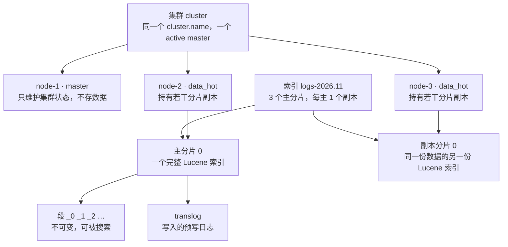
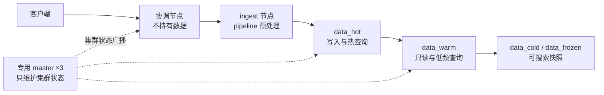
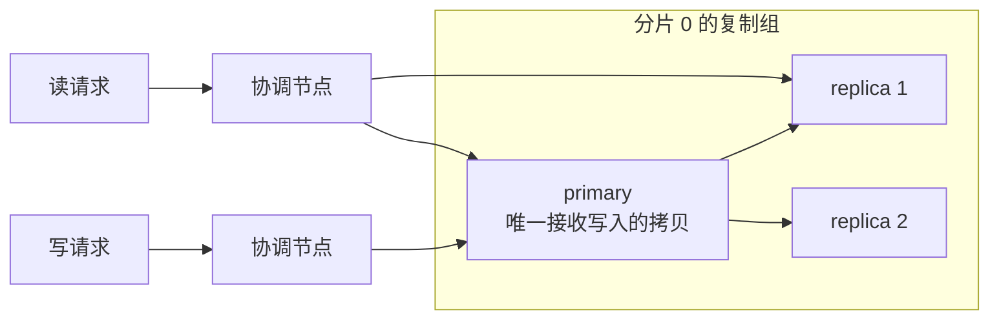
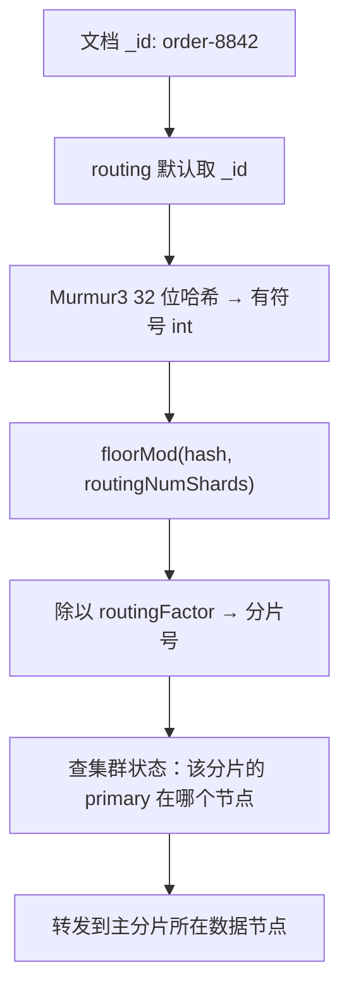
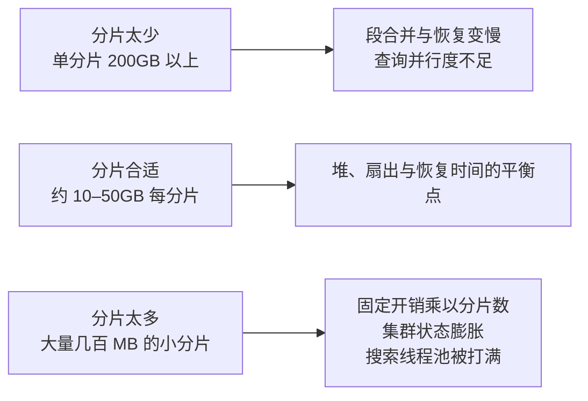
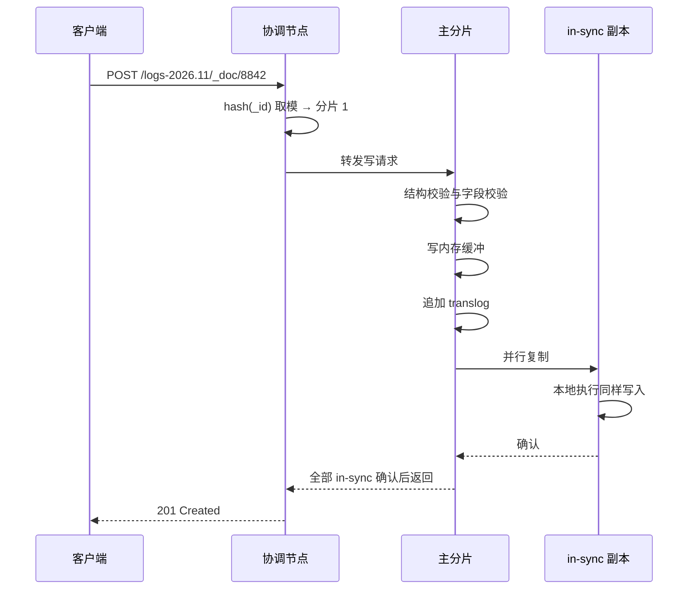

# 01 ES 全局架构——集群、节点、索引与分片

**摘要：**

Elasticsearch 站在 Lucene 的肩膀上，但它真正交付的东西不是倒排索引——倒排索引 Lucene 早就做好了——而是把一份索引切成若干份、摊到多台机器上，并且让客户端感知不到这个切割。切割的最小单位是分片，每个分片本身又是一个完整、独立的 Lucene 索引，有自己的段与事务日志；副本则是同一份数据的另一份拷贝，它不接收写入，却要参与读。切多少份，就是分片数；这个数字在建索引的那一刻写进元数据，之后无论数据涨到十倍还是跌到十分之一，它都不会自己变化。本文顺着"集群、节点、索引、分片、段"这四层映射把物理与逻辑逐一对应清楚，再集中讲透分片数的三个约束：它是一次性的票、它是堆与集群状态的计价单位、它决定 master 的发布成本。路由公式 `hash(routing) % number_of_primary_shards` 会解释这份一次性从何而来，源码里的 `floorMod` 与路由空间会解释那道仅存的技术缝隙。随后把写入路径（协调、主分片、副本三段）与读取路径（查询与取回两阶段）逐一对照，说明副本为什么参与读却不参与写；再交代 8.x 与这四层直接相关的几处变化，最后落到容量推算与反例，回答两个问题：建索引时这个数字该取多少，以及取错了还有几条退路。

---

## 第 1 章 从一个库的边界说起

### 1.1 Lucene 交付的是索引结构，不是服务

1999 年，Doug Cutting 发布了 Lucene 的第一个版本；2001 年它进入 Apache 基金会，2005 年成为顶级项目。此后二十年里，几乎所有能被称作"搜索引擎"的开源产品，底层都躺着这份代码或者它的移植版本。Lucene 提供的是一套完整的倒排索引实现：分词、词典、倒排表、布尔查询、短语查询、相关性打分、段文件格式、以及段的合并策略。这些东西加起来，构成了信息检索领域最扎实的一块地基。

但把 Lucene 的 jar 包加进工程依赖，你得到的是一个库，不是一个服务。库的边界很清楚：`IndexWriter` 独占写入，`IndexSearcher` 读一个提交点的快照，段的合并与提交点（commit point）都发生在本地文件系统上。它的正确性论证从头到尾不需要考虑第二台机器——没有网络分区，没有副本滞后，没有"另一台机器上那份数据是不是同一份"的问题。

不妨把这层关系想成发动机总成与整车：Lucene 是一台做工精良的发动机，曲轴、活塞、配气机构都齐备，但你把它放在地上，它哪儿也去不了。缺的是底盘、传动、油箱，以及一套让驾驶员不必懂内燃机的操控界面。

### 1.2 缺口不在功能，在部署形态

单机 Lucene 撞上的墙有三堵，而且一堵比一堵硬。

第一堵是容量。一个 Lucene 索引的段文件躺在单块磁盘上，数据量超过单盘上限就无解。倒排索引还有个额外的麻烦：它不像日志那样可以简单地追加分文件，查询要跨所有段做归并，段越多、字段越多，堆里的元数据越厚，单机就越难优雅地老去。

第二堵是可用性。单机存储意味着单点——磁盘坏道、主板故障、机房断电，任何一种都能让搜索服务停摆。Lucene 有提交点与事务日志来保证"进程崩了不丢已提交数据"，但它保证不了"机器没了还有另一份"。

第三堵是使用门槛。`IndexWriter`、`Directory`、`Analyzer`、`Collector` 这一串 API 是给搜索工程师准备的，业务开发者想要的是"把这条 JSON 存进去、按关键词查出来"。这一层抽象缺位，Lucene 就只能待在少数团队的机房里。

2010 年，Shay Banon 发布的 Elasticsearch（此前他写过 Compass）在这三堵墙前面各补了一层：用**分片（Shard）**解决容量，用**副本（Replica）**解决可用性，用 JSON over HTTP 解决门槛。这三层里，只有第一层真正改变了数据组织的形态，后两层都是围绕它长出来的。

### 1.3 一个 2010 年合理、今天还在生效的决定

当年做分布式搜索，摆在面前的路不止一条。可以把 Lucene 包装成一个远程服务，由客户端做分片与归并；也可以像 HDFS 那样引入一个名字节点，让"键到分片"的映射由中心目录维护，扩容时只挪数据、不改算法。ES 选了第三条：让每个分片本身就是一个完整的 Lucene 索引，用一次哈希取模把文档钉死在某个分片上，不做中心目录。

这个选择带来的直接后果，是分片数必须在建索引时确定。哈希取模是个纯函数，分母一变，所有文档的归属同时改变——不是"部分数据搬家"，而是"整张地图作废"。于是分片数从一个可以随时调整的运维参数，变成了一个写进索引元数据、跟着索引一辈子的常量。

站在 2010 年看，这笔交易划算得没有讨论余地：单机磁盘小、机器贵，把索引切小摊出去是唯一解；分片数拍个 5，够用好几年。站在今天看，这笔债的利息变高了——数据增长的速度、索引的数量、集群的规模，都远超当年的设想，而那个"拍出来的 5"还钉在元数据里。本篇余下的篇幅，基本都是围绕这笔债展开的：它为什么必须存在、它的利息怎么算、以及还债有哪几条路。

---

## 第 2 章 四层映射：从集群到 Lucene 段

ES 的架构文档里最常见的困惑，是逻辑概念与物理实体对不上号：索引听起来像一个文件，实际上是一组分片；分片听起来像一个数据切片，实际上是一个完整的小引擎。下面这张图把四层摊开，后面几节逐层落细。



### 2.1 一张表看清四层

| 层级 | 物理形态 | 谁负责维护 | 坏掉时看到什么 |
| :--- | :--- | :--- | :--- |
| 集群 cluster | 一组共享 `cluster.name` 的节点进程 | master 节点维护集群状态 | `_cluster/health` 变红、master 选举、节点掉线 |
| 节点 node | 一个 JVM 进程，一个 `path.data` | 节点自身与编排系统 | `_cat/nodes` 少一行、分片重新分配 |
| 索引 index | 元数据（settings/mappings/aliases）加一组分片 | master 写元数据，数据节点持有分片 | `GET /idx/_settings` 报 404、别名指向空 |
| 分片 shard | 一个 Lucene 索引目录加一个 translog 目录 | 所在数据节点 | `_cat/shards` 出现 UNASSIGNED、恢复中 |
| 段 segment | 一组不可变的索引文件 | Lucene 的 IndexWriter 与合并策略 | 段数暴涨、查询变慢、堆占用升高 |

这张表最值得记住的是第二列与第三列的错位：索引的元数据归 master 管，索引的数据归数据节点管。于是"索引存在"和"索引可查"是两件事——元数据在、分片没分配，索引照样是 yellow 甚至 red 状态。这个错位是后面所有故障形态的源头。

### 2.2 节点是一个进程，不是一台机器

排障时最常见的误解之一，是把节点等同于服务器。节点是 JVM 进程：它有 `node.name`、有 `path.data`、有堆与线程池，一台物理机上可以跑多个节点（各自独立的 `path.data`，否则会互相踩数据），一个容器里也可以只跑一个节点。

这个区分在三个场景里会咬人。其一，堆的账按节点算而不是按机器算：一台 256GB 内存的机器上跑四个 16GB 堆的节点，与跑一个 64GB 堆的节点，Lucene 能用的 page cache 完全不同。其二，分片分配的最小单位是节点，`index.routing.allocation.total_shards_per_node` 限制的是单节点上的分片数，与机器无关。其三，容器化部署下 `node.name` 若取默认的 hostname，Pod 重建后名字变化，`cluster.initial_master_nodes` 里写的名字就对不上了——这个坑在 3.6 节展开。

### 2.3 索引不是一个文件

初学者看到"索引"两个字，容易联想到磁盘上的一个文件或一个目录，于是自然推导出"索引大小 = 磁盘占用 = 备份对象"。真实的结构要绕一层。

索引在集群状态里是一份元数据：`settings`（分片数、副本数、`refresh_interval`、分析器默认值、`number_of_routing_shards`）、`mappings`（字段类型与索引方式）、`aliases`（读写切换的抓手）。这三样都躺在集群状态里，由 master 维护并广播到所有节点。

索引在数据节点上是若干目录，按分片编号分开：每个分片对应 `path.data/indices/<索引 UUID>/<分片号>/` 下的一份 Lucene 目录（段文件、删除标记、提交点），加一个 `translog/` 目录。索引与集群的元数据另有 `_state/` 目录存放，与段文件分开。

所以"删索引"能瞬间完成，因为它删的是元数据加目录树，不需要逐个文档操作；而"按条件删文档"是另一回事——它在每个分片上写删除标记，空间要等段合并才真正回收。理解了这个层次，才能理解为什么官方文档反复强调"删索引而不是删文档"。

### 2.4 每个分片是一个完整的 Lucene 索引

这是本篇最应该被记住的一句话。分片不是"从索引里横切出来的一片数据"，而是一个能独立开机、独立搜索、独立恢复的完整 Lucene 索引：自己的段集合、自己的提交点、自己的 translog、自己的 IndexWriter 与 IndexSearcher、自己的 refresh 与合并节奏、自己的删除标记。

这句话解释了四个看起来不相干的现象。

第一，为什么每个分片都有固定开销。既然是独立索引，就得有一套独立的堆对象：段元数据、每段每字段的开销、分片级的统计与缓存，这些东西与分片里装了多少数据无关。50MB 的分片和 50GB 的分片，这套骨架**一样厚**。

第二，为什么恢复以分片为单位。副本追数据、节点迁移、快照恢复，都是"把一个分片的 Lucene 索引整体搬过去"，粒度是分片而不是文档。

第三，为什么一个慢分片能拖慢一整组。写入要等主分片与所有 in-sync 副本确认（7.1 节），任何一个分片卡住，整条复制组都等它。

第四，为什么分片数直接决定查询的扇出。一个跨全索引的查询，要把请求发给每个分片的一份副本，再在协调节点归并——分片数就是扇出的下限。

### 2.5 段：查询可见性的最小单位

段（segment）是 Lucene 的最小存储单元，一次写入批产生的段在被合并之前不再变化。写入的文档先落在内存缓冲里，refresh 时缓冲变成一个新段并打开新的 IndexSearcher，这一刻起新文档可被搜索；删除只是在段上打标记，更新等价于"删旧写新"；段合并把若干小段并成大段，顺带回收被标记删除的空间。

把分片与段的关系想成一个抽屉柜：分片是那只抽屉，段是抽屉里一封封封好的信。信一旦封好就改不了，想改只能抽出来重写；抽屉里信太多翻起来慢，所以定期把几封合并成一封。这个比喻有个前提要说清楚——Lucene 的合并不是物理剪贴，而是重写：把旧段里的存活文档读出来，写进新段，然后删掉旧段。所以合并是 IO 与 CPU 密集型操作，它决定了"分片太碎"的代价会以什么方式出现。

段的生成、合并与 flush 的完整链路，以及 TieredMergePolicy 的取舍，在 [[03 文档写入与 Lucene 段合并]] 里有专门铺陈；这里只需要一个结论：段的数量随写入与合并波动，而分片数一旦定下就不波动——两个变量里，能提前规划的只有后者。

---

## 第 3 章 节点角色：把职责拆开的理由

一个 ES 进程默认什么都能干，这在开发环境里很方便，在生产规模下会变成互相拖累。下面这张图是常见的大集群形态：专用 master 只维护状态，专用 data 按层承接数据，协调节点挡在客户端前面承担扇出与归并。



### 3.1 node.roles：从布尔开关到角色列表

7.9 之前，角色是几个布尔开关拼出来的：`node.master`、`node.data`、`node.ingest`。7.9 起改用 `node.roles` 一个列表，写什么就是什么；7.10 起数据层又被拆成 `data_hot`、`data_warm`、`data_cold`、`data_frozen` 与 `data_content`，同一套列表又长了一截。

这个改动有一个容易踩的细节：不写 `node.roles` 与写空列表是**两回事**。不写时，节点拿到的是全套默认角色（`master`、`data`、各数据层、`ingest`、`ml`、`transform`、`remote_cluster_client` 等）；写 `node.roles: []` 时，节点变成纯协调节点，一个数据分片都不会分给它。前者是"什么都干"，后者是"只转发"。

另一层约束常被忽略：一旦显式写了 `node.roles`，就必须把这台节点该有的角色全列出来。集群至少需要一个 `master`，以及 `data` 或（`data_content` 与 `data_hot`）之一；跨集群搜索要 `remote_cluster_client`；监控采集与 ingest pipeline 要 `ingest`；Fleet、Security 与 transform 要 `transform`；机器学习要 `ml`。少写一个，节点能起来，但对应功能会安静地失效。

### 3.2 专用 master：三个就够

专用 master 的职责可以一句话概括：维护集群状态，决定分片去哪。它不存数据、不处理查询、不跑聚合，因此 CPU 与磁盘都不是瓶颈，瓶颈在堆与网络。

数量上，**3 个**是标准答案。理由不是性能而是容错算术：3 个节点容忍 1 个失效，5 个容忍 2 个，而每次选举都要在候选节点之间达成多数派；节点越多，达成多数派的通信成本越高，选举窗口越长。多数派算术天生偏爱**奇数**，起点定在 3，不是玄学。超过 5 个候选节点时，更常见的做法是留 3 个投票节点、其余加 `voting_only` 角色——它们参与状态同步但不参与投票，既不打破多数派的算术，又能分担状态存储。

堆的需求有官方口径可依：master 能管理的索引数与堆成正比，经验值是每 1GB 堆对应不超过 3000 个索引（`_cat/nodes` 可查各节点堆上限）。按这个口径，4GB 堆的专用 master 大约能管 12000 个索引。注意这个上限只保证"管得住"，不保证"查询快"——它约束的是元数据规模，不是数据规模。

为什么不让 master 兼 data？因为 master 最怕的是长停顿：一次 Full GC、一次磁盘 IO 卡顿，都可能让 master 错过心跳超时窗口，触发不必要的重新选举；而数据节点的 GC 与 IO 恰恰是最不可控的。把两者分开，等于把"集群的大脑"与"集群的肌肉"隔离开。

### 3.3 专用 data：按层拆分

数据节点是资源消耗的主体，磁盘、堆、CPU 三样都吃。规模上来之后，通常不会再有一类"通用 data 节点"，而是按数据温度分层：

| 角色 | 承接的数据 | 硬件取向 | 调大或调小的代价 |
| :--- | :--- | :--- | :--- |
| `data_hot` | 正在写入、频繁查询 | 高 IO、SSD、较大堆 | 加节点提升写入与热查询吞吐；节点过少则单节点分片数逼近 1000 上限 |
| `data_warm` | 只读、查询频率下降 | 大容量机械盘、中等堆 | 扩容便宜，但迁移分片要消耗网络与 IO |
| `data_cold` | 极少查询、仅保留可检索性 | 大容量、低 IO | 便宜但查询延迟高，需接受冷查询慢 |
| `data_frozen` | 可搜索快照，数据主要在对象存储 | 本地缓存盘 | 存储成本最低；查询受缓存命中率影响，且需 `searchable_snapshots` |

数据层通过 `index.routing.allocation.include._tier_preference` 与 ILM 联动：hot 阶段写满后 rollover，warm 阶段 shrink 并迁移，cold 阶段进一步压缩，frozen 阶段挂到可搜索快照上。这条链路的代价要提前算清——每一次层间迁移都是一次分片搬迁，而分片搬迁会写集群状态、占恢复带宽，还会在目标节点上制造一段时间的 IO 尖峰。

### 3.4 协调节点：把扇出与归并挪走

协调节点（coordinating only node）不持有数据，只做三件事：接收请求、把请求散到持有相关分片的节点、把各分片的返回归并成最终结果。它的角色定义就是 `node.roles: []`。

什么时候值得单独拆出来？当扇出很重的时候。一个跨 600 个分片的聚合查询，协调节点要发出 600 个分片请求、收 600 份部分结果、在内存里做归并；这份内存与 CPU 如果压在数据节点上，会和写入、段合并抢资源。把协调层独立出来，数据节点的负载曲线会平滑很多，代价是多一跳网络，以及协调节点自己需要足够大的堆来承载归并。

还有一个不显眼但真实的约束：任何节点在收到不属于自己的请求时都会临时扮演协调节点。所以"专用协调节点"优化的是常态流量，而不是消灭协调行为。

### 3.5 ingest 与 ml：两个容易放错位置的角色

`ingest` 角色负责写入前的预处理：字段提取、类型转换、geoip 解析、脚本改写。它跑在独立的 `ingest` 线程池上，重 pipeline 会吃 CPU 与堆，因此不适合与 master 混部。一个常被忽略的失效模式是：索引模板里挂了 `default_pipeline`，而唯一带 `ingest` 角色的节点挂了，写入会因为 pipeline 无法执行而整体失败——这属于"角色拆分后必须同步检查依赖"的典型。

`ml` 角色跑异常检测与数据框分析，内存模型与普通节点不同（原生进程、堆外内存），通常单独一组机器。它与分片数的关系是间接的：ML 作业要读分片里的数据，分片过多会让作业的元数据开销上升，仅此而已。

### 3.6 discovery 的两个陷阱

第一个陷阱是 `cluster.initial_master_nodes`。这个参数只在集群第一次形成时使用，值为初始候选节点的 `node.name` 列表，作用是让这些节点在没有任何集群状态的情况下互相找到、选出第一个 master。集群形成之后它就没有用了，官方要求从配置里移除。如果一直留着，在全部节点重启、磁盘数据又还在的场景下，节点会按这个列表重新走引导流程，运气不好就形成两个各自为政的小集群——这正是脑裂的现代版本。

第二个陷阱是把 `discovery.seed_hosts` 当成投票配置。它只是"去哪里找其他节点"的地址簿，写主机名或 IP 加 transport 端口（默认 9300），发现之后节点间用真实地址通信。它不决定谁能当 master，也不决定多数派怎么算。真正的投票配置由集群自己维护，改节点名单的正确姿势是滚动重启，而不是改这个参数。

单机环境还有第三个选项：`discovery.type: single-node`。它跳过引导流程直接形成单节点集群，代价是这个集群永远只有一个节点，扩容时不能简单地把参数删掉——那会触发一次全新的引导。选主与分配的完整机制，包括投票配置排除、选举超时与脑裂防护，见 [[06 集群管理——选主、分片分配与脑裂防护]]。

---

## 第 4 章 索引、分片与副本

### 4.1 复制组：一个主分片加它的所有副本

同一个分片号的主分片与副本分片，构成一个复制组（replication group）。组内的所有拷贝持有完全相同的数据，区别只在"谁能接写入"。下图把读写两条路径叠在同一组上，能看清它们的差别。



### 4.2 副本不参与写入：一条写请求的三段旅程

说"副本不参与写入"容易被误读成"副本不写数据"，实际含义是：副本不接收客户端写入、不决定写入顺序、不校验请求合法性。数据它当然要写，只是被动地重放主分片已经确认过的操作。

一条写请求分三段。协调阶段，接收请求的节点算出目标分片，把请求转给当前持有主分片的节点。主分片阶段，主分片做结构校验（比如把一个对象写进数字字段会被直接拒绝）、本地执行索引、把操作追加到 translog，然后并行转发给 in-sync 副本集合里的每一个拷贝。副本阶段，每个副本在本地执行同样的写入并回复主分片；主分片收齐所有 in-sync 副本的确认，才向协调节点确认成功。

in-sync 副本集合由 master 维护，语义是"保证处理过所有已向用户确认的写操作的拷贝"。主分片对这份名单负有不变量责任：它必须把每一个操作复制到名单上的每个拷贝。一旦某个副本超时或失败，主分片会请求 master 把它从名单里剔除，得到 master 确认后才向客户端返回成功——这就是为什么"一个副本挂了"有时会让写入延迟抖动，因为剔除本身要走一轮集群状态变更。

主分片自己挂掉时，写请求会等待默认最长一分钟，等 master 把某个副本提升为新主分片再继续。这个一分钟是硬编码的等待窗口，它解释了故障切换期间那几分钟的写入超时——不是 ES 卡死了，是它在等新主分片就位。

副本为零的索引也能正常写入。此时主分片没有外部校验者，但 master 知道它是唯一的好拷贝，因此不会把过期的旧拷贝提升为主分片——已经确认的写入不会被一次错误的提升抹掉。物理上的单点风险另说：只有一份数据，盘坏了就是坏了。

### 4.3 副本参与读，但边界比想象的多

读请求只需要一份 in-sync 拷贝即可服务，主分片与副本都能接。所以副本凭空多出一份读吞吐，这是副本相对"纯冗余"的额外收益，也是 ES 与 Kafka 那类"副本默认不服务消费"的设计分道扬镳的地方。

但边界有三个。

其一，搜索的可见性受 refresh 影响，而 refresh 是每个拷贝各自完成的。写入在主分片本地执行、再复制到副本，副本上同样经历"内存缓冲到新段"的过程；如果你的读请求恰好落到一个还没到 refresh 周期的副本上，新文档就搜不到。这不是 bug，是近实时的定义。要让"写完立刻搜到"，得用 `?refresh=true` 强制主副本一起 refresh，代价是每次写入多一次段生成，高频写入下会把段数量顶上去。

其二，按 ID 取文档（GET）默认是实时的。它不走 refresh 路径，直接从分片的 translog 里取，所以写后立刻 GET 通常能取到——即使那个分片还没 refresh。这个特例经常被当成"ES 是实时的"证据，其实是两条不同的读取路径。

其三，负载均衡依赖自适应副本选择（adaptive replica selection，ARS）。协调节点默认按"过往请求响应时间、节点执行搜索的耗时、搜索线程池队列长度"三个判据挑拷贝，而不是简单轮询。它偏向空闲节点，意味着流量分布会随时间漂移，这也解释了为什么同一个查询偶尔命中不同的分片拷贝、命中不同的请求缓存。

需要稳定的缓存或稳定的分片选择时，用 `preference` 参数：`_local` 优先本节点，`_only_local` 只用本节点，自定义字符串则按哈希把相同字符串的请求固定到同一批分片。自定义串这一招在"报告类重查询"上很值钱——同一个用户或同一个看板重复查询时能命中分片请求缓存，代价是流量不再均匀。

### 4.4 分片数乘副本数，才是你真正要付的账

设主分片数为 $N$、每个主分片的副本数为 $R$，集群里这个索引的分片拷贝总数是 $N \times (R+1)$。所有成本都按这个乘积算：磁盘占用、堆开销、集群状态里路由表的条目数、故障恢复时要搬的数据量、`cluster.max_shards_per_node` 的计数。

新手常犯的错是按 $N$ 做规划：算出来 20 个主分片、每节点 10 个分片，看起来轻松；加上 1 个副本之后变成 40 个拷贝，每节点 20 个，压力翻倍。副本数可以随时调（`PUT /idx/_settings` 改 `index.number_of_replicas`），这是它和分片数最大的不同——分片数是买断，副本数是按月付费。

| 维度 | 主分片数 | 副本数 |
| :--- | :--- | :--- |
| 创建后能否修改 | 不能，只有 reindex、split、shrink 三条路 | 随时可改，集群自动补齐或删除拷贝 |
| 影响读吞吐 | 影响扇出与并行度 | 直接放大读吞吐 |
| 影响写吞吐 | 影响写入并行度 | 不提升写入，反而放大写放大与确认延迟 |
| 影响可用性 | 无直接影响 | 决定能容忍几个节点同时失效 |
| 影响堆与集群状态 | 按 $N$ 计 | 按 $N \times R$ 计 |

---

## 第 5 章 路由公式：分片数为什么改不了

### 5.1 一条请求怎么找到它的分片

ES 收到文档时，先算出它属于哪个主分片，再查集群状态找到持有该分片主拷贝的节点。公式在官方文档里反复出现：

$$
shard = hash(routing) \bmod number\_of\_primary\_shards
$$

`routing` 默认取文档的 `_id`，也可以由客户端显式指定（`?routing=user-42`）。默认情况下，改文档内容不影响归属，改 `_id` 就等于换了一个分片。

### 5.2 分母为什么不能改：一次反事实推演

先做个推演。假设某索引有 5 个主分片，一条文档的哈希值是 8471（这只是演示用的假设值，真实哈希不可预测）。$8471 \bmod 5 = 1$，所以它落在分片 1。

现在把分片数改成 6。$8471 \bmod 6 = 5$，同一条文档被算到分片 5。可它的数据还躺在分片 1 的段文件里。结果不是"搬迁中"，而是**查不到**：读请求去分片 5 找一个不存在的文档，`GET` 返回 not found，搜索漏掉它，而分片 1 里那份数据静静躺着、谁都够不着。更麻烦的是写入——同一个 `_id` 再写一次，会落到分片 5，于是一条逻辑上的文档在两处各有一份，删除操作只能删掉其中一份。

这就是为什么 `index.number_of_shards` 是一个 final 的索引级设置：`PUT /idx/_settings` 改它会被直接拒绝，报 "Can't update non dynamic settings"。ES 没有给这个参数留运行时修改的口子，因为哈希取模的语义不允许。

换一个角度看得更清楚：分片数不是一个"容量参数"，而是一张**映射表**——从哈希空间到物理分片，表本身只有一行，就是一个除数。改除数等于换表，换表意味着所有已有文档的归属全部作废。任何支持"在线改分片数"的设计，本质上都得引入第二层映射或一致性哈希，而这两样都要在读路径上加成本。

### 5.3 源码里的两处修正与一道缝隙

官方的公式是教学版，源码里的实现有两处修正，值得知道，因为它们解释了一些"按理说不该出现"的现象。

第一处是哈希函数与取模方式。哈希用 Murmur3 的 32 位版本，输出是有符号整数；取模用 `Math.floorMod` 而不是 Java 的 `%`。原因很实在：`%` 对负数返回负数，直接取模会算出负的分片号；`floorMod` 保证结果落在非负区间。这类细节在文档里不会写，但它决定了"换一种哈希实现会不会打乱数据"这种问题的答案。

第二处是路由空间。源码里并不是直接对 `number_of_shards` 取模，而是：

```text
分片号 = floorMod(hash, routingNumShards) / routingFactor
```

`routingNumShards` 对应索引设置 `index.number_of_routing_shards`，默认等于 `number_of_shards`，且只能在创建索引时设定；`routingFactor` 等于 `routingNumShards / number_of_shards`。默认情形下因子为 1，公式退化成教学版。这个设计的意义在于给 `_split` 留了路：先把哈希空间建大，再逐次把物理分片数往上加，由于哈希空间没变，文档的路由结果保持稳定。

于是那道缝隙的准确形状是：分片数**不可改**，哈希空间**可以预留**。预留在 5 个主分片、30 个路由分片的索引上，可以依次 split 到 10、15、30 个分片；而一个按默认值建的 5 分片索引，想直接 split 到 10 会被拒绝，因为 5 个路由分片无法被 10 整除，报错大意是"路由分片数必须是目标分片数的整数倍"。这就是 5.5 节里三条退路之一的技术前提。

下图是这条路由链路的完整形状，从 `_id` 到最终节点。



### 5.4 自定义路由：把同一租户钉在一个分片上

默认按 `_id` 路由的好处是分布均匀，坏处是任何按业务维度的查询都要扇出所有分片。若业务天然按租户分区，写入时带上 `?routing=tenant-42`，同一租户的文档就都会落到同一个分片；查询时带上同样的 `routing`，请求只发一个分片，扇出从 $N$ 掉到 1。

代价有两个。一是偏斜：租户大小不均是常态，大租户可能独占一个分片，把它撑成热点，而哈希对业务规模一无所知。二是可维护性：路由值一旦写进文档就固定了，换路由策略等于换索引。折中方案是 `index.routing_partition_size`，让一个路由值分散到 P 个分片（P 大于 1 且小于主分片数，创建时设定），查询时扇出 P 个分片。它把"一个租户一个分片"的尖锐热点磨成一个可控的小范围，代价是查询要多打几个分片、并且写入必须带 routing。

### 5.5 想改分片数的三条路

分片数不能在线改，但并非终身监禁。三条路各有前提与代价，选哪条取决于数据量、停机窗口与写入压力。

| 手段 | 前提 | 代价 | 适用场景 |
| :--- | :--- | :--- | :--- |
| `_reindex` | 目标索引已建好；源索引可读 | 全量重写数据，期间双写或停写；大数据量耗时以小时计 | 任意方向调整，最通用 |
| `_split` | 源索引只读、单副本、所有拷贝在同一节点；目标分片数是路由空间的整数倍 | 需要一份额外磁盘空间放新索引；split 期间源索引不可写 | 分片太少、单分片过大 |
| `_shrink` | 源索引只读、单副本、所有拷贝在同一节点；目标分片数整除源分片数 | 同样需要额外空间；分片数只能往下减 | 冷数据归档、小索引合并 |
| `_clone` | 与 split 前置条件相同，目标分片数等于源 | 只复制不改结构，用于试验 | 灰度验证、快照前留底 |

三条路的共同点是：都是"造一个新索引，再切别名过去"。所以真正的运维动作不是执行 API，而是设计切换：新索引建好、`_reindex` 跑到尾、核对文档数、把别名从旧索引切到新索引、观察一段时间、再删旧索引。别名在这里扮演的是"读路径的稳定入口"，它让上层代码不必知道底层索引换过。

对日志类数据，还有第四条更省事的路：根本不动老索引，让 rollover 只影响未来。把 `index.number_of_shards` 写进索引模板，之后每次 rollover 生成的新后备索引都按新分片数建，老索引自然老去、到期删除。这也是数据流（data stream）比手工建索引更值得推荐的原因之一——它把"分片数可演进"这件事做成了默认行为。

---

## 第 6 章 分片数的三个约束

分片数之所以被称作"建索引时一次性决定"的那个参数，不是因为 ES 懒，而是因为它同时被三件事绑住：元数据的不可变性、堆的固定开销、以及 master 的发布成本。前两个约束在单机上也能观察到，第三个只有集群规模上去之后才会显形。下图把两端的代价并排列出，中间是三条曲线交汇出的舒适区。



### 6.1 约束一：它是一张一次性的票

第一层约束是硬的：`index.number_of_shards` 是 final 设置，写入索引元数据之后不可修改。5.2 节已经从哈希语义上解释过原因，这里补上运维视角的后果——它意味着分片数必须在**信息最少**的时刻做出决定。

建索引时，你对未来的数据量只有估计；而这个估计要一直管到索引被删除。日志类索引还好，有 rollover 兜底；业务类索引往往是"建了就一直用"，三年后数据涨了十倍，分片数还是当年那个。这种错配不会立刻爆炸，而是慢慢显形：单分片越写越大，恢复时间越来越长，某天一次节点重启就变成了几个小时的降级。

### 6.2 约束二：分片是资源单位

第二层约束是成本：每个分片都有与数据量无关的固定开销。把这份开销拆开看，大致是四类。

段元数据。分片里每个段都要在堆里保留元数据供搜索快速访问，段越多这份开销越厚，合并把它压下去。

每段每字段的开销。这是官方文档里明确点出的一项：每个段对每个已映射字段都有一点堆开销，包括字段名的一份拷贝（能用 ISO-8859-1 表示就用它，否则用 UTF-16）。单个不显眼，但"段数乘字段数"之后会显著，尤其是段数高、字段多、字段名长的索引。

映射与分片级对象。索引的 mappings 要进集群状态，数据节点还要为持有的每个已映射字段额外留堆；此外每个分片还有自己的引擎对象、缓存、统计。

线程与任务。分片是搜索与写入的任务单位，一次跨分片的搜索会在每个分片上占用搜索线程池的一个许可；分片越多，同样一个查询占用的线程许可越多。

把这几项加起来，一个已经合并到少数几个段的分片，固定开销大致在数十 MB 量级（量级判断，随字段数、段数与版本变化）。这个数字的含义不是"每分片必须留 30MB"，而是"分片再小，这笔钱照付"。

算一笔账（示例推算）。3 个数据节点、每节点 16GB 堆，集群里共 2000 个分片拷贝。按每分片 30MB 的固定开销估，每节点约 667 个分片，光固定开销就接近 20GB，超过堆上限——剩下的堆要给段、给聚合、给请求缓存，结果只能是频繁 GC 直到熔断。反过来，同样 2000 个分片如果只装在 8 节点上，每节点 250 个分片、约 7.5GB 固定开销，账就平了。分片数没有绝对值，只有"分片数除以节点数"这个比值。

官方给了两条可以对照的硬线：每节点默认最多 1000 个非冻结分片（`cluster.max_shards_per_node`，冻结层另有 3000 的上限），以及 master 每 1GB 堆对应不超过 3000 个索引。前者防的是单节点过载，后者防的是元数据压垮 master。两条线都只是"不要越过去"的护栏，不是"越接近越好"的目标。

### 6.3 约束三：分片数让 master 慢

第三层约束最隐蔽。集群状态（cluster state）是一份内存对象，包含节点清单、每个索引的 settings 与 mappings 与别名、以及一张路由表——这张路由表为每个分片的每个拷贝记录它在哪个节点、处于什么状态。master 每次变更都要生成新版本，序列化后广播给所有节点，等各节点应用并确认，最后提交。

分片数在这个流程里是体积的主要来源：路由表的条目数等于拷贝总数，索引数与映射规模决定元数据部分。一个两千分片、几百个索引的集群，集群状态可以到几十 MB 量级（量级判断，取决于映射复杂度）；每次发布都要把这几十 MB 走一遍网络、在每个节点反序列化一遍、在堆里留一份新版本。发布是**全量广播**，窗口默认 30 秒（`cluster.publish.timeout`），超时 master 会主动下台重选——于是过大的集群状态会以一种间接的方式变成"master 抖"。

更麻烦的是放大效应：分片分配、迁移、副本提升、节点上下线，每一次都会产生新状态版本。分片越多，这些事件越频繁，发布越密；发布越密，master 的 pending task 队列越长。排查时看 `GET _cluster/pending_tasks`，如果队列里堆着几十个 `shard-started` 或 `reroute` 任务，基本可以判断分片数与变更频率已经超过 master 的处理能力。

下面三条命令是判断这件事的常用起手式，分别看分片规模、节点上的分片分布、以及映射在堆上的体量。

```bash
# 全集群分片总数与状态分布
GET _cluster/stats?filter_path=indices.shards.total,indices.shards.primaries

# 每节点持有多少分片、堆用掉多少、是什么角色
GET _cat/nodes?v&h=name,node.role,heap.max,heap.percent,shards

# 映射元数据去重压缩后占多少堆
GET _cluster/stats?human&filter_path=indices.mappings.total_deduplicated_mapping_size*
```

最后那个 `shards` 列是最容易被忽略的数字。它一旦接近四位数，无论磁盘还剩多少，这个节点的搜索与恢复都会开始变脆。

### 6.4 10-50GB 这个区间从哪来

官方给出的分片大小经验区间是 10GB 到 50GB，同时建议单个分片的文档数控制在 2 亿以内。这两个数字都不是硬限制，而是三条曲线交汇出来的舒适区。

第一条是段合并曲线。分片越大，段越少，固定开销摊得越薄，搜索要打开的段也越少；但段越大，合并一次的成本越高，且合并期间占用的 IO 会挤压查询。到了某个尺寸，继续增大分片带来的边际收益趋近于零。

第二条是恢复时间曲线。副本追数据、节点迁移、快照恢复都以分片为单位，而恢复是限速的（`indices.recovery.max_bytes_per_sec`，默认值以对应版本文档为准），且每节点同时恢复的分片数也有限（`cluster.routing.allocation.node_concurrent_recoveries`，默认 2）。按 40MB/s 的限速做示例推算：一个 50GB 的分片完整恢复约需 21 分钟，一个 10GB 的分片约需 4 分钟。如果集群有 20 个 200GB 的超大分片，一次节点故障的降级窗口会以小时计；而 200 个 20GB 的分片可以并行恢复，窗口短得多。50GB 这条线，很大程度上是"一次故障的容忍窗口"倒推出来的。

第三条是搜索并行度曲线。每个分片上的搜索在单线程里跑，分片越多，单个查询能并行利用的核越多，但协调节点要归并的部分结果也越多，而且一次查询在每个节点上允许并发的分片请求是有限的（`max_concurrent_shard_requests`，默认 5）。分片太少则并行度不够，分片太多则线程池与归并开销压过并行收益。10GB 这条线，与"别把分片切得比这更碎"直接相关。

三条曲线叠加的结论是：10-50GB 不是标准答案，而是默认起点。有些场景适用更小的分片（比如查询极热、要求低延迟的小型业务索引），有些场景适用更大的分片（比如只追加、几乎不查的归档索引），判断依据永远是"你的恢复窗口与查询延迟能容忍什么"。

### 6.5 三个反例

**小索引开 5 分片**。这是 6.x 及更早版本的默认值遗留：那时新建索引默认 5 主 1 副，模板一代代传下来，很多团队至今仍在模板里手写 5。一个总数据量 800MB 的业务索引开 5 个分片，每个分片一百多 MB，固定开销一分不少，扇出却变成 5 倍；1 个分片就够的索引，白付了 5 份元数据与 5 份线程许可。7.0 起默认值已经变成 1 主 1 副，这个改动本身就是官方对旧默认值的否定。

**按三年后的量定死**。反向的错：预判三年后会有 900GB，于是建索引时开 30 个分片；结果第一年只有 30GB，平均每个分片 1GB，集群状态里白白多出 60 个路由条目，恢复时 30 个分片一起动。正确的姿势是让索引生命周期管理来承担演进：写索引按 `max_primary_shard_size` 滚动，每个新索引都按当前数据量重新定分片数——分片数不可改，但"每个新索引都可以重新选"。

**全员 master 候选**。20 个节点的集群，每个节点都不写 `node.roles`，于是 20 个候选 master。任何一个数据节点的长 GC 都可能触发选举，每次选举都要求 11 个节点达成多数派；集群状态的发布也要经过 20 个节点确认，任何一个慢节点都会拖长发布窗口。这不是理论风险，而是小集群升级到大集群时最常见的配置债。

---

## 第 7 章 读写路径：两条路线为什么长得不一样

### 7.1 写入：五步与两个日志

一条写入从客户端到确认，中间有五个明确的步骤，下图把它们串起来。



**两个日志**的分工是理解写入可靠性的关键。内存缓冲负责"可搜索"，refresh 时它变成新段；translog 负责"不丢"，它是每次写入都要落盘的追加日志，默认 `index.translog.durability: request`，即每个请求都 fsync。这意味着一条写入被确认时，数据已经在主分片与所有 in-sync 副本的 translog 里落了盘——即使此刻一次 refresh 都没发生，进程崩溃重启后也能靠重放 translog 恢复。

refresh 与 flush 是两件事。refresh 把缓冲变成段并让文档可搜索，代价是一次段生成；flush 把段与提交点落盘并清空 translog。`index.refresh_interval` 默认 1 秒，这就是"近实时"的来源；批量导入时把它设成 `-1`（关闭定时 refresh）能显著提升写入吞吐，代价是导入期间数据不可搜索。

### 7.2 确认语义与三个旋钮

写入确认的语义由 in-sync 副本集合定义，客户端能调的是三个旋钮。

`wait_for_active_shards` 控制"至少要有几个分片拷贝处于 active 状态才开始写"，默认 1，即只要主分片活着就写。把它设成 `all` 意味着所有拷贝都活着才写，一致性更强但可用性更差——副本所在节点短暂抖动就会让写入失败。

`refresh` 控制"写完是否立刻可见"，默认 `false`（等下个 refresh 周期）、`wait_for`（等下一次 refresh 完成再返回）、`true`（立刻强制 refresh 后返回）。前两者对写入吞吐友好，后者对读一致性友好。

`index.translog.durability` 控制持久化强度，`request`（默认，每请求 fsync）换成 `async`（按 `index.translog.sync_interval` 批量 fsync）能把写入吞吐拉高一个档，代价是进程崩溃时可能丢掉最近几秒已确认的写入。这是一个纯粹的持久性与吞吐的交换，没有免费的一侧。

### 7.3 读取：两阶段查询

搜索不是"去哪儿取一条数据"，而是"在很多分片上各算一部分，再合并"。这个形态决定了它必须分两阶段。

查询阶段，协调节点把查询发给每个目标分片的一份拷贝；每个分片在本地执行查询、算出匹配文档的 `_id` 与打分、取本地前 `from + size` 条返回。协调节点收齐所有部分结果，做一次全局归并排序，确定最终要取哪些文档。

取回阶段，协调节点按分片分组，向持有最终结果的分片发第二轮请求，取回完整文档（`_source`）与高亮等字段，拼装后返回客户端。

分两阶段的理由很直接：全量文档内容在网络上的代价远高于 ID 加分数。查询阶段只传"谁入围"，取回阶段只取"入围者的内容"，中间那次全局排序把候选集从"所有匹配"压缩到"前 K 条"。

分片失败时的行为值得单独记一笔：搜索、批量搜索与批量取回在部分分片失败时仍然返回 HTTP 200，失败信息藏在响应头的 `_shards` 字段里（`total`、`successful`、`failed`）。监控只看到 200 就以为一切正常，是漏告警的经典原因。

### 7.4 读路径上的选择权

读路径比写路径多一个自由度：同一份数据有多个拷贝，挑哪个由协调节点决定，默认按 ARS 的三个判据（历史响应时间、搜索耗时、队列长度）。这带来几个可用的手段。

`preference=_local` 让请求优先落在本节点，省一跳网络；配合请求缓存，重复查询能命中同一份缓存。自定义 `preference` 字符串把同一个业务维度的请求钉在同一批分片上，适合看板类重复查询。`routing` 参数则从源头上把扇出压到 1 个或 P 个分片，前提是写入时也用了同样的 `routing`。

写与读的对照可以收成一张表。

| 维度 | 写路径 | 读路径 |
| :--- | :--- | :--- |
| 入口 | 任意节点担任协调节点 | 任意节点担任协调节点 |
| 目标分片 | 只发主分片 | 主分片或任一 in-sync 副本 |
| 分片内动作 | 校验、写缓冲、追加 translog、复制 | 两阶段：本地查询打分、取回文档内容 |
| 等待条件 | 所有 in-sync 副本确认 | 所有目标分片返回或超时 |
| 默认可见性 | refresh 后（约 1 秒）可搜索，GET 实时可读 | 受 refresh 影响，可能读到副本上的旧快照 |
| 失败容忍 | 单分片失败即整体失败 | 部分分片失败仍返回 200，失败数在 `_shards` |

---

## 第 8 章 8.x 的几处变化

从 7.x 跨到 8.x，与"集群、节点、索引、分片"这四层直接相关的改动有四处，前两处会让老代码直接跑不起来。

| 变化 | 生效版本 | 影响 | 迁移动作 |
| :--- | :--- | :--- | :--- |
| `security` 默认开启 | 8.0 | 默认 HTTPS 与认证，裸 `curl` 会 401 或证书错误 | 导入 CA 或使用 `--cacert`；脚本改用账号密码或 API Key |
| 映射类型彻底移除 | 7.0 移除、8.0 清理过渡参数 | 一个索引只有一个隐式类型，写入端点统一为 `_doc` | 去掉 URL 与 bulk 里的 type，去掉按 `_type` 过滤的查询 |
| 分片上限与路由空间 | 7.x 后期引入上限、8.x 延续 | 每节点 1000 个非冻结分片的上限，越限报错 | 超限需扩节点或减分片；建索引时按需预留路由分片 |
| 向量检索进入主路径 | 8.x | `dense_vector` 与 kNN 改变分片的内存账 | 向量字段按 mmap 而非堆规划，控制分片数 |

### 8.1 security 默认开启

8.0 起 `xpack.security.enabled` 默认为 true，首次启动会自动生成 CA 与传输层、HTTP 层的证书，并给 `elastic` 超级用户设一个随机密码打印在控制台。对运维的直接冲击是：过去那种 `curl -XGET localhost:9200/_cat/indices` 的脚本全线失效，要么加 `-k`（不验证证书，生产不可取），要么把生成的 CA 导入信任链。

这条变化的深层含义不在证书，而在"默认安全"。它把 ES 从"默认裸奔、需要时加固"改成了"默认加固、需要时放开"，代价是开发与调试的门槛抬高——单机测试环境也得处理认证。官方为此保留了 `discovery.type: single-node` 这条捷径，但它只解决集群形成，不解决认证。

### 8.2 类型移除与 `_doc` 端点

早期 ES 允许一个索引里有多个类型（type），类比关系库的"一个库多张表"。这个类比在 Lucene 层面站不住脚：类型之间共享同一份倒排索引，字段冲突（同一个字段名在不同类型里类型不同）无解，稀疏字段还会拖累文档值的压缩与全局序号（global ordinals）。于是 6.x 限制为一个索引一个类型，7.0 起新建索引只能使用 `_doc` 这个名字，8.0 连过渡参数 `include_type_name` 一并移除。

落到端点上，写入统一成两种形态：不带 ID 的 `POST /idx/_doc`，由 ES 生成 ID；带 ID 的 `PUT /idx/_doc/8842`。bulk 请求里的元数据行不再需要 `_type`，`_type` 字段也不再出现在文档元数据里。老代码里按 `_type` 过滤的查询、以及 `PUT /idx/mydoc/1` 这种带类型的路径，在 8.x 上都会失败。

### 8.3 分片相关的默认值

`cluster.max_shards_per_node` 默认 1000，超过就拒绝新建索引或分配分片，报错信息里会写清"当前已有多少、上限多少"。它是一个集群级动态设置，应急时可以临时调高再回滚，但长期解法只有扩节点或减分片。

`index.number_of_routing_shards` 是那道缝隙的开关，默认等于主分片数，只能在创建时设定。打算日后 split 的索引，要在建索引时就把哈希空间放大——例如 1 主分片配 30 路由分片，之后可以 1 到 3 到 6 到 30 地逐次 split。这个参数在索引设置里能看到，它也解释了 `_cat/indices` 里那些"分片数不是 2 的幂"的索引是怎么来的。

冻结层另有一组数字：每节点最多 3000 个冻结分片（`cluster.max_shards_per_node.frozen`），配合可搜索快照把数据主体放在对象存储上，本地只留缓存。这是把"分片数上限"与"存储成本"解耦的唯一手段，代价是冷查询受缓存命中率支配。

### 8.4 向量检索改变了内存的账

8.x 的 `dense_vector` 支持建 HNSW 索引，`knn` 作为检索参数参与查询，按 `num_candidates` 在每个分片上取候选再归并。这件事对分片数的影响不是"多了一个字段"，而是内存账的归属变了：向量索引结构以 mmap 方式访问，主要吃 page cache 而不是 JVM 堆，"每分片几十 MB 堆"这条经验值在向量字段上要让位给"每分片多少 GB 的图结构"。

分片越多，每片一份 HNSW 图、每片独立算候选集，检索的召回率与延迟都会受影响，所以向量场景比文本场景更讨厌过度分片。顺带划一句边界：向量检索只是 ES 的一个能力，与专用向量库（[[中间件/Milvus/00 专栏导览|Milvus]]）的存算分离与索引组织不是一回事，这里只在"分片账"这个切面上提到它。

---

## 第 9 章 把分片数算出来

### 9.1 五步推算

到这一步，分片数的计算可以拆成五个能落笔的步骤。

第一步，估数据总量与增长速度。按日增数据量乘保留周期，得到稳态总量；同时估文档数，因为 2 亿文档这条线可能先于容量线触顶。

第二步，定单分片目标大小。默认取 30GB 左右（10-50GB 区间的中点偏上），要求低延迟的小索引取 10-20GB，只追加不常查的归档索引可以取 50GB 甚至更大。

第三步，算主分片数。主分片数等于数据总量除以单分片目标大小，向上取整。这一步要顺带看一眼主分片数与数据节点数的比例：主分片数少于节点数，总有些节点分不到这个索引的数据，写入并行度上不去；主分片数远多于节点数，单节点分片就会过多，需要回到第五步复核。

第四步，定副本数。生产环境至少 1 个副本；对可用性要求高、节点数足够的场景用 2 个。注意副本数直接乘进总拷贝数，也直接乘进堆与集群状态的账。

第五步，复核三条硬线。单节点分片数不超过 1000（冻结层 3000）；master 堆按每 GB 对应 3000 个索回复核；单分片文档数不超过 2 亿。三条线任何一条越界，都回到第三步重算。

### 9.2 三个场景的答案

| 场景 | 数据特征 | 推荐形态 | 关键取舍 |
| :--- | :--- | :--- | :--- |
| 应用日志 | 按天增长，写入高，查询集中在近 7 天 | 数据流加 ILM，索引模板里 1 主 1 副，按 `max_primary_shard_size: 30gb` 滚动 | 用 rollover 换"分片数可演进"，别用单一大索引 |
| 商品搜索 | 数据量中等，读多写少，要求低延迟 | 3-5 个主分片、每主 1 副本，单分片 10-20GB | 分片少一点换取更少的扇出与更稳的延迟 |
| 多租户 SaaS | 租户数量多，大小差异大 | 自定义 `routing` 钉租户，必要时开 `routing_partition_size` | 用偏斜换扇出，接受大租户热点并单独隔离 |

### 9.3 上线后仍要复核的三件事

第一，分片大小的实际分布。`GET _cat/shards?v&h=index,prirep,shard,store` 看 `pri.store.size`，如果最大值与最小值差一个数量级，说明要么分片数选错，要么路由偏斜。

第二，节点上的分片数与堆。`GET _cat/nodes?v&h=name,node.role,heap.max,heap.percent,shards`，节点分片数长期高于 600 就该考虑加节点（经验判断，取决于节点规格与查询模式）。

第三，master 的发布压力。`GET _cluster/pending_tasks` 与 master 日志里的发布耗时，队列持续积压说明分片数或变更频率已经超过 master 的处理能力。这三件事的指标口径与告警阈值，在 [[08 ES 生产运维——监控、容量规划与版本升级]] 里有更完整的铺陈。

---

## 第 10 章 结语

四个层级的映射把 ES 的物理结构说清楚了：集群是进程的集合，节点是角色与资源的容器，索引是元数据加一组复制组，分片是一个完整的 Lucene 索引，段是查询可见性的最小单位。这条链条上唯一不可逆的决定，是分片数。

它不可逆的原因很朴素：路由用哈希取模，分母一变，整张归属地图作废。它昂贵的原因为三重：每个分片有一份与数据量无关的固定开销、每个拷贝都要进集群状态并参与广播、每次恢复与迁移都以分片为单位。于是"每分片 10-50GB"不是标准答案而是起点，"每节点不超过 1000 个分片"不是目标而是护栏，真正要算的是分片数除以节点数的比值，以及这个比值随时间的变化。

笔者更愿意把这件事当作一个关于决策时点的案例：分片数把运行时的复杂度换成了建索引时的一次性决策，这笔交易在 2010 年极其划算，在今天则要求做决策的人提前知道三年后的数据形态。缓解它的手段都在"未来"这一侧——rollover、数据流、索引模板、别名切换、`_split` 与 `_shrink` 的预留路由空间——没有一样能改写已经建好的索引。

分清哪些决定还能回头，哪些不能，本身就是架构工作的一大半。倒排索引为什么长成 FST 加压缩倒排表的样子，答案在 [[02 倒排索引——从 Term Dictionary 到 FST]]。

---

## 参考资料

1. Elastic 官方文档：Size your shards，https://www.elastic.co/docs/deploy-manage/production-guidance/optimize-performance/size-shards
2. Elastic 官方文档：Clusters, nodes, and shards，https://www.elastic.co/docs/deploy-manage/distributed-architecture/clusters-nodes-shards
3. Elastic 官方文档：Reading and writing documents，https://www.elastic.co/docs/deploy-manage/distributed-architecture/reading-and-writing-documents
4. Elastic 官方文档：Node settings（`node.roles` 与默认角色），https://www.elastic.co/docs/reference/elasticsearch/configuration-reference/node-settings
5. Elastic 官方文档：Search shard routing（自适应副本选择与 `preference`），https://www.elastic.co/docs/reference/elasticsearch/rest-apis/search-shard-routing
6. Elasticsearch 源码：`IndexRouting.java`、`IndexMetadata.java`、`OperationRouting.java`（8.15 分支），https://github.com/elastic/elasticsearch
7. Elastic 官方文档：Index modules 与 index settings（`index.number_of_shards`、`index.number_of_routing_shards`、translog 与 refresh 相关设置），https://www.elastic.co/docs/reference/elasticsearch/index-settings/index-modules

---

> [!note] 思考题
> 1. 一个 5 主分片的索引，建索引时没有设置 `index.number_of_routing_shards`。现在想用 `_split` 扩到 10 个分片，会发生什么，有什么补救路径？
> 2. 如果让你在"1 个 50GB 分片"和"10 个 5GB 分片"之间为同一个 50GB 索引做选择，除了查询延迟，你还会比较哪些量化指标？
> 3. 集群有 3 个专用 master，堆各 4GB，当前 8000 个索引、每个索引 2 个分片。按官方口径还撑得住吗，先动哪个参数更合理？
> 4. 写请求带上 `?refresh=wait_for` 之后仍可能搜不到刚写入的文档，原因可能是什么，如何验证？
> 5. 为什么 ES 允许副本分片承担读请求，而 Kafka 的分区副本默认不承担消费？这个差异对容量规划意味着什么？
> 6. 试着为一个日增 200GB、保留 30 天的日志场景算出主分片数、副本数与索引滚动策略，并说明如果日增量翻倍，哪一部分不需要改动。