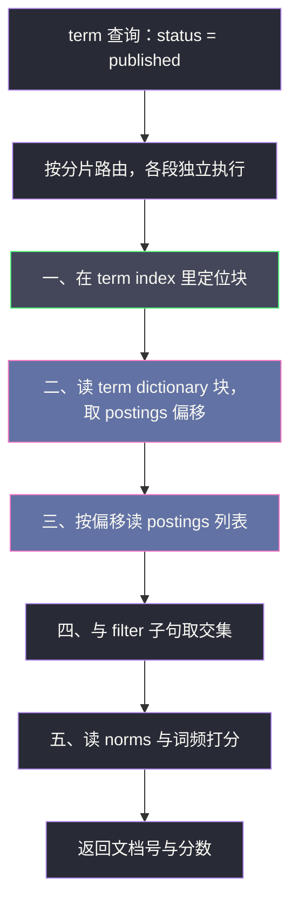
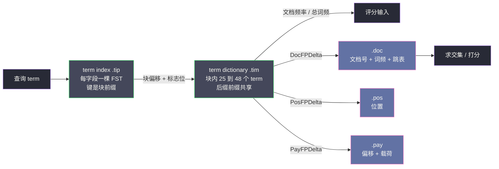
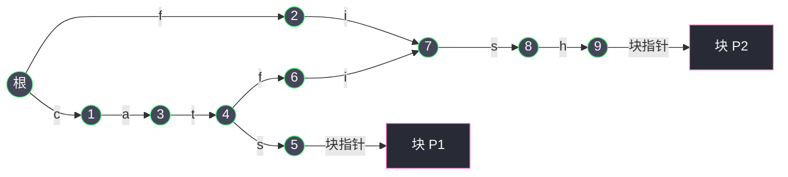
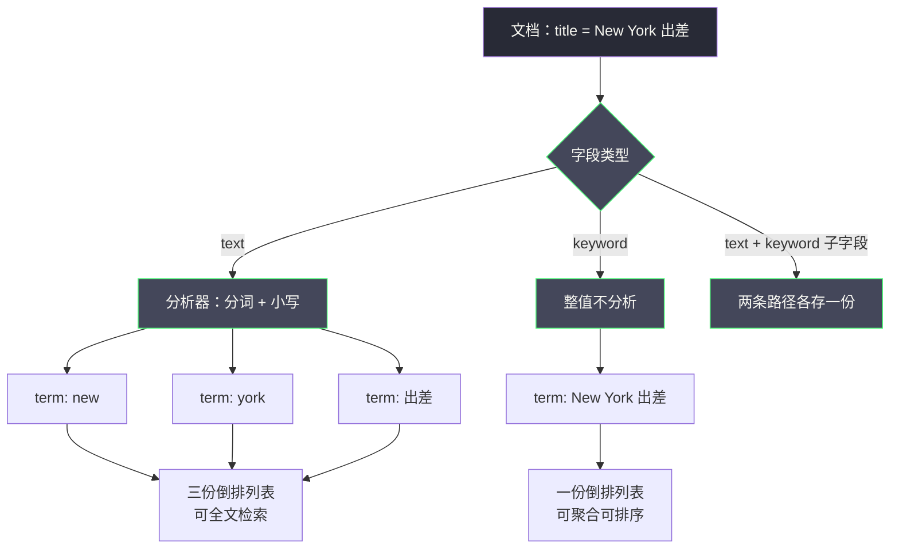
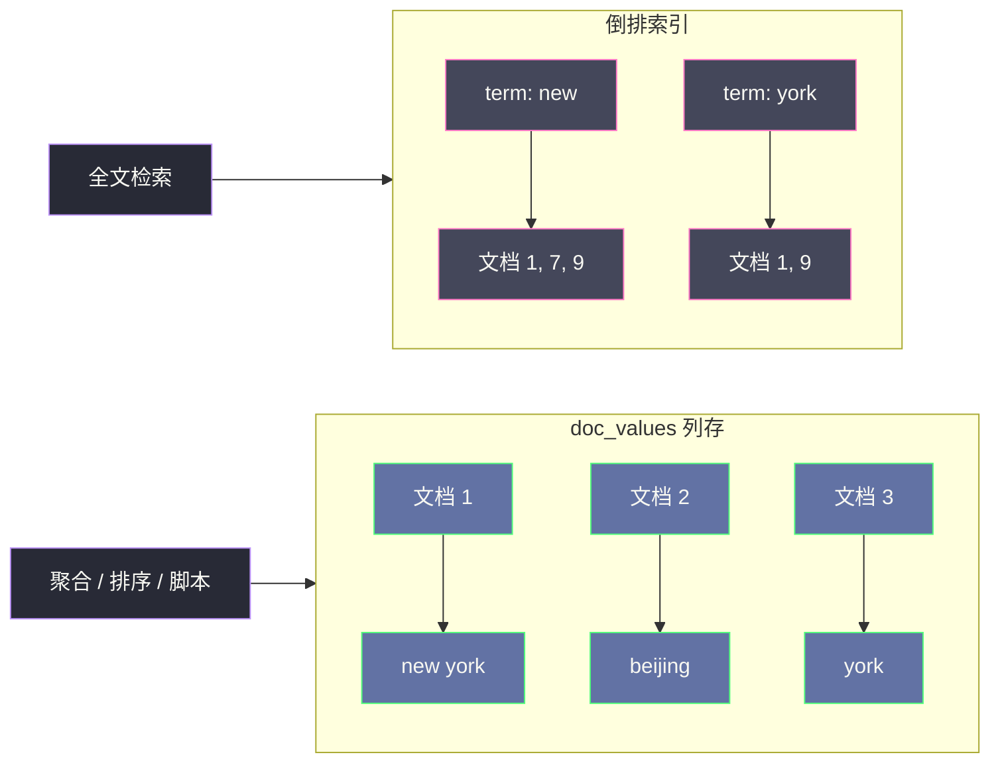
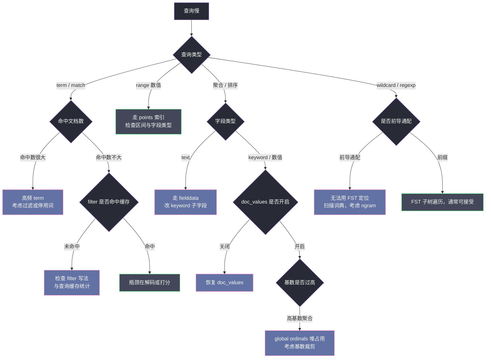

# 倒排索引——从 Term Dictionary 到 FST

**摘要：**

一条 `term` 查询从进入分片到算出分数，中间只隔了几次内存遍历和两次磁盘读取，但这条路径上叠着三种不同的数据结构：负责"term 在哪里"的词典与词典索引、负责"哪些文档命中"的倒排列表、以及负责"怎么排序聚合"的列存。本文沿着一次真实查询的执行顺序，把这三层拆开讲：先说清 term dictionary 为什么按块组织、块内怎么压前缀，再说清 FST 到底索引了什么、它的字节如今落在堆内还是堆外，然后讲倒排列表用定长块加差值编码把文档号压到每篇一到几个比特，以及跳表怎样让交集不必逐篇扫描。后半程转到配置面：`text` 与 `keyword` 的分词差异如何决定查询能不能聚合，`doc_values` 为什么是聚合的真正入口，`norms` 与 `index_options` 各自买到了什么功能、又卖掉多少空间。最后给出一条从"查询慢"到"根因"的判据链，把高频词、`text` 字段聚合、关闭位置信息、超长 `keyword` 这几类现场逐一对上号。文中出现的体量数字均标注为示例推算，只用来对齐量级。

---

## 第 1 章 一次 term 查询到底走了哪几步

### 1.1 从 1999 年的一个 Java 库说起

1999 年，Doug Cutting 在写一个文本检索工具时，需要一个能把"词"和"文档"对应起来的索引结构，他把这套代码开源成 Lucene；十一年后，Shay Banon 在 Lucene 之上包了一层分布式外壳，起名 Elasticsearch。二十多年过去，底层那个核心问题没有换过：给定一个词，怎么在千万级、亿级的文档集合里，用最少的内存和磁盘读，把包含这个词的文档全部找出来。

笔者在排查线上"搜索变慢"的问题时，最常遇到的误解，是把这件事想成一个整体。其实一次 `term` 查询在单个分片内部要跨三个层次，每一层各有自己的失败方式：词典层决定"能不能定位到这个 term"，倒排列表层决定"命中的文档有多少、解码要多久"，评分层决定"要不要读额外的数据给结果排序"。把这三层混在一起看，就很容易把"词典膨胀"误诊成"磁盘慢"，或者把"字段类型选错"误诊成"集群算力不够"。

先看全局。一次落到分片的查询，大致是五步：

图中第一步只走内存里的图结构，第二、三步落在词典与倒排列表的文件上（热的时候是页缓存，冷的时候才是真正的磁盘读），第四、五步在内存里做集合运算与算术。这张图是本文的骨架，后面每一章都在解释其中一格。

### 1.2 五步里的每一步都可能成为瓶颈

第一步的失败形态是"词典太大，索引撑不住"，表现为段数增加后堆外内存吃紧、或者节点启动变慢；第二步的失败形态是"块太碎或太大"，高基数字段尤其明显；第三步的失败形态是"命中的文档太多"，也就是常说的长尾查询，一个 `error` 之类的词命中几百万篇文档；第四步的失败形态是"过滤器没被缓存"，每次都重新解码；第五步的失败形态是"不需要评分却读了评分数据"，或者反过来，需要评分但 `norms` 被关掉了。

这五步的先后顺序不是随意排的。Lucene 把"定位"和"读取"分开，是因为前者靠内存里的稀疏索引就够，后者才需要真正的随机读；把"取交集"放在"打分"之前，是因为打分要读 `norms`，而 `norms` 是每文档一字节的额外数组，能少读就少读。理解这个顺序，才能理解后面所有的调优旋钮为什么存在。

### 1.3 段是不可变的最小执行单位

还有一层结构不能忽略：分片内部由若干段（Segment）组成，每个段是一份独立的、不可变的**倒排索引**。查询时协调节点把请求发给每个分片，分片再对每个段各跑一遍上面五步，最后归并。这意味着"一次查询的成本"近似等于"段数乘以单段成本"，段越多，词典索引占的内存越多，查询的固定开销也越大。段怎么产生、怎么合并，是另一条主线（见 [[03 文档写入与 Lucene 段合并]]），这里只记住一个结论：本章讨论的所有结构，都是按段各存一份的。

---

## 第 2 章 倒排索引的三个组成部分

### 2.1 term dictionary：所有 term 的有序清单

**词项字典（Term Dictionary）**是倒排索引的底座，它按字典序保存某个字段在某个段内出现过的全部 term。排序不是审美选择，而是三项能力的来源：给定 term 做精确查找、给定前缀做范围扫描、给定上下界做区间扫描。若把它做成哈希表，精确查找固然是常数时间，前缀与范围查询就退化成全表遍历，而且每个 term 都要完整驻留内存。

Lucene 的 term dictionary 落在一个叫 `.tim` 的文件里，它不是一条条 term 平铺，而是按块（Block）组织：默认情况下每块装 25 到 48 个 term 或子块引用，同一块内的 term 共享一段前缀，因此只需要存后缀。每个 term 在块里除了后缀，还带三样东西：文档频率（docFreq）与总词频（totalTermFreq）、以及指向倒排列表的偏移量。统计值也有压缩，文档频率为 1 且只出现一次的 term 会被游程编码（连续多个这样的 term 合成一个计数），其余 term 的总词频则按与文档频率的差值存，因为绝大多数 term 的总词频与文档频率很接近。

### 2.2 term index：词典的目录

词典本体再有序也无法整块进内存，于是有了**词项索引（Term Index）**。它是一棵**有限状态转换器（Finite State Transducer，FST）**，位于 `.tip` 文件，每个字段一棵。它的键不是完整 term，而是"块前缀"：FST 的每一条从根到叶的路径，对应 `.tim` 里某一块所覆盖的前缀；路径终点挂着的输出值，是该块在文件中的字节偏移，外加两个标志位——这一块里是否真有 term、这一块是否是拆分出来的子块。

用图书馆打一个比方：词项字典是按序排好的书名清单，词项索引是贴在墙上的索引卡，先看卡片定位到第几排书架，再走过去翻那一小段，而不必从第一本翻起。这个设计带来一个常被忽略的好处：当 term 根本不存在时，遍历 FST 就会失败，于是不必去磁盘上做任何一次 seek 就能返回"没找到"。`Lucene90BlockTreeTermsWriter` 的文档里明确写了这一点：索引同时用来判断某个 term 是否可能存在于磁盘上，从而省掉一次磁盘寻道。对拼写错误、冷门关键词这类查询，这条早退路径贡献了大部分性能。

### 2.3 postings list：文档号与附加信息

**倒排列表（Postings List）**是真正的"倒排"部分：对每个 term，记录包含它的文档号，以及可选的词频、位置、偏移与载荷。文档号必须严格升序，这不是约束而是优化前提——升序意味着可以用差值编码压位宽，也意味着两个列表求交集时只需单向前进，不必做哈希或排序。

附加信息分层存在不同文件里：`.doc` 放文档号与词频，`.pos` 放位置，`.pay` 放偏移与载荷。分文件的好处是按需读取：只做 `term` 匹配的查询完全不碰 `.pos`，做短语查询时才读位置，做高亮时才读偏移。三者的前提是 mapping 里 `index_options` 至少开到了对应档位，这个开关在第 9 章展开。

### 2.4 不分成三层会怎样

不妨做个反事实推想。假如只保留一张哈希表，把 term 直接映射到倒排列表：几千万 term 的字段，每个 term 至少几十字节的字符串，加上哈希表本身的负载因子，堆里放不下，且前缀查询无从下手。假如只保留有序词典、不要索引：每次查找都要在磁盘上做二分，跳一次就是一次随机读，深度约 log₂(千万) ≈ 23 次，单次查询的延迟会从微秒级变成毫秒级。假如把索引做成全量 term 的 FST，不用块：内存占用会随 term 总数线性上涨，而块结构把索引条目压缩到总数的三十分之一上下。

三种结构各司其职，用一张表把它们的职责与代价对齐：

| 维度 | term dictionary | term index | postings list |
|---|---|---|---|
| 存放内容 | term 后缀、文档频率、总词频、倒排偏移 | 块前缀到块偏移的映射 | 文档号、词频、位置、偏移 |
| 文件 | `.tim` | `.tip` | `.doc`、`.pos`、`.pay` |
| 规模量级 | 与 term 数同阶 | 约为块数，即 term 数的三十分之一 | 与 term 与文档的配对总数同阶 |
| 是否可整块驻留 | 否，通常按块读 | 是，体量小 | 否，按需解码 |
| 主要失败形态 | 高基数字段膨胀 | 段数过多导致索引副本增多 | 高频 term 命中过多 |

段内各文件与读取路径的关系，画成图更直观：

由此也就能读懂一个索引目录里那一堆扩展名各自的分工：

| 扩展名 | 内容 | 读它的查询类型 | 是否在 `hybridfs` 下被映射 |
|---|---|---|---|
| `.tip` | 每字段一棵 FST，块前缀到块偏移 | 所有词项类查询 | 是，与词典同组 |
| `.tim` | 词项字典块、统计值、倒排偏移 | 所有词项类查询 | 是 |
| `.tmd` | 字段级统计与 FST 元数据 | 打开段时读一次 | 是 |
| `.doc` | 文档号、词频、跳表数据 | term、match、布尔查询 | 是（落在 term dictionary 一组） |
| `.pos` | 词位置 | 短语、跨度查询 | 是（同上） |
| `.pay` | 字符偏移、载荷 | 高亮、自定义载荷 | 是（同上） |
| `.dvd`、`.dvm` | 列存数据与元数据 | 聚合、排序、脚本 | 是 |
| `.nvd`、`.nvm` | 字段长度归一化因子 | 参与评分的查询 | 是 |
| `.fdt`、`.fdx` | 存储字段，含 `_source` | 取回阶段 | 否，按需读 |

最后一列表述的是 ES 8.x 的默认存储类型 `hybridfs`：按官方文档，它只把 Lucene 的词项字典、`norms` 与 `doc_values` 相关文件做内存映射，其余文件走 NIO。这一列信息很关键，第 4 章讨论 FST 到底占什么内存时会用到它。

---

## 第 3 章 词典为什么要分块

### 3.1 块的大小是压缩率与随机读的折中

把 term 顺序写进文件，最直接的问题是随机访问：要找第 N 个 term，得先知道第 N 个 term 在哪。块结构把"随机访问"变成"两级定位"：FST 给出块的位置，块内再从几十个后缀里挑一个。块大小的默认区间是 25 到 48 个条目，这个数字背后是一种折中——块越大，块内共享的前缀越长、压缩率越高，但每次读进来的无用字节也越多；块越小，随机读的粒度越细，索引条目却变多，FST 也就变大。

块内的存储分三段：先是所有 term 的后缀拼在一起，然后是统计值块，最后是每个 term 的元数据块（倒排偏移等）。后缀这一段并不总是原样存。Lucene 9 会判断是否值得压缩：如果后缀总长度超过条目数的两倍，且块前缀长度大于 2，就尝试压缩；平均后缀长度大于 6 字节时先试 LZ4，省下超过四分之一才采用；否则退回去试一种针对小写 ASCII 的专用压缩。这个策略说明一个事实：词典本身就是被压缩过的，那些"term 存了 120MB，FST 只有 4MB"的对比，分母其实已经是压过的体积。

### 3.2 同前缀太多时的平铺块

块的划分靠"共享前缀"驱动：写入时 term 按序到达，一旦发现某个前缀下攒够了条目（不少于 25 个），就切出一个块。可现实中会出现某个前缀下的 term 远超 48 个的情况，譬如用 `keyword` 存主机名，`web-` 开头的主机可能上万台。这时如果硬塞进一个块，块内线性扫描就会退化成上千次字符串比较。

Lucene 的处理叫**平铺块（Floor Block）**：当某个前缀下的条目超过上限，就按后缀首字节切成多个子块，每个子块仍然只装几十个条目，而 FST 里那个前缀的输出值不再是一个块地址，而是一张"首字节到块地址"的小表。查询时先由 FST 定位到这张表，再用目标 term 在块内的首字节直接跳到对应子块，等于在块内又加了一层索引。这也解释了 FST 输出值里那两个标志位的用途：调用方要知道这一块是否真的装着 term（纯子块引用可以跳过），以及它是不是平铺块。

### 3.3 一次块读的成本有多大

块到底多大，可以从构成估个量级。以 30 个 term、后缀平均 8 字节计，后缀段约 240 字节，统计值段每 term 一到数个字节，元数据段每个 term 若干字节的偏移增量，加上块头，整块通常在数百字节到数 KB 之间。这是一次顺序读，落在页缓存里时是纯内存拷贝，落在磁盘上时也只值得一次预读。拿它和"全词典二分"比，后者每次比较都要读一个块，二十多次比较就是二十多次读，量级差在这里，而不在单次比较的快慢。

块内扫描是线性的，这一点常被诟病。但块内只有几十个条目，比较的是短后缀，且内存连续，实际耗时在纳秒到微秒量级；相比之下，为块内再做二分而引入的额外索引与分支，收益并不明显。源码的 TODO 里其实记着"未来可以把块内后缀做成随机访问数组再二分"，但至今没有成为默认实现，原因就在这笔账上。

### 3.4 反例：把 UUID 塞进 keyword

高基数字段是块结构最不擅长的场景。以 UUID 做 `keyword` 为例，三千多万个互不相同的值，两两之间几乎没有公共前缀，块内共享前缀退化成 0 到几个字符，LZ4 找不到重复串，压缩直接放弃；后缀段长度接近 term 原文，索引条目数按每块三四十个算仍有近百万个，FST 也跟着涨。此时查询单个 UUID 依然快（定位精确、倒排列表只有一条），但整个字段的词典体积、段打开时间、以及每次合并时的重建成本都会显著上升。

更隐蔽的坑是长度上限：Lucene 允许的单个 term 最长 32766 字节，超过就报错，错误信息里带 "immense term" 字样。把整段日志文本、整篇商品描述误映射成 `keyword`，先撞的往往不是这个上限，而是 `ignore_above`——动态映射给字符串的默认值是 256，超过的值被静默丢弃，既不进索引也不报错，表现为"某些文档搜不到"。这类问题的排查方法在第 10 章给出。

---

## 第 4 章 FST：把前缀压成一张图

### 4.1 从 Trie 到有向无环图

理解 FST，先理解它替换掉了什么。前缀树（Trie）把每个 term 拆成字符路径，公共前缀只存一份，这对词典类数据已经是很好的压缩。但 Trie 的节点数仍然与"所有 term 的字符总数"同阶，且每个节点要存子节点指针，指针的开销往往超过字符本身。

FST 在此之上多做一步：如果两个子图结构完全相同，就让它们合并成同一个状态。于是不仅公共前缀共享，公共后缀也共享，整棵树被压成**有向无环图（DAG）**。这一步在自动机理论里叫最小化，落到词典上就是把"mop、top、stop"这类共享尾部 "op" 的词压到一起。再加上它是个转换器（Transducer）：每条边可以携带输出，整条路径的输出拼接起来就是该键对应的值，于是"键到值的映射"也能存进同一张图，不必另建哈希表。

用一组小词示意这种合并，注意两条从不同前缀出发的路径最终汇到同一个状态：

图中 `i → s → h` 这段只存一份，由 `catfish` 与 `fish` 两条路径共用。图是简化示意，实际每个状态的转移按字节排序并以定长或变长编码存储，输出挂在转移上而不是节点上。

### 4.2 Lucene 的取舍：索引只到块前缀

概念上的 FST 很强，但 Lucene 并没有把全部 term 塞进 FST。前文已述，`.tip` 里的 FST 只索引块前缀，键的集合是稀疏的：每三四十个 term 才有一条键。原因在于块内本身已经做了前缀共享，如果 FST 再存完整 term，等于把同一批字符存两遍，而块内那份更省——它可以连续存放、可以整体压缩。

更能说明取舍的是源码里的一行：构建块索引时，FST 编译器的后缀共享被显式关掉，注释写明"块树索引不需要后缀共享，因为后缀大多已被丢弃在 FST 之外，留在了 term 块里"。换句话说，第 4.1 节讲的"共享后缀"是 FST 这个数据结构的一般能力，在 Lucene 的块树索引里被有意放弃了。笔者见过不少文章把"FST 共享后缀"直接套到 Lucene 的词项索引上，严格说并不成立：这里共享的是块前缀，后缀仍留在 `.tim` 的块内。

这个设计还有一层顺带的好处。由于键是前缀而不是完整 term，FST 天然支持区间与通配扫描：给定 `ab*`，在 FST 上从 `ab` 出发遍历子树，就能枚举所有以 `ab` 开头的块前缀，再逐块展开。前缀查询之所以比后缀通配快得多，根源在此，而不是在某个专门的"前缀索引"里。

### 4.3 输出值怎么编码

FST 的输出不是裸指针，而是一个变长字节串，解码后得到一个长整数，低两位是标志位，其余位右移两位得到块偏移：标志位分别表示这一块里是否真有 term，以及这一块是否是平铺块的第一块。偏移之外还要带平铺子块的首字节与相对地址，于是同一个输出可能是一张短表。把偏移左移两位再塞标志位，是为了让相邻块的偏移共享高位，变长编码下能少写一两个字节；这种"省一个字节也要省"的做法，在千万级条目的索引上放大成实实在在的内存差。

### 4.4 它究竟驻留在哪里

这是本篇最需要说清、也最容易说过时的一点。中文技术文章里普遍写着"FST 常驻堆内存"，这句话在早期版本成立：Lucene 6.x 装载词项索引时把 `.tip` 读进字节数组，那确实是 JVM 堆里的对象。但从 7.x 往后，情形变了两次。

第一次变化在存储层。ES 7.3 之后，默认存储类型 `hybridfs` 把词项字典相关文件纳入内存映射，FST 的字节通过 `IndexInput` 直接映射进进程的地址空间，不再反序列化成堆上的数组。第二次变化在 Lucene 内部：8.3 给块树读取器加过 `FSTLoadMode` 开关，用来控制 FST 是读进内存还是从磁盘按需读；到 9.x，`FieldReader` 里那条路径被固定下来，源码注释写得很直白——FST 一律以堆外方式初始化，底层用 `OffHeapFSTStore` 实现，即用文件输入本身充当存储，而不是先在堆上分配。

所以更准确的说法是：FST 常驻的是操作系统**页缓存与内存映射区**，而不是 Java 堆。ES 8.15 背后是 Lucene 9.11，默认 `hybridfs` 下按官方文档只对词项字典、`norms`、`doc_values` 做内存映射。这个区别在实践中很要命：堆外那部分内存照样占物理内存、照样进容器的常驻集（RSS），`-Xmx` 却管不到它；把堆从 16GB 调到 32GB 并不能让词典更快，而给容器加内存限制时如果只按 `-Xmx` 估算，节点会在词典与段元数据涨起来之后被 OOM Killer 干掉。

真正留在堆里的，是每段每字段的读取器对象、字段元信息、统计值、以及倒排读取器的解码缓冲。这些量只随段数与字段数增长，与 term 总数基本无关——按每字段几百字节到几 KB 估，几十个字段、几十个段也就几 MB 量级，与"每个 term 一条记录"的旧模型差了两三个数量级。这也解释了为什么 30GB 堆能服务 TB 级索引：堆里装的是骨架，血肉在页缓存里。于是"堆小数据大"这个判断要落到具体对象上——倒排列表、`_source`、`doc_values` 都不在堆里，堆里只有读取器、元数据与解码缓冲。

想把词典更积极地留在内存里，ES 给的旋钮不是某个 `fst` 参数，而是存储与预读相关的三项：

| 设置 | 默认 | 调大或改变的代价 | 调小或关闭的代价 |
|---|---|---|---|
| `index.store.type` | `hybridfs` | 改成 `mmapfs` 会把更多文件映射进地址空间，虚拟内存占用上升，需调高 `vm.max_map_count` | 改成 `niofs` 后词典文件不再映射进地址空间，FST 只能按需从文件读，随机访问的成本明显上升 |
| `index.store.preload` | 空数组 | 设成 `["nvd","dvd","tim","doc","dim"]` 会打开索引时预读，索引打开变慢、常驻内存上升 | 保持空则完全依赖页缓存，主机重启或大合并后会有一段冷启动期 |
| `node.store.allow_mmap` | `true` | 开着时映射页计入容器内存，虚拟地址空间占用上升，`vm.max_map_count` 要够用 | 关掉后全部走 NIO，堆外映射消失，随机读性能下降 |

表中 `index.store.preload` 是静态设置，官方文档明确说它是尽力而为，且对超过主机内存的索引可能起反作用——大合并之后重新预读会把页缓存冲刷一遍，反而拖慢写入与查询。这类"看起来是优化、实际上是负优化"的旋钮，判断依据只能是索引规模与内存规模的比值。

### 4.5 量级估算

给一个可复算的例子，全部按示例推算理解，不代表任何线上数据。假设某字段一个段内有 1000 万个互不相同的 term，块大小按平均 36 条计，则块数约 28 万，FST 的键也就 28 万条。每条键平均 10 个字符、输出值若干字节，加上转移的编码开销，一条键折合 10 到 20 字节，整棵 FST 落在 3MB 到 6MB 之间。若一个索引有 10 个这样量级的字段，单段 FST 合计 30MB 到 60MB；再按每段一份乘上段数，词典索引的总量就到了百 MB 级。对照之下，1000 万个 term 的原文按平均 12 字节算约 120MB，块内压缩后可能降到几十 MB，FST 与词典原文的比例大约在十分之一到二十分之一之间。

这组数字解释了两种现象。其一，段数少的索引查询更稳，因为每个段都有一份独立的 FST 与词典，段越多，固定开销与页缓存压力越大。其二，只有少量字段需要全文检索的索引，把不需要检索的字段设成 `index: false`、或者用 `keyword` 而不分词，能显著缩小词典规模——省的不只是磁盘，还有页缓存。

---

## 第 5 章 postings 的压缩：定长块、差值、跳表

### 5.1 文档号为什么能压

倒排列表的主体是一串升序文档号。升序带来两个可压缩的性质：相邻文档号的差值远小于文档号本身，且同一段的文档号上限已知。差值编码的道理和电梯里报"再上三层"而不是报"到十七层"差不多，位数省在差上，不省在绝对值上。于是第一步是转成差值序列，第二步是对差值做定长分组编码。

具体到 Lucene 9，编码单位是固定 128 个整数一块，块内所有值用同一个位宽存储，位宽由块内最大值决定。位宽为 0 表示整块同值，直接省掉；位宽小于等于 8 时把 8 个值塞进一个长整数，小于等于 16 时 4 个，其余 2 个，这只是为了让解码时能用少量位运算批量展开，本质仍是位打包。这种"按块统一定宽"的做法通常叫定长块编码，也叫**参考帧编码（Frame of Reference）**——"帧"就是这一块 128 个值的取值范围。

对位置信息，同一定长块编码会换成允许例外值的变体：同样 128 个值一块，但允许最多 7 个离群值单独存放，其余按窄位宽打包，解码时再把这几个例外补回去。原因是位置差值分布很不均匀，大多数相邻位置差 1 到 3，偶尔跨句跨段会出现几十上百的跳变，用整块位宽迁就那几个离群值不划算。

### 5.2 跳表让交集不必逐篇走

两个倒排列表求交集，最朴素的做法是同步前进，一边比一边推，比较次数与两个列表长度之和同阶。命中百万篇文档的 term，这个开销就不能忽略了：即便每次比较只是几条指令，百万次也足够吃掉几毫秒。

**跳表（Skip List）**解决的是"能不能跳过一大段"的问题。Lucene 的跳表间隔与定长块大小相同，都是 128，也就是每个文档块的首部对应一个跳点；跳点再按倍数分层，形成一棵多级跳跃结构。求交集时，若一侧当前文档号远小于另一侧的目标，就可以在跳表上二分式地跳到不早于目标的块，跳过中间所有必然不会命中的文档。文档频率不足 128 的 term 不写跳表数据，因为它根本没有可跳的块。

这套机制也解释了长尾查询的成本结构：真正昂贵的不是"词很常见"，而是"命中的文档数量大"，因为解码与交集是随命中数走的，而位宽压缩只影响存储与带宽，不影响比较次数。

### 5.3 压缩比怎么估

仍以示例推算说明量级。假设段内共有 1000 万篇文档，某 term 命中 100 万篇，平均差值 10。差值最大 10 出头，位宽 4 位，100 万个值占 500KB 左右，相比原始 32 位整数的 4MB，压缩比约 8:1。若这个 term 几乎命中每篇文档，平均差值接近 1，位宽 1 位即可，100 万个值占 125KB，压缩比约 32:1。反过来，若 term 很稀疏，平均差值上千，位宽需要 10 到 11 位，压缩比回落到 3:1 上下。

这里有一个与直觉相反的结论：高频词在存储上往往最省，因为它的文档号最密集、差值最小。真正让高频词变慢的是命中数量与后续的打分、排序开销，而不是它的倒排列表占了多少字节。至于停用词（如英文的 `the`、`a`），问题也不在压缩，而在于它几乎出现在每一篇文档里，查询它等于把整个段扫一遍，这也是"analyzer 要不要去停用词"这个老话题的真实动机。

### 5.4 Roaring Bitmap 的准确位置

很多资料把 Roaring Bitmap 归为倒排列表的压缩手段，这个说法在 Lucene 里并不准确。倒排列表的文件格式由定长块编码、位打包与跳表组成，Roaring 并不参与 `.doc`/`.pos` 的编码；Lucene 里与 Roaring 同源的结构用于缓存查询结果，即把一段"过滤命中的文档号集合"存成自适应位图。

在 ES 里，这个位置就是**节点查询缓存（Node Query Cache）**。它的工作方式是：对处于过滤上下文的查询，按段把命中文档集合缓存下来，下一次同样的过滤条件直接用集合求交，连倒排列表都不解码。官方文档给出的参数是：整个缓存默认占堆的 10%、最多容纳一万条查询，且只在段内文档数不少于一万、命中不少于该段文档数 3% 时才缓存。这个阈值说明小结果集不值得缓存——维护位图的成本超过了重算。

因此"Roaring 加速 Boolean 查询"这句话要限定场景：加速的是被缓存的过滤条件，以及多个过滤条件的集合运算；纯粹的 term 查询在第一次执行时，走的仍是第 6 章那五步里的解码与归并。把这几类压缩手段与缓存结构放到一张表里对比：

| 作用对象 | 手段 | 典型效果 | 代价 |
|---|---|---|---|
| 文档号序列 | 差值编码 + 128 定长块位打包 | 密集列表 8:1 到 32:1，稀疏列表 3:1 上下，均为示例推算 | 解码需要按块展开，块边界固定 |
| 位置序列 | 128 定长块 + 最多 7 个离群值 | 位置差值集中时接近定长块的效果，示例推算省一半左右 | 离群值表带来额外的分支与内存访问 |
| 交集跳转 | 128 间隔的多级跳表 | 大幅减少比较次数，与命中数而非文档数相关 | 跳点本身占空间，短列表不写 |
| 过滤结果集合 | 自适应位图缓存 | 命中缓存时省掉整段解码 | 需要足够热、结果集不能太小 |
| 词典后缀 | LZ4 或小写 ASCII 专用压缩 | 平均后缀越长收益越大 | 只在符合条件的块上启用，读时解压 |

---

## 第 6 章 五步逐段拆解

### 6.1 第一步：在 FST 上定位块

五步的先后顺序像去仓库取货：先查货位表确定第几排货架，再走过去取那一箱，然后开箱清点，最后才登记入账。第一步的输入是 term 的字节序列，输出是 `.tim` 里的块偏移加标志位。实现上是一次字符级的状态转移：从根状态出发，每读一个字节沿对应转移前进，走到键末端时收集输出值。若中途没有匹配的转移，立刻返回"不存在"，不产生磁盘读。

这一层的耗时通常在亚微秒到几微秒量级，取决于键长度与 FST 在不在页缓存里。冷启动时会触发缺页，一个几 MB 的 FST 首次完全载入要几十毫秒，这也是"节点重启后第一波查询变慢"的常见来源之一；`index.store.preload` 的作用正是把这段成本前移到索引打开时。

### 6.2 第二步：读词典块，取倒排偏移

拿到块偏移后，读取该块，在块内按后缀顺序比对，找到目标 term 的条目。命中后一次性取出三样东西：文档频率与总词频（评分要用）、倒排列表在 `.doc` 中的位置、以及位置信息与偏移信息在 `.pos`/`.pay` 中的相对位置。

这些位置在块内是以前后差值的形式存的：第一个条目存绝对位置，后续条目存与前一条的差。这样块内偏移字段普遍很小，变长编码下只占一两个字节。取到之后还需要与字段的索引选项核对——如果这个字段根本没开位置信息，读取器就不会构造位置枚举，`match_phrase` 这类查询在规划阶段就会报错或退化。

### 6.3 第三步：读倒排列表

第三步按偏移读 `.doc`，把文档号与词频解码出来。这里的解码是按块进行的：每次读入 128 个文档号的编码块，按位宽批量展开。对于只需要文档号的查询，词频块可以跳过；对于 `match_phrase`，还要按同一个文档号去 `.pos` 取位置序列并检查相邻性；对于高亮，还要去 `.pay` 取字符偏移。

一个实现层面的优化值得注意：倒排列表的读取是流式的，调用方给一个目标文档号，读取器前进到不小于该号的位置，而不是一次性解出全部。布尔查询因此可以把多个列表的推进交织在一起，谁的当前文档号最小就推谁，命中相同才收集。这套做法的正式名字是**跳跃式交集**，它的成本与"被跳过的块数"相关，而不与列表总长度相关。

### 6.4 第四步：与过滤条件取交集

如果查询里有过滤子句（`filter` 上下文、`bool.filter`、`must_not`），第四步把主查询的命中集合与过滤集合求交。两条实现路径的代价差别很大：过滤集合未命中缓存时，就是两个倒排列表的跳跃式归并；命中缓存时，过滤集合已经是一个位图，主查询只需逐文档检查位图对应位是否置位，省掉一整侧的解码。

这也是"同样一个条件，写在 `must` 和写在 `filter` 里性能不同"的根本原因：`must` 参与评分，第五步必须读 `norms`；`filter` 不评分，第五步可以直接跳过，而且过滤集合还有被缓存的机会。把纯筛选条件放进 `filter`，同时拿到"少读一次 `norms`"和"可能命中位图缓存"两项收益。

### 6.5 第五步：打分

打分需要三样输入：词频（来自 `.doc`）、逆文档频率（由词典里的文档频率算出）、字段长度归一化因子（来自 `norms`，存在 `.nvd`/`.nvm` 中）。BM25 的公式怎么把这三样组合起来是另一条主线（见 [[04 查询与相关性评分——BM25 与向量检索]]），这里只关心读取成本：`norms` 是每文档每字段一字节的数组，按需随机读；如果字段设了 `norms: false`，这一步就只剩词频与逆文档频率，评分退化为不带长度归一化的形式。

如果查询整体不需要评分（`constant_score`、过滤上下文、按字段排序），第五步可以整体省略。这在日志检索场景里是常态：用户按时间排序、按关键词过滤，根本不关心相关性，此时关掉评分、关掉 `norms`，省下的是实打实的每文档一字节的读取。

### 6.6 把五步的账对齐

| 步骤 | 读取对象 | 位置 | 成本随什么增长 | 常见失败形态 |
|---|---|---|---|---|
| 一、FST 定位 | 块前缀到块偏移 | 内存映射或页缓存 | term 长度、FST 条目数 | 冷启动缺页、段数过多 |
| 二、读词典块 | `.tim` 块内后缀与统计 | 页缓存或磁盘 | 块大小、块数 | 高基数字段块膨胀 |
| 三、读倒排列表 | `.doc`，必要时 `.pos`/`.pay` | 页缓存或磁盘 | 命中文档数 | 高频 term 命中过多 |
| 四、过滤取交 | 另一侧倒排列表或位图 | 内存或页缓存 | 过滤集合大小 | 过滤器未被缓存 |
| 五、打分 | `norms`、词频、文档频率 | 内存映射或页缓存 | 命中文档数 | 不需要评分却读了 `norms` |

把这张表和前面那张段内结构图叠在一起看，五步的落点就清楚了：一步在页缓存里遍历图，二步读词典块，三步解码倒排列表，四步做集合运算，五步做算术。一次查询在每段上重复一遍这套动作，段数乘以五步，就是一次请求在单个分片上的总工作量。段合并把多份小词典并成一份，减少的不只是文件数，还有每段一份的 FST 与字典查找次数。

---

## 第 7 章 text 与 keyword：mapping 设计的第一课

### 7.1 分词把一次写入变成多个 term

`text` 字段在写入前要过**分析器（Analyzer）**，分析器由三段串联：字符过滤器做字符级预处理，分词器把文本切成词元，词元过滤器再做小写化、词干还原、同义词扩展之类的加工。一段 `The Quick Brown Fox Jumps Over the Lazy Dog` 经过标准分词器与小写过滤，得到九个词元；如果配置了停用词过滤器，`the` 会被去掉。

顺带纠正一处流传很广的细节：ES 8.x 的标准分析器默认只做小写化，停用词过滤器默认是关闭的，`the` 并不会被自动移除。要复现"去掉 the"的效果，得显式配置 `stop` 过滤器。这个差别直接决定了索引体积与查询行为——保留停用词意味着 `the` 这种 term 的倒排列表覆盖几乎全部文档，第 5 章的压缩分析在这里派上用场：它在存储上很省，在匹配上是灾难。

分词之后，一个字段值变成多个 term，倒排索引里就是"每个 term 各自一条倒排列表"。这是 `text` 与 `keyword` 的第一处分岔：`keyword` 不分析，整值一个 term，`New York` 在索引里是 `New York` 一个词；`text` 分析后是 `new` 与 `york` 两个词。

图中第三条路径是实践中最常见的做法：同一个字段配 `text` 主字段加 `keyword` 子字段，全文检索走前者，聚合排序走后者。代价是同一份原始值被索引两遍，磁盘与写入放大换取了查询能力的完整。

### 7.2 keyword 可聚合，但字典会膨胀

`keyword` 不需要 `fielddata` 就能聚合排序，因为它的列存副本 `doc_values` 默认开启。但整值一个 term 意味着每个唯一值都在词典里占一条：用 `keyword` 存用户 ID、订单号、URL，基数动辄千万级，词典规模直接向 `text` 的 term 总数看齐，而 `text` 的一个词往往被成百上千篇文档共享，词典条目反而少。

`keyword` 还有一个静默失效的开关。动态映射给字符串字段的 `ignore_above` 默认是 256 字符，超过的值既不报错也不进索引。这在日志场景里非常隐蔽：某个服务打了超长堆栈，那几篇文档的该字段就查不到了，而写入返回成功。显式声明 `keyword` 时不会自动带这个值，但一旦显式写了 `ignore_above`，行为相同。

### 7.3 在 text 上聚合必须打开 fielddata

`text` 字段默认不能聚合、排序、脚本取值，直接做会得到一条明确报错，提示 `text` 字段上 fielddata 默认关闭。要打开就设 `fielddata: true`，此时 ES 会把这段被分析后的词元按段反解析、加载进堆，形成一张"文档号到词元序号"的映射，这就是 fielddata 的本质——把倒排索引在内存里反过来用。

它的代价有三重。其一是内存，词元数量是文档数乘以每文档词元数，量级远大于文档数本身；其二是加载延迟，第一次聚合要现建，表现为首查抖动；其三是堆压力，fielddata 的缓存默认不设上限，靠断路器兜底，断路器默认阈值是堆的 40%，一旦触顶查询直接失败。用一个示例推算感受量级：一千万篇文档，某 `text` 字段平均每篇 20 个词元，按每个词元序号 4 字节计，光序号数组就是 800MB 量级，这还没算词元字典与哈希结构。

官方推荐的替代路径是加 `keyword` 子字段，或者用 `fielddata_frequency_filter` 只加载频率在某个区间的词元，减少进堆的量。这两个做法都指向同一个判断：`text` 上的聚合属于例外，不该是常态。

### 7.4 只做匹配的文本字段

如果一个文本字段只用来过滤，不需要相关性排序，也不需要短语精确匹配，可以退一步用 `match_only_text`。它在实现上等价于"只索引文档号、关闭 `norms`"的 `text`：`term` 查询照样走倒排，速度甚至更快，但所有查询返回**常数分 1.0**，短语查询因为拿不到位置，只能回读 `_source` 逐条校验，跨度查询直接不支持。日志的 `message` 字段是它的典型用户：日志检索靠过滤与排序，不靠打分。

三种文本型字段的取舍可以并列看：

| 维度 | text | keyword | match_only_text |
|---|---|---|---|
| 是否分析 | 是 | 否 | 是，固定用标准分析器 |
| 一个值对应几个 term | 多个 | 一个 | 多个 |
| 默认 `doc_values` | 无 | 有 | 无 |
| 聚合排序 | 需 `fielddata`，占堆 | 直接支持 | 不支持排序，聚合支持有限 |
| 短语查询 | 支持，用位置 | 不适用，整值匹配 | 需要回读 `_source`，慢 |
| 评分 | 完整 BM25 | 常数，按整值匹配 | 常数 1.0 |
| 空间 | 中，随词元数增长 | 小，但高基数时词典膨胀 | 最小，只有文档号 |

---

## 第 8 章 doc_values：反方向的列存副本

### 8.1 倒排索引答不了聚合

倒排索引的方向是"term 到文档"，聚合需要的方向恰好相反："逐篇文档读出字段值，再分组统计"。用倒排做聚合，要么把全部 term 的倒排列表都取出来反推文档归属，要么把词元加载进堆重建正排，前者慢且浪费，后者就是 fielddata 的路径，堆代价高。

`doc_values` 就是提前把反向的副本建好：按文档号顺序，把每个文档在该字段上的值连续存放。它在写入时与倒排索引一起生成，读的时候按文档号顺序扫描，天然适合聚合、排序与脚本。两个方向并存，是"写入放大换查询能力"的典型交换。

### 8.2 列存自己也在压缩

`doc_values` 落在 `.dvd` 与 `.dvm` 两个文件，按类型走不同的编码。字符串型（`keyword`）用序数映射：先把去重后的值按字典序排好，用前缀压缩存成一块块的词典（每 16 条一组、组内共享前缀，每 1024 条建一个反向索引以便随机查），再给每篇文档存一个定宽序数。数值型则先看数据形态再选策略：取值范围小就查表，全部值有公约数就先除公约数（日期字段常落到这一档），单调递增就按与预期增量的偏差存，其余情况按与最小值的差值做位打包，必要时切成 16384 个值一块并附上跳表。

还有一层容易被忽略的细节：并非所有文档都有该字段的值，缺失值要单独编码。Lucene 按文档号高位分块，块内稀疏就存短整型数组，半稠密就存位图加秩表，整块全满则干脆不存文档号。这直接决定了"字段填充率"对列存体积的影响：填充率低的字段，列存里有一大块是在描述"哪些文档没有值"。

### 8.3 哪些字段有，哪些没有

`doc_values` 对 `keyword`、数值、日期、布尔、IP、地理坐标等类型默认开启，`text` 类型不提供这个参数——`text` 的分词结果没有"每文档一个值"的语义，只能走 fielddata。所以"为什么这个字段不能聚合"这个问题，答案往往在 mapping 的第一行：类型选错了，后面所有开关都补不回来。

关掉 `doc_values` 省的是磁盘，代价是彻底放弃聚合、排序与脚本取值，只保留检索能力。这个交换只在"写多读少、且确定不做聚合"的字段上划算，譬如只用于过滤的 ID 字段。反过来，为了聚合把 `text` 改成 `keyword` 是有代价的：整值匹配意味着用户搜"数据库"匹配不到"数据库管理系统"，如果两类需求都要，正确做法是子字段而不是类型切换。

### 8.4 聚合慢的三种真相

把"聚合慢"拆开，判据只有三条。第一，字段是 `text`：聚合会走 fielddata，首次加载慢、堆压力大，报错信息里会直接点名 `text` 字段。第二，字段关了 `doc_values`：聚合要么报错要么退化。第三，字段基数太高：`terms` 聚合要为字段建**全局序数（global ordinals）**，基数百万级的 `keyword` 在聚合时会产生可观的堆占用，`eager_global_ordinals` 把这个成本前移到刷新时，缓解首查抖动但不减少总量。

这三条之外的原因通常不在倒排索引层，而在聚合本身的执行模型（见 [[05 聚合分析——Bucket、Metric 与 Pipeline]]）。判断顺序应当是先看类型与开关，再看基数，最后才怀疑数据量与分片数。

---

## 第 9 章 norms 与 index_options：为功能付空间

### 9.1 norms 存的是字段长度

`norms` 保存的是**字段长度归一化因子**，供评分时对长字段降权——一篇 5000 字的详情页命中一次关键词，不该比一篇 20 字的标题命中一次排名更靠前。它的实现是每文档每字段一个字节的编码值，按段存成 `.nvd`（数据）与 `.nvm`（元数据），在 `hybridfs` 下同样走内存映射。

关键在于"每文档每字段一字节"，且没有该字段的文档也占位。一亿篇文档、二十个参与评分的字段，就是两 GB 量级的 `norms` 数据；它不在堆里，但占页缓存，也占容器内存。如果某个字段只用来过滤、从不参与排序，那么这一字节纯属浪费，把 `norms` 关掉是划算的。

### 9.2 关掉 norms 的边界

`norms: false` 可以在已有字段上通过更新映射设置，但方向单一：能关，不能开。更麻烦的是生效时机，关闭只对之后合并出的新段生效，旧段里的 `norms` 要等合并才消失，于是过渡期内同一个字段上，一部分文档有归一化因子、一部分没有，评分会出现不一致。这一点在"先关掉再说"的临时优化里经常被忽略。

判断标准很直接：这个字段的查询是否需要按相关性排序。日志的 `message`、只做精确匹配的 ID 字段、纯过滤的枚举字段，都可以关；商品标题、文章正文这类需要相关性的字段，不能关。

### 9.3 index_options 的四档

`index_options` 决定倒排索引里除了文档号还存什么，四档是层层包含的关系：

| 取值 | 索引内容 | 失去的能力 | 空间代价相对 positions | 适用场景 |
|---|---|---|---|---|
| `docs` | 仅文档号 | 无词频，评分把每次出现当一次；无位置，短语与跨度查询不可用 | 最小，约为 `positions` 的三分之一到一半 | 只做过滤的字段、日志匹配 |
| `freqs` | 文档号 + 词频 | 无位置，短语查询不可用 | 中，约为 `positions` 的一半到三分之二 | 需要相关性评分但不需要短语 |
| `positions`（默认） | 文档号 + 词频 + 位置 | 无字符偏移，高亮需要回读原文 | 基准 | 全文检索的默认选择 |
| `offsets` | 文档号 + 词频 + 位置 + 字符偏移 | 无 | 最大，位置之外再加偏移 | 需要高亮定位、自定义载荷 |

表中的空间比例是示例推算，实际取决于文档长度与位置分布：词越密集，位置信息的差值越小，`positions` 与 `freqs` 的差距就越小；词越稀疏，差距越大。

### 9.4 关掉位置信息的代价

位置信息是短语查询、跨度查询、间隔查询的前提。在普通 `text` 字段上关掉位置信息，`match_phrase` 不会静默降级，而是在规划阶段直接抛错，报错信息里会写明该字段没有位置数据、无法执行短语查询。能静默降级的只有 `match_only_text`：它同样不存位置，但会回读 `_source` 逐条校验短语，把一次倒排查询变成一批存储读取，延迟上升一个量级。

高亮是另一个隐性依赖。字符偏移存在 `.pay` 里，`offsets` 档位会把它写进去；没有偏移，高亮器只能重新分析原文再定位，代价随命中数增长。这意味着"为省空间关掉 `offsets`"这个决定，实际影响的是高亮功能的延迟，而不是正确性，症状是"高亮还能用，但慢了很多"。

---

## 第 10 章 查询慢的判据链

### 10.1 先分清走的是哪套结构

判断慢查询的第一刀，是把它归到哪套索引结构上。`term`、`match`、`prefix`、`wildcard` 走词项字典与倒排列表；数值与日期的范围查询走独立的 points 索引（KD 树家族，文件不在 `.tim` 一组里）；聚合、排序、脚本走 `doc_values`；向量检索走 HNSW 图索引；`regexp`、`fuzzy` 与前导通配走自动机在词典上的遍历。走错结构去调另一个结构的参数，是最常见的白费功夫。

举个具体差别：`range` 查询在数值字段上并不遍历词典里的所有取值再求并集，而是直接在 points 索引上做区间裁剪，取出覆盖该区间的文档号位图；同一个条件写成 `term` 组合，才会退回到"取若干 term 的倒排列表再合并"。这也是为什么把时间范围条件交给 `range` 比手工枚举时间戳更快。

### 10.2 判据链

真正的排查顺序应当从"结构"收敛到"开关"，再收敛到"数据分布"。下面这条链把第 3 章到第 9 章的判据串起来：

判据链的每一段都对应一个可以查证的现场证据，把它们整理成表：

| 现象 | 先查什么 | 判据 | 常见根因方向 |
|---|---|---|---|
| 命中总数很大、`took` 随数据增长 | 命中文档数 | 单个 term 覆盖该段大部分文档 | 停用词、过宽的过滤条件 |
| 聚合报错提示 fielddata 关闭 | 字段类型 | 类型是 `text` | 应加 `keyword` 子字段 |
| 聚合首查抖动、堆曲线抬升 | 字段基数与 `fielddata` | 堆增长与聚合次数相关 | `text` 聚合或高基数 |
| 过滤器重复执行仍不快 | 查询缓存统计 | 缓存命中率低、驱逐数高 | 结果集过小不缓存、缓存被挤 |
| 通配查询延迟随词典增长 | 通配位置 | 前导通配无法用 FST 定位 | 需要 ngram 或 `wildcard` 类型 |
| 高亮很慢 | 索引选项 | `index_options` 未到 `offsets` | 高亮回读原文 |
| 排序报错或顺序不对 | `doc_values` | 字段无列存 | 类型是 `text` 或关了 `doc_values` |

### 10.3 几个典型现场

第一类是高频词。查询 `error` 这类词，命中数可能占全段一半以上，解码与打分都按命中数走，延迟自然上去。此时优化方向不是索引结构，而是查询本身：加时间范围收窄、用 `filter` 去掉评分、或者干脆把该字段改成 `match_only_text` 换取常数分与更小的索引。

第二类是 `text` 字段聚合。报错信息明确写着 fielddata 默认关闭；若有人为了"先跑通"打开了 `fielddata`，症状会从报错变成堆上涨与 GC 变频繁，并且首查抖动明显。这类问题的修复是 mapping 层面的，不是查询层面的。

第三类是前导通配。`*order*` 这种模式无法在 FST 上定位起点，只能遍历词典里所有块前缀，再逐块展开比对，成本随词典规模线性增长。前缀通配 `order*` 则可以在 FST 上从 `order` 出发遍历子树，两者复杂度不在一个量级。需要任意位置匹配时，正确做法是写入时用 ngram 分析器把词拆成子串，把"扫描"换成"精确匹配"。

第四类是过滤缓存未命中。过滤条件如果写在一个每次参数都变的查询里（譬如把时间戳拼进过滤条件），每次都是新查询，缓存永远不命中；反过来，如果过滤结果命中的文档不足该分片文档总数的 3%，或者所在段的文档数不足一万，缓存机制本身就不会接管。查证方式是看节点的查询缓存统计：命中数、未命中数、驱逐数这几项的组合能直接说明问题。

### 10.4 一个查询的账

按示例推算走一遍。某索引 5 个分片，每个分片 6 个段，一次 `term` 查询命中约一万篇文档。词典定位在 30 个段上各做一次，耗时在几十微秒量级；词典块读取每段一次，块大小几 KB，若热在页缓存就是内存拷贝；倒排解码按命中数走，1 万篇文档分布在 30 个段上，每段三四百篇，大约每段解码三到四个块，合计百来个块的位运算；然后是打分，读一万次 `norms` 的随机字节。总量落在几毫秒到十几毫秒，其中解码与打分占大头。

如果这个查询被写成 `text` 字段上的聚合，账就换了一套：除了上面的检索成本，还要为每个段构建一次 fielddata，一千万文档的字段在首次聚合时可能消耗数百毫秒与数百 MB 堆，之后靠缓存复用，直到段合并让缓存失效。这两笔账的数量级差，正是"结构决定成本"最直白的例子。

---

## 第 11 章 反例与边界

### 11.1 在 text 字段上做聚合

最典型的反例，也是新项目里最常见的一处。电商商品表把类目名、品牌名都映射成 `text`，因为要支持"按词搜索"；上线后要按品牌出报表，于是打开 `fielddata`。前几个月数据量小，一切正常；数据涨到千万级后，堆开始周期性被打满，GC 停顿影响所有查询。

根因不是 `fielddata` 本身有 bug，而是它把"词典规模乘以文档数"的数据搬进了堆。正确做法是回到 mapping：给品牌加 `keyword` 子字段，聚合走子字段，检索仍走 `text` 主字段。已经建好的索引要改字段类型只能重建（或加新字段后回填），这个迁移成本应当在设计阶段就用"这个字段将来要不要聚合"这个问题挡掉。

### 11.2 为省空间关掉 positions 却要短语查询

第二个反例更隐蔽。有人算过一笔账，发现 `.pos` 占了索引体积的三成，于是在重建索引时把正文的 `index_options` 调成 `freqs`。上线后单词检索仍然正常，但"精确短语"的需求一出现就露馅：`match_phrase` 直接抛错，报错信息指向字段没有位置数据，业务侧只能改成脚本校验或回读原文，延迟从毫秒级掉到百毫秒级。

这类决定危险在回退成本。`index_options` 是建索引时的参数，改它意味着重建索引；等短语需求出现再回头，要么重建，要么让业务侧绕开短语查询。判断标准很简单：只要存在短语、跨度、间隔查询或高亮需求，位置信息与偏移就不能关。

### 11.3 把超长文本塞进 keyword

第三个反例是类型用反。日志的 `message` 字段本应分词，却因为"要精确匹配整条日志"被映射成 `keyword`。后果是三层叠加：一是词典膨胀，每条日志几乎都是唯一的 term，压缩率极低；二是长度上限，超过 32766 字节的 term 直接写入失败，报错里带 immense term 字样；三是匹配语义变差，用户搜"连接超时"匹配不到含该短语的日志，因为整条日志是一个 term。

更好的做法是 `match_only_text` 或普通 `text` 加 `keyword` 子字段做精确匹配，检索与整值匹配各走各的结构。

### 11.4 高基数 keyword 的聚合

第四个反例不是错误配置，而是规模判断失误。给一个千万级基数的用户 ID 字段做 `terms` 聚合取前十条，看上去只输出十行，实际要为整个字段建全局序数：每个段的局部序数要先映射到全局序数，这份映射的规模与基数同阶。基数越高、段越多，构建越慢、堆占用越大，而且是每轮聚合都碰一次。

缓解手段有两条：一是限制聚合的候选集合，先在查询里用过滤条件把范围缩小；二是调整刷新策略，用 `eager_global_ordinals` 把构建成本前移到刷新时，避免首查长尾。两条都不改变"基数高就要付代价"这个事实，只是把代价挪到更能接受的位置。

### 11.5 边界之外

还有几处边界不属于本篇，但判断时需要知道。段不可变意味着删除只是打标记，被删文档仍占倒排列表的位置，直到合并重写；写入路径上的 refresh、flush、merge 决定了段的数量与词典的份数（见 [[03 文档写入与 Lucene 段合并]]）。相关性评分的完整推导、向量检索的图索引，是另一条线（见 [[04 查询与相关性评分——BM25 与向量检索]]）。mapping 的字段级调优与堆外内存规划，在调优篇里展开（见 [[07 性能调优——Mapping 设计、查询优化与 JVM]]）。

---

## 第 12 章 结构决定查询的形状

把本篇拆过的三层合起来看，能得到一个比"倒排索引很快"更有用的结论：查询的形状由它经过的结构决定，而结构在写入时就定好了。词典与 FST 决定了"定位一个词"有多快，倒排列表的编码决定了"命中很多文档"有多贵，`doc_values` 的有无决定了"能不能聚合"，`norms` 与 `index_options` 决定了"能不能评分、能不能短语、能不能高亮"。这四件事在创建索引的那一刻就已选定，查询阶段的优化只能在既定结构上做减法，做不了加法。

由此也能看出那些开关的真实性质。`doc_values`、`norms`、`index_options` 都不是"高级选项"，而是"**用空间买功能**"的报价单：关掉 `doc_values` 省下的是磁盘，卖掉的是聚合与排序；关掉 `norms` 省下的是每文档一字节，卖掉的是长度归一化；把 `index_options` 降到 `docs` 省下的是位置与词频，卖掉的是短语查询与词频评分。报价单上的每一项，都要先确认将来不会用到，才值得签字。

FST 的位置变化则是另一种性质的演进。它从"堆内数组"变成"堆外映射"，改的不是算法而是内存归属：查询依然快，因为页缓存替它承担了常驻；但容量规划必须跟着改，`-Xmx` 不再是唯一要看的数字，容器的常驻集、`vm.max_map_count`、页缓存与索引体积的比例都要一起算。很多人对"堆小数据大"的困惑，根子就在这里——堆里是骨架，页缓存里是血肉，算错了哪一头，都会在数据量上来之后付出代价。

至于"哪种索引结构更好"，本篇没有给出、也不该给出答案。块结构在压缩率与随机读之间取向中庸，FST 在内存与功能之间取向精巧，列存在写入放大与查询便利之间取向实用，三者叠加才构成一个可用的搜索引擎；换任何一种，都会在某类查询上更好、在另一类上更差。真正需要判断的，是当前这份数据将要被怎么查询，然后据此选结构、定开关，并在数据规模变化时重新审视这个判断。

---

## 参考资料

1. Apache Lucene 9.11，`Lucene90BlockTreeTermsWriter.java`：块结构、平铺块、后缀压缩与 FST 构建参数。https://github.com/apache/lucene/blob/releases/lucene/9.11.1/lucene/core/src/java/org/apache/lucene/codecs/lucene90/blocktree/Lucene90BlockTreeTermsWriter.java
2. Apache Lucene 9.11，`FieldReader.java`：FST 以堆外方式初始化。https://github.com/apache/lucene/blob/releases/lucene/9.11.1/lucene/core/src/java/org/apache/lucene/codecs/lucene90/blocktree/FieldReader.java
3. Apache Lucene 9.11，`Lucene99PostingsFormat.java`：定长块、跳表间隔与文件布局。https://github.com/apache/lucene/blob/releases/lucene/9.11.1/lucene/core/src/java/org/apache/lucene/codecs/lucene99/Lucene99PostingsFormat.java
4. Apache Lucene 9.11，`Lucene90DocValuesFormat.java`：列存编码策略与缺失值处理。https://github.com/apache/lucene/blob/releases/lucene/9.11.1/lucene/core/src/java/org/apache/lucene/codecs/lucene90/Lucene90DocValuesFormat.java
5. Elasticsearch 8.15 文档，Store：`hybridfs` 映射哪些文件、`index.store.type` 与 `node.store.allow_mmap`。https://www.elastic.co/guide/en/elasticsearch/reference/8.15/index-modules-store.html
6. Elasticsearch 8.15 文档，Preloading data into the file system cache：`index.store.preload` 的默认值与建议取值。https://www.elastic.co/guide/en/elasticsearch/reference/8.15/preload-data-to-file-system-cache.html
7. Elasticsearch 8.15 文档，`norms`：每文档每字段一字节的开销与关闭方式。https://www.elastic.co/guide/en/elasticsearch/reference/8.15/norms.html
8. Elasticsearch 8.15 文档，`index_options`：四档位包含关系与默认值。https://www.elastic.co/guide/en/elasticsearch/reference/8.15/index-options.html
9. Elasticsearch 8.15 文档，Text type family：`fielddata`、`match_only_text` 与 multi-fields。https://www.elastic.co/guide/en/elasticsearch/reference/8.15/text.html
10. Elasticsearch 8.15 文档，Node query cache settings：查询缓存的容量、条目上限与缓存门槛。https://www.elastic.co/guide/en/elasticsearch/reference/8.15/query-cache.html
11. Elasticsearch 8.15 文档，Circuit breaker settings：fielddata 断路器默认阈值。https://www.elastic.co/guide/en/elasticsearch/reference/8.15/circuit-breaker.html
12. Apache Lucene JIRA，LUCENE-8671：FST 堆内与堆外加载开关的引入背景。https://issues.apache.org/jira/browse/LUCENE-8671

---

> [!note] 思考题
> 1. 一次 `term` 查询在每段上都要跑一遍五步。若把索引的段数从 30 降到 5，五步里哪几步的收益最大、哪几步几乎不变？如果索引只写不读、只读不写，段数策略应当怎么调整？
> 2. FST 从堆内数组变成堆外映射之后，"内存够不够"这个问题的判断依据变了。假设节点堆 16GB、索引 2TB、容器内存限额 24GB，你会怎样估算页缓存需要多少、映射区需要多少，又该不该打开 `index.store.preload`？
> 3. `fielddata` 与 `doc_values` 都能让聚合跑起来，但一个在堆里、一个在磁盘上。什么数据规模下 `fielddata` 是可以接受的，什么规模下它一定会成为事故？
> 4. 关掉 `norms` 只对之后合并出的新段生效，过渡期内同一字段上的评分会不一致。这类"延迟生效"的配置还有哪些，运维上应该用什么顺序操作来规避？
> 5. 前缀通配 `order*` 与前导通配 `*order*` 在 FST 上的执行代价差别极大。若要支持"任意位置子串匹配"且保持毫秒级，你会选 ngram 分析器、`wildcard` 字段类型，还是写入时预计算，各自的索引膨胀代价如何估？