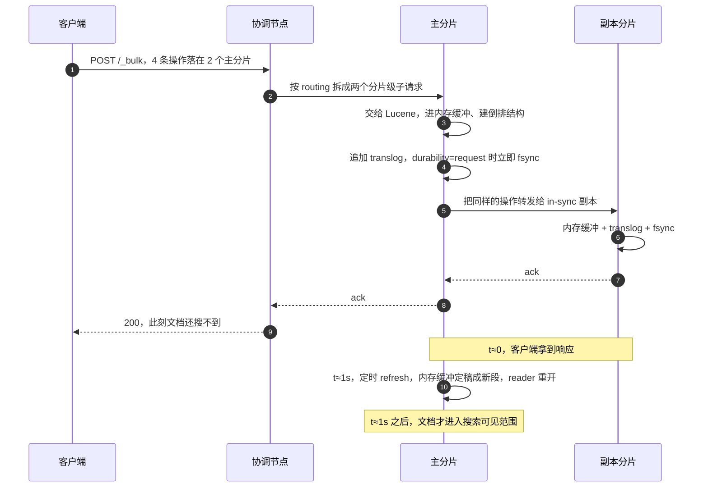
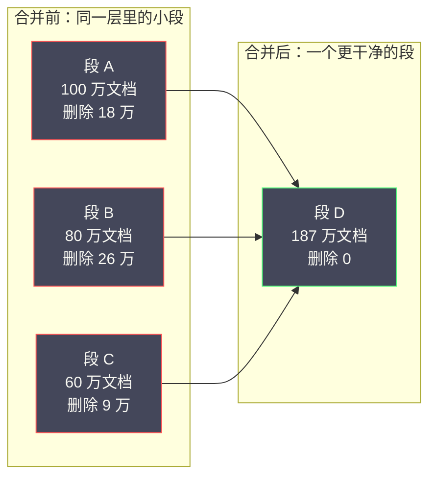
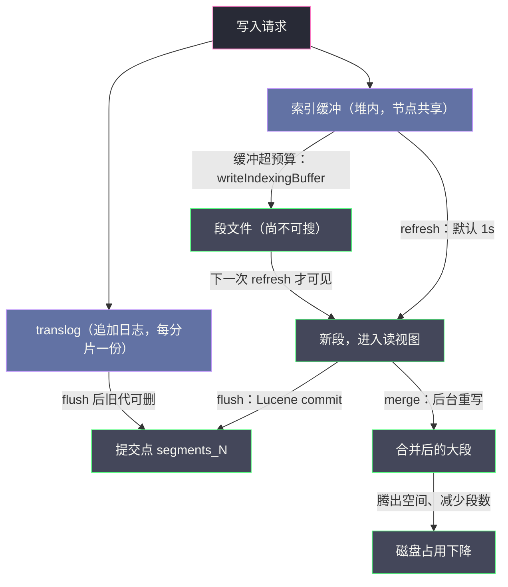
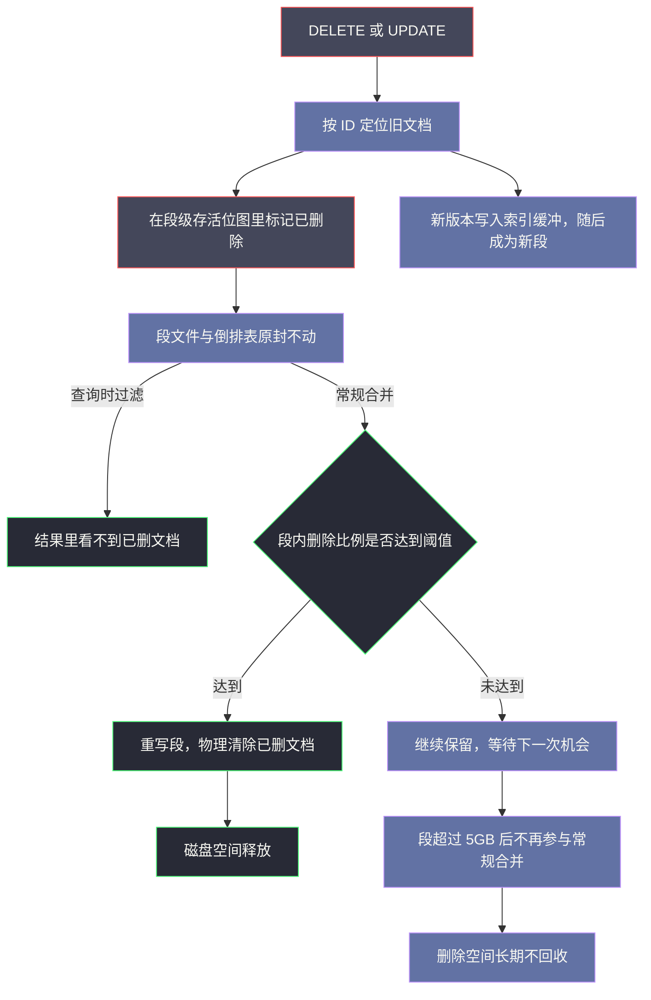
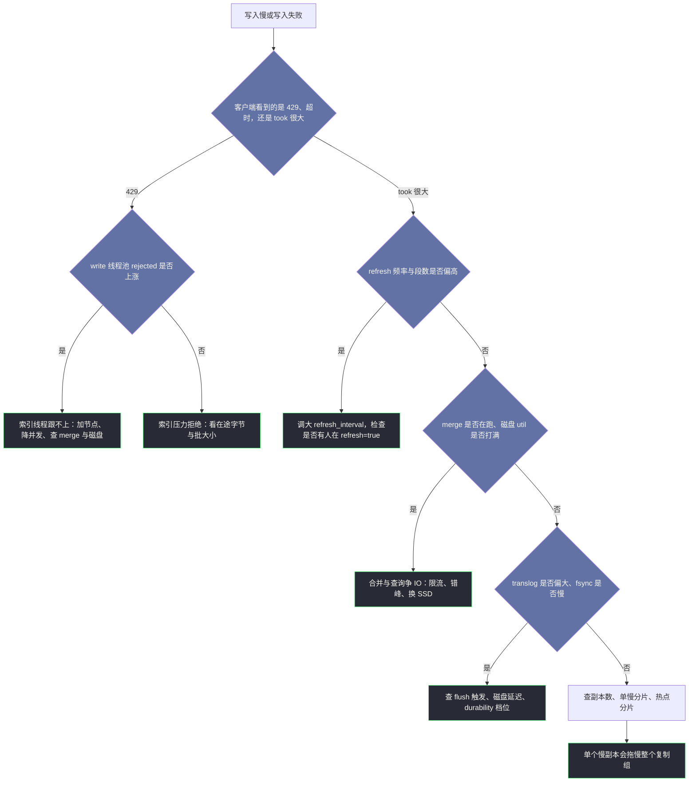

# 03 文档写入与 Lucene 段合并

**摘要：**

值夜班时被问得最多的一类问题是"我明明写进去了，为什么搜不到"，第二多的是"我删了两千万条，磁盘怎么一点没降"，第三多是"重启会不会丢数据"。这三个问题听起来都关于写入，答案却分属三条互不相干的机制：可不可搜由 refresh（刷新）决定，断电后还在不在由 translog（事务日志）与 flush（提交）决定，磁盘空间与查询效率由 merge（段合并）决定。本文沿着一次真实写入的路径把这三条线拆开：先说清协调节点如何按 routing（路由）把请求送到主分片，主分片如何先让 Lucene 在内存里建段、再把操作追加进 translog、最后等所有 in-sync（同步中）副本确认才返回；再逐一解剖 refresh、flush、merge 各自的触发条件、真实动作与代价，并把三者做成一张对照表，回答"什么时候动哪一层"。后半程落到工程面：为什么更新在 Lucene 里等于删加增、为什么删除标记的空间要等合并才回收、`_source` 与 `stored_fields` 各自买到了什么、写入性能的四个旋钮如何互相抵消、`_bulk` 的批大小与部分失败的判据，最后给出一条从"写入慢"到根因的判据链。文中涉及的量级数字均标注为示例推算，只用来对齐账目，不代表任何基准测试结论。

---

## 第 1 章 三个问题，三件事

### 1.1 同一个"写"，三种时间尺度

一位同事在凌晨两点问你：文档已经返回 201 了，为什么搜索页面上还是旧价格。这个问题如果答"因为 ES 是近实时的"，等于什么都没说。要答得清楚，得先把"写"这个动作拆成**三条彼此独立的时间线**：文档什么时候对搜索可见，什么时候在断电后还能恢复，什么时候占用的磁盘空间才会被回收。这三条线的推进速度差了一个到三个数量级，而被同一条写入路径触发。

换一个比方，饭店后厨收到一张订单：菜做好端上桌，是"可搜"；订单小票归档进台账，是"可恢复"；后厨每隔一段时间把散落在案板上的边角料清走、把几只小碟子拼成一只大盘子，才是"回收空间"。三件事都由"来了一单"引发，但没有一件跟着另一件同步发生。

### 1.2 一条写入的时间线

先看全程。下面这张时序图画的是一次 `_bulk` 请求从进入集群到"能被搜到"的完整路径，图中的时间刻度是默认配置下的典型值，不是承诺值。



这张图上能读出三件事。第一，客户端拿到 200 的时刻，文档已经进了内存索引、也进了 translog 并被 fsync，但还没有成为"段"，所以搜索看不到它。第二，主分片不是等到副本回包才写本地，而是本地写完再转发，副本的写延迟直接算进这一次请求的响应时间。第三，refresh 与前面所有步骤都没有因果关系，它只是按自己的节拍走。

### 1.3 如果只有一件事会怎样

反过来说，假如 Lucene 允许像关系库那样"就地更新一行"，并把这次更新同步刷到磁盘，世界会简单很多：写完即持久、写完即可见、改一行就释放一行空间，三个问题一次解决。代价在三处。其一是磁盘写模式从顺序追加变成了随机覆盖，机械盘上的随机写吞吐会掉一到两个数量级；其二是倒排索引的词典、倒排表、列存、长度归一化是四份物理上分开的结构，跨结构做原子修改需要一把覆盖全部结构的锁，并发写入会被这把锁压死；其三是正在被读的文件如果同时被改，校验和、页缓存、并发读三件事全部失去保证。这三个代价合起来，结论是搜索引擎宁愿接受"写进去不能立刻搜、删掉不能立刻省空间"，也不愿放弃"段一旦落盘就不再变"这个前提。

Lucene 的取舍由此定型：段（Segment）是只追加的、不可变的文件集合，所有的修改都表现为"新写一份、把旧的标成无效"，再靠后台的整理机制把无效的部分真正清掉。理解了这一点，后面 refresh、flush、merge 三者的分工几乎是必然推导出来的：可搜性靠"让搜索看到一个包含新段的新视图"，持久性靠"一个独立的、顺序写的日志"，空间与效率靠"定期把多个段重写成一个"。

---

## 第 2 章 请求从哪来：协调、路由、主分片

### 2.1 协调节点不写数据

一条写入请求先落到某个节点，这个节点在这一刻扮演**协调节点（Coordinating Node）**，它的职责只有三件：算出每个文档该去哪个主分片、把请求拆成分片级子请求、把各分片的回包合并成一个响应。它自己不碰 Lucene，也不碰 translog。这也是为什么协调节点宕机通常只影响"正在路上的请求"，不会影响数据完整性。

分片级子请求是并行的。一个 `_bulk` 里若有一万条文档散落在二十个主分片上，协调节点会并发发出二十个子请求，每个子请求在本分片内按顺序执行。这个细节解释了后面 `_bulk` 章节的一个现象：批大小不是越大越好，因为一个大批次会在协调节点上同时压出很多条子请求，而每个子请求的字节数都要在协调节点上被记账、被排队、被限流。

### 2.2 routing 决定去哪个分片

路由公式本身很短，默认按文档 `_id` 计算哈希：

```
shard_num = hash(_routing) % number_of_primary_shards
```

`_routing` 缺省取 `_id`，也可以在写入时显式指定，把"同一租户、同一订单"这类需要共处一地的文档钉到同一个分片上。公式里那个分母是整个设计里最不肯让步的地方：分母一变，几乎所有文档的归属都要重算，所以主分片数只能在建索引时定下，事后要用 `_split`、`_shrink` 或重建来换。完整的推演与三条绕路在 [[01 ES 全局架构——集群、节点、索引与分片]] 里，本篇只需要记住一个后果——分片数决定了写入的并行度上限，也决定了一个 `_bulk` 会散成多少个子请求。

落到分片这一级之后，同一分片上的写入并不是自由并发。每条写操作都会拿到一个递增的 `_seq_no` 与当前的 `_primary_term`，主分片用它维持操作顺序，客户端用它做乐观并发控制。这里的 `_seq_no` 还有第二个用途：副本追赶主分片时，就是靠"我最后一条是第 N 号，请从 N+1 开始发"来续传的。顺序号不只是给业务用的版本号，它同时是复制协议的游标。

### 2.3 主分片的本地写入顺序

主分片拿到子请求后，对每条文档做两件事：交给 Lucene 处理，然后把操作追加到 translog。这两件事的先后顺序值得单独说，因为它和教科书上的 WAL（Write-Ahead Log，预写日志）教条相反。ES 8.15 的官方文档写得很直白：所有的索引与删除操作，"在被内部 Lucene 索引处理之后、在被确认之前"写入 translog。

这个顺序不是笔误。先走 Lucene 的理由是校验前置：字段超长、类型不匹配、分词器抛错，这些失败都发生在 Lucene 处理阶段，一旦失败就没有必要污染日志；如果反过来先写日志，日志里就会沉积一批永远不会生效的操作，恢复时还得再筛一遍。耐久性并没有因此打折，因为真正承诺给客户端的那个点不是"内存索引完成"，而是"translog 追加并 fsync 完成"——它依然严格地发生在返回 200 之前。

顺序颠倒带来的实际差别在失败路径上。内存索引成功而 translog 追加失败，这在实现里被视为分片级故障：这次写入不能算成功，分片会走失败与恢复流程，而不是带着一段"搜得到但恢复不了"的数据继续服务。具体处理方式随版本变化，判断时以对应版本的源码与日志为准。

---

## 第 3 章 内存里的那一段：索引缓冲与它的账

### 3.1 IndexWriter 的待定段

Lucene 的写入入口是 `IndexWriter`。文档进来后并不是直接写文件，而是进入一个待定段（pending segment，内部叫 DWPT，DocumentsWriterPerThread），在这里完成分词、把 term 写进内存里的词典与倒排、把字段值写进列存缓冲。这个阶段的数据只在堆里，文件系统上什么都没有。

这里有一笔容易被忽略的账：**索引缓冲是节点级共享的**，不是分片独占的。`indices.memory.index_buffer_size` 默认取堆的 10%，由这个节点上所有"正在活跃写入"的分片共享；如果这个值是百分比，还会被 `indices.memory.min_index_buffer_size`（默认 48MB）托底，被 `indices.memory.max_index_buffer_size`（默认不设）封顶。官方调优文档给的经验值是——单个重度写入的分片给到 512MB 缓冲就基本到顶，再多收益很小。

常见的误读是把那个 512MB 当成硬上限，于是把 `index_buffer_size` 设成 20GB 的堆、20% 就以为每个分片能吃到 4GB。真实情况是：堆 10GB、默认 10% 意味着全节点共享 1GB 缓冲，按官方说法这只够两个重度写入的分片吃饱；分片数一多，缓冲被摊薄，每个分片能攒的待定段就更小，段就更多。

### 3.2 缓冲满了会发生什么

答案不是 refresh。节点上的 `IndexingMemoryController`（IMC）每隔 `indices.memory.interval`（默认 5 秒）检查一次，并在累计写入字节超过预算的 1/128 时提前触发检查；一旦总占用超过预算，它挑出一批分片，调用 `shard.writeIndexingBuffer()`，把这些分片堆里的待定段写成磁盘上的段文件。这段逻辑刻意挂在索引线程上执行，目的就是让内存立刻能回收，代价是 `_bulk` 的毛刺会变高——源码注释里把这笔代价写得很明白。

关键在于：**写出段文件不等于可搜**。段文件躺在文件系统里，只要搜索用的 reader 没有重新打开，它就还在搜索视野之外。所以"导入数据时关掉 refresh，段文件却一直在涨"是正常现象，那涨的是 IMC 与 Lucene 自己写出去的段，与 refresh 无关；这些段要等下一次 refresh 才进入可见范围。这一条辨析能省掉大量误判，尤其是把"段多"直接归咎于 refresh 调得太勤的时候。

同一条通路上还有反压。当"正在写盘的字节 + 堆里还没写的字节"超过预算的 1.5 倍时，IMC 会对最吃内存的分片打开写入限流（throttle），把索引并发压到单线程，等追赶上来再放开。日志里出现 `now throttling indexing for shard [...]` 与随后的 `stop throttling indexing` 时，说明写入侧已经跟不上段落盘的速度。

### 3.3 显式 ID 与自动 ID 的差别

`_id` 由谁给，直接决定写入路径上多不多一次查找。自动生成 ID 时，ES 不必检查同 ID 文档是否已存在，直接当新文档写入；显式给 ID 时，为了维持"后写覆盖先写"的语义，必须先在版本图里查到旧版本、把它标成删除，再写新的。官方调优文档把这条列为独立的优化项，原因就在这里——显式 ID 的写入成本里，含了一次按 ID 的查找，而且这次查找随索引规模变贵。

这条差别也解释了为什么日志类场景偏爱自动 ID：日志天然按时间追加，不需要覆盖语义，省掉查找就是纯收益。反过来，业务主键型索引绕不开显式 ID，那就把成本算进容量规划，而不是指望调参抹平。

---

## 第 4 章 Translog：耐久性的两档与代价

### 4.1 它到底承诺了什么

translog 是每个分片一份的追加日志，记录的是"自上次 Lucene 提交以来"的所有索引与删除操作。它存在的唯一理由是：Lucene 的提交（commit）太贵，不可能每次写完都做一次，而两次提交之间的数据一旦进程崩溃就会被 Lucene 丢掉。于是 ES 在"Lucene 处理完"和"给客户端回包"之间插进一条日志，把这段可靠性窗口补上。

两档耐久性就是"这条日志什么时候 fsync"的选择，官方的语义说得很清楚：`request` 档下，ES 只有在 translog 已经在主分片和每一个已分配副本上成功 fsync 并提交之后，才会向客户端报告成功；`async` 档下，fsync 交给后台按 `index.translog.sync_interval`（默认 5s，下限 100ms）执行，崩溃时自上次自动提交以来的写入都会被丢弃。

| 档位 | fsync 时机 | 崩溃可能丢什么 | 写入吞吐 | 适用判断 |
|:---|:---|:---|:---|:---|
| `request`（默认） | 每个索引/删除/更新/批量请求之后，主分片与全部已分配副本都 fsync 完才回包 | 已经回包的操作不会丢 | 受 fsync 延迟约束，批量越大摊得越薄 | 订单、账务、权限变更这类回滚代价高于吞吐代价的数据 |
| `async` | 后台每 `sync_interval` 一次 | 最近一个间隔内已回包的写入 | 明显更高，尤其小批量高频写入 | 日志、埋点、可重放的采集数据 |

### 4.2 `request` 档的真实成本结构

`request` 档并不等于"每条文档一次 fsync"。fsync 的粒度是"一次分片级请求"，一个 `_bulk` 里打到同一分片的几千条文档，共用一次 translog fsync；副本上同样是一次。于是这条路径的吞吐模型近似为：每秒可完成的 fsync 次数乘以每个 fsync 摊到的文档数。批量写之所以比逐条写快一个数量级，很大一部分收益来自这里，而不是来自 HTTP 连接复用。

这笔账可以直接估算。假设单条文档 1.5KB，分片级请求每次 1000 条，`request` 档下每次请求产生一次 fsync、约 1.5MB 追加写；如果单分片每秒能扛 50 次 fsync，写入能力就是每秒 5 万条——这个数字与磁盘的 fsync 延迟、副本的 fsync 延迟强相关，属于示例推算的量级，换硬件就换答案。反过来，如果客户端把批大小降到 10 条，同样的 fsync 预算只能摊到每秒 500 条，吞吐掉两个数量级，而 CPU 和磁盘带宽都还没吃满。

`async` 档省掉的正是这些 fsync，但省下来的不只是延迟，还有"副本一致性"这一层账：`request` 档下副本没 fsync 成功，主分片不会回包；`async` 档下回包与副本落盘脱钩，丢数据时主副本可能各丢一段不同的操作，恢复后要靠重放与分片重建收敛。所以选 `async` 时，真正要回答的问题不是"能不能丢 5 秒"，而是"丢了之后由谁补齐"——上游能不能重发、数据本身能不能重算。

### 4.3 translog 怎么被清掉

translog 不是一个文件，而是一串按代（generation）编号的文件。每次 flush 会启动新的一代，并把旧代里"已经被 Lucene 提交覆盖"的文件删掉，磁盘空间随之释放。这里有两个数字值得记住：8.15 文档给出的 `index.translog.flush_threshold_size` 默认值是 10GB（早期版本是 512MB，很多老文章还停在那个数字上），同时官方声明 translog 的总体积不会超过磁盘容量的 1%。

把这两个数字代入贯穿本文的场景：一个商品搜索索引，白天平均每秒 2000 次更新，单条 1.5KB，那么每秒进入 translog 的源数据约 3MB，攒到 10GB 大约需要 55 分钟（示例推算）。也就是说，在默认配置下，一个中等写入强度的索引可能一小时才 flush 一次，这期间 translog 一直是"恢复时要重放的那部分"。

### 4.4 恢复时间才是 flush 的真正约束

flush 的频率表面上是个 IO 问题，实质是**恢复时间**问题。节点重启时，ES 打开最新的 Lucene 提交点，然后把提交点之后的 translog 全部重放一遍；未提交的 translog 越大，重启越慢，分片回到可用状态越晚。这也是为什么阈值参数叫 `flush_threshold_size` 而不是 "sync_threshold"——它约束的是"待重放量"，不是"耐久性"。耐久性由 4.1 的两档决定，两者正交。

理解了这层正交，很多配置争论就能收敛。把 `flush_threshold_size` 调大，换来的是更少的提交、更少的大段 fsync、更平滑的写入，代价是重启窗口变长、translog 占用空间变大；调小则相反。但如果有人希望通过频繁 flush 来"提升数据安全性"，那是把两件事混成了一件——`request` 档的 translog 已经在每次回包前落盘，flush 再勤也不会让已回包的写入更安全。

还有一条隐蔽的触发路径：分片空闲超过 `indices.memory.shard_inactive_time`（默认 5 分钟）后，IMC 会调 `flushOnIdle`，让这个没什么写入的分片把未提交的 translog 提交掉。它解释了为什么夜间低峰期 translog 会自己缩下去，也解释了为什么"什么都没干"的时候偶尔能看到一次 flush 的 IO。

---

## 第 5 章 Refresh：可搜的那一秒

### 5.1 它做的是"重开一个读视图"

refresh 的动作可以一句话概括：把内存里还没定稿的待定段写成段文件（必要时），然后重开搜索用的 reader（NRT，近实时），让新的段进入搜索视野。注意这里没有 commit，也没有 fsync——Lucene 的数据只有在 commit 时才真正持久化；refresh 只是让搜索进程通过文件句柄看到新文件，而文件内容此刻可能还在操作系统页缓存里。

这正是"近实时"三个字的全部含义：可见性与持久性解耦，可见性靠重开 reader，持久性靠 translog 与 commit。也正因为如此，refresh 对"重启会不会丢数据"这个问题的答案是——不影响。真正兜底的是 translog。

### 5.2 默认一秒，但要先看有没有人搜

`index.refresh_interval` 默认 `1s`，这是所有资料都会说的部分。8.x 里还有一层默认行为常被漏掉：如果没有显式设置这个参数，那些至少 `index.search.idle.after`（默认 30 秒）没有收到过搜索请求的分片，不会做后台 refresh，直到它收到搜索请求为止；而搜索请求落到这种"待刷新"分片时，会顺手触发该分片的一次 refresh。

这个设计的意图很实在——纯写入、无人搜索的索引不该为可见性付代价，批量导入因此自动变快。但它同时制造了一类现场困惑：白天有人搜的时候 refresh 每秒一次，凌晨没人搜的时候一次都没有，于是"同样的写入量，夜里的段数比白天少得多"，这既不是 bug，也不是监控漏采，而是 search-idle 在起作用。要退出这个自适应行为，显式把 `index.refresh_interval` 设成 `1s` 即可。

### 5.3 手工触发有三档

| 用法 | 语义 | 代价 | 什么时候用 |
|:---|:---|:---|:---|
| `POST /index/_refresh` | 对该索引所有分片强制一次 refresh | 立刻产生新段，小段多，合并债累积 | 导入完成后收尾、验证脚本里对齐可见性 |
| `?refresh=true`（或空串） | 本次写入涉及的主副本分片立即 refresh | 每次写都造小段，写入与搜索同时变慢 | 写后立刻要读、且写入量很小 |
| `?refresh=wait_for` | 等下一次 refresh 发生时再回包，不强制立刻刷 | 回包延迟最多约一个间隔 | 写后马上要读、但不希望自己造小段 |

`wait_for` 有一处实现细节值得知道：每个分片上等待 refresh 的请求槽位由 `index.max_refresh_listeners`（默认 1000）限定，槽位耗尽时，后来的 `wait_for` 请求会退化成强制 refresh，响应里带 `forced_refresh: true`。也就是说，`wait_for` 在高并发下并不保证"不造小段"，它只是"通常不造"。另外，把一个批次里成百上千条需要可见的写入拆成多个 `wait_for` 请求是反模式，正确做法是把它们并进一个 `_bulk?refresh=wait_for`，让 ES 并行等一次。

### 5.4 refresh 贵在哪里

一次 refresh 的成本由三块组成。块一是把待定段定稿成为可读的段文件，涉及词典与倒排的序列化；块二是重开 reader，这会让所有缓存的段级结构重新建立；块三是新产生的小段带来的长期负担——每个段都要在每次查询里被独立打开、遍历、归并结果，都要占文件句柄，最后都要被 merge 再写一遍。

第三块是复利的。默认 1 秒一次、单个分片持续写入，一天就是八万六千多次 refresh，理论上能攒出八万多个段（示例推算，实际会被 merge 压住）。把间隔调到 100 毫秒，这个数字乘十；把间隔调到 30 秒，除以三十。段数的量级直接决定查询的固定开销，也决定 merge 的 IO 账单，所以 refresh 间隔是写入侧最贵的那个旋钮——它用"可搜延迟"换"写入吞吐与查询稳定"，两头都能算账。

---

## 第 6 章 Flush：提交点，而不是"把数据写到磁盘"

### 6.1 一次 flush 到底做了什么

flush 的动作官方定义得很干净：执行一次 Lucene 提交，并启动一个新的 translog 代。展开来是三件事——把当前所有段文件与 `segments_N` 提交点 fsync 到磁盘、开一代新的 translog、把旧代里已被提交覆盖的文件删掉。做完之后，"恢复时需要重放的操作"归零，translog 的空间也还给了文件系统。

这里要拆掉一个流传很广的说法：flush 不是"把数据写到磁盘"。数据在 refresh 时就已经写成段文件了（虽然未必 fsync），在 `request` 档下更是早就通过 translog 落了盘。flush 唯一新增的东西是**提交点**：一个让"磁盘上的段集合"具备权威性的清单文件，以及随之而来的"可以放心删掉旧 translog"的许可。所以把 flush 理解成"耐久性提交点"比理解成"刷盘"准确得多。

### 6.2 什么时候会 flush

| 触发来源 | 依据 | 频率量级 | 备注 |
|:---|:---|:---|:---|
| translog 体积 | `index.translog.flush_threshold_size`，8.15 默认 10GB | 依写入量而定，中等负载以小时计 | 早期版本默认 512MB，是很多资料的出处 |
| 磁盘比例上限 | translog 总体积不超过磁盘容量的 1% | 磁盘小的时候先到 | 官方 8.15 文档的表述 |
| 显式 API | `POST /index/_flush` | 人工 | 排查与收尾时用 |
| 分片空闲 | `flushOnIdle`，空闲 5 分钟 | 低峰期偶发 | 与 IMC 的检查周期绑定 |
| 索引关闭/节点退出 | 关闭前提交 | 每次关闭 | 影响重启后的重放量 |

这张表里没有"每 30 分钟"这一项。早期的 ES 有 `index.translog.flush_threshold_period` 一类的按时间触发参数，后来被移除，很多网上的参数表还留着它——照抄到 8.x 上会得到一个"未知参数"的报错，或者一个静默不生效的配置。

### 6.3 三个常见误解

第一个误解是"flush 之后数据才安全"。在 `request` 档下，回包之前 translog 已经 fsync，安全早已成立；在 `async` 档下，flush 反而是一次"把风险窗口清掉"的动作，但两次 flush 之间的写入仍然靠后台 fsync 兜着。安全性由耐久性档位决定，flush 只是让它变得"可裁剪"。

第二个误解是"flush 越勤越安全"。频繁 flush 意味着频繁的 Lucene 提交，每次提交都要 fsync 一批段文件并重写提交点，IO 成本高，而且会让小段更快被固定下来，增加后续 merge 的压力。真正需要担心的是"重启要重放多少"，而不是"多久没提交"。

第三个误解是"手工 flush 能释放磁盘"。它能释放的是旧代 translog 的空间，通常远小于索引正文；被删除文档占的那部分空间，只有 merge 才会还回来——这是下一章的正题。

---

## 第 7 章 Merge：空间与查询效率的回收器

### 7.1 不合并会怎样

先算三笔账，就知道合并不是可选项。

第一笔是**文件句柄**。一个段不是单个文件，而是一组文件，分片内每个段都要被打开。`ulimit -n` 是进程级的，段数一多，`Too many open files` 就会在某些分片上冒出来，表现为分片失败、反复重试、集群状态在黄红之间跳。

第二笔是**查询摊子**。一次查询要在分片内的所有段上各跑一遍，再把结果归并。段数从几十涨到几千，单段成本不变，总成本近似线性上升，而每次查询的固定开销（打开、遍历、归并）会先于数据量成为瓶颈。这就是"数据没变多，查询却慢了"的常见来源。

第三笔是**删除空间**。被标记删除的文档仍占着倒排表与列存的位置，查询时要读出来再过滤掉，既费磁盘也费 IO。只有合并时重写段、跳过已删除文档，这部分空间才真正归还。

### 7.2 合并的动作与原子切换

合并是后台线程干的活：按合并策略挑出一组段，把其中的存活文档（跳过 `docs.deleted` 标记的那些）写成一个新段，新段 fsync 完成后更新提交点，最后删掉旧段文件。整个过程对正在进行的搜索是透明的，因为搜索线程持有的是旧段的引用，旧段在被引用期间不会被真正删除——磁盘占用因此在合并期间短暂翻倍，这一点后面讲 `_forcemerge` 时会变成事故。下图把一次合并前后的段结构与被删文档的账摆在一起，图中数字是示例推算。



图里的算术是本文的示例推算：三个段共 240 万文档，其中 53 万被标记删除，合并后剩 187 万，磁盘占用按比例下降，查询只需要打开一个段。这笔收益不是免费的——240 万文档被完整读一遍、187 万被重写一遍，这就是"写入放大"在搜索引擎里的具体形态。

### 7.3 TieredMergePolicy 的真实参数

ES 默认用 Lucene 的 `TieredMergePolicy`（分层合并策略），它把段按字节大小分层，同一层内段数超过阈值就挑一组开合并，并允许合并"不相邻"的段（不像 `LogMergePolicy` 那样只合并相邻段）。参数与 Lucene 9.11 的默认值如下，ES 用 `index.merge.policy.*` 暴露它们。

| 参数 | Lucene 9.11 默认 | 含义 | 调大的代价 | 调小的代价 |
|:---|:---|:---|:---|:---|
| `segments_per_tier` | 10 | 每层允许的段数 | 段更多、查询固定开销上升 | 合并更频繁、后台 IO 上升 |
| `max_merge_at_once` | 10 | 单次合并最多并几个段 | 单次合并更大更久，毛刺更明显 | 收敛慢，段数下降缓慢 |
| `max_merged_segment` | 5GB | 常规合并产出的段上限 | 超大段不再参与常规合并，删除空间难回收 | 大段被反复重写，写放大上升 |
| `floor_segment` | 2MB | 小于此值按此值参与排序，优先被并 | 小段长期滞留 | 小段被过度合并，收益有限 |
| `deletes_pct_allowed` | 20（取值 5–50） | 索引整体可容忍的删除比例 | 空间浪费多、查询更慢 | 合并更积极，写放大上升 |
| `expunge_deletes_allowed` | 10 | 段内删除比例达到此值才在合并中清理 | 删除空间回收变慢 | 清理更勤，IO 上升 |

这里有两处值得较真。一是 `deletes_pct_allowed` 的语义是"整个索引"的删除比例上限，不是单段；它决定合并策略会不会主动为清理删除而发起合并。二是 `max_merged_segment` 是一个不受欢迎的副作用源头：常规合并产出的段一旦超过 5GB，就不再是常规合并的候选对象，之后这个段里被更新、删除的文档只能靠软删除标记堆着——这条规则是下一章"删了磁盘不降"和本章"不要对活跃索引 force merge"两处结论共同的物理基础。

合并的评分也不是只看删除率。Lucene 的 `MergeScore` 综合三个因素：合并的倾斜度（最大段与最小段的比值）、合并的总字节数、可回收的删除比例，倾斜越小、总量越小、回收越多的组合优先。把合并评分简化为"删除率越高越优先"是一种常见说法，它只覆盖了其中一个维度。

### 7.4 谁在执行合并

后台合并跑在 Lucene 的 `ConcurrentMergeScheduler` 自己的线程里，不在 ES 的线程池里。每个 IndexWriter 允许同时进行的合并数由 `index.merge.scheduler.max_thread_count` 控制，默认是 `max(1, min(4, processor 数 / 2))`——这个默认值按 SSD 调的；机械盘上官方建议降到 1，因为并发随机读会让寻道开销成倍上升。

与合并相关的还有一个独立的 `force_merge` 线程池，默认每节点一个线程，用于手工触发的 `_forcemerge`。这是一个容易混淆的地方：`_cat/thread_pool` 里能看到 `force_merge` 的活跃数与队列，却看不到后台合并的进度；后台合并要看 `_stats/merges` 里的 `current`、`total`、`total_time_in_millis`，或者 `_nodes/stats/indices/merges`。

### 7.5 合并的 IO 账单

合并的写放大可以用层数做量级估算。若每层阈值是 10 个段，把 N 个新段收敛到一个段需要重写的层数约为 `log₁₀(N)`。以前面那个每秒一次 refresh 的场景为例：单分片一天产生八万多个段，`log₁₀(86400) ≈ 4.9`，意味着平均每个字节在一天内被重写约五次，加上最初写入的一次，磁盘写入量是数据量的六倍上下（示例推算，实际受写入节奏、段大小分布、删除比例影响）。

这笔账解释了三个现象。其一，写入密集的索引，磁盘写入带宽往往远高于"数据量 / 时间"的直觉值；其二，合并与查询抢 IO，表现为查询 P99 在合并高峰出现尖刺；其三，把 refresh 间隔调大不只是少造段，它同时把合并的层数往下压，IO 账单跟着降——这是"调大 refresh_interval 提升写入"的真实机理，而不是"少做了 refresh 这种轻量操作"。

也正因为 IO 是硬约束，Lucene 的合并调度带自适应限流（auto-throttling），会根据合并线程的完成速率反过来调节每轮合并允许的 IO 量，把合并压到不影响前台查询的水平。它买来的是稳定性，代价是合并变慢、段数更难降——在磁盘已经写满七成、写入又停不下来的索引上，这个代价会以"段数长时间不收敛"的形式显形。

### 7.6 Force merge：只读索引的收尾工具

`_forcemerge` 把索引的段强行并到指定数量，`max_num_segments=1` 就是并成一个。它适合的场景很窄：一个不再接收写入的索引，比如按天滚动之后的历史索引，或者数据导入完成后的只读副本。做完之后查询结构最简单、删除空间被清干净、快照的增量也更规整。

代价有三层，都不轻。第一层是 IO，它把整个分片读一遍、写一遍。第二层是空间，官方文档明确写了：`max_num_segments=1` 时，被合并分片的存储需求会暂时增长到其体积的三倍——旧段要留到引用释放，新段要先写出来。第三层最隐蔽：合并出的段一旦超过 5GB，就不再参与常规合并，此后这个索引上的更新与删除只能以软删除标记堆着，删除比例会迅速爬升，磁盘与查询同时变差，官方因此明确建议只对只读索引做 force merge。

还有两个操作层面的细节经常被写错。`_forcemerge` 请求默认阻塞到合并完成（`wait_for_completion=true`），客户端断连不会中止合并，后续对同一索引的 force merge 请求会继续等；更重要的是，**force merge 任务不可取消**，`_tasks` 里只能看到它，不能通过取消接口让它停下来。指望"发现磁盘告急就取消 force merge"是行不通的，能做的是提前拦住它——磁盘水位、只读状态、目标段数三件事先核对，再发请求。

---

## 第 8 章 三者的分工：一张表与一句话

### 8.1 一张表对齐三个动作

前面七章拆开讲的每一件事，在这一节合并成一张对照表。判断现场问题时，先在这张表上定位"我看到的现象属于哪一列"，再去查那一列的触发条件与代价。

| 维度 | refresh | flush | merge |
|:---|:---|:---|:---|
| 一句话职责 | 让新写入进入搜索视野 | 建立耐久性提交点 | 回收空间、压平查询成本 |
| 作用对象 | 索引缓冲 → 段 → 读视图 | 段文件与 translog 的代际关系 | 段与段之间的重写 |
| 默认触发 | 每 `1s`（未显式设置时，30 秒无搜索的分片不做后台 refresh） | translog 达 `flush_threshold_size`（8.15 默认 10GB）或磁盘容量的 1%，空闲 5 分钟，关闭索引 | Lucene `ConcurrentMergeScheduler` 按层数、段大小、删除比例后台调度 |
| 是否影响"能否搜到" | 是，这一列就是它的全部意义 | 否 | 否，但影响查询要打开多少个段 |
| 是否影响"断电后能否恢复" | 否 | 是，它决定恢复要重放多少操作 | 否 |
| 是否影响磁盘占用 | 略微增加（新段文件） | 释放旧代 translog，索引正文不变 | 是，真正释放被删文档的空间 |
| 手工入口 | `_refresh`、`?refresh=true/wait_for` | `_flush` | `_forcemerge`、`only_expunge_deletes` |
| 主要代价 | 小段增多、合并债累积、查询固定开销上升 | 段文件 fsync 与提交点重写的 IO | 大量顺序读写，与查询争 IO，期间磁盘占用可翻倍 |
| 出问题时的典型症状 | 写后读不到、段数暴涨 | 重启恢复慢、translog 偏大、磁盘水位紧张 | 查询 P99 尖刺、段数长期不收敛、删除空间不回收 |
| 观测入口 | `_stats/refresh`、`_cat/segments` | `_stats/translog`、`_stats/flush` | `_stats/merges`、`_cat/segments` |

### 8.2 三个时间尺度

refresh 的节拍以秒计，flush 以分钟到小时计，merge 没有固定节拍——它由段的形状驱动，可能在一次批量导入后密集发生，也可能在稳定的低写入索引上长时间不动。这三条节拍互不等待，所以对同一个索引做同一件事（比如导入一亿条数据），你会在三个时间窗口里看到三种不同的"没完成"：前几十秒是搜不到，前一小时是 translog 还没提交，前几小时是段还没合并干净。把这三类动作落到同一张数据流图上，边界会更清楚。



图里那条从"索引缓冲"直连"段文件（尚不可搜）"的边，是全文最容易被忽略的一条：缓冲写满会自己造段，但造出来的段要等 refresh 才可见。把这张图记住，refresh、flush、merge 三者的边界基本就不会再混。

### 8.3 一句话记住

把三列压成一句话：**refresh 管可搜**，**flush 管提交点**，**merge 管空间与查询效率**。判断任何一条写入侧的告警或现象，先问"这是可见性问题、恢复性问题，还是回收问题"，答案会直接指向其中一列，剩下两列的触发条件不必再看。

这也解释了为什么三类误判特别常见。把"搜不到"归咎于磁盘或 merge，是把可见性问题错配到回收列；把"磁盘不降"归咎于 refresh 调得太勤，是把回收问题错配到可见性列；把"重启慢"归咎于数据量大，往往只是 translog 没有及时提交。三列各查各的，比笼统地说"写入链路有问题"有效得多。

---

## 第 9 章 为什么更新等于删加增

### 9.1 不可变段的必然结果

**段一旦落盘就不再被修改**，这条规则把"更新"逼进了唯一的实现路径：先把旧文档标成删除，再把新文档写成一个新版本。删除标记不是一个布尔值清单，而是段级的存活位图（live docs bitset，落在 `.liv` 文件里），以及一套用于副本恢复与跨集群复制的软删除（soft deletes）历史。搜索时，命中的文档要先过一遍存活位图，被标记的直接丢弃。

这套机制还带出一个与业务直觉冲突的事实：更新一条文档的写入成本，约等于一次删除加一次写入，而且旧版本占的空间不会立刻释放。一次全量字段刷新（比如把某个字段全改一遍），代价相当于把整个索引重写一遍；`_update_by_query` 干的就是这件事，它按批读出 `_source`、重写文档、写入新版本，同时对旧版本打删除标记，所以它的耗时与索引大小成正比，与"改了多少字段"关系不大。

### 9.2 空间要等到合并才还

从删除到空间真正释放之间隔着好几道关卡，下图把这条路径画成一条判据链。



这张图把"删了两千万条，磁盘一点没降"的完整解释链摆了出来。删除只是打标记，段文件与倒排表原封不动；**回收要等合并重写**；而合并是否愿意为你重写，取决于段内删除比例是否达到 `expunge_deletes_allowed`（默认 10%）、索引整体删除比例是否超过 `deletes_pct_allowed`（默认 20%），以及那些段是否已经超过 `max_merged_segment`（5GB）——超过阈值的段不再参与常规合并，里面的删除标记只能一直堆着。

把这条链子接到数量上。假设单条文档在索引里连同倒排与列存共占 1.5KB，删掉两千万条，这部分"幽灵数据"约 30GB（示例推算）；删除标记本身只有位图级别的大小，可以忽略。只要这些标记散落在若干未达清理阈值的段里，`_cat/indices` 的 `store.size` 就不会动，`_cat/segments` 里的 `docs.deleted` 却会一直显示着它们。

### 9.3 想让空间尽快还回去的四条路

第一条是等。常规合并会在写入持续的情况下自然发生，删除比例高的段会被优先挑中，这是默认路径，也是唯一不付额外代价的路径。

第二条是 `_forcemerge?only_expunge_deletes=true`，它只挑删除比例超过阈值的段重写，比全量 force merge 温和，但仍然是一次大规模 IO，只适合在写入停下的窗口里做。

第三条是重建：把数据 `_reindex` 到新索引，再删掉旧索引。它绕开了合并的限制，代价是双份磁盘与一次全量写入，适合"历史索引要归档"这种一次性场景。

第四条是从设计上避免：用按时间滚动的索引，让旧索引变成只读，再对只读索引做 force merge。数据写入的形态决定了回收的难度，这比事后补救省事得多。

顺便说清时间尺度上的边界：`index.gc_deletes`（默认 60 秒）控制的是"被删文档的版本号还能被引用多久"，与空间回收无关；软删除历史由 `index.soft_deletes.retention_lease.period`（默认 12 小时）约束，它影响的是副本追赶与跨集群复制的可行性。这两个参数经常被误当成"删除多久后真正生效"，其实都不管空间。

---

## 第 10 章 `_source` 与 `stored_fields`：取回文档的两条路

### 10.1 `_source` 存的是什么

`_source` 保存的是写入时那份原始 JSON 主体，它不被索引、不可搜索，只用于取回（get 与 search 的 fetch 阶段）。它承担三重角色：把文档原样返回给客户端、作为 `_update`、`_update_by_query`、`_reindex` 的操作对象、以及在排查时回答"当初写进来的到底是什么"。

代价是磁盘。`_source` 与倒排索引、列存是三份相互独立的数据，同一份字段值要被存两遍以上。官方把替代方向摆在一起，合理的顺序是：先用压缩（`index.codec: best_compression`，官方实验数据是理想情况下存储下降约 18%，索引吞吐影响约 2%），再考虑合成 `_source`，最后才是关掉。

### 10.2 `stored_fields` 不是 `_source` 的替代品

`stored_fields` 只对映射里显式声明 `store: true` 的字段有效，默认所有字段都不单独存储。它的优点是取回时只读指定的字段、不必解析整份 `_source`；缺点是要为这些字段额外存一份数据，而且一旦字段集合变了，就要改映射、重建索引。它真正合适的场合是"只取一两个字段做展示、且不打算用 reindex"，而不是"为了省空间把所有字段都换成 stored"。

| 方式 | 存储成本 | 取回速度 | 能 reindex 吗 | 能 update 吗 | 适用场合 |
|:---|:---|:---|:---|:---|:---|
| `_source`（默认） | 存一份原始 JSON | 需解析 JSON，但可只投影部分字段 | 能 | 能 | 绝大多数业务索引 |
| `stored_fields`（`store: true`） | 额外存一份指定字段 | 只读指定字段，最快 | 不能只靠它 | 不能 | 极少数字段的高频取回 |
| 合成 `_source`（8.x） | 不再存原文，靠 `doc_values` 重建 | 明显更慢 | 能（有损） | 能 | 日志与指标类、磁盘敏感 |
| 关闭 `_source` | 省掉最大的一块 | 只能靠 stored fields | 不能 | 不能 | 几乎不该用 |

### 10.3 关掉 `_source` 的连环失效

官方文档列过一份清单，把 `_source` 关掉之后会失去的能力摆得很清楚：`_update`、`_update_by_query`、`_reindex` 三个 API 全部失效；Kibana 的 Discover 看不到字段；高亮（highlighting）失效；跨索引重建映射、跨大版本升级索引的能力失效；排查查询与聚合时无法回看原始文档。也就是说，省下的是磁盘，**卖掉的是数据治理能力**——升级集群时没有 `_source` 就没法 reindex，这条代价在两年后才会显形。

8.x 给了一条中间的路径：合成 `_source`。它不存原文，而是在取回时用 `doc_values` 与 stored fields 重新拼出文档体。8.15 的文档把适用范围写得很克制——对时间序列索引（`index.mode: time_series`）正式可用，其他索引用的是技术预览。它还有若干行为差异必须提前知道：数组会被挪到叶子字段上，某些嵌套数组会直接消失；字段名按映射命名，带点号的字段会被拆成多层对象；字段按字母序输出；范围值统一成两端闭区间；`geo_point` 精度下降；与 `copy_to` 不能共用。

这些差异对日志场景无所谓，对"把 ES 当文档库、要求原文逐字节一致"的场景是硬伤。选它之前先确认下游有没有依赖字段顺序、数组结构或浮点尾数。

---

## 第 11 章 写入性能的四个旋钮与代价

### 11.1 旋钮与它们的真实代价

写入侧的调参集中在四个地方，每一个都同时动"吞吐、延迟、可靠性、查询"四本账，**没有一个是单调收益**。

| 旋钮 | 默认值 | 往哪个方向调 | 换到什么 | 付出什么 |
|:---|:---|:---|:---|:---|
| `index.refresh_interval` | `1s` | 调大（如 `30s`）或设 `-1` | 写入吞吐上升、段数下降、合并 IO 下降 | 可搜延迟从秒级变成分钟级；设成 `-1` 后要等手工刷新，`wait_for` 会一直挂着 |
| `index.translog.durability` | `request` | 改 `async` 并调 `sync_interval` | 省掉每请求 fsync，小批量高频写入收益最大 | 崩溃丢最近一个间隔的已回包写入，副本可能各丢一段 |
| `index.number_of_replicas` | `1` | 导入期临时降为 `0` | 每分片少一次 Lucene 写入与一次 translog fsync | 期间任一节点故障即丢数据；导入完成必须改回 |
| 批大小与并发（客户端侧） | 无默认 | 倍增到吞吐平台期 | 摊薄了每次请求的固定开销与 fsync | 批过大让协调节点与索引压力上升，触发 429 与内存压力 |

这张表里最容易被滥用的两行是前两行。`refresh_interval` 设成 `-1` 之后，索引在没人手动 refresh 的情况下永远搜不到新数据，`wait_for` 会一直挂着等；`async` 档在副本之间的丢数据窗口不一致，恢复后需要靠分片重建与上游重放收敛，这两条都不是"调个参数"能解决的，而是要改运维流程。

### 11.2 四个旋钮叠加的账

把默认值和调整值放到同一个场景里对比，能看清两两抵消的关系。场景仍是那个商品搜索索引：6 个主分片、1 个副本、白天每秒 2000 次更新、单条 1.5KB，也就是每秒 3MB 原始数据。

在默认配置下，refresh 每秒一次意味着 6 个分片每秒各出一个段（若都有写入），一天的理论段数是五十万量级；`request` 档下每次分片级请求一次 fsync，假设批大小 1000 条，那么每分片每秒 2 次请求、全集群 24 次 fsync/秒，磁盘的 fsync 能力还远远没到顶，瓶颈落在 refresh 与 merge 上。

把 `refresh_interval` 调到 30 秒，段产生的速率降到约三十分之一，合并层数随之减少，磁盘写入量按 7.5 节的估算从六倍量级降到五倍量级（示例推算）。这笔收益不需要牺牲可靠性，代价只是可搜延迟变成最长 30 秒——对"价格 30 秒内生效"能接受的业务，这是最划算的一刀。

把 `durability` 改成 `async`，省掉的是每秒 24 次 fsync 的尾延迟，收益主要体现在小批量高频写入的 P99 上；但在批大小 1000 条的配置下，fsync 本来就被摊薄了，收益远没有"逐条写入改批量"那么大。这就是旋钮之间的替代关系：批量化已经吃掉过一次 fsync 成本，再去动 durability，边际收益递减，风险却是实打实的。

把副本数临时降到 0，收益是最直接的一档——每个分片少一次 Lucene 写入与一次 translog fsync，写入吞吐接近翻倍；风险同样直接。它只适合"数据在别处有全量副本、失败可重来"的初始导入，且必须写在流程里、事后核对副本数已改回。

---

## 第 12 章 `_bulk` 的实践判据

### 12.1 200 不代表成功

`_bulk` 的响应里有三个字段值得逐一读：`took` 是整体耗时，`errors` 是"是否至少有一条失败"，`items` 是按提交顺序排列的逐条结果。即使一半操作失败，HTTP 状态码通常仍是 200，失败信息藏在 `items[i].<action>.error` 与逐条的 `status` 里。**200 不代表全部成功**，这是批量导入里最常见的事故来源，尤其是映射冲突、字段超长、版本冲突这类只影响个别文档的错误。

排查时用响应过滤把噪音切掉：`POST /_bulk?filter_path=items.*.error` 只返回失败项，配合日志里的原批次就能定位到具体行。工程上更稳的做法是在客户端把 `errors: true` 当成必须处理的信号，按 `status` 分流：可重试的放回队列，不可重试的进死信，而不是整批重发。

| 逐条状态与错误 | 常见成因 | 是否可重试 | 处置 |
|:---|:---|:---|:---|
| `429`，`es_rejected_execution_exception` | 线程池队列满或索引压力拒绝 | 可 | 指数退避后重试，同时降并发或加节点 |
| `409`，`version_conflict_engine_exception` | 并发更新同一文档，`if_seq_no` 过期 | 可（重读后重试） | 用 `retry_on_conflict` 或业务侧重试 |
| `400`，`mapper_parsing_exception` | 字段类型与映射不符 | 不可 | 修正数据或映射，进死信 |
| `400`，`illegal_argument_exception` 提及长度 | 单个 `keyword` 或文档超过上限 | 不可 | 截断、改用 `text`/`wildcard`，或拆文档 |
| `404`，`document_missing_exception` | `update` 目标不存在 | 视语义 | 补 `upsert` 或改用 `index` |

### 12.2 批大小怎么定

官方给的方法很朴素：单节点单分片，从 100 条开始倍增，直到吞吐进入平台期，宁可偏小不要偏大；同时提醒即便更大批次看起来更快，也不要超过几十 MB 的量级，因为并发多个大批次会给集群内存带来压力。硬上限是 HTTP 请求体，默认 `http.max_content_length` 为 100MB，超过直接拒绝；单条文档本身也不能超过这个限制，超长文档要在写入前切分。

批大小还有一层与索引压力相关的约束。协调阶段要为每个子请求记账，`indexing_pressure.memory.limit`（默认堆的 10%）是这些未完成请求字节数之和的上限；批越大、并发越高，越容易在这一层被拒。所以**批大小与并发数要一起调**，只动其中一个，另一个会立刻成为瓶颈。

### 12.3 幂等性决定重试策略

能不能安全重试，取决于动作类型与 `_id` 由谁生成。`index` 是覆盖语义，同一个 `_id` 重发一次结果相同；`create` 是插入语义，重发会得到 409，这让"重复写入"变成可检测的错误而不是脏数据；`update` 的语义最复杂，脚本型更新重放会重复累加，必须是幂等脚本或带版本条件才安全。自动生成 `_id` 的写入天然不幂等——重试必然产生重复文档，这也是日志类场景必须靠上游去重或靠时间窗口收敛的原因。

这条约束反过来指导架构：凡是需要重试的写入，`_id` 必须由业务给出；凡是 `_id` 由业务给出，就要接受 3.3 节说的那次按 ID 查找的成本。省下的成本与失去的幂等性，是同一个决策的两面。

### 12.4 背压来自两个地方

客户端收到 429 时，拒绝可能来自两个完全不同的机制。一是 `write` 线程池的队列满了，说明本节点索引线程跟不上；二是索引压力控制器拒绝，说明未完成的索引字节数超过了内存预算。前者加节点或降并发都能缓解，后者往往说明"批次太大、并发太多，内存被在途请求吃掉了"，此时加节点反而会让协调阶段的内存压力扩散。

监听 `_cat/thread_pool/write` 的 `queue` 与 `rejected` 能区分前者；看 `_nodes/stats/indexing_pressure` 的 `memory.current.all_in_bytes` 是否贴近上限能区分后者。两者的处置方向不同，混在一起调参会来回震荡。

---

## 第 13 章 写入慢的判据链

### 13.1 从症状往下走

"写入慢"是个笼统的描述，往下走之前要先问清楚慢在哪一段：是客户端等得久，是服务端处理得久，还是根本被拒绝了。这三者的判据完全不同。下面这条判据链从客户端能看到的症状出发，逐层往里收。



### 13.2 逐层要看的指标

第一层在客户端。`took` 是服务端处理耗时，不含网络；被拒时状态码是 429，异常类型是 `es_rejected_execution_exception`；部分失败要看 `errors` 与 `items`，而不是看 HTTP 状态。

第二层在分片与线程池。`GET _cat/thread_pool/write,refresh,flush,force_merge?v&h=node_name,name,active,queue,rejected,completed` 能一次看出四类线程的拥塞：`write` 的 `queue` 持续非零说明索引跟不上；`refresh` 的 `active` 长期非零说明刷得太勤；`flush` 排队说明提交成了瓶颈；`force_merge` 的 `active=1` 说明有人正在做全量合并。

第三层是索引压力。`GET _nodes/stats/indexing_pressure` 里的 `memory.current` 有 `coordinating_in_bytes`、`primary_in_bytes`、`replica_in_bytes` 与合计的 `all_in_bytes`，对照堆的 10% 就能判断是在途请求太多还是写入本身太重。被拒时的错误文本会带上这几个字节数，正好衔接到这里：

```
es_rejected_execution_exception: rejected execution of coordinating operation
[coordinating_and_primary_bytes=..., replica_bytes=..., all_bytes=...,
max_coordinating_and_primary_bytes=...]
```

第四层是 refresh 与段。`GET index/_stats/refresh,segments?level=shards` 里的 `refresh.total` 与 `refresh.total_time_in_millis` 能算出单次 refresh 的平均耗时；`GET _cat/segments?v&h=index,shard,segment,docs.count,docs.deleted,size` 能看出段数、每段文档数与被删文档比例，段数与 `docs.deleted` 是判断"该不该管 refresh"和"空间为什么不回收"的两个直接依据。

第五层是 merge 与 IO。`GET index/_stats/merges` 的 `current` 是在跑的合并数，`total_time_in_millis` 是累计耗时；`_cat/segments` 里段大小呈明显的阶梯分布，说明分层策略在正常工作，若长期只有大量小段则说明合并被限流或卡住。磁盘侧看 `iostat` 的 `%util` 与 `await`，合并高峰会把顺序写带宽吃满。

第六层是 translog 与水位。`GET index/_stats/translog` 的 `uncommitted_size_in_bytes` 就是"重启要重放多少"；`_cat/allocation?v` 与磁盘水位对照，接近 `cluster.routing.allocation.disk.watermark.high`（默认 85%）时，分片会开始搬移，写入延迟跟着抖。

| 症状 | 先看什么 | 常见根因 | 处置 |
|:---|:---|:---|:---|
| 写入返回 200 但搜不到 | `_stats/refresh`、`refresh_interval` | 间隔太大、`-1`、search-idle 生效 | 调回 `1s` 或改用 `wait_for` |
| 写入吞吐上不去，CPU 与磁盘都不忙 | `write` 线程池 queue、批大小 | 批次太小，fsync 次数太多 | 放大批次，合并小请求 |
| 写入吞吐上不去，磁盘 util 打满 | `_stats/merges`、段数 | 合并与写入争 IO | 调大 refresh 间隔、限流合并、换 SSD |
| 尖刺型延迟，周期性出现 | merge `current`、`_cat/segments` | 大段合并 | 错峰、限制合并线程数 |
| 429 频发但 `write` 队列不高 | `indexing_pressure` 字节数 | 批太大、并发太多 | 降批大小或降并发 |
| 重启后分片恢复很久 | `_stats/translog` 未提交大小 | flush 阈值调得过大 | 调小阈值或手工 flush |
| 磁盘只涨不降 | `_cat/segments` 的 `docs.deleted` | 删除空间未合并 | 等合并、`only_expunge_deletes`、重建索引 |

---

## 第 14 章 反例与边界

### 14.1 日志场景硬扛默认的 1 秒

日志索引的典型形态是持续高写入、搜索只在排障时发生、可接受几十秒的可见延迟。把默认的 `1s` 原样留着，等于每秒为"可能没人看的可见性"付一次造段成本，段数与合并 IO 都按这个节拍记账。日志场景把 `refresh_interval` 调到 `30s` 甚至更久，是收益最直接的一刀；需要立刻可见的排障查询，用 `?refresh=wait_for` 或临时 refresh 解决。

反过来也有边界：如果这个索引承载的是"写入后立刻跳详情页"的业务，30 秒的可见延迟就是功能缺陷。同一套参数在两种场景下结论相反，判断依据是业务的可见性要求，不是集群的 CPU 占用。

### 14.2 删数据之后盯着磁盘等它降

删除两千万条、刷新页面发现磁盘纹丝不动，于是继续删，最后删到查询也慢了。这条路的错误在于把"删除"当成"回收"：删除只打标记，回收要等合并，而合并的积极性取决于段内删除比例、索引整体删除比例与段大小。正确的做法是先看 `_cat/segments` 的 `docs.deleted` 确认标记已经打上，再按 9.3 的四条路选一条，而不是反复执行删除。

### 14.3 一批塞十万条

十万条、每条约 1.5KB，就是 150MB 的请求体，直接越过 `http.max_content_length` 的 100MB 默认上限。即便把上限调大让它过了，这个批次也会在协调阶段被拆成大量子请求，在途字节数轻松顶到索引压力的上限，然后以 429 结束；客户端重试时又是同样一个大批次，形成稳定失败。批大小应按 12.2 的方法测出来，而不是按"一次传完省事"定。

### 14.4 业务高峰期做 force merge

force merge 的磁盘需求会涨到分片体积的三倍，IO 是纯顺序读写，会把磁盘带宽吃满，同时它**不可取消**。放在高峰期做，结果是写入超时、查询尖刺、磁盘水位报警三件事同时发生，而这时能做的只有等。它应该出现在滚动索引后的只读阶段、导入完成后的窗口期，并且执行前核对三件事：索引已只读、磁盘余量大于剩余体积的两倍、目标段数明确。

### 14.5 把 `wait_for_active_shards` 当成一致性开关

这个参数控制的是"开始处理前至少要有几个分片副本是活的"，默认 1 表示只要主分片活着就开始写，它并不决定"要不要等副本写完"。副本的确认是复制协议的事：主分片会等所有 in-sync 副本回包，副本失败则请求 master 把它从同步集合里移除，然后才回包给客户端。把 `all` 当成"强一致"、把默认值当成"可能丢数据"，都是把两个机制混成了一个。

### 14.6 边界之外

分片数的选择、路由公式的推演、节点角色的划分在 [[01 ES 全局架构——集群、节点、索引与分片]] 里；倒排结构与段内文件的布局在 [[02 倒排索引——从 Term Dictionary 到 FST]] 里；字段级映射、堆外内存与查询侧调优在 [[07 性能调优——Mapping 设计、查询优化与 JVM]] 里；容量规划、监控项与版本升级的流程在 [[08 ES 生产运维——监控、容量规划与版本升级]] 里。本篇的边界是"一次写入与它触发的三种整理"：再往下的文件格式、再往上的运维制度，都不在这里展开。

---

## 第 15 章 结语

把这条链路从头到尾看一遍，会发现它没有任何一处是"为了快"的单向设计，每一处都在两难里选了一边。段不可变，换来的是无锁并发读、页缓存友好与高压缩率，付出的是更新必须删加增、删除空间必须等合并；translog 的存在是为了补上提交太贵留下的可靠性窗口，代价是每次回包前多一次 fsync；refresh 用"可见性延后"换取"不频繁提交"，flush 用"偶尔一次大 IO"换取"重启不必重放太多"，merge 用"后台持续写放大"换取"查询不必打开上千个段"。三者各管一件事，任何一件被误当成另一件，调参会立刻变成来回震荡。

落到判断上，记住三句话就够了：能不能搜到看 refresh，断电后还在不在看 translog 与 flush，空间与查询效率看 merge。再往上一层，所有的写入性能选择最终都归结为两个问题——这份数据的可见性要求是多少秒，这份数据丢了能不能补回来。两个问题的答案定了，refresh 间隔、耐久性档位、副本数、批大小才有讨论的基础；答案没定，参数讨论只是把风险从一处挪到另一处。

---

## 参考资料

1. Elasticsearch 8.15 文档，Translog：`durability` 两档语义、`sync_interval`、`flush_threshold_size` 默认值与 1% 磁盘上限。https://www.elastic.co/guide/en/elasticsearch/reference/8.15/index-modules-translog.html
2. Elasticsearch 8.15 文档，Index modules：`refresh_interval`、`search.idle.after` 与 `number_of_replicas` 的默认值。https://www.elastic.co/guide/en/elasticsearch/reference/8.15/index-modules.html
3. Elasticsearch 8.15 文档，Indexing pressure：`indexing_pressure.memory.limit` 与三种阶段的拒绝条件。https://www.elastic.co/guide/en/elasticsearch/reference/8.15/index-modules-indexing-pressure.html
4. Elasticsearch 8.15 文档，`?refresh`：`true`、`wait_for` 的差异、`max_refresh_listeners` 与 `forced_refresh`。https://www.elastic.co/guide/en/elasticsearch/reference/8.15/docs-refresh.html
5. Elasticsearch 8.15 文档，Flush API：提交点、translog 代际与 `force` 参数。https://www.elastic.co/guide/en/elasticsearch/reference/8.15/indices-flush.html
6. Elasticsearch 8.15 文档，Force merge API：只读建议、三倍空间需求、任务不可取消、`only_expunge_deletes` 阈值。https://www.elastic.co/guide/en/elasticsearch/reference/8.15/indices-forcemerge.html
7. Elasticsearch 8.15 文档，Bulk API：NDJSON 格式、`errors` 与逐条 `status`、`filter_path`、100MB 请求体上限。https://www.elastic.co/guide/en/elasticsearch/reference/8.15/docs-bulk.html
8. Elasticsearch 8.15 文档，Reading and Writing documents：协调、主、副本三阶段与 in-sync copies 的确认语义。https://www.elastic.co/guide/en/elasticsearch/reference/8.15/docs-replication.html
9. Elasticsearch 8.15 文档，Tune for indexing speed：批大小倍增法、refresh 与 search-idle 的关系、索引缓冲每分片 512MB 经验值。https://www.elastic.co/guide/en/elasticsearch/reference/8.15/tune-for-indexing-speed.html
10. Elasticsearch 8.15 文档，`_source` field：关闭后的功能损失、`includes`/`excludes` 与合成 `_source` 的适用范围。https://www.elastic.co/guide/en/elasticsearch/reference/8.15/mapping-source-field.html
11. Elasticsearch 8.15 文档，Merge：`index.merge.scheduler.max_thread_count` 的默认公式与机械盘建议。https://www.elastic.co/guide/en/elasticsearch/reference/8.15/index-modules-merge.html
12. Apache Lucene 9.11.1，`TieredMergePolicy`：各参数默认值与合并评分构成。https://lucene.apache.org/core/9_11_1/core/org/apache/lucene/index/TieredMergePolicy.html
13. Elasticsearch v8.15.0 源码，`IndexingMemoryController.java`：索引缓冲的节点级共享、`writeIndexingBuffer` 触发与 1.5 倍限流阈值。https://github.com/elastic/elasticsearch/blob/v8.15.0/server/src/main/java/org/elasticsearch/indices/IndexingMemoryController.java
14. Elasticsearch v8.15.0 源码，`IndexingPressure.java`：协调、主、副本三段记账与拒绝时抛出的错误文本。https://github.com/elastic/elasticsearch/blob/v8.15.0/server/src/main/java/org/elasticsearch/index/IndexingPressure.java

---

> [!note] 思考题
> 1. 若把一个索引的 `refresh_interval` 从 `1s` 调到 `30s`，可搜延迟、段产生速率、合并 IO 与 translog 大小四项里，哪几项会变、哪几项不变？
> 2. `request` 与 `async` 两档耐久性在"主分片与副本各自丢失一段不同操作"时的恢复代价不同。能否设计一种写入方式，让 `async` 档的风险与批大小解耦？
> 3. 一个只读的历史索引里有 40% 的文档被标记删除，`_forcemerge?max_num_segments=1` 与 `_forcemerge?only_expunge_deletes=true` 分别会触发什么，哪一个更可能在磁盘紧张时出问题？
> 4. 关闭 `_source` 换来的磁盘空间，与两年后跨大版本升级时需要的重建成本相比，该如何折算成决策依据？
> 5. `_bulk` 返回 `errors: true` 时，如果直接把整批重发，哪几类错误会因此产生重复或放大？重试策略应当如何按 `status` 分流？