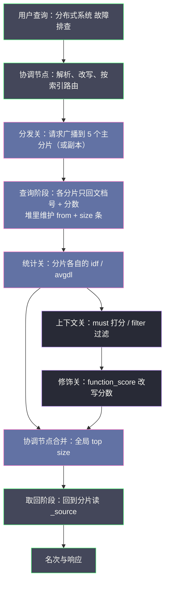
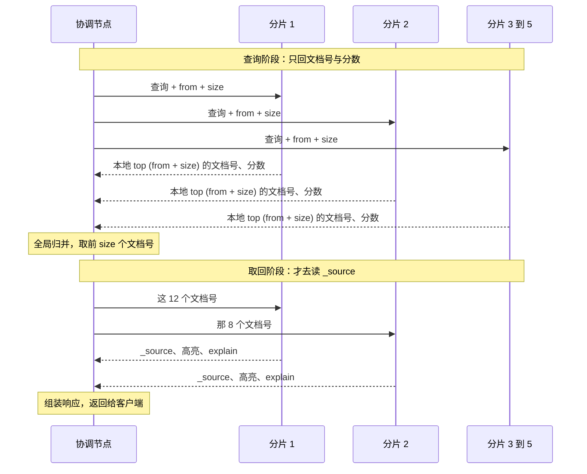
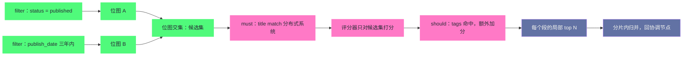
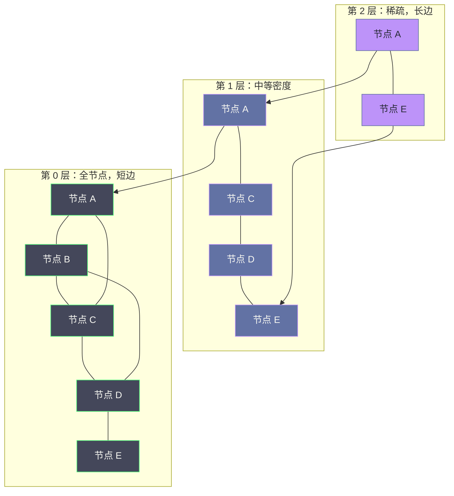
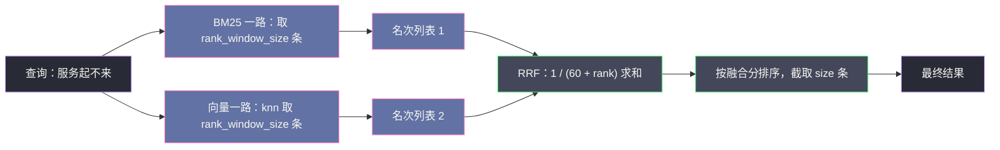

# 04 查询与相关性评分——BM25 与向量检索

**摘要：**

站内搜索最典型的投诉是「这条最该排第一却没排第一」，而多数排查最后停在「评分算法不懂相关性」这个错误结论上。排序之前先有两道口径：查询在分片上怎么执行，分片自己掌握多少统计量。本文沿着一次 `_search` 的真实路径展开：先讲两阶段查询——查询阶段各分片只回文档号与分数、取回阶段才去读 `_source`，以及 `from + size` 为什么必须在每个分片上放大成「分片数 × (from + size)」，由此带出 `search_after`、PIT、`scroll` 三条出路，和 `terminate_after`、`track_total_hits`、`preference` 三个容易被误用的旋钮；再把 BM25 拆成词频饱和、逆文档频率、长度归一化三个因子，说明 `_idf` 为什么是分片局部的、关掉 `norms` 之后再谈相关性排序意味着什么。核心交付是 `bool` 四个子句的打分与缓存行为，以及 `function_score` 修饰分数的先后顺序。后半程转向 ES 8.x 的向量检索：`dense_vector` 与顶层 `knn` 的近似性、`m` 与 `num_candidates` 的旋钮作用、`script_score` 暴力精确计算的边界、混合检索里加权相加与 `rrf` 的取舍，最后给出向量索引的内存账与「排序不对」的五个成因。文中的内存与延迟数字均为示例推算，只用于对齐量级。

---

## 第 1 章 为什么这条该排第一却没排第一

### 1.1 一个重复出现的现场

周三下午，内容站的运营把两条链接发过来：用户搜「服务启动失败」，第一条命中的是一篇讲 `systemd` 单元文件写法的短文，第二条才是那篇被引用了两百多次的排查手册。运营的诉求很具体，后者才该排第一。这类反馈笔者每个月都会碰到，最后多数收束到一句判断：算法不懂相关性。

这个判断很少成立。真正发生过的事情通常是，分数是在某个特定口径下算出来的相对量——同一篇文档，换一个分片数、换一份统计量、换一个分析器，算出来的数就不是原来那个数，名次自然跟着动。所以第一个该问的不是「BM25 准不准」，而是「这个名次是在什么口径下算出来的」。

从一次 `_search` 请求到最终名次，中间要过四道关口，每一道都会改写结果：

- 分发关：查询被广播到哪些分片、每个分片回什么、协调节点怎么合并，这是两阶段查询模型管的事；
- 统计关：分片手里有哪几个统计量，`idf` 与 `avgdl` 各自怎么来的，这是 BM25 三个因子管的事；
- 上下文关：哪些子句参与打分、哪些只做过滤、过滤结果能不能被缓存，这是 `bool` 四个子句管的事；
- 修饰关：分数算出来之后，还有谁在乘、在加、在替换，这是 `boost` 与 `function_score` 管的事。

四道关口里任何一处口径不对，表现都是「该排第一的没排第一」，但处置办法完全不同。分发关要换翻页方式，统计关要统一统计口径或者接受分片差异，上下文关要把过滤条件从 `must` 挪到 `filter`，修饰关要检查 `boost_mode` 有没有把查询分数整个扔掉。把四件事混成「评分算法不行」，就会去调 `k1`、`b`，然后发现调完还是那个名次，只是分数变了个数。

### 1.2 分数不是绝对量，名次才是

「分数」这个词容易让人以为它有刻度。BM25 的分子里有逆文档频率，分母里有平均字段长度，两者都依赖语料统计，同一篇文档在两份索引里得分不同，这不是缺陷，是定义使然。Lucene 的 `_score` 从来没有承诺过跨查询、跨索引、跨分片可比，它只在同一次查询返回的这一批结果内部有意义。

既然名次是相对的，「排序不对」至少要拆成两类。一类是口径错：用了一个本不承担相关性排序职责的信号，譬如把 `status = published` 这种过滤条件当成相关性证据，于是文档分数被一个与内容无关的字段扰动。另一类是权重错：信号对，但配比不对，譬如短字段里的命中被 `b` 惩罚得过重，或者热度因子的系数大过相关性本身。前一类改配置，后一类调参数或者加特征；把两类混在一起，就只能靠反复试。

### 1.3 贯穿全文的一份索引

后面的讨论都落在同一份索引上，方便互相对照。设想一个技术社区的内容检索：索引 `articles`，5 个主分片、1 个副本，约 1200 万篇文章；`title` 与 `content` 是 `text`，`tags` 与 `status` 是 `keyword`，`publish_date` 是 `date`，`popularity` 是 `integer`，另有一个 768 维的 `embedding` 字段。用户查询形如「分布式系统 故障排查」，业务规则要求只出已发布、最近三年的文章。

整条路径画成一张图，后面每一章都在解释其中一格：



图里的顺序不是排版顺序。分发在最外层，因为它在任何一次打分发生之前，就已经决定了「哪些分片参与、每个分片要回多少条、回来的东西怎么合并」；统计、上下文、修饰都在单个文档的分数上动手，属于内层。两层的关系是：外层决定候选集与成本，内层决定候选集内部的次序。只看内层调参，等于在错误的候选集里找最优解。

### 1.4 两条路线：把口径调对，或者把口径换掉

关键词检索的口径是「词的重合与统计」，向量检索的口径是「向量空间里的距离」，两套口径没有共同的零点，也没有共同的刻度。所以混合检索从来不是「把两个分数加起来」这么简单的一件事，它首先要解决可比性：要么把两套分数校准到同一刻度，要么放弃分数、只用名次。后面讲 RRF 时，走的是后一条路。

向量检索本身不复杂——一段嵌入、一次近邻搜索；复杂的是它进入一个已有 BM25、分片、`bool` 上下文与过滤缓存的系统之后，这些机制怎么相处。ES 8.x 把向量放进了同一个索引，写起来方便了，但口径问题没有消失，只是从显眼处挪到了隐蔽处。

---

## 第 2 章 两阶段查询：查询阶段定「是谁」，取回阶段定「是什么」

### 2.1 请求落到谁身上

一次 `_search` 先到达协调节点（Coordinating Node）。这个角色不是独立部署的节点类型，任何节点都能担任，只处理本次请求的合并与转发，不持有分片的数据副本。协调节点解析查询、确认目标索引与路由，然后把请求广播到每个分片的一份拷贝上：主分片还是副本，由自适应副本选择（Adaptive Replica Selection）按各副本的历史响应时间与队列长度挑，不是简单轮询。

分片收到请求后，对内部的每个段（Segment）各执行一遍查询，再在分片内归并。段是不可变的最小执行单位，这一点在 [[02 倒排索引——从 Term Dictionary 到 FST]] 里拆过，这里只需要一个结论：一次分片查询的成本近似等于段数乘以单段成本，段多则固定开销在每一段上各付一次。

### 2.2 查询阶段：只回文档号和分数

**查询阶段（Query Phase）**的目标可以一句话说完：在每个分片上，找出本地得分最高的 `from + size` 条文档，只把文档号和分数带回来。字段值一个字节都不传。

分片在这一阶段做四件事：从倒排索引定位命中的文档号；对命中的文档调用评分器算分；用一个最小堆维护目前见过的最高 `from + size` 个；把结果序列化回协调节点。堆的用法值得留意，它意味着分片并不需要把整个命中集排序，只需要维护一个大小为 `from + size` 的窗口，这也正是深分页代价的来源——窗口越大，堆越大，而窗口大小由客户端给的 `from` 决定。

协调节点收齐所有分片的结果后，做一次全局归并，取前 `size` 条文档号。到这一步，排序已经定下来了，但返回给用户的内容还是空的。

### 2.3 取回阶段：才去读 `_source`

**取回阶段（Fetch Phase）**拿到的是一份文档号清单。协调节点按分片把这些文档号分组，再向对应分片发第二次请求。分片对每个文档号做一次查表：先在 `.fdx` 里定位偏移，再到 `.fdt` 里读出对应的字节块，反序列化出 `_source`；高亮、`explain`、`script_fields`、`stored_fields` 也都在这一阶段计算。

这条路径是随机读。热数据被页缓存（Page Cache）兜住，延迟在微秒到毫秒之间；冷索引上的取回则可能比查询阶段更贵，因为它对每个文档都要做一次寻址。一个常被忽略的性质是 `_source` 是整块压缩存储的：`_source_includes` 只是减少了网络传输与反序列化的工作量，读到内存里的仍是整块，所以指望它省磁盘读是错的方向。

### 2.4 不分两阶段会怎样

不妨做个反事实推想。假设取消取回阶段，让每个分片在查询阶段直接返回 `from + size` 条完整文档，那么 5 个分片、`from = 10000`、`size = 20` 时，协调节点要接收 5 万零 100 条完整文档。按技术文章平均 8 KB 的 `_source` 估算（示例推算），网络传输约 400 MB，而其中真正被返回给用户的只有 20 条，其余全部在归并后被丢弃。两阶段把「传什么」和「传多少」拆开：查询阶段只传决定名次所需的两个小字段，取回阶段只传最终要展示的那几十条。



两次请求之间隔着一个时间窗，这带来一个容易被忽略的后果：如果这期间发生了刷新（refresh）或者删除，取回阶段拿到的可能是更新后的内容，也可能是已经被标记删除、却仍能从 `.fdt` 读出旧字节的文档。单次查询里这个窗口通常是毫秒级，影响有限；一旦进入翻页场景，窗口被拉长到分钟甚至小时，就必须用后面第 3 章要讲的 PIT 把视图固定住。

### 2.5 两阶段的副产品：`preference` 有了意义

正因为取回阶段是第二次独立请求，它落在哪个副本上是可以干预的，这就是 `preference` 参数的由来。它的取值包括 `_local`（能本地就本地）、`_only_local`（只用本节点上的分片）、`_shards:0,1`（限定分片集合）、`_prefer_nodes` 与 `_only_nodes`（按节点偏好或限定），以及任意自定义字符串（同一个字符串的请求会落到同一组分片，由哈希决定）。默认不指定时，协调节点做自适应副本选择，把请求摊到各副本上。

`preference` 最常被误用的地方，是有人拿它当读写一致性开关，早期的写法是 `preference=_primary`，只把查询打给主分片。这个取值在 6.1 被标记弃用、7.0 起从支持列表移除，8.x 上要用 `_shards` 或自定义字符串来表达路由意图。退一步说，即便它还可用，也解决不了「写入之后立刻搜索读不到」：根因是刷新间隔（默认 1 秒），主分片上那份新段同样要等下一次刷新才可见。要立刻可见，得用 `refresh=wait_for` 或 `refresh=true`，前者等下一次刷新完成，后者强制刷新当前分片，代价是产生小段、加重合并压力。`preference` 真正能解决的是「同一个用户的连续请求打到同一组分片」，从而提高查询缓存的局部性；以及在排查时固定 `_shards:0`，观察同一查询在单个分片上的分数，这是后面验证 `idf` 口径问题最直接的手段。

---

## 第 3 章 `from + size` 的算术：深分页为什么撑不住

### 3.1 每个分片都得回 `from + size` 条

为什么不能只让每个分片回 `size` 条就够？因为协调节点事先不知道全局第 10001 名落在哪个分片。做一次鸽巢推演：假如分片 A 只回本地前 20 条，而全局第 10001 名恰好是分片 A 的本地第 9000 名，这条就永远不会出现在候选集里。要保证全局第 `from + 1` 名一定可见，每个分片必须至少回 `from + size` 条。

于是代价随 `from` 线性放大，且放大系数是分片数。按技术文章计（示例推算）：`from = 10000`、`size = 20`，每个分片要维护 10020 个候选；每个候选在堆里是一个对象，按 40 到 60 字节计，单分片约 0.4 到 0.6 MB 堆内存；5 个分片加上协调节点再建一遍合并队列，合计 4 到 6 MB 堆，加上约 1 MB 的网络往返。单看不算吓人，但这类请求通常并发而来，10 个并发就是几十 MB 堆，且对象都活到请求结束。把分片数换成 100、`from` 换成 50000，同样的算法会给出几百 MB 的量级，这时页面还没翻完，节点可能已经进了老年代回收。

`index.max_result_window` 的默认值 10000 就是拦住这条路的闸门。超过时请求直接被拒，报错文本里会写清楚：`Result window is too large, from + size must be less than or equal to: [10000] but was [10020]`。有人会把这个设置调大，本质是把「按时失败」换成「慢慢拖死」，因为它没有改变放大系数，只是把触发点往后挪。真要做深翻页，得换一种翻页方式。

### 3.2 三条出路的分工

这三条路不是新旧替代关系，而是三个不同的问题各自有解：要不要跳页、要不要实时、数据量有多大。

| 方式 | 每分片返回量 | 能否跳页 | 视图一致性 | 典型代价 |
|---|---|---|---|---|
| `from + size` | `from + size` 条文档号 | 能 | 无保证 | 深翻时堆与网络按分片数线性放大 |
| `search_after` + PIT | `size` 条文档号 | 不能，只能顺序 | PIT 固定段视图 | 需要唯一且稳定的排序键；PIT 需维持 `keep_alive` |
| `scroll` | `size` 条文档号 | 不能，只能顺序 | 快照 | 大量段引用长期不释放，不适合实时 |

`search_after` 的思路是把「位置」换成「锚点」：上一页最后一条的排序值就是下一页的起点，每个分片只需要给出排在锚点之后的 `size` 条，于是无论翻到第几页，每分片返回量都稳定在 `size`。代价是它不能跳页，参数只能前进。另外排序键必须唯一且稳定，否则排序值相同的文档在翻页边界上会漏或者重；技术上要求排序字段组合能唯一定位文档，常用做法是末尾追加 `_id` 或一个唯一业务键。

`scroll`（滚动查询）则是给「全量导出」设计的：建立快照，拿到 `scroll_id`，然后按批拉取，快照在 `scroll` 参数指定的时间内有效。它的问题在于快照本身要占资源，`_nodes/stats/indices/search` 里的 `open_contexts` 会长时间高企，段文件因为被快照引用而不能及时合并清理。用它做用户翻页，相当于为一个允许过期的页面付出一个快照的代价。

PIT（Point in Time，时间点视图）解决的是另一个问题。翻页途中发生刷新或段合并，排序值与文档集合都会变，翻页就会出现重复与遗漏；PIT 把某一时刻的段集合固定下来，后续查询都在这个视图上执行。代价是延长段的生命周期，`keep_alive` 给得越长，磁盘与合并压力越大，1 到 2 分钟足够覆盖一次正常翻页。

### 3.3 两个「提前收手」的旋钮

`terminate_after` 是「够了就停」：每个分片收集到指定数量的文档就结束，响应里会带 `terminated_early: true`。它的适用场景很窄——只想确认「有没有这类文档」，不关心有多少、也不关心排序是否完整，譬如安全扫描里判断某个错误码最近有没有出现。用它做正常搜索是错的，因为返回的 `total` 与排序都不可信。

`track_total_hits` 是「要不要精确计数」。默认情况下，ES 一旦数到 10000 条就停，返回 `{"value": 10000, "relation": "gte"}`，含义是「至少一万」。把 `track_total_hits` 设为 `true` 会精确计数，代价是每个分片都要把全部命中遍历一遍，对一个会命中几百万文档的高频词，这部分成本可能超过打分本身；设成一个具体数值（譬如 100000）是折中，超过这个数就退化成 `gte`。很多「搜索结果 1 万+」的界面，本质是把精确计数当成了默认能力，而它其实是一个需要单独付费的选项。

### 3.4 深分页的配置取舍

`index.max_result_window` 这张表值得单独列一下，因为它是少数「调大就能立刻见效、但见效方向是错的」配置。

| 配置 | 默认值 | 调大的代价 | 调小的代价 |
|---|---|---|---|
| `index.max_result_window` | 10000 | 深翻请求的堆与网络放大上限抬高，突发流量下更容易 OOM | 前端「跳到最后一页」这类交互直接报错 |
| PIT 的 `keep_alive` | 调用方指定 | 段引用长期不释放，磁盘与合并压力上升 | 翻页会话中途过期，需要重新建立视图 |
| `scroll` 的存活时间 | 调用方指定 | `open_contexts` 堆积，段无法回收 | 大批量导出中途失效，需要重跑 |
| `search.max_open_scroll_context` | 500（节点级动态设置） | 内存与文件句柄压力上升 | 并发导出任务被拒 |

这张表里没有「调大更好」的项。能跳页的用 `search_after` 顺序翻，要全量扫描的用 PIT 加 `search_after` 或 `scroll`，只问「有没有」的用 `terminate_after`，不要求精确总数的保留默认的 `gte`。

---

## 第 4 章 BM25 的三个因子

### 4.1 2016 年的一次默认值替换

BM25 不是新东西。1994 年的 TREC-3 评测里，Robertson、Walker 所在的 Okapi 系统提交了一套概率检索模型，那是 BM 系列最早的一次公开亮相；1998 年 Walker 等人把词频饱和与长度归一的参数形式固定下来，才有了今天写在教科书上的 `k1` 与 `b`；2009 年 Robertson 与 Zaragoza 的《The Probabilistic Relevance Framework: BM25 and Beyond》把它整理成一套可推导的框架。从论文到默认值，中间隔了二十多年。

转折点在 2016 年。Apache Lucene 6.0 把默认相似度从 `ClassicSimilarity`（TF-IDF 的一个变体）换成 `BM25Similarity`，Elasticsearch 5.0 基于 Lucene 6.x，于是从 5.0 起新建索引的默认评分算法就是 BM25。有些文章把这件事记在 7.0 账上，那是把版本号记串了——7.0 换的是别的东西，主要是 `hits.total` 从数字变成带 `relation` 的对象，这恰好与第 3 章讲的 `track_total_hits` 是同一件事。

### 4.2 公式拆开只有三项

BM25 对一个查询的评分，是把查询里每个词各自的贡献加起来：

$$\text{score}(d, q) = \sum_{t \in q} \text{idf}(t) \cdot \frac{f(t,d)\,(k_1 + 1)}{f(t,d) + k_1\left(1 - b + b\,\dfrac{|d|}{\text{avgdl}}\right)}$$

其中逆文档频率那一项，Lucene 用的是带平滑的形式：

$$\text{idf}(t) = \ln\left(1 + \frac{N - n(t) + 0.5}{n(t) + 0.5}\right)$$

`N` 是文档总数，`n(t)` 是包含词 `t` 的文档数，`f(t,d)` 是词 `t` 在文档 `d` 里的出现次数，`|d|` 是该字段的 token 数，`avgdl` 是该字段的平均长度。

把这个式子当成一张评分表来看，三项各管一件事：`idf` 管「这个词有多稀罕」，中间那一项管「重复出现值不值得继续加分」，分母括号里那一项管「文档的长短要不要折算」。词频那一项的形状是双曲线，而不是直线，这是 BM25 与 TF-IDF 最本质的区别；`idf` 那一项与 TF-IDF 同源，但多了 0.5 的平滑与一个 `+1`，保证它恒为正；长度归一化那一项是 BM25 相对早期模型的增量，它把「长文档天然命中次数多」这件事从分数里扣掉。

### 4.3 词频饱和：`k1` 控制的是「第几次之后不值钱」

先只看中间那一项，并令 `b = 0`（关掉长度归一化），于是它退化成：

$$\text{tf}_{\text{norm}}(f) = \frac{f\,(k_1 + 1)}{f + k_1}$$

这个函数随 `f` 单调递增，但**上界是 k1 加 1**。取 `k1 = 1.2`（Lucene 默认），上界就是 2.2，也就是说一个词无论出现 32 次还是 3200 次，它对分数的贡献最多是首次出现的 2.2 倍。

| 词频 f | 线性 TF | `sqrt(f)` | BM25 饱和值（`k1 = 1.2`, `b = 0`） |
|---|---|---|---|
| 1 | 1.00 | 1.00 | 1.00 |
| 2 | 2.00 | 1.41 | 1.38 |
| 4 | 4.00 | 2.00 | 1.69 |
| 8 | 8.00 | 2.83 | 1.91 |
| 16 | 16.00 | 4.00 | 2.05 |
| 32 | 32.00 | 5.66 | 2.12 |
| 64 | 64.00 | 8.00 | 2.16 |

前四行的斜率还看得出来，到十六次之后基本躺平。`k1` 调小，饱和来得更早，`k1 = 0.5` 时上界只有 1.5，两次以上重复几乎没有额外收益；`k1` 调大，曲线更接近线性，`k1 = 2.0` 时上界是 3.0，高词频文档的优势被放大。Lucene 的默认值 1.2 落在「既承认重复、又抑制堆词」的中间地带。

这一项对应的是早期 TF-IDF 最受人诟病的行为：一篇一万词的文章把关键词重复三十次，原始 TF 就能把它顶到前面去，而读者真正想要的是「这个词在这篇文章里是不是核心」。饱和函数把「量」压成了「有没有、够不够密」，剩下的事交给长度归一化去判。

### 4.4 逆文档频率：它是在分片上算的

`idf` 依赖 `N` 与 `n(t)` 两个统计量，而这两个数的口径是分片，不是索引。分片收到查询后，把本地各段（Segment）的统计汇总起来：`N` 是本地所有未删除文档数，`n(t)` 是本地包含该词的文档数。5 个分片就有 5 份 `idf`，**每个分片各算一份**。

后果很具体。假设「排查」这个词在分片 0 上出现于 12 万篇文档（本地 `N` 约 240 万），在分片 4 上只出现于 8000 篇（本地 `N` 同样约 240 万），那么它的 `idf` 在两个分片上差出一个量级。两篇内容相近的文档，一篇落在分片 0，一篇落在分片 4，前者在这个词上的得分天然更低——不是因为不够相关，而是因为它所在的分片里这个词太常见。全局归并时，这种偏差会直接变成名次偏差。

这个现象有个正式的名字，叫「分片级统计与全局统计的差异」；ES 给的解法是 `search_type=dfs_query_then_fetch`。`dfs` 指 Document Frequency Statistics：先发一轮请求向所有分片收集各词的文档频率，汇总成全局统计，再带着全局统计发第二轮真正的查询。代价是多一次往返，以及每一轮都要等最慢的分片，分片多的时候聚合本身也不便宜。十几个分片以内、相关性敏感时值得打开；上百个分片时，通常的做法是接受分片差异，改用「按字段加权」压过分片噪声。

判断这个问题是否存在，有个很直接的手段：把同一查询用 `preference=_shards:0` 与 `preference=_shards:4` 分别执行，对比同一批文档的分数；再打开 `dfs_query_then_fetch` 执行一次，如果名次明显变化，就说明口径差异在起作用。

### 4.5 长度归一化：`b` 与 `norms`

分母括号里那一项是 `1 - b + b·|d|/avgdl`，`b` 取 0.75（Lucene 默认）。文档长度等于平均值时这一项为 1；文档比平均长，它大于 1，分母变大，词频贡献被压；文档比平均短，它小于 1，词频贡献被抬。`b = 0` 时长度完全不参与，`b = 1` 时完全按长度折算。

`|d|` 来自 `norms`。`norms` 是一个每文档、每字段一个字节的数组，存在 `.nvd` 与 `.nvm` 文件里；一个字节装不下精确的长度，Lucene 用 `SmallFloat` 编码（保留三位尾数），所以长度是近似值，长度差异小于约 10% 的两篇文档，可能拿到同一个归一化因子。这也解释了一个常见困惑：明明两篇文档长度差了几十个字，分数却一模一样。

`norms` 可以在 mapping 里关掉（`"norms": false`）。关掉之后省下每文档每字段一个字节，索引体积通常只降几个百分点，打分时也少读一个数组；代价是长度归一化整项失效，短文档不再占优，`b` 参数随之作废，而且这个改动不可逆——已经写好的段不会因为改了 mapping 就恢复，要恢复只能重建索引。

| 参数 | 默认值 | 调大的代价 | 调小的代价 |
|---|---|---|---|
| `k1` | 1.2 | 更接近线性 TF，关键词堆砌的文档更容易冲到前面 | 饱和更早，长文里反复论述同一主题的文档拿不到额外权重 |
| `b` | 0.75 | 长文档被过度惩罚，深度长文与短新闻不可比 | 长度归一化趋近失效，长文档天然占优 |
| `norms` | 开启 | —— | 关掉省一个字节，卖掉长度维度，且需重建索引才能恢复 |

### 4.6 Lucene 的实现与教科书公式不完全一样

把 Lucene 的 `BM25Similarity` 摊开看，有三处与教科书公式对不上，都会影响你读 `explain` 看到的东西。

第一处是 `k1 + 1` 这个因子被省掉了。它对同一个词是常数，不改变同一次查询内的相对次序，所以实现里把权重写成 `boost × idf`，把词频项写成 `f / (f + k1·(1 - b + b·|d|/avgdl))`。于是 `explain` 里看到的 `tf` 值最大接近 1，而不是 2.2——这不是算错了，是省略了一个常数。

第二处是统计量的粒度。`avgdl` 按段统计，`N` 与 `n(t)` 按分片汇总各段。段合并之后，段的边界变了，`avgdl` 的数值随之变化，同一篇文档的分数可能略微变动。这条推论能解释一类线上现象：索引合并完成的那天，搜索结果的名次和前一天不完全一致，但没人改过任何配置。

第三处是 `discount_overlaps`（默认 `true`）：同一位置上被同义词过滤器放进去的多个 term，词频只算一次。没有它，一个同义词组就能把词频虚增几倍，直接把饱和曲线推到上界附近。

---

## 第 5 章 分数的口径：`explain` 与不可比性

### 5.1 读 `explain`，先读结构再读数字

`_explain` 接口对单篇文档返回一棵打分树，`_search?explain=true` 对每条命中返回同样的结构。树的每一层有 `value`、`description`、`details` 三个字段，`description` 里写着这一层的公式与输入。读法是从下往上：最底层是 `idf`、`tf`、`fieldNorm`（或 `tfNorm`）这些叶子，逐层往上做乘加，最顶层就是这次查询给这篇文档的分数。

对第 4 章那份索引，「分布式系统 故障排查」的打分树大致是：每个词一层，层内先给 `idf`（带 `docCount` 与 `docFreq`），再给 `tf`（带 `freq`），再乘长度归一化，最后把各词的层相加、乘查询级 `boost`。哪一层出现意料之外的数值，口径问题就在哪一层。

三个最常见的异常读数：`idf` 为 0 或者极小，说明这个词在本分片上几乎处处可见；`tf` 已经贴着上界，说明词频饱和已经发生，再优化词频没有意义；`fieldNorm` 恒等于 1，说明 `norms` 被关了，长度归一化根本没参与。

### 5.2 三种不可比

`_score` 不可比这件事至少有三层，很多人只意识到第一层。

同一索引、不同分片：`idf` 与 `avgdl` 都是分片级的，同一文档换一个分片落在不同的统计口径里，分数自然不同。

同一索引、同一次查询、不同查询词：`idf` 是查询词的函数，搜「Kubernetes」与搜「故障」得到的两批结果，分数基数完全不同，前者的分数普遍更高，这只说明前者更稀有，不说明前者更相关。

不同索引：文档数、平均字段长度、分析器、甚至 Lucene 版本都可能不同。跨索引比较分数，等于拿两把刻度不同的尺子量同一根木头。

由此可以得出一条实用纪律：`_score` 只在「同一次查询返回的这一批结果」内部做比较；跨查询、跨索引要比较，就必须落到名次、命中率或者人工标注的离线指标上。

### 5.3 排序与打分是两件事

一旦在请求里显式写了 `sort`，ES 默认不再计算分数，`_score` 会变成 `null`。这不是缺陷，是省成本的默认行为：既然排序键已经给定，再算一遍 BM25 纯属浪费。若确实需要分数（譬如用分数做二级排序，或者为了展示），要打开 `track_scores: true`，代价是每个命中文档都要走一遍评分器。

用了 `sort` 的查询与 `min_score` 组合时也要留意：`min_score` 过滤的是分数，分数不存在的查询里它不生效；而在 `function_score` 里，`min_score` 作用在修饰之后的最终分数上，与查询分数的阈值完全不是一回事。

### 5.4 `boost` 是乘数，不是校准

`boost` 不改变分数的分布形状，它只是乘一个系数。给 `title` 上的匹配乘 3、给 `content` 上的匹配乘 1，做的是「同一口径下的相对加权」，不会让两个字段的分数变得可比，也不会让最终分数落进某个区间。多层 `boost` 相乘时，系数而不是相关性在主导排名，这是调相关性里最常见的自欺：把系数调到让几条已知样例看起来对了，代价是其余查询整体漂移。

同理，`min_score` 用来做「相关性过滤」通常是短期方案。阈值是当前语料分布下的产物，数据增长、分析器调整、甚至一次段合并，都可能让阈值失效；失效的方向还不一定，可能是一夜之间结果全空，也可能是全量涌出来。

### 5.5 调相关性要用可比的口径

评估一次改动的好坏，ES 提供了 `_rank_eval` 接口：给一组查询与每个查询的期望文档，它会算出 precision、recall、NDCG 一类的指标。配合 `_search_shards`（确认查询落在哪些分片，用来验证 `preference` 是否生效）与 `dfs_query_then_fetch`（把统计口径统一到全局）先排除口径差异，再谈 `k1`、`b`、`boost` 的调整——顺序反了，就是在噪声上做优化。

---

## 第 6 章 `bool` 查询的四个子句与打分行为

### 6.1 四个子句各管一件事

`bool` 查询是 ES 里组合条件的标准写法，四个子句的语义差异是整篇最值得记住的一张表。它们的区别不只在逻辑，还在「打不打分」与「能不能进缓存」。

| 子句 | 逻辑语义 | 是否参与打分 | 是否走查询缓存 | 典型用途 |
|---|---|---|---|---|
| `must` | 必须命中（AND） | 是，分数累加 | 否 | 真正表达相关性的条件 |
| `filter` | 必须命中（AND） | 否，分数为 0 | 是 | 状态、时间范围、权限、租户 |
| `should` | 应该命中（OR） | 是，分数累加 | 部分（取决于上下文与是否有 `minimum_should_match`） | 加分项、同义词扩展 |
| `must_not` | 必须不命中（NOT） | 否 | 是 | 排除下架、软删、黑名单 |

表里「是否走查询缓存」一列需要用一句话解释清楚：缓存的对象是「在过滤上下文里执行过的子句」在某个段上的结果位图，与子句写在 `filter` 还是 `must_not` 里无关，只与执行上下文有关。同一段 `range` 条件写在 `filter` 里会被缓存，写在 `must` 里不会。

### 6.2 `should` 的默认规则最容易踩

`should` 有一个反直觉的默认：如果 `bool` 里同时存在 `must` 或 `filter`，`should` 默认不强制命中，只作为加分项（`minimum_should_match` 默认 0）；如果 `bool` 里只有 `should`，则默认要求至少命中一个（默认 1）。

这意味着「`must` 一个条件 + `should` 一个条件」的写法，语义是「必须满足前者，后者命中可以加分」，而不是「两者至少命中一个」。想要「前者必须满足，后者也至少命中一个」，得显式写 `minimum_should_match: 1`。

`minimum_should_match` 还支持百分比与条件语法，适合「查询词越长、容忍度越高」的场景。

### 6.3 `filter` 是性能上最重要的一个子句

`filter` 的价值分两层。第一层是不打分：命中文档的分数贡献为 0，评分器根本不需要为它构造 `Scorer`。第二层是可缓存：过滤上下文里的子句会被转成一个位图（bitset），按「段 × 子句」缓存起来，后续同样的条件直接做位运算，不必再访问倒排索引。

缓存落在**节点查询缓存（Node Query Cache）**里，默认占堆的 10%（`indices.queries.cache.size`），按 LRU 淘汰。它的有效性建立在段不可变这个前提上：段一旦写出就不会变，所以「某段上满足某条件」的位图可以放心复用；段被合并掉，对应的缓存条目随之失效。这解释了一个日常现象：一次大的段合并之后，查询延迟会短暂上升，因为缓存全冷了。

这里要纠正一个流传很广的叫法。很多资料把这块缓存叫 Filter Cache，8.x 里并没有这个名字，真实的组件是节点查询缓存；与它并列的另一个缓存是 `request_cache`，缓存的是 `size: 0` 这类请求的完整结果（典型场景是聚合看板），两者不是一回事，指标也不在同一处。看缓存命中要看 `_nodes/stats/indices/query_cache`，看请求缓存要看 `request_cache`；聚合要走列存而不是倒排，见 [[05 聚合分析——Bucket、Metric 与 Pipeline]]。

### 6.4 把过滤条件写进 `must` 会发生什么

这是四子句里代价最高的一种误用。假设 `status = published` 写在 `must` 里，会发生三件事。

分数被扰动。`status` 是 `keyword`，`published` 在索引里出现于绝大多数文档，`idf` 接近 0 但不是 0，每篇已发布文档都会因为命中它而拿到一个与内容无关的加数；不同文档的 `norms` 不同，这个加数还不相等。于是名次里混进了一个纯粹的噪声项。

缓存失效。过滤子句进不了节点查询缓存，每次查询都要重新在该段的倒排列表上做一次遍历与位运算。对 `status` 这种低基数字段，倒排列表很长，这次遍历并不便宜。

短路机会丢失。写在 `filter` 里时，执行顺序是「先用位图把候选集收敛到很小，再对剩下的文档打分」；写在 `must` 里时，它变成评分器的一个必须迭代的子句，Lucene 会按代价排序子句，但领先的迭代器通常是那个命中集最大的，收敛效果不如位图交集。

### 6.5 执行顺序：先过滤，后打分

这条顺序不是实现细节，它是 `filter` 之所以能带来数量级收益的原因。下面这张图把一次带 `filter` 的 `bool` 查询在单个段上的执行顺序画出来：



图里绿色部分只做集合运算，粉色部分才需要读 `norms`、算 `idf`、做乘加。候选集从千万级收敛到几千条之后，打分成本与候选集大小成正比——`filter` 省下来的不是过滤本身，是让打分只发生在小集合上。

### 6.6 `must_not` 与 `constant_score`

`must_not` 也是过滤，不打分，但它不能单独使用：一个只有 `must_not` 的 `bool` 等价于「全集减去这个集合」，实际会退化成 `match_all` 加排除，成本要看排除集合的大小。写「排除软删」这类条件时，`must_not` 是正确的语义，只是别忘了它之前通常需要一个正向条件来收敛。

`constant_score` 是把「参与打分的子句」变成「分数恒为 1 的过滤」的语法糖：

```json
{
  "query": {
    "constant_score": {
      "filter": { "term": { "status": "published" } },
      "boost": 1.0
    }
  }
}
```

它的用途有两个：一是明确表达「这个条件只用于筛选」，让后来读代码的人不会误以为它该参与相关性；二是在 `function_score` 里当基准分数用，让业务因子成为唯一变量。

---

## 第 7 章 `boost` 与 `function_score` 的干预顺序

### 7.1 分数算出来之后，还有五个人能动它

按执行顺序排，能改写最终名次的手段有五种：查询级 `boost`（子句级乘数）、`function_score`（业务因子修饰）、`script_score`（脚本重算）、`rescore`（只对前 N 条重排）、`sort`（彻底绕开分数）。它们不是互斥的，一层套一层时，顺序决定了谁覆盖谁。

`rescore` 常被误当成「精排」的全部。它的语义是：查询阶段先取前 `window_size` 条（默认等于 `size`），取回阶段之前只对这几十上百条用第二个查询重排。成本可控，效果取决于「真正相关的那条是否在初排的前 N 里」——不在，就救不回来。

### 7.2 `function_score` 的流水线

`function_score` 的修饰顺序是固定的，任何一步搞错都会让最终分数不是你以为的那个值：

第一步，执行内层 `query`，得到查询分数；第二步，对每个命中文档执行 `functions` 数组里的每个函数，得到一组函数值；第三步，按 `score_mode` 把这组函数值合并成一个数；第四步，按 `boost_mode` 把这个数与查询分数合并；第五步，`max_boost` 截断结果，`min_score` 作为请求级参数过滤最终分数。

| 参数 | 取值 | 语义 |
|---|---|---|
| `score_mode` | `multiply`（默认） | 多个函数值相乘 |
| | `sum`、`avg`、`max`、`min`、`first` | 相加、平均、取大、取小、只取第一个 |
| `boost_mode` | `multiply`（默认） | 函数结果乘查询分数 |
| | `replace` | 丢弃查询分数，只用函数结果 |
| | `sum`、`avg`、`max`、`min` | 与查询分数相加、平均、取大、取小 |

`replace` 是这张表里最危险的一格。它的语义是「查询分数不要了」，于是内层 `query` 里所有的 `boost`、所有精心调过的 `k1`、`b`，全部作废。有人为了让热度因子「说了算」，顺手写了 `replace`，结果相关性排序彻底消失，只剩下按热度排——这其实就是一次显式的业务排序，只是伪装成了相关性搜索。

函数类型里，`field_value_factor` 最常用，`modifier` 可以取 `log`、`log1p`、`ln`、`ln1p`、`sqrt`、`square`、`reciprocal`、`none`，用来把长尾分布压平；`decay`（`gauss`、`exp`、`linear`）用于时效与距离衰减，四个参数 `origin`、`scale`、`offset`、`decay` 里 `scale` 的语义最容易被配错，它表示「衰减到 `decay` 值时对应的距离」，不是「衰减开始的距离」；`random_score` 用于 A/B 与打散，`seed` 固定则结果可复现；`script_score` 把计算交给 Painless，灵活但按文档付费。

还有一条性能规则必须记住：**函数只作用于命中文档**。如果内层写的是 `match_all`，那么每个文档都要跑一遍函数，这在千万级索引上等同于一次全量扫描。把 `filter` 放进内层 `query`，让函数只作用在收敛后的候选集上，是最省事的一种优化。

### 7.3 干预顺序的选择判据

| 需求 | 该用的手段 | 不该用的手段 |
|---|---|---|
| 某个字段整体更重要 | 查询级 `boost` 或 `constant_score` 的 `boost` | `function_score` 的 `weight`（多一层间接） |
| 业务因子（热度、销量）参与排序 | `function_score` + `field_value_factor` | 在 `must` 里加一个热度的 `range`（会引入噪声） |
| 时效衰减 | `function_score` + `decay` | 在查询里加多个 `range` 加权（口径混乱） |
| 用外部模型分数排序 | 写入时预计算，读时 `field_value_factor` | 查询时 `script_score` 调外部服务 |
| 彻底按业务字段排 | `sort` | `function_score` + `replace`（伪装成相关性） |

最后一行是笔者的建议：如果业务本来就要按时间或销量排，直接写 `sort`，不要用 `function_score` 的 `replace` 来「保留一点相关性」——`replace` 之后没有相关性，只有函数值，名次的可解释性会一起消失。

---

## 第 8 章 向量检索之一：`dense_vector` 与顶层 `knn`

### 8.1 词汇表不匹配

BM25 再精细，也解决不了一个根本问题：查询词与文档词没有交集时，分数就是 0。用户搜「服务起不来」，那篇写了「进程无法启动：一次 `systemd` 依赖失败的排查」的文章，在 BM25 眼里几乎不相关——两者共享的词只有停用词，而停用词既被分析器过滤，也不承担区分度。

这就是语义鸿沟。向量嵌入（Embedding）用几何距离把它填上：模型把文本映射成固定维度的浮点向量，语义相近者距离近；查询与文档各过一次同一个模型，比较两个向量即可，不需要共享字面 token。

ES 8.x 的 `dense_vector` 字段类型把这件事收进了同一个索引。字段声明要给出维度、相似度度量和是否建索引：

```json
PUT articles
{
  "mappings": {
    "properties": {
      "embedding": {
        "type": "dense_vector",
        "dims": 768,
        "index": true,
        "similarity": "cosine",
        "index_options": {
          "type": "hnsw",
          "m": 16,
          "ef_construction": 100
        }
      }
    }
  }
}
```

`index: true` 才会构建 HNSW 图；为 `false` 时字段只能用于 `script_score` 里的暴力计算，这一点第 9 章展开。`similarity` 可取 `cosine`、`dot_product`、`l2_norm`：`cosine` 的分数是 `(1 + 余弦值) / 2`，落在 0 到 1 之间；`dot_product` 要求向量预先归一化才能与余弦等价，ES 不会替你归一化；`l2_norm` 把欧氏距离折算成相似度。三者的选择在写入侧就固定了，用错度量不会报错，只会让近邻变得没意义。

可索引向量的维度上限在 8.x 各版本里从 1024 逐步放宽到 2048、4096，具体数值以对应版本文档为准；`m` 与 `ef_construction` 只影响建索引，改了就重建，这一点与 `norms` 属于同一类「写入时定死」的开关。

### 8.2 HNSW：为什么要在图上分层

HNSW（Hierarchical Navigable Small World，分层可导航小世界图）的论文在 2016 年公开，思路可以直接从跳跃表借过来理解：如果一张图上只有局部的短边，贪心走几步就会卡在局部极小；如果再加上一些长边，跨区域只需要几步。层次结构把这件矛盾的事折中——高层稀疏、边很长，用来快速落到目标区域附近；低层稠密、边很短，用来在区域内精修。



插入一个向量时，先按指数分布随机决定它的最高层（层数越高概率越低），从顶层入口开始逐层贪心找最近邻，沿途与 `m` 个邻居连边；检索时从顶层入口开始，每层贪心走到底，把上一层的落点作为下一层的起点，到第 0 层改用宽度优先，在候选集里保留最多 `num_candidates` 个节点，最后取最近的 `k` 个。

`m` 控制每个节点在每层的最大连接数，`ef_construction` 控制建图时候选集的大小。两者调大都能提升图的质量与召回率，代价是构建时间与内存；`m` 的代价是永久的（每个节点多几条边，图更大），`ef_construction` 的代价只在建索引期间。ES 8.x 的默认值是 `m = 16`、`ef_construction = 100`，对多数中等规模语料够用，只有在召回率实测不达标时才值得往上调。

### 8.3 查询：`knn` 参数与它的物理含义

```json
{
  "knn": {
    "field": "embedding",
    "query_vector": [0.011, -0.032, 0.045],
    "k": 10,
    "num_candidates": 100
  },
  "_source": ["title", "publish_date"]
}
```

`k` 是最终要返回的近邻数，`num_candidates` 是每个分片在图搜索时保留的候选数，默认取 `min(1.5 × k, 10000)`，上限 10000。执行方式是：每个分片从本地各段的 HNSW 图里搜出 `num_candidates` 个候选，返回其中最近的 `k` 个；协调节点收齐所有分片的 `k` 个结果，再归并出全局前 `k`。

这个「每分片 k 个」的细节很重要。分片越多，协调节点拿到的总和越大，但全局真正的近邻有可能排在某个分片的第 `k + 1` 位——它在本地都没进前 `k`，自然没机会进入全局归并。所以分片数增加会轻微损失召回率，这与 BM25 的分片统计问题不是同一个机制，但表现相似：同一份数据换一种分片方式，结果就变了。

`knn` 里可以带 `filter`，语义上是「先限定范围再找近邻」。这里有一个版本差异需要注意：早期实现的流程是先按图搜出候选、再用 filter 筛，筛完可能不足 `k` 条；后续版本引入了带过滤的图遍历，才真正做到了先过滤再走图。如果线上的过滤条件很强（譬如只在一个租户的几万篇文档里找），务必用实际数据验证返回条数是否达到 `k`，否则会出现「翻到第二页就空了」这种诡异现象。

同一请求里同时出现 `query` 与 `knn` 是 8.x 的原生混合检索形态：两路各自打分，再相加（各自受 `boost` 加权）。第 10 章讨论这个相加为什么危险。

### 8.4 近似性：召回率是一个统计量

HNSW 是近似最近邻（Approximate Nearest Neighbor，ANN），不保证找到精确的前 `k` 个。评价它用的是召回率（Recall@k）：ANN 返回的前 `k` 条与暴力计算出的真前 `k` 条，交集占 `k` 的比例。

召回率没有解析解，只能实测。测法是准备一份小样本，用 `index: false` 的字段加 `script_score` 暴力算一遍真值，再与 `knn` 的结果对比。`num_candidates` 提高，召回率上升、延迟上升，且边际递减：从 `1.5k` 提到 `10k`，扫描的候选集大了六七倍，延迟大致同向增长，召回率的增长却越来越慢（具体曲线随数据分布与维度变化，必须用自己语料测，任何「某参数召回 96%」的说法都不具备可迁移性）。

还有一层更隐蔽的近似：HNSW 图是段级的，每个段各建一张图，段合并会重建图。合并前后，图的邻居结构不同，同一次查询可能返回略不一样的近邻。这不是 bug，是「近似」这个词的一部分；如果业务要求同一查询结果严格稳定（譬如对账、审计），向量检索不能作为唯一依据。

---

## 第 9 章 向量检索之二：`script_score` 与暴力精确计算

### 9.1 精确路径怎么写

当 `index` 为 `false` 时，字段不建图，只能用脚本对每个命中文档现算相似度：

```json
{
  "query": {
    "script_score": {
      "query": { "term": { "status": "published" } },
      "script": {
        "source": "cosineSimilarity(params.q, 'embedding') + 1.0",
        "params": { "q": [0.011, -0.032, 0.045] }
      }
    }
  }
}
```

`+ 1.0` 不是随手写的。`cosineSimilarity` 的返回值可能为负，而脚本分数不能为负，平移是必须的；如果担心负值被截断，也可以乘一个正系数。脚本里还能取到 `_score`（内层查询的分数），写成 `_score * doc['popularity'].value` 这种形式，让业务因子与相关性相乘。

这条路径的语义是精确的：它真的把候选集里每个向量都算了一遍，得到的 `k` 个结果就是真值。代价是线性扫描，复杂度是候选集大小乘以维度。

### 9.2 成本算术

按千万级语料算一笔账（示例推算）：100 万篇文档、768 维，一次全量扫描是 7.68 亿次乘加；保守按单核每秒十亿次浮点运算估算，纯算力在零点几秒量级，叠加内存带宽、反序列化与脚本执行的开销，实际可能是几秒。文档数到 1000 万，算术量翻十倍，延迟也同向翻十倍，这在在线搜索里不可接受。

对比 HNSW：一次查询大致是几十到上百次图跳转，每跳比较几十个邻居，总距离计算次数在几千量级。两者**差了三到四个数量级**，这就是「近似」买到的东西。

### 9.3 精确路径的三种正当用途

数据量小。几万到十几万条向量，暴力扫描的延迟仍在几十毫秒内，此时精确性比延迟更值钱，没必要引入图结构的近似与参数调优。

离线重排。先用 `knn` 或 BM25 召回 1000 条，再用脚本对 1000 条精确算分，这是「粗排 + 精排」的经典结构，成本可控，精度也够。

评估基准。第 8 章讲的召回率测量，真值就来自这条路。没有精确基准，调 `num_candidates` 全是盲调。

### 9.4 三个容易忽略的坑

脚本对「命中文档」执行，`match_all` 意味着全量。这和第 7 章 `function_score` 的规则是同一条：内层 `query` 负责收敛，脚本负责精算，顺序反了成本就失控。

Painless 每次执行都有解释与调用的开销，即使脚本已编译缓存。在百万级文档上，脚本开销往往比浮点运算本身更显著。

脚本里读向量要用 `cosineSimilarity(params.q, 'embedding')` 这类专用函数，第二个参数是字段名而不是文档值，函数签名以对应版本文档为准；用错不会静默降级，通常直接报错。

---

## 第 10 章 混合检索：加权相加与 RRF

### 10.1 两路并排，分数相加

8.x 的原生写法是把 `query`（BM25）与 `knn` 放在同一个请求里，两路各自算分，再相加：

```json
{
  "query": {
    "match": { "content": { "query": "服务起不来", "boost": 0.5 } }
  },
  "knn": {
    "field": "embedding",
    "query_vector": [0.011, -0.032, 0.045],
    "k": 20,
    "num_candidates": 100,
    "boost": 0.5
  },
  "size": 10
}
```

看起来两路各乘 0.5 就平衡了，但这里的 0.5 只调整了权重，没有解决刻度问题。BM25 的分数是把每个查询词的贡献累加起来的，词越多、词越稀罕，分数越高；余弦相似度的分数被归一化到 0 到 1 之间，天然有界。

举个具体的对照（示例推算）：文档 A 的 BM25 得分 18.4，余弦 0.62；文档 B 的 BM25 得分 3.2，余弦 0.91。按 0.5 / 0.5 加权，A 得 9.51，B 得 2.05，A 完胜。但向量那一路其实已经明确说了 B 更接近查询的语义。问题不在权重，在于两路分数的「零点」和「刻度」不同：BM25 的 18 分不代表「非常相关」，只代表「命中了几个稀有的词」。

### 10.2 归一化的尝试与它的边界

最直觉的修补是做归一化：把两路分数各自缩放到 0 到 1，再相加。问题在于归一化的参照系从哪来。

按当前结果集做 min-max 归一化，同一篇文档在不同查询里的归一化值不同——它依赖这一次召回了哪些文档。按固定常数缩放（譬如 BM25 除以 30）只能应对一个平均情况，长查询与短查询的分布完全不同；按离线分位数映射，语料一变就失效。

结论是：只要两路分数没有共同的零点与刻度，任何线性融合都是在猜。猜得准的场景当然存在，但它依赖持续维护的校准，而不是一次配置。

### 10.3 RRF：只用名次，不用分数

倒数排名融合（Reciprocal Rank Fusion，RRF）在 2009 年由 Cormack、Clarke、Buettcher 提出，思路是把「分数」这个麻烦的东西整个扔掉，**只用名次**：

$$\text{RRF}(d) = \sum_{r \in R} \frac{1}{k + \text{rank}_r(d)}$$

`rank_r(d)` 是文档 `d` 在第 `r` 路结果里的名次（从 1 开始），`k` 是平滑常数，论文推荐 60。ES 8.8 起提供 `rrf` retriever（当时标注为技术预览，后续版本转正，以对应版本文档为准）：

```json
{
  "retriever": {
    "rrf": {
      "retrievers": [
        { "standard": { "query": { "match": { "content": "服务起不来" } } } },
        { "knn": {
            "field": "embedding",
            "query_vector": [0.011, -0.032, 0.045],
            "num_candidates": 100
        } }
      ],
      "rank_constant": 60,
      "rank_window_size": 50
    }
  },
  "size": 10
}
```

这个公式的性质值得掰开看。两路都排第一的文档拿到 `2/(60+1) ≈ 0.0328`；一路第一、一路第十拿到 `1/61 + 1/70 ≈ 0.0307`；两路都排第十拿到 `2/70 ≈ 0.0286`。差距很小，这正是 RRF 的设计意图：它奖励「共识」，而不奖励「某一路的极端自信」。一个在 BM25 里因为堆词冲到第一、在向量里排到两百名开外的文档，融合后在 RRF 里几乎没有优势。

`rank_window_size` 决定每路取多少条参与融合，默认 10，必须不小于 `size`。它太小时，某一路排在 30 位但另一路排第 3 的文档会被截掉，融合失去意义；太大时，融合的计算与内存成本上升，而且长尾结果的名次本身就不稳定，参与融合反而引入噪声。实践中常用 50 到 100，与最终展示条数的比例大致控制在 5 到 10 倍。

### 10.4 融合策略的判据

| 场景 | 推荐做法 | 理由 |
|---|---|---|
| 有标注数据，能持续评估 | 加权相加 + 定期校准 | 能表达「某一路更重要」，上限更高 |
| 无标注，两路都基本可信 | RRF | 不依赖刻度，对分数分布漂移免疫 |
| 一路明显更强（如专有名词多的领域） | 单路召回 + 另一路扩召回 | 避免弱信号稀释强信号 |
| 需要按分数做阈值过滤 | 单路或校准后的加权 | RRF 的分数没有绝对含义，不能设阈值 |

最后一行是 RRF 最容易踩的坑：RRF 输出的是「共识度」，不是「相关性分数」。拿它做 `min_score`，等于给一个无量纲的排名统计量设阈值，语义上不成立。



### 10.5 融合之后还有一步：精排

工业界的检索链通常是「召回 → 融合 → 精排」三段，ES 负责前两段，精排交给交叉编码器（Cross-Encoder）一类的模型，拿融合后的前 50 到 100 条逐条重算。**召回率决定上限**，精排只在上限之下重排次序；召回阶段漏掉的文档，精排救不回来。

---

## 第 11 章 向量索引的内存账

### 11.1 每个向量占多少字节

向量本身是定长的：`dims × 4` 字节（`element_type` 为 `float` 时）。768 维就是 3072 字节，约 3 KB；1536 维约 6 KB。这个数乘以文档数，就是向量的裸数据量；再乘以副本数，就是集群要为它准备的存储。

| 维度 | 单向量裸数据 | 100 万条 | 1000 万条 | 说明 |
|---|---|---|---|---|
| 384 | 1.5 KB | 1.4 GB | 14 GB | 小模型常用维度 |
| 768 | 3 KB | 2.9 GB | 29 GB | 常见通用嵌入维度 |
| 1024 | 4 KB | 3.8 GB | 38 GB | 部分模型输出 |
| 1536 | 6 KB | 5.7 GB | 57 GB | 大模型常用维度 |

表里的数字是示例推算，只用来对齐量级；真实占用还要加上段文件的对齐与压缩开销，以及副本倍数。

### 11.2 HNSW 图要额外一笔

图的开销常被低估。0 层每个节点最多 `2m` 条边，每条边存一个文档号、4 字节；上层每个节点 `m` 条边，层数按指数递减。`m = 16` 时 0 层的边约 128 字节每向量，加上上层与元数据在 150 字节上下；`m = 64` 时涨到 600 字节以上。

把它和向量本体放在一起看：768 维向量 3072 字节，配 `m = 16` 的图约 160 字节，图占 5% 左右，不算什么；但如果为了召回率把 `m` 调到 64，图就涨到向量本体的两成上下，此时「调大 m」的代价从「建索引慢一点」变成了「常驻内存多一大截」。

还有段级放大：每个段各建一张图，段多时同一向量会在不同段的图里各留一份邻居表，图的总量因此大于「一份图」。这又是段合并价值的另一个侧面。

### 11.3 它占的是堆外内存

8.x 把可索引向量与 HNSW 图放在 Lucene 的 knn 索引结构里，通过段文件映射访问，**不占 JVM 堆**。这件事改变了容量规划的算法：`-Xmx` 不再是唯一要看的数字，容器的内存上限要同时装下堆（段元数据、查询缓存、聚合缓冲）、堆外映射区、以及页缓存（索引文件的热数据）。

两个具体的坑：容器内存上限要显式调大，否则向量把页缓存挤满之后内核会 OOM kill；`vm.max_map_count` 要够大，段多、映射多时它会变成启动失败的原因。堆与页缓存的比例怎么划，见 [[07 性能调优——Mapping 设计、查询优化与 JVM]]。

副本倍数也要算进去：3 副本意味着三份向量与三份图。向量字段与其他字段在同一条文档上，副本机制不做区分，所以「加一个副本」对向量索引的存储与内存压力，等于「把向量数据复制一份」。

### 11.4 什么时候该换专用向量库

把第 11.1 到 11.3 节的账合起来，可以给出一个粗略的判据（量级判断，不是精确阈值）：向量在千万条以内、维度 1024 以下、副本 2 份，通用搜索引擎的「一个系统里同时有倒排、聚合、向量」的便利性通常盖过它的效率劣势；到了亿级向量、1536 维以上、需要多副本与复杂过滤，向量数据的存储与内存开销会开始主导集群成本，专用向量库的索引类型深度与资源效率更有优势。

这条界线的另一侧是 [[中间件/Milvus/00 专栏导览|Milvus]] 这类专用向量库的领域：它们把向量索引当作第一等公民，围绕它设计存算分离、索引类型与副本策略；ES 的优势则在于同一个索引里既有倒排又有向量，一次查询能同时做关键词过滤、聚合与语义召回。选择取决于「向量是不是系统的唯一主角」，而不是「谁的向量检索更快」。

---

## 第 12 章 「排序不对」的五个成因

### 12.1 成因一：`idf` 跨分片不一致

症状是同一批文档在分片数变化后名次改变，或者某个语义上很相关的文档总是差一点。判据用第 4 章给的办法：用 `preference=_shards:0` 与 `preference=_shards:1` 分别执行，对比分数；再开 `dfs_query_then_fetch` 对比名次。处置有两条路：打开 `dfs`（分片少时），或者接受差异、改用「字段加权 + 业务因子」来压过分片噪声。

### 12.2 成因二：`norms` 被关

症状是长度差别很大的文档拿到几乎相同的分数，短文档的优势消失。判据是 `explain` 里长度归一化那一项恒为 1，或者 `fieldNorm` 读数为 1。处置只有一个：改 mapping 后重建索引——`norms` 的开关对已有段无效，改完 mapping 也不会追溯生效。

### 12.3 成因三：分析器不一致

这是最容易被误判为「算法问题」的一类。表现是「明明文档里有这个词，却搜不到或者排得很后」。根因通常是同一段文本在索引侧与查询侧被切成了不同的 term：索引用 `ik_max_word`、查询用 `standard`；或者改了分析器配置却没有重建索引，旧段仍是旧分词；或者在 `keyword` 字段上做全文搜索；或者同义词只在查询期生效，索引期没有展开。

判据很直接：对同一段文本分别用 `_analyze` 的 `analyzer` 与 `field` 两种模式查看分词结果，再对比查询词的分词结果。三个结果对不上，问题就在分析器，与 BM25 无关。

### 12.4 成因四：过滤条件放进了 `must`

症状是加了某个筛选条件之后排序整体漂移。判据看两处：`explain` 里出现了 `status`、`tenant_id` 这类字段的分数项；`_nodes/stats/indices/query_cache` 的 `hit_count` 长期为 0 而 `miss_count` 持续增长。处置是把条件挪进 `filter`，排序会回到「只由内容决定」的状态，缓存也会重新开始命中。

### 12.5 成因五：`boost` 被 `function_score` 覆盖

症状是无论怎么调子句 `boost`，名次都不变。判据看两处：`function_score` 的 `boost_mode` 是否为 `replace`；是否有外层 `function_score` 把内层整个包住并再次 `replace`。处置是把 `replace` 改回 `multiply`，或者干脆用 `sort` 表达业务排序的意图。

### 12.6 判据链

五个成因的排查顺序有讲究：**先看分数结构，再看统计口径**，最后才动参数。顺序反了，会在错误的层面反复试。

| 成因 | 典型症状 | 一句话判据 | 处置 |
|---|---|---|---|
| `idf` 分片不一致 | 名次随分片数变化 | `dfs_query_then_fetch` 后名次变了 | 开 `dfs` 或收拢分片 |
| `norms` 被关 | 长短文档同分 | `explain` 里长度项恒为 1 | 重建索引 |
| 分析器不一致 | 有词却搜不到 | `_analyze` 三个结果对不上 | 统一分析器并重建 |
| 过滤进 `must` | 加筛选后排序漂移 | `explain` 里有状态字段分数 | 挪进 `filter` |
| `boost` 被覆盖 | 调 `boost` 无效 | `boost_mode: replace` | 改回 `multiply` |

### 12.7 四个反例

深分页用 **from + size** 硬扛。翻到第 200 页时，每个分片要维护两万个候选，5 个分片是十万级对象；延迟与堆用量一起涨，而且 `max_result_window` 随时会把它拒掉。正确做法是 `search_after` 配合 PIT。

把过滤条件放进 **must**。分数被无关字段扰动、缓存失效、短路机会丢失，三件事同时发生。这类改动在代码评审里经常以「顺手」的形式出现，代价却要在流量上来之后才显现。

关掉 **norms** 之后还想按相关性排序。`norms` 省下的是每文档一个字节，卖掉的是长度维度。如果业务确实要按相关性排，这个开关不能动；如果业务只按时间排，那它本来就不该参与打分，关掉是对的——两件事不能同时成立。

向量分与 BM25 分**直接相加**、不做归一化。BM25 的分数没有上界，余弦分数被限制在 0 到 1，两者相加的结果由量纲更大的那一路决定，与「哪一路更可信」无关。要么做校准，要么用 RRF 只比名次。

---

## 第 13 章 排序是一种口径

把前面十二章合起来看，可以得到一个比「BM25 很准」或者「向量检索更智能」都好用的结论：**名次是口径的函数**，而不是算法的属性。口径包含五层——分片给了多少统计量、段给了多精确的平均长度、字段被哪个分析器切成了什么 term、子句在哪个上下文里执行、分数算完之后又被谁乘了一遍。任何一层错位，最后都表现为「这条该排第一却没排第一」，而在错位的那一层调参，只会得到一个更精致的错误。

由此也能看清 `_score` 这个字段的真实地位。它是这次查询、这批结果内部的相对位置，不是「相关性」的度量。拿它做跨查询比较、拿它设固定阈值、拿它与向量相似度直接相加，都是在把一个相对量当成绝对量用。真正可比的量是名次、是召回率、是离线标注上的 NDCG——三者都不便宜，但都可比。

向量检索带来的变化，用「口径」这个说法来描述最准确。它并没有让系统「更懂语义」，而是引入了另一套口径：距离代替了词频，近似代替了精确，段级图代替了全局索引。这套口径有自己的参数（`m`、`num_candidates`）、自己的失效方式（段合并后图重建、过滤太强时命中不足 `k` 条）、自己的容量成本（`dims × 4` 字节的裸向量加一层图）。把它塞进一个已有 BM25 的系统里，写起来是一次 mapping 改动，算起来是两套刻度并存——而两套刻度并存的第一件事，是解决可比性；加权相加与 RRF 各有适用边界，**没有一条在所有场景下更优**。

复杂性也没有消失，它只是从算法层挪到了口径层。早期系统只有一个分数，好与坏都归因于算法；现在的系统有统计口径、缓存口径、近似口径、融合口径，每一层都能解释一部分「为什么没排第一」，也都能制造一部分。笔者以为，能不能把「这条该排第一」这句话翻译成「在哪个口径下、用哪套特征、按什么指标衡量」，比选 BM25 还是选向量重要得多；而这件事，恰恰是评分算法本身回答不了的。

---

## 参考资料

1. Robertson S., Walker S., Jones S., Hancock-Beaulieu M., Gatford M. "Okapi at TREC-3." *TREC-3*, 1994：BM25 的早期公开形态与 TREC 评测结果。https://trec.nist.gov/pubs/trec3/papers/city.ps.gz
2. Robertson S., Zaragoza H. "The Probabilistic Relevance Framework: BM25 and Beyond." *Foundations and Trends in Information Retrieval*, 2009：`k1`、`b` 与饱和函数的完整推导。https://www.staff.city.ac.uk/~sbrp622/papers/foundations_bm25_review.pdf
3. Apache Lucene 9.11，`BM25Similarity.java`：默认 `k1 = 1.2`、`b = 0.75`，`(k1 + 1)` 因子的省略与 `discount_overlaps` 的实现。https://github.com/apache/lucene/blob/releases/lucene/9.11.1/lucene/core/src/java/org/apache/lucene/search/similarities/BM25Similarity.java
4. Malkov Y., Yashunin D. "Efficient and robust approximate nearest neighbor search using Hierarchical Navigable Small World graphs." arXiv:1603.09320，2016：HNSW 的分层构建、`M` 与 `ef` 参数。https://arxiv.org/abs/1603.09320
5. Cormack G., Clarke C., Buettcher S. "Reciprocal Rank Fusion outperforms Condorcet and individual Rank Learning Methods." *SIGIR 2009*：RRF 公式与 `k = 60` 的经验取值。https://plg.uwaterloo.ca/~gvcormac/cormacksigir09-rrf.pdf
6. Elasticsearch 8.15 文档，Search API：`from`、`size`、`sort`、`track_total_hits`、`terminate_after`、`preference`、`search_type` 的语义与默认值。https://www.elastic.co/guide/en/elasticsearch/reference/8.15/search-search.html
7. Elasticsearch 8.15 文档，Paginate search results：`from + size`、`search_after` 与 `scroll` 的取舍。https://www.elastic.co/guide/en/elasticsearch/reference/8.15/paginate-search-results.html
8. Elasticsearch 8.15 文档，Point in time API：`keep_alive` 与 `search_after` 的配合方式。https://www.elastic.co/guide/en/elasticsearch/reference/8.15/point-in-time-api.html
9. Elasticsearch 8.15 文档，Similarity settings：`BM25` 的 `k1`、`b`、`discount_overlaps` 配置。https://www.elastic.co/guide/en/elasticsearch/reference/8.15/index-modules-similarity.html
10. Elasticsearch 8.15 文档，`bool` query：四个子句的语义与 `minimum_should_match` 的默认规则。https://www.elastic.co/guide/en/elasticsearch/reference/8.15/query-dsl-bool-query.html
11. Elasticsearch 8.15 文档，`function_score` query：`score_mode`、`boost_mode`、`max_boost` 与各函数类型。https://www.elastic.co/guide/en/elasticsearch/reference/8.15/query-dsl-function-score-query.html
12. Elasticsearch 8.15 文档，Node query cache settings：`indices.queries.cache.size` 的默认值与淘汰策略。https://www.elastic.co/guide/en/elasticsearch/reference/8.15/query-cache.html
13. Elasticsearch 8.15 文档，`dense_vector` field type：`dims`、`similarity`、`index_options` 与内存说明。https://www.elastic.co/guide/en/elasticsearch/reference/8.15/dense-vector.html
14. Elasticsearch 8.15 文档，kNN search：顶层 `knn`、`num_candidates` 的默认值与每分片收集语义。https://www.elastic.co/guide/en/elasticsearch/reference/8.15/knn-search.html
15. Elasticsearch 8.15 文档，RRF retriever：`rank_constant` 与 `rank_window_size` 的默认值。https://www.elastic.co/guide/en/elasticsearch/reference/8.15/rrf.html
16. Elasticsearch 8.15 文档，Explain API：打分树的结构与各层字段含义。https://www.elastic.co/guide/en/elasticsearch/reference/8.15/search-explain.html

---

> [!note] 思考题
> 1. `_score` 不可跨查询比较，可产品经理要的正是「相关度 80 分以上」。你会怎样把「相关度阈值」翻译成一个不随语料漂移的判据，又需要哪些离线数据支撑？
> 2. `search_after` 要求排序键唯一且稳定，而业务排序常常是「时间倒序」这种不唯一的键。翻页边界上的漏号与重号各会在什么情况下出现，加 `_id` 兜底能解决哪一半？
> 3. 打开 `dfs_query_then_fetch` 会让查询多一轮往返，同时把 `idf` 变成全局统计。分片数为 5、50、500 时，这笔交易的账分别该怎么算，有没有介于「默认」与「dfs」之间的第三种做法？
> 4. 如果把 `status`、`tenant_id` 这类条件全部挪进 `filter`，排序会「变干净」，但业务方可能会说结果变得不符合直觉。这种直觉通常来自哪个被去掉的分数项，应该用 `boost` 还是 `function_score` 补回来？
> 5. 混合检索里 RRF 只比名次，加权相加依赖校准。如果业务同时要求「语义召回」与「按热度微调」，这两种融合方式分别会在哪一步失效，能否组合使用？
> 6. 向量索引的容量成本是 `dims × 4 × 文档数 × 副本数` 再加上 HNSW 图。在 1000 万条、1536 维、2 副本的规模下，你会怎样估算它需要的常驻内存，又凭什么决定该留在 ES 还是迁到专用向量库？