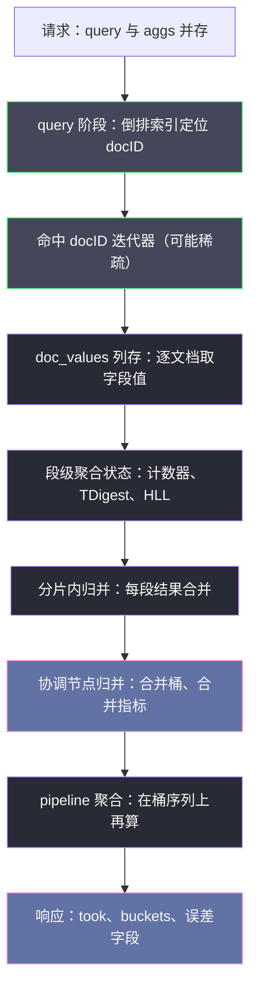
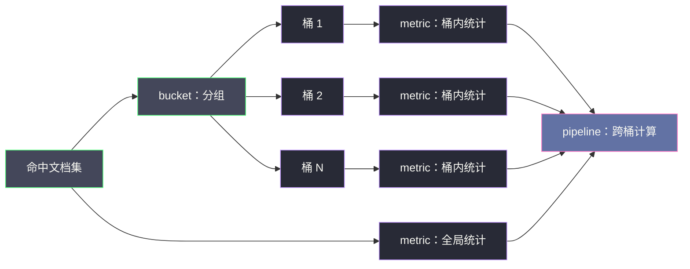
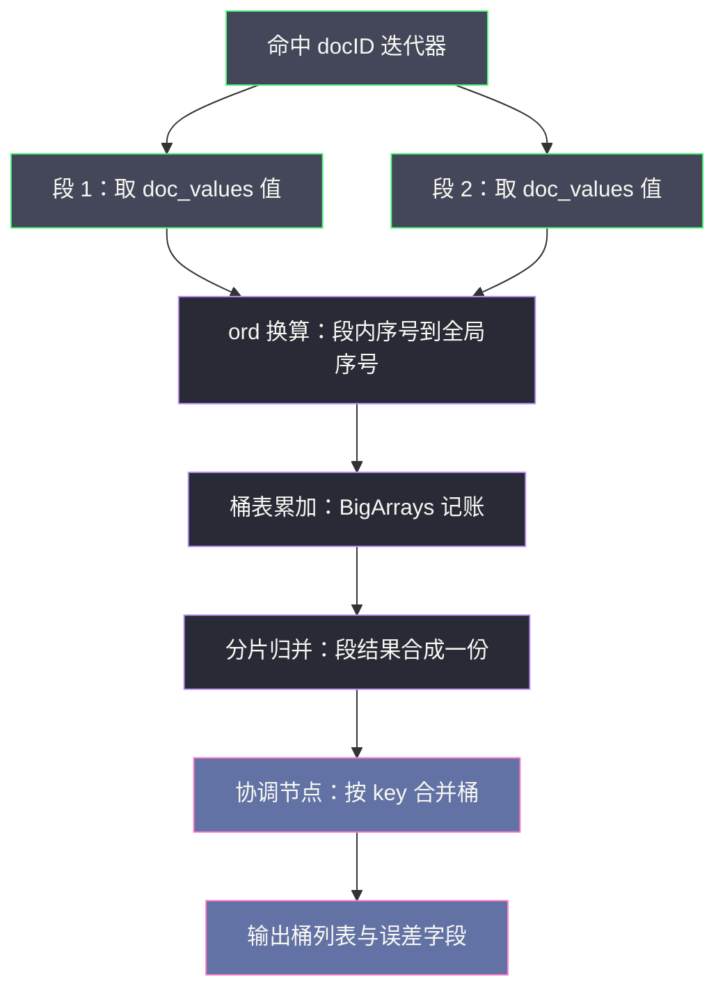
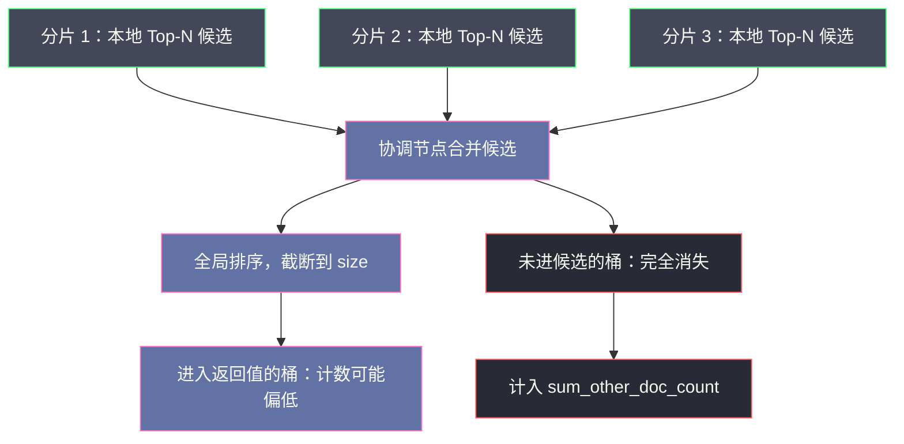
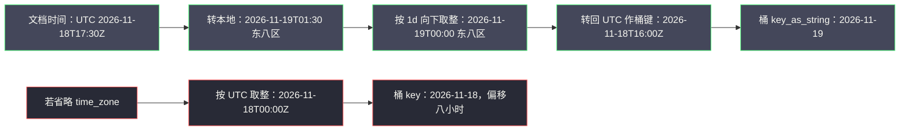
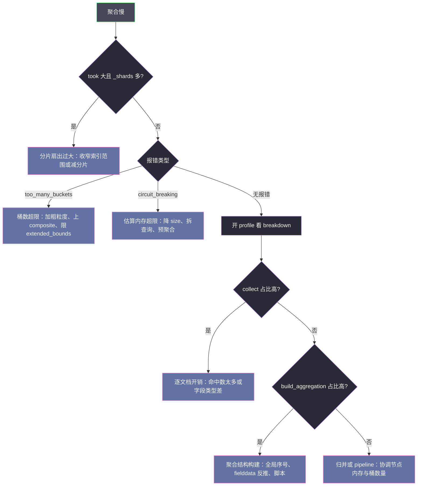

# 05 聚合分析——Bucket、Metric 与 Pipeline

**摘要：**

聚合是 Elasticsearch 里最像数据库的一块能力，也是线上最容易同时踩到"慢"和"不准"两块地雷的地方：慢起来能把整个节点的堆吃掉，不准起来又会给出一个看上去完全合理、实际差了两三成的数字。本文从订单索引上的两个抱怨切入——按天统计的曲线从早上八点开始、分组报表和明细对不上——把聚合拆成三条互相咬合的线索：其一，聚合不走倒排索引而走 `doc_values` 列存，执行路径决定了它的成本随命中文档数线性增长，也决定了 `text` 字段为什么必须开 `fielddata` 才能聚合、而 `fielddata` 为什么是堆的杀手；其二，精度契约，`terms` 的 `size` 默认只返回十个桶、每个分片只上报自己的 Top-N、`cardinality` 与 `percentiles` 用的是概率算法，误差既有明确来源也有明确边界；其三，资源账本，桶数、`search.max_buckets` 与三层断路器共同决定了一次聚合能不能跑完。全文以 bucket、metric、pipeline 三类聚合为骨架，途中穿插时区、`nested`、`global`、`filter` 这些容易踩空的角落，末尾给出一条从 `took` 到 profile 的判据链、五个成因的处置表，以及预聚合、`composite`、字段类型改造三条替代路线。文中量化数字除注明出处的，均标注为示例推算，只用于对齐量级。

---

## 第 1 章 两个抱怨，一条主线

### 1.1 曲线为什么从早上八点开始

运营在早上九点发来一张图，横轴是最近三十天，纵轴是每日订单额，每个柱子的起点都落在上午八点。数据没有错，采集没有丢，报表接口也没有做时区转换——错的是分桶的尺子。`date_histogram` 默认按 UTC 切日历，而业务方的"一天"指的是东八区的零点到次日零点，两个日历相差八个小时，落到图上就是整体位移八小时。这张图是本文最好的入口，因为它同时暴露了两件事：聚合的结果形状由参数决定，而参数的默认值是按 UTC 与英文世界的习惯定的。

同一个索引上还有第二个抱怨，来自财务对账。按支付渠道分组的汇总表，和从明细导出的口径差了几千单，渠道方自己的后台又是另一个数。这类"数字对不上"的排查通常耗时数天，最后往往要落到三个地方：`size` 默认只返回十个桶、每个分片只上报自己那一份 Top-N、以及 `cardinality` 给出的本来就是估算值。三者叠加，误差既不显眼也不可忽略。

### 1.2 聚合不是"加了 GROUP BY 的搜索"

关系型数据库里，`GROUP BY` 与普通查询共享同一套执行器：扫表、过滤、分组、聚合，差别只在最后两步。Elasticsearch 不是这样。搜索请求与聚合请求共享 `query` 阶段——都用倒排索引定位命中的文档号，但过了这一步就分道扬镳：搜索只取回目标条数的文档并打分（`query` 阶段与评分机制见 [[04 查询与相关性评分——BM25 与向量检索]]），聚合则要把命中文档集**全部**过一遍，从另一套磁盘结构里把每个文档的字段值读出来，再做归并。命中一千万的查询，返回十条 `_source` 就结束；命中一千万的聚合，要把一千万个文档的 `doc_values` 解码一遍。



这张链路上有三个容易混淆的环节。第一个是 `query` 与聚合的耦合：查询写得越松，进入 `doc_values` 解码的文档越多，聚合时间近似线性增长，这解释了"同一个聚合在 `now-15m` 上几十毫秒、在 `now-30d` 上几十秒"的现象。第二个是归并发生了两次而不是一次：段内先归并，分片内再归并，协调节点最后合并——`terms` 的精度问题全部长在这个多级归并上。第三个是 pipeline 聚合的位置：它在协调节点、在桶已经生成之后执行，所以它无法减少上游任何开销，只能改变结果的表达。

### 1.3 三个契约：路径、精度、内存

把上图的环节按住不放，可以抽出三条契约，后文所有内容都是这三条的展开。**路径**指数据从哪儿读：聚合读列存，因此字段类型、编码方式、是否开启 `doc_values` 直接决定解码成本。**精度**指结果的可信度：近似算法、分片归并、排序方式各自贡献一部分误差，误差有界但不会为零。**内存**指这些中间状态住在哪儿：桶表、分位数的质心、去重计数的寄存器，全部落在 JVM 堆上，由断路器兜底。三条契约互不替代——把查询改快了不解决精度，把 `size` 调大了不解决内存，把断路器调高了只是把崩溃推后。

---

## 第 2 章 三种聚合，三种职责

### 2.1 桶聚合：把文档分进组

桶聚合（Bucket Aggregation）定义一种分组函数，把文档集切成若干互不相交的子集，每个子集是一个桶，桶里可以继续挂子聚合。最常用的是 `terms`，按字段值分组，等价于 `GROUP BY`；`date_histogram` 与 `histogram` 按时间或数值区间分桶；`range`、`date_range`、`ip_range` 用显式区间切分；`filters` 一次请求里按多个条件切分；`composite` 把多维分组拼成一个可翻页的扁平键。

除了"多桶"聚合，还有一类特例叫单桶聚合：`filter` 把文档集收窄成一个桶，`global` 忽略查询条件、取整个索引作为一个桶，`nested` 把嵌套文档展开成一个桶。单桶聚合看起来不起眼，却是很多"分母算不出来"问题的解法，第 8 章会细讲。

### 2.2 指标聚合：在一个集合上算数

指标聚合（Metric Aggregation）不做分组，它在一个文档集上算出一个或一组数值。单值的有 `avg`、`min`、`max`、`sum`、`value_count`、`weighted_avg`，多值的有 `stats`、`extended_stats`、`percentiles`、`percentile_ranks`，以及返回原始文档的 `top_hits`。它们既可以挂在查询顶层（对全部命中文档算一次），也可以挂在每个桶里（对桶内文档各算一次），后一种用法才是分析场景的主力。

`stats` 一次遍历同时给出 `count`、`min`、`max`、`avg`、`sum`，比分别发五个指标聚合省下的不只是往返，而是同一段 `doc_values` 只解码一次。这也是聚合设计里最朴素的一条优化：能一次遍历算完的，不要拆成多次。

### 2.3 管道聚合：对结果再算一遍

管道聚合（Pipeline Aggregation）的输入不是文档，而是别的聚合的输出。它分两类：父管道（parent）作用在同一层桶集合上，`bucket_script` 用脚本对若干指标做算术，`bucket_selector` 按条件筛掉桶，`bucket_sort` 对桶排序并截断；兄弟管道（sibling）作用在兄弟聚合产出的序列上，`derivative` 求相邻桶差值，`cumulative_sum` 求累计，`serial_diff` 求同期间隔差，`moving_fn` 做滑动窗口计算，`avg_bucket`、`max_bucket` 之类把整条序列压成一个数。

`buckets_path` 是管道聚合的寻址语法：`total_sales` 指向同层指标，`by_region>total_sales` 用大于号下钻一层，`_count` 指桶的文档数，`_value` 指单值指标的值。序列中间有空桶时由 `gap_policy` 决定行为：`skip` 跳过缺口，`insert_zeros` 把缺口当零补上——这一项选错，会让同比环比曲线出现整段跳变。

8.x 里还有一个版本口径必须交代：早期的 `moving_avg` 在 6.4 被标记弃用，8.0 起已被移除，请求里出现它会直接报错，对应的替代品是 `moving_fn`；同样在 8.0 被移除的还有 `date_histogram` 排序里的 `_time` 键，统一改用 `_key`。照着老文章抄 DSL 时，这两处最容易在升级后翻车。

### 2.4 三者的边界与常见误用

三类聚合的分工清晰，误用却集中在两处。一是把管道聚合当成优化手段，希望靠 `bucket_sort` 只取前十名来减轻上游负担——恰好相反，`bucket_sort` 要求上游把所有桶都算完并传到协调节点，它只是在结果上再做一次排序截断。二是把 `terms` 的 `size` 当成"分组上限"，以为`size: 0` 或省略 `size` 就会返回全部分组，这个问题留到第 5 章用误差字段说清。

| 维度 | bucket 聚合 | metric 聚合 | pipeline 聚合 |
|:---|:---|:---|:---|
| 输入 | 文档集 | 文档集 | 其他聚合产出的桶或指标序列 |
| 输出 | 若干桶，可继续嵌套 | 一个或一组数值 | 每个桶上的派生值，或整条序列的值 |
| 典型成员 | `terms`、`date_histogram`、`range`、`composite` | `avg`、`stats`、`cardinality`、`percentiles` | `derivative`、`bucket_script`、`cumulative_sum`、`moving_fn` |
| 执行位置 | 数据节点逐段收集 | 数据节点逐段收集 | 协调节点，归并之后 |
| 失败形态 | 桶爆炸、精度失真 | 熔断、近似误差 | 上游开销无法减免、缺口处理错误 |



这张图想说明一件容易被忽略的事：pipeline 聚合的视野横跨整棵聚合树，它看得见所有桶，但它改变不了任何桶的生成成本。真正决定一次聚合开销的，永远是左边的分组函数和上面的查询条件。

---

## 第 3 章 doc_values：聚合慢的第一性原因

### 3.1 倒排回答"在哪里"，聚合问"是多少"

官方文档里有一句话把两种读模式的差别讲得很干净：倒排索引是"拿词去找文档"，而排序与聚合需要的是"拿文档去找它有哪些词"。前一种模式适合检索，后一种模式需要一个以文档号为主键、按字段展开的副本。这个副本就是 `doc_values`，它在写入阶段随段一起生成，以列式（column-oriented）方式落在磁盘上。

用一个图书馆的比喻可以少绕几步。倒排索引像书名目录：你说出一个关键词，管理员直接翻到那一页，告诉你哪些书架上有这本书。`doc_values` 像是把每本书的版权页复印下来，按"全部书的第 N 页"装订成册——你要统计某年出版的书有多少本，不需要一本本翻，只需要把那一册从头读到尾。反过来，你要找《某某》这一本，翻那册复印本毫无帮助，还是得回到书名目录。两种目录各有自己的强项，ES 把它们同时维护着。

### 3.2 列存的物理形态

`doc_values` 在 Lucene 的段目录里体现为两类文件：数据文件 `.dvd` 与元数据文件 `.dvm`。数据按文档号顺序排列，同字段的所有值连续存放，因此扫描一个字段就是一次顺序 IO，页缓存命中率极高。编码随类型分档：数值与日期用定长块加差值压缩，时间戳因为单调递增往往能压到极小的位宽；`keyword` 用有序字典加序号（ord）列，文档里存的是指向字典的整数序号；`boolean` 与 `ip` 也各有专用编码。

| 字段类型 | `doc_values` 编码 | 能否直接聚合 | 说明 |
|:---|:---|:---|:---|
| `keyword` | 有序字典 + ord 列 | 可以 | 聚合主力，基数决定字典与 ord 映射的规模 |
| `long`、`integer` | 定长块 + 差值压缩 | 可以 | 数值分桶与求和的首选 |
| `double`、`float` | 定长块定点编码 | 可以 | 有精度换算开销，金额避免用浮点 |
| `date` | 毫秒时间戳差值压缩 | 可以 | 单调递增时压缩率最高 |
| `boolean` | 位图 | 可以 | 桶数最多两个，几乎不会出问题 |
| `text` | 不生成 | 不默认允许 | 需打开 `fielddata`，走的是完全不同的堆内结构 |

这条表格的后两行是全文的分水岭。倒排与词典的构造细节见 [[02 倒排索引——从 Term Dictionary 到 FST]]，这里只记住一点：`text` 字段在 `doc_values` 里根本没有副本，所以对它做聚合时，ES 只有两条路：报错拒绝，或者按 `fielddata` 的要求临时把倒排索引翻转成堆内结构。

### 3.3 稀疏命中集反而更慢

列存擅长顺序读，前提是文档集合本身稠密。真实的聚合请求前面往往挂着过滤条件，命中的文档号可能是一亿个文档里散落的一万个。此时按文档号跳读列存，每跳一次都可能落在不同的压缩块上，解压与随机访问的代价被放大了几十倍。笔者遇到过一个反直觉的现场：同一个聚合，把时间范围从三十天缩到一小时，耗时只降了不到一半——因为总文档数虽然少了，但命中集在段内高度稀疏，扫描变成了跳读。

这个现象解释了两条经验。其一，"先用 `filter` 缩小范围再聚合"并不是无条件成立，它的收益取决于过滤后的文档集是否还保留足够的稠密度；如果过滤极狠，反而应该考虑把这部分统计从聚合改成预聚合。其二，段的数量会影响稀疏度：段越碎，各段内部的命中分布越散，随机跳读的次数越多，这也是合并段能间接改善聚合延迟的原因之一（段的生成与合并且见 [[03 文档写入与 Lucene 段合并]]）。

### 3.4 一次聚合的读取顺序

把第 1 章的链路压到存储层，一次 `terms` 聚合在单个分片内部的执行大致是：先在查询阶段拿到命中文档号的有序迭代器；对每个段，把文档号送进聚合收集器；收集器从 `doc_values` 取该字段的值，若是 `keyword`，值已被映射成段内序号，再经全局序号（global ordinals）换算成跨段统一的序号；收集器用这个序号在桶表里累加计数，桶表由 BigArrays 管理，记账记在请求断路器上；段收集结束后，分片把各段结果归并成一份；协调节点再把各分片的桶按 key 合并、把指标按各自的可合并规则合并。



中间那个"全局序号"步骤值得单独记住。**全局序号（global ordinals）**是分片级的一张映射表，把每个段的局部序号翻译成跨段统一的序号，这样桶表就只需要一套；它的代价是每次有新段可见（也就是每次 `refresh` 之后）都要重建，并且内存与字段基数成正比。字段基数越高，这张映射表越大，重建越贵——这是"高基数字段做 `terms` 聚合会周期性抖动"的物理原因，而不只是"桶太多"这么一句概括。

### 3.5 量化：一次聚合读了多少

给一组示例推算。假设一亿条订单文档，单分片命中全部，`category` 是基数两百的 `keyword`，`doc_values` 中每文档的 ord 按两字节打包，加上块内解压开销，按每文档四字节估算，纯数据量约 400MB；这 400MB 是顺序读，页缓存热的情况下吞吐可以做到每秒数 GB，冷的时候受限于磁盘。再假设每文档的解码与累加分摊到一百纳秒，一亿文档就是十秒量级的 CPU 时间——分散到多个分片后可以并行，所以真正的墙不是单次读取，而是"命中数乘上分片数"这个总账。

同样的道理放到 `date_histogram` 上更明显。按分钟分桶统计三十天，桶数不过四万出头，看着不多；但每个桶的文档数依然要逐文档累加，成本仍然与命中数成正比。所以时间范围的收缩带来的是两重收益：桶数变少、命中数变少。反过来，把 `calendar_interval` 从 `1d` 调到 `1m` 只会让桶数涨一千四百倍，命中数一点没变，聚合耗时几乎不变，内存却可能先撞上桶数上限。

---

## 第 4 章 text 与 fielddata：堆是怎么被吃掉的

### 4.1 text 字段为什么不能聚合

`text` 字段在写入时被分析器切成若干词元，倒排索引里存的是词元到文档的映射。这里没有"字段值"这个概念：一篇文档的 `title` 在倒排里是五个词元的五个条目，它们的顺序关系由位置信息表达，而不是由一个值表达。聚合要的是"这个文档在 `title` 上有一个什么值"，`text` 结构里根本没有这个东西，所以 `doc_values` 也不为它生成——官方文档在列举 `doc_values` 的例外时点得很明确：`text` 与 `annotated_text` 不在此列。

不加处理直接对 `text` 聚合，ES 会拒绝，错误信息会告诉你要么改用子字段，要么显式打开 `fielddata`：

```json
{
  "error": {
    "type": "illegal_argument_exception",
    "reason": "Fielddata is disabled on text fields by default. Set fielddata=true on [title] in order to load fielddata in memory by uninverting the inverted index."
  }
}
```

这条报错的设计意图是保护，不是刁难。它把"要不要为此付出堆内存"这个决定权交回到建模的人手里。

### 4.2 fielddata 到底做了什么

`fielddata` 的实现是"反推"（uninvert）：把一个段里的倒排索引临时翻转，得到"文档号到词元"的映射，再在堆内建立字典与序号，供排序、聚合、脚本使用。它有三个与 `doc_values` 截然不同的性质。第一，它是按段构建、按段淘汰的，段被合并后旧结构失效，新段要重新构建。第二，它常驻堆内，且不受段生命周期之外的任何限制，只有断路器与缓存清理能约束它。第三，它的构建是按需触发的——第一个打到这个字段的请求会承担全部构建成本，表现为"第一次查询特别慢，之后变快"，这种延迟毛刺极难在压测里复现。

### 4.3 把阈值调高只是把事故推后

`fielddata` 的内存由字段数据断路器把关，`indices.breaker.fielddata.limit` 默认是堆的 40%，估算值还会乘以一个 1.03 的系数。超限时请求被拒，返回 `circuit_breaking_exception`。看起来安全，实际有两个缺口：断路器估算的是加载这一份 `fielddata` 所需的内存，它挡不住"许多字段各自只占一点点、加起来超过堆"的累积效应；而且它对高基数字段尤其不友好，一个百万级唯一值的 `text` 字段反推之后，字典、序号、映射表三项叠加，量级很容易到 GB。

更麻烦的是它对 GC 的影响。堆内大对象的存活时间与段的生命周期绑定，段合并时新旧两代 `fielddata` 会同时存在，堆占用出现尖峰；如果堆本来就紧张，这一下就够触发长时间 Full GC，节点进入假死，协调节点超时重试，请求量翻倍，形成正反馈。

### 4.4 三种正确的取法

| 取法 | 可聚合 | 空间成本 | 内存成本 | 适用场景 |
|:---|:---|:---|:---|:---|
| `text` 加 `keyword` 子字段 | 是，走子字段 | 多一份 keyword 列存 | 无额外堆 | 既要全文检索又要聚合，默认选择 |
| 只建 `keyword`，不建倒排（`index: false`） | 是 | 只有列存 | 无额外堆 | 以分组排序为主、偶尔过滤的维度字段，过滤会退化为扫描列存 |
| `text` 开 `fielddata` | 是 | 不额外占磁盘 | 堆内常驻，GB 量级 | 极低基数、偶发聚合，能明确承受代价 |
| `runtime` 字段做转换 | 是 | 不落磁盘 | 查询时逐文档计算 | 一次性分析、临时口径 |

第三行的关键在于"极低基数"这个词。例如 `level` 只有 `debug`、`info`、`warn`、`error` 四个值，`fielddata` 的内存占用可以忽略，此时打开它换来的建模便利是划算的；但把同一开关用在 `message`、`url`、`user_agent` 上，就是拿节点的命去赌。第四行的 `runtime` 字段在 8.x 里是首选替代——它不落磁盘、不占常驻堆，代价是每次查询都要逐文档计算，只适合一次性分析。另外，`text` 类型上还有一个 `fielddata_frequency_filter` 参数，可以只把高频词加载进内存，低频词在聚合时被跳过；这个参数的副作用是聚合结果不再完整，通常只用于探索性分析。

---

## 第 5 章 terms 的两个默认值，把分组变成了抽样

### 5.1 size 默认只给十个桶

`terms` 聚合的 `size` 默认是 10。这个默认值在 Kibana 的图表里很自然——没人数一个饼图的三十个扇区——但它是"聚合不准"的头号来源。省略 `size` 并不会返回全部分组，它只会返回用户最关心的那十个，其余的桶被折叠进 `sum_other_doc_count` 这个数字里。于是"渠道一共十七个，报表只有十行"这种问题，往往不是数据丢了，而是没要。

### 5.2 两次归并，两次截断

单分片时，`terms` 的行为很好理解：扫一遍文档，在桶表里累加，按 `doc_count` 排序取前十。分布式场景下多了一层：每个分片不能只返回自己的前十，因为一个在全局排第一的词，可能在每个分片都只排第十一。所以 `terms` 让每个分片多报一些候选，候选数量由 `shard_size` 控制，默认值是 `size` 乘 1.5 再加 10；协调节点拿到所有分片的候选后合并、排序、截断到 `size`。这是两次截断：分片按 `shard_size` 截，协调节点按 `size` 截。

`shard_size` 有一条硬规则：不能小于 `size`，小于时会被自动改写成 `size`。这一条在排查时很有用——如果你以为自己把 `shard_size` 调小了省内存，其实什么都没发生。

### 5.3 漏桶的算术

用三个分片、请求前十（`size` 为 10）、`shard_size` 为 10 的极端配置走一遍。假设 `brand` 字段上有四个品牌，每个分片的计数如下：分片一给出 A 1000、B 700、C 500、D 400；分片二给出 A 900、C 600、D 500、B 100；分片三给出 B 1200、D 600、A 50、C 50。每个分片按自己的 Top-10 上报，因为总共只有四个词，四个桶都报上来了，结果精确。把场景改成每个分片有两百个词就不同了：分片三的候选表里塞满了它本地的高频词，某个在全局排第五、但在三个分片都只排第十二的品牌，会在三个分片的候选表里同时落选，从结果里彻底消失；另一些挤进候选表的词，则只带回了局部计数。



图里两条出口是两种不同性质的失真：进了返回值的桶，计数可能偏低；没进候选的桶，连同计数一起消失。前者影响数值，后者影响排名，业务方感受到的往往是后者——"明明这个渠道这个月卖得最好，报表里根本没有它"。

### 5.4 误差字段要主动打开

ES 为每个桶提供了一个上界字段 `doc_count_error_upper_bound`，它的定义是：各分片上未进入 `shard_size` 的最大桶的计数之和。换句话说，它衡量的是"这个桶在别的分片上可能漏掉多少"。它是每个桶一个值，而不是整个响应一个值；而且默认不返回，必须在请求里打开 `show_term_doc_count_error`：

```json
{
  "size": 0,
  "aggs": {
    "by_channel": {
      "terms": {
        "field": "channel.keyword",
        "size": 20,
        "show_term_doc_count_error": true
      }
    }
  }
}
```

响应里还会带一个 `sum_other_doc_count`，表示没进前 `size` 的文档总数——它是精确值，可以作为"我到底漏了多少"的粗略标尺。判断聚合是否可信，最实用的做法是看这两个数：`sum_other_doc_count` 为 0 且误差上界为 0，说明这次分组是完整的；`sum_other_doc_count` 占比很大，说明这不是"全部分组"而是"头部抽样"，业务口径必须跟着调整。只盯 `took` 而从不看这两个字段，是把聚合当数据库用的典型症状。

### 5.5 排序方式会改变误差的形状

默认按 `doc_count` 降序，此时误差是有界的，可以用上面那个字段报出来。一旦换排序，性质就变了。按 `_key` 排序是安全的：字典序不依赖各分片的计数分布，合并之后的顺序与合并之前一致，结果精确。按子聚合排序则基本不可靠，官方文档的说法是"很容易写出一个返回错误结果、并且不容易察觉的排序"，只有两种情况能保证正确：按最大值降序、按最小值升序——因为全局最大必然出现在某个分片的局部最大里，而全局最小同理。

最危险的是 `"order": {"_count": "asc"}`，也就是专门去找冷门分组。由于每个分片上报的永远是自己局部的高频候选，低频词在候选阶段就被筛掉了，升序排序拿到的是一份被系统性截断的样本。8.x 为此提供了专门的 `rare_terms` 聚合，它在分片层面按低计数保留候选，正是为这种需求设计的。这条经验值得写进团队规范：需要冷门分组时，不要给 `terms` 换排序，换聚合类型。

### 5.6 把准确度买回来：四个旋钮

| 旋钮 | 作用 | 调大的代价 | 调小的代价 |
|:---|:---|:---|:---|
| `size` | 最终返回的桶数 | 协调节点内存与响应体积线性增长，逼近 `max_buckets` | 直接丢分组，`sum_other_doc_count` 变大 |
| `shard_size` | 每分片候选桶数 | 每分片多存多传候选桶，分片越多协调节点收得越多 | 候选不足，误差上界抬高、部分桶整体消失 |
| 分片数（路由或单分片） | 归并层级 | 单分片牺牲并行度与高可用 | 分片过多放大候选总量与协调压力 |
| `composite` | 用翻页替代 Top-N | 请求次数增加，需要客户端循环 | 单次返回不全，但每页精确 |

第一、二行合起来有一个容易记反的事实：想提高准确度，优先加 `shard_size` 而不是加 `size`。前者的开销只是候选桶的内存与网络字节，后者会让最终结果集膨胀，还可能牵连子聚合与响应序列化。文档对两者的措辞也很直白：加大 `shard_size` 比加大 `size` 便宜得多，但依然要付网络与内存的账。这句话的"便宜"是相对的，量级上并不小：按示例推算，500 个分片、`shard_size` 取 1000，协调节点要一次性收下五十万条候选，每条按一百字节计就是 50MB 的瞬时驻留，十个这样的查询并发就是 500MB——这也解释了为什么高并发报表集群里，请求断路器报错常常出现在"聚合参数看着很保守"的请求上。

四个旋钮之中，`composite` 是最彻底的一个。它把多维分组拍成一个扁平的复合键序列，按 `after_key` 翻页，每页 `size` 默认为 10，返回的桶数与请求的 `size` 严格相等，不存在"哪个桶被漏掉"的问题——因为它的语义就是"按 key 顺序遍历全部桶"。代价是客户端要循环请求，多次往返，且不能像 `terms` 那样一次拿到按计数排序的 Top-N。要全量、要精确，用它；要头部排名，用 `terms`。

### 5.7 collect_mode 与组合爆炸

还有一个影响的不只是精度而是耗时的参数：`collect_mode`。当 `terms` 下面挂着另一个 `terms` 时，`depth_first` 会为每个父桶的每篇文档构建子桶，两个高基数字段相乘就是**组合爆炸**——文档里举的例子很形象：一个演员可能产出 n 平方个桶。`breadth_first` 反过来，先算出父层的前 N 个桶，再只为这些桶收集子聚合，代价是父层的候选要在内存里暂存。默认策略是按基数自适应：基数字段大于请求的 `size`，或者基数未知（数值字段、脚本），走 `breadth_first`；否则走 `depth_first`。排查两层 `terms` 特别慢的现场时，先看 `collect_mode` 实际走了哪条路，比盲目调 `size` 有效得多。

另外，`terms` 还有一个 `execution_hint`，默认 `global_ordinals`，也可以设为 `map` 直接用词值作键、绕过全局序号。`map` 只在命中数很少时值得考虑，官方提示是"命中很多时，基于序号的执行方式明显更快"。若一个索引已经不再写入，把它强制合并成单段，可以让段内序号直接等于分片的全局序号，从而彻底省掉全局序号的构建——代价是合并期间的大量 IO 与磁盘峰值，这个取舍在冷索引上很划算，在热索引上不成立。

---

## 第 6 章 近似算法：cardinality 与 percentiles

### 6.1 HyperLogLog++ 在数什么

去重计数（`cardinality`）与分位数（`percentiles`）都面对同一个困境：精确算法需要把全部值放进一个集合再排序或去重，内存随数据量线性增长，放到亿级文档上就是几 GB。ES 对这两者都用了概率数据结构。

`cardinality` 用的是 HyperLogLog++（HLL++）。它的原理可以用"估计广场上的人数"来类比：不点名，而是让每个人看一眼自己帽子上印的随机数的前导零个数，报出"我见过的最长一串前导零是 k"，据此反推人数大约是 2 的 k 次方。单个样本方差极大，于是把广场分成许多区域（寄存器），各区域独立估计再取调和平均，误差就被压下来了。HLL++ 在此基础上加了稀疏表示与偏差校正：基数小的时候用近似精确的结构，基数大的时候才切换到稠密寄存器。

它有三个工程性质值得记住。其一，内存只与精度参数有关，与唯一值个数无关——不管是一万个还是一百亿个唯一值，内存都一样。其二，它天然可合并（merge），多个分片各自算完，协调节点把寄存器逐位取最大值即可，不需要传输原始数据，这正是它能在分布式里成立的关键。其三，误差是概率性的，可以给出量级预期，但不能给出逐次保证。

### 6.2 precision_threshold 默认 3000

`precision_threshold` 的语义是"低于这个唯一值数量时，计数接近精确；高于这个值时，计数开始变得模糊"。默认值 3000，上限 40000，超过 40000 按 40000 处理。内存开销的官方口径是按参数线性：阈值 c 大致需要 c 乘 8 字节。据此可以列一张示例推算表，把代价放在明面上：

| `precision_threshold` | 每分片寄存器内存（约） | 典型误差量级 | 适用判断 |
|:---|:---|:---|:---|
| 100 | 约 0.8KB | 低基数下接近精确，百万级唯一值时可见 1% 到 6% 的偏差 | 只要"有没有过万"这种粗判断 |
| 3000（默认） | 约 24KB | 阈值以内基本精确，以上逐步偏离 | 大多数 UV、会话数统计 |
| 40000（上限） | 约 320KB | 偏差进一步收窄，但仍是估算 | 计费、审计类需要接近精确的统计 |

表中内存一列是"每分片每聚合"的量级，实际集群总量要乘以分片数与并发请求数；误差一列来自官方对"阈值 100 时百万级计数仍有 1% 到 6% 偏差"的描述，其余档位按 HLL 的标准误随寄存器规模下降的规律推算，属于量级判断，不是逐次承诺。请注意，误差并非只有系统性偏移，它还会随数据集分布变化，同一份数据在不同分片切分下可能得到不同结果。

### 6.3 把 cardinality 用错的两个场景

第一个场景是对账。财务要求"本月下单用户数与财务系统一致"，而 ES 给的是估算，两边差 3% 就会触发一串排查。这类需求应当在设计阶段就划清边界：`cardinality` 适合趋势、量级、漏斗，不适合作为账目数字的最终来源。真要精确，只能回到 `terms` 全量枚举（受 `max_buckets` 与内存约束），或者把去重放到离线任务里做。

第二个场景是在高基数 `keyword` 上做 `cardinality` 的同时还要求它快。官方给了一个技巧：对超高基数字符串字段，可以预先存哈希值（客户端算好，或用 `mapper-murmur3` 插件在写入时算），再对哈希字段做 `cardinality`。这样省掉的是每文档的哈希计算与长字符串的比较，节省的是 CPU 与内存，代价是多一个字段、多一份存储，且哈希字段不能再用于精确分组。

### 6.4 percentiles 与 TDigest

分位数用的是 TDigest，由 Ted Dunning 提出。它把值压缩成一组"质心"，每个质心代表一段区间的数据点，查询分位数时在质心之间插值。它有两个性质很关键：精度与 q(1-q) 成正比，也就是说极端分位数（P99、P99.9）比中位数更准；对小数据集几乎精确，对大数据集才明显近似。监控场景恰好只关心尾部，这也是 P99 能在毫秒级给出的原因。

`tdigest.compression` 默认 100，文档给出的上界是"最大节点数约为 20 乘 compression"，压缩度越高，内存越大、精度越高、构建越慢。请求里还可能出现两个看起来矛盾的结果：同样的数据、同样的参数，两次请求返回的 P95 略有差别。这不是 bug，分位数聚合本身是非确定性的——合并顺序与质心裁剪都会影响结果。做容量评估或 SLA 统计时把这一点考虑进去，避免把 0.3% 的抖动当成回归。

### 6.5 合并、误差与"不可复现"

三种近似算法在分布式下的行为不同，值得对照记一遍。`cardinality` 的合并是精确的寄存器合并，误差只来自估算本身；`percentiles` 的合并是质心合并，合并顺序会影响结果，因此不同分片切分、不同请求时机可能给出不同值；`avg` 这类可交换的指标则是完全精确的，分片只传 `sum` 与 `count`，协调节点做除法。于是"同一个聚合，昨天和今天跑出不同结果"这件事，要先分清是数据变了、分片变了，还是算法本身不保证可复现。

顺带说一句看似无关但常被一起提起的坑：`hits.total` 在 8.x 默认有 10000 的上限，超过时返回 `"relation": "gte"` 而不是精确值。有人拿它当"总文档数"与聚合结果对照，自然会得出"聚合漏了"的结论。真要全量计数，得显式设置 `track_total_hits`，而那本身又是一次全量扫描。

---

## 第 7 章 date_histogram 的时区与桶边界

### 7.1 默认按 UTC 切日历

`date_histogram` 的 `time_zone` 默认是 UTC，这不是疏忽，而是一致性设计的自然结果：写入按 UTC 存，默认也按 UTC 算。问题在于业务的"天"是本地日历概念：东八区的 2026-11-19 从 UTC 的 2026-11-18T16:00:00 开始。不指定时区，每个桶的边界都落在本地时间早上八点，曲线自然整体右移八小时。

### 7.2 桶键的换算式

官方文档给出了桶归属的判定公式：先把 UTC 时间转成目标时区，按间隔向下取整，再转回 UTC。用文字表述就是"在指定时区的日历上找这个时刻所属的那一格，再把这一格的起点换回 UTC"。这意味着 `time_zone` 不只影响显示，它决定了文档落进哪个桶——跨零点的订单会因此换桶，按天的口径与按小时的汇总因此在边界处产生系统性差异。



图里两条路径的差别只在"在哪个日历上取整"。一旦报表口径固定，就必须把 `time_zone` 写进查询模板，而不是依赖客户端转换 `key_as_string`——后者在跨夏令时的月份会出现一天二十三小时或二十五小时的桶，手工换算必然出错。

### 7.3 calendar_interval 与 fixed_interval

`calendar_interval` 是按日历感知的间隔，接受单数量单位：`minute`、`hour`、`day`、`week`、`month`、`quarter`、`year`，也可以用 `1m`、`1d` 这种缩写，但不接受 `2d` 这种多数量。`fixed_interval` 是固定的 SI 单位倍数，永远是毫秒的整数倍，可以写成 `30s`、`90m`、`7d`。两者的差异在夏令时与月份长度上体现：用 `calendar_interval: 1d` 在东八区永远是本地零点到次日零点，用 `fixed_interval: 24h` 则是严格的二十四小时，遇到夏令时切换（在没有夏令时的东八区不会发生，但在有夏令时的时区会）两者就会错开。

选择规则很简单：按日历聚合（日报、月报）用 `calendar_interval`；按固定窗口聚合（每五分钟一个监控点、每二十四小时一个滚动窗口）用 `fixed_interval`。混用会产生"每天的桶长度在变"这种难以察觉的口径漂移。

### 7.4 空桶、边界与 offset

聚合结果默认只返回有文档的桶，间隔里没有数据的时段直接跳过。做趋势图时这会让曲线"跳格"，解决方式有两种：`min_doc_count: 0` 配合 `extended_bounds` 显式声明起止，强制补齐空桶；或者交给客户端补零。前者会让桶数按时间跨度膨胀，是一个容易被忽视的桶爆炸来源——把 `extended_bounds` 设成一年前的某天，而查询只覆盖最近一小时，按小时分桶就会凭空多出八千多个空桶。

`offset` 用来平移桶边界，常用于"财务日从凌晨三点开始"这种业务定义：`"offset": "+3h"` 会把桶的起点整体后移三小时。它与 `time_zone` 的区别是：`time_zone` 换的是日历，`offset` 换的是同一日历内的切分起点。两者叠加时各自改变一维：时区决定在哪张日历上取整，偏移决定同一张日历内的切分起点；理解这一层，才不会在跨月与跨夏令时的边界上把桶算错。

| 参数 | 默认 | 作用 | 调大或改动的代价 |
|:---|:---|:---|:---|
| `time_zone` | UTC | 决定在哪个日历上取整 | 不设时区，桶边界与业务口径错位 |
| `calendar_interval` | 无默认，必填 | 按日历感知的间隔分桶 | 粒度变细，桶数成倍增长并可能撞上限 |
| `fixed_interval` | 无默认，必填 | 固定长度的窗口 | 与日历脱钩，跨夏令时口径与报表不一致 |
| `offset` | 无 | 平移桶起点 | 偏移写错，整条曲线整体错位 |
| `extended_bounds` | 无 | 强制补齐空桶 | 跨度设大，空桶数量爆炸 |

---

## 第 8 章 三种容易被忽略的桶

### 8.1 nested 与 reverse_nested

对象数组如果按普通 `object` 映射，数组内各字段的关联关系会被压平：`[{"name": "A", "price": 10}, {"name": "B", "price": 20}]` 在索引里变成 `name` 的两个值加 `price` 的两个值，`A` 与 `10` 的配对关系丢失。`nested` 类型为每个子文档单独建一段隐藏文档，保住配对关系。代价随之而来：聚合时检索引擎的默认视野是"根文档"，嵌套文档在倒排里是独立条目，`terms` 聚合落在根层级根本看不见它们。

正确的写法是先进入 `nested` 路径，再在桶内做子聚合；如果需要回到父文档层面做统计（例如"有至少一个高价商品的订单数"），就要用 `reverse_nested` 跳回去。`reverse_nested` 有两个约束：必须写在 `nested` 聚合内部；`path` 默认为空，表示回到根文档，也可以指定回到更外层的嵌套对象，但不能指向当前 `nested` 结构之外的路径。

```json
{
  "size": 0,
  "aggs": {
    "items": {
      "nested": { "path": "items" },
      "aggs": {
        "expensive": {
          "filter": { "range": { "items.price": { "gte": 500 } } },
          "aggs": {
            "orders": { "reverse_nested": {} }
          }
        }
      }
    }
  }
}
```

这段查询的语义是"先看所有商品条目，筛出价格不低于 500 的，再回到订单层面数订单"。漏掉 `reverse_nested` 直接在外层数，得到的是商品条目数而不是订单数——两者在常见的多商品订单上差得很远。嵌套的另一个代价是隐藏文档让索引膨胀，一个三项数组会产生三个隐藏文档，`nested` 聚合的遍历成本随之上升，这也是"`nested` 用起来贵"的实际含义。

### 8.2 global：算占比的分母

`global` 聚合无视外层查询条件，把整个索引当作一个桶。它最常见的用途是当分母：报表要展示"本次查询命中的订单占全部订单的比例"，就需要在同一个请求里同时拿到分子与分母。`global` 只能放在聚合树顶层，因为把它嵌在别的桶里没有语义——它的定义就是"跳出当前作用域"。

```json
{
  "query": { "term": { "channel.keyword": "app" } },
  "size": 0,
  "aggs": {
    "all": {
      "global": {},
      "aggs": { "total": { "value_count": { "field": "order_id" } } }
    },
    "app": { "value_count": { "field": "order_id" } }
  }
}
```

这段请求一次拿到全量订单数与 app 渠道订单数，比值就是占比。没有 `global` 的话，只能发两次请求或者把条件写两遍，前者的两次结果可能落在不同的刷新周期上，后者的维护成本随条件复杂度上升。需要注意，`global` 桶不受查询条件约束，但它会把整个索引扫一遍，索引越大代价越高，用它做分母时最好配合过滤很狠的查询，或干脆走预聚合。

### 8.3 filter 与 filters：把子集算进一次请求

`filter` 聚合产生一个单桶，桶内是外层文档集与过滤条件的交集；`filters` 聚合一次产生多个并行的单桶，适合"按多个互斥条件各算一份"的场景。它们与查询里的 `filter` 有两个本质差别：查询里的 `filter` 作用在全部聚合上，`filter` 聚合只作用在自己的子树；查询里的 `filter` 子句能进节点查询缓存（query cache），被后续请求复用，`filter` 聚合只服务于当前这一条请求。

选择依据是"要不要影响其他聚合"。如果一次请求里所有指标都应该基于同一个子集，把条件放进 `query.bool.filter`；如果一个请求里要并列比较几个子集（例如"总览 + 各渠道明细"），用 `filters` 聚合，这样一次扫描、一次传输，比发多次请求省下的是重复扫描的成本。

### 8.4 post_filter 的陷阱

还有一个与桶无关、但会直接造成"数字对不上"的机关：`post_filter`。它在聚合之后才生效，只过滤返回的 `hits`。于是同一份响应里，`aggregations` 的数字包含被 `post_filter` 排除的文档，`hits` 却不包含。Kibana 里做"点选钻取"用的正是 `post_filter`，这种设计本身合理——面板要保持上下文——但如果有人拿面板上的聚合数字去和底部列表的条数对照，就会得出"聚合漏数"的错误结论。排查这类问题时，先确认请求里有没有 `post_filter`，比逐层拆聚合快得多。

---

## 第 9 章 桶数、内存与熔断

### 9.1 每个桶都要占一块堆

桶不是免费的。一个 `terms` 桶至少要存 key、文档计数、子聚合状态；如果有三个子指标，每个子桶都要带上 `avg` 的累加器和计数器。用示例推算记账：假设每桶平均占用两百字节（key 引用、计数、子聚合状态与哈希表开销），一百万桶就是两百 MB，而这还只是单个分片的状态；协调节点合并时还要再存一份，`size` 越大这份越大。高基数 `terms` 的危险不在于"分组多"，而在于"分组多乘上子聚合多乘上分片多"。

### 9.2 max_buckets 与 too_many_buckets_exception

`search.max_buckets` 是动态设置，默认 65536，语义是"单个响应允许的最大聚合桶数"，超出即报错，异常类型为 `too_many_buckets_exception`，消息形如"Trying to create too many buckets. Must be less than or equal to: [65536] but was [N]"，并提示可以调整该集群级设置来放宽。这个上限是保护性的，它在聚合把堆吃光之前先踩刹车。

具体到数字上，一个很普通的请求就可能触发它：按秒对最近二十四小时做 `date_histogram`，86400 个桶，超过 65536；再叠一层按服务名的 `terms`，桶数乘上服务数量，瞬间翻十倍。这条上限对"临时取个细粒度"的分析特别不友好，处置方式要么是加粗粒度，要么是用 `composite` 分页，要么是临时上调设置并同时盯住堆——最后这条只在明确知道总量可控时成立。

### 9.3 三层断路器

桶的内存、`fielddata` 的内存、请求本身的内存，由三层断路器分别把关：

| 断路器 | 保护对象 | 默认阈值 | 触发后的表现 |
|:---|:---|:---|:---|
| `indices.breaker.request.limit` | 单请求内聚合等结构的估算内存 | 堆的 60%，估算值再乘 1.0 的系数 | `circuit_breaking_exception`，请求被拒 |
| `indices.breaker.fielddata.limit` | `fielddata` 加载 | 堆的 40%，估算值乘 1.03 | 字段加载被拒，查询失败 |
| `network.breaker.inflight_requests.limit` | 传输中的请求体 | 堆的 100%，受父断路器约束 | 请求在入口被拒 |
| `indices.breaker.total.limit` | 全集群内存总闸 | 父断路器，`use_real_memory` 为真时 95%，为假时 70% | 所有子断路器之上再兜一层 |

请求断路器的记账方式是"预估加扣减"：进入聚合前先按估算值占额度，结束后释放。它的估算偏保守也偏理想化——聚合的真实峰值出现在"多分片结果同时驻留协调节点"的时刻，而分摊到单请求的估算未必覆盖这个峰值。实践中的经验是：断路器能挡住大部分明显失控的请求，挡不住"每个请求都不大、并发一高就超"的累积型过载，后者只能靠限流与预聚合。

### 9.4 提高阈值只是把 OOM 推后

熔断报错频繁时，最常见的处置是上调阈值，这几乎总是错的。断路器的作用是在堆耗尽前拒绝请求，把问题变成一个可观测的 4xx；调高阈值等于拆掉保险丝，让 JVM 在某个时刻直接 OOM、节点掉出集群、分片重新分配、恢复期间请求全打在同一批节点上——故障从"部分请求失败"升级为"集群级雪崩"。合理的顺序是：先定位是哪种桶在膨胀（`max_buckets` 报错还是请求断路器报错，两者的处置完全不同），再决定是改查询、改字段类型，还是把这条统计挪去预聚合。

如果集群里确实存在少量必须跑的大聚合，可以走专用通道：把这些查询路由到专门的数据节点（用 `preference` 或独立的协调节点），让它们的内存压力不影响在线检索。这是一种隔离而不是优化，代价是多一组节点的运维成本。

---

## 第 10 章 聚合慢的五个成因与判据链

### 10.1 五个成因

把前面各章的机制收拢，线上"聚合慢"的成因可以归成五类，它们的判据各不相同。

第一类是**高基数字段做 `terms`**：桶数与内存随基数增长，全局序号随刷新重建，表现为耗时随基数上升、堆使用出现与 `refresh` 同频的锯齿。第二类是**`text` 字段开 `fielddata`**：第一次查询触发反推构建，表现为冷启动毛刺、`fielddata` 内存持续上涨、GC 频率上升。第三类是**`cardinality` 精度过高**：寄存器内存按参数线性放大，在每桶都挂一个 `cardinality` 的请求里被分片数与桶数双重放大。第四类是**时间范围过大**：成本与命中数线性相关，表现为"范围缩一半、耗时不减半"的稀疏效应。第五类是**`script` 聚合**：`scripted_metric` 与基于脚本的分组要逐文档执行脚本，比读 `doc_values` 慢一个量级，且 8.x 为它准备了专门的闸门。

### 10.2 从 took 到 profile 的判据链

判据链的起点永远是 `took` 与 `_shards`：前者告诉你总耗时，后者告诉你参与的分片数与失败数；分片数异常大（一次搜索打到上千分片）本身就是规模问题，分片布局与路由规则见 [[01 ES 全局架构——集群、节点、索引与分片]]。第二步看两种报错：`too_many_buckets_exception` 指向桶数超限，`circuit_breaking_exception` 指向估算内存超限，前者改聚合形状，后者改数据规模。第三步开 `profile`，聚合节点会给出每个聚合器的耗时分解。



`profile` 里的 breakdown 有几个字段值得逐个对上号：`initialize` 是聚合器初始化的时间，`collect` 是逐文档收集的时间，`build_aggregation` 是构建聚合结构（例如全局序号、`fielddata`）的时间，`reduce` 是归并时间。同一份响应里还有 `debug.total_buckets` 与 `result_strategy`，前者直接告诉你这次生成了多少桶。`collect` 高说明瓶颈在逐文档解码与累加，往命中数和字段类型上查；`build_aggregation` 高说明瓶颈在结构构建，往全局序号、`fielddata`、脚本上查；`reduce` 高说明瓶颈在协调节点的合并，往桶数与分片数上查。

### 10.3 五个现场与处置

| 症状 | 判据 | 根因 | 处置 |
|:---|:---|:---|:---|
| 聚合耗时随刷新周期抖动 | `fielddata` 内存锯齿、`build_aggregation` 占比高 | 高基数 `keyword` 的全局序号反复重建 | 换 `execution_hint: map` 或降基数、冷索引强制合并单段 |
| 首次聚合极慢，之后正常 | `fielddata` 内存突增后持平 | `text` 开了 `fielddata`，按需反推 | 改 `keyword` 子字段或 doc-values-only 字段 |
| 请求零星失败，报熔断 | `circuit_breaking_exception`、请求断路器 `tripped` 计数 | 桶数与子聚合叠加超估算 | 降 `size` 与层级、拆查询、预聚合 |
| 桶数不涨但耗时随范围线性涨 | `collect` 占比高、命中数大 | 逐文档解码与累加 | 缩范围、加过滤、把统计下推到预聚合 |
| 脚本聚合拖垮节点 | profile 显示聚合器类型为脚本类、CPU 高 | 逐文档执行脚本 | 改 `runtime` 字段或写入时预计算字段 |

第五行的"写入时预计算"值得展开。很多脚本聚合在做的事，本质是把几个字段拼装成新的分组键，这种工作在写入时做一次、在查询时省掉千万次。Ingest Pipeline 里可以用 `script` 处理器预计算，或者在应用侧直接写入目标字段；代价是索引体积与写入开销上升，收益是查询侧彻底摆脱脚本。这种把成本从读搬到写的取舍，是聚合优化里最常见的一类。

### 10.4 脚本聚合的闸门

8.x 对脚本聚合加了一层管控：`search.aggs.only_allowed_metric_scripts` 默认 `false`，置为 `true` 后，`scripted_metric` 里只允许使用白名单里的内联脚本或存储脚本，白名单由 `search.aggs.allowed_inline_metric_scripts` 与 `search.aggs.allowed_stored_metric_scripts` 配置。这层设计的动机很直接：脚本聚合属于那种"用户代码在数据节点上逐文档执行"的机制，它对集群的影响面与普通查询不同。与此并列的还有 `search.allow_expensive_queries`，用它可以在查询侧整体关闭昂贵查询，适合对外暴露搜索接口的网关层。

---

## 第 11 章 让它变快：从查询侧到写入侧

### 11.1 先把候选集缩小

最有效的优化永远是少扫文档。把过滤条件放进 `query.bool.filter` 而不是 `must`，一是免掉打分，二是能进节点查询缓存、被后续同类请求复用；把时间范围写死在查询里而不是靠客户端截断结果；把"只关心异常"的聚合挂上状态过滤。这三件事的收益远大于任何参数微调，因为聚合成本与命中数线性相关，而参数只能改变常数项。

需要注意前文提过的稀疏效应：过滤极狠时，命中集在段内高度稀疏，`doc_values` 的随机跳读会吃掉一部分收益。判断方式是看 `collect` 耗时是否与命中数同比下降；若无明显下降，说明瓶颈已经转到块级随机访问上，此时更该考虑预聚合而不是继续加过滤。

### 11.2 把字段做成列存友好的类型

字段类型的改造收益经常被低估。把用于分组的字符串从 `text` 改成 `keyword`（或加 `keyword` 子字段），把用于范围过滤与求和的数值从 `keyword` 改成 `long`，把金额从 `double` 换成以分为单位的 `long`，把只用于分组、不用于检索的字段设成 `index: false` 只保留 `doc_values`——这些改动全部落在"让聚合少做无用的工作"这一条上。`index: false` 的字段仍然可以聚合、排序，也仍然可以被查询，只是查询要走列存扫描而不是倒排，官方对这类 doc-values-only 字段的定位正是"很少用于过滤、且过滤性能不敏感"的字段，譬如监控里的计时器与计数器。反方向的改造同样值得做：确定不再参与排序、聚合与脚本的字段，把 `doc_values` 关掉能省下可观的磁盘与写入开销，但这条判断依赖"将来这个字段不会被聚合"这一前提，口径一变就要重建索引。mapping 层面的整体取舍与 JVM 侧调优，见 [[07 性能调优——Mapping 设计、查询优化与 JVM]]。

### 11.3 composite：把"要全部"变成"翻页"

要全部分组时，`terms` 无论怎么调 `size` 都在赌概率，`composite` 则是确定性的：按复合键顺序遍历，每页 `size` 个桶，用 `after_key` 继续。它的内存特征是稳定的——同时只有一页的桶驻留——这让它成为高基数全量统计的默认答案。代价是必须循环请求，客户端要实现翻页逻辑并在中途失败时能续传；另外 `composite` 不支持按计数排序，想要"全量 + 排名"就得先全量拉回再在应用侧排。

### 11.4 预聚合：把成本搬到写入侧

**预聚合（pre-aggregation）**把"每次查询都算一遍"变成"写入时算一次"。三条路线各有适用面：`transform` 把源索引持续汇总成一张宽表，适合实体中心的指标（每个用户、每个商品的累计与窗口指标）；downsampling 面向时间序列数据流，把高精度历史数据降采样成低精度存储，配合 TSDS 使用；Rollup 是早期方案，已在 8.11 被标记弃用，官方建议迁移到 downsampling。选型的分界线是数据形状：时间序列走降采样，实体指标走 `transform`，两者都不适合的场景才回到查询侧硬算。

预聚合的代价必须一并算清：目标索引要多占磁盘，`transform` 要持续消耗计算资源，指标口径变更时要重建历史，且预聚合的粒度决定了后续分析的自由度——按小时预聚合之后，就再也回答不了"这一小时里哪一分钟最忙"。

| 路线 | 精度 | 延迟 | 存储成本 | 适用判断 |
|:---|:---|:---|:---|:---|
| 查询侧实时聚合 | 精确或近似可控 | 随数据量线性增长 | 无额外存储 | 交互式探索、口径常变 |
| `composite` 翻页 | 精确 | 随页数线性增长 | 无额外存储 | 高基数全量导出、报表快照 |
| `transform` 预聚合 | 取决于预聚合粒度 | 毫秒级 | 目标索引额外占用 | 实体指标、固定口径看板 |
| downsampling | 取决于降采样精度 | 毫秒级 | 低于原始数据 | 时间序列长周期查询 |

### 11.5 缓存只覆盖一部分请求

分片请求缓存（shard request cache）默认只缓存 `size: 0` 的搜索结果，也就是只缓存聚合、`hits.total` 与建议，不缓存命中文档。这正好覆盖了报表类请求的形态。但它有两个明确的失效条件：含 `now` 的时间表达式通常无法缓存，因为结果随时间变化；索引只要发生刷新，相关分片的缓存就会失效。于是"用相对时间做看板"这个最常见的用法，恰好落在缓存失效的那一侧——面板每分钟刷新，缓存每分钟作废一次。想吃到缓存，要么把时间范围对齐到固定边界并由上游定时刷新，要么接受它只是"同一秒内重复请求"的优化。

---

## 第 12 章 反例与边界

### 12.1 反例：不设 size 就以为拿到了全部分组

`terms` 省略 `size` 时返回十个桶，`sum_other_doc_count` 里静静躺着被折叠的文档。反例的典型形态是"渠道报表只有十行"，而渠道实际上有二十多个。判据是 `sum_other_doc_count` 是否为零；处置是显式设 `size`、看误差上界，或者改用 `composite` 全量遍历。

### 12.2 反例：把 cardinality 当精确值用

把 `cardinality` 的结果写进对账报表，或者用它判断"是否超过阈值触发风控"，都会在基数跨过阈值的那一刻出现偏差。`precision_threshold` 的语义是"阈值以下接近精确"，不是"全程精确"；量级判断可以，逐笔核对不行。需要精确值时，回到 `terms` 全量枚举或离线任务，并承担相应的内存与时间成本。

### 12.3 反例：date_histogram 不设时区

按天统计却拿到从早上八点开始的分桶，按周统计则得到从周日早上八点起算的周期。反例的隐蔽之处在于它不会报错，图形看上去也"差不多"，只有在跨月对账或与业务库比对时才会暴露。处置是把 `time_zone` 写进查询模板并在应用层统一，同时对跨时区的分布式集群显式声明口径——写入侧存 UTC、展示侧换本地、聚合侧显式指定，三者缺一不可。

### 12.4 反例：高基数 keyword 做 terms

对 `user_id`、`order_id`、`trace_id` 这类字段做 `terms`，是**桶爆炸**最快的路径。即便 `size` 只有十，分片仍要为每个候选维护状态，全局序号还要为整个字段建映射。判据是 profile 里 `total_buckets` 远超 `size`、`build_aggregation` 占比高；处置是把这类统计改成 `cardinality` 做量级判断，或者预聚合成实体维表，而不是在查询侧枚举。

### 12.5 反例：在 text 上开 fielddata 换取方便

"先开起来，反正能跑"是这类事故的共同起点。文本字段的唯一值数量与文档数同阶，反推后的堆占用以 GB 计，且在段合并时出现双份峰值。低基数字段可以开，高基数字段不能开，这条界线比"能不能开"更重要。

### 12.6 边界之外

聚合也有它不该承担的事情。跨大范围的多维下钻、需要精确去重的对账、需要窗口函数与多表关联的分析，都不适合压在查询侧聚合上——它们的共同点是"结果需要全量保真且维度组合不可预知"。这类需求应当交给专门的分析引擎或预聚合链路，ES 的位置是"面向检索结果的近实时统计"，把边界守在这一侧，比不断调参更省事。

---

## 第 13 章 精度、代价与判断

聚合的慢与不准，根子都不在参数上，而在三条结构性的约束里：数据从列存读，所以成本与命中数成正比，字段类型决定了常数项；结果要跨分片归并，所以 Top-N 必然是候选加截断，误差有来源也有上界；中间状态住在堆里，所以桶数与并发量决定了它能否跑完。理解了这三条，参数就不再是玄学：`shard_size` 是在买准确度，`size` 是在买完整性，`time_zone` 是在买口径一致，`precision_threshold` 与 `compression` 是在买精度，而每一次购买都有对应的内存或延迟账单。

由此产生一个判断顺序，笔者在排障时基本照此执行：先确认口径（时区、`post_filter`、`track_total_hits` 这三处最容易让数字看起来是错的），再确认完整性（`size` 与 `sum_other_doc_count`），然后才看性能。顺序反过来的代价是，可能花两小时优化了一个本来就不该给出那个数字的查询。

至于"该用精确还是近似"，答案取决于这个数字将被谁用来做什么。图表上的趋势、漏斗里的量级、告警的阈值，近似足够；账目、合同、审计，必须精确，且要为精确付出相应的代价。没有一种聚合能在所有场景里既快又准，能做的是把误差与代价都摊在明面上，让选择发生在设计阶段，而不是事故复盘阶段。

---

## 参考资料

1. Elasticsearch 8.15 文档，Terms aggregation：`size`、`shard_size` 默认值、`doc_count_error_upper_bound`、排序与误差、`execution_hint`、`collect_mode`。https://www.elastic.co/guide/en/elasticsearch/reference/8.15/search-aggregations-bucket-terms-aggregation.html
2. Elasticsearch 8.15 文档，Cardinality aggregation：HyperLogLog++、`precision_threshold` 默认 3000、上限 40000、内存按参数线性、预计算哈希。https://www.elastic.co/guide/en/elasticsearch/reference/8.15/search-aggregations-metrics-cardinality-aggregation.html
3. Elasticsearch 8.15 文档，Percentile aggregation：TDigest、`compression` 默认 100、精度与 q(1-q) 成正比、非确定性。https://www.elastic.co/guide/en/elasticsearch/reference/8.15/search-aggregations-metrics-percentile-aggregation.html
4. Elasticsearch 8.15 文档，Date histogram aggregation：`time_zone` 默认 UTC、桶归属公式、`calendar_interval` 与 `fixed_interval`、`offset`、`extended_bounds`。https://www.elastic.co/guide/en/elasticsearch/reference/8.15/search-aggregations-bucket-datehistogram-aggregation.html
5. Elasticsearch 8.15 文档，Composite aggregation：扁平复合键、`size` 默认 10、`after_key` 翻页。https://www.elastic.co/guide/en/elasticsearch/reference/8.15/search-aggregations-bucket-composite-aggregation.html
6. Elasticsearch 8.15 文档，Nested aggregation：`nested` 路径与嵌套文档的聚合范围。https://www.elastic.co/guide/en/elasticsearch/reference/8.15/search-aggregations-bucket-nested-aggregation.html
7. Elasticsearch 8.15 文档，Reverse nested aggregation：必须位于 `nested` 内、`path` 语义与约束。https://www.elastic.co/guide/en/elasticsearch/reference/8.15/search-aggregations-bucket-reverse-nested-aggregation.html
8. Elasticsearch 8.15 文档，Global aggregation：只能置于顶层的全集单桶。https://www.elastic.co/guide/en/elasticsearch/reference/8.15/search-aggregations-bucket-global-aggregation.html
9. Elasticsearch 8.15 文档，Filter aggregation 与 Filters aggregation：单桶与多桶的子集聚合。https://www.elastic.co/guide/en/elasticsearch/reference/8.15/search-aggregations-bucket-filter-aggregation.html
10. Elasticsearch 8.15 文档，Pipeline aggregations：父管道与兄弟管道的分类、`buckets_path` 语法、`gap_policy`。https://www.elastic.co/guide/en/elasticsearch/reference/8.15/search-aggregations-pipeline.html
11. Elasticsearch 8.15 文档，Bucket script aggregation：父管道在桶上的指标运算。https://www.elastic.co/guide/en/elasticsearch/reference/8.15/search-aggregations-pipeline-bucket-script-aggregation.html
12. Elasticsearch 8.15 文档，Moving function aggregation：`moving_avg` 的替代实现。https://www.elastic.co/guide/en/elasticsearch/reference/8.15/search-aggregations-pipeline-movfn-aggregation.html
13. Elasticsearch 8.15 文档，Cumulative sum aggregation。https://www.elastic.co/guide/en/elasticsearch/reference/8.15/search-aggregations-pipeline-cumulative-sum-aggregation.html
14. Elasticsearch 8.15 文档，Rare terms aggregation：低频分组的专门聚合。https://www.elastic.co/guide/en/elasticsearch/reference/8.15/search-aggregations-bucket-rare-terms-aggregation.html
15. Elasticsearch 8.15 文档，Circuit breaker settings：请求断路器 60%、`fielddata` 40%、`inflight_requests` 100%、父断路器 95%/70% 与 `overhead` 系数。https://www.elastic.co/guide/en/elasticsearch/reference/8.15/circuit-breaker.html
16. Elasticsearch 8.15 文档，Search settings：`search.max_buckets` 默认 65,536、`search.aggs.only_allowed_metric_scripts` 等。https://www.elastic.co/guide/en/elasticsearch/reference/8.15/search-settings.html
17. Elasticsearch 8.15 文档，Search shard request cache：默认只缓存 `size: 0`、含 `now` 的查询通常不可缓存。https://www.elastic.co/guide/en/elasticsearch/reference/8.15/shard-request-cache.html
18. Elasticsearch 8.15 文档，Profile API：聚合 profile 的 `initialize`、`collect`、`build_aggregation`、`reduce` 分解与 `debug.total_buckets`。https://www.elastic.co/guide/en/elasticsearch/reference/8.15/search-profile.html
19. Elasticsearch 8.15 文档，`doc_values` mapping parameter：列存、`text` 与 `annotated_text` 的例外、doc-values-only 字段。https://www.elastic.co/guide/en/elasticsearch/reference/8.15/doc-values.html
20. Elasticsearch 8.15 文档，Text type family：`fielddata` 默认关闭、`eager_global_ordinals`、`fielddata_frequency_filter`。https://www.elastic.co/guide/en/elasticsearch/reference/8.15/text.html
21. Elasticsearch 8.15 文档，`eager_global_ordinals`：全局序号的构建时机、单段索引的例外、`execution_hint` 的作用。https://www.elastic.co/guide/en/elasticsearch/reference/8.15/eager-global-ordinals.html
22. Elasticsearch 8.15 文档，Migrating to 8.0：`moving_avg` 移除、`date_histogram` 的 `_time` 排序键移除。https://www.elastic.co/guide/en/elasticsearch/reference/8.15/migrating-8.0.html
23. Elasticsearch 8.15 文档，Rolling up historical data：Rollup 自 8.11 弃用，建议迁移到 downsampling。https://www.elastic.co/guide/en/elasticsearch/reference/8.15/xpack-rollup.html
24. Elasticsearch 8.15 文档，Downsampling a time series data stream 与 Transforming data。https://www.elastic.co/guide/en/elasticsearch/reference/8.15/downsampling.html
25. Apache Lucene 9.11 API，`DocValues`：列存的数据访问接口与按类型编码的入口。https://lucene.apache.org/core/9_11_1/core/org/apache/lucene/index/DocValues.html

---

> [!note] 思考题
> 1. 一个索引有 12 个分片，`terms` 聚合 `size` 为 10、`shard_size` 为 25，结果里有三个桶的 `doc_count_error_upper_bound` 都大于零。要判断"排名前五是否可信"，你会看哪几个数、还缺什么信息？
> 2. 若一个 `keyword` 字段的基数是一千万，`terms` 聚合即便 `size` 为 10 也会很慢。慢在桶表还是慢在全局序号？这两者的处置方向有何不同？
> 3. 报表按天统计，采集侧写入 UTC 时间戳，业务侧要求东八区日历。请给出时区、`calendar_interval`、`offset` 三者的组合，并说明跨夏令时的时区（譬如`Europe/Berlin`）下这条查询会怎样变化。
> 4. `cardinality` 与 `terms` 全量枚举都能给出唯一值数量，前者误差可控但不确定，后者精确但受 `max_buckets` 与内存约束。在什么数据规模与什么业务口径下，你会选择哪一个？
> 5. 一个看板每分钟请求一次最近二十四小时的聚合，请求缓存几乎命中不了。若要把 P95 延迟从两秒压到两百毫秒，你会选 transform 预聚合、downsampling，还是把时间边界对齐并接受口径延迟？各自的代价是什么？