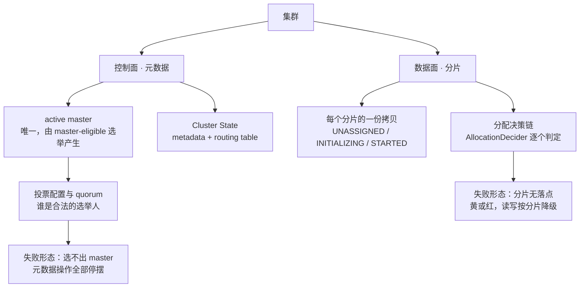
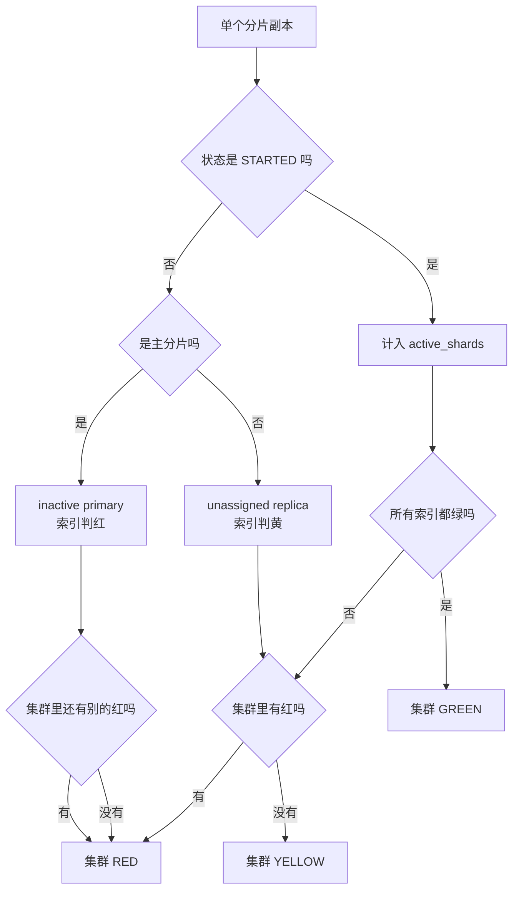
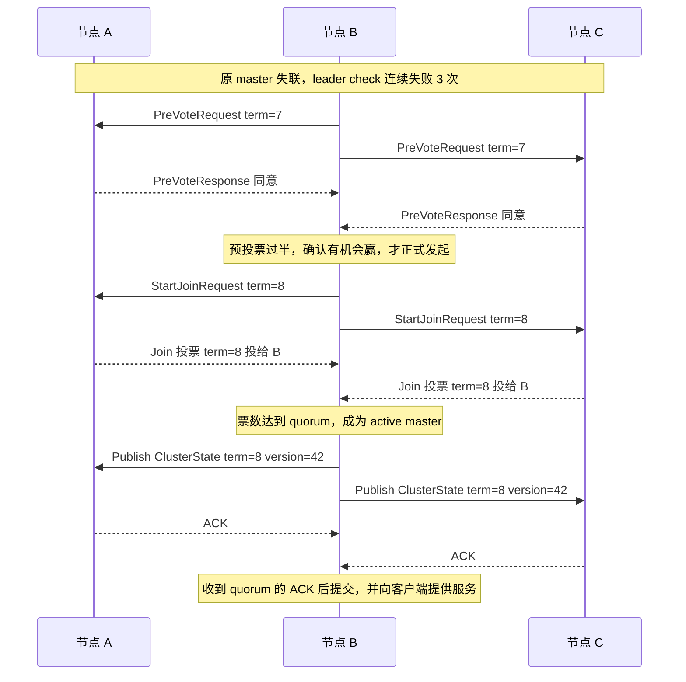
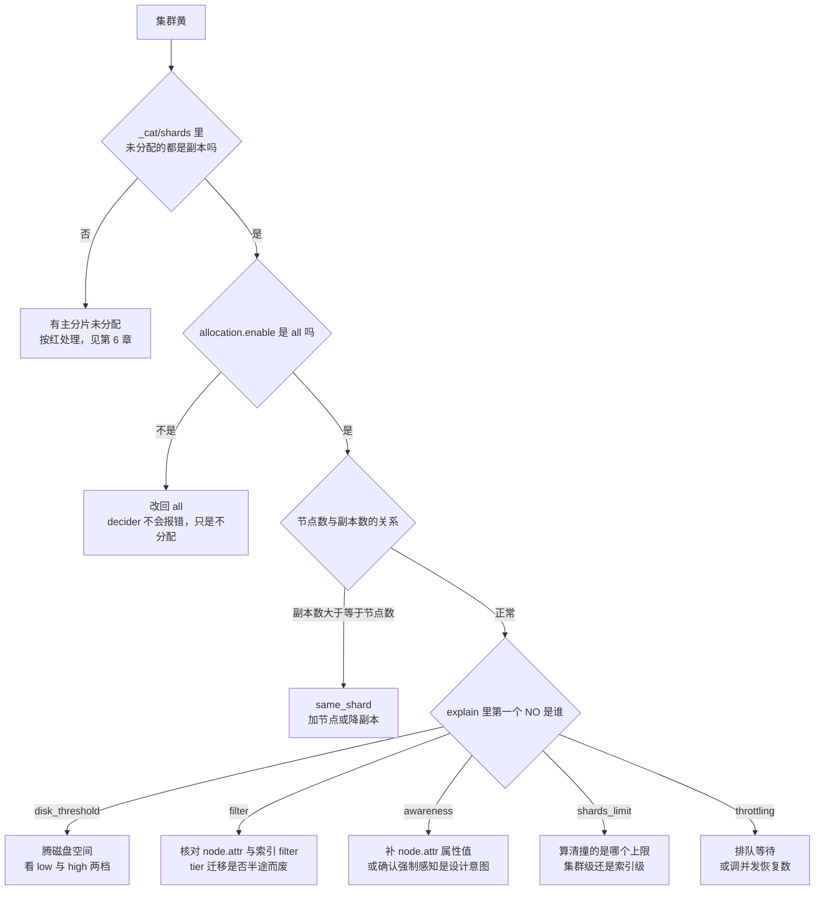
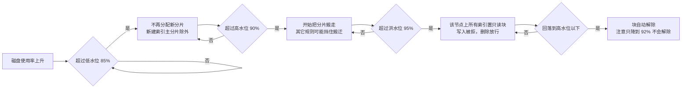

# 06 集群管理——选主、分片分配与脑裂防护

**摘要：**

ES 运维事故里有两类现场反复出现：集群状态变黄变红，以及 master 选不出来。前者看上去是"数据出问题了"，后者看上去是"集群整个挂了"，但两者其实各自对应一条完全不同的判定链：颜色是路由表里分片状态的汇总，选主是投票配置上的多数派问题。本文先拆开三种颜色的精确含义，说明绿是"全部副本就位"、黄是"主分片齐了但至少缺一个副本"、红是"至少一个主分片没有落点"，并论证红不等于全挂。随后把 7.0 以来的类 Raft 选主讲透：投票配置而不是存活节点数决定 quorum，`discovery.seed_hosts` 只负责发现、`cluster.initial_master_nodes` 只负责引导，脑裂的现代防护就是 quorum 本身。第三部分进入本篇核心，把 8.x 的分片分配决策链摊开——`allocation.enable` 的四个档位、九个 AllocationDecider 的判定顺序、磁盘三段水位与单位陷阱，并说明 `_cluster/allocation/explain` 为什么是排查的唯一正确入口。最后按"黄六个成因、红四个成因、blocks 与重平衡代价"三组给出判据与反例，回答两个问题：这个颜色到底允许你先睡一觉，还是必须立刻动手。

---

## 第 1 章 两种故障现象，一条因果链

### 1.1 从一条凌晨的告警说起

设想一个不算小的日志集群：三个专用 master 节点，九个数据节点，每天写入两 TB 左右的日志，索引按天滚动，每个索引三个主分片、每主一副。凌晨三点十二分，告警系统发出两条消息，第一条是 `cluster health RED`，第二条是写入端报出的 503 比例超过阈值。

值班的人第一反应通常是"集群挂了"，然后登录机器一看，十二个节点一个不少，`_cat/nodes` 整整齐齐。再往下看，是一个索引的某一个分片丢了全部拷贝，其余索引读写正常。这个反差是 ES 运维里最常见的一幕：告警说的是集群，坏掉的却是一个分片；而"集群 red"这个结论，是从那一个分片推上来的。

把这一幕拆开，实际上是三件事：某个节点的磁盘出了状况，导致一个分片的全部拷贝不可用；master 把这件事写进路由表并广播；`_cluster/health` 把路由表汇总成一个颜色。三件事里只有第一件是"故障"，后两件都是故障的表达方式。运维要做的是从表达反推事实，而不是对着颜色猜。

### 1.2 控制面与数据面：两条链路的分界

ES 集群的状态可以粗分成两层，两层坏掉时的表现差别极大，处置手段几乎不重叠。

一层是元数据面，也就是控制面：谁当 master、集群状态（Cluster State）是哪个版本、索引的 mapping 与 settings、每个分片该落在哪个节点。核心角色是 active master，由 master-eligible 节点选出，一次只有一个。这一层停摆的表现是：建索引、改 mapping、改副本数、分片迁移全部卡住，日志里反复出现选主告警，客户端收到 `master_not_discovered_exception` 或者 503。

另一层是数据面：分片能不能读写，取决于持有它的节点是否在线、数据文件是否完好、节点还有没有空间。这一层坏掉时 master 往往活得好好的，集群状态照样发布，只是路由表里有几个分片没有落点，颜色从绿变黄或变红，而索引管理与分片迁移完全正常。

下面这张图把两层和它们的失败形态并排放一遍。可以看出，两个问题的排查入口完全不同：颜色问题从 `_cluster/health` 往下查分片，选主问题从 master 日志和投票配置往下查多数派。



两层之间的耦合点只有一个：master 负责决定，数据节点负责执行。master 挂了，已有的分片照样能读写，因为读写路径不经过 master；master 活着但分配决策做不出来，分片就永远停在未分配。反过来，数据面全红也不会让 master 下台，除非红的原因正是持有 master 的那个节点也死了。

### 1.3 颜色与根因之间隔着三层

这两类问题难查，是因为症状到根因之间隔着三层，每一层都在翻译，而翻译会丢信息。

第一层是汇总：成百上千个分片状态被压成一个颜色和几个计数，压完只知"有分片没落位"，不知是哪个索引的第几分片。

第二层是判定：分片没落位，可能因为节点不在、磁盘满了、过滤规则排除了所有候选、同分片的副本已占了该节点，或者分配失败次数超限后 ES 主动停手——这些原因在 `_cluster/health` 里都长成同一个 `unassigned_shards` 计数。

第三层是配置与资源：判定背后的输入，来自集群设置、索引设置、节点属性、磁盘水位。这一层才是根因所在，而它偏偏不在任何一个"状态"字段里。

`GET _cluster/allocation/explain` 的意义就是把后两层一次性摊开：它不回答"为什么集群红了"，只回答"这一个分片为什么落不到这个节点上"；读完这个回答，第三层的根因基本自己浮出来。本篇关于分配的讨论，最后都要落到这条命令上。

---

## 第 2 章 三种颜色的精确含义

### 2.1 颜色是分片状态的汇总

集群状态不是被"设置"出来的，是被算出来的。master 维护的路由表里，每个分片副本有四种状态：`UNASSIGNED`（没有落点）、`INITIALIZING`（正在恢复或复制）、`RELOCATING`（正在搬家）、`STARTED`（可用）。`_cluster/health` 做的事情是把这些状态按规则汇总：

| 状态 | 判定条件 | 数据是否完整 | 冗余是否完整 | 允许先观察吗 |
| :--- | :--- | :--- | :--- | :--- |
| 绿 green | 所有索引的所有主分片与副本分片都是 `STARTED` | 完整 | 完整 | 是，绿是唯一不需要解释的状态 |
| 黄 yellow | 所有主分片都已分配，至少一个副本分片未分配 | 完整 | 缺失 | 短期可以，长期不行；黄意味着容错窗口归零 |
| 红 red | 至少一个主分片未分配 | 不完整（缺的是那一部分） | 缺失 | 不可以，但也不必立刻做破坏性操作 |

三个颜色是"最差者胜"的汇总：集群里只要有一个索引是红，集群就是红；一个索引里只要有一个主分片未分配，这个索引就是红。所以红可以很严重（核心索引全丢主分片），也可以很局部（一个不重要的索引掉了一个分片），颜色本身不区分这两种情况，必须往下看 `level=indices` 甚至 `level=shards`。

`_cluster/health` 里几个计数比颜色更有信息量：`active_primary_shards` 与 `unassigned_shards` 给出规模，`delayed_unassigned_shards` 单独统计还在延迟窗口内的分片，`initializing_shards` 与 `relocating_shards` 说明是否正在恢复或搬家，`active_shards_percent_as_number` 给出一个百分比。判断"是在恢复还是卡死"：`initializing_shards` 在动说明在恢复，它停在原地而 `unassigned_shards` 不减，才叫卡住。

### 2.2 绿：所有副本就位

绿的含义没有任何歧义：每个索引的每个主分片、每个副本分片，都有一份 `STARTED` 的拷贝。它同时也意味着一件事——此刻任意一个数据节点掉线，集群大概率会变黄，而不是保持绿。

所以绿不等于"安全"，绿只等于"当前没有已知的缺口"。一个只有单副本的三节点集群，在全部节点健康时是绿的；一旦某个节点掉线，它的副本就没了，集群变黄。想让绿在单节点故障下依然成立，副本数必须大于等于 2，并且节点数足够容纳——这条推论常被忘掉：副本数从 1 调到 2，磁盘占用与分片总数都涨一半，很多人只看到了"更安全"。

### 2.3 黄：主分片齐了，副本缺了

黄的定义是"所有主分片都已分配，但至少有一个副本分片未分配"。这句话值得逐字读：主分片全在，意味着**所有数据都还能读写**；副本有缺，意味着**这份数据此刻只有一份**。

数据不丢但没有冗余，这句话在工程上意味着三件具体的事。

其一，容错窗口为零。此时如果持有某个主分片的节点掉线，那个分片就没有任何其他拷贝可提升，集群立刻从黄变红。黄和红之间只隔一次节点故障，这是黄最危险的地方。

其二，读的并行度下降。查询要打到每个分片的一份拷贝上，副本少了，可选的拷贝就少，热点会更集中；写入不受影响，因为写只走主分片与 in-sync 副本（副本怎么参与读，[[01 ES 全局架构——集群、节点、索引与分片]]里有完整的分工）。

其三，恢复是有代价的。副本重新分配要走网络复制整份分片数据，一次补几个大分片，就可能把数据节点的带宽与磁盘 IO 吃满，进而拖慢同时进行的查询。这就是"补救动作本身造成二次故障"的典型场景。

黄是不是"正常态"？要分情况。日志集群在每天滚动新索引的头几分钟，新副本正在初始化，短暂黄是正常现象，通常会自己变绿；跨可用区部署且用了强制感知（forced awareness），某个可用区整体掉线时，副本会被有意留在未分配状态，这时的黄是设计意图，不是故障。除此之外的长期黄，都是待处理的欠账。

### 2.4 红：至少一个主分片没有落点

红的定义同样只有一句：至少一个主分片是 `UNASSIGNED`。它带来的是局部不可用，不是全集群停摆，这个区别必须讲清楚。

先看不可用是怎么发生的。写入请求按路由公式找到目标分片，如果那个分片的主分片不存在，写入方拿不到任何可以确认的拷贝，于是返回 503，异常名通常是 `UnavailableShardsException` 或者 `no shard available`。查询的行为不一样：8.x 的默认 `allow_partial_search_results` 为真，协调节点打到缺失分片时会把失败记在 `_shards.failed` 里，然后用其余分片的结果返回 200。所以"红"在业务侧的表现经常是**写不进去但查得出东西**，而且查出来的结果少了那部分数据，还不报错——这比直接报错更难发现。

再看局部性。红是按分片判定的：一个三主一副的索引，如果只有一个分片的主副本全丢，另外两个分片照常读写，这个索引就是"三分之二可用"。同理，集群里十个索引只要有一个红，集群就是红，但另外九个完全正常。把红当成"全部数据没了"，往往会做出过激的处置，譬如直接对全集群执行 `reroute` 或者恢复一个旧快照，把本来还活着的数据覆盖掉。

下面这张图是颜色判定的决策路径，从单个分片一路走到集群颜色，路径上每一步都能对应到一条具体的查询命令。



### 2.5 一个算例：三个节点掉两个，为什么只红一个分片

把上面的判定跑一遍具体数字，比读定义清楚。集群三个数据节点，某索引三主一副共六份拷贝，初始分布如下：N1 持有 P0 与 P1，N2 持有 P2 与 R0，N3 持有 R1 与 R2。

| 场景 | 存活节点 | 各分片的处境 | 索引颜色 | 可用比例 |
| :--- | :--- | :--- | :--- | :--- |
| 初始 | N1 N2 N3 | 三主三副全部 `STARTED` | 绿 | 6/6 拷贝 |
| N1 掉线 | N2 N3 | P0 与 P1 失主，R0、R1 各自可提升为主；两份副本空缺 | 黄 | 4/6 拷贝 |
| N1、N2 再掉一个 | N3 | P0 与 R0 都在 N1、N2 上，分片 0 无任何拷贝；分片 1 由 R1 顶上；分片 2 由 R2 顶上 | 红 | 2/6 拷贝 |

第二行说明黄的来源：主分片全部有继任者，缺的只是副本。第三行说明红为什么可以很局部：分片 0 的两份拷贝恰好都落在两个已死的节点上，于是它红了；分片 1 与分片 2 各自还有一份拷贝活着，能正常读写，只是没有任何冗余。此时 `unassigned_shards` 为四，`active_shards_percent_as_number` 大约三十三，索引与集群都是红，但业务实际受损面是"三分之一的数据不可用"，而不是"集群不可用"。

这个算例还说明另一件事：在这个规模下，无论怎么摆，两个节点同时掉线都恰好丢掉一个分片——六份拷贝剩两份，只够覆盖两个分片。真正体现"摆法"差异的是副本数大于 1 的时候。把副本数改成 2，每片三份、共九份，若每片在三个节点上各放一份，任意两个节点掉线后每片都还剩一份，集群只是黄；反过来，若某一片的三份拷贝恰好挤在两个节点上，掉这两个节点就让这一片彻底消失，集群变红。同样九个副本、同样两台机器故障，结局一个是黄一个是红，差别只在摆放。分配感知（awareness）就是为这件事存在的，第 5 章会讲它失效的几种方式。

### 2.6 读颜色的正确姿势

颜色是入口，不是结论。要往下读，`_cluster/health` 有三个层级参数值得记住：默认层级只看集群，`level=indices` 给出每个索引的颜色与计数，`level=shards` 直接按分片列出。第二级最常用——先看哪个索引红，再看那个索引的哪个分片红。

`wait_for_status` 有两个常见的误用。一是把它当健康检查：`?wait_for_status=green&timeout=30s` 在超时后返回的是**当前状态**而不是错误，HTTP 状态码依然是 200，很多探活脚本因此把红集群判成健康。二是把它当分片级探针：它只按颜色向上等，等不到"某个分片恢复"，也等不到"比现在更好但还没到目标颜色"的中间状态。

8.x 多了一个更贴近现场的入口：`GET _health_report` 给出若干健康指标（indicator），譬如分片可用性、磁盘、master 稳定性等，每条指标带状态、症状与影响范围。它比三个颜色更细，底下的数据仍然来自同一张路由表。三个入口各管一段：颜色定级别，`_health_report` 定范围，`allocation/explain` 定根因。

---

## 第 3 章 选主：从 Zen 到类 Raft

### 3.1 6.x 的 Zen Discovery 与那个被删掉的参数

2019 年 Elasticsearch 7.0 发布时，做了一件在分布式系统里算得上大胆的事：把节点发现与选主这一整层重写，连带删掉了 `discovery.zen.minimum_master_nodes` 这个被无数运维文档供奉过的参数。

重写之前的 Zen Discovery 不算严格的共识协议，选主逻辑大致是：每个 master-eligible 节点向已知对等节点发 ping，收集对方认为的集群状态版本，先比版本、版本相同再比节点 ID，得到"最优候选"后向其请求支持，支持者达到 `minimum_master_nodes` 就公布新状态。这里面有两处软肋。

一处是参数的语义依赖人工正确。`minimum_master_nodes` 应当设成 `(master-eligible 数量 / 2) + 1`，但它是个普通配置项，规模变化时没人提醒你改；改成 1 或留空，多数派这层保护就等于没有。另一处更麻烦：这个参数只在选举时起作用，选举结束之后，已经当选的 master 并不知道自己是否还代表着多数派。网络分区恰好切在 master 所在的那一半，剩下的节点会重新选出一个合法的新 master，而旧 master 仍然认为自己是 master，一边接受写入、一边发布状态——这就是脑裂，写进去的数据在两边分叉，网络恢复后没法自动合并。

新协议补的正是这一刀：不只"选出来"要多数派，"改状态"也要多数派。master 每次发布集群状态（新建索引、分片迁移、节点加入离开），都要拿到投票配置中多数节点的确认才算提交（commit）。分区少数派那一侧的 master 拿不到确认，状态改不动，也无法对外宣称自己是有效 master。这条约束把脑裂从"参数配错才发生"变成了"结构上不可能发生"。

### 3.2 投票配置：quorum 的分母

新协议的核心对象叫投票配置（voting configuration），它是一组 node id，持久化在集群状态里。quorum 的算法简单到一句话：`floor(投票配置大小 / 2) + 1`。

这句话里最容易被忽略的是分母。quorum 的分母是**投票配置里的节点数**，不是"当前存活的 master-eligible 节点数"，也不是"配置文件里写了几个 `node.roles: [master]`"。三个 master-eligible 节点时 quorum 为二；五个时为三；两个时为二——两个节点意味着必须两个都活着才能选主，掉一个就永远选不出来。

为什么要把名单持久化？因为如果每个节点各自按"我发现到的存活节点数"算 quorum，同一场网络分区里两边的视角必然不同，各自都可能凑出半数。持久化之后，所有节点对"谁是选举人、总共几个、需要几票"有同一份答案，这个答案只能通过提交一次集群状态来修改——而提交本身又需要旧的多数派同意。这是一个自指的结构，也正是它能挡住脑裂的原因。

投票配置会被自动维护：`cluster.auto_shrink_voting_configuration` 默认为真，master 会把已经离开集群的节点从名单里剔掉。但这条自动维护有一个前提条件，官方文档写得很清楚——只要名单里**至少还剩三个节点**才继续收缩。三个 master 的集群掉一个，名单从三缩到二，此后不再收缩；再掉一个，剩下那个节点面对的是"二分之二"的 quorum，永远凑不齐，集群就此失去 master。这条规则解释了一个反直觉的现象：三节点集群扛过一次故障之后，抗故障能力不是下降，而是归零。

### 3.3 一轮选举里发生的事

下面这张时序图把一轮完整选举摊开，横轴是时间，纵轴是参与者。看懂它，日志里那些反复刷屏的行就不再是天书。



第一段是失效发现，靠两种心跳。master 每秒向每个节点发一次 follower check，超时十秒、连续失败三次，就把该节点踢出集群；反过来每个节点每秒也向 master 发一次 leader check，同样的间隔与次数，连续失败就认为 master 失效，开始寻找新 master。这两组参数默认都是间隔一秒、超时十秒、重试三次，所以"master 挂了大概三十秒之后才换届"可以预期，不必因半分钟的元数据不可用而惊慌。

第二段是预投票（pre-vote）。候选节点先问一圈"如果我现在拉票，你会投我吗"，只有过半同意才正式发起。预投票防的是两类无谓震荡：因自身 GC 卡顿误判 master 失效的节点不该带着集群换届；刚恢复、状态落后的节点也不该凭一次拉票把稳定 master 掀掉。它不改变任期，失败也不污染任期号。

第三段是正式选举与任期（term）。候选把任期加一，向所有投票配置内的节点拉票；每个节点在同一任期内只投一票，并且只接受任期不低于自己的请求。拿到多数票的节点成为 active master，随即开始发布集群状态。集群状态的发布同样要走多数派：master 把新状态发给所有节点，收到投票配置内多数节点的确认后才提交（commit），`cluster.publish.timeout` 默认三十秒，超时则这次发布失败、状态回滚重来。

"同一任期不会有两个 master"这件事，是算术保证的，不是实现细节：两个多数派必然至少共用一个节点，而这个节点在一个任期内只投一票，所以第二个候选拿不到多数。旧 master 即便还活着，它的任期也没法再前进——它已经联系不上多数派了——于是它发出的任何状态都停留在未提交状态，不被采信。

### 3.4 脑裂的现代防护就是 quorum

到这里可以把"脑裂防护"这句话说完整了。7.0 之后，防止脑裂靠的不是某个参数，而是 quorum 本身：选举要多数、提交要多数、而多数派之间必然有交集。

`minimum_master_nodes` 在 7.0 被移除，这件事经常被误解成"ES 不再需要防脑裂配置了"。准确的说法是：这个参数被协议取代了，你不再需要手工算票数，但你必须保证投票配置的规模是合理的——奇数个 master-eligible 节点，或者用 `voting_only` 凑出合理的投票结构。参数消失了，责任没有消失，只是从"填对数字"变成了"设计对拓扑"。

值得补一句的是，quorum 挡住的到底是什么。它挡住的是**两个 master 同时提交状态**，也就是双写与元数据分叉。它挡不住的是：分区少数派那一侧的节点上，客户端还能不能读到数据。这个问题的开关叫 `cluster.no_master_block`，默认值是 `write`：没有 active master 时，写请求被拒，读请求放行并基于本地最后一次已知的集群状态返回结果。于是少数派节点上的查询会返回**可能过时的数据**。设成 `all` 则读写全拒，代价是那部分节点彻底不可用；`metadata_write` 只拒元数据写入、放过普通索引请求，适用于宁可读到旧数据也要保住写入的场景。三档之间没有对错，只有对"没有 master 时宁可不可用还是宁可读到旧数据"的选择。

### 3.5 三个配置项的职责边界

选主相关的配置只有三个名字经常同时出现，它们的职责严格分离，混用是多数选主故障的起点。

| 配置 | 作用 | 静态还是动态 | 用错的后果 |
| :--- | :--- | :--- | :--- |
| `discovery.seed_hosts` | 只负责"找到对端"，列出可连的 master-eligible 地址 | 静态（需重启） | 不会改变 quorum；写少了会连不成网，写错了会一直连不上 |
| `cluster.initial_master_nodes` | 只在**全新集群首次引导**时声明初始候选人 | 静态（需重启） | 集群形成后不删除，全量重启时可能诱发重新引导，形成第二个集群 |
| 投票配置（voting configuration） | 决定 quorum 的分母，持久化在集群状态里 | 由 master 自动维护，也可用 exclusions API 干预 | 规模为偶数或过小，抗故障能力与预期不符 |

`discovery.seed_hosts` 是通讯录，不是选民册。它写多写少、写谁不写谁，都不会让某个节点的票变重或变轻；它唯一的作用是让一个刚启动、还没有任何对端信息的节点能联系上集群。默认值是本地回环地址，所以在容器或跨主机部署里不显式配置，节点会各自找一个不存在的集群。

`cluster.initial_master_nodes` 是引导指令，只在"这个集群还不存在"的时候有意义。官方文档的措辞很硬：集群形成之后移除它，此后永远不要再设；不要配在非 master-eligible 节点、加入已有集群的节点、重启的节点上，做全量重启时尤其不要配。原因不复杂——它的语义是"我相信现在不存在集群，请用这几个人凑一个新的"，把一个已存在、且持有数据的集群按这个语义去启动，最好的结果是启动失败并报错，最坏的结果是两批节点各自认为自己组成了合法的集群。

投票配置才是选民册。它不由配置文件决定，而由集群状态决定；增删 master-eligible 节点时，master 会把它调整到新的成员集合上，而调整这件事本身需要旧集合的多数派同意。要永久移除一个再也不回来的节点，用的是 `POST _cluster/voting_config_exclusions?node_names=...`，排除项数量受 `cluster.max_voting_config_exclusions` 限制（默认十）。这条 API 的正确用法是"永久下线"，不是"暂时不可用"——对暂时不可用的节点做排除等于主动缩小投票配置，缩到某个程度就凑不齐 quorum。

### 3.6 投票配置的四个陷阱

第一个陷阱是 `node.roles` 写错。声明了三个 master 节点，但配置模板里漏了 `master`（只写了 `data` 或只写了 `data_hot`），实际参与选举的只有一个节点，quorum 为一。这种集群平时一切正常，绿得毫无破绽，直到那个唯一有资格的节点重启——集群失去 master，而运维手里明明有"三个 master"的架构图。8.x 的 data tier 角色（`data_hot`、`data_warm` 等）不隐含 master，从 7.x 模板迁移过来时最容易犯这个错。核查办法只有一个：`GET _cat/nodeattrs` 与 `GET _nodes` 里看 `roles` 字段，不看配置文件，也不看架构文档。

第二个陷阱是两节点集群。两个 master-eligible 的 quorum 为二，意味着任意一个节点不可用，集群就没有 master。这不是 bug，是多数派的算术结果：二分之二才过半。要么加到三个，要么改成"两个全职能节点 + 一个 `voting_only` 节点"的结构——投票节点参与投票、但永不当选，于是投票配置有三个成员、quorum 为二，两个全职能节点里活一个就能维持选举。

第三个陷阱是偶数。四个 master-eligible 的 quorum 为三，容错是一个——与三个节点完全相同。多出来的那个节点只增加投票人数，不增加容错，反而让"需要多少节点同意"这个数字变大。多数派系统的通行结论是取奇数，这里的理由和对 etcd、ZooKeeper 说"取奇数"是同一个理由。

第四个陷阱是把 `voting_only` 当成"备用 master"。它确实永远不能当选，所以把它当作 master 故障时的接管者，会在真正的故障里发现自己少了一个候选。它的定位是投票结构里的配重，不是候选人。

### 3.7 选不出来的时候，现场长什么样

选主失败的日志有一个稳定的开头：`master not discovered`。这条消息由 `discovery.cluster_formation_warning_timeout`（默认十秒）触发，十秒内没能形成集群就打印一次，后半段会给出它认为的 quorum 规模、已经发现的候选节点列表、以及正在尝试的地址。读懂这三样，基本能定位一半的选主问题。

典型现场有三种。其一是全新集群没有配 `cluster.initial_master_nodes`，日志会明确说这个节点期待加入一个已经引导过的集群；其二是集群重启后凑不齐 quorum，日志里的"已发现候选"数量小于所需票数，通常伴随某些节点因为磁盘或 JVM 起不来；其三是网络分区，两边各自打印"master not discovered"，但两边的候选列表不一样。

判断"现在有没有 master"最快的命令是 `GET _cat/master` 与 `GET _cluster/state/master_node`，前者列出当前 master 的 node id 与地址，后者在集群状态里给出 `master_node` 字段；再配合 `GET _cat/nodes?v&h=name,node.role,master` 看哪些节点具备资格。

此时集群并不是完全不能用，能用到什么程度取决于 `cluster.no_master_block`。默认 `write` 的含义是：读还能做（可能读到旧数据），写会被拒，元数据类操作（建索引、改 mapping）一律失败。所以"没有 master"这个判断要落到对业务的具体影响：查询缓慢而不报错，写入报 503，那么大概率是 master 侧的问题，而不是数据节点全挂了。

处置方向只有一个：让投票配置里的多数节点重新互相可见。恢复节点、修网络、把起不来的节点拉起来，都是沿这个方向。反方向的操作——在 quorum 不足时用 `reroute` 手工搬分片、或者干脆把某个节点的 `node.roles` 改成 master 来"凑人数"——会造成新的不一致：前者改不动状态，后者可能触发一次不必要的成员变更，把本来还能恢复的投票配置搅乱。

---

## 第 4 章 分片分配：一条决策链

### 4.1 谁在决定，什么时候决定

分片分配（allocation）与分片重平衡（rebalancing）都是 master 的活儿，但两者不是一回事：分配回答"这个未分配的分片能不能放到某个节点上"，重平衡回答"已经在某个节点上的分片要不要搬到更好的位置"。前者是能不能，后者是值不值。

决策的触发时机是集群状态每一次变化：节点加入或离开、索引被创建或删除、副本数被修改、集群设置被更新、某个分片恢复完成。每一轮，master 的分配服务把当前所有未分配分片排个序（主分片优先、优先级高的索引优先），对每个分片枚举候选数据节点，逐个跑判定链，通过的节点再按权重排序取最优。这个过程单线程跑在 master 上，成本与"未分配分片数 × 数据节点数"成正比，几千个未分配分片同时存在时，`_cluster/pending_tasks` 的积压就是这笔账单。

另一笔账记在集群状态的体积上。路由表里每个分片副本占一条记录，加上 in-sync 分配 ID、节点映射与索引元数据，按每份拷贝数百字节到一 KB 的量级估算（示例推算），一万份拷贝的集群，状态在一到十 MB 之间；每次变更都要序列化、算差量、再推到每个节点，发布耗时随节点数线性增长。分片数在 master 侧要付两次费：每轮分配的枚举成本，每次变更的序列化与广播成本。

### 4.2 `cluster.routing.allocation.enable` 的四个档位

这是分配的总闸门，四个取值对应四种完全不同的操作意图：

| 取值 | 允许分配什么 | 典型用途 | 用错的现场 |
| :--- | :--- | :--- | :--- |
| `all` | 主分片与副本分片都允许 | 默认值，日常状态 | 无 |
| `primaries` | 只允许分配主分片 | 滚动升级、临时制止大量副本搬迁 | 副本全部停在未分配，集群长期黄 |
| `new_primaries` | 只允许新索引的主分片分配 | 建索引时避免触发搬迁 | 旧索引的未分配主分片也不会恢复，红的更红 |
| `none` | 什么都不分配 | 计划内维护、确实要冻结路由表 | 忘了改回 `all`，此后所有恢复与搬迁都停摆 |

两个容易忽略的语义。第一，它只影响**未来**的分配，不会把已分配的分片撤下来——设成 `none` 后集群看起来一切照旧，直到某个节点掉线才发现分片补不回来。第二，它不会阻止重启节点上的本地主分片恢复：一个节点重启后，如果它本地持有的主分片数据完好，这个主分片会立刻恢复，不看闸门。所以"设了 `none` 为什么还有分片在恢复"不是 bug，是这条豁免。

`primaries` 与 `new_primaries` 的区别经常被搞混。两者的差别在"新"字：`primaries` 是"任何主分片都可以分配，副本一律不许"，`new_primaries` 是"只有新建索引的主分片可以分配，其他一概不许"。滚动升级时用哪个，取决于你想让集群在这段时间里恢复多少——官方升级流程推荐先设 `primaries`，让重启节点上的主分片能快速回来，同时避免大量副本搬迁抢占带宽。

### 4.3 九个 decider 的判定顺序

真正做判断的是一串分配决策器（AllocationDecider）。每个 decider 对一个"分片 × 节点"的组合给出三种结论之一：`YES`（我不反对）、`NO`（我反对，直接排除这个节点）、`THROTTLE`（可以，但现在排不上，先等着）。判定链上任何一个 `NO` 就足以毙掉这个候选，`THROTTLE` 则让分片进入排队状态——这两种结果在 `allocation/explain` 里长得完全不一样，后面会讲怎么区分。

下表按"从硬约束到软约束"的顺序列出九个最常撞上的 decider。这个顺序是排查时应当采用的顺序，不是源码里 decider 的注册顺序（源码由 `ClusterModule` 按依赖手工排序，与这里的逻辑顺序并不一致），但语义是并列的：它们各自独立表决，没有优先级。

| 顺序 | decider | 判什么 | 触发设置 | 返回 NO 时的现场 |
| :--- | :--- | :--- | :--- | :--- |
| 1 | `same_shard` | 同一分片的两份拷贝不能落在同一节点 | `cluster.routing.allocation.same_shard.host` | 单节点集群配了副本；解释里直接点名该节点已有这份分片 |
| 2 | `awareness` | 同一分片的拷贝不能落在同一故障域 | `awareness.attributes`、`awareness.force.*.values` | 可用区整体掉线且开了强制感知；可用区内节点数不足以承载副本 |
| 3 | `filter` | 节点是否满足集群级与索引级的 include/exclude/require | `index.routing.allocation.*`、`_tier` | 热温冷迁移没落点；节点名写错导致索引永远搬不过去 |
| 4 | `disk_threshold` | 节点磁盘是否超过低水位、高水位、洪水位 | `disk.watermark.low/high/flood_stage` | 磁盘八成半以上，副本不再进入该节点；九成以上开始往外搬 |
| 5 | `shards_limit` | 节点或索引的分片数是否触顶 | `cluster.routing.allocation.total_shards_per_node`、`index.routing.allocation.total_shards_per_node` | 单节点分片数到上限，新分片无处可去 |
| 6 | `max_retry` | 这个分片是不是已经分配失败太多次 | 分配失败次数（默认五次） | 分片停在未分配，解释里提示需要 `retry_failed` |
| 7 | `snapshot` | 该分片是否正在被快照读取 | 快照进行中 | 快照期间搬迁被推迟，通常几十秒到几分钟 |
| 8 | `throttling` | 节点并发恢复数是否已达上限 | `node_concurrent_incoming_recoveries` 等，默认各二 | 分片排队，`can_allocate` 为 `throttled` |
| 9 | `rebalance` | 搬家能不能改善平衡、以及此刻允不允许搬 | `rebalance.enable`、`allow_rebalance`、平衡阈值 | 集群不平衡但不搬，主动搬会被解释为"搬了也不会更好" |

这张表最右一列是它的价值所在：每一种 `NO` 在 `allocation/explain` 里都有特征句式，认识这些句式，就不必再去猜"是不是磁盘满了"。

除了这九个，8.x 还有若干 decider 处理更细的场景：跨版本迁移期间，新版本节点上的分片不会被分配到旧版本节点（版本兼容）；节点滚动重启期间，master 会尽量避免把分片在即将重启的节点之间来回搬；resize（shrink/split）过程中有专门的约束；data tier 相关的分配偏好独立成一层。看到不认识的 decider 名，先回想最近有没有做过升级、滚动重启或 resize。

### 4.4 磁盘水位：三段阈值与一个单位陷阱

`disk_threshold` 是九个 decider 里最容易撞上的，因为磁盘只涨不跌。它按三个水位分三段动作：

| 水位 | 默认值 | 该节点上发生什么 | 调大的代价 | 调小的代价 |
| :--- | :--- | :--- | :--- | :--- |
| 低水位 low | 85% | 不再往该节点分配新分片（新建索引的主分片除外） | 逼近高水位才发现，搬迁窗口变窄 | 过早触发，集群看起来"总是缺落点" |
| 高水位 high | 90% | 开始把该节点上的分片搬走 | 搬迁启动太晚，可能来不及搬完就撞洪水位 | 正常波动也触发搬迁，白搬大量数据 |
| 洪水位 flood_stage | 95% | 该节点上所有索引被置为只读 | 磁盘真写满的风险上升 | 一次临时写入高峰就全集群只读 |

三个水位有一处单位陷阱：百分比指已用空间，字节值指剩余空间。写 85% 的意思是"用了八成半就不收了"，写 `50gb` 的意思是"剩余低于五十 G 就不收了"——同样是"低水位"，一个看占用、一个看空闲，方向正好相反。三个值要么全用百分比或比例，要么全用字节，混用会被配置校验拒掉，这是 ES 有意为之的一致性检查。

大磁盘上百分比还会折算成过大的空闲要求：一块一百 TB 的盘，95% 意味着还剩五 TB 就要进入只读，这个余量对日志集群是浪费。8.x 为此增加了一组 max headroom 设置（`disk.watermark.low.max_headroom`、`high.max_headroom`、`flood_stage.max_headroom`），把"按百分比算出来的空闲要求"封顶在某个绝对值上；文档给出的默认上限在百 GB 量级（低水位二百 GB、高水位一百五十 GB、洪水位一百 GB，以对应版本文档为准）。对单盘超过十 TB 的机器，这组参数值得显式核对，否则会看到"磁盘还剩好几 TB 就只读了"的怪现象。

水位判断有滞后：`cluster.info.update.interval` 默认三十秒，master 每三十秒才更新一次各节点的磁盘使用率。清掉日志之后写入仍然被拒、分片仍然不回迁，先等一个刷新周期再说，不要立刻怀疑配置。

### 4.5 `_cluster/allocation/explain` 的读法

这条命令是排查未分配分片的唯一正确入口：它把判定链的每一步都打印出来，看磁盘、看日志、看 `_cat/shards` 都只能提供间接证据。

不带参数调用时，它挑一个未分配分片来解释；指定 `index`、`shard`、`primary` 就能精确问某一个。返回体里最该先看的是四个字段：

`current_state` 说明该分片现在是未分配还是已分配；`unassigned_info.reason` 说明它**当初**为什么变成未分配（`NODE_LEFT` 是节点离开，`ALLOCATION_FAILED` 是分配失败，`INDEX_CREATED` 是新建索引时就没分配出去，`REPLICA_ADDED` 是加了副本）；`can_allocate` 给出最终结论；`allocate_explanation` 用一句话解释这个结论。

`can_allocate` 的取值比"yes/no"丰富，每一种对应一种处置方向：`no` 表示有硬约束挡住了，要往下看 `node_allocation_decisions` 里每个节点的 `deciders` 列表；`throttled` 表示只是排队，等着就行；`allocation_delayed` 表示还在节点离开的延迟窗口里，响应会带上 `remaining_delay`，直接告诉你还要等多久；`no_valid_shard_copy` 表示集群里已经没有这份分片的任何拷贝——这一条最重，它意味着数据只能从别处来（快照、或者那个还没回来的节点）。

```json
{
  "index": "logs-2026.11.19",
  "shard": 2,
  "primary": false,
  "current_state": "unassigned",
  "unassigned_info": {
    "reason": "NODE_LEFT",
    "at": "2026-11-19T03:12:07.441Z",
    "details": "node_left[Qk3x...]",
    "last_allocation_status": "no_attempt"
  },
  "can_allocate": "no",
  "allocate_explanation": "cannot allocate because allocation is not permitted to any of the nodes",
  "node_allocation_decisions": [
    {
      "node_name": "data-07",
      "node_decision": "no",
      "deciders": [
        {
          "decider": "disk_threshold",
          "decision": "NO",
          "explanation": "the node is above the low watermark ..."
        }
      ]
    },
    {
      "node_name": "data-08",
      "node_decision": "no",
      "deciders": [
        {
          "decider": "same_shard",
          "decision": "NO",
          "explanation": "a copy of this shard is already allocated to this node"
        }
      ]
    }
  ]
}
```

读这个响应有两个技巧。第一，先看 `deciders` 里的 decider 名，再看 explanation，因为名字对应的是设置项，而 explanation 里往往直接引用了那条设置的当前值——省掉一次"配置到底是多少"的查询。第二，注意 `node_decision` 的取值除了 `yes` 与 `no` 还有 `worse_balance`：它表示这个节点能放，但放过去不会比现在更均衡，于是不动。看到这个值就该明白，问题不在分配而在平衡，处置手段是调平衡阈值或者接受现状，而不是清理磁盘。

### 4.6 从症状到入口

把上面几节压成一张表，按"症状"找入口：

| 症状 | 第一入口 | 第二入口 | 通常的答案落在哪一层 |
| :--- | :--- | :--- | :--- |
| 集群黄，写入正常 | `_cat/shards?h=index,shard,prirep,state,unassigned.reason` | `allocation/explain` | 副本数、节点数、水位、过滤规则 |
| 集群红，写入 503 | `allocation/explain` 看 `can_allocate` | `_cat/recovery`、节点日志 | 拷贝是否还存在；节点能否回来 |
| 写入突然全拒，报 `FORBIDDEN` | `_cat/allocation?v` 看磁盘 | `GET _settings` 看 index blocks | 洪水位触发的只读块 |
| 分片在搬但很慢 | `_cat/recovery?v&active_only` | `_cat/nodes` 的并发恢复数 | 并发恢复数与带宽上限 |
| 集群不平衡但不搬 | `allocation/explain` 看 `worse_balance` | 平衡阈值与 `rebalance.enable` | 平衡器而非分配器 |
| 选不出 master | master 日志的 `master not discovered` | `_cat/master`、投票配置 | quorum 规模与投票配置 |

---

## 第 5 章 黄的六个成因

黄是运维里最容易被放过的一种状态，因为它不影响读写，看上去"只是没冗余"。但每一个长期黄都对应一处配置或资源的欠账，而这笔欠账的利息，是在某一个节点掉线的瞬间从黄跳到红。下面六个成因覆盖了绝大多数现场，每一个都给出机制、判据与处置。

### 5.1 副本数大于数据节点数

机制是 `same_shard`：同一分片的两份拷贝不能落在同一个节点上。一个数据节点、索引设了 `number_of_replicas: 1`，副本永远没有落点，集群永久黄。

这是唯一一个"配置本身就不成立"的成因，所以判据也最直接：把数据节点数与索引的最大副本数放在一起看，前者减一小于后者，必然有副本分不出去。处置只有两条路，加数据节点，或者把副本数降到节点数减一；单节点测试环境直接设 `number_of_replicas: 0`。

注意口径是数据节点数而非节点总数：三个 master 加一个 data 的集群只有一个落点集，`same_shard` 只看数据节点。

### 5.2 磁盘水位

`disk_threshold` 按节点独立判定，现场特征很具体：不是所有副本都缺，而是**某些节点上的副本缺**，且缺的那部分总落在磁盘最满的几个节点上。

低水位有一个容易忽略的细节：它不影响新建索引的主分片分配，只拦副本。所以磁盘八十六个百分点的节点上新索引照样能建起来，只是副本分不出去——这解释了"新建了一堆索引之后集群开始黄"这类时间上高度相关的现象。

比单个节点超水位更麻烦的是全部节点都超低水位：没有任何节点能接收新分片，master 连"往哪儿搬"都算不出来，高水位搬迁也就无法启动，症状是"黄的比例持续上升而 `relocating_shards` 为零"。处置是先腾空间（删旧索引最快，删文档要等段合并），再看水位回落与分片回填。

### 5.3 分片数触顶

这里有三个不同层次的上限，混在一起谈会得出错误结论：

`cluster.max_shards_per_node`（默认一千）是集群级的总闸，超过之后**新建索引被拒**，报错大意是"这个操作会增加总分片数，超出当前上限"。它不产生未分配分片，所以它带来的是建索引失败，而不是黄。

`index.routing.allocation.total_shards_per_node`（索引级，默认负一即不限）限制单个索引在一台节点上最多放几个分片。它真的会让分片分配不出去，典型场景是一个索引的分片数远多于节点数，又把它设成了很小的值。

`cluster.routing.allocation.total_shards_per_node`（集群级，默认负一即不限）限制每个节点承接的主副本总数，高了接不了、低了浪费。

`shards_limit` 的解释会给出"已分配多少、上限多少"，处置前先分清撞的是哪一个上限。

### 5.4 `allocation.enable` 被设成 `primaries`

这是人为造成的成因，也是最常见的遗留故障。为了滚动升级或临时止血，有人把闸门设成 `primaries` 甚至 `none`，事后忘了改回 `all`。此后所有副本都停在未分配，集群慢慢变黄；而 `_cat/shards` 里这些分片的原因是 `NODE_LEFT` 或者干脆没有新原因，看日志也找不到任何报错，因为根本没有失败——只是没人允许分配。

判据只有一条：查 `GET _cluster/settings?include_defaults=true&filter_path=**.routing.allocation.enable`，看到任何不是 `all` 的值，先改回去再谈别的。这条查询应该成为"集群为什么黄"排查的第一步。

### 5.5 节点被过滤规则排掉

`filter` decider 把集群级与索引级的 include、exclude、require 全部算进去，外加 `_tier` 与 data tier 的偏好。它的现场特征很鲜明：集群整体资源充足、磁盘也不满，但某个索引的分片就是没有落点，而 `allocation/explain` 里每个候选节点给出的解释都指向同一条过滤规则。

最常见的三种触发方式：把某个索引的 `index.routing.allocation.require.box_type` 设成了某个节点属性值，而集群里已经没有带这个属性的节点（比如从热节点迁到温节点的 ILM 动作执行到一半，温节点被下线了）；把节点名写进 include 但节点重建后名字变了；给节点打了一个新的 `node.attr` 而索引还指着旧值。

值得记住的是过滤规则同时约束"搬入"与"留驻"：`require` 一旦指向一个不存在的属性值，已经在那儿的副本不动，新副本进不来，于是黄；如果指向的属性值在某个节点上存在但那个节点磁盘满了，就变成磁盘与过滤双杀，`allocation/explain` 会在同一个节点的 deciders 里给出两条 `NO`。

### 5.6 感知属性缺失或强制感知只剩一个故障域

这一条最容易误判，因为它"看起来配置是对的"。分配感知的判定前提是节点上有对应的属性值：集群设置了 `cluster.routing.allocation.awareness.attributes: zone`，那么只有带 `node.attr.zone` 值的节点才会参与分配。如果一部分数据节点漏配了这个属性（或拼写不同、或重启后配置没生效），这些节点就被排除在候选之外，落点池少了一半，副本自然分不出去。

另一种是强制感知（forced awareness）：宁可少一份副本，也不把所有拷贝堆进同一个故障域。某个 zone 整体不可用时，本该落在那个 zone 的副本会被有意留在未分配状态，此时的黄是设计意图。这两者的区别在于：属性缺失是事故，强制感知留下的黄是选择。

本章谈到的六种成因，在 `allocation/explain` 里各自对应不同的 decider 名，记忆负担不大，但需要把"decider 名 → 设置项 → 处置动作"这条链走通：



还有一类"假黄"值得单独记一笔：节点掉线后的一分钟内，受影响的分片还处在延迟分配窗口（`index.unassigned.node_left.delayed_timeout`，默认一分钟），会计入 `delayed_unassigned_shards` 而不是立刻重分配。这个设计是为了让只是重启的节点能带着本地数据回来，省掉一次全量复制——代价是这一分钟里集群显示黄。看到黄的瞬间先看这个计数，能省掉一半的无效排查。

---

## 第 6 章 红的四个成因

红的判定是"至少一个主分片没有落点"，但"为什么没有落点"有四种截然不同的答案，处置方式互相排斥。把成因分对，比急着执行命令重要得多。

### 6.1 主分片所在节点离线且无法恢复

这是最常见的一种，`allocation/explain` 会给 `can_allocate: no_valid_shard_copy`，`allocate_explanation` 明确说"集群里已没有这份数据的任何拷贝，等持有数据的节点回来，或者从快照恢复"。

关键判断在于"无法恢复"这四个字是否成立。机器重启、进程重启、容器重新调度，都属于"会回来"，此时正确动作是等，把 `delayed_timeout` 的窗口算进去；只有确认磁盘报废、数据目录被删、机器永久下线之后，才轮到讨论数据从哪里补。这一判断错了，代价是把还能救回来的数据当成丢了。

### 6.2 分片数据损坏

磁盘坏道、文件系统损坏、写入过程中的断电，都可能让某个分片的数据文件读不出来。ES 在恢复分片时会校验 Lucene 文件，发现损坏就把这份拷贝标记为失败，转而尝试其他拷贝；如果所有拷贝都坏了，主分片就无法分配，集群红。

现场特征在数据节点日志里：`CorruptIndexException`、`checksum` 报错、`failed to open index` 一类。此时 `allocation/explain` 的 `reason` 往往是 `ALLOCATION_FAILED` 或 `PRIMARY_FAILED`，`failed_allocation_attempts` 累加。处置不是重试分配，而是从快照恢复这个索引，或在确认其他拷贝可用时让 ES 从副本重建。

### 6.3 索引元数据丢失

数据目录还在磁盘上，但集群状态里已经没有这个索引了。常见原因有两类：master 侧的集群状态被重置（全部 master 节点被重装、数据目录被清空后重新引导），或者有人误删了索引。

此时磁盘上的分片目录会被标记为悬空索引（dangling index），可以用 `GET _dangling` 列出来，再决定是否通过 `_dangling/<index-uuid>` 导入。导入不是无损操作：ES 只能拿到数据文件，拿不到原始 settings 与 mappings，导入后要手工核对副本数、分片数与字段类型，否则一次导入就能引发一轮分配风暴。

### 6.4 分片数上限与节点容量：一个需要澄清的边界

有一种流传很广的说法是"分片数超过 `cluster.max_shards_per_node` 会导致集群变红"。这个说法把两件事混在了一起，需要拆开。

`cluster.max_shards_per_node` 撞顶的表现是**新建索引被拒**，请求直接失败，集群状态不变——它不产生未分配分片。真正会让主分片没有落点的是另两种情况：一是节点数不足以承载主分片的数量，且没有其他机制（比如 `cluster.routing.allocation.total_shards_per_node` 设得过小）允许落点；二是一个索引的主分片数超过了所有数据节点能承接的上限，此时部分主分片长期停在未分配。

把这条边界说清楚的现实意义在于处置方向：看到建索引报错，去调 `cluster.max_shards_per_node` 或者删旧索引；看到主分片未分配，去查节点数与 `shards_limit`。前者是容量问题，后者是落点问题，用一个参数去解另一个问题，只会把现场搅得更乱。

---

## 第 7 章 集群只读块：突然不能写的头号原因

### 7.1 四种块

ES 有两级块（block），集群级与索引级，索引级最常用。它们的作用都是在不改数据的前提下，把某一类操作整体拒掉：

| 块 | 位置 | 拦住什么 | 常见触发方 |
| :--- | :--- | :--- | :--- |
| `index.blocks.read_only` | 索引设置 | 写入与元数据修改，删除也拦 | 人工维护窗口 |
| `index.blocks.read_only_allow_delete` | 索引设置 | 写入与元数据修改，但放行删除 | 洪水位自动置上 |
| `index.blocks.write` | 索引设置 | 只拦写入，元数据可改 | shrink 前后、只读索引 |
| `cluster.blocks.read_only` | 集群设置 | 整个集群的写与元数据操作 | 灾备切换、全集群冻结 |

`read_only` 与 `read_only_allow_delete` 的差别只在于"能不能删"。这个差别是有意的：洪水位要的是尽快腾空间，若连删除都拦，唯一出路就只剩停机改配置。留这道缝的代价是删文档回收的空间要等段合并，这也是"删了文档磁盘没降"在洪水位现场尤其致命的原因。

### 7.2 自动置块与自动撤块的边界

洪水位触发时，master 会对**该节点上的所有索引**置上 `index.blocks.read_only_allow_delete: true`。注意这个作用范围经常超出预期：一个节点上放了八十个索引的分片，这八十个索引全部只读，而它们的分片可能还分布在另外八个健康节点上。所以在洪水位现场，写入失败的往往不止"热点索引"，而是"这个节点沾过的所有索引"。

撤块的条件写得很明确：该节点的磁盘使用率回落到**高水位以下**，块自动解除。这就带来一个特别常见的误判——把磁盘从 95% 清到 92%，看起来腾出了两百 G，但 92% 仍然高于高水位线，块不会撤，写入继续报错。正确的目标不是"腾出一点空间"，而是"降到高水位以下"，也就是至少要降到 90% 以下，留一点余量再动手。

下面这张图把三段水位与对应的动作、块状态放在一条时间轴上，可以看清"只读"是最后一道闸，而不是第一道。



### 7.3 排查与解除

写入被块拦住时，客户端拿到的是一段带 `FORBIDDEN` 的报错，`cluster_block_exception`，括号里写着 `index read-only / allow delete (api)`。看到这段，动作顺序是固定的：

先确认是哪个索引被块拦住，`GET _all/_settings?filter_path=**.blocks` 一览；再确认是哪个节点磁盘满了，`GET _cat/allocation?v` 看各节点占用；然后真的腾出空间——删旧索引最快，删文档要等段合并，force merge 只读索引能回收删除标记占的空间但本身是重 IO。空间回落到高水位以下之后再等一个 `cluster.info.update.interval`（默认三十秒），块会自己走。

只有在磁盘已经安全、而块因为某些原因没有自动解除时，才手工清：`PUT <索引>/_settings` 把 `index.blocks.read_only_allow_delete` 置为 `null`。手工清块的唯一合法理由是"确认磁盘不会再回到洪水位"，否则下一次写入高峰会原地复发。

还有一个不推荐但确实存在的旁路：把 `cluster.routing.allocation.disk.threshold_enabled` 设成 `false` 会整体关掉磁盘判定，并且顺带清掉已有的只读块。这样做等于收起了唯一的磁盘保护，把"写入被拒"换成"磁盘写满、进程崩溃、分片损坏"。它可以作为几分钟内的止血手段，但必须紧接着处理磁盘。

### 7.4 与另外三种"不能写"的区分

"写入不了"有四种常见原因，报错不同、处置也不同，混在一起会浪费时间：

块导致的是 `403` 加 `FORBIDDEN` 文本；分片无主导致的是 `503` 加 `UnavailableShardsException` 之类；线程池队列满导致的是 `429` 加 `es_rejected_execution_exception`，此时磁盘与分片都正常，只是写入太快；认证或权限不足也是 `403`，但报错里出现的是安全相关的关键词而不是 block。四者里只有第一种与磁盘有关，第二种与数据可用性有关，后两种与容量和权限有关——先看 HTTP 状态码，再看报错正文，两步就能分开。

---

## 第 8 章 重平衡的代价

### 8.1 三个开关

重平衡是"把分片搬到更均衡的位置"，并不免费：一次搬迁要复制整份分片数据，占网络、磁盘读 IO 与目标节点写带宽，还可能挤占查询与写入。控制它的三个设置分管不同层：

| 设置 | 取值 | 管什么 | 代价 |
| :--- | :--- | :--- | :--- |
| `cluster.routing.rebalance.enable` | `all`、`primaries`、`replicas`、`none` | 哪类分片可以被平衡搬动 | 设 `none` 后集群可能长期失衡，且故障恢复后不回填 |
| `cluster.routing.allocation.allow_rebalance` | `always`、`indices_primaries_active`、`indices_all_active` | 什么时机才允许启动平衡 | 收紧到 `indices_all_active` 会让"恢复完成前绝不搬"，恢复期更长 |
| `cluster.routing.allocation.cluster_concurrent_rebalance` | 整数，默认二 | 全集群同时进行的平衡搬迁数 | 调大加快收敛但抢资源；调小则大批扩容后收敛很慢 |

注意 `cluster_concurrent_rebalance` 只管**平衡**引发的搬迁，不管由过滤规则、强制感知、节点下线引发的搬迁——后者的并发由 `node_concurrent_incoming_recoveries` 与 `node_concurrent_outgoing_recoveries` 限制，默认各二。所以"我把平衡并发调到 8 了，为什么搬迁还是两两进行"这类疑问，答案往往在这里。

### 8.2 算一笔搬迁的账

搬迁的时间下限由数据量与带宽决定，与并发无关。假设一个分片一百 GB，`indices.recovery.max_bytes_per_sec` 设为 `100mb`：

单分片搬迁约 `100GB ÷ 100MB/s ≈ 1000 秒`，十六七分钟；两个并发搬迁并行，网络出口占用约两百 MB/s，也就是一点六 Gbps，约合一张万兆卡吞吐的六分之一。若一次扩容八台节点、要挪动八百个分片，平均每片十个 GB，总数据量八 TB，按单节点出口两百 MB/s 计，仅数据搬运就是 `8TB ÷ 200MB/s ≈ 40000 秒`，十一个小时量级。以上都是示例推算，真实值还受网络抖动与磁盘 IO 影响，但量级说明重平衡的代价按小时计，不能当秒级操作安排。

由此得到一条实践判据：扩容或大规模下线之前，先把 `cluster_concurrent_rebalance` 与 `node_concurrent_recoveries` 调小（比如各设为一），让搬迁慢而稳，宁可多花几个小时也不要让业务查询抖动，完成后必须改回默认值，否则下一次故障恢复会慢到不可接受。

### 8.3 8.x 的平衡器换了一代

8.6 起默认的平衡算法换成了期望平衡（desired balance）：master 在后台算一份"理想的分片分布"，算完之后把实际分布往理想分布上靠，而不是像旧算法那样每轮只挑几个能立刻改善平衡的搬动、搬完再算。这个变化解决了旧算法的一个老毛病——同一分片可能在平衡过程中被反复搬动好几次。

`cluster.routing.allocation.type` 控制用哪一代算法，默认 `desired_balance`，旧值 `balanced` 在 8.8 标记为弃用（以对应版本文档为准）。配套的平衡权重（`balance.shard` 默认零点四五、`balance.index` 默认零点五五）与阈值 `balance.threshold`（默认一）共同决定搬与不搬；官方明确不建议调权重，理由同所有"看起来能调"的参数：改坏的后果往往很久以后才出现。

这一代差异影响的是 `allocation/explain` 里 `worse_balance` 的读法：旧算法下它表示"搬过去不划算"，新算法下还可能表示"后台还在算期望分布，先别动"，两者处置相同（等，或接受不均衡），但等待的预期不同。

---

## 第 9 章 反例与边界

### 9.1 磁盘满了，却当成程序问题查

写入报错之后，最先被怀疑的往往不是磁盘，而是客户端代码、网络、ES 版本，因为报错文本里全是"索引"和"分片"，一个字没提磁盘。于是团队花两小时查客户端重试逻辑，而 `_cat/allocation` 里那台节点已经九十六。

正确的第一步是看状态码与报错正文，而不是看业务代码。`403` 加 `FORBIDDEN` 直接指向块，`429` 指向线程池队列，`503` 指向分片无主。这四种里只有第一种与磁盘水位有关，而它恰好是最容易被当成"权限问题"跳过的一种——"403 不是权限是什么"，这个直觉在 ES 里不成立。

### 9.2 用 `reroute` 手工搬分片绕开根因

`_cluster/reroute` 是给"明确知道该搬到哪儿"的场景准备的，不适合"不知道为什么不出去"的场景。用 `move` 把一个分片从超水位的节点搬到另一个节点，表面上集群绿了，实际上磁盘还是满的，下一个分片会撞上同一堵墙；用 `allocate_stale_primary` 让一个旧拷贝顶上主分片，表面上红变黄了，实际上丢掉了这个分片最近一段时间的写入，而且丢多少没有任何提示。

能不能手工干预只需问一句：`allocation/explain` 里那个 `NO` 的原因，是被我修掉了，还是被我绕过了。修掉了再 reroute 是收尾，绕过了是掩盖；`POST _cluster/reroute?dry_run=true` 可以先看一遍结果。

### 9.3 `allocation.enable` 改完忘了改回

这条前面提过，仍值得单列，因为它的时间跨度可以很长：维护窗口设成 `none`，完成后忘了改，几天后某个节点重启时才暴露——缺的副本补不回来，一路黄下去。设置类操作要有对称的收尾：改前记下原值，改后验证生效，收尾改回再验一次。三行命令换的是几天的静默欠账。

### 9.4 把黄当健康、把红当全挂

两个方向相反的误判，后果也是对称的。把黄当健康，等于在没有冗余的状态下继续跑，一次节点故障就从"轻微"跳到"数据不可用"；把红当全挂，等于对着一部分可用数据做全量恢复，把还能救的现场推倒重来。

判断的锚点始终是分片而不是集群：黄的时候问"缺哪些副本、下一次节点故障会不会踩到同一个分片"，红的时候问"缺哪个分片、那份数据的其他拷贝是否真的不存在"。

### 9.5 本篇的边界

分片数怎么定、副本数与节点数怎么配比，[[01 ES 全局架构——集群、节点、索引与分片]] 已用一整章铺过；写入确认语义与 refresh、flush 的时机在 [[03 文档写入与 Lucene 段合并]] 里；告警阈值、升级与快照流程在 [[08 ES 生产运维——监控、容量规划与版本升级]] 里。本篇只负责把颜色读准，把选主与分配这两条决策链走通。

---

## 第 10 章 结语

集群状态与选主看起来是两套独立的知识，实际是同一种结构在两个层面的重复：都是"少数服从多数"的判定，都需要一份谁也不能单方面修改的名单。颜色是路由表上的多数，选主是投票配置上的多数，失效方式也相似——名单错了，或者磁盘、网络、角色配置让多数派凑不齐，系统就停在一个"看起来还在跑"的状态里。

这也解释了它们为什么总被误判：症状出现在汇总层，根因藏在具体条目里，而汇总层恰好是所有人最先看到的。`_cluster/health` 给一个颜色，`_cat/master` 给一个空值，剩下的靠 `allocation/explain`、`_cat/shards` 与 master 日志逐条拆；工具都在，缺的是"不猜、先读判定链"的习惯。

至于取舍，这套机制里没有免费选项：副本带来冗余，也带来存储与恢复成本；强制感知守住故障域，也接受长期的黄；`reroute` 换来立刻的绿，代价是把根因留在原地；`no_master_block` 的三档，是在"不可用"与"读到旧数据"之间选一个。运维的判断力，说到底是知道自己在付哪一笔账。

---

## 参考资料

1. Elastic 官方文档：Cluster-level shard allocation and routing settings。<https://www.elastic.co/docs/reference/elasticsearch/configuration-reference/cluster-level-shard-allocation-routing-settings>
2. Elastic 官方文档：Discovery and cluster formation settings。<https://www.elastic.co/docs/reference/elasticsearch/configuration-reference/discovery-cluster-formation-settings>
3. Elastic 官方文档：Shard allocation awareness，含强制感知的语义与"只分配到带属性值节点"这条前提。<https://www.elastic.co/docs/deploy-manage/distributed-architecture/shard-allocation-relocation-recovery/shard-allocation-awareness>
4. Elastic 官方文档：Using the cluster allocation API for troubleshooting。<https://www.elastic.co/docs/troubleshoot/elasticsearch/cluster-allocation-api-examples>
5. Elastic 官方文档：Voting configurations。<https://www.elastic.co/docs/deploy-manage/distributed-architecture/discovery-cluster-formation/modules-discovery-voting>
6. Elastic 官方文档：Publishing the cluster state。<https://www.elastic.co/docs/deploy-manage/distributed-architecture/discovery-cluster-formation/cluster-state-overview>

---

> [!note] 思考题
> 1. 一个三节点集群，其中一个节点因为硬件故障永久下线。此时把该节点从投票配置中排除，与直接依赖自动收缩，对"接下来再坏一台"这件事的容错能力有何不同？
> 2. 集群长期黄，`allocation/explain` 显示每个候选节点都被 `same_shard` 拒绝。在不加节点的前提下，除了调小副本数，还有哪些做法能让集群变绿，各自的代价是什么？
> 3. 洪水位触发的只读块在磁盘降到高水位以下会自动解除。如果某台节点的数据增长速度快于搬迁速度，会发生什么，应该在哪一层提前干预？
> 4. 为什么"同一任期不会选出两个 master"是算术保证，而"两个子网不会各自认为自己是主"在 7.0 之前却不是？这个差别对运维的影响体现在哪条日志或哪个开关上？
> 5. `cluster.no_master_block` 从默认的 `write` 改成 `all`，会让哪些业务从"读到旧数据"变成"完全不可用"？这个取舍在什么场景下值得做？