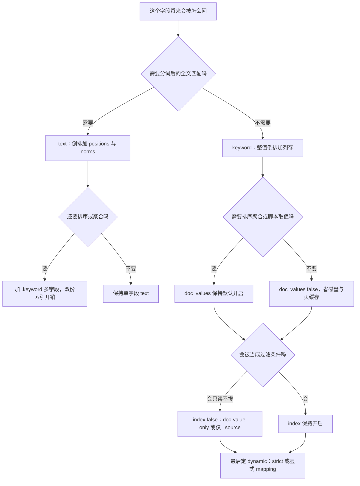
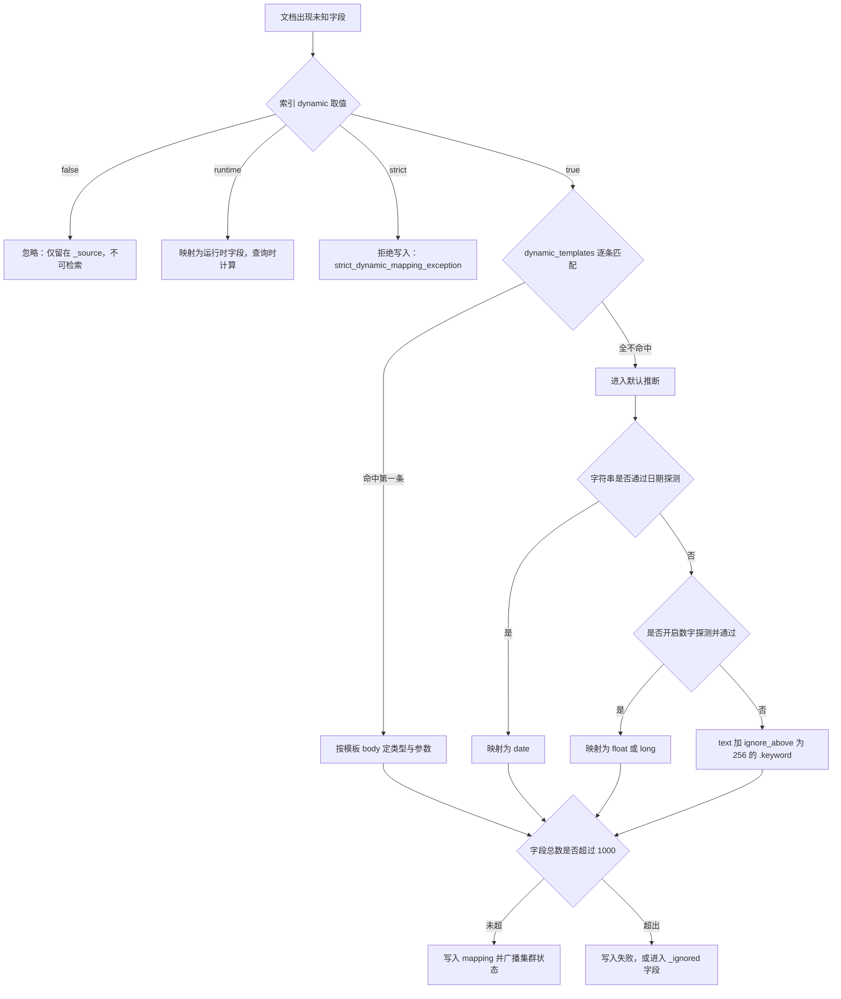
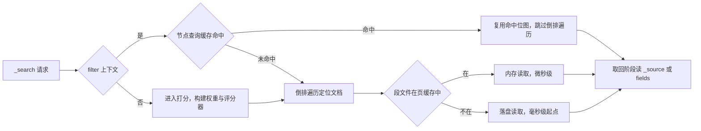
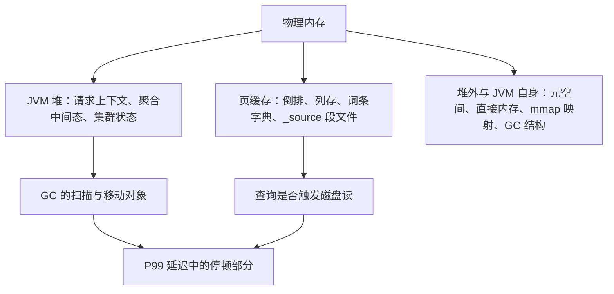
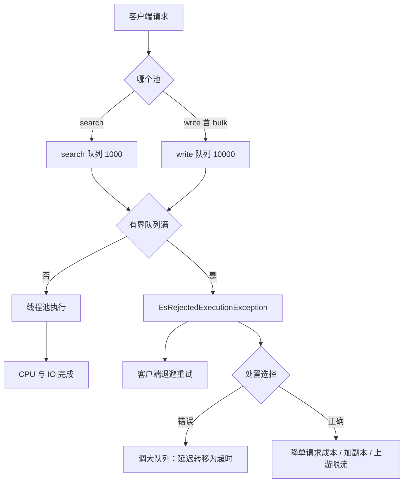
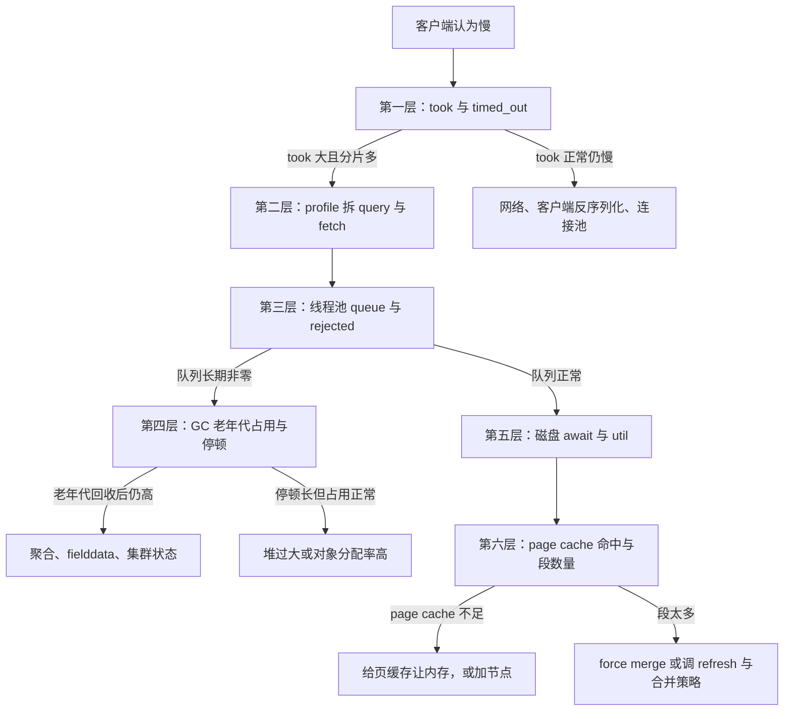

# 07 性能调优——Mapping 设计、查询优化与 JVM

## 摘要

**摘要：**

这一篇要回答的是一个很具体的问题：当 mapping 已经写进索引、数据已经灌了几百 GB 之后，还有哪些调优动作真正可做，哪些只能靠重建索引来偿还。答案由成本结构决定——mapping 的修正成本随数据量线性放大，所以四个必须提前定下的决定（字段类型、`doc_values`、`index` 与 `enabled`、`dynamic` 策略）要放在数据量最小的时候做完，而「改 mapping」的真实边界是：加字段、改 `ignore_above`、改 `null_value` 可以在线完成，改类型只能新索引加 `_reindex`。中段按收益排序讲查询侧的六个手段，从 `filter` 取代 `must` 一直到用 `profile` 定位热点，并说明节点查询缓存按段生效、段太小就几乎命中不了这一前提。后半程落到 JVM 上 ES 特有的三条规则：堆不超过物理内存的一半且不越过压缩指针阈值、GC 只用 G1、用 `bootstrap.memory_lock` 并调低 `vm.swappiness`，核心机制是 Lucene 的数据在页缓存不在堆里，所以堆大反而慢。收尾给出线程池四个关键池的参数口径、`rejected execution` 的正确处置，以及一条从客户端 `took` 一路查到页缓存命中的判据链。文中的延迟与内存数字除注明文档出处者外，均为示例推算，只用于对齐量级。

---

## 第 1 章 Mapping 是合同，不是配置

把 mapping 当成一份「写下去就改不动」的合同，是理解 ES 调优的起点。配置可以反复试错，mapping 的试错成本随数据量线性增长，而且增长的斜率相当陡：一份在十万条文档时随手推断出来的 mapping，等到八亿条文档时想改，代价就是一次完整的数据搬家。

### 1.1 一次改类型的成本算术

先看一个具体场景。某个订单索引在项目初期用 `dynamic: true` 写入，`order_status` 是一个枚举字符串，被自动推断成 `text` 外加一个 `.keyword` 子字段；`total_amount` 因为上游把金额序列化成了字符串，被推断成 `text`。数据涨到 1.2TB、约八亿文档之后，业务提出两个需求：按金额做区间筛选并按区间聚合，以及按状态做精确分组。

状态这一侧还能忍，`order_status.keyword` 是现成的；金额这一侧直接崩了。`range` 查询打在 `text` 字段上没有意义，打到 `total_amount.keyword` 上会按字典序比较，"999" 排在 "1000" 之后，统计结果全错。此时的选择只有两条：要么在应用层把金额重新算一遍再过滤，要么新建一个正确 mapping 的索引、把数据搬过去。

搬家这件事的账要这样算。目标索引的 mapping 里 `total_amount` 是 `scaled_float` 或 `long`（以分为单位），`order_status` 用 `keyword`，其余字段照抄并顺手把几个高频过滤字段的 `doc_values` 和 `index_options` 调好，然后执行一次 `_reindex`。峰值磁盘占用约等于源索引加目标索引再乘副本数，1.2TB 的场景下就是双份以上；如果副本数为 1，中间态需要接近 5TB 的可用空间。时间上，`_reindex` 的瓶颈通常在目标侧：每条文档都要重新分析、重建倒排与列存、写 translog、按 `refresh_interval` 生成新段、后台再合并。按单节点有效写入 30~50MB/s 估算，八亿文档约 1.2TB，在十节点集群上跑完大致是十几到几十小时的量级（示例推算，实际取决于文档大小、分析器复杂度与段合并策略）。这段时间里上游还在写新数据，所以还得配双写或者按时间窗追赶，切换时靠别名（alias）原子换向。

一句话概括：改一次字段类型的成本，**等于重建整份数据**，并且在这期间维持两套写入。这就是为什么 mapping 的决策必须放在数据量最小的时候做。

### 1.2 「改 mapping」的真实边界

关于 mapping 能不能改，流传最广的说法是「不能改」，这个说法不够准确，容易让人把可以低成本修正的问题也当成必须重建。真实边界可以分成三档。

第一档是可以在线改、不需要重建索引的：新增字段、修改 `ignore_above`、调整索引级或对象级的 `dynamic`。`ignore_above` 控制 `keyword` 字段超过长度阈值后既不索引也不进列存，官方文档明确支持在既有字段上更新它，不过它只对之后写入的文档生效；`dynamic` 开关则可以整体收紧或放宽，这意味着你可以先允许动态推断跑一段时间，观察清楚实际字段形态，再收紧成 `strict`。

第二档是名义上能改、实际**只对新文档生效**、要补齐历史数据就得重写的：给已有字段追加 `.keyword` 子字段、修改 `null_value`。`null_value` 只在写入时把显式 `null` 替换成哨兵值，历史文档里的 null 不会因此变得可检索。`PUT _mapping` 加 multi-field 会成功，mapping 里也确实多了这一项，但已经存在于段中的历史文档在这个新子字段上是空的。要让老数据补上，得跑一次 `_update_by_query`，而它本质上是一次全量重写，成本与 `_reindex` 同阶，只是省掉了建索引和切别名的手续。笔者见过不少团队在这一步上误判：以为加个子字段就完事，结果聚合结果里少了一大半历史数据，排查半天才发现是回填没做。

第三档是彻底改不了的：字段类型（`text` 与 `keyword` 互换、`long` 与 `keyword` 互换）、分析器（analyzer）、`doc_values` 开关、`index` 的开关状态。前两项的原因很直接：段里已经按旧分词器切好的词条无法重新切分，倒排索引里的 term 就是既成事实。`doc_values` 与 `index` 之所以也在这一档，是因为它们决定了段文件里有没有对应结构，缺了就补不回来。要变，只能新建索引加 `_reindex`。

| 改动 | 能否在线生效 | 对历史文档生效 | 代价 |
|:---|:---|:---|:---|
| 新增字段 | 可以 | 不适用 | 可忽略，但字段数触及上限时写入会失败 |
| 新增 multi-field（`.keyword`） | 可以 | 否，需 `_update_by_query` 回填 | 回填等同全量重写 |
| 改 `ignore_above` | 可以 | 否，只影响之后写入 | 既有段按旧阈值处理的值不会重算 |
| 改 `null_value` | 可以 | 否，只影响之后写入 | 旧文档的 null 仍不可检索 |
| 改索引级 `dynamic` | 可以 | 是 | 无 |
| 改字段类型 / 分析器 | 不可以 | 不可以 | 新索引 + `_reindex` + 双写切换 |
| 改 `doc_values` / `index` 开关 | 不可以 | 不可以 | 新索引 + `_reindex` |

还有一个补充事实：字段重命名也不需要重建，用 `alias` 类型的字段指向原名即可，这是一个被严重低估的小工具。

把上面三档边界放回建模流程里看，四个决定的顺序其实是有依赖的：先按查询形态定类型，再由类型决定列存与检索开关，最后由数据来源的可控程度决定 `dynamic` 策略。这个依赖关系可以画成一条判断链。



### 1.3 决定一：字段类型

字段类型是四个决定里最不可逆的一个，判据应该**从查询形态倒推**，而不是从「数据看起来像什么」正推。同一个业务字段，如果它只会被精确匹配和分组，就应当是 `keyword`；如果它只会被全文检索，就应当是 `text`；如果两种查询都要，才用 `fields` 兼用。把语义标签当类型依据，是最常见的错误来源——`status` 这个词看起来像文本，实际业务里它只做等值过滤，用 `text` 就是纯浪费：倒排里存了分词结果，排序聚合还得再开一个 `.keyword`，等于付两份存储。

`text` 与 `keyword` 的机制差异集中在两个结构上。`text` 走分析器切词，写入的是 term 到文档的倒排，还带词位置（positions）供短语查询使用，同时存一份 `norms` 供 BM25 做长度归一化；它没有 `doc_values`，所以默认不能排序、不能聚合，强行聚合只能开 `fielddata`，而 `fielddata` 是把词条字典反序列化到堆里，属于堆调优章节里最危险的东西。`keyword` 不做分析，原始串整体作为一个 term 进倒排，同时在段里生成列存，所以能排序、能聚合、能用于脚本取值。

兼用形态的代价结构要看清。`"type": "text", "fields": {"keyword": {...}}` 意味着同一份文本被索引两次：一次走分词进倒排，一次原样进倒排加列存。写入放大接近两倍的字段级开销，查询时两边各自服务各自的路子——全文检索打 `title`，排序聚合打 `title.keyword`。这不是冗余，是两种访问模式各自需要的数据结构；但只在真的两种查询都发生时才是划算的。

| 类型 | 检索能力 | 排序/聚合 | 主要代价 | 适用判据 |
|:---|:---|:---|:---|:---|
| `text` | 分词全文检索、短语 | 不支持（`fielddata` 除外） | 倒排 + positions + norms，索引最大 | 只做全文检索、不排序不聚合 |
| `keyword` | 整值等值、前缀、通配 | 支持（列存） | 高基数时列存与字典都膨胀 | 枚举、标签、ID、精确匹配 |
| `text` + `.keyword` | 两者兼得 | 通过子字段支持 | 双份索引开销，写入更慢 | 同一字段既要搜又要聚合 |
| `ip` | CIDR 区间 | 支持 | 无特殊代价 | 需要网段判断的地址字段 |
| `date` | 区间、按日历聚合 | 支持 | `format` 选错会导致写入失败 | 时间戳、需要日期数学的字段 |
| `wildcard` | 后缀与子串通配 | 有限 | n-gram 索引显著增大 | 明确需要 `*suffix` 的场景 |
| `flattened` | 整对象内等值 | 能力有限 | 无法按 key 单独映射 | 键名不可控的标签对象 |
| `nested` | 数组内独立匹配 | 支持但昂贵 | 每元素一个隐藏子文档，join 开销 | 数组元素间需独立成对判断 |

在类型之外，还有三个参数级的旋钮值得在建模时就定下来。`norms: false` 用于那些不需要按长度归一的字段（关键词、编号、短标签），关掉后每个文档每字段省一点空间，打分也省一步；`index_options: docs` 用于确定不会做短语查询的长文本字段，去掉 positions 能显著缩小索引，代价是短语查询和 `highlight` 的精度受损；`similarity: boolean` 用于只需要「命中与否」的字段，把打分简化成布尔，省掉词频统计。这三个旋钮都不改变语义，只改变索引的体积与打分成本，属于「建模时顺手定、事后想改也要重建」的那一类。

### 1.4 决定二：doc_values

列存（doc values）解决的是与倒排相反方向的访问：给定文档找字段值。排序、聚合、脚本取值全部依赖它，因此它对几乎所有类型默认开启，唯一的例外是 `text` 与 `annotated_text`——这两类字段的词条是分词结果，按文档取值没有意义，官方干脆不提供列存支持。一个流传很广的误解是「`text` 字段设成 `index: false` 之后仍保留列存，可以排序聚合」，`text` 根本没有列存可留，关掉倒排之后它就只剩 `_source`。

关掉 `doc_values` 能省磁盘，这是事实，但收益必须实测，不能拍脑袋。列存的体积与字段基数强相关：低基数字段的列存经过字典编码后会非常小，高基数字段（UUID、请求 ID）则是字典加定长序号，占比可观。官方提供了按字段拆分存储的接口，`POST /my-index/_disk_usage?run_expensive_tasks=true` 能列出每个字段在倒排、列存、`_source`、stored fields 各占多少，这比任何经验值都可靠。笔者的建议是：先用这个接口量一遍，再决定关哪个，不要相信「关掉能省三到五成」这类没有前提的数字。

真正需要区分的是三种「不建」的语义，它们经常被混为一谈。

- `doc_values: false`：字段仍可被 `term` 等查询命中（走倒排），失去排序、聚合与脚本取值能力。
- `index: false`：对有列存的类型（`keyword`、数值、日期、`ip`、布尔）是反向操作，保留列存、去掉倒排。官方把这叫 **doc-value-only** 字段，仍然可以用 `term`、`range` 查询，但查询实现是扫描列存而非常数时间的倒排定位，速度明显更慢。它适合那些「偶尔按它筛一下、主要用来排序或取数」的字段，比如指标数据里的计数器。
- 两者都关：只剩 `_source` 里的一份原文，既不能查也不能排，等价于纯展示字段。

还有一点容易踩：`wildcard` 类型的字段不允许关闭 `doc_values`，这是官方明确的例外。

### 1.5 决定三：index、enabled 与 _source

`index: false` 与 `enabled: false` 常被当成同义词，实际粒度差一个数量级。`index: false` 是字段级开关，作用对象是标量字段，效果如上节所述取决于类型是否自带列存。`enabled: false` 是**对象级开关**，作用对象是一整个 `object`（或顶层 mapping），效果是这个对象内部的一切都不被解析、不被索引，整块内容只留在 `_source` 里，连其中的子字段都不会出现在 mapping 中。前者适合「这个字段不查但要在返回里看到」，后者适合「这是一坨外部 payload，我只负责存和取」。

`enabled: false` 的典型用法是原始报文：一条告警文档里带一份上游系统的完整 JSON，排查时可能需要人工翻看，但永远不会按其中的字段检索。把它整块关掉，写入时省掉解析与索引，查询时也少了一堆列存文件的页缓存占用。代价是无法做任何字段级查询，想查就得靠 `_source` 取回来在应用里过滤。

`store: true` 则是另一条路：把字段值单独写进 stored fields 文件。它只在 `_source` 被整体禁用的场景下才有价值，因为默认返回字段值是从 `_source` 读整份 JSON 再挑出目标字段的，而 `_source` 一旦关掉，就只能靠 `store` 取值。开着 `_source` 又开 `store`，等于同一份数据存两遍，除了特殊的高亮需求之外没有收益。

`_source` 本身的取舍要单独说。它是文档的原始 JSON，是 `_update`、`_reindex`、`highlight` 的数据来源。用 `excludes` 排除掉超大字段（完整堆栈、原始 HTML）是很划算的操作：被排除的字段仍然按 mapping 参与索引，只是不再存储原文，磁盘立刻降下来。需要清楚的是这个操作不可逆——排除之后的文档，`_reindex` 搬过去也补不回那份原文。彻底关掉 `_source` 能省得更多，但会同时失去更新、重建、高亮三条退路，`synthetic _source` 只在时序数据流（TSDS）里可用且限制不少，不适合当通用方案。

```json
PUT /orders-v2
{
  "settings": {
    "index.codec": "best_compression"
  },
  "mappings": {
    "_source": { "excludes": ["raw_payload", "full_stack"] },
    "dynamic": "strict",
    "properties": {
      "total_amount": { "type": "scaled_float", "scaling_factor": 100 },
      "order_status": { "type": "keyword", "ignore_above": 64 },
      "raw_payload": { "type": "object", "enabled": false },
      "remark": { "type": "text", "index_options": "docs", "norms": false }
    }
  }
}
```

这段 mapping 里有四个决定同时落地：金额用 `scaled_float` 保住精度又省空间，状态用 `keyword` 并设了长度上限，原始报文整体关掉索引，备注用 `text` 但去掉 positions 与 norms。它们共同的思路是——先想清楚这个字段将来会被怎么问，再决定它为哪类查询付存储成本。

`index.codec: best_compression` 值得单独提一句：它用 DEFLATE 换磁盘，读的时候多一次解压 CPU 开销。冷数据索引、只读索引用它很划算；热写的索引上，压缩带来的 CPU 与 merge 开销会把写入吞吐压下去。

### 1.6 决定四：dynamic 策略

`dynamic` 决定「遇到 mapping 里没有的字段怎么办」，四个取值对应四种态度。

`true` 是默认值，来者不拒、自动推断并入 mapping。开发期很方便，生产上等于把 schema 的决定权交给了写入方，任何一次上游字段改名都会永久留在 mapping 里。

`false` 是忽略：新字段不加入 mapping，但仍然会写进 `_source`，所以数据不丢、只是不可检索。它适合字段集合会漂移、但漂移出来的字段不需要查的场景，代价是这些字段会静默变成「只能看不能查」，而且不会有任何报错提醒你。

`strict` 是**拒绝写入**：文档里出现未知字段，整条写入失败，错误类型是 `strict_dynamic_mapping_exception`。这是生产环境里唯一能把 schema 纪律落到实处的选项，因为它在数据入口就把问题暴露出来。要注意的是 bulk 的行为：一批里只要有条目触发严格模式，那一条会失败，整批不一定回滚，客户端必须读 `errors` 字段并逐条检查状态码，否则会出现「以为写进去了其实丢了一部分」。

`runtime` 是 8.x 里最被低估的一档：未知字段不进 mapping，而是自动映射成运行时字段，查询时按需计算，不占索引空间。它把 `false` 那种「静默不可查」变成了「可以查但没有索引加速」，对探索性分析、临时排障非常合适。官方文档里 `dynamic` 的取值表明确列了这一项，所以它不是某种非官方技巧，而是与 `true`、`false`、`strict` 并列的第四种态度。

| 取值 | 新字段行为 | 可检索 | 风险 | 适用场景 |
|:---|:---|:---|:---|:---|
| `true` | 自动推断并写入 mapping | 是 | mapping 爆炸、类型推断错误 | 开发环境、一次性分析索引 |
| `false` | 忽略，仅留在 `_source` | 否 | 静默不可查，容易误判数据缺失 | 字段漂移但不需检索的日志 |
| `strict` | 拒绝写入并报错 | 不适用 | 上游改字段直接导致写入失败 | 核心业务索引、受控 schema |
| `runtime` | 映射为运行时字段 | 是（无索引加速） | 查询时算，CPU 换空间 | 探索分析、排障、低频字段 |

字段数的上限也要提前知道：`index.mapping.total_fields.limit` 默认 1000，字段、对象与字段别名都计数，运行时字段也计数。触到上限之后的默认行为是写入失败并报 `Limit of total fields has been exceeded`；把 `index.mapping.total_fields.ignore_dynamic_beyond_limit` 设为 `true` 可以让超限字段进入 `_ignored` 而不是报错，这是一条「宁可丢索引也不要丢写入」的兜底。配套的上限还有字段深度 20、`nested` 类型数 50、单文档嵌套对象数 10000，它们共同构成 ES 对 mapping 爆炸的防线。

---

## 第 2 章 dynamic 与 dynamic_templates：把默认行为掰回来

默认推断规则本身不算复杂，但它与真实数据的分布之间常常差一层，dynamic templates 就是用来补这一层的。理解了默认规则，才能知道该在哪一层动手。

### 2.1 默认推断到底做了什么

官方文档给出的推断表只有六行有效信息，值得逐条记住：`null` 不建字段；布尔建 `boolean`；JSON 浮点建 `float`（注意是 `float` 不是 `double`）；JSON 整数建 `long`；`object` 建 `object`；数组按第一个非 `null` 元素的类型推断。字符串则走三道判断——先看是否通过日期探测，通过就是 `date`；再看是否通过数字探测，通过就是 `float` 或 `long`；都不通过才是 `text` 加一个 `.keyword` 子字段。

这三道判断里，前两道都是「默认关闭或默认开启」的开关。日期探测（`date_detection`）默认开启，`dynamic_date_formats` 默认是 `strict_date_optional_time` 与 `yyyy/MM/dd HH:mm:ss Z||yyyy/MM/dd Z` 两组模式，所以 `"2026-03-04"` 这类字符串会被直接判成 `date`。数字探测（`numeric_detection`）默认关闭，也就是说字符串 `"123"` 默认会落成 `text` 加 `.keyword`，而不是 `long`。把「数字字符串自动推断为 long」当作默认行为，会直接导致数值比较被写成字符串比较。

由此得到三个高发误判。第一，形似日期但不是日期的字符串被判成 `date`，比如版本号 `"1.2.3"` 不会命中，但 `"2026/03/04"` 会，之后写入任何不匹配该格式的值都会触发 `mapper_parsing_exception`。第二，JSON 浮点默认是 `float`，金融金额走这条路径会丢精度，正确做法是显式映射成 `scaled_float` 或 `long`（以分为单位）。第三，字符串 ID 落成 `text`，前导零与大小写都可能在检索时出意外。

一个字段从「出现在文档里」到「进入 mapping」，要经过模板匹配与默认推断两道关，顺序是模板优先。把这个过程画出来，才能看出该在哪一层干预。



### 2.2 dynamic_templates 的写法与生效顺序

dynamic templates 是一组按数组顺序求值的规则，第一个匹配上的模板决定字段的映射，后面的不再参与。这个「顺序敏感」是它最容易出错的地方：把 `match: "*"` 的兜底模板放在最前面，后面所有精细规则就全部失效。

模板的匹配维度有四个：`match_mapping_type` 按推断出来的 JSON 类型匹配，`match`/`unmatch` 按字段名匹配，`path_match`/`path_unmatch` 按完整路径匹配（可以对 `meta.*` 这类前缀统一处理），加上 `match_pattern: regex` 之后字段名匹配支持正则。模板体里可以写完整的 mapping 参数，不只是 `type`，`ignore_above`、`null_value`、`doc_values`、`copy_to`、`analyzer` 都能塞进去。

```json
PUT /logs-write
{
  "mappings": {
    "dynamic": false,
    "dynamic_templates": [
      {
        "ids_and_labels": {
          "match_mapping_type": "string",
          "match": "*",
          "mapping": { "type": "keyword", "ignore_above": 256 }
        }
      },
      {
        "event_times": {
          "match": "*_at",
          "mapping": { "type": "date", "format": "strict_date_optional_time||epoch_millis" }
        }
      },
      {
        "free_text": {
          "match": "msg*",
          "mapping": { "type": "text", "index_options": "docs" }
        }
      }
    ],
    "properties": {
      "service": { "type": "keyword" },
      "timestamp": { "type": "date" }
    }
  }
}
```

这段模板做的是三件事：把所有字符串默认压成 `keyword`（日志场景里绝大多数字符串都是标签，不需要分词），把以 `_at` 结尾的字段统一成日期并按两种格式解析，把 `msg` 开头的字段留作全文检索。索引级 `dynamic` 设成 `false`，是为了让未命中模板的字段静默忽略，避免整条日志被拒——这是一种取舍：宁可丢一部分字段的可检索性，也不让采集链路中断。

模板改动**只影响新字段**，已经在 mapping 里的字段不会被重新匹配。这一点与「mapping 不可逆」是同一个约束的两面：模板写错的代价，同样要用重建来还。

### 2.3 mapping 爆炸的四个成本

字段数失控之所以危险，不是因为单个字段贵，而是因为它在**四个地方同时收钱**。

第一处是集群状态。mapping 是集群元数据的一部分，随集群状态广播到所有节点，每个节点都要反序列化一份。字段数从几百涨到几万，这份元数据的体积会到几 MB 甚至更大，广播频率不变的前提下，网络与 CPU 开销同步放大；更糟的是每次字段新增都会触发一次元数据更新，写入高峰期的动态字段就是一台持续制造集群状态变更的机器。

第二处是每个段的元信息。段是不可变的，一个段里有哪些字段、每个字段的列存在哪，都是段级元数据。字段多而稀疏时，大量段要为「自己一条数据都没有的字段」维护空结构，段数越多浪费越大。

第三处是 `_source` 与列存的实际膨胀。稀疏字段的列存并不是零成本，它有头部、有编码字典，还有一个隐性的开销是页缓存被大量冷字段占据，挤掉真正热的数据。

第四处是查询初始化。查询解析阶段要为涉及的字段建查询器，字段索引越庞大，元信息查找与权重构建的固定成本越高；这块成本在小查询上占比尤其明显。

对付爆炸有三条路。`flattened` 把整个对象压成一个 Lucene 字段，不管里面有多少 key 都只占一个 mapping 条目，代价是失去按 key 的独立映射与数值范围查询能力，聚合支持也很有限，它只适合「当字典查」的标签集合。`enabled: false` 更彻底，连查都不让查。`runtime` 字段则是把成本从写入期挪到查询期，空间省下来了，代价是每次查询都要现算。

---

## 第 3 章 查询优化：按收益排序的六个手段

查询优化最容易犯的错是把手段当清单，全都上一遍，却不清楚每一项的收益量级和前提条件。下面这六项按笔者的实践排序，排在前面的收益大、前提少，排在后面的要么只在特定场景有效，要么是诊断工具而非优化手段。

| 排序 | 手段 | 收益量级 | 前提 | 代价 |
|:---|:---|:---|:---|:---|
| 1 | `filter` 取代 `must` | 高，命中缓存后接近常数 | 该条件不需要参与相关性打分 | 缓存占堆，受段合并影响 |
| 2 | 消除前导通配与 `regexp` | 高，极端情况从秒级降到毫秒级 | 能改成前缀、n-gram 或 `wildcard` 类型 | 索引体积增大或建模复杂度上升 |
| 3 | `search_after` 取代深分页 | 高，翻页深度越大差距越大 | 排序键唯一且稳定 | 不能跳页 |
| 4 | `track_total_hits: false` | 中，命中量大时明显 | 前端不需要精确总数 | 失去精确计数 |
| 5 | `preference` 与 routing | 中，多副本时省一跳并提升缓存命中 | 查询有明显的数据分区特征 | routing 可能造成分片倾斜 |
| 6 | `profile` 定位瓶颈 | 不直接提速 | 无 | 本身有开销，只适合抽样 |

### 3.1 手段一：filter 取代 must

`must` 与 `filter` 的差别不只是「算不算分」，更关键的是前者进不了节点查询缓存（node query cache）。filter 上下文里的查询结果以「哪些文档命中」的位图形式缓存，下次遇到同样的条件直接复用；而 `must` 里的条件必须参与 BM25 打分，每次都要重新构建评分器。

缓存的真实规则比「LRU 加 10% 堆」这句流传的说法细得多。节点级的查询缓存由所有分片共享，最多容纳 10000 条查询、占用不超过堆的 10%；缓存是**按段缓存**的，只有当一个段至少包含 10000 个文档、且至少占该分片文档总数的 3% 时才会被缓存；`term` 查询以及任何不在 filter 上下文里的查询都不具备缓存资格；段合并会让相关缓存条目失效。这几条合起来解释了一个常见困惑：小索引上 filter 缓存几乎从不命中，因为段太小，达不到缓存门槛。

理解了规则，用法上的几个推论就清楚了。其一，filter 里不要放带 `now` 的时间表达式，每条请求算出来的绝对时间都不同，缓存形同虚设，正确做法是客户端算好时间戳传入，或者用按天取整的固定窗口。其二，把「过滤」与「排序」拆开，`bool.filter` 负责缩小候选集，`sort` 负责顺序，只有在确实需要相关性排序时才把条件放 `must`。其三，明确区分 `post_filter`：它在聚合之后才生效，只影响返回的 `hits`，聚合统计仍然覆盖过滤前的集合，用它做「先聚合再筛选」是正解，用它做普通过滤则是错的。

> [!info] 缓存名额是堆换来的
> 有人把 `indices.queries.cache.size` 从 10% 往上调，指望换取更高的命中率。查询缓存占的确实是堆，而堆在 ES 里是最贵的资源，多给缓存十个百分点，就等于从聚合中间态与请求上下文那里拿走同样的空间；更常见的情况是缓存规模并不是瓶颈，瓶颈是段太小根本没有缓存资格。

一次检索要依次穿过三层结构，每一层的失效方式都不同，分开记住比混在一起记更有用。



### 3.2 手段二：消除前导通配与 regexp

`wildcard` 查询以 `*` 开头、`regexp` 查询、以及带前导通配的 `query_string`，都面临同一个问题：无法用词条字典的有序性做定位。Lucene 的 term dictionary 用 FST 压缩存储，有序性是它最大的资产，前缀查询（`prefix`、`cloud*`）可以在字典上二分跳转，代价是对数级；而 `*cloud` 这种模式，只能把自动机拿到字典上跑一遍，逐条尝试，复杂度**与词典规模成正比**。词条数到千万量级的字段上，单次查询的耗时可以到秒级（量级判断），并发一上来就把节点的 search 线程占满。

绕开它有四条路，选择取决于查询形态。前缀查询直接用 `prefix` 查询或 `match_phrase_prefix`，让 FST 干活。子串或后缀查询，在建模期加一个 n-gram 分析器，把词切成定长片段索引，查询转成 `term`，代价是索引体积成倍增长，且 n-gram 之间的误匹配需要额外校验。明确只需要「整值通配」的场景（比如路径、URL、序列号），用 `wildcard` 类型的字段，它内部用压缩的 n-gram 索引并针对这类查询做了特殊优化，比在 `keyword` 上做 `wildcard` 查询快得多。最后一条是收敛入口——把 `search.allow_expensive_queries` 设为 `false`，昂贵的查询直接报错，用拒绝换稳定，适合保护性场景。

还有一个细节：`wildcard` 查询本身有 `case_insensitive` 选项，但无论怎么设置都改变不了前缀定位的缺席，别指望调参数能救回来。

### 3.3 手段三：search_after 取代深分页

`from + size` 的成本模型是每个分片都要取出排序后的前 `from + size` 条，在堆上建一个优先队列，再由协调节点归并。翻到第 1000 页时，每个分片要维护上万个候选元素，十亿级索引上这样的优先队列要在几十个分片上各建一份，并且这个成本**与页码线性相关**。`index.max_result_window` 默认 10000 就是给这条曲线加的一个刹车。

`search_after` 换掉了「位置」这个概念：把上一页最后一条文档的排序值当作锚点，每个分片只返回排在锚点之后的 `size` 条，于是无论翻到多深，每个分片的返回量都稳定在 `size`。代价是不能跳页、参数只能单调前进，并且排序键必须唯一且稳定——通常的做法是末尾追加一个唯一字段（`_id` 或业务主键）。游标语义、PIT 的配合、以及与 `scroll` 的适用边界，见 [[04 查询与相关性评分——BM25 与向量检索]]；此处只强调它在性能手段里的排位：只要存在深分页，这就是最高优先级的一处改造，收益往往比调任何参数都大。

### 3.4 手段四：track_total_hits

默认情况下 ES 数到 10000 条就停，返回 `{"value": 10000, "relation": "gte"}`，意思是「至少一万」。很多前端界面显示的「共 1 万+ 条」正是这个默认值的产物，而它其实是一个隐性的性能保护。

`track_total_hits: false` 让 ES 完全放弃计数，`hits.total` 不再返回；设成一个具体数字则是折中：不超过这个数时精确计数，超过则退化成 `gte`。这个开关的成本在命中量大的时候才显现——每个分片都要把命中集遍历一遍来累加计数，对一个命中几百万文档的高频词，这部分开销可能超过打分本身。如果前端只需要「有没有下一页」，`false` 是明确的选择。

需要小心的是它与 `terminate_after` 的区别：后者是提前终止收集，会改变返回的文档集合，聚合结果也会受影响；`track_total_hits` 只影响计数，不改结果集。

### 3.5 手段五：preference 与 routing

多副本场景下，同一个分片的多个副本分散在不同节点，协调节点默认会在它们之间轮询。轮询的好处是负载均衡，坏处是查询缓存与页缓存都在节点本地——上一次打在节点 A 的副本上，这次落到节点 B，两边的缓存都用不上。

`preference` 就是用来改变这个选择的。`_local` 表示优先使用本节点的副本，省掉一跳网络；给一个自定义字符串（比如用户 ID），ES 会对它做哈希，让同一个用户的查询稳定落在同一个副本上，缓存命中率随之提升；`_only_local` 更严格，只在本地副本上执行，没有就失败。这几个选项都不改变「查哪些分片」，只改变「查哪个副本」。

routing 改变的是「查几个分片」。写入时用 `routing` 参数指定路由键，文档被固定写到某一个分片；查询时带上同样的键，协调节点只把请求发给那一个分片。原本要在 N 个分片上执行、再归并 N 份结果的查询，变成单分片执行，网络与归并开销一起消失。代价是数据倾斜：路由键分布不均时，某个分片会同时承担超额的存储与查询压力，所谓「超级用户」是最典型的热点。倾斜到一定程度，routing 带来的收益会被热点抵消，此时要么改用组合键打散，要么对该类数据单独建索引。

### 3.6 手段六：profile 定位热点

`profile` 不提速，它是**诊断工具而非优化手段**，把「慢在哪一环」摊开给看。请求体里加 `"profile": true`，或者用 `GET /my-index/_search?profile`，返回里会出现每个分片、每个查询组件的耗时分解。

读这份输出要抓住**五个计时段**。`create_weight` 高，说明查询器的构建成本大，通常是 filter 缓存没命中、或者查询结构太复杂；`build_scorer` 高，说明评分器反复重建，常见于 `script_score` 或大量 `should`；`next_doc` 高，说明候选集太大，该往前提过滤条件；`advance` 高，说明跳读多，倒排结构没被好好利用；`score` 高，说明打分本身贵，可考虑 `constant_score` 或简化字段统计。`fetch` 段的耗时单独看，它主要花在读 `_source` 与反序列化上，`_source` 太大就是这个数字大的原因。

使用上有两条纪律：`profile` 会让查询真正跑一遍并收集统计，开销不小，不要在大查询、高并发下开着跑；它给出的是这一次执行的分片级明细，要看分布得抽出若干次对比，而不是看一次就下结论。

---

## 第 4 章 JVM：ES 特有的三条规则

通用 Java 调优经验在 ES 上会系统性地失效，原因只有一个：ES 的主要数据**不在堆里**。Lucene 的段文件由操作系统页缓存（page cache）承载，堆只放「正在处理的对象」。把这条机制记牢，下面三条规则就从「背诵口诀」变成「自然推论」。

### 4.1 内存账本

一台跑 ES 的机器，物理内存要分给三块。第一块是 JVM 堆，放请求上下文、聚合中间态、集群状态、字段数据、各种缓冲；第二块是操作系统页缓存，放 Lucene 的段文件——倒排、列存、词条字典、stored fields、`_source`，查询时能不能不碰磁盘，全看这一块；第三块是 JVM 自身与堆外内存，包括元空间、代码缓存、GC 用的辅助结构、Netty 的直接内存、以及 mmap 的文件映射。



关键的一句话是：Lucene 的段文件通过 mmap 映射进进程地址空间，读它们消耗的是页缓存，不是堆。所以堆的大小不决定「能缓存多少索引」，它决定的是「一次 GC 要扫多少对象」。这两个目标方向相反，这就是 ES 内存调优的全部张力所在。

### 4.2 规则一：不超过一半物理内存，且不越过压缩指针阈值

官方文档对堆只给了两条硬约束：一是 `Xms` 与 `Xmx` 不得超过物理内存的 50%，剩下的留给文件系统缓存与堆外内存；二是不超过压缩普通对象指针（compressed oops）的阈值，具体数值因系统而异，多数机器上 26GB 是安全的，部分系统可以到 30GB。检查方式很直接：启动日志里那一行 `heap size [...], compressed ordinary object pointers [true]`，或者查 `GET _nodes/_all/jvm` 的 `jvm.using_compressed_ordinary_object_pointers`。

> [!warning] 越过阈值不会报错
> 堆一旦超过阈值的那个点，JVM 不会拒绝启动，也不会打警告，只是在启动日志里把 `compressed ordinary object pointers` 悄悄变成 `false`。改完 `-Xmx` 之后必须回读这一行，否则「调大堆」这件事会静默地变成「调慢」，而且所有监控指标都显示正常。

压缩指针的机制值得说清楚，因为「32GB」这个数字经常被误传成一个人为设定的红线。JVM 在堆小于阈值时，用 32 位偏移量表示对象引用，实际地址等于偏移量乘以对象对齐粒度（通常是 8 字节），于是 32 位能表达的寻址范围被放大到大约 32GB。一旦堆超过这个范围，JVM 必须退回 64 位引用，对象头里的引用与数组元素都从 4 字节变成 8 字节。这意味着同样一份业务数据，在 40GB 堆上占用的字节数比 30GB 堆上多出相当一部分，超出的那部分堆被**指针膨胀**吃掉了——堆变大了，能装的对象却没变多，GC 要扫的对象反而更多。这就是「堆大反而慢」的第一层机制。

第二层机制是停顿时间。GC 的停顿与「要扫描和移动的对象数量」正相关，而堆越大，存活对象的绝对数量通常越大；G1 的混合回收还要在候选分区之间做选择与转移，分区越多，单次回收涉及的集合越大。停顿从几十毫秒涨到几百毫秒，在 P99 上就是一条看得见的台阶。

8.x 还有一个容易被忽略的现实：发行包默认会按节点角色与总内存自动定堆，官方也建议多数生产环境沿用默认值。手工覆盖要写在 `config/jvm.options.d/` 下的自定义 `.options` 文件里，不要改根部的 `jvm.options`；`Xms` 与 `Xmx` 必须相等，避免运行期扩缩堆引发的额外回收。专用主节点不需要大堆，它只维护集群状态，几百 MB 到 2GB 级别通常就够，把内存留给数据节点才是正解。

| 节点内存 | 堆的取法 | 页缓存余量 | 说明 |
|:---|:---|:---|:---|
| 16GB | 8GB | 约 8GB | 小集群，压缩指针安全区 |
| 64GB | 26~31GB | 33~38GB | 主流数据节点配置，卡在压缩指针阈值内 |
| 128GB | 单实例 26~31GB，或拆两个实例 | 90GB 以上 | 拆实例比堆 60GB 更划算 |
| 256GB | 拆成多个实例，每个 26~31GB | 各自留一半 | 单实例堆再大也换不来吞吐 |

### 4.3 规则二：G1，而不是 CMS

8.x 的发行包在 `jvm.options` 里默认就是 G1（Garbage-First），这不是可选项而是既成事实；CMS 在 JDK 14 被移除（JEP 363），而 8.x 自带的 JDK 版本远高于 14，所以「换回 CMS」在 8.x 上根本不存在——不是不推荐，是**没有这个收集器**。看到有人建议「ES 用 CMS 更稳」，可以直接判断这条经验来自 6.x 甚至更早。

G1 适合 ES 的原因与它的设计目标有关。ES 堆里的对象形态很偏：大量短命的请求上下文与缓冲（年轻代），加上一批长期存活的缓存与集群状态（老年代），对象大小差异大且分配速率高。G1 用分区（region）管理堆，按「回收收益优先」挑选分区，能在给定停顿目标下尽量多回收，避免了 CMS 那种并发模式失败后被迫做一次串行全堆整理的风险。发行包里已经带了若干 G1 的调优默认值（保留区比例、触发并发周期的堆占用阈值等），这些值经过大规模验证，不要凭通用的 Java 经验随手改。

需要注意的是 ZGC 的位置。ZGC 的停顿极短且与堆大小基本无关，看起来很适合 ES，但官方发行包并不默认启用，也没有把它作为推荐路径，实际收益取决于 JDK 版本、堆大小与负载形态，需要自己压测验证。把它当成「可以尝试的选项」而不是「官方推荐的升级」，是更稳妥的表述。

GC 日志默认是开的，写到日志目录下的 `gc.log`，按 64MB 轮转、总量上限约 2GB。读它的重点是三个数：年轻代回收的频率与停顿（正常应是秒级一次、每次几十毫秒以内）、老年代回收之后仍然占用的堆（这才是真实占用）、以及老年代回收的频率（每天几次以内算正常，持续走高意味着有东西在长期累积）。`GET _nodes/stats/jvm` 里的 `jvm.mem.pools.old.used_in_bytes` 与 `jvm.gc.collectors.old.collection_time_in_millis` 是同一件事的监控版本。

### 4.4 规则三：锁住堆内存，压住 swap

swap 对 ES 是灾难性的。GC 需要遍历整个堆，如果堆的一部分被换到磁盘，一次年轻代回收就要等磁盘 IO，停顿从毫秒级变成秒级甚至分钟级；更糟的是，多个线程同时触发缺页，节点会看起来「活着但不动」，协调节点判定超时并将其踢出集群。官方文档的说法很直白：swap 会拖慢性能、破坏稳定性，应当不惜代价避免。

三层防护按可靠性排序。第一层是完全关闭 swap，`swapoff -a` 并注释掉 `/etc/fstab` 里的 swap 行，这是首选。第二层是 `vm.swappiness` 设为 1，降低内核主动换出的倾向，同时保留极端情况下的应急能力。第三层是 `bootstrap.memory_lock: true`，用 `mlockall` 把进程地址空间锁进物理内存，阻止堆被换出；需要配 `memlock` 的 ulimit（`/etc/security/limits.conf` 里 `memlock unlimited`，systemd 下是 `LimitMEMLOCK=infinity`），否则启动时会看到 `Unable to lock JVM Memory`。验证方式：`GET _nodes?filter_path=**.mlockall`，返回 `true` 才算生效。

这里有一个必须知道的边界：内存锁**只锁堆**，某些平台上堆外内存仍可能被换出，官方明确建议这种情况下去彻底关闭 swap。换句话说，`memory_lock` 是补丁，`swapoff` 才是根治。

还有一个与内存无关但同样属于「ES 特有的系统配置」的项：`vm.max_map_count` 需要调到 262144。Lucene 用 mmap 映射段文件，映射区数量上限不够时，节点会直接抛 `Map failed` 起不来，这在容器环境里尤其常见。文件描述符与线程数上限同理，属于「不配就起不来」的一类。

### 4.5 量化：堆大小、GC 停顿与 page cache 命中

把上面的机制落到数字上，方向会更清楚。两台 64GB 的机器，A 的堆设 31GB，B 的堆设 60GB，跑同一个 500GB 的日志索引，热数据（近七天）约 200GB。A 剩 33GB 给页缓存，B 只剩 4GB。用「页缓存容量除以热数据量」粗略估计命中率的上限：A 约 16%，B 约 2%，差八倍；命不中的部分都要走磁盘，查询延迟的差距就从这里来（示例推算，忽略预读、多副本分散与访问倾斜，只用于说明方向）。

GC 这一侧的量级：31GB 堆上，G1 的混合回收停顿通常在几十毫秒量级；堆翻到 60GB 后，同样的存活对象结构下，一次回收要处理的分区数、转移的对象数都接近翻倍，停顿到数百毫秒量级并不罕见（量级判断，具体取决于存活率与对象图）。对一个 P99 目标是 200ms 的检索服务，这就是致命的差别。

| 配置 | 堆 | 页缓存 | 热数据命中率上限 | 混合回收停顿（示例推算） |
|:---|:---|:---|:---|:---|
| A：常规 | 31GB | 约 33GB | 约 16% | 几十毫秒 |
| B：大堆 | 60GB | 约 4GB | 约 2% | 数百毫秒 |
| C：拆实例 | 2×31GB | 约 66GB 共享 | 视访问分布 | 同 A |

C 这一行指的是 128GB 内存的机器：拆成两个各 31GB 堆的实例，两个进程共享约 66GB 页缓存，比单实例 60GB 堆更容易做资源隔离与滚动重启，代价是共享带来的竞争取决于访问模式，这里不硬编一个百分比，因为那只会变成误导。

---

## 第 5 章 线程池：四个关键池与 rejected 的处置

线程池是 ES 里最容易被「调参数」误导的地方。池的大小由处理器数推导而来，多数情况下不该动；真正要读懂的是队列语义与拒绝的含义。

### 5.1 四个关键池的参数口径

ES 的线程池按操作类型划分，与读写路径直接相关的是四个：`search`、`write`、`get`、`search_worker`，其中 `bulk` 没有独立线程池，它与单文档写入共用 `write`。它们的大小都基于「分配处理器数」（allocated processors，可由 `node.processors` 覆盖，容器里 CPU limit 被误读时就靠它纠正）。

| 池 | 类型 | 大小 | 队列 | 承载的操作 | 调大与调小的代价 |
|:---|:---|:---|:---|:---|:---|
| `search` | fixed | `int((P × 3) / 2) + 1` | 1000 | 分片级搜索与计数、取回阶段 | 调大：并发查询抢 CPU 与堆，深分页被放大；调小：更早拒绝，长尾请求先受损 |
| `search_worker` | fixed | 同上 | 无界 | 单分片内跨段并行执行的重活 | 一般不动；调大对单分片内并行有帮助，但对整体吞吐无益 |
| `write` | fixed | P | 10000 | 单文档写入、删除、更新、bulk、ingest | 调大：多出的线程在锁与磁盘上排队，写入并不更快；调小：背压更早，拒绝变多 |
| `get` | fixed | 8.15 文档为 `int((P × 3) / 2) + 1` | 1000 | 按 ID 取文档 | 一般不动，取文档是短任务，池越大上下文切换越多 |
| `refresh` | scaling | max `min(10, P/2)` | 无界 | 定期 refresh | 调大：并发 refresh 抢占磁盘与 CPU，挤压搜索；调小：新数据可见变慢 |
| `snapshot` | scaling | max 10（堆足够时） | 无界 | 快照与恢复 | 调大：快照抢占磁盘带宽，影响在线查询；调小：备份窗口拉长 |

一个细节需要点明：`get` 池的大小在不同版本文档里有差异，8.15 的文档给的是与 `search` 相同的公式，早期版本给的是处理器数，遇到版本差异以对应版本文档为准；表格里另外两个 `scaling` 池（`refresh` 与 `snapshot`）属于后台任务，与请求路径的背压无关，列出来只是为了让池的数量级有参照。

`fixed` 与 `scaling` 的区别在队列语义。`fixed` 是固定线程数加可选有界队列，队列满时直接抛 `EsRejectedExecutionException`，这是一种显式的背压；`scaling` 是线程数在 core 与 max 之间浮动，配合 `keep_alive` 回收空闲线程，队列入队无界或按 max 限制，适合突发型、低频的操作（refresh、快照、预热）。

为什么 `search` 的线程数比核数多出 50%？因为搜索线程有相当一部分时间在等 IO——等页缓存未命中的磁盘读、等磁盘上的段合并结束。等待期间线程不能干活，多配一些线程能把 CPU 的空档填上。写入线程相反，它的工作段落短且以 CPU 与内存拷贝为主，追加 translog 是顺序写，所以池大小就等于核数。理解了「等 IO 的比例」这个维度，就明白为什么不该把 `write` 池调大：核数已经决定了并发上限，多出来的线程只会在锁上排队。

### 5.2 rejected execution 不是队列太小

`rejected execution` 的含义是「队列满了」，但把它当成「队列该调大」是一种典型的误诊。队列的作用是缓冲瞬时突发，调大队列**不会提高处理能力**，只会把「立即失败」变成「排队很久后失败或超时」。更隐蔽的代价是内存：队列里每个待执行请求都持有请求上下文与部分解析结果，1000 个排队的搜索请求与 10000 个排队的搜索请求，对堆的压力差一个数量级，而客户端看到的却是超时——一个比 rejected 难排查得多的症状。

正确的处置顺序是按「单请求成本」到「系统能力」逐层往下。

先看单请求成本。`search` 池的拒绝多来自少数昂贵查询：深分页、前导通配、高基数聚合、`script_score`。这些不解决，池调多大都会被吃满。`write` 池的拒绝要看是否需要一次写入太多小文档，把批量从每批 100 条提到 1000~5000 条、单请求控制在 5~15MB，往往能让拒绝量直接掉一个数量级。

再看系统能力。`write` 被拒绝且队列长期积压，通常意味着 translog fsync 慢或者段合并跟不上，底层是磁盘；`refresh` 太频繁也会拖住写入，把 `index.refresh_interval` 从 1s 调到 5s 或 30s 能显著提升吞吐，代价是数据可见延迟变长。`search` 被拒绝且查询本身不贵，说明并发量真的超了容量，此时该加副本、加节点，或者在上游做限流，而不是给队列加长度。

最后才是池参数。真要调，也应该调 `search` 之外的那些（比如把 `write` 池的队列调小，让背压更早发生），而不是把队列调长来「消化」压力。判断是否该调，看的不是 `rejected` 的绝对值，而是拒绝发生时的队列长度曲线与单请求耗时分布：如果拒绝发生在队列被瞬时打满、随后迅速排空，加一点队列是正确的；如果拒绝发生在队列长期高位，加队列只是推迟崩溃。



---

## 第 6 章 「慢」的判据链

排障最怕的是没有顺序，一会儿看 GC 一会儿怀疑磁盘，最后靠重启解决。下面这条链从外到内，每一层都有一个确定的判据，能**逐层排除**。

### 6.1 六层判据



第一层看客户端拿到的 `took`。它是 ES 内部从收到请求到返回结果的耗时，不含网络传输与客户端反序列化，所以 `took` 正常而用户喊慢，问题在 ES 之外：连接池打满、客户端 JSON 解析、网关层排队。`timed_out` 为 `true` 说明查询在超时前没跑完，返回的是部分结果，这类情况要连同 `_shards.failed` 一起看。

第二层看 `profile`，把 `query` 与 `fetch` 分开。`query` 阶段是倒排匹配加打分，`fetch` 阶段是取 `_source` 并组装结果。前者慢要回到第 3 章的六个手段；后者慢通常是 `_source` 太大或返回字段太多，用 `_source` includes 或 `fields` 从列存取数能明显改善。同时看 `_shards.skipped`：分片被 `can_match` 短路跳过的数量越多，越小越好，这个优化由 `pre_filter_shard_size` 控制（默认 128），在按时间分区、通常只查少数索引的场景里很有效。

第三层看线程池。`GET _nodes/stats/thread_pool` 里的 `queue` 与 `rejected` 增量，是把「慢」定位到「排队」还是「执行」的关键。队列持续非零而 `rejected` 不涨，说明系统在满负荷排队；`rejected` 在涨，说明已经过载。

第四层看 GC。老年代回收后仍然高企，才是真实占用，常见来源是聚合中间态、`fielddata`、集群状态、以及某些缓存；老年代回收后能降下来但停顿变长，问题在堆大小与对象分配率，回到 4.2 节。

第五层看磁盘。`GET _nodes/stats/fs` 的 `io_stats`（系统支持时才有），配合节点上的 `iostat -x 1`，重点看 await 与 util：await 高说明单次 IO 慢，util 接近 100% 说明盘被打满。写入侧的磁盘压力往往来自段合并，而合并的触发与 `refresh_interval`、`index.translog.flush_threshold_size`、以及段策略有关。

第六层看页缓存与段结构。`free -g` 的 buff/cache 与 available 反映了页缓存的实际余量；`GET _cat/segments` 能看出段数与段大小分布，段数过多会显著拉长查询；`GET _cat/shards` 能看出分片大小是否倾斜。这一层的结论通常是「加内存」「合并段」「重设分片数」三者之一。

### 6.2 症状与判据的对照

| 症状 | 首查 | 常见根因 | 处置 |
|:---|:---|:---|:---|
| `took` 大，`profile` 里 `next_doc` 高 | 命中量、过滤条件位置 | 候选集太大，条件没进 filter | 前移过滤、加 routing |
| `took` 大，`fetch` 占比高 | `_source` 大小、返回字段 | 返回整份大文档 | `_source` includes、`fields` |
| 大量 `rejected` | 队列曲线、单请求耗时 | 深分页、通配、批量过大 | 改查询形态、调批量 |
| 延迟周期性抖动 | GC 日志、老年代占用 | 堆过大或内存泄漏式缓存 | 降堆、限制 fielddata |
| 查询忽快忽慢，首次特别慢 | 页缓存、段数 | 冷启动、段过多 | 预热、force merge、加内存 |
| 写入变慢，`write` 队列积压 | `iostat`、合并统计 | 磁盘打满、refresh 太频繁 | 调 refresh、扩容、改用 SSD |
| 节点被踢出集群 | 启动日志、`mlockall` | swap、超时、`max_map_count` | 关 swap、加长超时、调系统参数 |

### 6.3 三个常见误判

第一个是把所有慢都归给 GC。GC 停顿是可观测的少数指标，于是它成了最容易背锅的一项；实际上大量「慢」来自页缓存未命中后的磁盘读，看 GC 日志很干净但查询仍然慢的情况非常普遍。

第二个是把 `took` 当端到端延迟。`took` 只覆盖 ES 内部，客户端与 ES 之间的网络往返、连接建立、以及客户端侧的 JSON 反序列化都不在里面。一条返回 1000 条大文档的查询，`took` 可能只有 20ms，而客户端解析花了 300ms。

第三个是把 `rejected` 当容量不足。容量不足只是其中一种可能，更常见的是单请求太贵或者批量参数不合理。看到 `rejected` 就去加节点的团队，通常会在一周后发现新节点也被同样的查询打满。

---

## 第 7 章 反例与边界

把前面几章的错误做法集中列出来，比正面陈述更容易记住。

| 反例 | 表面理由 | 实际后果 | 正确做法 |
|:---|:---|:---|:---|
| 堆设 64GB | 机器内存大，堆大缓存多 | 越过压缩指针阈值，指针膨胀，GC 停顿翻倍，页缓存被挤掉 | 26~31GB，余下留给页缓存 |
| 生产用 `dynamic: true` | 省事，字段自动识别 | 字段数爆炸、集群状态膨胀、类型误判后无法修改 | 显式 mapping 加 `strict`，模板兜底 |
| 前导通配查询 | 用户要模糊搜 | 词典全扫描，慢查询打满 search 池 | 改模型：n-gram、`wildcard` 类型、前缀 |
| `rejected` 就调大队列 | 队列满就加长度 | 内存被排队请求占用，延迟变超时 | 降单请求成本，加副本，上游限流 |
| 把 ES 当 OLAP 做复杂聚合 | 一套系统全搞定 | 高基数聚合吃满堆，触发熔断 | 明细检索留 ES，重聚合交给列式引擎 |
| 所有字段都开 `doc_values` | 怕以后要用 | 冷字段挤占页缓存 | 用 `_disk_usage` 实测后按需关闭 |
| 关闭 `_source` 省空间 | 磁盘紧张 | 失去 update、reindex、highlight | 用 `excludes` 排除大字段 |

最后一条值得多说一句。把 ES 当 OLAP 用，是多级 `terms` 加高基数维度加 `nested` 的典型组合，它在数据量小的时候表现尚可，一旦维度基数上去，聚合中间态就会把堆吃掉，`CircuitBreakingException` 开始出现。这不是调参能解决的，而是**定位问题**：ES 的强项是「带相关性排序的检索加轻量聚合」，重度的多维分析应该交给列式存储引擎。划清这条边界，能省掉大量无效的调优尝试。

同样需要划界的是本篇的范围。分片数量与副本布局的决定权在集群层，倒排与列存的物理结构在 [[02 倒排索引——从 Term Dictionary 到 FST]]，写入路径与段合并的时序在 [[03 文档写入与 Lucene 段合并]]，聚合的内存模型与熔断在 [[05 聚合分析——Bucket、Metric 与 Pipeline]]，监控指标与容量规划的长期口径在 [[08 ES 生产运维——监控、容量规划与版本升级]]。本篇只处理「mapping 已定、数据已灌」这个约束下的决策，其余部分各自有各自的判据。

---

## 小结

ES 的性能调优可以归结成一条主线：把不可逆的决定尽量前移，把可逆的手段按收益排序，把 JVM 当成「对象区」而不是「数据区」。

Mapping 的四个决定——字段类型、`doc_values`、`index` 与 `enabled`、`dynamic` 策略——都落在数据量最小的时候做，因为它们的修正成本与数据量成正比；能在线改的只有新增字段、`ignore_above`、`null_value` 与 `dynamic` 开关这几项，其中后两项只对之后写入的文档生效，改类型只能靠新索引加 `_reindex`。查询侧的六个手段按收益排序，`filter` 与消除前导通配排在最前，`profile` 排在最后，它是诊断而非优化。JVM 的三条规则本质上是一条：堆只放正在处理的对象，**数据靠页缓存**，所以堆不能大过一半内存、不能越过压缩指针阈值，GC 只用 G1，内存要锁住、swap 要关掉。线程池的四个关键池大小由处理器数推导，`rejected` 的正确处置是降低单请求成本而不是加长队列。

落到取舍上，本篇的每一处建议都有它的反面：堆小则聚合与缓存受限，堆大则 GC 与页缓存受损；`strict` 保住了 schema 纪律却牺牲了写入容错；routing 换来了单分片查询却引入了倾斜风险。这些都不是「最优解」问题，而是「在什么负载形态下更划算」的问题。

---

## 参考资料

1. Elasticsearch 8.15 Reference — Thread pools：https://www.elastic.co/guide/en/elasticsearch/reference/8.15/modules-threadpool.html
2. Elasticsearch 8.15 Reference — Dynamic field mapping：https://www.elastic.co/guide/en/elasticsearch/reference/8.15/dynamic-field-mapping.html
3. Elasticsearch 8.15 Reference — Update mapping API：https://www.elastic.co/guide/en/elasticsearch/reference/8.15/indices-put-mapping.html
4. Elasticsearch 8.15 Reference — Node query cache settings：https://www.elastic.co/guide/en/elasticsearch/reference/8.15/query-cache.html
5. Elasticsearch 8.15 Reference — doc_values：https://www.elastic.co/guide/en/elasticsearch/reference/8.15/doc-values.html
6. Elasticsearch 8.15 Reference — Advanced configuration（JVM heap 与压缩指针阈值）：https://www.elastic.co/guide/en/elasticsearch/reference/8.15/advanced-configuration.html
7. Elasticsearch 8.15 Reference — Disable swapping：https://www.elastic.co/guide/en/elasticsearch/reference/8.15/setup-configuration-memory.html
8. Elasticsearch 8.15 Reference — Mapping limit settings：https://www.elastic.co/guide/en/elasticsearch/reference/8.15/mapping-settings-limit.html
9. Elasticsearch 8.15 Reference — null_value：https://www.elastic.co/guide/en/elasticsearch/reference/8.15/null-value.html
10. JEP 363: Remove the Concurrent Mark Sweep (CMS) Garbage Collector：https://openjdk.org/jeps/363
11. Lucene Javadoc — DocValues：https://lucene.apache.org/core/9_11_1/core/org/apache/lucene/index/DocValues.html

---

> [!note] 思考题
> 1. 一个索引的 `amount` 字段被动态映射成了 `text`，现在既要按区间筛选又要按区间聚合。除了重建索引，还有没有第三条路？`runtime` 字段、`_update_by_query` 加 `copy_to`、或者在应用层预计算，各自的代价是什么？
> 2. 同一台机器上，堆 31GB 加页缓存 33GB 与堆 60GB 加页缓存 4GB，两种配置在「点查为主」与「大范围聚合为主」两种负载下分别谁更优？如果要给出一个判断阈值，你会用哪个指标来定？
> 3. `filter` 缓存按段生效、且要求段至少 10000 个文档，这个门槛意味着什么样的索引结构下缓存几乎无效？小时级滚动的日志索引、还是按租户切分的小索引，哪一种更吃亏？
> 4. 线程池 `rejected` 出现时，为什么「把队列调大」在客户端视角会表现为超时而不是错误？如果必须在不加机器的情况下缓解，你会先动查询形态、`refresh_interval`、还是副本数，依据是什么？
> 5. `bootstrap.memory_lock` 只锁堆不锁堆外内存，那么「关掉 swap」与「开内存锁」在什么部署形态下分别更现实？容器里 `memlock` 的 ulimit 通常怎么设？