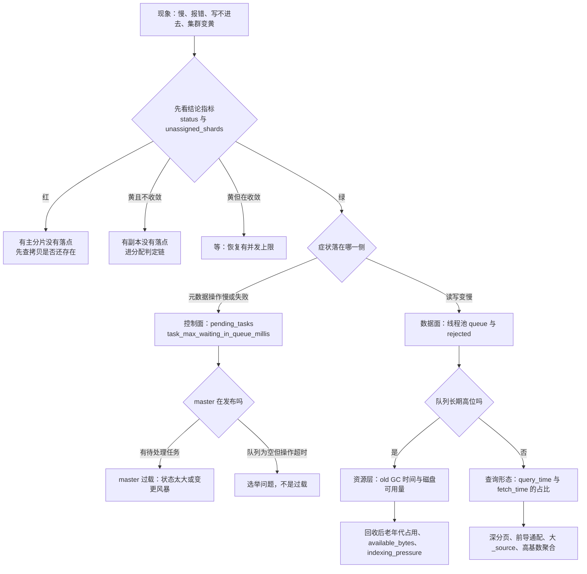
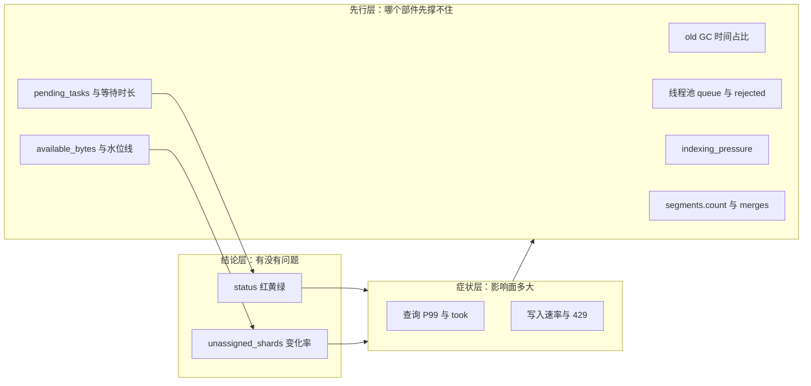
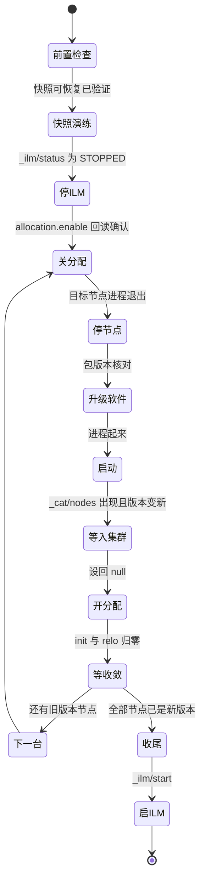
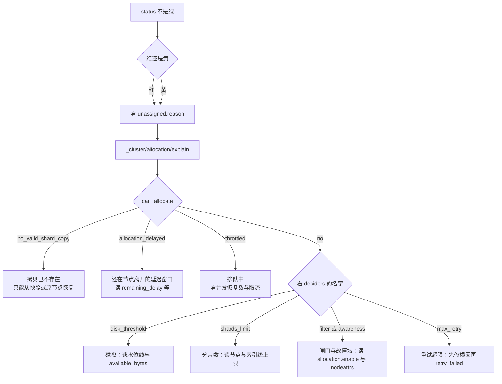

# 08 ES 生产运维——监控、容量规划与版本升级

**摘要：**

凌晨的告警从不按教科书的样子出现。集群是黄的，看板上二十个数字有六个标红，值班的人要在十分钟里决定：是先加磁盘，还是先停掉那个正在跑 force merge 的 ILM 策略，还是什么都不做等它自己收敛。这中间隔着的不是更多的指标，而是一套判定顺序——先看哪一个数字，它成立意味着什么，什么情况下它不成立。本篇把这件事拆成两条主线：一条是从症状到根因的判定链，按集群健康、JVM、线程池、磁盘、段与合并、查询六组指标逐层排除，每一组都给出建议阈值，也给出阈值会失效的现场；另一条是容量与升级这两类不可逆动作的判据，容量要算数据量、副本、预留三笔账，升级要先证伪"能不能退回去"，再谈步骤。文中所有阈值与算例均为示例推算，指标名按 8.15 口径给出，机制层面的细节分别落在分片与分配、写入链路、调优三篇里。两者合起来回答同一个问题：哪些动作可以靠指标试错，哪些动作必须先备好退路。

---

## 第 1 章 从"看指标"到"下判断"

### 1.1 一条凌晨的黄色告警

某天凌晨两点四十，一个跑日志与检索的集群转黄，三个未分配分片，客户端察觉不到任何异常——写入在继续，查询延迟也没有变化。值班的同学按面板顺序往下看：磁盘用了 62%，健康；堆 78%，健康；old GC 每小时一次，看着也正常；pending tasks 队列里有 4 个任务，十几秒后清空。四十分钟过去，集群还是黄的。

真正的答案在另一个地方：前一天下午有人把某个三片索引的副本数从 1 改成了 2，三份新副本要各找落点，而节点的 `total_shards_per_node` 上限恰好在此时触顶，于是三份副本一起悬空。面板上每一个数字都是对的，错的是看数字的顺序——他先看了资源，而资源本来就没有问题；他要找的是一条从"黄"通往"哪个约束不允许分配"的路径。

这类夜晚在运维岗上出现得比想象中频繁，原因不在于指标不够多，而在于指标之间没有因果关系。二十个数字并排躺在面板上，天生平等，而根因永远藏在某一两个数字的下游。

### 1.2 指标不是并列的

把运维要看的东西按因果位置分成三类，判断就会快很多。

第一类是**结论指标**，它们只回答"有没有问题"，不回答"问题在哪"。`status` 是典型：红黄绿是分片状态的汇总，它由最差的那个索引、最差的那个分片决定，而它本身不含任何原因。结论指标的价值在于给你一个触发器，不在于给你一个方向。

第二类是**症状指标**，它们描述系统能力的退化：查询 P99 抬升、写入速率掉档、客户端开始收到 429。症状指标最贴近用户，也最容易被误当成根因——延迟升高不是原因，它是某个更靠下的东西被耗尽之后的表现。

第三类是**先行指标**，它们在被感知之前就已经变化：old GC 的时间占比、线程池队列深度、`segments.count` 的膨胀、`fs.total.available_in_bytes` 的下降斜率。先行指标的价值是给你时间，代价是它们几乎都不能单独定性——队列深了可能是查询变贵，也可能是 GC 停顿把消费速度压住了。

判断的本质，是在这三类之间连线：结论指标亮起，用症状指标定位影响面，用先行指标收窄到部件。连线的方向一旦反了，就会出现 1.1 节那种"所有数字都正常，但集群确实不正常"的僵局。

### 1.3 三条排序原则

第一条，先外后内。客户端认为是 ES 慢的时候，先确认慢发生在哪一段：`took` 是 ES 内部的耗时，不含网络往返与客户端反序列化，`took` 正常而用户喊慢，问题在 ES 之外。这条原则在 07 篇的判据链里已经展开过，本篇只把它当作入口约定。

第二条，先结论后证据。颜色先看，再看 `unassigned_shards` 的**变化率**而不是绝对值，最后才是 `_cluster/allocation/explain` 给出的具体 decider。顺序反了会浪费大量时间：先翻磁盘、先看 GC，看到的都是"某处资源紧张"，而真正拦住分配的可能是一条 `allocation.enable` 设置。

第三条，先控制面后数据面。控制面是 master、集群状态、分配决策，数据面是分片上的读写与段合并。控制面出问题的表征很有辨识度：元数据操作变慢甚至超时、`_cat/master` 可能为空、新建索引失败，而数据面照常读写。数据面出问题的表征正相反：读写受影响，但集群状态发布正常。这两类故障的处置手段完全不同，先分清能省掉一半的排查动作。



三条原则之外还有一条口径要提前说清：本篇引用的指标路径以 8.15 的接口为准，不同小版本之间字段偶有增删；监控系统里常见的 `elasticsearch_*` 指标名来自 exporter，命名随 exporter 版本变化，取数时以对应版本文档为准。

### 1.4 不写指标清单的理由

把一份"必须监控的 30 个指标"抄进文档是最省事也最没用的做法。指标清单假设集群的形态是固定的，而真实的集群会经历扩容、副本调整、分层迁移、版本升级，每一个动作都会让原来那个阈值失去意义。更有用的沉淀是判据：这个数字在什么范围内算正常，超过之后先怀疑什么，什么条件下这个怀疑不成立。往下三章分别处理"现在出了什么事""还能撑多久""要不要做那件不能回头的事"。

---

## 第 2 章 六组指标与它们的判据

### 2.1 集群健康：颜色是结论，不是原因

`GET _cluster/health` 一次返回三个层级的字段，读法各不相同。

`status` 是结论。红的含义是至少一个主分片没有落点，此时受影响的索引会拒绝写入并可能返回部分结果；黄的含义是主分片齐了、副本缺了，读写不受影响但容错能力下降。红要在分钟级响应，黄要看两件事：持续时长，以及 `unassigned_shards` 是否在下降。一个正在收敛的黄和一个纹丝不动的黄，是完全不同的两个故障。

`unassigned_shards` 是证据，但要看变化率。集群重启后头几分钟这个数字很大，随后单调下降，属于正常恢复；如果三十分钟后曲线是平的，说明分配决策被某个硬约束卡住了，这时才值得进 `_cluster/allocation/explain`。`active_shards_percent_as_number` 是同一件事的百分比表达，适合做趋势线，不适合做单点告警。

`number_of_pending_tasks` 配合 `task_max_waiting_in_queue_millis` 才是真正有价值的先行指标。集群状态的变更由 master 单线程串行处理，每一个变更都要算一次分配、发布一次新的集群状态；当变更的产生速度超过处理速度，任务就在队列里堆积。此时的现象很有特征：新建索引超时、`_cat/indices` 卡住、ILM 动作失败，而读写完全正常。堆积的常见原因有三个——集群状态本身太大（分片数与索引数太多，每次发布都要序列化并广播）、短时间内出现变更风暴（批量建索引、批量改副本、ILM 同时触发几十个 shrink）、master 自己的 GC 或磁盘拖慢了处理。

建议阈值：`number_of_pending_tasks` 持续大于 0 超过一分钟，或 `task_max_waiting_in_queue_millis` 超过十秒，值得告警；超过三十秒或任务数持续增长，按故障处理。这两个值在批量运维窗口里短时越线是常态，所以告警要带"持续"条件，否则会被自己的操作打爆。

阈值会失效的情形有两个。其一，队列为空并不代表 master 健康：选不出 master 的时候，根本没有人在处理任务，`pending_tasks` 会一直是零，此时应该看 `_cat/master` 是否为空、看 master 日志里的 `master not discovered`。其二，专有主节点上偶尔出现一两个待处理任务是正常的，集群状态发布本身就不是零成本，把这类抖动做成告警只会训练值班同学忽略告警。

### 2.2 JVM：堆使用率没有可行动性，GC 时间才有

`jvm.mem.heap_used_percent` 是最常被设成告警的指标，也是最不该单独设告警的指标。ES 的堆里装着请求上下文、聚合中间态、字段数据、集群状态、索引缓冲，这些东西天然会把堆推到较高的占用；一个健康的集群跑在 80% 上下是常态，把它设成 85% 告警，得到的只是一条每天触发几十次、每次都被忽略的通知。

真正有可行动性的是 GC 的时间与频率，取 `GET _nodes/stats/jvm` 里的 `jvm.gc.collectors.old.collection_time_in_millis` 与 `collection_count`。这两个都是累计值，绝对值没有意义，要换算成窗口内的增量：old GC 时间占比等于窗口内的时间增量除以窗口长度，old GC 频率等于次数增量除以窗口长度。堆使用率只告诉你"用了多少"，GC 时间告诉你"为了维持这个用量付出了多少暂停"。

建议阈值（示例推算，下同）：old GC 时间占比在五分钟窗口内超过 3% 进入观察，超过 5% 需要处置，超过 10% 基本可以判定节点已经失去服务能力；old GC 在稳定态下每小时超过数十次，说明有对象在长期累积，要找的是累积源而不是加堆。另有一个更贴近用户的判据：单次停顿超过一秒，且停顿时间点与查询 P99 的尖峰对齐。

如何证明"慢是 GC 造成的"，有一个实用的对照法。协调节点的 `took` 在抬升，而各数据节点的 `search.query_time_in_millis` 增量没有同步抬升，说明时间花在分片开始执行之前的等待上；再把同一节点的 `thread_pool.search.queue` 曲线与 GC 时间增量对齐，两条曲线同周期出现锯齿，因果基本成立。它之所以可靠，是因为查询线程被 GC 暂停时既不消费队列也不累计执行时间，两处指标会同时留下痕迹。

阈值会失效的情形值得单列。其一，`collection_time_in_millis` 是累计值，节点重启后归零，用绝对值做告警会周期性误报，必须用 rate。其二，G1 在老年代的统计语义与 CMS 时代不同，`old` 的 `collection_count` 记的是并发周期次数，把它当 Full GC 次数理解会高估严重程度，判断仍要回到时间占比。其三，容器里如果 JVM 看到的可用内存与实际 cgroup 限额不一致，堆使用率的分母本身就是错的，这类环境要显式核对 `jvm.mem.heap_max_in_bytes` 与容器 limit。其四，堆占用高而 GC 干净是真实存在的健康状态，尤其是写入密集的小文档场景，此时加堆不会改善任何东西，反而把页缓存挤掉。

还有一类现场会把 GC 判据彻底打乱，那就是堆被换出到 swap。此时 GC 时间会突然拉长、单次停顿从毫秒级跳到秒级，而堆占用看起来并不高，指标本身是自洽的，结论却是错的——因为时间花在缺页上，不在对象整理上。这类事故的形态与 [[SRE/故障排查与复盘/NameNode长GC事故深度分析：JVM内存管理与Linux Swap的致命交互|NameNode 长 GC 那份复盘]] 里描述的同源，处置方向也一致：先确认 swap 是否关闭、`mlockall` 是否为 true，再回头谈阈值。

### 2.3 线程池：先读队列形状，再谈拒绝

线程池的三个数字是 `active`、`queue`、`rejected`，它们描述的是同一件事的三个阶段：正在执行、正在排队、已经放弃。`rejected` 出现只说明有界队列满了，而队列满的原因至少有四种——单请求太贵、并发真的超过容量、上游在重试放大、下游（磁盘或 GC）把消费速度压住了。

判断顺序建议这样走。先看是哪个池：`search` 的拒绝与查询形态相关，`write` 的拒绝与批量参数、translog 与段合并相关，`bulk` 没有独立线程池，与单文档写入共用 `write`。再看队列形状：瞬时打满、几秒内排空的拒绝是真突发，短暂加长队列合理；长期停在高位、拒绝持续的，加队列只是把"立即失败"换成"排队到超时"，还把内存压力搬到堆上。最后看单请求成本：`search` 侧的深分页、前导通配、高基数聚合，`write` 侧一批十万条，都能在不加容量的前提下把队列吃满。

建议阈值：`search.queue` 长期高于队列容量的 20%（默认队列 1000，即长期高于 200）说明排队已经常态化；`write.queue` 长期高于 1000 同理；`rejected` 的增量本身不宜设成绝对阈值，它是背压生效的证据，不是容量不足的证据。处置的完整顺序与各池的参数口径在 [[07 性能调优——Mapping 设计、查询优化与 JVM]] 里已经铺开，本篇不重复。

阈值会失效的情形：客户端在收到 429 后立即重试，会把一次拒绝放大成十次请求，`rejected` 曲线陡增而实际负载没变；滚动重启或升级期间分片重分布带来的写入抖动，与真实过载在指标上几乎无法区分，只能靠时间窗对齐运维窗口来排除；`search_worker` 的队列是无界的，永远不会产生拒绝，这类池要看的是 `active` 是否长期打满。

### 2.4 磁盘：看可用量，不看已用百分比

磁盘这一组指标有四处容易取错数。

第一处是 `free` 与 `available` 的区别。`fs.total.free_in_bytes` 是文件系统层面的空闲空间，`fs.total.available_in_bytes` 是 JVM 真正能用到的空间，在有 XFS 配额、预留块或容器限制的机器上，后者明显更小。判断"还能不能接收分片"，必须用 `available`。在 `_cat/allocation?v&h=node,disk.avail,disk.used_percent` 里对应的就是 `disk.avail` 与 `disk.used_percent` 两列；同一份输出里的 `disk.indices` 只统计分片本身的数据量，不含同盘上的日志与快照仓库文件，拿它去算水位会系统性地低估。

第二处是百分比水位的单位陷阱，这一条在 06 篇里拆过：85% 说的是已用空间，`50gb` 说的是剩余空间，方向正好相反，混用会被集群设置校验直接拒掉。

第三处是水位判断的滞后。master 每隔 `cluster.info.update.interval`（默认 30 秒）才更新一次各节点的磁盘用量，清理数据之后立刻看水位会看到旧值。更精确的做法是读 `GET _nodes/stats/fs` 里每个数据路径的 `low_watermark_free_space_in_bytes`，它给出的是 master 此刻认同的那条线，省掉自己按百分比换算的步骤。

第四处是指标本身不区分"为什么降"。磁盘下降可以来自写入增长、段合并的临时占用、快照仓库与数据目录同盘、日志文件未轮转。定性要看 `merges.current` 与 `indexing.throttle_time_in_millis` 是否同步上升，若同步上升，多半是合并与写入在抢盘；若两者都安静，先怀疑同盘的其他消费者——ES 之外的进程写盘同样会把 `available` 吃掉，这类事故在 [[SRE/故障排查与复盘/Flink Savepoint 磁盘打满事故分析与最佳实践|Flink Savepoint 磁盘打满]] 里有完整的时间线，判定口径是同一个：先看谁在写，再看水位。

8.x 新增了一个值得纳入判断的指标：`indexing_pressure`。`GET _nodes/stats/indexing_pressure` 返回的是在途写请求占用的字节数与上限，上限默认是堆的 10%；协调与主分片阶段超过上限开始拒绝，副本阶段超过上限的 1.5 倍开始拒绝。它比 `write.queue` 更早报警：队列满说明线程都在忙，pressure 逼近上限说明连在途请求占用的内存都快撑不住了。建议在 `current.all_in_bytes` 占 `limit_in_bytes` 的 70% 时进入观察。

`indexing_pressure` 的失效情形也要知道：空闲集群上它恒为零，只有写请求在途时才有数值；小文档高频写入能撑爆 `write.queue` 却几乎不消耗 pressure；协调节点的 pressure 与数据节点的 pressure 含义不同，把它们画在同一张图上会得出矛盾结论。

### 2.5 段与合并：看不见的空间账

`segments.count`、`merges.current`、`refresh.total_time_in_millis` 这三个数字本身都不告警，它们的作用是解释另外两个指标为什么异常。

`segments.count` 是节点级的，要先除以节点上的分片数才可比。一个持续写入的分片，段数在几十的范围内波动是正常的；长期停在三位数，说明合并速度跟不上段的产生速度，原因通常是合并被限流（`merges.total_throttled_time_in_millis` 持续增长）、磁盘 IO 不够，或者 `refresh_interval` 太短让段产生得太快。判断这一点还要看 `refresh.total_time_in_millis` 的增量占比：refresh 是把内存缓冲变成可搜索段的过程，它不便宜，一秒一次对写入密集的索引是可观的固定成本。

`merges.current` 需要配合场景读。持续大于零并且 `merges.total_time_in_millis` 同步增长，是合并正在进行；如果 `merges.current` 长期等于零而段数很高，说明合并被配置或磁盘能力挡住了。需要区分的是主动触发的 `_forcemerge`：它期间的 `merges.current` 高是预期的，代价是 IO 打满，在线查询会被拖慢，这也是为什么只读索引才适合 force merge。

阈值会失效的情形：删除文档之后段数不会立刻下降，被删文档要等到合并重写才真正释放空间，这段时间里段数与磁盘占用都会"看起来不对"；节点重启后从 translog 恢复，段数会短暂偏高；可搜索快照索引的段结构由快照决定，不受本地合并策略影响。

### 2.6 查询：平均延迟会骗人

`search.query_time_in_millis` 与 `search.fetch_time_in_millis` 是查询两阶段的耗时，要按增量算平均值，更要有分位数。平均值的欺骗性在这个指标上尤其明显：一次深分页的长尾请求可以把平均值抬高，也可以被大量快请求稀释掉。

有两条判据比较可靠。一条是比例：`fetch_time` 在总耗时中的占比超过一半，说明瓶颈在取回阶段，通常是 `_source` 太大或返回字段太多，处置手段是 `_source` includes 与 `fields`。另一条是对照：协调节点的 `took` 抬升而数据节点 `query_time` 不抬升，问题在等待而不是计算，方向转向 GC、线程池排队与网络。

`request_cache` 的命中率要小心解读。它只对 `size: 0` 的请求生效，也就是典型的聚合看板与计数查询，写入与普通搜索都不进这个缓存；命中率等于增量 hit 除以 hit 与 miss 之和。命中率低不一定是故障——查询里带 `now`、每次条件都不同、或者索引刚刚 refresh 过，都会让缓存失效。真正值得关注的是命中率的突变：昨天 80%，今天 20%，说明查询形态或索引刷新节奏变了，而不是缓存坏了。节点查询缓存（`query_cache`）是另一回事，它缓存的是过滤器的结果位图，与 `request_cache` 不是同一个东西。

阈值会失效的情形：`query_time` 从分片开始执行时计时，不含协调节点排队与归并，用它代表端到端延迟会低估问题；`_shards.skipped` 的比例变化会让同样的查询在不同时间有完全不同的开销，跨时间比较前要先确认这个比例没有大变。

### 2.7 六组指标压成一张判据表



| 指标组 | 关键取值 | 它回答什么 | 建议阈值（示例推算） | 阈值会失效的情形 |
|:---|:---|:---|:---|:---|
| 集群健康 | `status`、`unassigned_shards`、`number_of_pending_tasks`、`task_max_waiting_in_queue_millis` | 有没有问题、问题在控制面还是数据面 | 红立即响应；黄三十分钟不收敛转工单；pending 超十秒告警 | 选举失败时队列恒为零；批量运维窗口内的短暂堆积属正常 |
| JVM | `jvm.mem.heap_used_percent`、`jvm.gc.collectors.old.collection_time_in_millis` 增量 | 暂停吃掉了多少服务能力 | old 时间占比 3% 观察、5% 处置；单次停顿超一秒且与 P99 对齐 | 累计值重启归零；容器限额与堆上限不一致；GC 干净而堆高是健康态 |
| 线程池 | `search` 与 `write` 的 `queue`、`rejected`、`active` | 是排队还是执行慢 | `search.queue` 长期高于 200、`write.queue` 长期高于 1000 | 客户端重试放大；升级期分片重分布；`search_worker` 无界队列永不拒绝 |
| 磁盘 | `fs.total.available_in_bytes`、`low_watermark_free_space_in_bytes`、`indexing_pressure` | 还有多少落点余量 | 低水位 85% 前介入；pressure 达上限 70% 观察 | 大磁盘上百分比折算过苛；水位更新有三十秒滞后；空闲时 pressure 为零 |
| 段与合并 | `segments.count`、`merges.current`、`refresh.total_time_in_millis` | 空间与查询效率为什么退化 | 单分片段数长期三位数即需解释；refresh 时间占比超 5% 需解释 | force merge 与重启恢复期的段数异常属预期；快照索引段结构不受本地策略影响 |
| 查询 | `query_time`、`fetch_time` 增量、`request_cache` 命中率 | 时间花在算还是取 | fetch 占比超一半转取回优化；命中率突变而非绝对值 | 平均值掩盖长尾；`query_time` 不含排队与归并；缓存只对 `size: 0` 生效 |

这张表最右一列比中间一列重要。中间一列是可以抄的，右一列决定了抄过去之后会不会被误导。

---

## 第 3 章 容量规划的三笔账

### 3.1 第一笔：数据量与索引膨胀

容量规划的第一笔账最容易被算成"每天多少 G，乘以天数"。这个算式漏掉了膨胀：进入 ES 的原始文档并不是磁盘上占用的全部，`_source` 之外还有倒排、列存、范数与点数据。

以进入 `_source` 的字节数为基准，索引总占用通常在 1.1 到 2.0 倍之间，具体倍率由 mapping 决定。日志类数据偏低，因为文本短、重复词多、压缩效果好，1.1 到 1.4 倍常见；字段多、基数高、开了词向量或对大量字段保留 `doc_values` 的场景偏高，1.5 到 2.0 倍是常态。这是量级判断，不是可以直接写进预算的数字，落地时应当用一个真实索引的 `GET _cat/indices?v&h=index,pri.store.size,docs.count` 除以它对应的源数据量，算出自己的倍率。三个字段类型的影响最直接：`text` 字段付的是倒排与词频的账，`keyword` 付的是列存与全局序号的账，数值与日期付的是 BKD 树的账；不需要检索只用于展示的字段，如果还开着索引与列存，等于为从不发生的查询付费。

`_source` 这一块单独说一句。它一般是索引体积里最大的一块，因为它按原文存整份 JSON，字段名也在里面；关掉它能把倍率压到 1 以下，代价是失去 update 与 reindex 的能力，这条链条在 [[03 文档写入与 Lucene 段合并]] 里有完整推演。容量规划不必重推一遍，只需要记住这个取舍：省下来的磁盘，将来要用一次"数据改不了"来偿还。

第一笔账的算式因此是三段：

```text
单副本数据量 = 日增原始字节 × 膨胀倍率 × 保留天数 × 增长余量
```

增长余量容易被跳过：保留期三十天，但业务量在三十天里会涨，规划时按 15% 到 20% 预留，比上线两个月后再扩容便宜得多。

### 3.2 第二笔：副本与故障域

第二笔账是副本。副本数 r 意味着实际占用乘以 `1 + r`，这笔账没有折扣可谈，因为副本不是备份、而是可用性：主分片所在节点挂了，副本立刻接替，读写不中断。把副本降到零能省一半磁盘，代价是任何一次节点故障都变成数据不可用，直到节点回来或者分片被重新分配。

副本账里有两个硬约束。其一，同一分片的两份拷贝不能落在同一节点（`same_shard` 决定），单索引的副本数最多是数据节点数减一。其二，开了故障域感知（`cluster.routing.allocation.awareness.attributes`）之后，两份拷贝必须落在不同故障域，此时能容忍的是"一个故障域掉线"：两个机架各两台只扛得住单机故障，三个机架各两台才扛得住整机架掉线。

第二笔账的算式：

```text
含副本数据量 = 单副本数据量 × (1 + 副本数)
可容忍失效的节点数 = 故障域内节点数 - 1
```

### 3.3 第三笔：预留

第三笔账是预留，它分三块，每一块都有对应的机制在盯着。

第一块是水位余量。低水位 85% 之后节点不再接收新分片，高水位 90% 之后开始往外搬，洪水位 95% 之后索引被置为只读。规划时按低水位倒推，也就是可用量只算 85%，因为一旦越过 85%，集群就会开始用它自己的方式（搬迁与只读）提醒你。

第二块是合并的临时空间。段合并会把若干个小段重写成一个更大的段，重写期间新旧两份同时存在，峰值占用取决于合并的规模；日常的自动合并是局部的、渐进的，占用通常在百分之几的量级，一次大规模的 force merge 或者只读索引的收尾合并可以短时吃掉十几个百分点。规划时留 5% 到 10% 给合并，并在合并期间盯住 `merges.current` 与磁盘可用量。

第三块是"掉一台"的余量，这一块最常被跳过。节点故障后，它的分片要在存活节点上重新落位，存活节点得同时容纳自己的数据与迁来的数据；按满载的 85% 设计，掉一台之后剩下的人必然越线，`allocation/explain` 一边倒地报 `disk_threshold`，集群卡在黄色直到删数据或加盘。第三笔账的算式因此要再乘一个系数：

```text
需要裸盘 = 含副本数据量 ÷ 水位可用率 ÷ 合并余量 × N ÷ (N - 1)
```

其中 `N ÷ (N - 1)` 就是**故障承受系数**，六台是 1.2，十二台是 1.09。节点越多，这笔系数越便宜，这也是大集群在容量上更从容的原因之一。

### 3.4 分片数：倒推，与那个改不了的分母

分片数的规划方向是从总量倒推，而不是先定一个"每索引五个分片"的习惯。做法是：先按 10 到 50GB 的区间为单个分片定一个目标大小，再用总量除以目标大小。日志场景取偏大的一端（40 到 50GB），因为分片少意味着每分片的段管理开销与 master 的状态压力都小，代价是单分片恢复更慢；检索并发极高的场景取偏小的一端，让查询能扇出到更多分片并行。

时序数据还有一个额外的好处：按天滚动（rollover）的索引每天重新定一次分片数，于是"分片数不能改"这条限制被绕开了——旧索引保留它创建时的分片数，新索引用当天的量重新算。非时序数据没有这个出口，分片数在建索引那一刻就钉死，之后只能靠 shrink、split 或者重建来换，三条路都要重写数据。为什么分母改不了、自定义路由怎么把同一租户钉在一个分片上、10 到 50GB 这个区间的来由，都在 [[01 ES 全局架构——集群、节点、索引与分片]] 里，这里只留一个操作层面的结论：分片数规划错了，代价不是多花磁盘，而是一次数据重写。

分片总数还有两条上界要一起验证。一条是单节点分片数，经验区间是每 GB 堆 20 个分片以内，但更紧的约束来自查询扇出：一个节点上分片数远超 `search` 线程池大小时，单次查询会在同一个池子里排队，延迟随分片数上升。另一条是 master 的发布压力，分片数越多，每次集群状态发布要序列化的内容越多，`number_of_pending_tasks` 的基线就越高。

### 3.5 Hot-Warm-Frozen：把时间维度的账分三段

日志与可观测数据有一个很好的性质：越新的数据越常被查，越旧的数据越接近冷备。分层存储做的就是把这件事实变成硬件配置：热层用最快的盘与最多的副本，温层用便宜的盘与更少的副本，冷层与冻结层把数据放在对象存储上，本地只留缓存。


四层的角色与代价差异很大，规划时逐层算账比算一个总数更清楚。

| 层 | 节点角色 | 存储 | 副本 | ILM 阶段动作 | 主要代价 |
|:---|:---|:---|:---|:---|:---|
| 热 | `data_hot` | NVMe 或 SSD | 1 | `rollover`、`set_priority` | 单价最高，通常只放最近几天 |
| 温 | `data_warm` | HDD 或大容量 SSD | 0 或 1 | `forcemerge` 到单段、`allocate` 降层 | 合并不便宜，且合并后不可再写 |
| 冷 | `data_cold` | 大容量盘加对象存储 | 0 | `searchable_snapshot` 全量挂载 | 恢复依赖仓库，仓库故障即数据不可读 |
| 冻结 | `data_frozen` | 对象存储加本地共享缓存 | 0 | `searchable_snapshot` 部分挂载 | 查询要回源，缓存重启清空 |

有一个必须写在配置旁边的边界：冷层与冻结层用的是可搜索快照，索引数据的**唯一完整拷贝**在快照仓库里，本地只是缓存。删掉底层快照、注销仓库、或者让另一个集群写坏同一个仓库，数据就永久丢失，这不是"副本少一点"的降级，而是"唯一一份"的托管。仓库的注册纪律因此属于容量规划的一部分，而不是备份章节的附属品。

### 3.6 一个可以复算的算例

把三笔账套在一个具体集群上。前提：日增原始数据 500GB（进入 `_source` 的字节），保留 30 天，1 个副本，膨胀倍率取 1.3，增长余量 20%，水位按 85%，合并余量按 5%，单个分片目标 50GB。

| 步骤 | 算式 | 结果 |
|:---|:---|:---|
| 单副本数据量 | 500GB × 1.3 × 30 天 | 19.5TB |
| 计入增长 | 19.5TB × 1.2 | 23.4TB |
| 含副本 | 23.4TB × 2 | 46.8TB |
| 水位倒推 | 46.8TB ÷ 0.85 | 55.1TB |
| 合并余量 | 55.1TB ÷ 0.95 | 58.0TB |
| 校验 A：11 台 × 6TB | 掉一台后 60TB × 0.85 = 51TB，占用 78% | 距低水位仅 7 个百分点 |
| 校验 B：12 台 × 6TB | 掉一台后 66TB × 0.85 = 56.1TB，占用 71% | 水位余量 14 个百分点 |

分片数同向推算：23.4TB 主数据除以 50GB，约 468 个主分片；按 30 天、每天 650GB 的单副本增量算，每天约 13 个分片、约 390 个，与总量倒推的结果在同一量级，取整后按每天 13 个分片滚动。936 个分片（含副本）摊到 12 个节点，每节点 78 个；若节点是 16 核，`search` 线程池为 25，78 个分片约为池大小的三倍，落在"查询扇出不至于让排队成为常态"的区间内。

这张表值得反过来读一遍。前五步算出的 58TB 只是"装满且不越水位"的需求，按它选 11 台在纸面上过关；但掉一台之后，46.8TB 要压在 60TB 裸盘上，占用率 78%，距低水位只剩七个点，一次合并峰值或一天的写入增长就能顶穿。多出来的 6TB 买的不是容量，是故障当天的七个点。

---

## 第 4 章 版本升级：不可逆动作的判据

### 4.1 为什么说升级不可逆

升级与扩容、改副本、调 refresh 不在一个量级上，后三者都能回头，升级这件**不可逆**的事不能。原因有三层，一层比一层硬。

第一层是集群内部状态的单向变更。官方在升级文档里写得很直白：一旦集群里出现了新版本的节点，它就可能对内部状态做出无法回退的改动；如果升级无法完成，处置方式不是把新节点换回旧版本，而是丢弃这个半升级的集群、部署一个旧版本的空集群、再从快照恢复数据。这句话把"回退"这个词从升级流程里删掉了，只留下"重建"。

第二层是 Lucene 的段格式。ES 的版本兼容是**新读旧**而不是旧读新：新版本能打开旧版本写的段，旧版本打不开新版本写的段。升级期间只要有一个分片被新节点写入，即使数据本身没变，这个分片也已经带上了旧版本读不懂的格式。集群里混版本运行只在升级窗口内被容忍，官方明确不支持长期共存。

第三层是协调层的版本协商。新版本节点可以加入旧版本 master 领导的集群，反之则不行，这正是升级顺序要求"非 master-eligible 先升、master 最后升"的原因：让被选举出来的 master 永远是较新的那个，任何节点都能加入。

三层叠加起来的结论是：升级的可用性保障不在集群里，在快照里。第 5 章讲快照，是因为它是这条流程唯一的回退手段。

### 4.2 三道门：先证伪，再动手

动手之前有三道门要过，任何一道没过，升级都不该开始。

第一道门是路径合法性。小版本之间可以直接滚动；跨大版本不能跳，7.x 升 8.x 必须先到 7.17，无论采用滚动还是全量重启；6.x 不能直接到 8.x。路径判断错的表现很有杀伤力：节点起不来，或者起得来但加入不了集群，而这时旧节点已经被动过了。

第二道门是弃用项清空。7.17 上用 `GET _migration/deprecations` 拉清单，响应里 `level` 为 `critical` 的项必须在升级前修掉，`warning` 的项要逐条判断影响。这个接口在 8.x 里仍然存在，官方把它定位为供 Kibana 的 Upgrade Assistant 间接使用的接口，也就是说升级到 8.x 之后还要再跑一次，为下一次大版本做准备，而不是"7.x 专属的一次性检查"。清单里的三类项最值得优先处理：索引级设置里的已弃用参数（它们会在新版本里被忽略或报错）、mapping 里新版本不再接受的写法（只能靠重建索引解决）、以及集群级设置里改名的参数（升级后旧名字失效，行为回到默认值，往往在几天后才被发现）。

第三道门是插件与 mapping。所有插件必须与 ES 版本精确对应，包括分词器、仓库插件、安全插件；版本不匹配的插件会让节点直接起不来。mapping 的兼容性更隐蔽：7.x 允许而 8.x 拒绝的写法，在升级过程中不会报错，直到某个索引被写入时才炸，所以要在升级前用 `_migration/deprecations` 的索引级条目配合 reindex 处理掉。

### 4.3 滚动升级的顺序，以及每一步的判据



顺序里有三个点不能反，每个点背后都有一个具体的代价。

第一个点是先关分配、再停节点。停掉一个数据节点之后，master 会等 `index.unassigned.node_left.delayed_timeout`（默认一分钟）再开始把它的分片复制到别的节点；这一分钟里没关分配，就会开始一场注定回滚的搬迁——节点一会儿就回来，搬走的副本还得搬回去，两趟 IO 白烧，还可能把磁盘推到高水位。关分配之后，重启节点的本地分片仍然会恢复（这条豁免在 06 篇里讲过），但不会触发副本的大规模重分布。

第二个点是先等节点入集群并恢复、再开分配。节点进程起来不等于分片就位，它要先加入集群、上传自己的分片状态、等待 master 重新分配；这期间如果已经放开了分配，master 会把本来属于它的分片安排到别处，等它准备好了再迁回来。判据是 `_cat/nodes?h=name,version` 里目标节点的版本已经变新、`_cat/health` 的 `init` 与 `relo` 归零，此时再放开。

第三个点是放开分配之后不要立刻升级下一台，要等集群收敛。`_cat/recovery?v&active_only` 里没有活跃恢复、`init` 与 `relo` 归零，才算这一台结束。混版本期间集群可能是黄的，这不是异常，判据是"没有正在进行的初始化与搬迁"，而不是"颜色是绿的"。

| 步骤 | 动作 | 判据 | 顺序反了的后果 |
|:---|:---|:---|:---|
| 1 | 记录基线：节点版本、分片数、磁盘水位 | `_cat/nodes?v&h=name,version`、`_cat/allocation?v` 存档 | 出问题后无法判断是否退化 |
| 2 | 快照并演练恢复 | 第 5 章的演练清单全部通过 | 唯一的回退手段不可用 |
| 3 | 停 ILM | `GET _ilm/status` 返回 `STOPPED` | 升级中触发 shrink 或 force merge，抢 IO 且可能失败 |
| 4 | 关分配 | `GET _cluster/settings` 回读到 `primaries` 或 `none` | 节点一停就开始无谓的副本搬迁 |
| 5 | 停节点并升级软件包 | `_cat/nodes` 少一台；包版本核对 | 包与插件版本不匹配，节点起不来 |
| 6 | 启动并等入集群 | `_cat/nodes` 出现，version 变新 | 过早放开分配，分片被搬走再搬回 |
| 7 | 放开分配 | 设为 `null`，回读确认 | 忘了改回，集群此后不再自动恢复 |
| 8 | 等收敛后处理下一台 | `init`、`relo` 归零，无活跃恢复 | 带着未完成的恢复进入下一个节点，问题叠加 |

关于第 4 步用哪个值，需要说清楚。官方滚动升级文档给的是 `primaries`，含义是"允许主分片分配、不允许副本分配"，这样重启节点的主分片能尽快回来，同时副本不会在混版本之间来回搬。`none` 更彻底，什么都不分配，适合完全停写的窗口；代价是它会把所有恢复都按下暂停，如果此时有节点意外掉线，分片补不回来，集群从黄变红。选择取决于这次升级有没有停写：停写用 `none`，不停写用 `primaries`，两者都必须在升级结束后改回 `null`，并且以回读 `GET _cluster/settings` 为准。

版本一致性要用两条路径互相印证。`GET _cat/nodes?v&h=name,version` 给出全量节点的版本列，一眼能看出还剩几台没换；`GET _nodes/stats?filter_path=nodes.*.version` 拿的是各节点自报的版本，能确认节点是真的可用而不只是显示在列表里。两者不一致时的读法不一样：`_cat/nodes` 已是新版本而 `_nodes/stats` 的响应里少了这个节点，说明进程在但请求超时，可能是 GC 或负载把节点压住了，这种情况不能继续下一台；反过来 `_nodes/stats` 里有它而 `_cat/nodes` 还没更新，通常只是刚加入的瞬态，等一个集群状态发布周期再确认。

### 4.4 什么时候必须停写，至少停 ILM

**停 ILM** 是滚动升级的最小要求，**停写**是跨大版本的要求，两者的理由不同。

停 ILM 的理由是它在升级期间会主动制造变更。ILM 会在数据到达时间阈值时执行 `forcemerge`（抢磁盘 IO）、`shrink`（把索引重写成更少的分片，过程中创建新索引，可能落在旧版本节点上）、`searchable_snapshot`（把索引挂载成快照索引，需要仓库可用）。混版本期间还有一个更尴尬的限制：新版本节点上的主分片，其副本不能分配到旧版本节点，所以升级窗口里任何"新建索引并等它变绿"的动作都可能超时。停掉 ILM，把这些变更推迟到升级结束之后，代价是升级窗口里数据不会按策略下移一层，通常可以接受。

停写的判据更简单：跨大版本升级必须停写，因为 8.x 相对 7.x 在 mapping、索引设置、客户端兼容上有实质变化，允许写入等于允许新旧格式在同一个索引里交替出现；而且停写能让升级窗口从"边写边升"变成"只升不写"，恢复量最小、判断最简单。上游是 Kafka 的日志链路很容易做到这一点，把消费位点停住即可；直接双写的业务链路则要慎重评估停写窗口，通常改用全量重启加工双集群切换。

插件与 mapping 不兼容是两种必须停下来处理的情形：插件只能等对应版本或换掉，mapping 只能在旧版本上重建并验证完再升级。

### 4.5 8.x 的门槛

8.x 有三处与升级直接相关的门槛，每一处都容易在上线当天才发现。

第一处是安全默认开启。8.0 起安全特性默认启用，第一次启动时会自动生成 TLS 证书与密钥、写入配置、生成 `elastic` 用户密码、生成 Kibana 的 enrollment token，并把这个 CA 证书的指纹打印到终端。这些凭据只在第一次启动时显示一次，必须落进密码库；丢了只能用 `elasticsearch-reset-password` 重置，给新节点加入用的 enrollment token 则要用 `elasticsearch-create-enrollment-token -s node` 重新生成。这里有一个被反复误解的点：自动配置只在"节点第一次启动、数据目录为空、且没有显式配置安全或发现相关设置"时发生。升级来的节点数据目录非空，会跳过自动配置；而任何生产集群都设置了 `discovery.seed_hosts` 或 `cluster.initial_master_nodes`，同样会跳过自动配置。所以"security 默认开启"不是升级时自然发生的事，新建集群与升级集群在这一点上完全不同，升级前必须单独确认 `xpack.security.enabled` 的取值与证书状态，否则会得到一部分节点要求 TLS、一部分节点不要求的混合现场。

第二处是 type 的移除。8.0 起索引里不再有 type，`_doc` 端点作为兼容形式保留，但 7.x 时代带 type 的写 mapping、查 mapping 的调用会报错。升级前要把应用侧的调用扫一遍，尤其是那些从 5.x 或 6.x 一路复制过来的代码。

第三处是 JDK 的归属。8.x 的发行包自带 JDK，启动脚本优先使用包内的 JDK，`ES_JAVA_HOME` 的优先级高于 `JAVA_HOME`；如果运维习惯性地在环境变量里指定了外部 JDK 的路径，升级后节点可能用旧 JDK 启动，表现为启动失败或者运行期出现奇怪的模块错误。核对的判据是启动日志里的 JVM 版本行与 `_nodes/stats/jvm` 返回的版本一致。

| 门槛 | 检查方式 | 失败现场 |
|:---|:---|:---|
| 安全默认开启 | 核对 `xpack.security.enabled`、证书文件与密码库条目 | 节点间 TLS 握手失败，或客户端 401 |
| type 移除 | 搜代码里的 mapping 调用与 `_doc` 之外的 type 用法 | 建索引或写 mapping 返回 400 |
| JDK 归属 | 启动日志的 JVM 行、`ES_JAVA_HOME` 取值 | 启动即退出，或运行期类加载错误 |

### 4.6 停机窗口怎么估

滚动升级的窗口不是"节点数乘以重启时间"，它由四段构成：前置动作（快照、演练、停 ILM）、每节点的停机与恢复、每节点之后的收敛等待、收尾动作。

每节点的耗时可以这样估：进程停止与启动几十秒，JVM 起来后加入集群十几秒，本地分片恢复是主要部分。以第 3 章的 12 节点集群为例，每节点 6TB 数据、78 个分片，本地恢复每个分片按两秒计约两分半，加上重启与加入集群，单节点约四分钟。十五个节点（含三个专有主节点）下来约一小时（示例推算，实际受磁盘读速、分片数与 translog 回放量影响）。

如果忘了关分配，同一个窗口会变成什么样，可以算一笔对照账：节点掉线一分钟后开始副本重分布，6TB 数据按每节点 40MB/s 的恢复限流摊到十一台存活节点上，每台要接约 545GB，约三点八小时；节点回来后这些副本还要再搬回去。也就是说，一个漏掉的 `PUT _cluster/settings` 能把一小时的窗口拖成半天，并且期间在线查询与磁盘都在承压。

停机窗口的结论要写进变更单：前置两小时（快照、演练、基线记录），滚动窗口一到两小时（视节点数与分片数），缓冲一小时，总计预留半个工作日。

---

## 第 5 章 快照：唯一的回退手段

### 5.1 仓库类型与它们的适用面

快照写入一个仓库，仓库是集群之外的一块存储。可用的类型有共享文件系统（`fs`）、对象存储（`s3`、`gcs`、`azure`）、只读 URL、source-only，以及需要单独插件的 HDFS。选型主要看两件事：能不能被所有 master 与数据节点看到，以及它的读写能否支撑"全量恢复"这个最坏场景。

| 类型 | 前置条件 | 适合 | 坑 |
|:---|:---|:---|:---|
| `fs` | 所有节点挂载同一共享文件系统，`path.repo` 白名单 | 机房内有成熟 NFS 或分布式文件系统 | NFS 卡顿会同时拖住快照与恢复；权限与目录不能跨节点不一致 |
| `s3` 及兼容实现 | bucket、凭据或实例角色 | 云上集群，容量不设上限 | 兼容实现必须完整支持 S3 语义，否则会在恢复时静默出错 |
| `hdfs` | 安装对应版本的仓库插件 | 已有 Hadoop 集群 | 插件版本与 ES 严格对应，升级时要一起换 |
| 只读 URL | 一份静态的仓库副本 | 归档与合规留档 | 只能恢复不能新建快照 |
| source-only | 无额外前置 | 只要 `_source`、不要索引结构 | 恢复时要重新索引，恢复时间不可控 |

有一条纪律比选型更重要：同一个仓库只允许一个集群写。多个集群同时写同一个 bucket，仓库内容有损坏风险；其他集群应当以只读方式注册。这条纪律在升级场景里尤其关键，因为回退要用的正是这份仓库。

### 5.2 两个限流闸门

快照与恢复的速度由两个独立的闸门控制，很多人只记得第一个。仓库侧的闸门是 `max_snapshot_bytes_per_sec` 与 `max_restore_bytes_per_sec`，前者默认 40MB/s、后者默认不限，两个值都是"每节点"的口径而非集群总量；节点侧的闸门是 `indices.recovery.max_bytes_per_sec`，默认 40MB/s，限制每个节点的恢复总流量，对等恢复与快照恢复都算在内。两者串联，一个恢复要同时低于两条线才能跑满。所以"恢复了三个小时还没完"的第一嫌疑通常不是仓库慢，而是这个节点级限流。

| 参数 | 默认值 | 调大的代价 | 调小的代价 |
|:---|:---|:---|:---|
| `max_snapshot_bytes_per_sec` | 40MB/s | 快照抢占磁盘与网络，在线查询变慢 | 备份窗口拉长，可能撞上下一次快照 |
| `max_restore_bytes_per_sec` | 不限 | 恢复打满网络，等同一次全量压力测试 | 回退窗口拉长，最坏情况下无法在承诺时间内恢复 |
| `indices.recovery.max_bytes_per_sec` | 40MB/s | 恢复与迁移动用更多带宽，挤压搜索与写入 | 恢复与副本补齐变慢，故障恢复时间变长 |
| `cluster.routing.allocation.node_concurrent_recoveries` | 2 | 并发恢复多，磁盘与网络争抢 | 恢复排队，节点回来很久仍不绿 |

这里有一个反直觉的结论：仓库侧的恢复限流默认"不限"，但在线集群不该真的不限——恢复是全量读加全量写，不设上限会把带宽吃干、把在线查询延迟顶上去。按可用带宽的六到七成设一个值，并接受恢复时间变长。

### 5.3 恢复不是点一下

恢复动作看起来只有一条 API，但它经过的路径与一次分片分配几乎一样：恢复的索引先创建，再走分配决策链，再按恢复限流拉数据，最后进入 `STARTED`。这意味着三件事。

第一，恢复会被分配约束卡住。磁盘越过低水位、分片数触顶、`allocation.enable` 被设成 `none`，都会让恢复的分片停在未分配。此时 `_cluster/allocation/explain` 给出的 decider 与普通分片完全一样，排查路径也一样。

第二，`include_global_state` 会覆盖集群级元数据。它包含模板、ILM 策略、集群设置、脚本等内容，恢复到同一个集群时带上它，等于用快照时刻的配置覆盖现在的配置；多数恢复演练应当把它设为 `false`，只恢复数据本身。

第三，索引名冲突要先处理。同名索引存在时恢复会失败，标准做法是用 `rename_pattern` 与 `rename_replacement` 恢复成新名字；演练时一律重命名恢复，免得"演练把生产数据覆盖了"。

### 5.4 可恢复性演练：把"做了快照"变成"能恢复"

升级前最容易走过场的一步是快照。`PUT _snapshot/...` 成功、`_cat/snapshots` 里有记录，并不等于这份快照**能恢复**。能恢复意味着仓库可读、段文件完整、index metadata 可用、并且恢复能在可接受的时间内完成。

演练清单有五步，缺一步都算没做。第一步，`POST _snapshot/repo/_verify`，确认所有 master 与数据节点都能访问仓库并拿到一致的目录。第二步，挑一个有代表性的索引做重命名恢复，`include_global_state` 设 false，`wait_for_completion` 设 false，在 `_cat/recovery?v&active_only` 里看进度与失败分片。第三步，恢复完成后用 `_count` 对比文档数，用一条覆盖主要查询形态的 DSL 抽样查询。第四步，记录恢复耗时与峰值速率，这个数字就是升级失败时的回退窗口。第五步，删掉演练索引，免得它占着磁盘水位。

演练的判据要写清楚：文档数与源索引一致；抽样查询结果正确；恢复过程没有失败分片；恢复耗时在可接受窗口内。最后一条经常被忽略——一份能恢复但需要十小时的快照，对一次计划两小时的升级来说等于没有。

### 5.5 可搜索快照：省磁盘，但把唯一性押在仓库上

可搜索快照把快照直接挂载成可查询的索引，不再需要在本地保留完整副本。它有两种挂载方式：全量挂载把数据完整缓存到本地，查询性能接近普通索引，冷层用它；部分挂载只在本地缓存最近查询过的数据，未命中的部分回源读取，冻结层用它，本地缓存大小默认为磁盘的九成、并保留约 100GB 的余量。

它的适用面很明确：访问频率低、可接受较高延迟、需要长期保留的历史数据。日志与安全审计数据是典型用户，配合 ILM 自动从热层一路下移到冻结层。它的边界同样明确：索引数据的唯一完整拷贝在仓库里，本地缓存不完整、不能用于恢复；删除底层快照、注销仓库、或者让其他集群写坏仓库，数据就永久丢失。这也是为什么用 ILM 管理可搜索快照时，它需要的时候会先克隆一份快照，让"作为备份的快照"与"被挂载的快照"分离。

挂载还有一个操作细节值得记住：部分挂载要求节点上有共享缓存，且只有 `data_frozen` 角色的专有节点会默认配置这块缓存；非专有节点需要显式设置缓存大小，否则部分挂载的分片没有落点。挂载时还要注意 recovered 索引的前缀：ILM 管理下，全量挂载的索引以 `restored-` 开头，部分挂载的以 `partial-` 开头，写索引模板与告警规则时不要把这两个前缀当成数据本身。

---

## 第 6 章 集群状态异常的判定链

### 6.1 四步走到 decider

前五章分别讲了指标、容量、升级、快照，这一章把它们收回到一个最常发生的现场：集群不是绿的，而且看起来不会自己变绿。

**判定链**有四步。第一步读颜色与分片，得到"红还是黄"以及涉及哪些索引。第二步读 `_cat/shards` 的 `unassigned.reason`，得到这个分片"当初"为什么未分配——`NODE_LEFT` 是节点离开，`ALLOCATION_FAILED` 是分配失败超限，`INDEX_CREATED` 是建索引时没有落点，`REPLICA_ADDED` 是加副本时没有落点。第三步用 `_cluster/allocation/explain` 拿 `can_allocate`，`no`、`throttled`、`allocation_delayed`、`no_valid_shard_copy` 四种取值直接决定下一步动作。第四步看 `node_allocation_decisions` 里的 decider 名，把根因归到磁盘、分片数、分配闸门、故障域之一。



四步之所以要按这个顺序，是因为每一步都在缩小范围，跳步会反复回到起点。先看磁盘再看 `explain`，看到的是"磁盘紧张"这个普遍现象而不是"这个分片被哪条水位挡住"；先看 decider 再看 `unassigned.reason`，会把"历史原因"和"当前阻碍"混在一起。

### 6.2 decider 对应的现场动作

分配决策链的机制与九个 decider 的判定顺序在 [[06 集群管理——选主、分片分配与脑裂防护]] 里已经拆透，这里只给运行时的对照动作。

| decider | 现场判据 | 第一动作 |
|:---|:---|:---|
| `disk_threshold` | `_cat/allocation?v` 的 `disk.used_percent`，或 `_nodes/stats/fs` 的 `low_watermark_free_space_in_bytes` | 清理数据或加盘；确认是否只是水位更新滞后 |
| `shards_limit` | 节点与索引级的 `total_shards_per_node` 设置 | 调整上限或减少分片；注意调高上限只是把压力推到别处 |
| `filter` | `index.routing.allocation.*` 与节点 `_tier` 属性 | 核对索引的目标层与节点角色是否匹配 |
| `awareness` | `_cat/nodeattrs` 与强制感知配置 | 故障域里的节点数不够时，先补节点再谈恢复 |
| `same_shard` | 数据节点数与索引副本数 | 降副本或加节点；单节点集群必然黄 |
| `max_retry` | 分片的失败次数 | 修掉根因后 `POST _cluster/reroute?retry_failed=true` |

这张表里最需要克制的动作是调高上限。分片数上限、磁盘水位、并发恢复数都属于"瓶颈的刻度"，把刻度调宽不会让瓶颈消失，只会让它在更靠后的位置以更难查的形式出现。

### 6.3 升级窗口里的"黄"是预期

第 4 章的滚动升级有一个必然的副作用：混版本期间集群会黄。分配规则不允许把新版本节点上主分片的副本放到旧版本节点，因为新格式旧版本读不懂；只升完一台时，它的副本无处可去，`unassigned_shards` 会稳定在非零值上。

这时候的判据不是颜色，而是 `init` 与 `relo` 是否归零、`_cat/recovery?v&active_only` 是否为空。两者归零，说明这一台的恢复已经结束，可以继续下一台；随着更多节点升级完成，副本会重新找到落点，集群自然变绿。把一个预期的黄当成故障去排查，会引入不必要的 `reroute` 与设置调整，那才是真正把升级搞复杂的原因。

与之相对，如果升级窗口里集群变红，那是真故障，要立刻停下来：红意味着有主分片没有落点，而升级流程本身的动作（停节点）不会造成红——关分配只会让副本缺位。红通常意味着快照之外的某个前置条件没满足，比如节点起不来、插件不兼容、或者升级前的分片本来就不完整。

---

## 第 7 章 反例

### 7.1 快照做了，但没有验证过恢复

`PUT _snapshot` 返回 `accepted` 之后就不再关心，是升级事故里最常见的一种起点。快照是异步的，返回受理不代表完成；完成也不代表能恢复。仓库权限变更、对象存储的生命周期策略把段文件转到了归档层、`path.repo` 少配了一台节点、索引的 metadata 引用了已删除的组件模板，这些问题在"做快照"时全都看不出来，只在恢复时暴露。等到升级失败需要回退，才发现唯一的退路是断的。

正确做法是第 5 章那份五步演练清单，并且把演练耗时写进变更单，因为它就是回退窗口的长度。

### 7.2 `allocation.enable` 忘了改回

滚动升级的流程里要求先关分配，最后的收尾却常常被跳过。忘了改回的表现是延迟出现的：升级当天一切正常，几天后某个节点重启，分片没有回来，集群从绿变黄；再过一段时间有节点掉线，黄变红。此时排查的人第一反应是磁盘、是副本数、是故障域，几乎不会想到三周前的一条 persistent 设置。

这类问题的防线只有两条：一是收尾动作写进清单并且以 `GET _cluster/settings` 的回读为准；二是把 `cluster.routing.allocation.enable` 纳入日常巡检，非 `null` 时告警。06 篇里把它列为反例，站在升级流程的角度看，它更像一条"没有验收步骤就不算结束"的纪律。

### 7.3 只看堆，不看 GC 时间

堆使用率 75%，于是判断内存健康；old GC 每两分钟一次、每次一点二秒，于是每次告警都被当成噪声划掉。这是把"用了多少"当成了"付出多少"。真正影响用户的是暂停时间，而暂停时间与堆占用之间没有单调关系：一个 31GB 堆上装着大量短命对象的节点，堆占用可以长期在 70% 上下，GC 却很干净；另一个 31GB 堆上装着高基数聚合中间态的节点，堆占用 68%，old GC 却在反复整理同一批长命对象。

判据应该反过来：先看 old GC 的时间占比与单次停顿，再看堆占用是不是原因。堆占用高且 GC 干净，说明对象结构健康，动堆只会挤掉页缓存；堆占用不高而 GC 频繁，要找的是谁在长期累积。

### 7.4 一出现 `rejected` 就调大队列

这条反例的机制在 07 篇里已经讲透：队列不提高处理能力，只把立即失败换成延迟失败，还顺带把内存压力搬到堆上。在升级与扩容的场景里它还有一个变体：混版本期间分片重分布带来写入抖动，`write` 池的 `rejected` 上升，有人据此把队列从一万调到五万，升级结束后队列长期停在低位，看起来问题解决了；下一次真正过载时，五万条请求在队列里排队，客户端超时，堆被排队请求的上下文撑高，故障形态从"快速失败"变成"整体雪崩"。

正确的判据是队列形状与单请求成本，调参数放在最后一步。

### 7.5 混版本长期共存

升级到一半停下来，一部分节点是新版本、一部分是旧版本，因为业务窗口结束就这样放着。混版本期间的新功能被禁用或降级运行，某些索引操作会失败，副本可能长期缺位；更麻烦的是一旦新版本节点写过数据，回退到全旧版本已经不可能，只能整集群重建。官方明确不支持在升级期之外运行多个版本，把它当成"可以慢慢来"是误读。

### 7.6 停写窗口按"平均数"估算

升级窗口如果只按"每台五分钟、十五台七十五分钟"估，会漏掉三类时间：单台恢复的尾部（某个大分片慢）、混版本期间的收敛等待（副本无处落点时要等下一台）、以及收尾动作（启 ILM、放开分配、验证、回读）。实际窗口通常是估算的一点五到两倍，回滚时间按最坏值写，不是按均值写。

---

## 第 8 章 结语

运维这件事的难点，从来不在"知道要看什么指标"，而在"知道先看哪一个，以及它不成立的时候该怎么想"。六组指标给的是观测面，判定链给的是顺序，容量三笔账给的是数字的下界与余量的价格，升级的四道门给的是不可逆动作的准入条件。

把这几件事连起来看，会发现它们共享同一个结构：所有可逆的动作，都可以用更多的指标和更细的阈值去试错；所有不可逆的动作，只能用可逆的手段兜底——升级的回退手段不在集群里，在快照里；分片数的后悔药不在设置里，在重建里；副本降为零省下的磁盘，将来要用一次数据不可用来偿还。所谓运维成熟度，大概就是把"哪些事还能回头、哪些事不能"分得足够清楚，并且把不能回头的那几件事，永远留一条经过验证的退路。

---

## 参考资料

1. Elastic. Rolling upgrade（7.17 文档，含滚动升级的完整步骤与顺序要求）：https://www.elastic.co/guide/en/elasticsearch/reference/7.17/rolling-upgrades.html
2. Elastic. Rolling upgrade（8.15 文档，含"升级到 8.x 必须先到 7.17"的路径要求）：https://www.elastic.co/guide/en/elasticsearch/reference/8.15/rolling-upgrades.html
3. Elastic. Cluster health API（`number_of_pending_tasks`、`task_max_waiting_in_queue_millis` 等字段）：https://www.elastic.co/guide/en/elasticsearch/reference/8.15/cluster-health.html
4. Elastic. Nodes stats API（`jvm`、`thread_pool`、`fs`、`indices`、`indexing_pressure` 的字段定义）：https://www.elastic.co/guide/en/elasticsearch/reference/8.15/cluster-nodes-stats.html
5. Elastic. Indexing pressure（默认上限为堆的 10%，副本阶段 1.5 倍）：https://www.elastic.co/guide/en/elasticsearch/reference/8.15/index-modules-indexing-pressure.html
6. Elastic. Deprecation info APIs（`GET _migration/deprecations`，供 Upgrade Assistant 使用）：https://www.elastic.co/guide/en/elasticsearch/reference/8.15/migration-api-deprecation.html
7. Elastic. Start the Elastic Stack with security enabled automatically（自动配置的产物与跳过的条件）：https://www.elastic.co/guide/en/elasticsearch/reference/8.15/configuring-stack-security.html
8. Elastic. Index recovery settings（`indices.recovery.max_bytes_per_sec` 默认 40MB/s）：https://www.elastic.co/guide/en/elasticsearch/reference/8.15/recovery.html
9. Elastic. S3 repository（`max_restore_bytes_per_sec` 默认不限、`max_snapshot_bytes_per_sec` 默认 40MB/s）：https://www.elastic.co/guide/en/elasticsearch/reference/8.15/repository-s3.html
10. Elastic. Searchable snapshots（全量与部分挂载、共享缓存与唯一拷贝的边界）：https://www.elastic.co/guide/en/elasticsearch/reference/8.15/searchable-snapshots.html
11. Elastic. Register a snapshot repository（仓库类型的适用面与多集群注册纪律）：https://www.elastic.co/guide/en/elasticsearch/reference/8.15/snapshots-register-repository.html

---

> [!note] 思考题
> 1. 一个节点上 old GC 时间占比达到 6%，但堆占用稳定在 70%、查询 P99 没有明显抬升。你会先处置 GC，还是先不管它？判据是什么？
> 2. 六节点集群滚动升级到第三台时集群持续为黄，`unassigned_shards` 稳定在 78。什么情况下可以继续升下一台，什么情况下必须停下来？
> 3. 容量规划里"低水位 85%"和"掉一台仍不越线"这两个约束，在不同节点数下哪个更紧？把三笔账的公式代进去，找出反转点。
> 4. 为什么 `max_restore_bytes_per_sec` 默认不限，而在线集群反而应该给它设一个上限？这个上限应该按什么来定？
> 5. 快照演练只验证了"能恢复"，没有记录耗时。这对一次计划两小时的升级意味着什么风险？
> 6. 如果集群刚从 7.17 升到 8.15，`GET _migration/deprecations` 返回为空，能否认为下一次大版本升级已经准备好了？还缺什么？