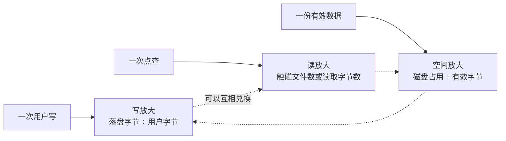
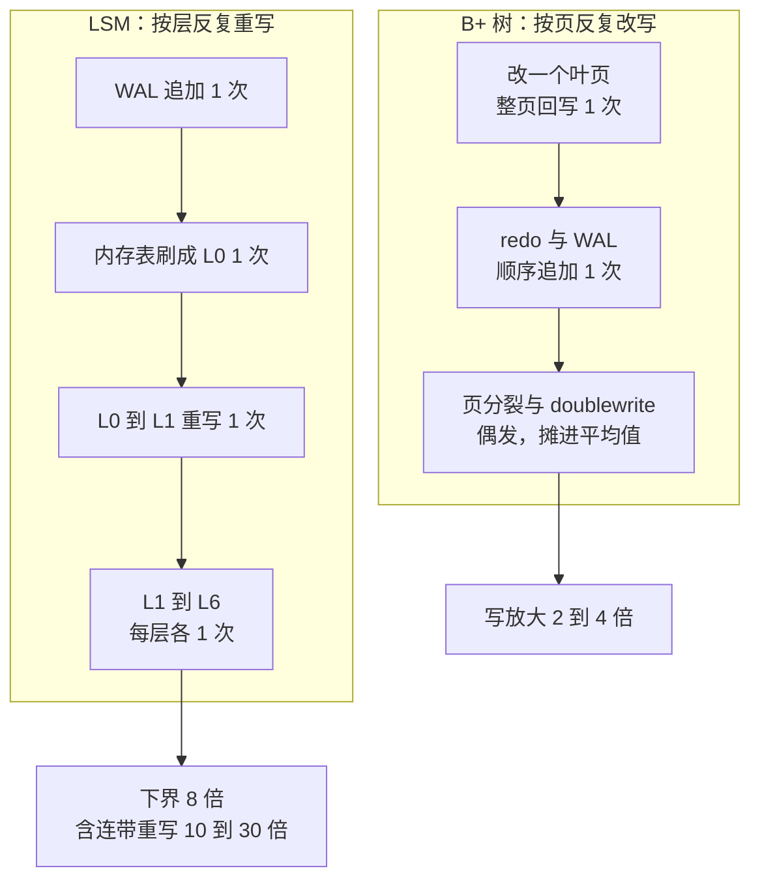
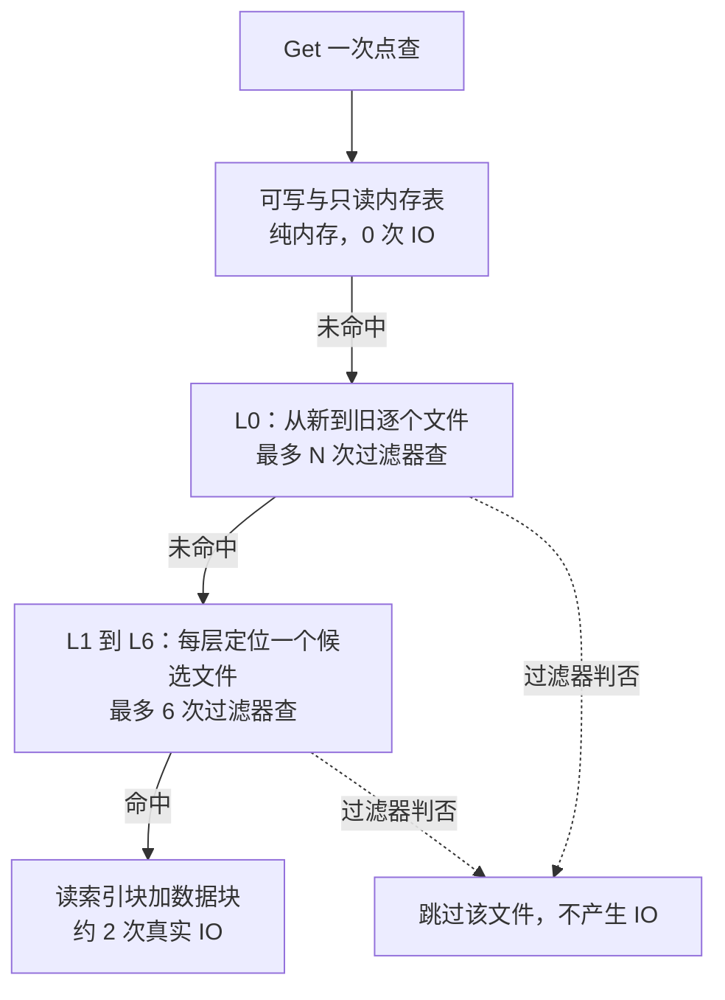
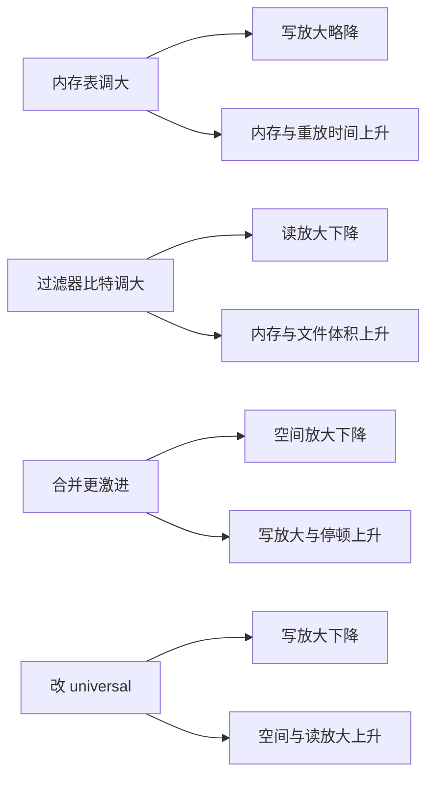
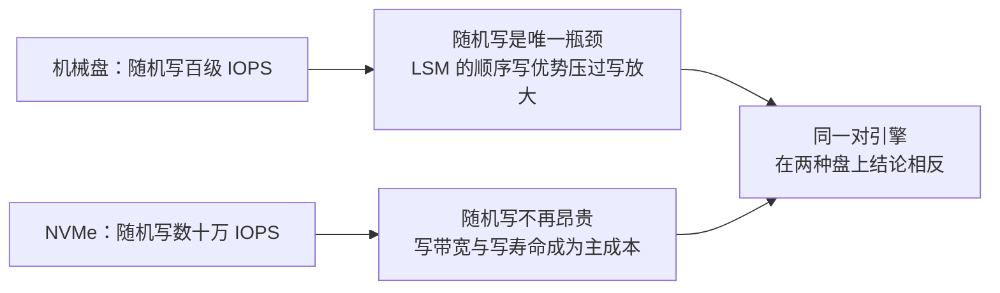

# LevelDB 全局架构——LSM-Tree 的写优化设计

**摘要：**

选存储引擎这件事，很少真的在比"谁更快"。B+ 树与 LSM-Tree 两大派系的差别，最后都落到三笔可以列算式、可以核算的账上：写放大是用户写一个字节、磁盘要写几个字节，LSM 按"层数 + 2"起算、含连带重写落在 10 到 30 倍，B+ 树是 2 到 4 倍；读放大是一次点查要碰几个文件，LSM 最坏是 L0 文件数加层数，B+ 树是树高这个常数；空间放大是磁盘占用是有效数据的几倍，leveled 约 1.1、universal 的默认上限可到三倍、B+ 树 1.1 到 1.5。本篇不逐行读 LevelDB 的实现，而是把这三笔账拆成算术与算例，说明"三笔账不可能同时取最优"为什么是选型问题的起点而非实现缺陷，据此给出五类负载的判据表——写密集看写放大、点查密集看读放大、成本敏感看空间放大、P99 敏感看合并抖动——以及三个要避开的反例：以为 LSM 全面优于 B+ 树、只看 QPS 不看写放大、拿 LevelDB 去做需要事务的场景。硬件换代会让结论翻转，机械盘时代的答案在 NVMe 上要重算。最后一句需要打折听：LSM 写快，快在随机写，不快在写字节数。

---

## 第 1 章 选型的问题不在速度，在三笔账

2011 年，Google 把一份 C++ 键值库放上代码托管平台，作者是 Jeff Dean 与 Sanjay Ghemawat。此后十几年，这份代码成了服务器侧 LSM 实现的共同祖本：RocksDB 从它 fork 出来，TiKV 的存储引擎是 RocksDB，MyRocks 与 CockroachDB 的 Pebble 都沿着同一条线长成。生产环境里跑的几乎全是它的后代，LevelDB 本体反而退成一份教学与嵌入式样本。

但"该选 LSM 还是该选 B+ 树"这个问题，每年仍然要被重新回答一次。原因有两层：硬件在变，随机写与顺序写的价差在缩小；负载在变，同一个系统三年前是写密集，三年后可能变成点查密集。回答这类问题，靠"LSM 写快"这种一句话结论是不够的，因为它既没说快多少，也没说代价由谁支付。

要把话说准，得先把三笔账定义清楚。

| 账 | 分子 | 分母 | 一句话含义 |
| :--- | :--- | :--- | :--- |
| 写放大 | 引擎实际写入磁盘的字节数 | 用户提交的键值字节数 | 写一字节，磁盘写几字节 |
| 读放大 | 一次点查触碰的 SSTable 文件数与块数 | 一次点查 | 查一个 key，读几个文件 |
| 空间放大 | 引擎占用的磁盘字节数 | 一份有效数据的字节数 | 存一份数据，占几倍空间 |

三笔账的定义看似没有歧义，实际核算时经常吵起来，因为分子分母的取法不同，结论能差出一倍。写放大要不要把 WAL 算进去、要不要把 doublewrite 算进去；读放大按文件数还是按字节数计；空间放大算不算临时的合并积压。笔者建议在讨论选型之前先把口径写在纸上，否则"我们的写放大是 5"和"我们的写放大是 20"很可能是两个不同定义下的真话。

> [!info] 审账三问
> 看到任何"写放大 X 倍"的数字，先问三件事：分子含不含 WAL 与 doublewrite；分母是用户提交的字节还是压缩后的字节；统计窗口取的是稳态还是含合并积压的峰值。三问答不齐，这个数字就不能拿去和别人比，只能自己前后对比。

下图是这三笔账各自挂在哪个动作上，后文所有算式都从这三个入口展开。

本篇用一个固定场景贯穿：某内容平台有两套数据，一套是用户行为埋点，一天一亿条、只按时间区间扫、几乎不点查；另一套是用户资料，几千万条、写入很少、每次请求都按主键点查一次。同样两个库，一个写着舒服，一个读着舒服，反差背后就是三笔账的分工。

---

## 第 2 章 写放大：一次用户写，磁盘写几次

### 2.1 B+ 树的记账单位是页

B+ 树更新一条记录的方式很直接：从根往下找到叶页，把 4KB 的页读进内存，改掉其中几十个字节，再把整页写回去。如果就此把这条记录的字节数去除页大小，会得到四十倍这种吓人的数字，但这样算是错的——一个叶页里通常躺着几十条记录，这次页回写是替整页服务的，账要摊到整页的记录头上。

稳态下，一个页被回写的频率与它容纳的记录数成正比地降低，页级放大于是被摊薄，剩下的账面就是"一次 WAL 顺序追加，加一次页回写"，也就是 2 倍起步；页分裂、doublewrite、undo 与 redo 的额外写再叠一层，落到 2 到 4 倍。这个区间几乎与树高无关，只与页大小、记录大小、页的填充率有关。

这条性质值得记住：B+ 树的写放大**不随数据量增长而恶化**。一台机器上放十亿条还是十一亿条记录，写放大都在同一个量级，它是结构性的常数项。

### 2.2 LSM 的记账单位是层

LSM 把更新变成追加，代价转到了另一处。这条写入链路的原理，[[中间件/深入浅出存储引擎/07 LSM-Tree 原理——用顺序写换取写吞吐|LSM-Tree 原理]] 已从 MemTable 到 SSTable 讲透，这里只盯住跳数：一条记录写进来，先追加进 WAL，写一次；随内存表刷成 L0 文件，再写一次；此后每往下一层沉降一次，就要被读出来、与新层里重叠的记录归并排序、再整批写出去一次。LevelDB 是七层结构（L0 到 L6），一条记录若一路沉到底，总共要写 1 + 1 + 6 = 8 次，这就是**层数 + 2**这条最粗的下界模型的来历。

真实值比 8 大，因为往下沉时被重写的不只是上面带来的那批数据。leveled 合并的输入是"上层的一批文件"加"下层中与之 key 范围重叠的全部文件"，后者同样要被读出来重写一遍，这部分就是写放大里最容易被漏掉的**连带重写**。稳态下，一份数据每沉降一层，就陪下层那部分数据再写一遍，8 次被放大到二十次上下。RocksDB 的文档里说 leveled 的写放大常在 10 以上，工程经验区间一般落到 10 到 30，具体到某个版本仍以其文档为准。

这个倍数对层容量比极其敏感。设第 N 层容量是第 N-1 层的 T 倍，则每次从 Ln 下沉的数据量相对于 Ln+1 的总量是 1/T 量级，连带重写的比例随之下降。LevelDB 把 T 取作 10，把七层堆到 TB 量级，这是当年在机械盘上做的折中；把 T 提高到 20，写放大会明显改善，代价是单次合并的输入更大、停顿更长。

与 B+ 树的常数项相反，这笔账**随数据量增长**。数据从百 GB 涨到 TB 量级，层数从三层堆到七层，写放大跟着从五六倍爬到八倍，再叠连带重写。这是 LSM 一个不太被提及的性质：容量一涨，单位写入成本就涨一档，扩容不只是加盘，还要重算账。

下图把同一条记录的两种一生并排放在一起，可以看出账目结构完全不同：B+ 树是按页反复改写，LSM 是按层反复重写。

### 2.3 合并策略直接改写这笔账

写放大不是一个常数，换合并策略就换了一本账。三主流策略的账面差异极大，选型时要连着读放大与空间放大一起看。

| 策略 | 写放大 | 读放大 | 空间放大 | 适合的负载 |
| :--- | :--- | :--- | :--- | :--- |
| leveled | 10 到 30 倍，随层容量比变动 | 低，每层只需定位一个候选文件 | 低，约 1.1 倍 | 点查多、磁盘成本敏感 |
| universal（size-tiered） | 低，由合并轮数与 run 数决定，常在个位数到十几倍 | 高，run 之间 key 范围重叠，要逐个判 | 高，默认上限到有效数据的三倍 | 写密集、按时间整段扫、能接受空间换写 |
| FIFO | 接近 1，基本不重写 | 高，且老数据不可控 | 由 TTL 决定 | 时序、日志、可淘汰缓存 |

FIFO 严格说不是合并，而是丢弃：老文件到点直接删，写放大接近 1 的秘密在于它根本不重写。这也说明白了一件事——写放大可以低到 1，前提是放弃"任意历史数据都可查"。三种策略各自的判别条件与切换代价，[[04 Compaction——分层合并与版本管理|合并策略]] 有逐项展开。

### 2.4 算例：一天一亿条埋点

设埋点流一天写一亿条，key 与 value 合计 100 字节，有效数据 10 GB。按七层模型，这批数据在磁盘上要落 8 × 10 = 80 GB；加上连带重写取 1.5 到 3 倍修正，落在 120 到 240 GB，写放大 12 到 24。同一份数据交给 B+ 树，WAL 10 GB 加页回写（按页利用率六成、页内摊薄后约 20 到 30 GB），再叠上分裂与 doublewrite，大致 40 GB 上下，写放大 3 到 4。

两者相差三到六倍，方向与直觉一致。但请注意这个差值是在"写入条数相同"的前提下算的，而实际盘上的表现还取决于这些写是不是随机——B+ 树那 40 GB 里绝大部分落在随机位置，LSM 那 120 GB 里绝大部分是顺序追加，机械盘上前者的代价远不止三倍。这笔差价的换算放在第 7 章。

以上数字均为示例推算，用于暴露算式与量级，不是任何版本的基准测试结果。

---

## 第 3 章 读放大：一次点查，碰几个文件

### 3.1 B+ 树：一次点查看树高

一棵存一亿条记录的 B+ 树，页大小 4KB、每条记录 100 字节，一个叶页能放四十来条，于是需要两百多万个叶页；再按扇出取一百往上摞，三层内节点就能管住这个量级，树高落在四层。点查走的是根到叶的路径，每层读一页，理论读放大等于树高；根与前两层内节点几乎总在缓冲池里，真实 IO 常常只要两次上下。

这是 B+ 树最结实的地方：读放大是一个由树高决定的常数，与写入历史、合并进度、数据分布都无关。今天读一个 key 要两次 IO，明年数据翻倍之后大概还是两到三次。

### 3.2 LSM：一次点查看 L0 文件数与层数

LSM 的读路径是"自上而下逐层判否"：先查可写内存表，再查只读内存表，这两步是纯内存；然后按从新到旧逐个查 L0 文件；最后在 L1 到 L6 每层定位一个候选文件。最坏情况要碰的文件数可以写成一条算式：

**L0 当前文件数 + （层数 - 1）**

LevelDB 的 L0 在慢停阈值上是 8 个文件、硬停是 12 个，七层算下来最坏是 12 + 6 = 18 个候选文件。每个候选文件至少要读一次索引块才能判断 key 在不在范围内，命中那一层还要再读一次数据块。这就是读放大这笔账在 LSM 上的形状——它不是常数，它随合并进度浮动，合并跟不上时 L0 会堆高，读延迟跟着线性上升。

下图是这条路径的完整断面，注意每一层的"判否"动作才是读放大真正的来源。

### 3.3 布隆过滤器：把"确认不存在"买回内存

读放大这笔账在 LSM 上之所以能被忍下来，全靠布隆过滤器（Bloom Filter）。它的作用可以一句话说完：给每个文件挂一张位图，用一次内存查表回答"这个 key 大概不在本文件里"，判否就跳过，不产生 IO。

价格是可以算的。按每 key 10 比特估算，1 亿个 key 的过滤器占 125 MB；每条记录多存 1.25 字节，对 100 字节的记录是文件涨 1.25%，对 20 字节的小记录就是涨 6%。这笔内存与块缓存抢的是同一个预算池，过滤器多吃一兆，热数据的缓存就少吃一兆，两笔收益要放在一起算。

收益也可以算。对一个不存在的 key，十八个候选文件的判别全部落在内存里，真实 IO 归零；对一个确实存在的 key，前面若干层每层查一次过滤器，按 0.84% 的假阳性率（每 key 10 比特、哈希个数按 bits 乘 0.69 取整得 6）乘前置层数，期望的额外 IO 不到 0.05 次。过滤器省下的不是"文件触碰数"——那十八次触碰一次都没少，省下的是这十八次里本该发生的磁盘读。假阳性的具体算术与过滤器粒度的取舍，[[03 SSTable 的文件格式与 Block 结构|读路径与块缓存]] 算过一遍，这里只取结论：读放大被换成了内存开销，而不是被消灭了。

### 3.4 读放大的波动性

这笔账最容易被当成一个固定值，其实是浮动的。同一个用户资料库、同一个查询、同一份代码，早高峰时 L0 只有 4 个文件，一次未命中的点查要碰 4 + 6 = 10 个文件；合并一旦积压，L0 涨到 12，同一个查询要碰 18 个文件，成本涨了近一倍。数据没变、代码没变、缓存也没变，变的只是后台合并追不追得上前台写入。

这条性质解释了 LSM 系统一个常见的观测现象：读延迟的 P99 与写入速率高度相关，写入一忙，读就慢，而读路径的代码一行都没改。容量规划如果按"平均读放大"做，会在写高峰被打穿；按"最坏读放大"做，又会为大部分时间用不到的文件数付内存。这也是第 5 章判据表里"低延迟稳定"一栏偏向 B+ 树的原因——它的读放大不随合并进度漂移。

### 3.5 文件数只是次数，块大小是单次代价

读放大还有第二个维度：字节。同一个 user key 的多个版本可能散在 L0 的多个文件里，每次都要读一整个数据块才能确认里面有没有目标记录。文件数决定 IO 次数，块大小决定单次 IO 的字节数，两者相乘才是字节级的读放大。块调大，单次搬进来的无关数据变多，但记录集占的文件数与索引项数下降；块调小则相反。这个取舍落在 SSTable 的格式设计上，那里有完整的计量。

---

## 第 4 章 空间放大：磁盘占用是有效数据的几倍

### 4.1 空间放大的四个来源

空间放大最容易被当成"实现不好"的证据，其实它的来源有四个，性质完全不同：其一是多版本，同一 user key 的旧值还躺在下层文件里没被合并掉；其二是墓碑，删除只是写一条删除标记，占着位置等它沉到底才能回收；其三是合并余量，leveled 每层都会留出 1/T 的余量，不然一次合并要动整层；其四是碎片，页内空洞、文件尾部的未用空间、压缩块的边界对齐。

前两个是 LSM 特有，后两个两边都有。分开看，才能判断某个系统的空间放大是该认的成本还是该治的毛病。

压缩率也直接改写这一栏。LSM 的 SSTable 按块压缩，块边界会把相邻记录的相似性切断；B+ 树按页压缩，页内的局部性通常更好。同一个数据集，压缩率从 3 倍掉到 2.2 倍，磁盘占用就多出四成——在有压缩的部署里，这一项常与多版本处于同一量级，只算多版本会算漏一半。

### 4.2 LSM：多版本与墓碑的账

leveled 的好处是同一 user key 最多同时存在于相邻两层，其余旧版本在合并时被丢弃，于是空间放大的上限大致是 **1 + 1/T**，T 取 10 就是 1.1 倍。这也是 leveled 被称作空间友好的原因——它把"存几份"压到了接近 1。

RocksDB 里这条上限还有一层结构性保证：从 8.4 起默认开启的 `level_compaction_dynamic_level_bytes` 会按最后一层的实际大小倒推各层目标，让九成数据落在最后一层——分层不再是"每层都填满"，而是"只有最后一层是满的"。按 RocksDB 文档的说法，这能给空间放大一个稳定的上界（以对应版本文档为准）。

但这条上限只在合并跟得上的时候成立。一旦合并积压，L0 堆着十几个文件、各层都留着待合并的旧版本，空间放大临时冲到 1.5 以上很常见；再叠上墓碑——删除密集的表里，墓碑可能比有效数据还多，因为一条删除标记必须沉到最底层才能确定"下面没有更旧的版本了"然后被丢掉——空间占用可以在相当长时间里维持在有效数据的 1.3 到 2 倍。

universal 策略的记账方式不同：它把大小相近的文件归成 run，run 之间并不保证 key 范围不重叠，同一个 key 的旧版本可以散在多个 run 里。RocksDB 给 universal 的默认空间放大上限是 200%，但这里的百分比以有效数据为分母算增量——100 字节的库最多可占 300 字节，也就是三倍。换来的是低得多的写放大，这是一笔明码标价的兑换，不是缺陷。

### 4.3 B+ 树：碎片与页填充率

B+ 树没有多版本的天然冗余（MVCC 的 undo 另算），它的空间放大主要来自页填充率。随机插入时，页分裂后左右两半各占五成到七成；删除之后页里的空洞不会自动归还；批量导入再随机更新，填充率会一路往下漂。稳态下 1.1 到 1.5 是常见区间，长期只增不删的表稳定在 1.3 附近，删除密集的表漂到 1.5 以上也不稀奇，需要整表重写（`OPTIMIZE TABLE`、`pg_repack` 之类）才能压回去。

### 4.4 算例：10 GB 有效数据落在三种结构上

| 结构 | 主要来源 | 磁盘占用估算 | 空间放大 |
| :--- | :--- | :--- | :--- |
| leveled LSM | 合并余量与残余旧版本 | 约 11 GB | 1.1 |
| universal LSM | run 间重叠，默认上限到三倍 | 15 到 30 GB | 1.5 到 3.0 |
| B+ 树 | 页填充率六成到七成 | 14 到 16 GB | 1.4 到 1.6 |

同一份 10 GB 数据，落在不同结构上可以差出三倍。对按容量计费的云盘或者需要定期扩容的系统，这笔账最终会以采购单的形式出现，比 IOPS 更直白。

---

## 第 5 章 三笔账不能同时取最优

### 5.1 为什么这是结构性约束

三笔账之间有一条很短的推理链。写入磁盘的总字节数等于有效数据乘写放大，而"读一次要多快"取决于数据在磁盘上被组织成多少份——份数越少，要判的东西越少。任何减少份数的手段都在别处加账：合并减少份数，但要重写；分层减少单层份数，但要多查几层；保留索引减少判否成本，但索引本身占空间。三者同时最优，只有一种可能——数据永远留在内存里，一次性顺序写出去之后再不改动、不再整理。这在容量与更新上都不可行。

所以三笔账的下界是 IO 与信息的约束，不是工程偷懒。任何声称"三笔都低"的宣传，都要追问它把哪一笔转移到了使用者看不见的地方。

### 5.2 调参不是让三笔账都变好，而是决定谁付账

工程上的旋钮，本质都是在这本账和那本账之间搬数字。下表按"往哪边搬"归纳，具体的取值与操作手法属于调优范畴，与选型判据是两件事。

| 旋钮 | 调大之后 | 调小之后 | 主要挪动的账 |
| :--- | :--- | :--- | :--- |
| `write_buffer_size` | 刷盘次数少、L0 文件大而少，写与读都略降；内存占用与重启重放时间上升 | 内存省、切换频繁、L0 文件变多，读放大升 | 写与读，代价是内存 |
| `max_write_buffer_number` | 抗写压能力上升，L0 积压风险上升，内存翻倍 | 容易撞上写停，前台延迟抖动 | 写停顿，代价是内存 |
| `level0_file_num_compaction_trigger` | 允许 L0 堆更多文件，读放大与空间放大上升，写停风险上升 | 合并更早，写放大上升，读与空间下降 | 读与空间，代价是写 |
| `target_file_size_base` | 单文件大、单次合并输入大，停顿变长 | 文件碎、元数据多，读放大微升 | 停顿，代价是元数据 |
| `max_bytes_for_level_base` 与层容量比 | 写放大下降，层数减少；单次合并输入变大，停顿变长 | 写放大上升，层数变多 | 写，代价是停顿 |
| `block_cache` 容量 | 读放大下降（缓存命中上升），内存占用上升 | 命中率下降，真实 IO 上升 | 读，代价是内存 |
| `bloom_bits` | 假阳性下降，读放大下降，文件体积与内存上升 | 假阳性上升，读放大上升 | 读，代价是空间与内存 |
| `compaction_style` 改 universal | 写放大明显下降；空间放大上限到三倍，读放大上升 | 改回 leveled 则反向 | 写，代价是空间与读 |

这张表的读法只有一句：调参**只搬账，不产生收益**。谁付得起，就把账挪给谁。内存表容量与刷盘时机怎么定、撞上写停之后怎么退，[[02 MemTable 与 SkipList|写缓冲容量与刷盘时机]] 单独算过。

下图把这条"搬账"的路径画出来，箭头指向的都是被牺牲的那一栏。

### 5.3 五类负载该优化哪一笔

把账本换成判据，才落到工程决策上。下表按负载形状给出首选与理由，"关键账"一列是这笔负载真正卡住它的那一笔。

| 负载类型 | 关键账 | 首选结构 | 理由 | 例外与代价 |
| :--- | :--- | :--- | :--- | :--- |
| 写密集（日志、埋点、时序） | 写放大 | LSM，极端时用 universal 或 FIFO | 顺序追加摊薄随机写，写吞吐上限由带宽除以写放大决定 | 空间放大与读放大变差，历史随机点查变难 |
| 读密集点查（用户资料、配置、元数据） | 读放大 | B+ 树；若已选 LSM 则必须配过滤器与块缓存 | 点查 IO 是树高这个常数，不随合并进度浮动 | LSM 需要额外内存买过滤器，且 P99 受合并干扰 |
| 范围扫描（时间区间、前缀列表） | 读放大（顺序性） | 两者皆可，大跨度偏 LSM，小跨度偏 B+ 树 | 大跨度只要顺序读大块，LSM 的不可变文件反而没有页分裂成本 | 小跨度跨多文件时，LSM 要逐个定位 |
| 空间敏感（多租户、成本约束、备份窗口） | 空间放大 | B+ 树，或 LSM 的 leveled 加激进合并 | 两者都能压到 1.1 到 1.5，universal 不适合 | 激进合并会推高写放大与停顿 |
| 低延迟稳定（P99 敏感、在线交易） | 合并抖动 | B+ 树 | 前台路径不与后台整理抢资源 | LSM 需限速加多线程合并，且仍难消掉长尾 |

这张表最容易被误读成"五条独立结论"。它其实是一条结论的五个切面：先确定这笔负载最不能忍受哪一笔账，再用结构去换，而不是先选结构再找理由。埋点流与用户资料库之所以一个选 LSM 一个选 B+ 树，不是因为哪个更先进，而是因为它们最不能忍受的账不同。

### 5.4 判据失效的地方

判据表在单一负载上很硬，遇到混合负载就软了。真实的系统里，一个库往往同时承担写入与点查，比例还会随时间漂移。这时有两条路：一条是把负载拆开，热数据放 B+ 树、冷数据下沉到 LSM，用分层存储把两笔账分别定价；另一条是留在一种结构里，用缓存和过滤器去买另一笔账，接受代价。前者的成本是数据搬迁与一致性，后者的成本是内存与尾部延迟。

还有一类负载会让判据整体失效：写之后立刻读同一个 key。这在事件驱动与状态机里很常见，LSM 把它变成"从内存表里读"，本来是最快的路径，但一旦合并正在跑，读要排队等后台线程让出磁盘带宽，P99 就会出现毛刺。对这类负载，判据不是"选哪个结构"，而是"能不能把读写路径拆开"。

---

## 第 6 章 LevelDB 在这个家族里的位置

### 6.1 一句话的架构

LevelDB 是一个单进程、单后台线程、七层 leveled、只提供批量写原子性的嵌入式 LSM 库：写入先落 WAL 再进内存表，内存表满了刷成 L0 文件，后台线程按层容量逐级合并。它的 MemTable 跳表、SSTable 的三层索引与 compaction 的打分，[[中间件/深入浅出存储引擎/09 LevelDB 源码剖析——MemTable、SSTable 与 Compaction|源码剖析]] 已经拆到行级，这里只保留与账本相关的一句：它的每一个设计选择，都是拿写放大去换顺序写。

### 6.2 它没有的四样东西

第一是没有列族（column family）。一个库一套 key 空间，多业务要么分库、要么靠前缀隔离，而合并无法按业务的账本分开算：一个业务的大量写入会把另一个业务的读放大一起推高。第二是没有事务，只有 WriteBatch 的单批原子性，跨批的读改写没有隔离保证，快照读能看一致视图，但不能拿来做事后校验。第三是没有合并过滤器（compaction filter），过期数据只能写墓碑、等它沉底，空间放大因此恢复得慢。第四是没有并发合并，单后台线程意味着一场大合并会把内存表刷盘一起挡住，写延迟分布是"大部分很快、周期性很慢"。

这四样不是遗漏，而是取舍：每加一样，就多一组需要使用者决定的参数。LevelDB 的定位是"结构做对、装修留白"，它把承重墙浇好，把隔断交给下游。

还有一层现实排在取舍之外。LevelDB 的正式发布长期停在 1.23 一线，此后基本处于维护状态（以仓库的 release 页为准）。它能定义 LSM 的最小正确结构，这一点至今无人否认；但把它放进生产，意味着后续十几年的工程补课要由自己承担——合并限速、多线程、列族隔离，这些下游已经解决的问题，都得在应用层重做一遍。

### 6.3 适合与不适合

| 场景 | 判断 | 原因 |
| :--- | :--- | :--- |
| 嵌入式单进程、本地缓存、索引 | 适合 | 无网络层无服务进程，库直接进进程；数据量单机可控 |
| 写多读少、按 key 有序遍历 | 适合 | 顺序写加有序 SSTable，迭代器扫描成本低 |
| 需要多业务隔离 | 不适合 | 无列族，隔离只能靠前缀约定，合并账本混在一起 |
| 需要跨 key 事务或读改写 | 不适合 | 只有单批原子写，无隔离级别语义 |
| 大 value（图片、文档） | 不适合 | value 随 key 一起被反复重写，写放大成倍恶化 |
| 高并发写、P99 敏感 | 不适合 | 单后台线程，合并即停顿，且无合并限速 |

一个常被忽略的用法边界是"单实例"。LevelDB 用文件锁保证一个目录只被一个进程打开，这既是它的简单之处，也决定了它不做多副本、不做网络共享——需要这些的系统，选型上已经越过了它。

### 6.4 到 RocksDB，补的是让三笔账可以分别定价

RocksDB 从 LevelDB 出发，做的事可以一句话概括：把三笔账从"绑在一起"变成"分开可调"。下表按能力列清单，最后一列写清每种补齐挪动了哪笔账。

| 能力 | 补了什么 | 挪动了哪笔账 |
| :--- | :--- | :--- |
| 列族 | 多业务共享一个库、各自一套合并与统计 | 读放大按列族隔离，内存开销上升 |
| 事务 | 悲观与乐观两套事务、读改写隔离 | 不直接改放大，复杂度上升 |
| 合并过滤器 | 回调式决定哪些记录可在合并时丢弃 | 空间放大下降，正确性责任转向使用者 |
| 前缀查询（prefix seek） | 前缀布隆与前缀迭代器 | 读放大下降，内存与配置复杂度上升 |
| 合并操作符（merge operator） | 读改写语义下沉到引擎 | 写放大下降，读路径多一次合并计算 |
| 多线程合并与子合并 | 合并并行、按区间切分 | 写吞吐上升，CPU 与 IO 争抢加剧 |
| 合并限速 | 基于漏桶的后台限速 | 前台延迟更稳，合并积压与空间放大上升 |
| 键值分离（BlobDB） | 大 value 单独存 | 写放大下降，读路径多一次随机读 |
| 配置丰富度 | `DBOptions` 与 `ColumnFamilyOptions` 数十项 | 可调性即责任，默认值未必适配你的负载 |

这张表的重点是最后一列：没有任何一项是"纯收益"。RocksDB 没让 LSM 变得免费，它只是把代价**挪到可配置的位置**。RocksDB 8.x 与 9.x 又各自调整过一批默认值与接口（譬如合并优先级、限速实现与 BlobDB 的成熟度），具体到某个版本，仍以对应版本文档为准；从 LevelDB 迁到 RocksDB 的判据与步骤，[[05 从 LevelDB 到 RocksDB——优化与演进]] 有逐项对照。

---

## 第 7 章 "LSM 写快"这句话要打折

### 7.1 快的是随机写，不是字节数

LSM 相对 B+ 树的优势，准确表述是**把随机写换成了顺序写**。在机械盘上这是量级差异：随机写受寻道与旋转限制，每秒百级到千级 IOPS；顺序写能跑满接口带宽。同样是 100 MB 的写入，散在十万个随机位置上，与连续追加成几个大文件，耗时能差两个数量级。

但这个优势与"写得更少"是两件事。LSM 用顺序写换来了随机写性能，代价是同一份数据要写更多字节——写放大 15 意味着有效写入 100 MB 时磁盘要承接 1.5 GB。当瓶颈从随机 IOPS 转成写带宽或写寿命时，这笔账就翻面了。

### 7.2 硬件换了，结论会翻

把上面两个事实放进同一个算例。设磁盘的有效写带宽是 500 MB/s，应用希望以 100 MB/s 持续写入，物理写需求等于用户写入速率乘写放大：LSM 取 15，需要 1.5 GB/s，超出带宽，实际有效写吞吐被压到 500 ÷ 15 ≈ 33 MB/s；B+ 树取 3，需要 300 MB/s，带宽不是瓶颈，它的瓶颈转移到随机 IOPS 上。此时谁赢，取决于盘给的是带宽还是 IOPS。

机械盘上答案是 LSM：随机写 200 IOPS、4KB 一块，有效吞吐不到 1 MB/s，就算除以 15 的写放大，LSM 仍有 10 MB/s 量级的有效吞吐，优势是十倍以上。NVMe 上答案就未必了：随机写能到几十万 IOPS，随机写不再昂贵，B+ 树那笔 3 倍的写放大配上更少的重写字节，反而在高带宽压力下更从容。

这是一条容易过时的结论，也是"LSM 全面优于 B+ 树"这类说法最容易翻车的地方：它把一个特定介质上的经验，当成了架构层面的定论。

### 7.3 SSD 寿命：写放大直接变成消耗

闪存有擦写次数上限，写放大在这里不是性能指标而是消耗指标。同样写入 1 PB 有效数据，写放大 3 的引擎让盘承受 3 PB 的写入，写放大 15 的引擎让盘承受 15 PB。按消费级盘常见的数百 TBW（总写入字节）标称，前者能用很久，后者会把寿命压到一个需要认真测算的量级。这解释了为什么 RocksDB 在键值分离、限速、合并策略上投入那么多——在闪存时代，压低写放大省下的是真金白银的更换成本。

在分布式系统里，这个倍数还要乘上副本数。三副本共识下，物理写 1.5 GB 意味着三倍磁盘写与两倍跨机网络流量，写放大 15 放进一套三副本集群，介质消耗接近 45 倍。这也是为什么 TiKV、Kafka 这类系统的调优文档，总把写放大与复制流量放在一起谈：这两笔钱在同一个账本上。

### 7.4 三个反例

第一个反例是"以为 LSM 全面优于 B+ 树"。三笔账里 LSM 只在写放大这一栏可能占优，而且是在随机写昂贵的前提下；读放大与空间放大它通常更差。把"写快"当成"全面更好"，会得到一套读延迟不稳、磁盘占用翻倍的系统。

第二个反例是"只看 QPS 不看写放大"。压测里 LSM 的写 QPS 通常漂亮，但那是在盘还有余量的时候；一旦写放大把带宽吃满，QPS 会断崖式下跌，而这种下跌在压测的短窗口里未必暴露。

第三个反例是"用 LevelDB 做需要事务的场景"。有人拿它做账户余额、库存扣减、去重计数，靠 WriteBatch 拼原子性，最后在"先读后写"的竞争上出问题。原子批写只保证一批内的写要么全成要么全败，它不提供跨批隔离，也不提供读改写的事务语义。

---

## 第 8 章 结语

三笔账的价值在于把模糊的"快"换成可核算的算式。写放大是层数加二的模型，含连带重写落在 10 到 30 倍；读放大是 L0 文件数加层数，布隆过滤器把"确认不存在"的成本从磁盘搬到内存；空间放大由多版本、墓碑与合并余量决定，leveled 约 1.1，universal 的默认上限可到三倍。B+ 树在三栏上分别是 2 到 4 倍、树高这个常数、1.1 到 1.5 倍。

三笔账不能同时最优，是 IO 约束而不是实现水平。于是选型的动作不是比谁先进，而是先问这笔负载最不能忍受哪一笔账——埋点流忍不了随机写，用户资料忍不了读放大，多租户忍不了空间放大，在线交易忍不了合并抖动——再决定用哪个结构去换。LevelDB 是这个家族里最小的实现，结构做对、装修留白：没有列族、没有事务、没有合并过滤器、没有并发合并，适合嵌入式与写多读少的单进程场景，不适合需要隔离与事务的系统。RocksDB 补的每一项，都是把某笔账挪到可配置的位置，代价也随之显式化。而"LSM 写快"这句话，完整的版本是"LSM 把随机写换成了顺序写，代价是多写几倍字节"；在随机写昂贵、带宽充裕的介质上它是优势，在随机写便宜、带宽或写寿命紧张的介质上，这个优势会被写放大吃掉。

介质在变，负载在变，判据要跟着重算。把三笔账算清楚这个动作，比记住任何一条结论都更耐用。

---

## 参考资料

1. O'Neil P., Cheng E., Gawlick D., O'Neil E. The Log-Structured Merge-Tree (LSM-Tree). *Acta Informatica*, 1996. [PDF](https://www.cs.umb.edu/~poneil/lsmtree.pdf)
2. LevelDB 源码与实现文档（`doc/impl.md` 说明层级结构与合并触发条件）. [GitHub](https://github.com/google/leveldb/blob/main/doc/impl.md)
3. RocksDB Wiki：Leveled Compaction. [链接](https://github.com/facebook/rocksdb/wiki/Leveled-Compaction)
4. RocksDB Wiki：Universal Compaction（含 `max_size_amplification_percent` 的空间放大上限）. [链接](https://github.com/facebook/rocksdb/wiki/Universal-Compaction)
5. RocksDB Wiki：RocksDB Tuning Guide（写放大与合并策略的取舍）. [链接](https://github.com/facebook/rocksdb/wiki/RocksDB-Tuning-Guide)
6. RocksDB Wiki：RocksDB Bloom Filter（过滤器位数与假阳性）. [链接](https://github.com/facebook/rocksdb/wiki/RocksDB-Bloom-Filter)
7. Lu L., Pillai T. S., Arpaci-Dusseau A. C., Arpaci-Dusseau R. H. WiscKey: Separating Keys from Values in SSD-conscious Storage. *FAST 2016*. [PDF](https://www.usenix.org/system/files/conference/fast16/fast16-papers-lu.pdf)
8. Comer D. The Ubiquitous B-Tree. *ACM Computing Surveys*, 1979. [链接](https://dl.acm.org/doi/10.1145/356770.356776)
9. Bloom B. H. Space/Time Trade-offs in Hash Coding with Allowable Errors. *Communications of the ACM*, 1970. [链接](https://dl.acm.org/doi/10.1145/362686.362692)

---

> [!note] 思考题
> 1. 若一个负载的写放大是 20，磁盘写带宽是 2 GB/s，应用需要 80 MB/s 的有效写吞吐，物理写是否成为瓶颈？如果换一块随机写 IOPS 很高但带宽不变的盘，结论会变吗？
> 2. 布隆过滤器每 key 从 10 比特提到 20 比特，假阳性率降两个数量级，但内存翻倍。在什么情况下这笔兑换不划算？
> 3. 你的系统同时有埋点写入与用户资料点查，两者量级都在增长。是拆成两个库各用各的结构，还是留在一个 LSM 里用列族隔离？两种方案的账分别记在哪一栏？
> 4. universal 策略把写放大压到个位数，代价是空间放大默认上限可到三倍。对一个磁盘容量紧张但写入极高的系统，这笔兑换的盈亏平衡点在哪里？
> 5. LevelDB 的单后台线程在什么规模下成为瓶颈？如果只做嵌入式本地缓存，这个瓶颈是否可忽略？
> 6. 为什么说"三笔账不能同时最优"是 IO 约束而非实现缺陷？请从"减少读时要判的份数"这个动作出发，说明它必然在写或空间上加账。