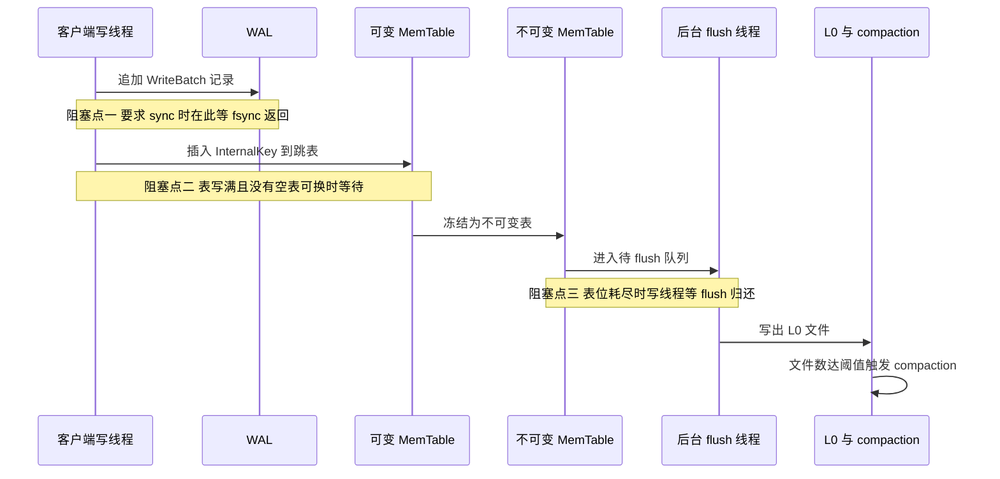
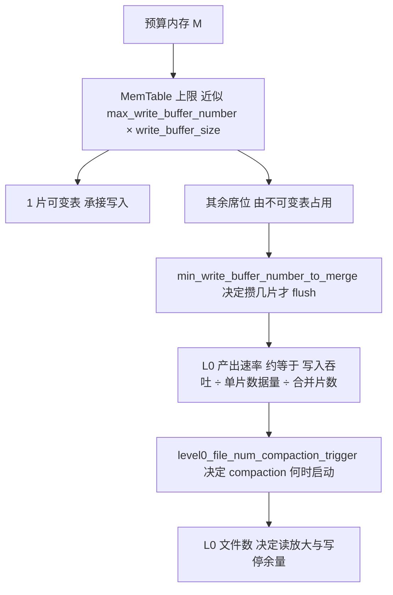
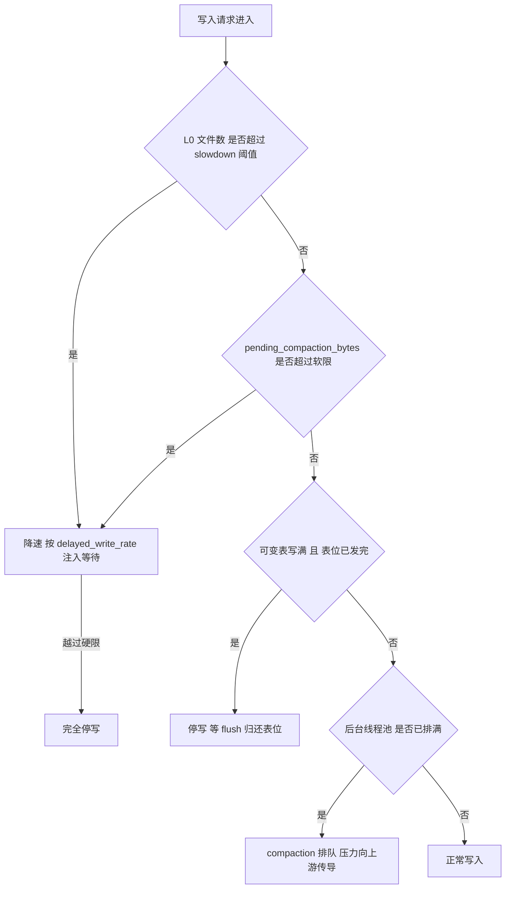
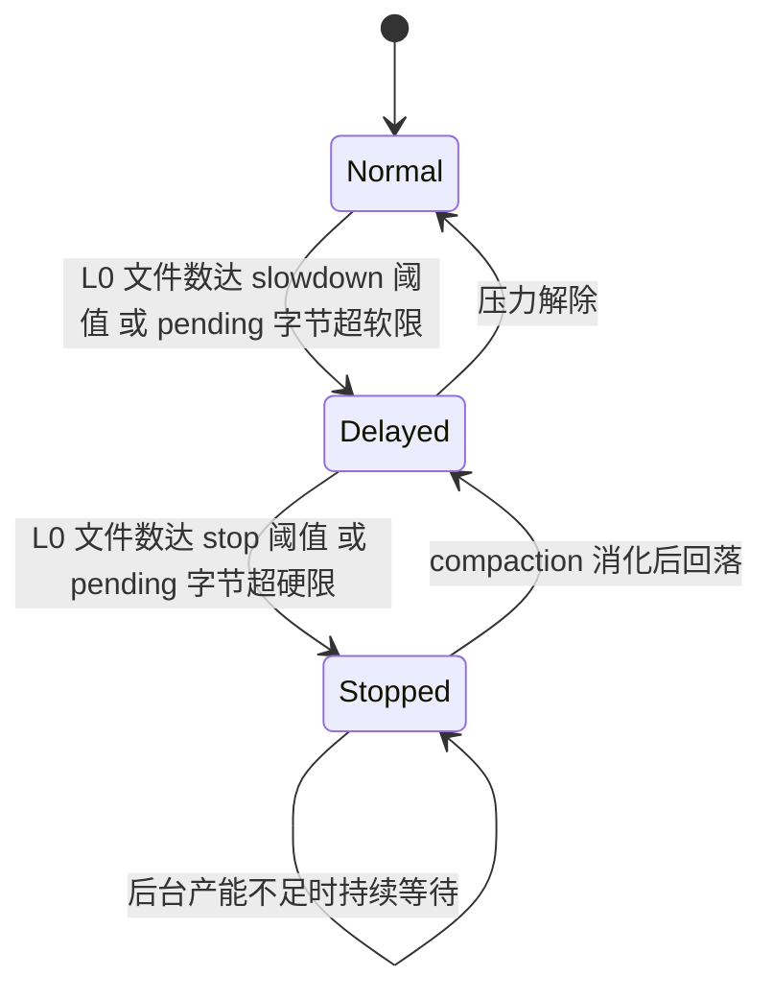
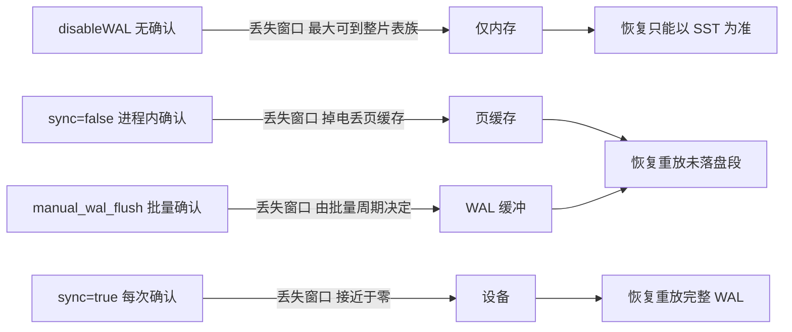

# 写缓冲的容量与 flush 时机——写停是怎么发生的

**摘要：**

LSM 引擎的写入先落进一片内存表，再由后台线程刷成磁盘文件，这条流水线一旦有一段跟不上，客户端感受到的就不是"慢"，而是"不动"。本篇按写路径的时序拆开六个环节，逐个指出它们各自的阻塞点——`sync=true` 时等 fsync、可变表写满时等新表、不可变表积压时等 flush 完成，并说明并发度如何改变这些成本的分摊方式。在此之上，把 `write_buffer_size`、`max_write_buffer_number`、`min_write_buffer_number_to_merge`、`level0_file_num_compaction_trigger` 这四个容量参数放进同一本账里，给出它们互相咬合的三条关系式，以及每个参数调大、调小各自要付的代价；随后把写停归成四类成因——L0 文件数触顶、`pending_compaction_bytes` 越界、MemTable 表位耗尽、后台任务不足——并为每一类找到可观测的证据，包括 `rocksdb.stats` 的停写时长、`rocksdb.is-write-stopped` 属性与三类日志字样。文中还专门分辨"写停"与"写变慢"这两种常被混为一谈的现象，说明为什么只看 P99 会漏判停写、在客户端该补哪些指标；WAL 一节则交代 `sync`、`manual_wal_flush`、`WAL_ttl_seconds` 各自的取舍边界，以及把归档保留时间当成恢复加速开关错在哪里。最后用一组参数算例与三个典型反例，把容量、延迟与恢复时间之间的权衡落到可计算的量上。

---

## 第 1 章 一次不返回的 Put

先说一个笔者见过的现场。某订单库的写入侧压在 RocksDB 上，平稳运行半年，日均写入的 P99 一直在 1 毫秒出头，某次促销把写入流量抬到平时的两倍多，QPS 曲线只是微微上翘，但应用侧的 P99 直接跳到 700 毫秒，监控上出现大量耗时超过 200 毫秒的 Put 调用，且这些长尾调用不是偶发一两条，而是一段几十秒的窗口里成片出现。CPU 使用率没到瓶颈，磁盘的利用率也只有六成，扩容加机器毫无改善。

这类现场最容易走错的方向，是把"写慢"当成"引擎能力不够"，于是加内存、换 SSD、上更快的网卡，全都无效。真正发生的事是：写入线程被引擎挂起了，它没有在计算，也没有在等磁盘，它在一个条件变量上睡觉，等后台把积压的活干完。这句话区分了两个完全不同的故障类别——一类是每次写都变慢一点，另一类是某些时刻写根本不返回。前者是容量的账没算平，后者是**写停**（Write Stall）。

本篇要回答两个问题。其一，写缓冲的容量由什么决定，flush 又按什么节奏发生，四个容量参数之间是什么关系；其二，写停真正发生的那一刻，能从哪些指标、哪些日志、哪个属性上拿到证据。讨论的对象以 RocksDB 8.x/9.x 为准，必要处拿 LevelDB 对照——毕竟生产环境里跑的绝大多数是 RocksDB 或者它的衍生引擎，LevelDB 更像是把这套机制的骨架保留得最干净的那个参照物，而 MemTable 内部的跳表结构、Arena 分配、InternalKey 编码这些数据结构层面的东西，在 [[09 LevelDB 源码剖析——MemTable、SSTable 与 Compaction]] 里已经拆到节点一级，本篇不再重讲。

---

## 第 2 章 写路径的时序与三个阻塞点

### 2.1 一趟 Put 走过六道门

把一次 `Put` 从调用到最终落到磁盘文件的过程摊平，大致是六步：应用把若干条操作打包成 `WriteBatch`；批次被追加进预写日志（Write-Ahead Log，WAL）；若要求同步，此时等一次 fsync；批次里的每条记录转成 InternalKey 插进可变 MemTable；插完之后检查容量，超了就把可变表冻结成不可变表（Immutable MemTable）并换上一片新表；后台 flush 线程把不可变表写成 L0 的 SST 文件；L0 文件数到阈值后，compaction 把 L0 合并进下层。

这六步里，前四步在客户端线程上同步完成，后两步在后台线程上异步推进。写路径的性能秘密就藏在这个"同步四步 + 异步两步"的分界上：只要后台两步的吞吐不弱于前台四步的产生速度，写入就近似常数时间；一旦后台跟不上，异步的部分就变成了前台必须等的部分。

下图把这条时序画出来，并标出三个会挂起客户端线程的位置。

### 2.2 阻塞点一：等一次 fsync

`WriteOptions::sync` 为真时，一次写入必须等 WAL 落盘（调用 fsync 或等价机制）才返回。这一步的代价不是常数：机械盘上单次 fsync 的延迟在毫秒量级，NVMe 上可以压到几十微秒，但无论哪种介质，它都是整条写路径里唯一一个把延迟直接绑在硬件上的环节。

RocksDB 在这里做了两件事来摊薄成本。一是**组提交**（Group Commit）：先到的写线程发现自己不是唯一的等待者，就把其他排队线程的批次合并成一次 WAL 追加与一次 fsync，一次落盘的代价由整组请求分摊。二是提供 `manual_wal_flush` 这类选项，把"写进 WAL 缓冲区"与"把缓冲区刷到设备"拆成两个可控动作，让上层自己决定什么时候付这笔钱。组提交能把单位成本摊薄一个数量级，但它摊销的是平均值，不是尾部：一组的规模取决于并发压力，低并发时组里只有一两个请求，此时 sync 的延迟依然等于一次 fsync 的延迟。

需要区分的是"数据在什么时候可能丢"与"写入什么时候返回"。`sync=false` 时，WAL 只写进了操作系统的页缓存，写入立刻返回，进程崩溃不会丢数据（页缓存还在内核里），但机器掉电就会丢掉最近未落盘的那一段。`sync=true` 把丢失窗口压缩到接近零，代价是每一次写都要等一次设备确认。这两者之间没有中间态，除非上层自己实现批量同步——每隔几毫秒调一次 fsync，把这一窗口内的写入一起落盘，用极小的数据丢失窗口换取接近异步的吞吐。

### 2.3 阻塞点二：表写满了，得等一片新的

可变表插满之后不能就地扩容，只能冻结成不可变表、换一片空表接着写。而换新表这件事有前提：空表位没有被占光。RocksDB 的规则是，如果当前的可变表与不可变表总数还没到 `max_write_buffer_number`，就直接换表；如果已经到顶，写线程就得等后台 flush 消化掉至少一片。LevelDB 里这段逻辑叫 `MakeRoomForWrite`，是一个按优先级排列的判断阶梯：先看有没有可换的空位，没有就看 L0 文件数是否超标，超标就先推动 compaction 再等；还没解决就睡一毫秒回头看，循环直到腾出空间。RocksDB 的等价逻辑藏得更深，判断入口分散在 write 路径与后台调度之间，但外在行为一致——表位就是写线程能继续前进的通行证，发完了就得等。

这里有一个容易被忽略的细节：冻结与 flush 并不是"立即"发生的。冻结只改一个指针，代价可以忽略；但 flush 要读完整片不可变表、压成有序的 SST 文件、再调一次 fsync 把它落盘，这一段是完全的磁盘操作。所以"表位耗尽"这件事的本质，不是内存不够，而是 flush 的速度不够。

### 2.4 阻塞点三：不可变表积压，等 flush 归还

第三个阻塞点是第二个的延长线。不可变表从冻结那一刻起就在排队等 flush，队列里的表占用着 `max_write_buffer_number` 的名额。如果写入速率稳定高于 flush 速率，队列会一直排到满，此时写线程在每次换表时都要等；而若冻结的速度远快于 flush 的消化速度，队列同样会迅速见底，此时写线程等的时间就接近一整次 flush 的耗时——这一点与直觉相反：写得越快，换表越频繁，单次等待越不容易被摊薄。

RocksDB 还给这张表位账本加了一层跨列族的约束：`WriteBufferManager` 可以对整个 DB 实例（含所有列族）的 MemTable 内存总量设上限，超限时要么触发 flush、要么按配置让写入停顿。单列族调参调得很好、多列族一起把内存吃穿，是分片实例上很典型的一种翻车方式。

把三个阻塞点放在一张表里，各自的触发条件、客户端表现和取证方式就清楚了。

| 阻塞点 | 触发条件 | 客户端看到什么 | 相关参数 | 直接证据 |
| :--- | :--- | :--- | :--- | :--- |
| 等 fsync | `sync=true` 且设备确认慢 | 单次写延迟等于设备 fsync 延迟，均值与尾部一起抬高 | `WriteOptions::sync`、`manual_wal_flush` | 写延迟直方图的固定台阶、`rocksdb.db.write.micros` |
| 等新表 | 可变表写满且表位已发完 | 写入停顿从毫秒级跳到 flush 时长量级 | `max_write_buffer_number`、`write_buffer_size` | `rocksdb.num-immutable-mem-table` 长期贴着上限 |
| 等 flush | 不可变表积压，flush 产能不足 | 停顿呈块状，与 flush 完成时刻对齐 | `max_background_jobs`、flush 带宽 | `rocksdb.mem-table-flush-pending` 持续为 1、Immutable 计数不降 |

### 2.5 并发度决定了谁付这笔钱

三个阻塞点里，前两个的成本分摊方式取决于并发度，这一点在估算容量时经常被漏掉。

组提交的前提是有别的线程在排队。单个客户端线程以 `sync=true` 顺序写时，每次写都自成一组，一次 fsync 的成本全额记在这一条请求上；同一个实例上有几十个写线程时，一次 fsync 平均能服务十几次写，单条请求分摊到的设备延迟降到几分之一。这也是为什么同一个库在压测环境和生产环境表现不同的常见原因之一：压测习惯用少量线程跑高 QPS，生产则是一个连接池里几十个线程各写各的，组提交的效率完全不同。

批量大小的影响方向则相反。一个 `WriteBatch` 里塞进成千上万条记录，插入 MemTable 时持有写锁的时间被拉长，其他写线程的等待随之变长，而且这一个批次可能一次就吃掉大半片表——表位的消耗是阶跃式的，而不是平滑的。所以"加大批次提升吞吐"这条经验在写停的场景里要打折：它确实提高了组提交效率，但也把表位的消耗集中到了更少的时间点上，突发性更强。

---

## 第 3 章 四个容量参数的联动

### 3.1 write_buffer_size：单片写缓冲的大小

`write_buffer_size` 决定一片 MemTable 能装多少字节，RocksDB 的默认值是 64MB，LevelDB 的默认值是 4MB——这两个数字经常被混着引用，而把 4MB 当成生产基线来算出"每秒产生几十个 L0 文件"，是很多错误结论的起点。

调大它的直接收益是 L0 文件数变少：flush 产出的文件大小大致等于一片表的实际数据量，写入吞吐不变时，表越大，单位时间产出的文件越少，`level0_file_num_compaction_trigger` 也就越晚被触发，compaction 的输入粒度更大、排序效率更高。代价则落在三个地方：单片表占用的内存变大；崩溃恢复时要重放更多 WAL 记录，恢复时间线性拉长；单次 flush 要写出的文件变大，flush 期间的写停顿粒度也随之变粗。

| 方向 | 收益 | 代价 |
| :--- | :--- | :--- |
| 调大 | L0 文件数减少，compaction 触发变稀疏，排序效率提升 | 单片内存变大；恢复重放变长；单次 flush 时长与抖动同步变大 |
| 调小 | 恢复更快，flush 粒度细，内存占用低 | L0 文件数暴涨，compaction 频繁启动，写放大与后台 CPU 压力上升 |

判断它是否合适，不看绝对值，看两个比值：一是"一片表填满的间隔"与"一次 flush 的耗时"之比，二是"最大单片表大小"与"可接受的恢复时间"之比。前者决定稳态下会不会积压，后者决定故障恢复的预算。

### 3.2 max_write_buffer_number：能同时存在几片表

这个参数是 MemTable 家族的席位总数，默认值 2，也就是一片活跃表加一片不可变表。它的作用不是"内存上限"这么简单，而是"抗突发能力"——突发写入让活跃表迅速填满，如果此时唯一的那片不可变表还在 flush，写线程就只能停下来等。

调大它，账面上等于多买了几张席位，后台 flush 慢一点也能靠席位顶住，写入的瞬时不均匀被吸收掉；代价是内存上限成倍抬升，因为每一张席位都是一片完整大小的表。调小到 2 或者更少，内存最省，但只要 flush 出现一次抖动，写入立刻传导成停顿。也就是说，这个参数**买的是时间，付的是内存**。

| 方向 | 收益 | 代价 |
| :--- | :--- | :--- |
| 调大 | 抗突发能力增强，flush 抖动被缓冲吸收，写停概率下降 | 单个列族内存上限按片数翻倍；多列族叠加后容易挤占 block cache |
| 调小 | 内存占用低 | 只剩一进一出的双缓冲，任何一次 flush 变慢都会直接阻塞写线程 |

### 3.3 min_write_buffer_number_to_merge：一次 flush 取走几片

默认值 1，意思是每片不可变表各自 flush。调成 2，就要等两片不可变表攒齐才启动 flush，一次写出一个合并后的大文件。它的直接效果是把 L0 文件数按合并片数打折：`min_write_buffer_number_to_merge=2` 时，同样的写入量产出的 L0 文件数大约减半，`level0_file_num_compaction_trigger` 的触发频率随之下降，compaction 的输入更整齐。

但它有一个反直觉的副作用。片数被攒着不 flush，意味着这些表一直占着 `max_write_buffer_number` 的席位；席位又被攒住的表占掉一部分之后，留给"活跃表 + 在途不可变表"的余量就变少了。于是调大这个参数，L0 文件是少了，突发写入下写停的概率反而可能升高。这就是它与 `max_write_buffer_number` 必须一起看的原因：两者之差，才是真正可用的双缓冲深度。

| 方向 | 收益 | 代价 |
| :--- | :--- | :--- |
| 调大 | 单次 flush 合并多片，L0 文件数下降，compaction 触发变稀疏 | 席位被攒住的表占掉，突发时可用缓冲变浅；数据在内存里停留更久，恢复要重放的 WAL 更多 |
| 调小 | 表位周转快，突发吸收能力强，恢复时 WAL 短 | L0 文件数变多，compaction 更频繁，写放大上升 |

### 3.4 level0_file_num_compaction_trigger：第一道闸

L0 是唯一一层文件之间 key 范围互相重叠的层，因此它的文件数直接决定两件事：compaction 什么时候启动，以及一次读要碰几个文件。compaction 的打分规则大致是"L0 文件数除以本阈值"，到 4（默认值）就相当于 L0 已经欠了 compaction 的债，必须开始还。

这个参数是四者里最像"闸门"的一个：调小，compaction 更早启动，L0 永远攒不起来，读放大低，但 compaction 更频繁、写放大更高；调大，compaction 更晚启动、批量更大、写放大更低，但 L0 文件数在峰值时会堆得更高，读路径要逐个查这些重叠文件，读 P99 直接受影响，而且离 `level0_slowdown_writes_trigger` 更近一步。

| 方向 | 收益 | 代价 |
| :--- | :--- | :--- |
| 调大 | compaction 批量更大，写放大与后台 CPU 更低 | L0 堆积更高，读放大上升，慢启动与停写的余量被吃掉 |
| 调小 | L0 常年低位，读延迟稳定 | compaction 频繁，写放大与后台 IO 上升，compaction 本身成为瓶颈 |

### 3.5 四个参数的同一本账

把四个参数放在一起，能写出两三条互相约束的关系，它们比任何单参数的推荐值都有用。

第一，内存上限。MemTable 家族占用的内存上限近似为 `max_write_buffer_number × write_buffer_size`，再乘以列族数；如果配了 `WriteBufferManager`，则以那个全局额度为准。这笔内存是独立于 block cache 的一块，规划容量时必须单独留出来，不能默认它会被 block cache 的预算覆盖。

第二，**可用缓冲深度**。真正能在突发时顶住写入的，是"除攒表所需之外还剩几片席位"，经验上等于 `max_write_buffer_number − min_write_buffer_number_to_merge`；这个数小于 1 时，系统在任何一次 flush 变慢时都会阻塞，等于把写停的概率交给磁盘抖动的概率。

第三，L0 的产出节奏。在稳态下，L0 文件数的增长速率约等于写入吞吐除以单片表的数据量（若合并 flush 则再除以合并片数），compaction 的启动间隔则由这个速率与触发阈值共同决定。三个数一摆，就能看出后台是否跟得上：如果这个速率乘上"一次 compaction 的耗时"大于阈值本身，L0 就注定要往上涨。

下图把这份账本画成一条链路。

还有一个常被忽略的联动：flush 产出的 L0 文件大小由 `write_buffer_size` 决定，而下层文件的目标大小由 `target_file_size_base` 决定，两者差距过大时，compaction 的输入会碎成一堆小文件，一次合并要处理大量小文件、排序与索引开销被放大；反过来，下层文件远小于 L0 文件时，合并又会被迫把一个文件切成多份。这两个参数应当同量级。

---

## 第 4 章 写停的四种成因与判据

### 4.1 第一因：L0 文件数触顶

这是最常见也最好判断的一种。RocksDB 为 L0 文件数设了两道阈值：`level0_slowdown_writes_trigger` 默认 20，到线之后写不再被直接放行，而是被**降速**——引擎按一个可调的速率给每次写注入等待，把写入的节奏压下来，给 compaction 腾出时间；`level0_stop_writes_trigger` 默认 36，到线之后彻底停写，写线程在条件变量上等，直到 compaction 把 L0 消化到阈值之下才被唤醒。

这两个阈值合起来构成本篇最该先调的一对参数。它们不是"越大越好"的旋钮：调大，等于允许 L0 堆得更高才踩刹车，读放大会先撑不住，因为 L0 的每个文件都要被读路径查到；调小，刹车踩得更早，写入更容易被降速，写吞吐的上限被压低。真正的判据是：这两道阈值必须与 `level0_file_num_compaction_trigger` 拉开足够距离，否则刚触发 compaction 就已经逼近降速线，后台连一轮完整合并的窗口都没有。

### 4.2 第二因：pending_compaction_bytes 越界

L0 文件数只反映了一层的堆积，compaction 的真实欠账要看全局：所有层里尚未完成的合并工作折算成字节，就是 `pending_compaction_bytes`。它对应的两道闸是 `soft_pending_compaction_bytes_limit`（默认 64GB）与 `hard_pending_compaction_bytes_limit`（默认 256GB，均以对应版本文档为准）——越过软限开始降速，越过硬限直接停写。

这一因比第一因隐蔽得多。L0 可能只有五六片文件，看起来一片祥和，但如果下层 compaction 已经在排队、待重写的字节数持续上涨，软限照样会被触发，写入照样被降速。它反映的是"compaction 的总产能不足"，而 L0 文件数只反映"某一层的瞬时堆积"。只看 L0 数的监控，在多层同时欠账的场景里会漏报。

### 4.3 第三因：MemTable 表位耗尽

这一因就是 2.3 节与 2.4 节描述的阻塞点。它的判据很直白：`rocksdb.num-immutable-mem-table` 长时间贴着 `max_write_buffer_number` 减一的位置，同时 `rocksdb.mem-table-flush-pending` 保持为 1，两者叠加就意味着 flush 产能不够、写线程正在表位上排队。

值得留意的是这一类停顿的"块状"特征。它不像降速那样把每次写均匀拉长，而是一段一段地停：表位用光时停一次，等一次 flush 完成，放行一片表位，写一段，再停。在延迟曲线上看，就是一连串与 flush 周期对齐的尖峰。若 flush 与 compaction 共用后台线程且线程数不够，这种尖峰会与 compaction 的长任务重叠，表现为秒级的偶发挂起。

### 4.4 第四因：后台任务不够

`max_background_jobs` 默认值是 2，它决定后台线程池的规模，flush 与 compaction 都从这个池子里取线程。老版本里用 `max_background_compactions` 与 `max_background_flushes` 分别配置，这两个选项后来被合并进 `max_background_jobs` 并标记为废弃，新配置只设后者即可（以对应版本文档为准）。池子太小，compaction 只能排队，L0 与 pending 字节同时上涨，前两因接连被触发；池子太大，后台任务会与前台读争抢磁盘 IO 和 CPU，把读延迟拖下水，此时需要配 `rate_limiter` 给后台写入设速。

单个 compaction 内部还能再并行：`max_subcompactions` 把一个大的合并任务切成若干个 key 区间并行做，是压缩单次合并耗时的手段，但它不改变"任务总产能"这个约束。

下图按判定顺序把四因串起来。

### 4.5 判据：从哪些地方拿证据

写停不是靠猜的，它有明确的观测面。`DB::GetProperty` 提供了一组只读属性，可以对单个 DB 实例按需查询；`rocksdb.stats` 输出的多段统计里则给出了累计与区间两个维度的汇总。

| 成因 | 关键属性 | 阈值参数 | 日志与统计特征 | 处置方向 |
| :--- | :--- | :--- | :--- | :--- |
| L0 触顶 | `rocksdb.num-files-at-level0` | `level0_slowdown_writes_trigger`、`level0_stop_writes_trigger` | 日志出现 "Stalling writes because we have N level-0 files"；`rocksdb.is-write-stopped` 置位 | 提高 compaction 产能，或降低 L0 产出速率 |
| pending 越界 | `rocksdb.estimate-pending-compaction-bytes` | `soft_pending_compaction_bytes_limit`、`hard_pending_compaction_bytes_limit` | compaction 队列常满，`rocksdb.compaction-pending` 长期为 1 | 增加后台并发、检查下层文件是否过大 |
| 表位耗尽 | `rocksdb.num-immutable-mem-table`、`rocksdb.mem-table-flush-pending` | `max_write_buffer_number`、`write_buffer_size` | Immutable 计数贴住上限且不下降 | 加大表位、提高 flush 优先级或带宽 |
| 后台不足 | `rocksdb.actual-delayed-write-rate`、`rocksdb.background-errors` | `max_background_jobs`、`max_subcompactions` | 后台任务排队时长上升，flush 完成间隔变长 | 扩大线程池，并用 rate limiter 约束后台 IO |

`rocksdb.stats` 里最值得盯的两行是累计停写与区间停写。它们以"时分秒 + 占比"的形式给出引擎在统计周期内停写的总时长，这比任何百分比指标都直接——写入延迟的分位数会被大量正常请求稀释，但"这个小时停了 4 分 12 秒"没有稀释空间。默认的输出周期是 600 秒，观测粒度太粗时把它调到 60 秒，代价只是日志量。

写入控制器在正常、降速、停写三级之间迁移，下图给出这条迁移线的走向。

### 4.6 阈值之间该留多少余量

三道 L0 阈值之间的关系值得单独算一遍：`level0_file_num_compaction_trigger`（默认 4）触发合并，`level0_slowdown_writes_trigger`（默认 20）开始降速，`level0_stop_writes_trigger`（默认 36）完全停写。从 4 到 20 之间隔着 16 个文件的缓冲，这个缓冲的作用是"给一轮 compaction 留出完成的时间"。

把前面算过的 L0 产出速率 1.25 片每秒代进去：16 片文件对应 12.8 秒的写入量。也就是说，只要一轮 L0 到 L1 的合并能在 12.8 秒内完成，L0 就不会走到降速线。若实测一轮合并要 20 秒，这个余量就不够——无论怎么调 `max_write_buffer_number`，L0 迟早会攒到降速线，因为欠账的根源在于合并本身太慢。反过来，若一轮合并只需要 3 秒，那么 16 片的余量有近四倍的冗余，把阈值调小一点以换取更低的读放大是安全的。

同样的算法可以用在降速线与停写线之间：36 减 20 是 16 片，这段时间的作用是"让已经开始的降速有时间见效"，若降速的比例太低、写速率并没有真的掉下来，L0 会径直穿过这 16 片的空间，从降速直接跳到停写。

---

## 第 5 章 写停与写变慢，不是一回事

这两种现象在监控图上都能表现为"P99 变差"，但它们的机制、证据与处置完全不同，混在一起看会得出相反的结论。

写变慢是**均匀**的：引擎给每次写注入一点延迟，请求一个个排着队慢慢过去，线程始终在工作，只是每一步都慢一点。写停是**离散**的：线程真的被挂起了，在那段时间里它不消耗 CPU、不发起 IO，只是在等一个条件满足。前者像限速路段，车速降下来但车一直在动；后者像收费站前排到熄火的队伍，队伍里的车一段时间内根本没动。

由此推出两条判据。看延迟分布时，降速会把整个分布向右平移，P50 与 P99 一起变差；停写则主要拉长尾部，P50 可能毫无变化，P999 与最大值却出现数量级跳变。所以**只看 P99 会低估停写**——如果停顿只发生在一个统计窗口的少数几百毫秒里，P99 甚至可能看不出来。更可靠的观测量是三个：`rocksdb.stats` 里的区间停写时长占比、写入耗时的最大值与 P999、以及并发在途写请求数的曲线是否出现"只进不出"的平台。

| 维度 | 写变慢（Delayed Write） | 写停（Write Stall） |
| :--- | :--- | :--- |
| 机制 | 按 `delayed_write_rate` 给每次写注入等待 | 写线程在条件变量上阻塞，等待指标回落 |
| 延迟形状 | 整体右移，P50 与 P99 同步变差 | 长尾尖峰，P50 稳定、P999 与最大值跳变 |
| 观测证据 | `rocksdb.actual-delayed-write-rate` 大于零 | `rocksdb.is-write-stopped` 置位、日志出现 Stalling/Stopping 字样 |
| 是否消耗 CPU | 是，线程仍在逐条推进，按速率定时等待 | 否，线程挂起 |
| 处置 | 降低写入速率或提高 compaction 产能 | 先解决后台产能缺口，再考虑参数 |
| 与客户端超时的关系 | 慢但通常不超时 | 容易触发客户端超时与重试，重试再放大写入 |

最后一行值得展开。写停一旦触发客户端超时，重试流量会叠加到原有流量上，把刚缓解的队列再压满一次，形成正反馈。这也是为什么停写的处置必须先恢复后台产能，而不是先调小 `write_buffer_size` 去"降低单次写入量"——后者只会让 L0 文件变多，把压力从表位挪到 compaction。

### 5.1 在客户端怎么量

引擎侧的证据要拿到，前提是能在客户端分出"这段慢"属于哪一类。一个成本很低的办法是给每次写记录两个数：本次耗时与发起时刻，画成随时间的散点。降速的散点是整体抬高的水平带，停写的散点是与 flush 周期对齐的竖条，二者的形状差异一眼可辨。

第二个指标是在途请求数，也就是客户端连接池里已发出、尚未返回的写请求个数。停写时它阶跃上升、并在停顿期间保持不下降，因为线程都挂在那里出不来；降速时它基本平稳，因为请求仍在不停地进出，只是每次慢一点。把在途请求数与引擎侧的停写时长放在同一时间轴上对照，两边的尖峰应该严格对齐——对齐了，归因就成立；对不齐，说明慢在客户端到引擎之间的某一段，譬如连接池排队或者网络重传。

第三个要注意的是超时设置对观测的截断。客户端把写超时设成 1 秒，那么所有超过 1 秒的停写在统计里都变成同一个值，1.1 秒和 10 秒的停写无从分辨，而这两种情况对应的处置完全不同。至少要把超时告警的计数单独打出来，或者在客户端记录"超时发生时刻"的分布，让停写的持续时间能被估出来。

---

## 第 6 章 WAL 的持久性取舍

WAL 是写路径上唯一一个把延迟直接绑在硬件上的环节，因此它的取舍本质上是在"丢多少数据"与"每次写多等多久"之间选一个点。

三种常见配置的差别在于**确认边界**。`sync=false` 时写入返回即成功，数据在页缓存里，进程崩溃不丢、掉电会丢；`sync=true` 时每次写都等设备确认，掉电也不丢；`manual_wal_flush` 打开后，WAL 写入只进进程内的缓冲，由上层决定何时刷到操作系统、何时 sync，适合自己实现批量确认的场景。第三种是前两种的推广：把同步从"每次写"变成"每批写"，用极小的丢失窗口换取接近异步的吞吐。

`WAL_ttl_seconds` 与 `WAL_size_limit_mb` 这两个选项经常被误用。它们的作用对象是**归档的 WAL 文件**——开启后 RocksDB 不再立即删除旧的 WAL，而是保留一段时间或一定体积供外部读取（典型场景是下游订阅变更流），超限后再清理。它们不改变写入延迟，也不改变崩溃恢复要重放的数据量：恢复的重放长度由 MemTable 家族的容量决定，WAL 归档保留多久是另一件事。把 TTL 调小当作"加速恢复"的旋钮，是把它用错了地方；而如果下游依赖 WAL 做增量同步，TTL 设得过小则会让下游追不上、需要重新做全量。

`disableWAL` 则是另一个量级的选择。关掉 WAL 之后，写入只在内存里，崩溃或掉电会丢掉所有尚未 flush 的数据——注意这个"尚未 flush"的窗口并不小，最大可以覆盖整个 MemTable 家族的容量。它只在数据可重建（缓存、可重算的派生表）或者外部已有副本时才成立，而且要与备份策略、重建流程一起论证，不能当成一个纯粹的性能开关。

| 配置 | 丢失窗口 | 写入延迟 | 适用前提 |
| :--- | :--- | :--- | :--- |
| `sync=false` | 掉电丢最近未落盘部分，进程崩溃不丢 | 低，不等设备 | 可接受掉电丢数，或另有同步副本 |
| `sync=true` | 接近于零 | 每次写等一次 fsync | 数据不可丢，写入并发足以靠组提交摊薄 |
| `manual_wal_flush` + 批量 sync | 由批量周期决定 | 介于两者之间 | 上层能做批量确认，且能承担进程级崩溃的窗口 |
| `disableWAL` | 最大可覆盖整个 MemTable 家族 | 最低 | 数据可重建，且有独立恢复路径 |

还有一个与设备布局相关的取舍：把 WAL 目录（`wal_dir`）与 SST 目录分到不同设备上，可以让 fsync 与 flush 的 IO 互不排队。写停的很多现场并不是产能真的不足，而是 WAL 的同步写与 flush 的批量写在同一条 IO 队列上互相踩踏。

下图把这四档配置的确认边界画在一起，横轴是"多久确认一次"。

图中四档从左到右，确认越严格、丢失窗口越小、单次写的延迟越高，恢复要重放的数据量也越大；恢复重放的量由 MemTable 家族的容量决定，与 WAL 归档保留多久无关。

---

## 第 7 章 反例与算例

### 7.1 把 write_buffer_size 设成 1GB

这是"调大就快"直觉下最常见的动作，它至少有三条互相独立的死法。内存侧，`max_write_buffer_number` 若保持 2，光是 MemTable 家族就要占 2GB，再叠加 block cache、索引与过滤器、以及多列族的副本，单机内存很容易被吃穿，随后触发的是操作系统层面的 OOM 或者 swap，比写停惨烈得多。恢复侧，崩溃重启要重放的是尚未 flush 的全部数据，最多接近整个 MemTable 家族的容量，重放又是单线程顺序 apply，恢复时间从秒级拉到分钟级，而这段时间里实例对外是不可用的。抖动侧，单片表 1GB 意味着一次 flush 要写出 1GB 的文件，一次 L0 到 L1 的合并要搬动 1GB 级别的数据，单次 compaction 的耗时被拉长，写停的"块"也随之变粗——原本几十毫秒的停顿变成几百毫秒。

真正合理的做法是反过来：把 `write_buffer_size` 定在**恢复预算**能接受的上限，再用 `max_write_buffer_number` 与 `min_write_buffer_number_to_merge` 去调抗突发能力与 L0 产出节奏。

### 7.2 max_write_buffer_number 保持 2，却抱怨写停

默认值 2 的语义是"一进一出"，它没有任何抗突发余量：活跃表填满的那一刻，如果那片不可变表还没 flush 完，写线程就得等。稳态下这没问题，只要 flush 比"填满一片表"快；但稳态不是生产环境的常态，一次 compaction 的长任务、一次慢盘、一次 fsync 抖动，都会让 flush 慢一拍，而慢一拍就是一次停写。

抱怨写停却把表位数留在默认值，等于承认自己没有为抖动留预算。常见的修正不是把表位调到很大，而是调到 4 左右（内存上限控制在可接受范围），同时确认 flush 有独立的后台线程可用，避免 flush 排在 compaction 后面。

### 7.3 只看 QPS 不看停写时长

QPS 是结果指标，不是过程指标。停写发生时，QPS 未必立刻掉：客户端有超时、有重试、有连接池排队，上游的请求速度可能在几百毫秒内看不出变化；等 QPS 真的掉下来，往往已经到了客户端大面积超时的阶段。反过来，一次持续 300 毫秒、每小时发生几十次的停写，在小时级 QPS 曲线上几乎不可见，但它足以把 P999 打到秒级，并让依赖于尾延迟的上层调用链出现雪崩式的超时传播。

更可用的观测组合是三条曲线放在一起看：写入 QPS、停写累计时长的增量、以及在途写请求数。停写时长在涨而在途请求数在堆，说明写线程真的被挂住了；两者都没动而 P99 在涨，则更像 fsync 变慢或者读路径的问题。

### 7.4 四个参数的算例

下面这组数字是示例推算，用来说明怎么把参数换算成可判断的量，不是任何真实环境的实测结果。假设单列族写入吞吐 80MB/s，`write_buffer_size` 取 64MB，flush 的有效写出带宽 200MB/s，L0 到 L1 的合并有效带宽 150MB/s，`max_write_buffer_number` 取 4，`min_write_buffer_number_to_merge` 取 1。

| 推算项 | 算式 | 结果 | 含义 |
| :--- | :--- | :--- | :--- |
| 单片表填满间隔 | 64 ÷ 80 | 0.8 秒 | 每 0.8 秒冻结一片表 |
| 单次 flush 耗时 | 64 ÷ 200 | 0.32 秒 | 稳态下 flush 有 0.48 秒富余 |
| L0 产出速率 | 80 ÷ 64 | 1.25 片每秒 | 约 3.2 秒攒够 4 片触发 compaction |
| 突发吸收能力 | (4 − 1) × 64 | 192MB | 约 2.4 秒的写入可以被表位吸收 |
| 表位内存上限 | 4 × 64 | 256MB | 不含 Arena 与索引开销 |
| compaction 需求带宽 | 80 × 写放大倍数 | 若倍数为 3 则 240MB/s | 超过 150MB/s 的产能，欠账开始累积 |

最后一行是这张表的关键：稳态能不能维持，取决于 compaction 的需求带宽是否小于产能。若写放大为 3 而产能只有 150MB/s，缺的 90MB/s 会以 `pending_compaction_bytes` 的形式慢慢累积，先是软限触发降速，再是硬限触发停写。此时调 `write_buffer_size` 只是把欠账的形状换一换——调大让每次合并搬得更多、更慢；调小让 L0 文件更多、写放大更高。真正该动的是写放大本身，也就是 compaction 策略与分层参数，这部分在 [[04 Compaction——分层合并与版本管理]] 里展开。至于什么时候该选 LSM 这一族、三笔放大账怎么算，则是 [[01 LevelDB 全局架构——LSM-Tree 的写优化设计]] 的主题。

---

## 第 8 章 结语

写缓冲的容量不是一个"越大越快"的旋钮，而是一组互相咬合的预算：`max_write_buffer_number × write_buffer_size` 决定内存与抗突发能力，`min_write_buffer_number_to_merge` 在其中划走一部分席位去换更少的 L0 文件，`level0_file_num_compaction_trigger` 决定后台什么时候开始还债，而 `level0_slowdown_writes_trigger` 与 `level0_stop_writes_trigger` 是最后两道闸。

写停之所以难处理，是因为它在监控上长得像"慢"，在客户端表现为"不动"，而两者的处置方向几乎相反。把停写时长当成一等指标盯住，把四个成因对应到各自的属性面板上，参数才有调整的落点——否则每一次调参都只是在猜。这其中的权衡没有普适答案，只有与写入模式、恢复预算、磁盘产能相匹配的那一组值。

---

## 参考资料

1. RocksDB Wiki，*RocksDB Tuning Guide*：https://github.com/facebook/rocksdb/wiki/RocksDB-Tuning-Guide
2. RocksDB Wiki，*Write Stalls*：https://github.com/facebook/rocksdb/wiki/Write-Stalls
3. RocksDB Wiki，*Basic Operations*（`GetProperty` 属性清单）：https://github.com/facebook/rocksdb/wiki/Basic-Operations
4. RocksDB 源码，`include/rocksdb/options.h`（`write_buffer_size`、`max_write_buffer_number`、`min_write_buffer_number_to_merge`、L0 触发阈值等默认值）：https://github.com/facebook/rocksdb/blob/main/include/rocksdb/options.h
5. RocksDB Wiki，*RocksDB FAQ*（WAL 的持久化语义与常见误解）：https://github.com/facebook/rocksdb/wiki/RocksDB-FAQ
6. leveldb/leveldb，`db/db_impl.cc`（`MakeRoomForWrite` 的等待阶梯）：https://github.com/google/leveldb/blob/main/db/db_impl.cc

---

> [!note] 思考题
> 1. 若把 `max_write_buffer_number` 从 2 调到 6 之后写停消失、但实例的常驻内存也跟着涨了 4 片表，这笔交易在什么前提下是划算的？
> 2. 为什么 `level0_slowdown_writes_trigger` 与 `level0_stop_writes_trigger` 必须和 compaction 的实际耗时一起看，而不能只按文件数绝对值设？
> 3. 一次停写持续 400 毫秒、每 10 分钟发生一次，与每次写都多 5 微秒的降速，哪一个对上层调用链更危险？
> 4. 如果下游依赖 WAL 做增量订阅，`WAL_ttl_seconds` 该按什么来定，设小了会发生什么？
> 5. 关闭 WAL 之后写停现象可能减轻，但这是不是一次真实的性能改进？