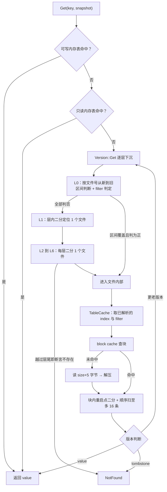
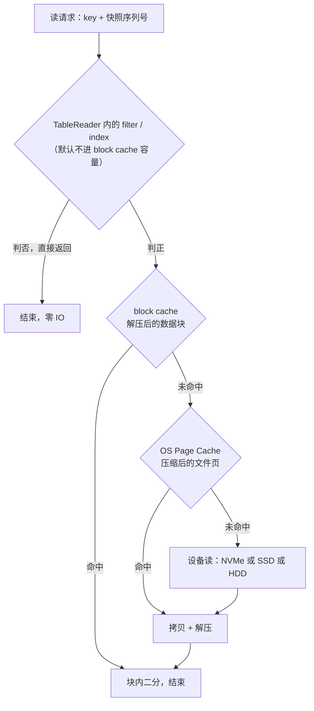
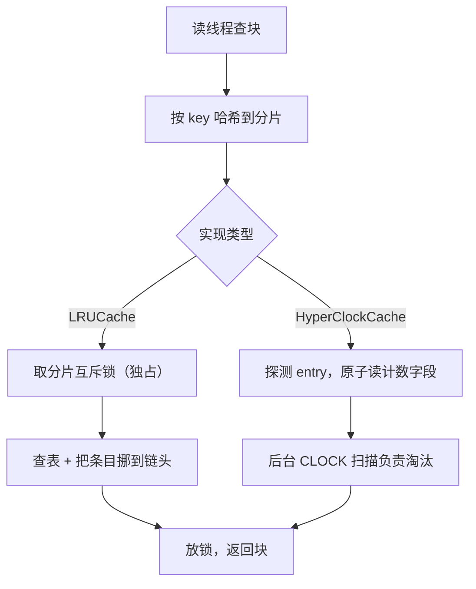
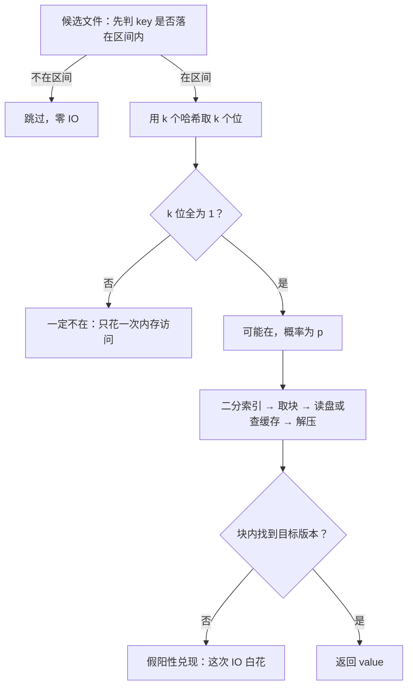
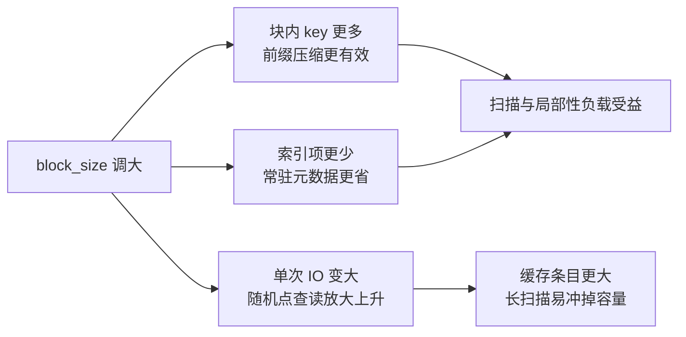

# SSTable 的文件格式与 Block 结构

**摘要：**

一份 SSTable 的字节布局本身不产生延迟，产生延迟的是"为确认某个块里没有这个 key"而多走的路：L0 要按文件号从新到旧逐个查，L1 到 Ln 每层要二分定位一个文件，命中的那个文件还要读块、解压、块内二分。本篇把一次点查拆成"可写内存表 → 只读内存表 → L0 → L1..Ln → 块内"这条链路，先算清读放大从哪里来、给出"最坏读几个文件"的算例，再交付三笔内存预算的判据：block cache 该给多少（默认 32MB，通常要占可用内存三分之一以上）、row cache 为什么默认关闭、文件句柄为什么会先于内存耗尽；最后把 Bloom Filter 落到算术上，用 p=(1-e^(-kn/m))^k 推出"每 key 多一位，假阳性率乘 0.6185"，给出位数与内存的对照、`optimize_filters_for_hits` 与 prefix bloom 的边界，以及 `block_size` 在点查与扫描之间的取舍刻度。文件格式的细节留在源码剖析那篇。本篇只谈一件事：读放大是怎么被压下去的，以及压它的每一步要付什么——L0 的顺序扫、层内二分、过滤器的假阳性、缓存与句柄的容量，每一个旋钮都对应一个可以算出来的数，也对应一笔要挪走的内存。

---

## 第 1 章 一次点查要走多少道门

一次 `Get` 的时间，大半不花在它真正读到的那一个块上，而花在它为确认"别处也没有"而多走的路上。这句话听着像常识，但它决定了两件事的算法：读放大的量级 **由文件数与层数决定**，而不是由数据总量决定；读侧的每一个优化——缓存、过滤器、块大小——本质上都是在买"少走几道门"或者"走到门口就知道不必进门"。

这条链路的骨架是 LevelDB 的 `DBImpl::Get`：锁内取快照序列号，拿到可写内存表、只读内存表与当前 `Version` 的引用，释放锁，按内存表、只读内存表、磁盘文件的顺序查找，磁盘这一段交给 `Version::Get` 逐层下沉，最后落到 `TableCache` 与 `BlockBasedTable` 完成块级定位。骨架本身、`LookupKey` 对序列号的编码、引用计数保护锁外访问，在 [[09 LevelDB 源码剖析——MemTable、SSTable 与 Compaction]] 里已经逐行讲过，此处不复述，只标出与读放大相关的计量点。

前两段的成本可以忽略：跳表查找是纯内存操作，命中即返回，没有 IO。分水岭在第三段——一旦落到磁盘，读放大就以文件为单位开始累加。

### 1.1 三段式决定了读放大的起点

内存表命中率是读放大的第一道闸，它决定了有多少读请求会走到磁盘。写入先进可写内存表，写满后转成只读内存表等待刷盘；这两级都命中的读，成本约等于一次跳表查找加一次序列号比较。写缓冲越小，刷盘越频繁，落盘数据在总量中的占比越高，落到磁盘的读也就越多。这与 [[02 MemTable 与 SkipList]] 里讲的容量与 flush 时机是同一件事的两面。

RocksDB 在这条链路上做了一处 LevelDB 没有的扩展：内存表可以有多个，读的时候要按时间从新到旧遍历整条只读内存表链。好处是写侧不会因为一个只读表挡路而停顿，代价是读侧最坏要多扫几次跳表。还有一个容易忽略的细节：内存表里也有过滤器——配置了 `prefix_extractor` 与 `memtable_prefix_bloom_size_ratio` 之后，内存表会用一段固定比例的内存建前缀布隆过滤器，专门服务那些"注定查不到、必须穿透到磁盘"的请求。

### 1.2 L0：为什么只能逐个查，以及它为什么对新旧顺序敏感

L0 的文件全部来自内存表刷盘，彼此之间的 key 区间可以重叠：两次刷盘之间写入的 key 可能落在任意区间上，所以 L0 里不存在"层内有序"这个前提。既然不能二分，就只能按文件号从大到小逐个尝试，一旦某个文件命中就停：文件号越大越新，同一个用户 key 的新版本一定在更新的文件里，从新到旧查可以在第一次命中时停手，这也是它必须从新到旧而不是从旧到新的原因。**L0 只能线性扫**，这条线性扫描是读放大最直接的放大器：L0 有 n 个文件，一次点查就可能尝试 n 次，而 n 由写侧决定——flush 快于合并，L0 就会堆积。

LevelDB 的分层参数把这件事写死在配置里：L0 到 4 个文件触发合并，到 8 个开始拖慢写入，到 12 个直接停写。写停阈值的存在，正是为了不让读路径上的这个乘数无限增长，这条背压链条在 [[02 MemTable 与 SkipList]] 与 [[01 LevelDB 全局架构——LSM-Tree 的写优化设计]] 里各有侧重。

不过这里要提一个常被忽略的边界：L0 的逐个尝试并不是每次都真的读盘。`Version::Get` 在打开文件之前，先拿用户 key 与该文件的 `smallest`、`largest` 做一次区间判断，范围不覆盖就直接跳过。所以"尝试 n 个文件"里的多数只是两次比较，只有当区间覆盖时才继续往下走——**真正决定 IO 的是这一步**。

### 1.3 L1 到 Ln：二分一个文件，越过层尾即断言不存在

L1 及以下由合并产出，层内 key 区间互不重叠，于是可以二分：`FindFile` 在文件元数据数组上做一次二分，定位到唯一可能包含目标 key 的文件。这里的放大上限被结构本身摁住了——每层至多一个候选文件，七层就是六次二分。层数由容量比例决定，改不动多少，这也解释了为什么读放大的可控部分主要压在 L0 上。

二分还有一个漂亮的短路：如果 `FindFile` 返回的索引越过该层末尾，说明目标 key 大于这一层所有文件的最大键；而层与层之间是"越往下越老"的关系，更下层只会有更老的键，于是可以立刻断定不存在，不必再往下沉。这条短路省掉的是"逐层确认它确实不在"的成本，在未命中的点查上体现得最明显。

需要说清二分定位的语义：它定位的是"可能包含这个 key 的文件"，而不是"包含这个版本的文件"。层内文件按内部键排序，内部键把用户 key 与序列号打包在一起，同一个用户 key 的多个版本可能被切在两个相邻文件里。所以二分命中之后，仍要在文件内部按序列号做一次版本判断，决定返回旧值、返回墓碑，还是继续往更老的层下沉。墓碑之所以也被当作"命中"，原因就在这里：它终止下沉，把一个被删除的 key 的查找代价固定在删除发生的那一层，而不是让它在每一层都重查一遍。

### 1.4 命中之后：句柄、索引、块、解压、块内二分

候选文件确定之后，工作才进入文件内部，这一段分成五步，每一步都可能变成一次 IO。

第一步是打开文件，也就是 `TableCache` 查表。`TableCache` 缓存已经解析好的表对象，其中包含索引块与过滤器块；命中它，后面两步都变成内存操作。未命中则要读文件尾部固定 48 字节的 Footer、再读索引块与过滤器块，两到三次 IO，随后才轮到真正的数据块。这就是"文件句柄"这个看似与读性能无关的参数为什么会直接影响延迟。

第二步是过滤器判定。两种实现的顺序不同，值得单独说明：LevelDB 的过滤器粒度是 2KB 数据区域，所以它必须先用索引块定位候选数据块，再用该块在文件中的偏移右移 11 位找到对应区域查一次；RocksDB 的默认实现是整文件一个 full filter，因此它可以在索引之前先判——判否就直接返回，连索引二分都省了。这个差别在下面这段简化代码里能看出来。

```cpp
// BlockBasedTable::Get 的判定顺序（简化）
// full filter 覆盖整个文件，所以可以在定位数据块之前就否掉这次查找
if (filter != nullptr && !filter->KeyMayMatch(user_key)) {
  return;  // 连索引都不查，省掉一次 index 二分
}
// 过滤器通过（可能是假阳性）才走 index -> block handle -> 块读
GetDataBlock(handle, &block);
```

第三步是块读。先在 block cache 里查，键由缓存 id、文件号与块偏移拼成；命中直接拿解压后的内容，未命中才发一次 `read`，长度是块大小加 5 字节的 trailer。

第四步是解压。磁盘上的块通常经过压缩，缓存里的块是解压后的内容，所以命中缓存省掉的不只是那一次 IO，还包括解压的 CPU。

第五步是块内定位：在重启点数组上二分，找到不大于目标的重启点，再从那里顺序解码，最多走 16 条记录。这一段是纯 CPU，前缀压缩与重启点的分工在 [[09 LevelDB 源码剖析——MemTable、SSTable 与 Compaction]] 里已经写透，此处只提醒一句：它决定了块大小的上限——块越大，一次解压与一次顺序扫描搬进来的无关数据越多。

### 1.5 算例：一次点查最坏读几个文件

把上面的计量点合起来，就可以算"最坏读几个文件"。下面的流程图是这条链路的完整形状，注意分支里每一处"判否"都对应一次可以省掉的 IO。



按 LevelDB 的参数（7 层、L0 上限 12）与 RocksDB 的参数（7 层、L0 慢停 20、写停 36），可以列出几种典型场景下的文件触碰数与块读数。表里的期望块读按每 key 10 位、假阳性率 0.84% 计算，只统计"确认没有"的那部分。

| 场景 | 触碰文件数 | 无过滤器块读 | 10 位 bloom 后期望块读 |
| :--- | :--- | :--- | :--- |
| 命中可写内存表 | 0 | 0 | 0 |
| 命中 L0 最新文件 | 1 | 1 | 1 |
| 命中 L6（L0 有 8 个文件） | 8 + 5 + 1 = 14 | 8 + 5 + 1 = 14 | 1 + 13 × 0.84% ≈ 1.1 |
| 完全未命中，LevelDB 参数 | 12 + 6 = 18 | 18 | 18 × 0.84% ≈ 0.15 |
| 完全未命中，RocksDB 参数 | 36 + 6 = 42 | 42 | 42 × 0.84% ≈ 0.35 |

这张表要横着读：第一列说明文件触碰的数量级是十几个到几十个，第二列说明没有过滤器时每一次触碰都可能是一次块读，第三列说明过滤器把"确认没有"的块读压到了不足一次。但它同时暴露了一个常被误读的地方：**过滤器并不减少文件触碰数**。命中 L6 的那一行，14 个文件一个也没少碰，每个文件仍要取 TableCache、仍要做区间判断、仍要查一次过滤器，只是这些动作都落在内存里。

用数量级推算感受一下差距（下面是示例推算，不是基准数据）：假设一次 4KB 随机读约 100 微秒、block cache 命中约 1 微秒、过滤器判定约 0.2 微秒。命中 L6 从 14 次块读约 1.4 毫秒，降到 1 次块读加 13 次过滤器判定约 0.1 毫秒；完全未命中从 18 次块读约 1.8 毫秒，降到 18 次过滤器判定约 4 微秒。两个数量级的差距来自同一件事——把"读盘确认"换成了"查表确认"。

---

## 第 2 章 三笔内存预算与一份句柄表

读路径上的缓存不止一层，容量都从同一台机器的内存里切出来；分清它们各自缓存什么，比记住某个推荐值重要得多。

下图是读请求从进程到设备要穿过的四层，箭头方向是"命中即止"。



### 2.1 block cache：缓存的是解压后的块

`block_cache` 缓存的是 **解压后的数据块**内容，键由缓存 id、文件号与块偏移组成。这一条决定了它的容量该怎么估：磁盘上经过压缩的块，解压后在内存里会变大，压缩比 2:1 时，标称 32MB 的缓存只覆盖约 16MB 的磁盘数据。用"数据集有多大"去反推缓存容量的人，常常在这里低估一半。

默认值方面，LevelDB 在 `SanitizeOptions` 里直接给 8MB，RocksDB 的 `block_cache` 默认是空指针，此时内部会创建一个 32MB 的缓存，也可以设 `no_block_cache` 彻底关掉。**32MB 只是起步价**，对一个动辄几十 GB 的库来说，这是几乎所有生产部署都要动的第一个参数，也是本篇认为最关键的一个：点查的稳态延迟几乎完全由它决定。

它为什么必须调大，可以用命中率与容量的关系说清。LRU 下命中率随容量单调上升，但没有线性关系：容量小于热点集时，命中率随容量快速爬升；一旦覆盖了热点集，再翻倍也只是小幅提升。所以判据不是"配内存的三分之一"，而是 **看命中率曲线**——三分之一这个经验值之所以流行，是因为多数在线业务的活跃数据占比大致落在这个量级。

代价同样要说清。block cache 与内存表默认不是同一个预算池，它们的容量互不相让：把一个进程的可用内存分成两半，读侧拿得多了，写侧就少了，写缓冲变小意味着 flush 变频繁、L0 文件数上升，读放大反而变差。RocksDB 提供了把两者并账的手段——`WriteBufferManager` 可以把内存表的用量记账到 block cache 的容量里（`CacheEntryRole::kWriteBuffer`），这时才是真正的"一个池子里分配"，而这也让"调大 block cache"从一个免费动作变成一次明确的预算再分配。

还有一个细节影响有效容量：缓存元数据默认计入容量。`CacheMetadataChargePolicy` 的默认值是全量计费，LRU 链表、哈希表这些支持快速查找的结构所占的空间也要从容量里扣。块越小，条目越多，元数据占比越高，标称 32MB 的缓存能装下的数据就越少。

### 2.2 缓存实现：LRU 与 HyperClockCache

选哪个实现，取决于你更在意 CPU 还是命中率。LRU 的实现分片，每片一把互斥锁，而且读操作也要拿独占锁——因为它要把命中的条目挪到 LRU 链头。分片数够多时争用不明显，但单个热块即使有再多的分片也躲不掉锁：同一个 key 打到同一个分片，读线程在锁上排队。缓存只有几十 MB 时还有第二个麻烦，分片被切得很小，一个体积较大的条目（典型是未分区的过滤器块）就可能把某个分片的容量占掉一大截，形成小范围抖动。

HyperClockCache 的思路是不在读路径上写共享状态：命中时只对计数字段做原子操作，淘汰由后台的 CLOCK 扫描完成。RocksDB 的头文件里已经写明它一般优于 LRUCache，代价是三条：优先级执行得没那么严格，长范围扫描会把缓存稀释掉（除非扫描时用 `fill_cache=false`）；命中率可能略低；部分配置依赖匿名 mmap。

这里要纠正一个流传很广的说法：老版本的 `ClockCache` 因为一个未修复的缺陷已经被移除，`NewClockCache` 这个接口现在只是返回一个 LRU 缓存以保持兼容；今天要用 CLOCK 语义，得用 `HyperClockCacheOptions` 构造实例，再把实例塞进 `block_cache`。同样地，`block_cache_type` 这个参数名在现代版本的头文件里已经不存在，选实现的方式是传不同的 `Cache` 实例，而不是改一个枚举值。

下图把两条读路径并排画出来，差别只在读的那一次要不要拿锁。



### 2.3 row cache：默认关闭的那一层

`row_cache` 缓存的是"表级行"，用来加速 `Get`：命中时直接拿到这一行所在块的内容，连块内二分都可以省。它默认是空指针，也就是关闭。

它为什么默认关，原因可以列成三条。第一，重复存储：它缓存的内容与 block cache 高度重叠，同一批数据在进程里存了两份，而两份的容量互不相让。第二，条目与文件版本强绑定：缓存键里带文件号，还额外带一个与快照相关的序号，SST 文件本身不可变，所以正常的写入不会让它失效——新写入先进内存表，落盘时生成新的文件号，旧条目只是不再命中，然后等淘汰。这听起来是优点，但它意味着一次合并之后，大批条目的命中率直接归零，却还占着容量。第三，接口限制：官方注释里写明它暂不支持 `DeleteRange`。

真正需要它的场景很少，判据也清楚：只有当 `value` 大到块里只装得下一两条记录、块利用率很低时，row cache 才有机会赢——因为它缓存的是"行"而不是"块"，不会为了一条记录把整块无关数据搬进内存。反过来说，如果块内记录数正常（4KB 块装几十条），row cache 就是在给同一份数据收两份内存。

### 2.4 文件句柄与四个参数的代价

文件句柄这一层不缓存数据，缓存的是"已经打开并解析过的表"。它的大小由 `max_open_files` 决定：LevelDB 的默认值是 1000，实现里还会预留十来个留作他用，剩下的给 `TableCache`；RocksDB 的默认值是 -1，含义是"打开全部文件"，分片数由 `table_cache_numshardbits` 控制（默认 6）。

`max_open_files` 设成 -1 在文件数不多时最省事，在几千个 SST 文件的库上就是另一回事：每个打开的表都要常驻索引块与过滤器块，这部分内存挂在表对象上，不计入 block cache。于是"文件太多"会同时撞两个上限——进程的 fd 上限，以及一块没人统计的元数据内存。**文件句柄会先于内存耗尽**，这句话在大库上并不夸张。

判据要分两步看：先看 fd 余量（`ulimit -n` 与实际打开数），再看每文件的索引与过滤器有多大。过滤器按每 key 10 位算，一个 2GB、平均 100 字节 KV 的文件约有两千万个 key，光是过滤器就要 25MB；五百个这样的文件同时打开，就是十几 GB 的元数据内存，这还没算索引块。

把这一节的内容压成一张表，重点在最后两列：任何调大都有一个对称的代价，不存在单向的收益。

| 参数 | 默认值 | 缓存什么 | 调大的代价 | 调小的代价 |
| :--- | :--- | :--- | :--- | :--- |
| `block_cache` | 32MB（LevelDB 为 8MB） | 解压后的数据块 | 挤占写缓冲与内存表，flush 变频繁，写放大上升 | 命中率下降，块读次数按未命中比例线性上升 |
| 缓存实现 | LRUCache | 同上 | 换 HyperClockCache：并发 CPU 效率提升，命中率可能略降，长扫描需关 `fill_cache` | 留在 LRU：高并发下分片锁争用，小缓存易被大条目打散 |
| `row_cache` | 关闭 | 表级行 | 与 block cache 重复占内存，合并后条目大批失效 | 大 value、块利用率低的场景省不掉那次块内定位 |
| `max_open_files` | -1（LevelDB 1000） | 打开的表与已解析的 index、filter | fd 与元数据内存随文件数上涨 | 每次 table cache miss 要多读 Footer、索引块与过滤器块，两三次 IO |

---

## 第 3 章 Bloom Filter 的算术

过滤器是读路径上最划算的一笔买卖：花几百 MB 内存，把十几个块读换成十几个内存查询。但"划算"有刻度，刻度就是假阳性率，而假阳性率可以算出来。

### 3.1 公式：从位数组到 0.6185 的幂

设有 m 个位、k 个哈希函数、已插入 n 个 key。插入一个 key 时，某一位被置为 1 的概率是 1/m，插入 n 个 key 之后某一位仍为 0 的概率是 (1-1/m)^(kn)，当 m 较大时约等于 e^(-kn/m)。查询一个不存在的 key 时，k 个哈希算出的位全部为 1 的概率就是假阳性率：

$$
p = \left(1 - e^{-kn/m}\right)^{k}
$$

令 b = m/n 表示每 key 分配的位数，则 kn/m = k/b，公式变成 p = (1 - e^(-k/b))^k。对 k 求导并令其为零，得到最优哈希个数 **k\* = b·ln2** ≈ 0.693b，代回原式：

$$
p_{\min} = \left(\tfrac{1}{2}\right)^{k^*} = 0.6185^{\,b}
$$

这个结果给出两条很好用的直觉。第一，**每多一位，假阳性率就乘 0.6185**；要把假阳性率降一个数量级，需要增加 ln10 / ln(1/0.6185) ≈ 4.8 位。第二，位数是唯一的杠杆，哈希个数只能逼近最优，无法突破它。

实现上还留了一道取整。LevelDB 的 `BloomFilterPolicy` 把哈希个数取成 k = floor(0.69 × bits_per_key)：每 key 10 位时取 6 而不是理论最优的 7，省下一次探针，代价是假阳性率从 0.82% 抬到 0.84%。RocksDB 的默认建议值是 9.9 位，官方注释给的对应假阳性率约 1%，与这个取整后的结果吻合。

无假阴性是它能放在读路径上的前提：过滤器说"一定不在"的时候必须真的不在，否则返回的就是错数据；说"可能在"的时候允许错，大不了多读一次块。下面的流程图把这四种结局分开画了出来，其中只有标着"假阳性"的那一支是白花的 IO。



### 3.2 位数、假阳性率与内存的对照

把公式按实现里的取整算出来，就得到下面这张刻度表，内存列按 1 亿个 key 估算。

| 每 key 位数 | 实际哈希个数 | 假阳性率（按取整计算） | 1 亿 key 的内存 | 相对 10 位的体积 |
| :--- | :--- | :--- | :--- | :--- |
| 6 位 | 4 | 约 5.6% | 75 MB | 0.6 |
| 8 位 | 5 | 约 2.2% | 100 MB | 0.8 |
| 10 位 | 6 | 约 0.84% | 125 MB | 1.0 |
| 12 位 | 8 | 约 0.31% | 150 MB | 1.2 |
| 16 位 | 11 | 约 0.046% | 200 MB | 1.6 |
| 20 位 | 13 | 约 0.0068% | 250 MB | 2.0 |

表里的数字是理论值，实测通常略高于它，原因有三个：位数在文件级别取整、哈希之间的相关性、过滤器按区域切分时每段元素数太少导致方差变大。实测比理论差一倍属于正常范围，差一个数量级就要怀疑配置。

怎么选这一列，取决于读负载里"未命中"占多大比例。全是命中查询时，过滤器只值"少读十几次确认块"；一半是存在性判断（缓存穿透、去重、唯一性校验）时，它值得 16 位。笔者的经验刻度是：点查为主、未命中占比一成以上的在线业务，从 12 位起步；纯命中型的离线批处理，10 位足够。

### 3.3 分块、局部性与 Ribbon：三个层次的取舍

过滤器的空间与查询精度之外，还有第三个维度：它与缓存如何相处。

LevelDB 选择按 2KB 数据区域切分过滤器。读的时候先用索引定位候选块，再用块偏移右移 11 位找到对应区域，只查那一段。好处是过滤器不必整文件常驻，用到哪段读哪段；代价是区域内元素数很少时（几 KB 数据、几十个 key），最小位数限制会让"每 key 位数"失真。这个设计在过滤器块要跟着数据块一起读盘的年代是合理的。

RocksDB 后来把这条路走成了 full filter——整文件一个过滤器，并在 7.0 之后从公共接口里移除了旧的 block-based 构造方式（`use_block_based_builder` 参数被忽略）。所以今天讨论"分块 bloom 块内假阳性更高但 cache miss 更少"，说的其实是历史实现；现代版本里与之对应的是分区过滤器（`partition_filters`）：把 full filter 切成 4KB 左右的分区，命中时只把一两个分区装进 block cache。它保住了 full filter 的判定效率，又让过滤器内存可以随访问局部性伸缩。

`bloom_locality` 这个参数容易引起误解。它现在的语义是"控制过滤器探针的局部性以提升 CPU 缓存命中"，而且只对 PlainTable 的前缀过滤器生效，默认值是 0（关闭）。在 block-based table 上把它当成"分块 bloom 的开关"是错的——那种效果要靠 `partition_filters` 得到，而它解决的是过滤器常驻内存的粒度，不是探针的 CPU 局部性。

还有一种用空间换构建成本的选择：Ribbon 过滤器。同等假阳性率下它比 Bloom 省约 30% 的空间，代价是构建时消耗三到四倍 CPU、约三倍临时内存。它的策略参数默认只在 flush 产出的文件（也就是 L0）上用 Bloom，其余层用 Ribbon——快的地方要快，省的地方要省。这个默认值本身就是一条判据：L0 的文件每次点查都要挨个试，过滤器判定在热路径上；深层每层只查一个文件，空间更值钱。

### 3.4 optimize_filters_for_hits：把最后一层的过滤器砍掉

`optimize_filters_for_hits` 默认关闭。打开它之后，RocksDB 不再给最后一层建过滤器，官方注释给出的理由是：最后一层装着数据量的大头，而对于一次命中查询，这一层的过滤器本来就没有用——你终究要读那个块，过滤器救不了任何 IO。**最后一层不建过滤器**，这就是它的全部含义。

这句话点出了过滤器的收益结构。每层至多一个候选文件，所以每层的过滤器每次点查最多省一次块读；可这一层的过滤器要按这一层的数据量来分配内存。于是"每次查询省下的 IO 除以占用的内存"这个比值，随层深单调下降：L0 最划算（一次点查要试 n 个文件，过滤器省 n 次读，而 L0 数据量最小），越往下越不划算，最后一层最不划算，而它恰恰最占内存。

需要纠正一个方向性错误：这个参数是"最后一层不建过滤器"，而不是"只给最后一层建过滤器"。二手资料里把它写反的不在少数，而写反之后结论会完全颠倒——按错误的理解，你会以为它省的是中间层的过滤器，于是对未命中型负载也敢打开它。实际影响正好落在未命中型负载最疼的地方：存在性判断在最后一层失去了最后一道闸，每次都要真读一个块。

### 3.5 whole_key_filtering 与 prefix bloom

前面讨论的过滤器默认按整 key 建，`whole_key_filtering` 的默认值就是 true，服务的是 `Get` 这类精确点查。另一条路是按前缀建：配置 `prefix_extractor` 之后，SST 里会多出一个前缀过滤器，服务的是"同一前缀下的批量查找"，典型场景是按用户 ID 前缀取该用户的全部记录、按日期前缀扫描某天的时间线。

两者的成本结构不同。整 key 过滤器的元素数等于 key 总数，前缀过滤器的元素数等于前缀基数；前缀基数远小于 key 总数时，同样位数下前缀过滤器更省内存，但它只对前缀查询有效。RocksDB 允许两者并存：整 key 与前缀各有一个过滤器块，读的时候按查询方式选。

内存表这一侧也有对应的配置：`memtable_prefix_bloom_size_ratio` 默认 0（关闭，上限 0.25），它按写缓冲大小的固定比例切出一块内存做前缀过滤器；`memtable_whole_key_filtering` 默认 false，打开后整 key 也进过滤器。这两个参数服务的是同一类请求——那种注定要穿透内存表、到磁盘上再确认一遍的未命中查询。

这里藏着本篇最值得记的一个陷阱：前缀过滤器**只在前缀查找中生效**。`ReadOptions::total_order_seek` 为 true 时，用 `Get` 读 block-based table 会跳过前缀过滤器，官方注释写得很直白，说这会影响 `Get` 的性能；迭代器一侧则由 `auto_prefix_mode`、`prefix_same_as_start` 与列族级的 `prefix_seek_opt_in_only` 共同决定走不走前缀模式。配了 `prefix_extractor` 却一直用总序模式读，前缀过滤器就是一个只占内存不干活的组件。

还有一个生命周期问题：前缀过滤器与建表时的 `prefix_extractor` 绑定。改了提取逻辑之后，旧文件里的过滤器与新配置不匹配，只能等合并重建；在重建完成之前，那批旧文件的点查退回无过滤状态。

### 3.6 算例：1 亿 key 的过滤器占多少内存

按 10 位算，1 亿个 key 的过滤器是 125MB；按 16 位算是 200MB。放进上下文里看：假设平均 KV 100 字节，1 亿条数据约 10GB，125MB 相当于数据量的 1.25%，却能把命中路径上的十几次确认读压成一次。

盈亏平衡点可以这样估。设一次块读约 100 微秒、一次过滤器判定约 0.2 微秒，一次命中 L6 的点查在无过滤器时要读 14 个块，有过滤器时读 1 个块加 13 次判定，省下约 1.3 毫秒。要在一秒内追回 125MB 的内存成本，只要这个库每秒有几百次这样的点查——对在线业务来说，这个门槛低得可以忽略。

---

## 第 4 章 三个"读变慢"的成因与判据

读路径上的故障很少表现为报错，表现为"P99 慢慢变高"。下面三个成因覆盖了多数现场，判据都可以从统计项里读出来（统计项名称以对应版本文档为准）。

### 4.1 过滤器不生效

最隐蔽的一种。表现是块读次数与"层数 × 候选文件数"吻合，过滤器明明配了，却看不到收益。

判据看一对计数器：一个记录"过滤器判否、省掉的读"，一个记录"过滤器判正"（其中一部分是真命中，一部分是假阳性）。如果判否数接近零而判正数很高，说明过滤器在几乎所有 key 上都给正面——位数不够，或者前缀配置与查询方式不匹配；如果两个数都接近零，说明过滤器根本没被查——要么没配 `filter_policy`，要么读走了总序模式。

处置顺序是先确认配置，再确认读法，最后才调位数：把每 key 位数从 10 提到 12 到 16，看判正数是否明显下降；如果不下降，问题就不在位数上。

### 4.2 block cache 太小

表现是稳态 IO 持续偏高，缓存用量长期贴着容量上限。判据有三个：数据块命中率（命中数除以命中加未命中）低于九成而负载有明显热点；缓存用量等于容量且淘汰持续发生；块读字节数与点查次数的比值明显高于块大小。

还有一种误判要提防：缓存命中率很高，IO 仍然很高。这时问题不在 block cache，而在表缓存——每次 table cache miss 都要重新读 Footer、索引块与过滤器块，这些 IO 不经过数据块缓存。两个缓存的命中率要分开看。

### 4.3 block_size 太大

表现是每次点查都搬进 16KB 甚至 32KB 的数据，其中九成是无关内容。判据很直接：用总读字节数除以点查次数，得到的就是平均单次读的字节数，它应该接近 `block_size`；再用缓存用量除以条目数，得到平均条目大小，条目越大，LRU 越容易在容量压力下把有用的块挤出去。

### 4.4 三者的判据表

| 症状 | 该看的观测项 | 判据 | 处置方向 |
| :--- | :--- | :--- | :--- |
| P99 高，块读次数接近候选文件数 | 过滤器判否数与判正数 | 判否接近零、判正很高 → 位数不足或前缀不匹配；两者皆零 → 过滤器没被查 | 先验配置与读法，再提位数 |
| 稳态 IO 高，缓存长期满 | 数据块命中率、缓存用量、淘汰情况 | 命中率低于九成且有热点；用量等于容量 | 调大 `block_cache`，同时给写缓冲留足预算 |
| 命中率不低但 IO 仍高 | 表缓存命中率与 miss 次数 | 表缓存 miss 频繁 → 句柄不足 | 调大 `max_open_files`，或减少文件数 |
| 单次读字节数远大于 4KB | 读字节数除以点查次数、平均条目大小 | 比值接近 16KB 或 32KB | 调小 `block_size`，或按负载分列族配置 |

---

## 第 5 章 block_size 的取舍

`block_size` 的默认值是 4KB，这个默认值的来源是操作系统页大小：读一个块正好落在一页上，不跨页，也不浪费。调它的时候，真正在交换的是三样东西。

调大的收益有三条。块内 key 更多，相邻 key 共享前缀的概率更高，前缀压缩更有效，写出的文件更小；索引项按块数增长，块大了索引就小，常驻内存的索引也随之变小；每块 5 字节的 trailer、每次解压的调用开销都被摊薄，扫描时顺序预读也更顺。

调大的代价有两条，都在点查这一侧。单次读放大：点查一个 key 要搬进整块，4KB 变 16KB 就是四倍的读放大，而其中往往只有一条记录有用。缓存条目变大：同样的容量装下的条目数减少，LRU 在大条目上更容易做错决策——一次长扫描就能把容量里的大块全冲掉。

下图把这两组对价画在同一张图上，收益向下游走，代价落在点查这一侧。



这里要拆掉一个流传的说法：调大 `block_size` 会减少过滤器的查询次数。对 LevelDB 那种按 2KB 区域切分的过滤器，一次点查在单个文件里只查一次，与块大小无关；对 RocksDB 的 full filter，一次点查在每个候选文件里也只查一次。**块大小的收益不在过滤器**，真正被减少的是索引项数量与分区过滤器的分区数——这些属于元数据开销，不属于每次查询的判定次数。把两者混为一谈，会导致在"点查慢"的现场去动过滤器那一侧的参数，方向从一开始就是错的。

那么什么时候该调到 16KB。判据是访问的局部性：如果一次读之后紧接着要读相邻的 key（时间线扫描、前缀遍历、批量导出），16KB 块让一次 IO 服务多条记录，读放大就不再是浪费；NVMe 上一次 16KB 的顺序页读与 4KB 的延迟差距远小于四倍，所以这种负载下 16KB 往往更快。反过来，纯随机点查、key 之间毫无关联时，4KB 更稳，因为没有第二次访问来摊薄那多读的 12KB。

| 维度 | 4KB（默认） | 16KB | 64KB |
| :--- | :--- | :--- | :--- |
| 单次点查读放大 | 最小，约等于一条记录加块头 | 四倍于 4KB | 十六倍，随机点查基本不可接受 |
| 前缀压缩效率 | 一般，块内相邻 key 数量有限 | 较好 | 好 |
| 索引大小 | 较大，每 4KB 一条索引项 | 约为默认的四分之一 | 约为默认的十六分之一 |
| 块内二分与扫描量 | 小 | 中等 | 大，解压后扫描的无关记录多 |
| 适用负载 | 随机点查为主 | 局部性强、扫描与点查混合 | 顺序扫描、批量导入、离线分析 |

---

## 第 6 章 反例与边界

反例一：用默认值撑一个大库。32MB 的 block cache 对 500GB 的数据集，命中率会低到个位数，于是每一次点查都落在"十几个块读"的最坏路径上；现场看到的是"RocksDB 比预期慢一个数量级"，实际原因是缓存根本没起到作用。判断它不需要压测，把缓存用量与数据集大小放在一起看即可。

反例二：以为过滤器能省掉所有读。它省的是"确认没有"的块读，不省文件触碰、不省索引二分、不省表缓存 miss 之后读 Footer 与过滤器块的那几次 IO，对范围扫描完全无效。一个以扫描为主的库把每 key 位数从 10 提到 20，除了多占 125MB 内存，什么也不会变。

反例三：配了 `prefix_extractor`，查询却走总序。用 `Get` 读，同时把 `total_order_seek` 打开；或者用迭代器从 `SeekToFirst` 开始全表扫，前缀过滤器都不会被使用。配置看起来齐全，收益为零，统计项上表现为"判否数几乎不动"。

反例四：估算内存时只算 block cache。默认配置下索引与过滤器不在 block cache 里，它们挂在表对象上，随打开的文件数增长；把 `max_open_files` 设成 -1 让所有文件常开，等于把这块内存交给文件数决定。一个文件数上千的库，这部分开销可以超过 block cache 本身。

边界也要说明白。这一章所有的优化都只作用于读路径：过滤器不影响写放大，缓存不减少合并产生的重写，块大小不改变分层策略。**三笔账是联动的**，压低其中一笔往往抬高另一笔——缓存大了写缓冲就小，过滤器多了内存就紧，块大了扫描快而点查慢。三者的选型判据在 [[01 LevelDB 全局架构——LSM-Tree 的写优化设计]] 里给了框架，合并策略那一侧的对价在 [[04 Compaction——分层合并与版本管理]] 里展开。

---

## 第 7 章 结语

读放大的账可以按"文件"和"块"两级来记：文件一级的放大由层数与 L0 文件数决定，块一级的放大由过滤器与缓存决定。前一级几乎改不动，后一级是调优的全部空间。过滤器把"读盘确认"换成"查表确认"，代价是每 key 若干位内存，收益随层深递减，所以最后一层可以砍掉；缓存把"读盘"换成"命中"，代价是挤占写缓冲，收益随容量递减，所以要盯命中率曲线而不是盯容量数字；块大小把"单次 IO"与"块内扫描量"互换，代价落在另一类负载上。

这三笔交易的共同点是：它们都不消除成本，只把成本挪到你能承受的那一侧。判断该往哪边挪，靠的是读分布的实测形状——命中率、判否率、单次读字节数，这三个数字比任何推荐配置都可靠。

---

## 参考资料

1. Google. *LevelDB Source Code*: `db/db_impl.cc`（`SanitizeOptions`、`TableCacheSize`）、`db/dbformat.h`（`kNumLevels`、`kL0_StopWritesTrigger`）、`util/bloom.cc`（`k_ = bits_per_key * 0.69`）、`include/leveldb/options.h`. https://github.com/google/leveldb
2. Meta. *RocksDB Source Code*: `include/rocksdb/table.h`（`block_cache` 默认 32MB、`block_size`、`cache_index_and_filter_blocks`、`whole_key_filtering`、`partition_filters`）、`include/rocksdb/cache.h`（`LRUCacheOptions`、`HyperClockCacheOptions`）、`include/rocksdb/advanced_options.h`（`optimize_filters_for_hits`、`bloom_locality`、`memtable_prefix_bloom_size_ratio`）、`include/rocksdb/filter_policy.h`（`NewBloomFilterPolicy`、`NewRibbonFilterPolicy`）、`include/rocksdb/options.h`（`row_cache`、`max_open_files`、`ReadOptions`）. https://github.com/facebook/rocksdb
3. Meta. *RocksDB Wiki: Block Cache, Bloom Filter, Memory Usage in RocksDB, RocksDB Tuning Guide*. https://github.com/facebook/rocksdb/wiki
4. Bloom, B. H. *Space/Time Trade-offs in Hash Coding with Allowable Errors*. Communications of the ACM, 13(7), 1970.
5. Kirsch, A., Mitzenmacher, M. *Less Hashing, Same Performance: Building a Better Bloom Filter*. ESA, 2006.
6. Dayan, N., Athanassoulis, M., Idreos, S. *Monkey: Optimal Navigable Key-Value Store*. SIGMOD, 2017.
7. Dayan, N., Athanassoulis, M. *Optimal Bloom Filters and Adaptive Merging for LSM-Trees*. ACM TODS, 2018.
8. Petrov, A. *Database Internals: A Deep Dive into How Distributed Data Systems Work*. O'Reilly, 2019.
9. Athanassoulis, M. et al. *Designing Access Methods: The RUM Conjecture*. EDBT, 2016.

---

> [!note] 思考题
> 1. 一次未命中的点查在 LevelDB 上要触碰 18 个文件，加上过滤器后块读降到期望 0.15 次，但文件触碰数不变。如果要继续压掉这 18 次触碰本身，可以在结构上动哪几层？
> 2. 每 key 位数从 10 提到 12 只多花 25MB（按 1 亿 key 计），假阳性率从 0.84% 降到 0.31%。在什么负载下这笔加仓不划算，判据是什么？
> 3. `optimize_filters_for_hits` 砍掉最后一层的过滤器。如果这个库的真实读分布是三成命中、七成未命中，打开它会怎样？请用第 1 章的算例估一个数量级。
> 4. 前缀过滤器与整 key 过滤器并存时，同一批数据要占两份内存。什么情况下只留前缀过滤器是安全的，什么情况下会出错误而不是仅仅变慢？
> 5. 如果把 `block_cache` 从 32MB 调到 8GB，同时用 `WriteBufferManager` 把内存表记账进去，实际可用内存会怎么分布？这种并账方式在什么条件下反而让写侧更不稳？