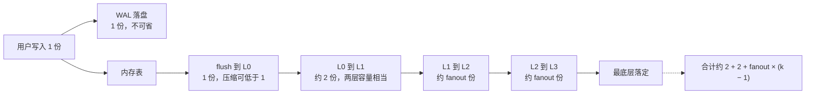
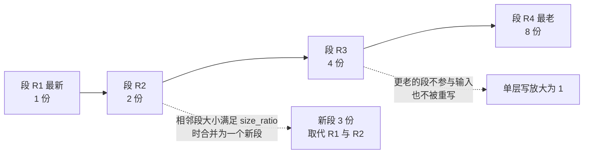
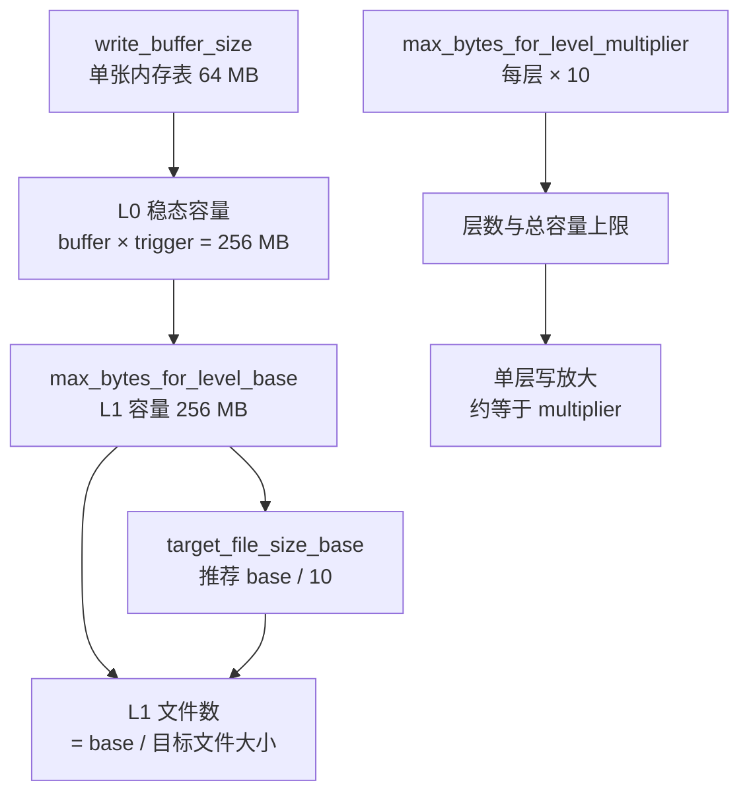
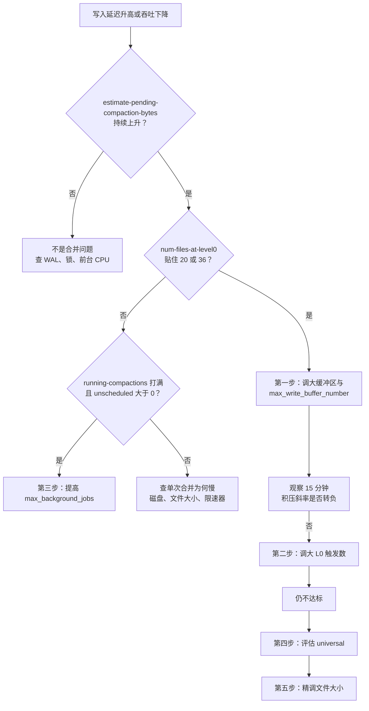

# Compaction——分层合并与版本管理

**摘要：**

Compaction 是 LSM 家族里唯一需要长期调、也最容易调坏的一段。调坏的原因通常不在参数本身，而在对写放大只有"一个数"的印象：写入量放大到三十倍，究竟哪一段该负责，往往说不清。本文把写放大拆成四笔账——预写日志（Write-Ahead Log，WAL）的一笔、刷盘（flush）的一笔、层间重写的一笔、以及由层容量等比递增带来的几何放大——给出各自的量级与推导，并把"每层容量乘 10"这件事如何把单层重写次数从 1 抬到 fanout 讲透。在此基础上给出 leveled、universal（tiered）、FIFO 三种策略的放大特征与选型判据表，说明 universal 专属旋钮（`max_size_amplification_percent`、`size_ratio`、合并宽度、`compression_size_percent`）各自的代价方向；再把 `write_buffer_size`、`target_file_size_base`、`max_bytes_for_level_base`、`max_bytes_for_level_multiplier`、`level0_file_num_compaction_trigger` 五个容量参数的自洽关系写成可验算的等式，指出破坏这些关系之后层间文件数会怎样失衡；最后给出一组"合并跟不上"的观测判据与五个调优下手顺序。三种策略、五个参数、五个顺序，要回答的是同一个问题：在给定的读写比与空间预算下，这笔写放大该记到哪一笔账上。全文的落点也在此：写放大只能在四笔账之间转移，调参的本质是把其中一笔换成读放大、空间放大或内存。

---

## 第 1 章 四种写放大

讨论 compaction 的调优，容易从一开始就滑向参数清单：缓冲区调到多少、触发数调到几、后台线程开几个。但这一串动作背后只有一个真正需要回答的问题：写放大这个比值，究竟由哪几段构成，哪一段值得动。答不上这个问题的调参，多半是在把预算花在不能省钱的地方。LSM 与 B+ 树之间那三笔放大账的对照，[[01 LevelDB 全局架构——LSM-Tree 的写优化设计]] 已经铺开过，本文接着往下算 compaction 这一段。

### 1.1 先把账本的口径统一

写放大（Write Amplification，WA）的定义只有一句：落盘字节数除以用户写入字节数。麻烦在于同一个比值有三个不同的分母，混着用就会得出互相矛盾的结论。用户视角看到的是 `Put` 的字节，引擎视角看到的是 SSTable 里写下的字节，设备视角看到的是闪存实际擦写的字节。后两者之间还隔着一层闪存转换层（Flash Translation Layer，FTL）的垃圾回收开销，那已经是设备自身的写放大，与 compaction 无关。

本文只算引擎视角的这一笔：从 WAL 到最底层 SSTable，一个逻辑字节被写了多少次。观测上有两条路，一条是读 `rocksdb.stats` 里每层的读写字节累计值，另一条更直接——用 `iostat` 看设备的写带宽，除以数据库自身的写入速率。后者把文件系统与设备层的损耗也带进来了，但正因如此，它是判断"磁盘是不是被写放大吃满"最快的办法：写放大为 50、盘能跑 500 MB/s，数据库在稳态下最多只能承受 10 MB/s 的用户写入。

在这个口径下，一个字节的旅程可以拆成四段。四段里只有一段是真正的主角，另外三段要么不可避免，要么量级小一个数量级。

| 来源 | 量级 | 是否可调 | 能动的旋钮 |
| :--- | :--- | :--- | :--- |
| WAL 落盘 | 约 1 倍 | 基本不可调 | 组提交只减 fsync 次数，不减字节 |
| flush 到 L0 | 1 倍 | 压缩后可低于 1 | 压缩算法、`min_write_buffer_number_to_merge` |
| 层间重写 | 约 fanout 倍，逐层累加 | 可调，主力项 | `compaction_style`、`max_bytes_for_level_multiplier` |
| 几何放大 | 由层容量比派生 | 可调，但代价确定 | 同上，外加层数 |

这四笔账的关系不是并列的。第三笔和第四笔其实是同一件事的两个侧面：层间重写是"动作"，几何放大是"为什么这个动作必须重复这么多次"。把两者拆开看，是理解后面所有参数的前提。按字节流量把四笔账串起来，总账的形状就出来了：前两段是固定入场费，后几段每换一层乘一次 fanout，最后全部累加。



四笔账之外还有一笔不计入字节、但确实占带宽的写：每次合并完成，文件集合的切换要先作为一条增量记录追加进清单文件并落盘，再切换内存里的版本指针；清单文件滚动时才重写那个指向它的单行文件。这套版本管理机制让前台读永远看到一致的文件集合，代价是每次合并在关键路径上多一次清单追加写。它的大小与合并次数成正比，与合并搬动的字节数无关——这正好解释了为什么"少做几次大合并"在调优里往往优于"多做几次小合并"，尽管两者搬动的总字节相同。

### 1.2 第一笔与第二笔：WAL 与 flush

第一笔写在 WAL 上。每次写入先顺序追加一条日志，落盘字节数与用户写入字节数基本相等，只多出记录头的开销，通常记为 1 倍。这笔账的调优空间极小：组提交（group commit）把并发的多个请求攒成一批，做一次 `write` 加一次 `fsync`，省下的是系统调用次数与每次 fsync 的等待，字节数一分不少。想真正省掉它，只有一条路——关掉 WAL，代价是崩溃后内存里的数据全丢，而这条路在绝大多数业务里不可接受。

第二笔写在 flush 上。只读内存表（immutable memtable）刷成 L0 文件，是一次纯顺序写，字节数与内存表里的数据量相等，也是 1 倍。`min_write_buffer_number_to_merge` 把多张只读表攒到一起刷，减少的是 L0 文件个数，不是字节数。这笔账同样刚性。

刚性之中还有一点缝隙：压缩。前面两笔写的都是未经压缩的用户字节，一旦启用 Snappy、LZ4 或 Zstd，落盘字节小于写入字节，这两笔账就能压到 1 以下。这也是为什么在写放大成为瓶颈的场景里，换压缩算法常常比调任何 compaction 参数都立竿见影——只是它换来的是 CPU 开销与更高的压缩比依赖。压缩比因数据而异，文本类数据显著优于已压缩的二进制，这一点只能实测，不能照抄别人的倍数。

### 1.3 第三笔：层间重写

一个 key 从 L0 落到最底层，中间每换一层就要被读出来、写回去一次。只算"自己搬自己"，穿越 k 层就是 k 次；但真实的重写量要高得多，因为一次 L(N) 到 L(N+1) 的合并，除了搬走 L(N) 的输入，还要把 L(N+1) 中与之 key 范围重叠的文件一并读出来重写。

RocksDB 的 wiki 把这一项讲得很直白：合并进 L(N) 的操作会重写此前已经合并进 L(N) 的数据，单层写放大在**最坏情况下等于 fanout**，也就是层与层的容量比。

```text
单层写出 ≈ 自身数据 1 份 + 下层重叠数据 (fanout − 1) 份
        ≈ fanout 份
```

这是全量重叠（all-to-all）的上界。LevelDB 与 RocksDB 都不是 all-to-all，而是只合并重叠的那一部分（some-to-some），所以实际值落在 1 与 fanout 之间。RocksDB 的 `compaction_pri` 默认取 `kMinOverlappingRatio`，含义就是优先挑"重叠比例最小"的文件参与合并，把这个区间往下界压。对 key 均匀分布、随机覆盖写的负载，重叠比例接近容量比的倒数关系；对 key 顺序写入（例如自增主键、时间戳前缀），重叠几乎为零，此时层间几乎不产生写放大，`allow_trivial_move` 甚至可以让文件只改元数据、不搬数据。

这就解释了一个常见的观测差异：同一套参数，有人测出写放大 35 倍，有人测出 8 倍。差异不在参数，在 key 的分布形态。

### 1.4 第四笔：multiplier 的几何放大

第四笔账最容易被忽略，也最容易算错。`max_bytes_for_level_multiplier` 默认是 10，意思是 L(N+1) 的容量是 L(N) 的 10 倍。层容量构成等比数列：

```text
S(L1) = max_bytes_for_level_base
S(L2) = S(L1) × multiplier
S(L3) = S(L2) × multiplier
...
S(Ln) = S(L1) × multiplier^(n-1)
```

这个数列带来三个推论，前两个是常识，第三个才是关键。

**推论一，容量求和**。把各层容量加起来，等比数列求和给出

```text
Σ S(i) = S(Ln) × (1 + 1/T + 1/T^2 + ...) = S(Ln) / (1 − 1/T)
```

其中 T 就是 multiplier。T = 10 时，这个系数是 10/9 ≈ 1.11：整棵树的容量只比最底层多出约 11%，也就是约 90% 的数据住在最底层。这个 `1/(1 − 1/T)` 正是 leveled 空间放大的下界，与官方 tuning guide 里那个"最底层 500 GB、总量约 568 GB、空间放大 1.14"的例子对得上。

**推论二，停留时间**。写入速率恒定记为 R，数据在第 i 层停留的时间约等于 S(i) / R。由于 S(i+1) 是 S(i) 的 T 倍，数据在第 i+1 层停留的时间就是第 i 层的 T 倍。这一条本身只是代数，但它和推论三扣在一起就决定了一切。

**推论三，重写次数**。一份数据在 L(i+1) 里停留的这段时间内，上一层（容量小 T 倍、周转快 T 倍）恰好会把整整一层的数据推下来 T 次。每推一次，都要与本层重叠的那部分数据合并重写。于是在它离开这一层之前，它被连带重写的次数约为 T 次，这就是 1.3 节里 `α ≈ fanout` 的动力学来源。层容量比不只是"能装多少"，它同时规定了"要被重写几次"。把这条因果链单独画出来，是因为后面所有涉及 multiplier 的判断都建立在它上面。


三个推论合起来，就是总账。以官方 tuning guide 的口径（不计 WAL）记账：

```text
WA ≈ 1 (flush 到 L0) + 2 (L0 到 L1) + T × (k − 1)
```

k 是数据实际穿过的非零层数。之所以 L0 到 L1 单独按 2 倍算，是因为 L1 的容量被推荐为与 L0 稳态大小相当，两者的重叠比例接近 100%，搬一份就要重写一份下级数据。把 WAL 补进账本（在设备写带宽里它确实存在），总量再加 1。

> [!warning] 三个常见的误算
> 其一，把 `1/(1 − 1/T)` 当成"每层被重写的次数"。这个系数是容量之比，无量纲，与次数无关。T = 10 时它给出 1.11，套到重写次数上会得出"写放大只有 1.1 倍"的荒谬结论，根因是漏掉了下层连带重写这一整项。
> 其二，把 `max_bytes_for_level_multiplier` 的调小直接当成降写放大。理论上单层放大确实随 T 下降，但层数按 log_T 增长，且 `num_levels` 默认只有 7，容量一旦不够用，数据溢出最底层，最后一层的合并重叠比例会远超 fanout，算式的假设当场失效。
> 其三，把 LevelDB 的 L0 阈值当 RocksDB 用。LevelDB 的减速与停写阈值是 8 与 12，RocksDB 默认是 20 与 36，照搬前者会让 RocksDB 在远未到极限时就开始抖动。

### 1.5 算例：同一份数据在三种 multiplier 下的账

把上面的公式代入具体数字，能看清 multiplier 的收益与失效边界。设数据库需承载 300 GB 用户数据、`max_bytes_for_level_base` 取默认 256 MB、`num_levels` 取默认 7，全部按示例推算，不构成基准数据。

| multiplier | 各层目标容量 | 实际可用层数 | 单层放大 | 写放大估算 | 空间放大下界 |
| :--- | :--- | :--- | :--- | :--- | :--- |
| 10 | 0.25 / 2.5 / 25 / 256 GB | 4 | 10 | 1 + 2 + 10×3 = 33 | 10/9 ≈ 1.11 |
| 4 | 0.25 / 1 / 4 / 16 / 64 / 256 GB | 6 | 4 | 1 + 2 + 4×5 = 23 | 4/3 ≈ 1.33 |
| 2 | 0.25 / 0.5 / 1 / 2 / 4 / 8 GB | 用尽 | 2 | 底层溢出，算式失效 | 2.0 |

读这张表要注意两件事。一是在容量够用时，把 multiplier 从 10 降到 4 确实能把写放大从 33 压到 23，代价是空间放大从 1.11 升到 1.33、读放大随层数增加，而且每次点查要多访问两层文件。二是降到 2 之后就完全不是"写放大更低"的故事了：7 层加起来只能装 16 GB 左右，300 GB 的数据会把最底层撑到目标容量的十几倍，此后每次向最底层合并都要重写远超 2 倍的重叠数据，同时空间放大翻倍。这也是官方明确"不建议改 multiplier 默认值"的实际原因——改它换来的写放大改善有限，而读放大、空间放大与容量上限的代价是确定的。真想降写放大，换 `compaction_style` 比改 multiplier 直接得多。

---

## 第 2 章 三种 compaction 策略与判据

RocksDB 的 wiki 把 compaction 算法分了五类：经典 leveled、tiered、tiered 与 leveled 混合、leveled-N、FIFO。社区版本里实现了三类——代码里叫 Level Compaction 的混合式、叫 Universal 的 tiered 式、以及不做合并的 FIFO。三者的差别不在实现细节，而在三笔放大各自的分配比例。合并的源码流程——触发链路、打分、挑选输入、丢弃规则——已经在 [[中间件/深入浅出存储引擎/09 LevelDB 源码剖析——MemTable、SSTable 与 Compaction|09 LevelDB 源码剖析]] 里逐函数走过，这里只谈策略之间的账。

### 2.1 leveled：默认之所以是默认

Leveled 的结构是分段的：L0 允许文件间 key 范围重叠，是 tiered 的形态；L1 及以下要求层内文件按 key 分区、互不重叠，是 leveled 的形态。合并时从 L(N) 挑一段，与 L(N+1) 中重叠的文件合并，输出写回 L(N+1)。

它的三个放大特征正好和另外两种相反：**读放大低**、**空间放大低**、**写放大高**。读放大只需扫完 L0 的文件，再在每一层至多定位一个文件；空间放大的下界就是前面算过的 T/(T−1)，因为重复版本会随合并被清掉；写放大高，则是因为每次合并都要连带重写下层。

读放大可以量化成一句话：`L0 文件数 + 非空层数`。布隆过滤器（Bloom Filter）能把这其中大部分"读块"操作挡掉，但挡不掉文件打开与索引查找，所以读放大的下界是文件数本身。

适合 leveled 的负载画像很清晰：读多写少、空间敏感、点查延迟要可预测、范围扫描频繁、更新在 key 空间上分散。反过来，纯追加写、几乎没有读的负载用 leveled，等于花钱买了一种自己用不上的低读放大。

### 2.2 universal：用读放大换写放大

Universal 是 tiered 式。所有 SSTable 被组织成若干"有序段"（sorted run），每一段覆盖完整 key 范围、对应一个时间窗口，段与段在时间上不重叠。合并只发生在相邻时间窗口的段之间，输出一个新段，**不去碰更老的段**。这一条直接决定了它的单层写放大是 1，而不是 fanout。



段的挑选有四个触发条件，按优先级依次判断：数据年龄超过 `periodic_compaction_seconds` 时按年龄合并；估算的空间放大比超过 `max_size_amplification_percent` 时做全量合并；段数达到 `level0_file_num_compaction_trigger` 且满足 `size_ratio` 时按大小相近的段合并；最后一条则放宽 `size_ratio` 限制，按段数合并。这套惰性调度的直接后果是合并流量更尖峰：长时间不合并，攒够了再一次性做大的，读延迟的长尾因此比 leveled 差。

写放大可以按官方给的估算式手算（官方自己标注为"not-so-good"的粗估，假定每次合并后段大小翻倍）：

```text
p  = log2(S / M)                     S 为总数据量，M 为单次 flush 的 SST 大小
WA1 = 100 / max_size_amplification_percent   （百分比 ≥ 100 时取 0）
WA2 = p − log2(level0_file_num_compaction_trigger − p)
WA  ≈ WA1 + WA2
```

代入 64 GB 数据、64 MB 的 flush 文件、触发数 12：p = 10，WA1 = 0.5，WA2 = 10 − log2(2) = 9，合计约 9.5 倍。同一个库换成 leveled，按 1.5 节的估算在 30 倍上下，这就是 universal 存在的理由。

代价同样明确：读放大高，因为有序段的数量上限就是触发数，每次点查要按新到旧把各段都碰一遍；空间放大高，因为重叠版本要等到段合并才会被清；还有一个硬限制——当 `num_levels` 取 1 时，整库最后可能被合并成单个 SST 文件，而单个 SST 的块大小受 32 位长度约束，官方明确提示库超过 100 GB 要谨慎。universal 适合写密集负载：日志落盘、时序数据、指标与计数器，以及"覆盖写远多于插入"的场景——空间放大比的估算式 `(各旧段之和) / 最新段` 正是为覆盖写设计的，纯插入负载会让它偏乐观。

### 2.3 FIFO：什么时候可以不做合并

FIFO 干脆不做合并：所有文件按写入顺序排开，总大小达到 `max_table_files_size`（默认 1 GB）就删掉最老的文件，`allow_compaction` 默认关闭，另有一个 `ttl` 参数可以按时间淘汰。它的写放大只有 2 倍（WAL 加 flush），是所有策略里最低的；空间放大被容量上限硬封顶，反而可控；读放大则等于文件个数，布隆过滤器在这里帮不上太多，因为文件间的 key 范围是重叠的。

能不能用 FIFO，取决于一个判断：数据的价值是否随时间单调衰减，丢弃能否**按文件粒度整块丢弃**。四条判据同时满足时才安全。

- 数据有明确的保留窗口，比如监控原始点只留 3 天、链路追踪的临时落盘只留 6 小时。
- 查询只落在最近一段数据上，不需要历史版本、不需要跨窗口的一致性视图。
- 丢弃粒度可以接受：删掉最老的文件意味着这个文件里的所有 key 一起消失，而不是按 key 精细淘汰。
- 数据写入后基本不再更新，或者更新只发生在最近窗口内。

三条反例则说明什么时候不能用：审计与事件溯源这类需要完整历史的场景；变更数据捕获（Change Data Capture，CDC）与二级索引这类依赖"某个 key 的最新值一定还在"的场景；以及任何需要按 key 空间做精确淘汰（只删某些客户、某些租户）的场景。FIFO 的删除是文件级的，一旦某个 key 的最新值落在被删的那个文件里，这个 key 就凭空消失了，读路径会把它当成不存在——这不是数据损坏，但对业务而言后果相同。

### 2.4 判据：读写比、空间敏感度、延迟要求

三种策略没有高下，只有适配。把选型压缩成一张表，判断顺序是先看读写比，再看空间是否紧张，最后看延迟要求。

| 读写比 | 空间敏感度 | 延迟要求 | 选型 | 主要代价 |
| :--- | :--- | :--- | :--- | :--- |
| 读多写少（读:写 > 10:1） | 高 | 点查延迟要稳 | leveled | 写放大高，写入带宽被吃掉 |
| 读写均衡（1:1 到 10:1） | 中 | 可容忍抖动 | leveled，必要时混合 | 无明显短板，靠参数微调 |
| 写密集（写:读 > 5:1） | 低 | 吞吐优先 | universal | 读放大与空间放大，长尾变差 |
| 写密集且容量大（> 100 GB） | 低 | 吞吐优先 | universal 配合多层与分区索引 | 单文件与索引膨胀，需谨慎验证 |
| 只查最近窗口 | 无所谓 | 无 | FIFO | 历史数据不可回溯，删除粒度粗 |
| 写后不再更新、有 TTL | 低 | 无 | FIFO 或 FIFO 加 `ttl` | 读放大随文件数增长 |

判据表里最容易被跳过的一行是**空间敏感度**。leveled 的空间放大下界是 1.11，universal 的上限是 3.0（`max_size_amplification_percent` 默认 200），两者之间差的是整个磁盘预算，而写放大省下来的那部分带宽，未必能抵上多买的磁盘。反过来，如果磁盘余量充足而写带宽是瓶颈，为省空间付写放大的账就不划算。

---

## 第 3 章 universal 的专属旋钮

选型定了之后，universal 还有一组 leveled 没有的旋钮。它们不改变结构，只改变"什么时候合并"和"合并多宽"，作用方向都是把写放大与空间放大做二次分配。

| 参数 | 默认值 | 作用 | 调大的代价 | 调小的代价 |
| :--- | :--- | :--- | :--- | :--- |
| `max_size_amplification_percent` | 200 | 空间放大超过此比例即触发全量合并 | 写放大降低，磁盘占用上升 | 空间收紧，全量合并变频繁，写放大上升 |
| `size_ratio` | 1 | 相邻段大小差在此百分比内才允许并入 | 一次合并的段更多，写放大略降，单次耗时变长 | 只合并大小相近的段，段数更多，读放大上升 |
| `min_merge_width` | 2 | 单次合并的最少段数 | 合并推迟，段数堆积，读放大上升 | 小段过早合并，写放大上升 |
| `max_merge_width` | 不设限 | 单次合并的最多段数 | 全量合并耗时与临时空间翻倍 | 大段迟迟合不掉，段数堆积 |
| `compression_size_percent` | -1（全压） | 只压缩"足够老"的段 | 压缩范围扩大，CPU 上升 | 压缩范围收窄，磁盘占用上升 |
| `stop_style` | 按总大小 | 合并宽度的停止条件 | 改为按相似大小，段数更容易堆积 | 反向调整同理 |
| `max_read_amp` | -1（沿用触发数） | 限制有序段数量的上限 | 读放大上升，写放大下降 | 读放大下降，写放大上升 |

几个需要额外说明的地方。`max_size_amplification_percent` 的估算口径是"除最新段之外所有段之和除以最新段"，因此 0 表示完美、100 表示库的物理占用是活跃数据的两倍、200 表示三倍。把它从 200 调到 100，等于把允许的磁盘占用从活跃数据的三倍压到两倍，代价是全量合并的频率显著上升——这个参数与写放大之间是直接的反比关系，不如说是"用磁盘换带宽"的汇率。

`size_ratio` 与合并宽度的组合效应，官方给过一个直观例子：设 `size_ratio = 0`、触发数为 5、每次 flush 都产生大小 1 的段，则五个段会被一次合并成一个大小 5 的段；此后新的段依序累积，直到"旧段总和"与"下一个段"的大小关系满足 `size_ratio` 条件时才再次合并，于是段的大小呈现出 1、2、3、4、5 这样的阶梯，最终一次合并成 16。这个阶梯形状说明 universal 的段大小不是均匀的，磁盘占用会随段数的积累周期性抬升，`max_size_amplification_percent` 就是给这个抬升设的天花板。

`compression_size_percent` 的判据是"待合并段之后的更老数据占总量的比例"：设待合并的是 B 组，更老的是 C 组，当 C 组大小占总大小的比例低于该百分比时，输出才压缩。取 -1 则全部压缩。它的用途是让最老、最不可能再被改写的段承担压缩成本，而新写入的段保持不压缩以省 CPU——这是一次用 CPU 换磁盘空间的交换。

验证这些旋钮的效果，需要一个可观测的量。用 `rocksdb.total-sst-files-size` 除以 `rocksdb.estimate-live-data-size`，得到的比值就是实际的空间放大，把它与 `max_size_amplification_percent` 的设定值对照，就能判断合并在不在位：比值长期贴着设定值上限，说明触发得太晚，重叠版本积压已经到了天花板。

还有一个容易被忽略的限制：`max_merge_width` 不设限时，universal 有可能做全量合并，而全量合并期间输入文件与输出文件同时存在，库的磁盘占用会临时翻倍。官方文档把这一点单列为"double size issue"，要求预留空间。磁盘用到 90% 以上的库，这一条会直接变成写入失败。

---

## 第 4 章 五个容量参数的自洽关系

如果把 compaction 的调参当成五个独立旋钮，几乎必然调出失衡的层结构。这五个参数其实被三条等式绑在一起，动一个而不同步其余，层间文件数就会失衡。

| 参数 | 默认值 | 直接管什么 | 调大的代价 | 调小的代价 |
| :--- | :--- | :--- | :--- | :--- |
| `write_buffer_size` | 64 MB | 单张内存表容量，决定 flush 粒度 | 内存占用与恢复时间上升，L0 文件变大 | flush 频繁，L0 文件变多，合并压力上升 |
| `level0_file_num_compaction_trigger` | 4 | L0 合并触发文件数 | 读放大与写停风险上升，恢复变慢 | 合并过频，L0 缓冲不足 |
| `target_file_size_base` | 64 MB | L1 及以下的目标文件大小 | 单次合并粒度变粗，峰值延迟变大 | 文件数膨胀，元数据与迭代器开销上升 |
| `max_bytes_for_level_base` | 256 MB | L1 的容量上限 | 单次合并搬动更多数据，写放大略升 | L1 装不下 L0 的输出，头两层变成漏斗 |
| `max_bytes_for_level_multiplier` | 10 | 相邻层容量比 | 空间与层数压力上升 | 层数暴增，读放大上升，容量上限下降 |

### 4.1 三条经验关系

官方 tuning guide 把这些关系写得相当直接，只是分散在不同段落里。

第一条：`target_file_size_base` 取 `write_buffer_size` 的量级。默认两者都是 64 MB，这不是巧合——flush 产出的文件本就是一个内存表的大小，目标文件大小与之同量级，L0 到 L1 的合并才不必对一个文件反复切分。

第二条：`target_file_size_base` 取 `max_bytes_for_level_base` 的十分之一，使 L1 大约容纳 10 个文件。这是官方推荐值，理由是文件数决定了单次合并的粒度：L1 只有 4 个文件时，一次合并就可能搬走 L1 的四分之一；有 10 个文件时，单次合并只搬十分之一，峰值延迟更平缓。RocksDB 当前默认的 64 MB 与 256 MB 对应 4 个文件，落在"文件偏大"的一侧，属于用粒度换元数据开销的取舍。

第三条，也是最容易被忽略的等式：L0 的稳态大小约等于

```text
write_buffer_size × min_write_buffer_number_to_merge × level0_file_num_compaction_trigger
```

而官方同时建议 `max_bytes_for_level_base` 取 L0 的大小量级。两条合起来，就得到必须自洽的等式：

```text
write_buffer_size × level0_file_num_compaction_trigger ≈ max_bytes_for_level_base
```

代入默认值验证：64 MB × 4 = 256 MB，正好等于 256 MB。这不是巧合，而是这一组默认值被设计成自洽的证据。



这张图的读法是"上游定量、下游失衡"。缓冲区与触发数决定 L0 的稳态体量，L1 容量必须能接住它；目标文件大小决定 L1 的切分粒度，而层容量比决定了整棵树能装多少、每层要重写几次。五个参数里任何一个被单独改动，失衡都会沿着箭头传下去。

### 4.2 破坏关系之后

假设一个常见的调整：为了让 flush 更少，把 `write_buffer_size` 从 64 MB 调到 128 MB，其余不动。此时 L0 稳态变成 128 MB × 4 = 512 MB，而 L1 的容量仍是 256 MB。L0 一触发合并，输出量就是 L1 容量的两倍，L1 来不及稳定就被推向 L2，于是每一份新数据都要多走一次 L1 到 L2 的合并；另一侧，L1 长期处在超限状态，compaction 分数一直大于 1，后台线程被头两层占满。修法有两条：把 `max_bytes_for_level_base` 同步抬到 512 MB 至 1 GB，或者把 `level0_file_num_compaction_trigger` 降到 2 至 3。

再假设另一个方向：为了减少文件数，把 `target_file_size_base` 从 64 MB 提到 512 MB。文件数确实降了，但 L1 的 256 MB 容量连一个目标文件都装不下，L1 会退化成一个文件甚至半层，此后每次 L0 到 L1 的合并都在一个大文件上做，粒度粗到无法与 L2 的 key 范围对齐，写放大与延迟抖动同时恶化。

这两个例子的共同点是：问题不在某个参数"太大"或"太小"，而在它与其他四个的比例关系被打破了。所以调容量参数时，值得先在心里过一遍 4.1 节的等式，再决定同步改哪几个。

### 4.3 动态层级改写了规则

上面所有推算都默认一件事：各层目标容量从 L1 的 `max_bytes_for_level_base` 起按比例往上乘。这个模式对应 `level_compaction_dynamic_level_bytes = false`。RocksDB 从 8.4 起把该选项的默认值改成了 true，规则随之反转：**目标容量从最底层反推**，`Target_Size(Ln-1) = Target_Size(Ln) / multiplier`，而 `max_bytes_for_level_base` 退化为一个下限——任何目标容量低于 `base / multiplier` 的层都不会被填充，L0 的合并会跳过这些层，直接落到第一个有有效目标容量的层。

官方给过一个例子：`max_bytes_for_level_base` 为 1 GB、`num_levels = 6`、最底层实际 276 GB 时，L1 到 L6 的目标容量分别是 0、0、0.276 GB、2.76 GB、27.6 GB、276 GB。也就是说 L1 与 L2 被空置，数据从 L0 直接落到 L3。这种形态保证"90% 数据在最底层"这件事稳定成立，而固定比例模式下并不保证。

对调参的影响有两处。其一，`max_bytes_for_level_base` 不再是"每层容量的起点"，而是"哪些层可以留空"的门槛，调它的效果与旧模式不同。其二，动态层级模式下 compaction 的分数会把待下沉字节计入分母，写压力大时低层会被优先调度，`estimate-pending-compaction-bytes` 因此从"观测指标"变成"参与调度决策的输入"，积压会自我加速。遇到老资料里的容量推算，先确认它对的是哪个模式，否则数字对不上。

---

## 第 5 章 合并跟不上：三个判据与五个下手顺序

调参的时机比调参的幅度更重要。多数线上事故不是参数选错，而是在合并已经跟不上之后才动手，此时任何单点调整都要几十秒到几分钟才生效。判断"跟不上"需要三个独立信号，缺一个都可能误判。

### 5.1 三个判据

第一个信号是待合并字节的走势。`rocksdb.estimate-pending-compaction-bytes` 给出的是"要让所有层降到目标容量以下、还需要重写多少字节"的估计值，只对 leveled 有效。看绝对值意义不大，看斜率才有意义：持续单调上升说明写入速率已经超过合并吞吐。它有两个硬阈值——`soft_pending_compaction_bytes_limit`（默认 64 GB）以上开始限速，`hard_pending_compaction_bytes_limit`（默认 256 GB）以上直接停写。

第二个信号是 L0 的文件数。`rocksdb.num-files-at-level0` 贴近 `level0_slowdown_writes_trigger`（默认 20）说明已经在限速，贴近 `level0_stop_writes_trigger`（默认 36）说明已经停写。这里要注意版本口径：LevelDB 的这一对默认值是 8 与 12，RocksDB 是 20 与 36，直接把 LevelDB 的经验搬过来会让 RocksDB 在还有余量时就开始抖动。

第三个信号是停顿本身。`rocksdb.stats` 的每层合并统计能看出读写字节的比例，`rocksdb.cf-write-stall-stats` 与 `rocksdb.is-write-stopped` 能看出停顿的原因归属，`rocksdb.actual-delayed-write-rate` 能看出写入被限到了什么速率。这些属性的完整读法与停顿归因路径见 [[05 从 LevelDB 到 RocksDB——优化与演进]]，这里只取判据用得上的三项。还有一个组合判据很有用：`rocksdb.num-running-compactions` 长期打满而 `rocksdb.num-unscheduled-compactions` 大于零，说明有任务排队但没有线程可用，这是线程数不足；反之运行数不满而 L0 仍在涨，说明单次合并太慢，瓶颈在磁盘、在单文件过大、或者被限速器压住了。

| 判据 | 观测属性 | 阈值参考 | 含义 | 对应动作 |
| :--- | :--- | :--- | :--- | :--- |
| 待合并字节持续上升 | `estimate-pending-compaction-bytes` | 64 GB 限速、256 GB 停写 | 写入速率超过合并吞吐 | 先调缓冲区，再调后台线程 |
| L0 文件数贴住阈值 | `num-files-at-level0` | 20 减速、36 停写 | 合并调度跟不上 flush | 调触发数与缓冲区 |
| 停顿占比升高 | `rocksdb.stats`、write-stall 统计 | 视业务 SLA | 前台被后台拖住 | 归因后再定方向 |
| 任务排队但无线程 | `num-running-compactions` / `num-unscheduled-compactions` | 前者打满、后者大于 0 | 后台并发不足 | 提高 `max_background_jobs` |
| 运行数不满仍积压 | 同上 | 前者未打满 | 单次合并太慢 | 查盘、查文件大小、查限速 |

### 5.2 五个下手顺序

参数之间的耦合决定了调整有先后。顺序的原则是**先动内存与并发，后动结构**，从最便宜、收益最大的一项往最贵、收益最不确定的一项走，每一步都能独立验证效果，再决定是否进入下一步。

| 顺序 | 动作 | 收益 | 代价 | 生效速度 |
| :--- | :--- | :--- | :--- | :--- |
| 第一步 | 调大 `write_buffer_size` 与 `max_write_buffer_number` | 降低 flush 频率，给合并留出缓冲，消掉大部分内存表写停 | 内存占用、崩溃恢复时间 | 重启或动态改 |
| 第二步 | 调大 `level0_file_num_compaction_trigger` | L0 缓冲加深，减速与停写触发变少 | 读放大上升，恢复变慢 | 动态可改 |
| 第三步 | 提高 `max_background_jobs` 与 `max_subcompactions` | 合并吞吐直接提升 | CPU 与 IO 与前台争抢 | 需重启线程池配置 |
| 第四步 | 切换 `compaction_style` 到 universal | 写放大数量级下降 | 读放大、空间放大、长尾变差 | 需离线或谨慎在线切换 |
| 第五步 | 精调 `target_file_size_base` 等 | 合并粒度更平滑 | 需要与其余四个参数同步 | 分批生效 |

第一步之所以排在最前，是因为它同时改善两件事。缓冲区翻倍，flush 次数减半，L0 的文件增长速率随之减半；`max_write_buffer_number` 从默认的 2 提到 4 至 6，等于给写入留出排队空间，内存表写停（memtable stall）这类最刺眼的停顿会先消失。这一步的代价是内存与恢复时间，都是可预估的。内存表那一侧的机制——缓冲区如何触发 flush、`max_write_buffer_number` 如何触到写停——见 [[02 MemTable 与 SkipList]]，这里看的是它的另一面：缓冲区越大，合并侧一次接到的数据也越大。第二步是把 L0 的缓冲深度换大，本质是允许更多文件在 L0 里堆着，用读放大换写稳定性，代价是点查要多扫几个文件。

第三步才开始动资源。`max_background_jobs` 默认只有 2，意味着后台同时只有约一个 flush 与一个 compaction 在跑，这在写密集场景里几乎必然不够。提到 CPU 核数的一半左右是常见起点，但要注意它抢的是前台也要用的磁盘带宽。

第四步是改结构。切到 universal 之前必须验证两件事：库是否超过 100 GB，以及读延迟能否接受有序段数量带来的放大。这一步的风险不在参数，在切换期间的全量合并与临时翻倍的磁盘占用。

第五步才是精细参数。`target_file_size_base` 这类参数对写放大的影响在 10% 量级，只有在前面四步都做完、并且确认瓶颈仍在合并粒度时才值得动，且必须与 `max_bytes_for_level_base`、`level0_file_num_compaction_trigger` 同步核算。



### 5.3 反例

反例比正例更能说明边界。

其一，把 `max_bytes_for_level_multiplier` 调到 2 求省写放大。如 1.5 节所算，容量上限会从 28 TB 级掉到 16 GB 级，大库会直接把底层撑爆，合并的重叠比例反而失控，同时空间放大翻倍。官方的态度是不建议改这个默认值，理由就在这里。

其二，写密集场景用 leveled。日志、时序、计数器这类负载的写读比常在 10:1 以上，leveled 的 30 倍上下的写放大意味着磁盘写带宽有九成以上被合并吃掉，扩容磁盘也追不上，因为扩容同时提高了合并吞吐与前台写入量，比值不变。这类负载从一开始就该用 universal。

其三，把 FIFO 用在需要历史的地方。审计日志、事件溯源、CDC 下游索引都属于此类。FIFO 删除是文件粒度的，一旦最老文件被删，其中的 key 连同最新值一起消失，读路径把它当"不存在"返回，业务侧看到的不是报错而是数据缺失，排查成本极高。

其四，只调 `write_buffer_size` 而不同步 `max_bytes_for_level_base`。这是 4.2 节的漏斗效应，L0 的输出量超过 L1 容量，头两层的合并频率与写放大同时恶化，表面看是"缓冲区调大了反而更慢"。

其五，把 `level0_file_num_compaction_trigger` 调到很大以求稳定。触发数同时是 L0 的稳态容量，调到 20 意味着 L0 常驻 1 GB 以上的未合并数据，点查要在这二十个文件里逐个检查，读延迟随之劣化；而且崩溃恢复时要重放更多 WAL，恢复时间以分钟计。

---

## 第 6 章 落点：把写放大预算花在正确的地方

四笔账算下来，能动的其实只有两处：层间重写的次数，以及它在三种策略间的分配。WAL 与 flush 是入场费，组提交只改 fsync 次数，压缩只能把 1 压到 1 以下一点；层间重写是主犯，而它的次数由 `max_bytes_for_level_multiplier` 这个几何关系规定，改它换来的写放大改善有限，代价却落在读放大、空间放大与容量上限上；`compaction_style` 才是把写放大与读放大、空间放大做整体交换的那个开关。

这也解释了为什么调参有顺序：缓冲区与后台线程属于"用内存与 CPU 买时间"，收益确定、代价可预估，所以排在最前；触发数属于"用读放大换写稳定性"，收益确定但会伤及延迟；切换策略属于"用读放大与空间换写带宽"，收益最大、风险也最大，必须最后做。每一步都在移动同一份预算，没有一步能让三笔放大同时下降——这是 LSM 结构本身的约束，不是实现缺陷。

于是判断一个库该不该继续调，问题不该是"写放大还能不能降"，而是"这份预算该记在谁头上"：磁盘带宽贵，就把预算记到空间上；点查延迟贵，就把预算记到写放大上；写入吞吐贵，就把预算记到读放大上。三种记法都成立，前提是知道自己付的是哪一笔。

---

## 参考资料

1. RocksDB Wiki. *Compaction*. https://github.com/facebook/rocksdb/wiki/Compaction
2. RocksDB Wiki. *RocksDB Tuning Guide*. https://github.com/facebook/rocksdb/wiki/RocksDB-Tuning-Guide
3. RocksDB Wiki. *Universal Compaction*. https://github.com/facebook/rocksdb/wiki/Universal-Compaction
4. RocksDB Wiki. *Leveled Compaction*. https://github.com/facebook/rocksdb/wiki/Leveled-Compaction
5. RocksDB 源码：`include/rocksdb/options.h`、`include/rocksdb/advanced_options.h`、`include/rocksdb/universal_compaction.h`、`include/rocksdb/db.h`（属性与默认值）. https://github.com/facebook/rocksdb
6. P. O'Neil, E. Cheng, D. Gawlick, E. O'Neil. *The Log-Structured Merge-Tree (LSM-Tree)*. Acta Informatica, 1996.
7. H. Lim, D. G. Andersen, M. Kaminsky. *Towards Accurate and Fast Evaluation of Multi-Stage Log-Structured Designs*. FAST 2016. https://hyeontaek.com/papers/msls-fast2016.pdf
8. N. Dayan, M. Athanassoulis, S. Idreos. *Monkey: Optimal Navigable Key-Value Store*. SIGMOD 2017.
9. Google. *LevelDB 源码*：`db/dbformat.h` 中的 `kL0_*` 触发阈值. https://github.com/google/leveldb

---

> [!note] 思考题
> 1. 若一个库的 `write_buffer_size` 是 128 MB、`level0_file_num_compaction_trigger` 是 4、`max_bytes_for_level_base` 仍是 256 MB，按 4.1 节的等式推算，L0 稳态容量与 L1 容量差了几倍？此时单次 L0 到 L1 合并的写出量至少是输入量的几倍？
> 2. 官方给出的 universal 写放大估算式里，`level0_file_num_compaction_trigger` 必须大于 `p = log2(S/M)`，这个约束的物理解释是什么？如果把触发数设得比 p 小，会发生什么？
> 3. 为什么 `max_bytes_for_level_multiplier` 调小在容量足够时确实能降低写放大，而超过 7 层容量上限之后反而让写放大恶化？这里的临界点由哪几个参数共同决定？
> 4. 一个只有点查、没有范围扫描的业务，把 FIFO 的 `allow_compaction` 打开会改变哪几笔放大？它换来的是文件数下降，代价落在哪一侧？
> 5. 在 `level_compaction_dynamic_level_bytes = true` 的模式下，`max_bytes_for_level_base` 不再决定 L1 的容量，那么它还能用来调节什么？如果希望"数据从 L0 直接落到 L3"，该怎样设置它？
> 6. 用 `iostat` 的写带宽除以数据库写入速率得到的写放大，与按文中的四笔账公式算出的写放大，通常在哪个方向上不一致？差额由什么构成？