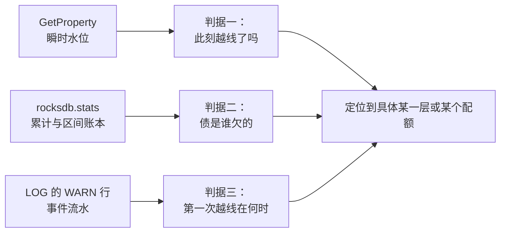
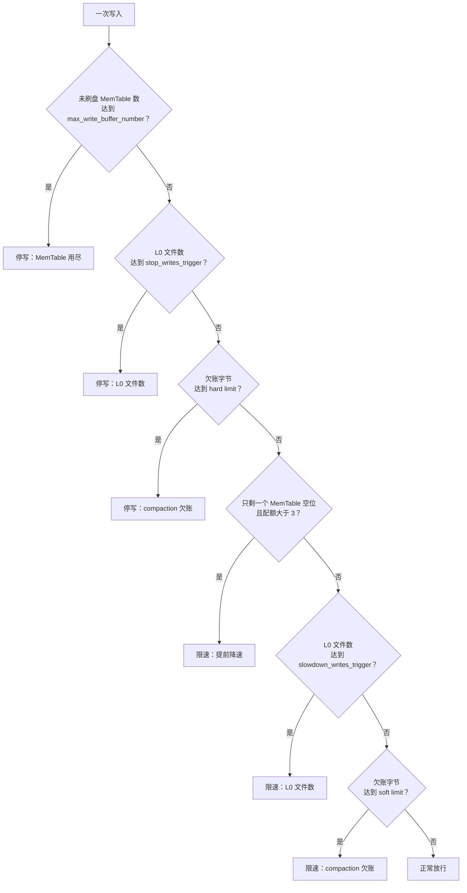
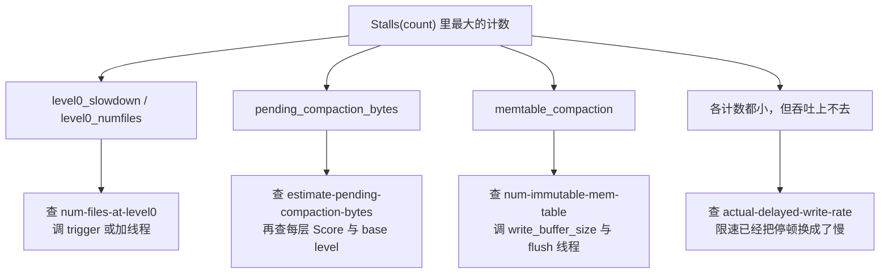
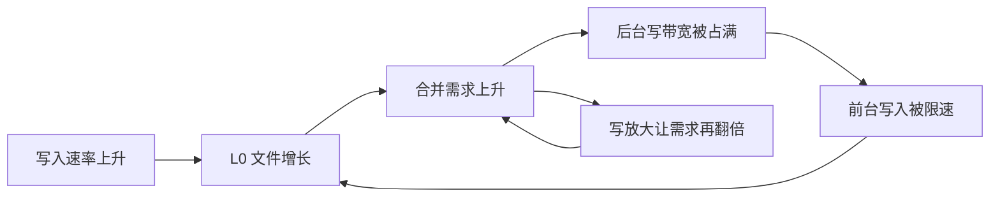

# 从 LevelDB 到 RocksDB——优化与演进

**摘要：**

从 LevelDB 到 RocksDB 的演进，一半发生在引擎里（多线程 compaction、列族、限速器），另一半发生在引擎外：把内部状态整理成可以读的账本。本篇只谈后半部分。先把 `rocksdb.stats` 拆成四段逐行读：分层表里 `Files` 的 `a/b` 是"文件数/正在被 compaction 的文件数"、`Score` 是"该层容量除该层上限"（L0 换算成文件数除触发点）、`W-Amp` 有两个口径（L1 以上是层间放大，L0 与 `Sum`、`Int` 行拿"进入 L0 的用户数据量"作分母，是端到端放大），`Stalls(count)` 一行里每个计数对应一道具体的闸，8.1 之后换成了 `cause-condition` 命名的 `Write Stall (count)`；再补一张"从 stats 判断瓶颈在哪"的对照表。然后补齐七个最常用的 `GetProperty`，把瞬时水位与累计账本配成最小观测面。中段是重心：按 `GetWriteStallConditionAndCause` 的真实判定顺序，把停顿拆成 L0 文件数、pending compaction bytes、memtable 配额、后台线程不足四种成因，逐一给出判据、旋钮与代价，并给出一条"标签 → property → 资源"的归因路径。末段回答"能不能不 stall"——不能，只能把停顿从长而频繁换成短而稀疏，据此给出三档取舍、八项监控阈值，以及从 LevelDB 迁移的判据与四个坑。

---

## 第 1 章 演进的下半场是观测

### 1.1 一次归因错的停顿

那次排查的起点很朴素：写入 P99 从 3 ms 涨到 40 ms，尖刺每天出现两次，正好压在批量对账的窗口上。值班的同学先看 iostat，`%util` 四成，`await` 不高，队列深度也不深，于是把结论写成"磁盘慢、IOPS 不够"，扩容单递了上去。三天后同样的负载换到 NVMe 的测试环境，尖刺照旧出现，这才回头翻引擎日志——`LOG` 里躺着几十行同样的 WARN：`Stopping writes because we have 39 level-0 files`。

39 这个数字不是随机的。RocksDB 的默认 `level0_stop_writes_trigger` 是 36，越过这条线之后，写路径不再往 MemTable 里写，而是阻塞在后台条件变量上，等 compaction 把 L0 的文件数压回触发点以下。iostat 好看，是因为那段时间根本没有新的写 IO 发出去——写的人在等，而 compaction 的带宽也就那么多。磁盘不慢，是 compaction 排不进队。

这个案例里有两层教训。表层是"看错了指标"，深层是**只看了操作系统，没看引擎**。LSM 引擎的延迟由它自己的内部水位决定，磁盘利用率只是这个水位的一个下游结果；反过来，用磁盘指标去解释延迟，等于用排水量去解释水坝为什么开闸。

### 1.2 三样东西，三种时间尺度

RocksDB 暴露出来的观测面其实不多，就三样，差别在于时间尺度。

`GetProperty` 取的是瞬时水位：此刻 L0 有几个文件、还欠多少 compaction 字节、写是不是已经被停掉。它回答"现在越线了吗"。

`rocksdb.stats` 取的是累计账本：这个实例从启动到现在，每一层被 compaction 搬了多少字节、花了多少 CPU 秒、哪个闸被撞了多少次，以及一个 `Int` 行给出上一个区间的账。它回答"这些债是谁欠的、欠了多少"，代价是默认每 600 秒（`stats_dump_period_sec`）才写一次 LOG，实时性靠应用侧主动去取。

`LOG` 里的事件流水最细，每一次 slowdown 和 stop 都有一行 WARN，带时间戳和当时的数字。它回答"第几秒、因为什么停下"。

三样东西对同一个问题给出三种粒度的答案，把它们串起来的顺序是固定的：**先用 stats 判断是哪道闸**，再用 property 确认此刻的水位，最后用 LOG 找到第一次越线的时刻。反过来用会很费劲——拿 property 当趋势看，等于反复拍快照去猜斜率。

下图是这三样东西与三类判据的对应关系：



---

## 第 2 章 `rocksdb.stats` 的逐行读法

### 2.1 三条取数路径

第一是应用内直接取：`db->GetProperty("rocksdb.stats", &value)`，得到的字符串是 `rocksdb.cfstats` 与 `rocksdb.dbstats` 两段拼接。列族多的时候，每个列族各有一段 cfstats，而 dbstats 只有默认列族那一段，因为写入计数、WAL、停顿微秒这些是数据库级的。

第二是让它自己写进日志：`stats_dump_period_sec` 默认 600 秒，周期性把同一份文本 dump 到 `LOG`，另有 `stats_persist_period_sec` 把每份 dump 存进 stats 历史，可用 `GetStatsHistory` 取回。多数线上问题用日志就够定位了，因为日志里前后几份 dump 天然构成趋势。

第三是拆开取：`rocksdb.cfstats`、`rocksdb.dbstats`、`rocksdb.levelstats`（只给每层文件数与总大小）、`rocksdb.cf-write-stall-stats`。做监控时拆开取更省。

### 2.2 一份可以对着读的样例

下面这份输出按 RocksDB 8.0 的 `rocksdb.stats` 格式构造，列的宽度与真实输出一致，数值是构造出来的，不对应任何真实集群：

```text
** Compaction Stats [default] **
Level    Files   Size     Score Read(GB)  Rn(GB) Rnp1(GB) Write(GB) Wnew(GB) Moved(GB) W-Amp Rd(MB/s) Wr(MB/s) Comp(sec) CompMergeCPU(sec) Comp(cnt) Avg(sec) KeyIn KeyDrop Rblob(GB) Wblob(GB)
-----------------------------------------------------------------------------------------------------------------------------------------------------------------------------------------------
  L0      9/2   0.56 GB  2.3      0.0    0.0      0.0   2684.3  2684.3       0.0  1.0      0.0   614.8  4471.20          4260.15    42949   0.104   4123M      0      0.0      0.0
  L1     14/0   1.02 GB  1.0   7985.5 2684.3   5301.2   5301.2     0.0       0.0  2.0    304.9   202.4 26814.41         25910.62      860  31.180    812M     6M      0.0      0.0
  L2    138/0  10.90 GB  1.0  16221.2 5301.2  10920.0  15367.0  4447.0       1.2  2.9    673.8   638.3 24653.02         22110.33      520  47.410    905M    11M      0.0      0.0
  L3   1092/0  96.40 GB  0.9      0.0    0.0      0.0      0.0     0.0      14.8  0.0      0.0     0.0     0.00             0.00        0   0.000       0      0      0.0      0.0
 Sum   1253/2  108.88 GB  0.0  24206.7 7985.5  16221.2  23352.5  7131.3      16.0  8.7    443.1   427.4 55938.63         52281.10    44329   1.262   5840M    17M      0.0      0.0
 Int      0/0   0.00 KB  0.0     78.5    9.6     68.9     82.4    13.5       0.5  8.6    626.1   657.2   128.40           121.01      162   0.793     61M   812K      0.0      0.0

Cumulative compaction: 23352.5 GB write, 276.7 MB/s write, 24206.7 GB read, 286.8 MB/s read, 55938.6 seconds
Interval compaction: 82.40 GB write, 281.2 MB/s write, 78.50 GB read, 267.9 MB/s read, 128.4 seconds
Stalls(count): 0 level0_slowdown, 0 level0_slowdown_with_compaction, 41 level0_numfiles, 12 level0_numfiles_with_compaction, 0 stop for pending_compaction_bytes, 0 slowdown for pending_compaction_bytes, 0 memtable_compaction, 0 memtable_slowdown, interval 3 total count
Block cache LRUCache@0x7f9c1a0b2c00#18734 capacity: 8.00 GB seed: 0x9e3779b9 usage: 7.62 GB table_size: 65536 occupancy: 51204 collections: 96 last_copies: 0 last_secs: 0.0213 secs_since: 12
Block cache entry stats(count,size,portion): Data(4831200,6.30 GB,78.75%) Filter(102400,684.0 MB,8.35%) Index(61200,412.1 MB,5.03%)

** DB Stats **
Uptime(secs): 86412.5 total, 300.1 interval
Cumulative writes: 3891720411 writes, 4123377115 keys, 902113004 commit groups, 4.3 writes per commit group, ingest: 2684.32 GB, 31.07 MB/s
Cumulative WAL: 3891720411 writes, 2661189944 syncs, 1.46 writes per sync, written: 2701.15 GB, 31.27 MB/s
Cumulative stall: 00:03:41.602 H:M:S, 0.3 percent
Interval writes: 13911204 writes, 14706332 keys, 3223110 commit groups, 4.3 writes per commit group, ingest: 9.58 GB, 31.94 MB/s
Interval WAL: 13911204 writes, 9502214 syncs, 1.46 writes per sync, written: 9.66 GB, 32.98 MB/s
Interval stall: 00:00:00.412 H:M:S, 0.1 percent
```

先说版本差异：`Estimated pending compaction bytes: <N>` 这一行在 8.0 的输出版本里没有，9.x 才看得到；`Stalls(count)` 这一行在 8.1 之后被改写成 `Write Stall (count): l0-file-count-limit-stops: N, ...` 这样的键名。行数一样，语义可一对一映射，后文给出对照。

### 2.3 分层表：每一列在回答什么问题

分层合并的机制本身在[[09 LevelDB 源码剖析——MemTable、SSTable 与 Compaction]]里逐行拆过，这里只读它留下的账。这张表的记法有一条最容易读错的规则：一段发生在 N 层与 N+1 层之间的 compaction，它的账**记在输出层 N+1 上**。所以 L1 那一行讲的是 L0→L1 的合并，L2 那一行讲的是 L1→L2 的合并，L0 那一行则专门记账 flush（MemTable→L0）以及直接 ingest 进来的文件。

| 列 | 读法 | 拿它判断什么 |
| :--- | :--- | :--- |
| Level | L0..Ln 是层，`Sum` 是各层累加，`Int` 是上一区间增量 | 先看哪一层有数，没有数的那层不参与判断 |
| Files | `a/b`，`a` 是该层文件数，`b` 是此刻正在被 compaction 的文件数 | `b` 长期等于 `a` 说明该层的文件几乎都在参与合并，并发已经到顶 |
| Size | 该层现有数据总量，走 `BytesToHumanString`，可能是 MB 也可能是 GB | 配合 Score 判断层容量是否卡在边界上 |
| Score | 非 L0 是"该层大小 ÷ 该层容量上限"，L0 是"L0 文件数 ÷ `level0_file_num_compaction_trigger`" | 大于 1 表示这一层需要 compaction；长期贴着 1 说明它一直是瓶颈层 |
| Read / Rn / Rnp1 | `Read` 是这段 compaction 读的总字节，`Rn` 读自 N 层，`Rnp1` 读自 N+1 层 | `Rnp1` 远大于 `Rn` 说明合并的代价主要花在重写下游已有数据上 |
| Write | 这段 compaction 写出到 N+1 的字节 | 与盘的顺序写带宽相除，得到 compaction 占用的写带宽 |
| Wnew | `Write − Rnp1`，即净新增而不是重写的字节 | 接近 0 说明该层在做全量重写，空间不会因为这次合并而膨胀 |
| Moved | 只更新 manifest、没有真实 IO 的搬迁字节 | 出现大额 `Moved` 说明分层在漂移（如 base level 变化） |
| W-Amp | 见 2.4，两种口径混在同一列里 | 找"哪一层在放大写入"用它，判断整体放大率要看 `Sum` 或 `Int` |
| Rd / Wr (MB/s) | 这段 compaction 的读写速率，等于字节数除以累计墙钟时间 | `Wr` 远低于盘能力，说明 compaction 受限在 CPU 或线程数，不在磁盘 |
| Comp(sec) / CompMergeCPU(sec) | 累计墙钟时间与累计 CPU 时间 | 两者相除得到实际并行度，比值远超线程数说明 CPU 打满 |
| Comp(cnt) / Avg(sec) | 合并次数与单次平均耗时 | 单次耗时陡增往往意味着某一层的数据块变大了 |
| KeyIn / KeyDrop | 参与比较的记录数与被丢弃（墓碑与旧版本）的记录数 | `KeyDrop` 占比高说明写多读少的负载特征明显 |
| Rblob / Wblob | BlobDB 的读写字节，未启用时为 0 | 用了 KV 分离时要把它加进写放大的分子 |

### 2.4 `W-Amp` 有两个口径

多数资料把 `W-Amp` 解释成"写入 N+1 的字节 ÷ 从 N 读入的字节"，这只对 L1 及更深的行成立。翻 `DumpCFMapStats` 的实现可以看到分母是分段取的：`level == 0` 时 `input_bytes` 取的是"累计 ingest 字节"（flush 写入 + ingest 进来的文件），`level >= 1` 时才取"从非输出层读入的字节"；而 `Sum` 与 `Int` 两行的 `W-Amp` 又是拿"compaction 写出字节 ÷ 累计 ingest 字节"算出来的。

| 行 | 分子的含义 | 分母的含义 | 口径 |
| :--- | :--- | :--- | :--- |
| L0 | flush 与 ingest 写出的字节 | 同一份 ingest 字节 | 端到端，正常应接近 1.0 |
| L1..Ln | 写到 N+1 层的字节 | 从 N 层读入的字节 | 层间放大，能看出哪一层贵 |
| Sum | 全生命周期 compaction 写出字节 | 全生命周期 ingest 字节 | 端到端，判整体放大率 |
| Int | 上一区间 compaction 写出字节 | 上一区间 ingest 字节 | 端到端，判趋势 |

样例里 `Sum` 行的 8.7 就是"用户每写 1 GB，盘上被 compaction 搬了 8.7 GB"，而 L2 行的 2.9 只说明"L1→L2 这一跳把数据放大了 2.9 倍"。前者拿去和磁盘寿命、写带宽做预算，后者拿去定位是哪一跳贵。把两者混用，会得出"写放大 2.9 倍所以问题不大"的结论，而实际端到端是 8.7 倍。

### 2.5 `Score` 是容量除上限

非 L0 层的 `Score` 就是该层当前数据量除以该层容量上限，超过 1 表示这一层已经该合并了。L0 的算法不一样，`CompactionScore` 取的是 L0 文件数与 `level0_file_num_compaction_trigger` 的比值，所以样例里 9 个文件、触发点 4，`Score` 是 2.3。

读 `Score` 的正确姿势是看"**哪一层的分数长期贴着 1**"。如果 L1 一直是 1.0 而 L2 只有 0.3，说明数据在 L1 就堆满了、每次 L0→L1 都在挤 L1→L2 的合并预算，此时把 `max_bytes_for_level_base` 调大比加线程更有效；如果所有层的分数都在 0.3 以下而 L0 分数居高不下，问题就在 L0→L1 这一跳的重写量上，得回头看[[04 Compaction——分层合并与版本管理|04 篇]]里的层容量与文件大小配比。

### 2.6 三行汇总：compaction 的吞吐、欠账与负载

`Cumulative compaction` 与 `Interval compaction` 两行是同一种账的两种时间窗：写出多少 GB、写速率、读了多少 GB、读速率、累计墙钟秒数。它的价值在于和盘的能力对齐——请注意这里的 MB/s 是拿字节数除以实例运行时长（`Interval` 行除以区间长度），而分层表里的 `Wr(MB/s)` 除以的是合并线程真正干活的时间，所以 `Sum` 行既有 427 MB/s（干活时），汇总行又有 277 MB/s（按运行时长摊平）。两者之间的差，就是 compaction 忙的时间占比。

这个区分直接决定归因方向。样例里按运行时长摊平的写速率是 277 MB/s，而累计 ingest 速率只有 31 MB/s，比值为 8.9，与 `Sum` 行的 `W-Amp` 8.7 对得上——换句话说，这台实例的静息写带宽里有近九成是 compaction 自己搬来搬去的字节。一块企业级 SSD 的顺序写通常在数百 MB/s 量级，此时盘既没有闲，也没有被打满，真正的余量取决于盘比这 277 MB/s 高出多少；余量越薄，对账窗口的写入脉冲越容易把欠账推到阈值以上。

顺带解释 1.1 里那个"iostat 只有四成"的疑点：`%util` 度量的是设备处于忙状态的时间比例，不度量带宽饱和程度，一个 277 MB/s 的稳定写流完全可以让设备只忙四成时间。时间维度与字节维度不能互替，判断盘是否瓶颈要看字节速率与实测带宽之比。

9.x 新增的 `Estimated pending compaction bytes` 一行是把欠账显式化：它和 `GetProperty("rocksdb.estimate-pending-compaction-bytes")` 取的是同一个量，语义是"把各层都压回容量上限以内，还需要重写多少字节"。这一行比任何比例都直观，因为它和两个阈值直接可比——软限 `soft_pending_compaction_bytes_limit` 默认 64 GB，硬限 `hard_pending_compaction_bytes_limit` 默认 256 GB。

`CompMergeCPU(sec) / Comp(sec)` 是一个容易被忽略的比值。样例中 `Sum` 行是 52281 / 55938 ≈ 0.93，说明平均只有一个线程在干活，`max_background_jobs` 很可能还是默认的 2；若这个比值远大于配置的 compaction 线程数，说明 CPU 已经打满，此时再加线程只会让每个线程都变慢。

### 2.7 `Stalls(count)` 一行：每个计数对应一道闸

这一行是整份 stats 里信息密度最高的地方，因为它把"停顿"这个笼统的词拆成了八个可归因的计数。样例里 `level0_numfiles` 41 次、`level0_numfiles_with_compaction` 12 次，其余为零，一眼就知道堵在 L0。

| 计数（≤8.0） | 含义 | 8.1 之后的键名 |
| :--- | :--- | :--- |
| `level0_slowdown` | L0 文件数过 `level0_slowdown_writes_trigger`（默认 20），写入被限速 | `l0-file-count-limit-delays` |
| `level0_slowdown_with_compaction` | 同上，但记录时 L0 的 compaction 已经在跑 | `l0-file-count-limit-delays-with-ongoing-compaction` |
| `level0_numfiles` | L0 文件数过 `level0_stop_writes_trigger`（默认 36），写入被停 | `l0-file-count-limit-stops` |
| `level0_numfiles_with_compaction` | 同上，但停的时候 L0 compaction 正在跑 | `l0-file-count-limit-stops-with-ongoing-compaction` |
| `stop for pending_compaction_bytes` | 欠账过 `hard_pending_compaction_bytes_limit`，写入被停 | `pending-compaction-bytes-stops` |
| `slowdown for pending_compaction_bytes` | 欠账过 `soft_pending_compaction_bytes_limit`，写入被限速 | `pending-compaction-bytes-delays` |
| `memtable_compaction` | 未刷盘的 MemTable 数达到 `max_write_buffer_number`，写入被停 | `memtable-limit-stops` |
| `memtable_slowdown` | MemTable 配额将满前的提前限速，只在 `max_write_buffer_number > 3` 时出现 | `memtable-limit-delays` |
| `interval N total count` | 上一区间新增的停顿总次数 | `total-stops` 与 `total-delays` 相加 |

`_with_compaction` 这个后缀值得单独说。它对应的记录条件是"这次停顿发生时，`IsLevel0CompactionInProgress()` 为真"，也就是引擎并没有闲着：compaction 正在跑，跑完了 L0 还是没降下来。所以这两个计数不该被理解成"调度没跟上"，而应理解成**调度跟上了但带宽不够**。反过来，如果只有 `level0_numfiles` 而没有 `_with_compaction` 的计数，问题更可能在 compaction 的调度或线程池上——文件堆着，却没有任务在跑。

`Stalls(secs)` 是同一批闸的累计秒数，8.1 之后时长信息改由 DB 段的 `Cumulative stall` 给出。次数和时长要一起看：次数多而总时长小，是频繁但短促的限速，通常还能忍；次数少而单次极长，往往意味着一次 stop 之后要等一轮大合并才恢复，尾延迟会非常难看。

### 2.8 `Block cache` 两行

`Block cache LRUCache@0x...#pid capacity: ... usage: ... occupancy: ...` 这一行给出缓存的容量与已用量，`occupancy` 是哈希表里已占用的桶数。第二行 `Block cache entry stats(count,size,portion)` 按角色拆分占用：`Data` 是数据块，`Filter` 是过滤器，`Index` 是索引块。样例里 Filter 占了 684 MB、8.35%，这就是[[03 SSTable 的文件格式与 Block 结构|03 篇]]讲过的那个算术在账面上一角——布隆过滤器不是免费的，它从缓存预算里扣，也随数据量线性增长。

这里没有命中率。命中率要自己去 `Statistics` 里取 `BLOCK_CACHE_HIT` 与 `BLOCK_CACHE_MISS` 两个 ticker 做除法，`rocksdb.stats` 只给容量与占用。

### 2.9 从 stats 判断瓶颈在哪

把上面这些列串起来，可以做成一张症状到结论的对照表。它的用法是先看 `Stalls(count)` 里哪个计数最大，再回分层表里找对应的那一层，最后用 property 与资源指标确认。

| 观察到什么 | stats 里的证据 | 瓶颈在哪 | 下一步 |
| :--- | :--- | :--- | :--- |
| 写入延迟尖刺，停顿集中在 `level0_numfiles` | L0 行 `Wr(MB/s)` 高、`Score` 大于 1，L1 行 `Avg(sec)` 变大 | L0→L1 的合并跟不上 flush | 查 `num-files-at-level0`，调 `level0_file_num_compaction_trigger` 或加 compaction 线程 |
| 停顿集中在 `memtable_compaction` | L0 行 `Comp(sec)` 与 flush 时间占满，`num-running-flushes` 长期为 1 | flush 慢或 MemTable 配额太小 | 查 `num-immutable-mem-table`，调 `max_write_buffer_number` 与 flush 线程 |
| 停顿集中在 `stop for pending_compaction_bytes` | 各层 `Score` 都接近 1，`Size` 贴着容量上限 | 层容量配比不合理，债滚不动 | 查 `estimate-pending-compaction-bytes`，调 `max_bytes_for_level_base` |
| 没有停顿，但写入吞吐上不去 | `Int` 行 `Rd/Wr(MB/s)` 不低，DB 段 `Interval writes` 的速率被压平 | 已经进入限速状态 | 查 `actual-delayed-write-rate`，它不为零就说明在按限速放行 |
| 停顿次数少、单次很长，`Avg(sec)` 到几十秒 | `Comp(cnt)` 少而 `Comp(sec)` 大，`Rnp1` 远大于 `Rn` | 下游层太大，一次合并重写过多 | 减小 `target_file_size_base` 或提高 `max_subcompactions` |
| compaction 写速率贴着盘的上限 | `Interval compaction` 的写速率接近盘实测带宽 | 确实受限于盘 | 扩盘、限速前台、或换写放大更低的策略 |
| `CompMergeCPU(sec)/Comp(sec)` 超过线程数 | 比值大于 `max_background_jobs` | CPU 打满，压缩与比较成了瓶颈 | 换更快的压缩算法或降压缩等级，而非加线程 |

---

## 第 3 章 七个 `GetProperty` 拼出的观测面

### 3.1 四组用途

property 的优点是便宜、即时、可高频取；缺点是只给标量，不给上下文。选哪些 property 取决于想回答哪一类问题，按用途分成四组就够了。

| property | 用途分组 | 返回什么 | 怎么判读 |
| :--- | :--- | :--- | :--- |
| `rocksdb.num-files-at-level<N>` | 容量水位 | 第 N 层的文件数 | L0 逼近 slowdown 触发点即要动；要按 N=0..6 循环取 |
| `rocksdb.estimate-pending-compaction-bytes` | 容量水位 | 把各层压回上限还需要的重写字节数 | 与软限 64 GB、硬限 256 GB 比；只对 leveled 有效 |
| `rocksdb.compaction-pending` | 容量水位 | 1 表示至少有一个 compaction 在排队 | 长期为 1 说明积压是常态，配合线程数看 |
| `rocksdb.is-write-stopped` | 写侧状态 | 1 表示写入已被停 | 瞬时采样容易漏，用 LOG 与停顿总次数补 |
| `rocksdb.background-errors` | 写侧状态 | 后台错误累计数 | 任何非零都异常，写入可能已降级或进只读 |
| `rocksdb.block-cache-usage` | 内存与规模 | 缓存中条目占用的字节 | 与 `block-cache-capacity` 比，长期贴着上限说明要扩 |
| `rocksdb.estimate-num-keys` | 内存与规模 | 活跃与未刷盘 MemTable 及存储中的估算总键数 | 用来估数据规模与缓存配比，误差较大，只做量级判断 |

除了这七个，还有三个值得顺手一起取：`rocksdb.num-running-compactions`、`rocksdb.num-running-flushes`（判断线程是否用满）、`rocksdb.actual-delayed-write-rate`（不为零表示正在限速，值越小限得越狠）。`rocksdb.num-immutable-mem-table` 与 `rocksdb.num-running-flushes` 配对，是判断 flush 是否跟得上的最直接组合。

### 3.2 一段采样代码

采集的写法没什么花哨，但有几处容易踩：层号拼在属性名尾部，`num-files-at-level` 后面必须跟 ASCII 数字；`GetProperty` 对不存在的属性返回 false 而非报错，漏接返回值会让监控静默地一直写 0。

```cpp
// 一次采样把水位、状态、错误三组取全；property 的名字里带层号，必须循环取
std::string v;
rocksdb::DB* db = /* 打开好的实例 */;

// 欠账：把各层压回上限还需要重写多少字节，9.x 的 stats 里也单独打一行
if (db->GetProperty("rocksdb.estimate-pending-compaction-bytes", &v)) {
  report_pending_bytes(std::stoull(v));
}
// 是否已经在停写；注意它是瞬时值，两次采样之间发生的停写不会留痕
if (db->GetProperty("rocksdb.is-write-stopped", &v)) {
  report_write_stopped(v == "1");
}
// 后台错误是累计值，非零就要立刻查 LOG，不能等下一轮
if (db->GetProperty("rocksdb.background-errors", &v)) {
  report_bg_errors(std::stoull(v));
}
// L0 的判据在文件数上，触发点是 level0_slowdown/stop_writes_trigger
for (int level = 0; level < 7; ++level) {
  std::string name = "rocksdb.num-files-at-level" + std::to_string(level);
  if (db->GetProperty(name, &v)) {
    report_files_at_level(level, std::stoull(v));
  }
}
```

### 3.3 采样节奏与差分的坑

`rocksdb.stats` 的 `Int` 行不是"上 600 秒"的意思，而是"上一次取 `rocksdb.stats` 到现在"。也就是说**取属性本身会推进快照**：如果监控系统和值班同学同时在拉 `rocksdb.stats`，两边都会看到比预期短得多的区间，甚至一方看到 0。可行的做法是只让一个采集器取整份 stats，把它拆成字段后再落盘，其余人读存下来的数据；`rocksdb.cfstats` 与 `rocksdb.dbstats` 同理。

高频采样还要区分累积量和瞬时值。`Cumulative stall`、`Cumulative compaction` 是累积的，取差分才有意义；`num-files-at-level0`、`is-write-stopped`、`num-running-compactions` 是瞬时的，直接落值，靠时间序列的形态判断。把两者混在一张图里，会得到一条"看起来一直在涨"的曲线，掩盖掉真正的波动。

---

## 第 4 章 停顿的四种成因与归因路径

### 4.1 判定是有顺序的

写路径上的闸不是一个，是六个，而且判定有严格顺序。`ColumnFamilyData::GetWriteStallConditionAndCause` 按固定次序逐条检查，先返回 stop 的三条，再返回 delay 的三条：

1. 未刷盘的 MemTable 数达到 `max_write_buffer_number`，停写；
2. L0 文件数达到 `level0_stop_writes_trigger`，停写（自动 compaction 未关闭时）；
3. 欠账字节达到 `hard_pending_compaction_bytes_limit`（且该值大于 0），停写；
4. `max_write_buffer_number` 大于 3，且未刷盘的 MemTable 数已达配额减一（只剩一个空位）、待合并数超过 `min_write_buffer_number_to_merge`，限速；
5. L0 文件数达到 `level0_slowdown_writes_trigger`，限速；
6. 欠账字节达到 `soft_pending_compaction_bytes_limit`（且该值大于 0），限速。

顺序本身携带信息：因为**stop 优先于 delay**，一旦进入停写，那段时间里 delay 的计数往往也在涨，读 `Stalls(count)` 时不能只盯最大的那个数，要按"停写类计数"先看。第 4 条也有讲究：配额只有 2 或 3 个 MemTable 时，"提前限速"没有缓冲可用，不如直接等停写，所以只有配额大于 3 才启用。

下图是这六条闸的判定顺序，以及每条闸对应的成因：



还有一处细节：L0 的文件数按版本记录算，正在合并的文件仍然留在里面，要等合并输出提交后才从 L0 消失。所以 L0 停在 20 上下、同时有两三个文件在合并，属正常；`_with_compaction` 那组计数记录的正是这种状态。

### 4.2 成因一：L0 文件数

这是最常见的一因，也是 1.1 那个案例的答案。L0 的文件彼此之间 key 范围重叠，读的时候要按文件号从新到旧逐个查，所以 L0 文件数既是写侧的闸，也是读侧的放大器。`level0_file_num_compaction_trigger` 默认 4、`level0_slowdown_writes_trigger` 默认 20、`level0_stop_writes_trigger` 默认 36，三个数构成一条从"该合并"到"限速"再到"停写"的阶梯。

判据是两条曲线的关系：L0 文件数长期贴着 20，说明合并的产能只够维持不越线；一旦尖刺期冲到 36，停写就是必然。此时先看 `num-running-compactions` 是否等于并发上限——如果没跑满，问题在调度或待合并的文件被选不出来；如果跑满了，再看 L0 行与 L1 行的 `Wr(MB/s)`，它是 compaction 真实的写吞吐。

处置有两条路，代价不同。调大 `level0_file_num_compaction_trigger` 会让 L0 攒更多文件再合并，单次合并的输入更大、效率更高，但 L0 变深直接抬高读放大，点查要多查几个文件的布隆过滤器；调大 `level0_slowdown_writes_trigger` 与 `level0_stop_writes_trigger` 只是把停写推后，缓冲区更深、恢复更慢，一旦撞上就是更长的停顿。加 compaction 线程见效最快，代价是抢 CPU 与盘带宽，且不改变写放大这个根本矛盾。

### 4.3 成因二：`pending_compaction_bytes`

欠账字节的含义是"把各层压回容量上限以内要重写多少字节"，它衡量的是债务规模而不是当前文件数。所以这一因的典型画像是：L0 看起来还好，各层 `Score` 都贴着 1，文件数不多，但数据总量已经撑破了层容量配比，合并怎么跑都还不完。

判据用 property 直接取：`estimate-pending-compaction-bytes` 与软限 64 GB、硬限 256 GB 比。到了软限，写入开始被限速；到了硬限，写入停止。这一因容易被误判成"数据库太大"，实际上是层容量没跟着数据量长大——默认 `max_bytes_for_level_base` 是 256 MB，`max_bytes_for_level_multiplier` 是 10，一套默认配比撑到几十 GB 就会开始反复欠账，必须按数据规模重算。

处置同样有取舍。调大 `hard_pending_compaction_bytes_limit` 能让停写不发生，但欠账不会消失，它只是把一次停写改写成一段长时间的限速，而且欠账峰值会继续抬升，下次清算更痛；调大层容量是治本，代价是每层的合并粒度变大、单次合并更久，且需要更多磁盘余量做新旧文件并存；减小 `target_file_size_base` 能让单次合并更细，但文件数上升、manifest 压力与 L0 读放大都会增加。

### 4.4 成因三：MemTable 用完

这一因的判据非常干脆：未刷盘的 MemTable 数等于 `max_write_buffer_number`。默认配额是 2，含义是只容忍一个不可变表在等刷盘：活跃表写满后转成不可变表（[[02 MemTable 与 SkipList|02 篇]]），写入落到新的活跃表，等第二张不可变表出现时配额用尽，写入停下等 flush。只要刷盘慢一拍（盘抖、flush 线程被 compaction 占住），写入就得等一次。

调用方看到的现象是写入延迟出现"整齐的台阶"：一批写同时卡住，然后在刷盘完成后同时放行。这类台阶与 L0 停写的区别在于，它通常与写入速率关系不大，而与"刷盘是否及时"关系很大——低写入速率下也会出现。

处置：调大 `max_write_buffer_number` 给刷盘留缓冲，代价是内存占用成倍增长，且 MemTable 属于被 pin 住的内存，在容器里最容易触发 OOM；调大 `write_buffer_size` 让单个 MemTable 更大、刷盘次数更少，代价是单次 flush 写出的 L0 文件更大，L0→L1 的单次合并峰值也会跟着变大，断电恢复时要重放的 WAL 更长；加 flush 线程（`max_background_jobs` 的分配）代价最小，但 flush 与 compaction 共享线程预算，压一侧就会挤另一侧。

### 4.5 成因四：后台线程不足

前三种成因都是"配额到了"，这一种是"没人干活"。它的特征是计数上不去：`is-write-stopped` 大多是 0，`Stalls(count)` 也不爆炸，但写入吞吐上不去、延迟方差大，`compaction-pending` 长期为 1。

判据要看三样东西拼起来：`num-running-compactions` 是否长期等于并发上限；`CompMergeCPU(sec) / Comp(sec)` 是否已经超过线程数；宿主机 CPU 是否有余量而 compaction 的写速率上不去。三者合起来才能区分"线程不够"与"线程够了但单线程太慢"——前者加线程有效，后者加线程只是让每个线程更慢。

处置是调 `max_background_jobs`（默认 2，flush 与 compaction 共享），必要时配 `max_subcompactions` 让单次大合并内部并行。代价是内存峰值：每个 compaction 线程都要缓存读取的块，容器里盲调线程数是 OOM 的常见来源；代价还包括前台延迟的方差——后台线程多了，与前台抢 CPU、抢盘带宽，P99 会变宽，虽然均值可能更好。

### 4.6 四因的判据映射

把前四节压成一张表，它的用法是自上而下逐行排除：

| 成因 | stats 里的证据 | property 判据 | 先动的旋钮 | 调大的代价 |
| :--- | :--- | :--- | :--- | :--- |
| L0 文件数 | `level0_slowdown` / `level0_numfiles`（带 `_with_compaction` 时说明已在合并） | `num-files-at-level0` 逼近 20 / 36 | `level0_file_num_compaction_trigger`、compaction 线程 | L0 变深抬高读放大，线程多了抢 CPU |
| 欠账字节 | `stop for pending_compaction_bytes` / `slowdown for pending_compaction_bytes` | `estimate-pending-compaction-bytes` 贴近 64 GB / 256 GB | `max_bytes_for_level_base`、`max_bytes_for_level_multiplier` | 单次合并更久，需要更多磁盘余量 |
| MemTable 用尽 | `memtable_compaction` / `memtable_slowdown` | `num-immutable-mem-table` 等于 `max_write_buffer_number` | `max_write_buffer_number`、`write_buffer_size` | 内存成倍占用，单次 flush 与恢复更重 |
| 后台线程不足 | 各因计数都不大，但 `compaction-pending` 长期为 1、吞吐上不去 | `num-running-compactions` 长期等于上限，CPU 有余量 | `max_background_jobs`、`max_subcompactions` | 内存峰值上升，前台尾延迟方差变大 |

### 4.7 归因路径与两个反例

归因的顺序应当是"标签 → property → 资源"，而不是反过来。先看 `Stalls(count)`（或 8.1 之后的 `Write Stall (count)`）里哪个计数最大，把成因缩到一到两个；再用对应的 property 确认此刻的水位是否真的越线；最后才去看 CPU、内存、磁盘这些资源指标，用来解释"为什么合并跟不上"。反过来从资源开始找，会陷入一种窘境：所有资源看起来都用了六成，谁都不像瓶颈。

下图是这条路径的展开：



反例一：把停顿归因到"磁盘慢"。这个反例在 1.1 里演过一遍，值得补的是它为什么反复出现——磁盘是唯一自带仪表盘的资源，而引擎的水位需要主动接。一个可操作的纠正办法是：任何一次停顿排查，先回答"`Stalls(count)` 里哪个计数最大"这个问题，**答不上来就不许看 iostat**。

反例二：只看停顿次数归零，就认为调优成功。停顿的计数与写入速率不是独立的：把 `delayed_write_rate` 压小、把限速做得更早，停顿次数会下降，但每一次写入都变慢了。判断依据要把三个数放在一起看——停顿次数、`Interval stall` 的百分比、`Interval writes` 的写速率。次数降而速率也降，不是调好了，是把队列挪到了前台。

---

## 第 5 章 能不能不 stall

### 5.1 不能，原因是一个除不尽的等式

稳态下，写入侧的产能需求等于写入速率乘以端到端写放大：用户每秒写 U 字节，盘上每秒就要被 compaction 搬走 U×A 字节。盘能提供的写带宽是有上限的 B，于是可持续的写入速率约等于 B/A。

拿一组数算一遍（示例推算，不对应具体硬件）：用户写入 50 MB/s，端到端写放大取样例里的 8.7，compaction 需要 435 MB/s 的写带宽；若一块盘的实测顺序写是 500 MB/s，那么这几乎把盘吃干净，任何一次对账期的写入脉冲都会把欠账推到阈值以上。三笔放大账的算法在[[01 LevelDB 全局架构——LSM-Tree 的写优化设计|01 篇]]里，这里只取它落成的这一个比值。要让 50 MB/s 变成可持续的，办法只有三个：把 A 降到 B/50 ≈ 10 以下，把 B 提上去，或者把 U 限下来。三者都是取舍，没有第四种。

这也是"能不能不 stall"的答案：不能。LSM 的写入路径上没有背压之外的缓冲，MemTable 与 L0 是有限的队列，队列满了只能等。工程上能做的，是把停顿从"长而频繁"变成"短而稀疏"，让它的发生时刻与时长可预期。

下面这张图把上面那个等式摊成了正反馈环，可以看清为什么限速必须存在：



环里有两个放大器：L0 的增长会要求更多合并，而写放大又把"更多合并"翻译成"更多写带宽"。限速器的作用是给这个环加阻尼——`SetupDelay` 在欠账未减少时每触发一次就把限速乘 0.8，欠账偿还后再乘 1.25 恢复，最低压到 16 KB/s。所以当你看到 `actual-delayed-write-rate` 一路走低，说明这个环已经在靠阻尼维持平衡了。

### 5.2 三档取舍

| 档位 | 做法 | 拿到什么 | 付出什么 | 适用 |
| :--- | :--- | :--- | :--- | :--- |
| 调大内存 | `write_buffer_size` 64 MB 起调大、`max_write_buffer_number` 加到 4 到 6、block cache 扩到内存三分之一 | 停顿更稀疏，flush 批次更大更高效 | 单次 flush 写出的 L0 文件更大，L0→L1 的峰值合并更重；恢复要重放的 WAL 更长；容器里容易 OOM | 内存有余量、写入有尖刺但对尾延迟容忍度较高 |
| 换 universal | `compaction_style = kCompactionStyleUniversal`，配合 `size_ratio` 与 `max_size_amplification_percent` | 写放大降到个位数甚至更低，同样带宽下可持续写入速率提升数倍 | 读放大上升（L0 内不再分层，点查要查更多文件），空间放大被 `max_size_amplification_percent` 放到 2 到 3 倍，布隆过滤器必须开 | 写多读少、时序与日志类数据、SSD 寿命敏感 |
| 接受停顿并背压 | 保留 leveled，把停顿当限流器，前台做排队、超时与降级，把 `delayed_write_rate` 作为显式的带宽预算 | 尾延迟可解释、可预算，不再出现不可控的 IO 排队抖动 | 吞吐被限速封顶，突发的写入必须排队或失败，业务侧要改造 | 前端已有队列与降级能力，追求可预期的延迟分布 |

三档不是互斥的，多数线上系统是第一档加第三档：给足内存把停顿推到偶发，再用显式背压兜住尖刺。第二档换 compaction 策略是一次性的架构决策，适合在容量规划阶段就确定，不适合在事故中临时切换——切过去之后空间放大与读放大会同时变化，需要重新做一轮容量评估。

---

## 第 6 章 八项必须盯的指标

监控项的价值不在于"能不能看到"，而在于"看到某个数之后知道该动什么、动了要付什么"。下面八项按重要性排序，阈值是经验起点加上前文默认参数推出来的，具体值要按自己的盘与内存重新校准。

| 监控项 | 取数方式 | 动手阈值（经验起点） | 超过后怎么动 | 动了要付什么 |
| :--- | :--- | :--- | :--- | :--- |
| 端到端写放大 | `Int` 行 `W-Amp`，或 `Interval compaction` 写字节 ÷ `Interval writes` 的 ingest | 大于 20 关注，大于 30 动手 | 调 `target_file_size_base` 与层容量配比；或换 universal | 层容量调大后单次合并更久、磁盘余量要求更高；换 universal 抬读放大与空间放大 |
| 停顿次数与时长 | `Cumulative stall` 百分比、`Stalls(count)` 的区间总数、`actual-delayed-write-rate` | 停顿时间占比大于 5%（示例阈值） | 按 4.7 的路径归因后再动，不许直接调触发点 | 放宽触发点等于把风险换成读延迟与更长的单次停顿 |
| L0 文件数 | `num-files-at-level0` | 大于触发点的两倍（默认 8）关注，到 20 限速，到 36 停写 | 调 `level0_file_num_compaction_trigger` 或加线程 | L0 每多一个文件，点查多一次过滤器查询，读放大大约线性上升 |
| 欠账字节 | `estimate-pending-compaction-bytes` | 大于软限一半（默认 32 GB）关注 | 调 `max_bytes_for_level_base` 与 `max_bytes_for_level_multiplier` | 层容量到位之前，欠账峰值会先变大，一次清算更久 |
| block cache 命中率 | `BLOCK_CACHE_HIT ÷ (HIT + MISS)`，容量看 `block-cache-capacity` 与 usage | 小于 90% 关注，小于 80% 动手 | 扩 cache 容量，或调 `block_size` | 扩 cache 挤压 MemTable 预算与 OS 页缓存，flush 可能更频繁 |
| compaction 积压比例 | `compaction-pending` 为 1 的时间占比、`num-running-compactions` | 一半以上时间有积压即动手 | 加 `max_background_jobs` 与 `max_subcompactions` | 线程多了抢 CPU 与盘带宽，前台 P99 方差变大，内存峰值上升 |
| 后台错误 | `background-errors` | 大于 0 立即查，不设第二个阈值 | 查 `LOG` 与 `Status`，必要时停写保护 | 忽略的代价是数据库可能静默进入只读或写入失败 |
| 磁盘剩余 | 文件系统可用空间 | 剩余小于 20% 关注，小于 10% 告警 | 扩盘或清理；`max_total_wal_size` 也要看 | compaction 期间新旧文件并存，峰值需要额外的 1 到 2 成空间 |

阈值背后的道理与默认参数有关。写放大的 20 与 30 不是拍出来的：leveled 策略下每层放大约 10 倍，端到端落在 10 到 30 之间是常态，超过 30 意味着某一跳的层容量严重不足，或者 `max_bytes_for_level_multiplier` 被设得过大导致下游反复重写。

L0 的 20 与 36 是默认参数本身，把它们写进告警的意义在于：停写发生前一定先在 20 停留过一段时间，如果有告警，就有处理窗口。

盘剩余的 20% 与 compaction 的空间特性有关：合并的输出要与输入并存，直到 manifest 提交后才删除输入文件，所以一次大合并期间磁盘占用会短暂抬升，余量不足时合并会先因为空间不足而失败，`background-errors` 随即变正。

还有一项容易被漏掉的判断：`Interval writes` 的 ingest 速率与 `Interval compaction` 的写速率放在一张图上，两条线的**剪刀差就是欠账的增速**。这个差值持续为正，说明稳态已经不成立，任何调参都只是延后清算时刻。

---

## 第 7 章 从 LevelDB 迁移的判据

### 7.1 什么时候值得迁

LevelDB 的定位一直很清晰：一个两万行左右、单后台线程、无列族、无事务的嵌入式引擎，1.23 之后基本处于维护状态。它不是不够好，而是它解决的问题与今天多数场景不同。判断要不要迁，看的是需求是否落在它的能力边界之外。

| 触发条件 | LevelDB 的情况 | RocksDB 的对应能力 |
| :--- | :--- | :--- |
| 需要在同一实例里隔离多个键空间 | 只有一个键空间，只能靠 key 前缀区分，共享同一套 compaction 策略 | 列族，各自独立 MemTable、SST 与策略 |
| 需要跨键的原子批量或事务 | 只有 `WriteBatch` 的批内原子性，没有快照隔离之上的事务 | `TransactionDB` 与 `OptimisticTransactionDB` |
| 需要按 TTL 或业务规则在合并时清理数据 | 没有 compaction filter，只能靠写入墓碑再等合并 | `CompactionFilter`，合并时回调用户逻辑 |
| 单后台线程的合并跟不上写入 | 一个后台线程同时干 flush 与合并 | 线程池，flush 与 compaction 分工，支持 SubCompaction |
| 需要按前缀区间做有界扫描 | 无前缀过滤器，范围扫描要落到真实的块上 | prefix bloom 与 `prefix_extractor` |
| 需要限速保护前台 IO | 合并不限速，能占满盘带宽 | `RateLimiter` 与自适应限速 |
| 需要细粒度的观测与调优 | `GetProperty` 只支持三个名字，`stats` 只有一张表 | 几十个 property 与分层账本 |

反向的判据同样重要：数据量在几 GB 以内、单线程写、嵌入在客户端里、对代码可读性有要求，这些场景迁到 RocksDB 只会换来一个更大的二进制与更多需要调的旋钮。RocksDB 并不更"先进"，它只是把更多的取舍暴露给你，需要你逐个决定。

### 7.2 四个坑

| 坑 | 现象 | 原因 | 处置 |
| :--- | :--- | :--- | :--- |
| 数据格式不兼容 | 直接拿 LevelDB 的目录去 `DB::Open` 失败 | MANIFEST 的版本记录集与表的布局都不同，官方不支持直接打开 | 用迭代器导出再批量写入，或用 `SstFileWriter` 生成 SST 再 `IngestExternalFile` |
| `Options` 语义差异 | 迁过去之后内存暴涨或行为变了 | 默认值不同：`write_buffer_size` 4 MB 对 64 MB，`max_open_files` 1000 对 -1，后台并发从"一个线程"变成 `max_background_jobs` | 逐项对照两边默认值重设，不要沿用旧配置的直觉 |
| WAL 不通用 | 拷 `.log` 过去恢复失败 | 记录格式同源，但 WriteBatch 记录集多了列族标识与 Merge/Blob/RangeDeletion 等类型，且恢复要靠 MANIFEST 对齐文件号 | 不要试图复用 WAL，迁移期用只读窗口加全量导出 |
| `Comparator` 不一致 | 不报错，但范围查询返回错乱，或合并没有去重 | 导出顺序按旧比较器，写入按新比较器，顺序前提被破坏；而导出再导入的路径不经过 MANIFEST 的比较器校验 | 自定义比较器必须在两边保持同名同序，迁移后抽样验证 `Seek` 与全量扫描结果 |

比较器这一坑最值得警惕，因为**它没有任何错误码**。LevelDB 在 MANIFEST 里记录了比较器名字并在打开时校验，而"导出再导入"这条迁移路径恰好绕过了那道校验：旧库按旧顺序导出，新库按新顺序落盘，SST 的 key 区间断言与 seek 定位都建立在"有序"这个前提上，前提坏了，症状会是随机的、间歇的、只在范围查询里出现的错乱。

`Options` 语义差异也不只是默认值。`max_background_compactions` 与 `max_background_flushes` 在 5.x 中后期被标记为废弃，语义改为"若你设置了其中之一，则自动合成 `max_background_jobs = 两者之和`"；把 LevelDB 时代"一个线程"的经验直接搬成 `max_background_compactions = 1`，实际拿到的后台并发可能只有 1，比默认还小。

### 7.3 迁完先建基线

迁移的最后一步不是切流量，而是建基线。切过去之后先让新库跑一段时间（至少覆盖一次业务高峰与一次对账窗口），把 `rocksdb.stats` 的完整输出存一份，标出四个数：端到端写放大、停顿时间占比、L0 文件的峰值与均值、compaction 的写速率与盘带宽的比值。这四个数就是这台实例的"体质档案"，后面任何一次延迟波动都可以拿它做对照——是在体质以内，还是越界了。

有了基线，前文那些阈值才有校准的依据：64 GB 软限与 20、36 的触发点都是按大盘假设定的，数据量只有几十 GB 时几乎不会触发，到了 TB 级又会变成真闸。

---

## 第 8 章 判据的优先级

把这篇的三张表按使用频次排个序，就是一套可执行的排查顺序。

先读 `Stalls(count)`（8.1 之后读 `Write Stall (count)`）里最大的那个计数，它把四种成因缩到一到两种，省掉大半瞎猜；这一行是入口，也是唯一直接给出成因标签的地方。

再用 property 确认水位：L0 看 `num-files-at-level0`，欠账看 `estimate-pending-compaction-bytes`，MemTable 看 `num-immutable-mem-table`，线程看 `num-running-compactions`。property 的价值是"此刻"两个字，它能把 stats 里模糊的累计现象收束成一个可以被阈值判断的数。

最后才动旋钮，而且**一次只动一个**。RocksDB 的旋钮之间是耦合的：调大 `write_buffer_size` 会改变 L0 的文件大小，进而改变 L0→L1 的合并粒度；调大 `max_bytes_for_level_base` 会改变各层的 Score 分布，进而改变哪一层先满；加线程会改变 CPU 与盘带宽的分配。

八项监控的阈值则是把"体质"钉住的锚点，不是排查工具。写放大、停顿占比、L0 峰值、欠账、命中率、积压比例、后台错误、磁盘余量，这八个数平稳，引擎就是健康的；其中任何一个越线，回到前面的入口重新走一遍。至于"停顿能不能消失"，答案停在 5.1 那个等式上：只要写入速率乘以写放大超过盘能提供的带宽，**停顿是这套结构的必然产物**，工程能选的只是把它安排在什么时刻、持续多久、让谁看见。

---

## 参考资料

1. RocksDB Wiki：[Compaction Stats and DB Status](https://github.com/facebook/rocksdb/wiki/Compaction-Stats-and-DB-Status)，分层表各列与 `Stalls` 语义的官方说明
2. RocksDB 源码 `db/column_family.cc`：`ColumnFamilyData::GetWriteStallConditionAndCause` 的判定顺序，`SetupDelay` 的限速衰减比例（[v9.7.3](https://github.com/facebook/rocksdb/blob/v9.7.3/db/column_family.cc)）
3. RocksDB 源码 `db/internal_stats.cc`：`DumpCFStatsNoFileHistogram`、`DumpDBStats`、`CacheEntryRoleStats::ToString` 的输出格式与 `W-Amp` 的分母取法
4. RocksDB 头文件 `include/rocksdb/db.h` 与 `include/rocksdb/options.h`：property 清单与 `level0_*`、`soft/hard_pending_compaction_bytes_limit`、`delayed_write_rate` 的默认值
5. RocksDB 源码 `db/write_stall_stats.cc`：8.1 之后 `Write Stall (count)` 的 `cause-condition` 键名定义
6. LevelDB 源码 `db/dbformat.h`、`include/leveldb/options.h`：`kL0_*` 触发常量与 `Options` 默认值
7. RocksDB Wiki：[RocksDB Tuning Guide](https://github.com/facebook/rocksdb/wiki/RocksDB-Tuning-Guide)，写放大与层容量的调优背景
8. RocksDB Wiki：[Write Stalls](https://github.com/facebook/rocksdb/wiki/Write-Stalls)，各类停顿的成因与缓解手段

---

> [!note] 思考题
> 1. 样例输出里 `Sum` 行的 `W-Amp` 是 8.7，而 L2 行只有 2.9。如果有人拿 2.9 去做容量规划，会低估多少盘的写入量？
> 2. `level0_slowdown_with_compaction` 与 `level0_slowdown` 两个计数都很大，说明问题在"调度"还是"带宽"？两种情况下该动的旋钮是同一个吗？
> 3. 把 `delayed_write_rate` 调到 4 MB/s，停顿次数会明显下降，但业务侧的写入延迟会怎样变化？这个改动算不算调优？
> 4. `max_write_buffer_number` 从 2 调到 6 之后，`memtable_compaction` 的计数大概会归零，但 L0 会出现什么变化？
> 5. 迁移时如果旧库用了自定义 `Comparator`，只跑一遍全量比对能不能发现问题？为什么？