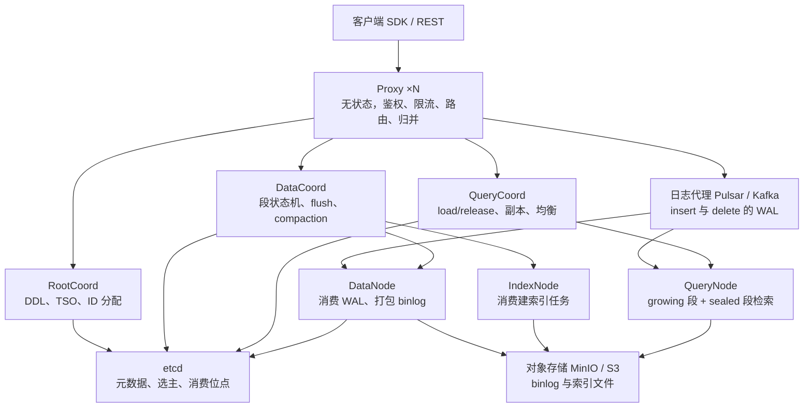
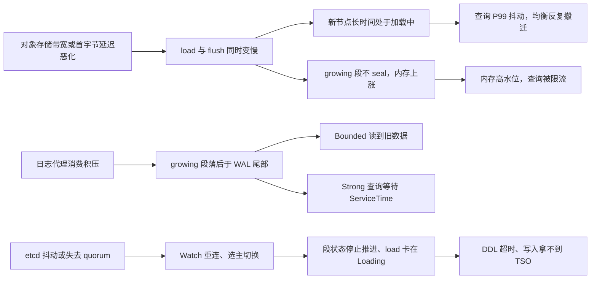
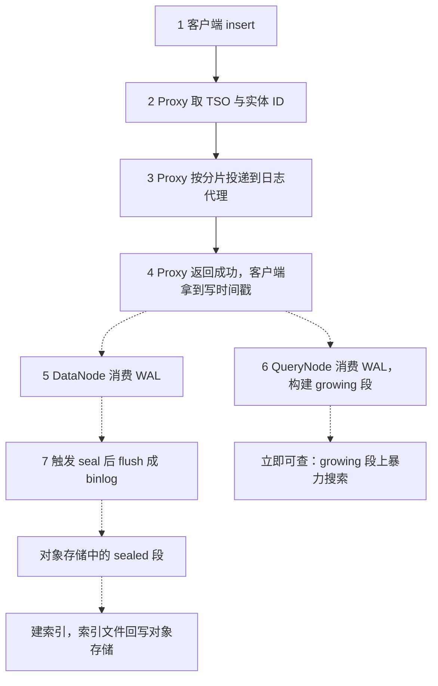
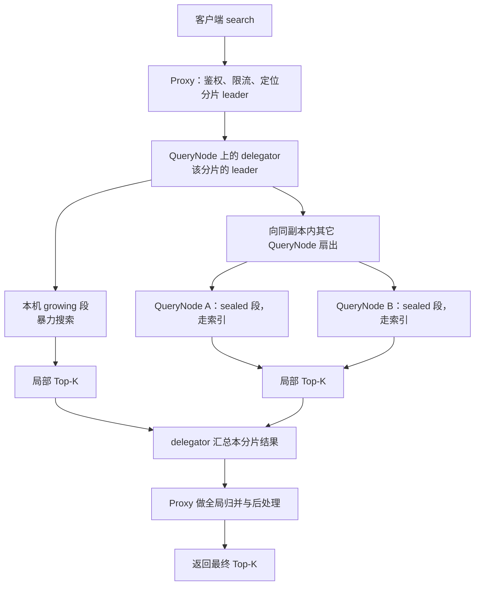

# 01 Milvus 全局架构——存算分离与云原生设计

**摘要：**

Milvus 1.0 于 2019 年开源，数据靠 NAS 持久化，2021 年重写为 2.0 之后把存储与计算彻底拆开：元数据交给 etcd，大块数据落到对象存储，增量写入走消息队列，计算侧只剩一群无状态的工作节点。这套拆法换来了弹性与成本，也把三笔账挪到了别处——查询要先从对象存储把段加载进内存，冷启动与扩容都有一段加载窗口；写进 WAL 不等于可查，中间隔着一个消费进度与一个时间戳；对象存储便宜，可查询要用的内存依旧很贵。本篇不讨论索引算法，那属于另一篇的题目，只做两件事：先把 Proxy、三类协调者、QueryNode、DataNode、IndexNode 与三个外部依赖的职责摊开，逐个交代它们变慢或挂掉时用户侧会看到什么；再顺着写入链路与读取链路走一遍，说清楚 growing 段为什么只能暴力搜索、`consistency_level` 四档各自在等什么、Bounded 那个窗口由哪个参数决定。末尾给出与 Elasticsearch 的一句话划界、三种部署形态的判据，以及把 Milvus 用错的几个典型场景。读完之后该能回答两个问题：这套架构的代价落在哪三处，以及自己的业务该付哪一笔。

---

## 第 1 章 从一个扩容窗口说起

### 1.1 加节点的那十四分钟

一个做企业内部知识库的团队，语料是六万多份文档，切块之后大约六千万条段落，用 768 维的稠密向量存进 Milvus，检索侧的峰值 QPS 是一百八十。数据量三个月没怎么动，涨的是人——知识库被接进了几个内部助手，查询量翻了近三倍。

扩容的做法看起来很朴素：给 QueryNode 加两个副本。按"加机器就该更快"的直觉，这该是一次无风险的调整。实际结果是新节点上线之后的十四分钟里，整个集群的 P99 从九十毫秒涨到四百二十毫秒，之后自己回落；CPU 与内存的曲线全程平稳，看不出任何资源被打满的痕迹，只有 QueryNode 的日志里密集刷着段文件的拉取与加载记录，对象存储的 GET 请求数在那十四分钟里翻了四倍。

这段经历几乎把存算分离的全部性格都演了一遍：新节点是干净的，它手上一个段都没有，得先把自己负责的那部分数据从对象存储搬进内存，搬完才算真正参加工作；而在搬的过程中，它已经是集群的一员，均衡器会按"节点数"重新切分归属，把一部分请求连同一部分数据一起推过去，于是这些请求要么等，要么算得慢。存储与计算拆开之后，算力不再是随加随用的东西，它必须先把数据"领"过来。

### 1.2 2021 年的那次重写，赌的是什么

Milvus 1.0 在 2021 年 3 月发布稳定版，架构是单体的：查询、建索引、数据存储都挤在一个进程里，持久化依赖 NAS。官方事后复盘这份设计时列了几条要害——NAS 的单价通常是本地盘或对象存储的十倍；没有内存副本，也没有跨机房容灾；建索引是 CPU 与内存密集型操作，跟查询跑在同一个进程里，互相踩。

2.0 在同年重写，官方给了三个设计口号：云原生优先、**日志即数据**、批流一体。这三句话落到工程上，是把数据库原本自己负责的三件事外包了出去：元数据与选主交给 etcd，大块持久化数据交给对象存储，增量写入的可靠传递交给日志代理，也就是消息队列。Milvus 本体剩下的是调度与计算——决定谁去加载哪一段数据、谁去建哪一份索引、查询该发给谁。

这笔交易的另一面是部署形态。单体的 Milvus 1.0 只要一个进程加一块盘，集群化的 Milvus 2.0 需要一整套基础设施：etcd 集群、对象存储、消息队列，外加 Kubernetes。装的组件多了，能独立扩缩容的面也多了，这就是它全部的收益与全部的成本。

### 1.3 本篇的边界与路线

向量检索的算法谱系——从暴力搜索到 IVF、HNSW、DiskANN——属于[[02 向量索引——从暴力搜索到 HNSW 与 IVF]]的题目，本篇只用一句话带过：索引决定的是"在一段固定数据上如何少算"，而段决定的是"这段数据在哪里、什么时候可以查"。Collection、Partition 与段的完整模型放在[[03 数据模型——Collection、Partition 与 Segment]]，标量过滤与混合检索的执行策略放在[[04 查询引擎——混合检索与过滤]]，集群部署与容量规划放在[[06 Milvus 运维——集群部署、索引调优与容量规划]]。

所以下面这条路线只沿着一条主线走：先把组件列清楚、把每个组件的失败形态标出来，再看写入与读取两条链路各自要经过哪些环节，最后集中算三笔账——延迟、一致性、成本，并给出 `consistency_level` 四档的判据。整篇要回答的问题只有两个：把存储与计算拆开之后，那些被拆出来的组件各自负责什么，坏掉的时候你会看到什么；以及拆开这件事在向量检索这个场景下，到底留下了多深的账。

---

## 第 2 章 组件清单：谁在做什么

### 2.1 一张拓扑图

Milvus 的架构文档习惯按四层讲：接入层、协调层、工作节点层、存储层。这个分法在描述数据平面与控制平面的分离时很顺，但排查故障时不够用，因为真正决定"故障会以什么形态出现"的，是哪一个组件在什么位置、被谁依赖。下面这张图按依赖关系重画了一遍，把三个外部依赖单独标出来，标注它们各自承载什么。

图里有一处值得停下来看：QueryNode 同时连着消息队列与对象存储。它向右订阅 WAL 拿到刚写入的增量，向下从对象存储拉历史段文件，这两条通路决定了它同时具备"实时"与"历史"两种数据来源，也决定了它同时继承了这两条通路的延迟特征。

### 2.2 一张表看清职责与故障

把七个微服务加三个外部依赖摊在一张表里，第二列是它们各自保管的东西，第三列是它们变慢或挂掉时用户侧能看到的现象，第四列是通常的处置方向。这张表在排障时比架构图好用，因为症状到组件的反查路径只有一条。

| 组件 | 保管什么 | 变慢或挂掉时看到什么 | 处置方向 |
| :--- | :--- | :--- | :--- |
| etcd | Collection/Partition 元数据、段状态与 binlog 路径、消费位点、节点注册与心跳 | DDL 卡住、段状态停止推进、协调者反复切主、load 停在 Loading | 查 etcd 的 `etcd_server_leader_changes_seen_total`、后端库大小与配额 |
| 对象存储 | insert/delete binlog、索引文件、部分查询中间结果 | load 变慢、flush 变慢、growing 段堆积、内存高水位告警 | 查 GET/PUT 的 P99 与请求数、单流带宽、小文件数量 |
| 日志代理 | insert 与 delete 的 WAL、消费订阅与位点 | 写入直接报错、消费积压、数据可见性滞后 | 查 publish 延迟、订阅 backlog、保留期是否够 |
| Proxy | 不存状态，只做接入与归并 | 连接打满、限流触发、全局归并变慢 | 加副本、查 TSO 调用耗时 |
| QueryNode | 加载后的段数据、growing 段、删除记录 | 查询 P99 抖动、内存高水位、load 长时间不完成 | 查段数、内存占用、mmap 命中 |
| DataNode | 写入缓冲与 flush 中的 binlog | flush 滞后、growing 段不 seal、段数暴涨 | 查消费位点落后多少、对象存储上传耗时 |
| IndexNode | 不存状态，只建索引 | 索引任务排队、数据可查但很慢 | 查任务队列长度、单任务耗时、CPU/GPU 占用 |
| RootCoord | TSO 与 ID 的分配入口 | 拿不到时间戳，写入与查询一起失败 | 查选主状态、etcd 连通性 |
| DataCoord | 段状态机与后台任务调度 | 段不 seal、不 compaction、索引不触发 | 查任务队列、心跳、etcd 写入 |
| QueryCoord | 段到节点的分配与均衡 | 负载不均、均衡反复搬迁、load 排队 | 查均衡器日志、目标节点资源 |

表里有三个外部依赖需要单独展开，因为它们分别对应三种完全不同的失败语义：etcd 是**协调不了**，对象存储是**搬不动**，日志代理是**写不进**。这三句话后面还会反复出现。

### 2.3 etcd：不大、不快，但不能没有

etcd 在 Milvus 里承担的角色，与它在 Kubernetes 里承担的角色几乎一样：它是元数据账本，也是选主的裁判。Collection 的 Schema、Partition 的划分、每个段的状态与它对应的 binlog 路径、各消费组的位点、每个工作节点的心跳，全都落在这套键值存储里；协调者的主备切换靠 etcd 的租约与事务；工作节点感知元数据变化靠 etcd 的 Watch，而不是轮询。这套机制的原理在[[01 etcd 全局架构——从配置存储到控制面账本]]里讲过，此处只取它的一条后果：元数据的每一次变更都要经过一次 Raft 复制，写放大的代价由 etcd 承担，所以它适合"少量、重要、不频繁"的写入，不适合被当成计数器用。

Milvus 把段级别的信息写进 etcd，这个选择在小规模下毫无问题，规模上去之后会露出两条边界。其一是键的数量：段是会被 compaction 合并的，合并之前的小段也要各自留一条记录，段数越多，键越多，Watch 的事件流也越密。其二是空间：etcd 的后端存储默认有一个 2 GiB 的配额，键的每一次修改都会留下一个历史版本，要靠定期 compaction 回收。生产环境里 etcd 报出空间不足，追下去往往是段元数据堆积加上 compaction 没有配自动执行。

etcd 挂掉时的现象很有辨识度：它不是"查询报错"，而是"一切都停住"。RootCoord 无法确认自己是主，拿不到 TSO，于是 Proxy 发起的写入在第一步就失败；DataCoord 收不到心跳，段状态从 Growing 到 Sealed 的推进停摆；QueryCoord 的 load 任务卡在 Loading；客户端的 DDL 全部超时。此时对象存储是好的，消息队列是好的，数据一条没丢，但整个系统像被按了暂停键。这也是为什么官方建议 etcd 至少三节点——它不承担数据吞吐，却承担了整个集群的"能否开始工作"。

### 2.4 对象存储：唯一的真相

在 Milvus 2.x 里，凡是"大块且不可变"的东西最终都落在对象存储：DataNode 写出的 insert binlog 与 delete binlog，IndexNode 构建的索引文件，官方文档里还提到部分查询的中间结果。对象存储承担的是 Milvus 原本要自己做的那份工作——副本、校验、跨机架冗余，全都换成了对象存储的持久性承诺。

这笔交换换来的是两样东西：容量近乎无限，以及按量计费。代价官方文档自己写得很直白：对象存储的访问延迟较高，并且按查询次数收费；为了缓解，路线图里提到了在内存或 SSD 缓存池上做冷热分离。这两句话值得抄在笔记本上，因为它们解释了后面几乎所有与"慢"有关的现象。

用对象存储而不是共享文件系统，这笔取舍在 1.x 到 2.0 的转变里看得最清楚。1.x 把数据放在 NAS 上，好处是能用 POSIX 语义直接读写，坏处是单价高、并发带宽被单挂载点限制、扩容要跟着文件系统走。对象存储放弃了随机写与目录语义，换来的是水平扩展的带宽与近乎无限的容量，代价是一次只能整对象读写——于是段的粒度必须足够大，才不至于让请求数与元数据开销失控。这条约束反过来解释了为什么 Milvus 的段动辄几百 MB：它不只是为了索引效率，也是为了对象存储的计费方式。

对象存储慢下来的方式有三种，症状完全不同。第一种是带宽不足：QueryNode 拉一个几百 MB 的段，单流一百 MB/s 要五秒，降到大几十 MB/s 就翻倍，load 的整体耗时线性拉长。第二种是首字节延迟高，每次 GET 都要多花几十毫秒，对多文件的小对象尤其致命。第三种是 LIST 慢，Milvus 在某些恢复路径上要列举前缀下的对象，前缀里对象越多，这一步越慢，而出问题的时候恰恰是对象最多的时候。

还有一笔账常被忽略：对象存储按请求计费，而 Milvus 的一个段不止一个文件。向量数据、标量数据、索引文件、删除记录、统计信息各有一份 binlog，一个段对应十几个对象是常态。段越碎、文件越多，请求数越多，账也越厚。这条算术在容量规划里会再出现一次。

### 2.5 日志代理：写入的 WAL

消息队列在 Milvus 的术语里叫日志代理（log broker），这是全篇最容易被低估的组件。官方架构文档对它的定位是"支持回放的发布订阅系统"，并且明确写了 Milvus 遵循"日志即数据"原则：不维护物理表，靠日志持久化加日志快照保证可靠性。换句话说，写入路径上的第一份持久化不是落进某个数据文件，而是落进一条可回放的日志流。

> [!info] 日志与快照的关系
> Milvus 不维护"当前这行是什么"的物理表，只保留变更日志与周期性生成的快照。查询时看到的是"快照加上快照之后的日志回放"，这也是它能在崩溃后只靠重放恢复、不需要额外 undo 机制的原因。

分布式部署默认用 Pulsar，也支持换成 Kafka；单机的 Standalone 里则用 RocksDB 充当这个角色，这就是为什么单机版不需要额外装一个 Pulsar——它把 WAL 放在了本地。两套实现的分野在[[01 Kafka 全局架构——Broker、Topic、Partition 与消息流转]]里有完整的对照，这里只关心一件事：日志代理是三个外部依赖里唯一一个"挂掉就立刻让写入停止"的组件。

原因在于写入确认的时机。客户端的 insert 请求经 Proxy 打到日志代理，Proxy 收到 publish 成功的回执就返回成功，此时 DataNode 还没消费，QueryNode 更没看到。所以日志代理不可用时，写入在第一跳就失败，错误来得很干脆，不像对象存储那样是"慢慢变慢"。而当日志代理没挂、只是消费变慢时，症状会换一副面孔：写入照样成功，但 growing 段迟迟不建起来，数据不可见。这两种失败形态在告警上必须分开，前者看 publish 失败率，后者看订阅的 backlog。

日志流不是整个集合一条，而是按分片切开的。建 Collection 时指定的分片数（`shards_num`）决定了有几条虚拟通道（vchannel），每条虚拟通道映射到日志代理上一个物理通道，数据按主键哈希落到其中一条。这个映射关系是整篇里最隐蔽的一条约束：段、通道、delegator 三者一一绑定，一个段的写入永远在同一条通道上，一个通道的读也永远由同一个 delegator 负责。想改分片数，等于重排这套绑定，代价与重建集合相当，所以它和 Elasticsearch 的分片数一样，是一次性的决定。

### 2.6 三个工作节点，与一个常见的误读

QueryNode 是唯一同时握着两条数据通路的节点。它向对象存储要历史——把 sealed 段的数据与索引文件加载进来；向日志代理要增量——订阅 WAL，把新写入的行攒成 growing 段。查询打过来时，它在这两种段上分别执行，再把局部结果交回去。

DataNode 只管写。它订阅 WAL，把消息按段打包成 binlog，上传到对象存储，并在本地记录消费位点；compaction 也由它执行——把若干小段并成一个大段，顺带回收被删除的行。它不建向量索引。

**IndexNode** 才是建索引的那一个。它从对象存储读入已 flush 的段，构建 HNSW 或 IVF 一类的索引，再把索引文件写回对象存储。这个活是 CPU 与 GPU 密集型，官方特意把它拆成独立节点，正是为了让建索引不跟查询抢资源；它不需要常驻内存，任务队列空了就是闲着。

这里有一个流传很广的误读：不少二手材料把"建索引"算在 DataNode 头上，理由是"DataNode 负责数据落地，索引也是数据"。真实的链路是四段接力——DataCoord 发现某个段已 flush 且缺索引，生成索引任务；IndexNode 领任务、读数据、建索引、写回；DataCoord 把段状态推进到"有索引"；QueryNode 在下次加载或热更新时换用索引文件。调优时如果找错了组件，就会得到"给 DataNode 加内存为什么建索引还是慢"这类无解的结论。

### 2.7 Proxy 与协调者

Proxy 是无状态的门面：维护客户端的长连接，做鉴权与限流，从 RootCoord 取时间戳与 ID，把写请求投进日志代理，把读请求按分片路由到对应的 QueryNode，最后做全局归并。它不存业务数据，所以可以随便加副本，前面挂一层负载均衡即可；它的性能瓶颈通常不在自身，而在它同步调用的那两个地方——取 TSO 与等待后端返回。

协调者是系统的大脑，分三种。RootCoord 处理 DDL 与 DCL，管 Collection、Partition、索引的创建与删除，并且是 TSO 与 ID 分配的唯一入口。DataCoord 管数据面：段的生命周期、flush 的触发、compaction 的调度、索引任务的生成，它同时盯着 DataNode 与 IndexNode 的拓扑。QueryCoord 管查询面：哪个段被分配到哪个 QueryNode、副本怎么摆、负载怎么均衡、load 与 release 何时执行。

历史上还有第四个协调者 IndexCoord，后来被并进了 DataCoord，到 2.4 的架构文档里协调者只剩三种。再往后，2.4 那一代起可以把三者合成一个进程（chart 里的 `mixCoordinator.enabled` 开关），到 2.6 合并成为唯一形态，同时把 IndexNode 并进了 DataNode。这条演进线的判据很清楚：集群小的时候，三个协调者各占一份资源、各起一份选主，合并省事；集群大的时候，DataCoord 的 compaction 调度与 QueryCoord 的均衡互不干扰，分开更稳。选哪一种，取决于你更怕资源浪费还是更怕故障域耦合。

三者都是主备模式，靠 etcd 选主。切主期间 DDL 与后台任务推进会停顿数秒，客户端通常感知不到，但如果恰好在切主时发起 load，会看到任务状态来回跳一次。

### 2.8 三条故障传播路径

组件清单本身不解释故障，故障在传播路径里。下图把三条最常见的路径画出来，从左到右是"源头→中间环节→用户可见现象"。

三条路径的共同点是"用户看到的都不是源头"。第一条把对象存储的延迟翻译成查询尾延迟，第二条把消息队列的积压翻译成数据可见性问题，第三条把 etcd 的抖动翻译成"整个系统卡住"。反查的方向刚好相反：看到尾延迟先看 load，看到可见性先看 backlog，看到全停先看 etcd。

---

## 第 3 章 写入链路：一条向量要走多久

### 3.1 七步

写入路径的分段方式在官方文档、社区文章与源码注释里各有版本，但主干是一致的。下图把一次 insert 拆成七步，实线表示同步调用，虚线表示异步。

七步里只有前三步是同步的，第 4 步返回之后，剩下四步都以异步方式推进。这个切分点是理解 Milvus 一致性的起点：客户端拿到"成功"的那一刻，数据只保证进了 WAL，既没有落进对象存储，也不一定被 QueryNode 看见。

批量大小会改变这条链路上的瓶颈位置。一次 insert 携带的行数越多，消息越大、条数越少，Proxy 的调用次数与日志代理的写入次数随之下降，DataNode 打包时的效率也更高；反过来，批量太小会让消息碎成一地，每条消息都带着自己的时间戳与元数据开销，段数也跟着涨。体积的上限来自两头：客户端与服务端之间的单次请求大小，以及日志代理对单条消息的容忍度。按十万条 768 维向量估，原始数据约 300 MB，这个量级已经超过多数默认配置的单次请求上限，客户端 SDK 会按内部批量自动拆分，拆分点落在哪里，直接决定日志代理要收多少条消息。示例推算只为说明量级，实际取值以所用版本与网关配置为准。

### 3.2 时间戳：TSO、syncTs 与 ServiceTime

写入链路上唯一贯穿始终的东西是时间戳。每条写入消息在进入日志代理之前从 RootCoord 领到一个单调递增的时间戳（TSO），它的作用不只是排序——查询侧要靠它判断"某条数据该不该被看见"。

机制在官方的一致性文档里写得很清楚：日志代理除了数据消息，还会持续写入同步时间戳（syncTs）；QueryNode 收到 syncTs 就把它记为服务时间（ServiceTime），意为该时刻之前的数据都已可查。查询请求携带一个**保证时间戳**（GuaranteeTs），如果 GuaranteeTs 小于当前 ServiceTime，说明请求要的数据已经全部可见，立即执行；如果大于，QueryNode 必须等 ServiceTime 追上来才能开始搜。

这套机制解释了三件事。第一，"写完立刻查"在物理上是可能的，只要查询等得及。第二，"写进 WAL"与"可查"之间隔着一个消费进度，正常情况下是毫秒到几十毫秒，积压时可能到秒级。第三，"一致性级别"这个看似抽象的概念，落到实现上只是 GuaranteeTs 取了什么值——四种级别对应四种取值方式，没有第四种魔法。

### 3.3 从 growing 到 sealed：两个阈值与一个周期

QueryNode 消费到的新数据先攒成 growing 段，留在内存里。它什么时候变成 sealed 段，由两个阈值和一个**兜底周期**决定，这三个参数是写入侧最该被理解的旋钮。

| 参数 | 常见默认值 | 作用 | 调大的代价 | 调小的代价 |
| :--- | :--- | :--- | :--- | :--- |
| `dataCoord.segment.maxSize` | 512 MB | 段的目标上限，配合 sealProportion 决定何时封段 | 单段过大，建索引耗时长、加载粒度粗、失败重试成本高 | 段数暴涨，元数据与文件数增加，查询扇出变大 |
| `dataCoord.segment.sealProportion` | 0.23 | 达到 maxSize 的这个比例即封段，默认约 117 MB | 封段变晚，growing 段长期偏大，暴力搜索拖慢查询 | 大量小段，compaction 压力变大，对象存储请求数上升 |
| `dataNode.syncPeriod` | 600 秒 | 数据量不达标时的强制 flush 周期 | 低频写入场景下数据长期停在 growing 段，只有暴力搜索可用 | flush 频繁，小文件多，compaction 频繁 |
| `rootCoord.minSegmentSizeToEnableIndex` | 1024 行 | 段内行数低于此值不建索引，直接暴力搜索 | 小集合长时间无索引，查询慢 | 极小段也建索引，索引文件数量与构建开销上升 |

表里的默认值取自 2.x 长期沿用的 `milvus.yaml`，具体版本之间可能有出入，以对应版本文档为准。四行的取舍逻辑是同一个：growing 段是"可写但只能暴力搜"的形态，sealed 段是"不可写但可建索引"的形态，所有参数都在调节这两种形态的边界。默认把封段点放在约 117 MB 而不是 512 MB，是因为 growing 段上的每次查询都要线性扫一遍，段越大越慢；先封成小段让它可建索引，再靠 compaction 合并成大段，是拿 compaction 的写放大换查询的稳定性。

### 3.4 flush 落的是什么

DataNode 消费 WAL 之后，按段把数据打包成 binlog 上传对象存储。一个段对应的对象不止一个：向量字段一份、每个标量字段各一份、删除记录一份，还有统计信息与索引文件各一份。打包完成之后，DataNode 向 DataCoord 汇报，DataCoord 把段状态推进到已 flush，并把 binlog 的路径与消费位点写进 etcd。

这里的可靠性来自两处。日志代理的保留期保证了"崩溃之后还能从位点重新消费"，只要位点还在、消息还没过期，重放是幂等的；对象存储的写入是原子的，一个 binlog 要么完整存在，要么不存在，不存在就重传。两处合起来，Milvus 不需要自己实现一套崩溃恢复协议，它把这件事交给了日志与对象存储。

位点也存在 etcd 里，这个选择带来一个副作用：位点更新得越频繁，etcd 的写压力越大；更新得太稀疏，重启后要重放更多消息。生产环境里消费位点的提交间隔与 etcd 的负载是一对需要一起看的参数。

binlog 的形态是列式的：一个字段一个文件，向量字段单独一份。这个布局有两个后果。其一，查询时只读需要的列——标量过滤先读标量列，得到候选集之后再去读向量列，不必把整段的所有字段都搬进内存，加载的字节数因此可以远小于段的逻辑体积。其二，压缩效率随列数的增加而下降，标量字段越多、每列的独立文件越多，对象存储上的对象数量与请求数就越难压低。一个 Collection 若定义了二三十个标量字段，段对应的对象数会成倍增长，容量规划时容易漏算这一项。

### 3.5 建索引为什么不在写入路径上

IndexNode 建索引这一段是异步的，而且通常是整条链路上最慢的一段。原因不在于实现取巧，而在于索引构建的代价与写入的代价不在一个量级：写一条向量是追加一个行，建一份 HNSW 索引要为每个点找邻居、连边、调层，规模上去之后一个段的索引构建可能耗时数分钟到数小时。

把这段拆走带来两个直接后果。好消息是写入不会被索引拖慢，查询在索引建好之前也能用——段内行数超过 1024 行之后即使没有向量索引，也能靠暴力搜索出结果，只是慢。坏消息是"数据刚导完就查"这个动作会踩在两种段的交界处：一部分段已经有索引，一部分还在暴力搜索，查询延迟会呈现双峰。

索引任务还有第三个来源：compaction 之后段被重写，原有的索引不再对应新的段，需要重建。所以索引任务不是一次性的，它跟着段的生命周期循环往复，IndexNode 的排队长度在 compaction 高峰期会明显上涨。

`create_index` 这个调用本身是异步的：它把索引配置写进元数据、生成任务、返回，此时索引未必已经建好。数据能查，但走的是暴力搜索。判断索引是否就绪要看索引状态而不是调用是否成功，这一点在自动化脚本里最容易出错——脚本建完索引立刻压测，测出来的是没有索引时的数字，然后得出"索引没用"的结论。

### 3.6 Proxy 返回成功，到底承诺了什么

把前面几节收拢成一个判断：`insert` 返回成功，承诺了三件事，没有承诺第四件。

承诺之一是数据进了可回放的日志，只要日志代理的保留期没到，它不会丢；承诺之二是这条数据领到了一个时间戳，后续查询可以用它做保证时间戳；承诺之三是消息的顺序在日志里是确定的，重放不会乱序。没有承诺的是"现在就能查到"——可见性取决于 QueryNode 的消费进度，也取决于查询时选了哪一档一致性。

这个语义与关系型数据库的"提交即可见"不同，与 Elasticsearch 的"refresh 之后可见"反而更接近，区别只在于 Milvus 把"等不等"做成了查询侧的可调项，而不是写入侧的固定周期。

写读之间并非没有捷径。insert 返回的写时间戳可以带进后续查询，作为该次查询的保证时间戳，等价于说"至少要看到这个时间点之前的写入"。这一步跳过了"调高档位"的粗暴做法：整条链路留在 Bounded，只有紧跟着写的那一次查询主动拉高可见性要求，既拿到了正确性，又没有把所有查询都拖进等待。很多"必须用 Strong"的需求，实际上只需要在个别调用上带一次时间戳。

---

## 第 4 章 读取链路：一次 search 的扇出

### 4.1 请求路径

查询路径比写入路径短，但分支更多。下图是一条 search 请求的完整走向，注意 QueryCoord 并不在查询的同步路径上——这个细节纠正了一类常见的描述。

Proxy 手上有一份分片到 leader 的缓存，请求直接打到 leader，不必每次去问 QueryCoord。leader 这个角色由 QueryNode 承担，内部叫 delegator，它负责两件别人替代不了的事：一是它自己持有该分片的 growing 段，二是它维护该分片的删除记录。

这份缓存的失效路径值得留意。QueryCoord 重新分配段、节点上下线、副本切换，都会让 leader 搬家，缓存随之过期；过期期间打过去的请求会失败并被重试一次，重试时 Proxy 重新查询归属。所以滚动重启期间看到的零星失败，多半不是数据问题，而是路由缓存在追平。排障时若看到"某个分片的请求集中失败又自动恢复"，先看 QueryCoord 的均衡日志，而不是去查数据一致性。

### 4.2 delegator：growing 与删除的裁判

delegator 的存在是理解 Milvus 读路径的关键。一个分片的写入是一条日志流，这条流只有 delegator 在消费，所以只有它知道"哪些数据是刚写进来、还没来得及落成 sealed 段"。查询打过来时，先在 delegator 本地扫一遍 growing 段，再让持有 sealed 段的其它 QueryNode 并行去搜，最后把两路结果合并。

删除也走同一条路。delete 请求同样进 WAL，DataNode 把它落成 delete binlog，QueryNode 消费后在本地维护一份被删主键的集合，通常用布隆过滤器压缩。查询时被命中的主键就地过滤掉。这个设计带来一个容易踩的坑：删除是**逻辑删除加查询期过滤**，被删的数据仍然占着内存与磁盘，真正回收要等 compaction 重写段。

### 4.3 局部 Top-K 与全局归并

每个 QueryNode 只返回自己那部分数据上的局部 Top-K，Proxy 拿到的候选数是"K 乘以参与节点数"，再做一次归并。这里有一个与 Elasticsearch 完全同构的精度约束：如果要取全局前 10 条，而某个节点上排第 11 的名次在别的节点上可能是第 1，那么每个节点就必须多返回一些候补。

所以实际发出的请求里，`limit` 之外还会带上偏移量，每个节点返回的是 `limit + offset` 条。这个放大倍数直接乘在扇出上：分片越多、QueryNode 越多、`limit` 越大，单次查询的计算量与网络传输量越大。这也是为什么 Milvus 在分片数与段数上并不追求"越碎越好"，碎到一定程度，归并的开销会盖过并行带来的收益。

还有一层放大来自查询向量的条数（`nq`）。一次请求可以携带多条查询向量，服务端按条数复制计算量，但扇出与归并是按批发生的：同样的拓扑下，`nq` 从 1 涨到 10，归并阶段要处理的行数也涨十倍，Proxy 与 delegator 的 CPU 会先于 QueryNode 成为瓶颈。这也是做批量相似度计算时常见的一个误判——以为是检索慢，其实是归并慢。

### 4.4 两种段，两条搜索路径

把读路径上的两种段并排看，差别一目了然。这张表也是"为什么刚写入的数据查询慢"的正式答案。

| 维度 | growing 段 | sealed 段 |
| :--- | :--- | :--- |
| 数据在哪 | QueryNode 内存，来自 WAL 订阅 | 对象存储，加载后在内存、mmap 或本地盘 |
| 是否有向量索引 | 默认没有，按暴力搜索处理 | 有索引则走索引，无索引仍走暴力搜索 |
| 搜索复杂度 | 与段内行数线性相关 | 索引决定，近似对数或聚类桶级别 |
| 可见性 | 消费到即可见，受 GuaranteeTs 约束 | 加载完成即可见 |
| 典型规模 | 从几 MB 涨到约 117 MB | 数百 MB 到 GB 级 |
| 主要风险 | 涨得太大又不封段，拖垮所有查询 | 加载窗口长、内存占用高 |

表里第五行的对比解释了参数设计：growing 段被限制在一百多 MB 就封掉，是为了让"只能暴力搜索"的那部分数据始终是小的；sealed 段允许到 512 MB 甚至更大，是因为它有索引可以依赖。两种段的规模上限之所以不同，根子在于它们的搜索方式不同。

有一种情况会让这张表失效：段内行数低于建索引阈值。此时即使段已封、已 flush，它依然没有向量索引，查询照样暴力搜索。官方性能文档专门提醒过这一点——小集合查询反而慢，因为段还没达到建索引的规模；这种慢与架构无关，纯粹是索引缺位。

### 4.5 load 做了什么

`load` 是存算分离架构里最有分量的动作，它把"对象存储里的段"变成"QueryNode 上可查的段"。下图是它的时间线，从被分配到能承接查询，一共七步。

图里从拉取文件到建句柄这几步是耗时主体，都受对象存储的带宽与首字节延迟支配；再往后还有一个常被忽略的开销：段的索引句柄与内存结构要占堆，段数越多，这部分固定开销越大，即便每个段只有几十 MB。

加载的粒度也值得说清楚：它可以按整个 Collection 加载，也可以按 Partition 加载，但不能按主键或过滤条件选择性地只加载一部分。这个限制决定了 Partition 的用法——多租户共用一个 Collection 而只挂一个 Partition，等于让每个租户都承担全量数据的加载成本；按租户开 Partition 之后，至少可以把"加载哪些数据"这件事变成可控的操作。分区的完整语义在[[03 数据模型——Collection、Partition 与 Segment]]里展开。

### 4.6 加载窗口的量化

把一个段从对象存储搬到 QueryNode 要多久，可以做一次示例推算，只为给量级感，不代表任何真实环境。

假设一个 sealed 段 512 MB，对象存储单流带宽 100 MB/s，纯传输约 5 秒；加上建连与首字节延迟，按 5.5 秒计。再假设解包与建索引句柄需要 2 秒，单段加载约 7.5 秒。一个 QueryNode 要接 20 个段，八路并发拉取，理论下限约 19 秒；实际因为带宽共享与对象存储限流，按两倍余量估，四十秒上下。这个数字与 1.1 节那段十四分钟的抖动并不矛盾——那里有两个变量叠加：新节点在加载，同时均衡器正在把段从旧节点迁走，迁走的那部分在迁移完成前谁来承接，取决于副本是否多于一份。

同样的推算换到扩容场景：数据总量 300 GB、每个 QueryNode 承接 60 GB，按单节点 100 MB/s 的拉取带宽算，纯传输就是十分钟量级。这就是为什么扩容必须提前做，而不是等 QPS 打满再补机器——补进去的机器要先把数据搬完，才能开始分担压力。示例推算到此为止，真实环境的数字取决于对象存储的分片带宽、是否走内网、是否开了多流并发。

反方向的推算同样有用：一个 QueryNode 到底能装多少数据。假设单节点可用内存 64 GB，段大小 512 MB，索引相对原始数据的放大按 1.3 倍计，一个段加载后约 660 MB；扣掉进程自身与查询时的临时缓冲，按 80% 可用估算，能常驻六十多个段，对应原始数据三十 GB 上下。这个数字是容量规划的起点——数据总量除以单节点承载量，再乘以副本数，就是 QueryNode 的数量下限；而它同时也解释了为什么"多副本"在 Milvus 里的成本呈现为内存的整数倍，而不是磁盘的整数倍。示例推算，实际取值随索引类型与查询模式浮动。

把链路各环节的延迟并排放一张表，异常时该看哪一个也就清楚了。下表的数字都是量级判断，用来比较相对大小，不是基准测试结果。

| 环节 | 正常量级 | 恶化时可能到 | 判断依据 |
| :--- | :--- | :--- | :--- |
| etcd 元数据读写 | 单次几毫秒 | 几十毫秒到秒级 | leader 是否在切、后端是否在 compaction |
| 日志代理 publish | 同机房几毫秒 | 几十毫秒 | publish 延迟分位、分区是否在迁移 |
| 增量到可查 | 几十毫秒 | 秒级 | 订阅 backlog 与 ServiceTime 落后多少 |
| 对象存储单对象 GET | 几十到上百毫秒 | 数百毫秒 | 首字节延迟、是否跨可用区 |
| 单段加载 | 五到十秒 | 数十秒 | 段大小、并发路数、带宽是否被分摊 |
| 单段建索引 | 分钟级 | 小时级 | 索引类型、段大小、IndexNode 竞争 |

---

## 第 5 章 存算分离的三个代价

### 5.1 代价一：延迟被搬到了 load 上

拆开存储与计算，查询侧并没有少做事，只是把"读本地磁盘"换成了"从对象存储搬"。稳态下这笔账很划算：段加载一次，之后反复查询，边际成本接近零，内存还能用 mmap 与 chunk cache 摊薄。问题都集中在过渡态——进程重启、节点扩容、段迁移、索引重建之后的重新加载，每一个都要走一遍完整的搬运。

延迟的量级可以用三个场景对照。稳态查询的延迟由索引与 CPU 决定，通常是个位数到几十毫秒；首次加载后的第一查，要多等一次换页或本地盘读取，可能上百毫秒；冷启动时整批段一起加载，就是分钟级。三种延迟在监控上是三条不同的曲线，混在一起看会误以为"查询变慢"，实际是"还在加载"。

2.3 引入的 mmap 与 2.4 的 DiskANN 都把内存压力往磁盘挪了一层，思路一致：既然内存贵，就让索引文件留在本地盘上按需换入。这是缓解，不是消除——mmap 的页不在内存时照样要读盘，DiskANN 的向量与图也在盘上，两者都把延迟从"对象存储"降到了"本地 NVMe"，本质上仍然承认"查询前置数据不在内存里"这个前提。

过渡态无法完全避开，能做的是把它变成可控的流程。`load` 本身是同步语义：调用返回时，段的元数据与索引句柄已就绪，请求可以打进来；但"句柄就绪"不等于"数据页在内存里"，尤其开了 mmap 之后，第一批查询仍要触发缺页中断。工程上的处理办法是加载完成后主动跑一轮轻量查询把热路径的页摸一遍，对 mmap 场景尤其有效；代价是这段时间的查询延迟会难看到，所以预热要么放在低峰期，要么让流量逐步切进来。绕不开的结论是：扩容与重启不是原子操作，它们在时间轴上有一段"名义上可用、实际上很慢"的区间，容量规划必须给这段区间留预算。

### 5.2 代价二：写进 WAL 不等于可查

第二笔账是一致性。关系型数据库里"提交即可见"是默认语义，Milvus 里"进 WAL"与"可查"之间隔着消费进度，这个缝隙就是四档一致性全部的活动空间。

官方把这条缝的参数化做得很干净：查询带保证时间戳，QueryNode 拿着它与自己的服务时间比，小于就立刻执行，大于就等。四档的区别只在保证时间戳取什么值——Strong 取最新时间戳，于是几乎每次查询都要等一小会儿；Eventually 取一个极小的值，等于放弃检查，立即执行；Session 取本客户端最后一次写入的时间戳，保证"自己写的自己看得见"；Bounded 取一个略早于当前的时间点，容忍一小段滞后。

Bounded 那"一小段"有多长，由 `common.gracefulTime` 决定，常见默认值是 5000 毫秒。这个参数的含义是把请求的到达时间往前推一段时间，用推后的时间点作为参考，从而允许最近的写入还没被消费。它同时是一致性旋钮与延迟旋钮：调大，读到旧数据的窗口变大，查询更少等待；调小，可见性更及时，等待更频繁。

把这笔账算清楚，一条反直觉的结论就出来了：Milvus 的默认一致性不是"最终一致"，而是**有界滞后**。这个选择的潜台词是——绝大多数向量检索业务并不需要读到秒级之前刚写的数据，而为了那几毫秒的可见性付出的等待，在高峰期会被放大成数量级的尾延迟。

### 5.3 代价三：对象存储便宜，查询内存仍然贵

第三笔账最容易被算错。看到存算分离，容易得出"数据放对象存储，成本大幅下降"的结论；这句话只对了一半——对的是持久化成本，错的是查询成本。

算术并不复杂。一亿条 768 维的 float32 向量，原始数据约 307 GB（`1e8 × 768 × 4` 字节）。HNSW 这类图索引要在原始向量之外再存一层邻接关系，按每点几十条边、每条边四个字节估，图结构在百 GB 量级，合计内存需求是数百 GB；即便用 PQ 之类的量化把向量压到原体积的几十分之一，图结构与索引元数据仍在。换成分片与副本之后还要再乘倍数。真正决定账单的是这部分内存，不是对象存储里那几百 GB。

两种计价的单位不同，容易产生错觉。对象存储按容量乘时间计费，查询内存按容量乘时间乘实例数计费，把公开标价换算到同一个时间尺度上，一个段在对象存储里躺一个月，成本大约相当于它在内存里驻留几个小时——量级判断，随手算一遍就能验证这个比例，具体数字随云厂商与计费方式浮动。这条换算解释了为什么"能不能只把热数据放内存"会成为一个持续的产品方向：冷数据在对象存储里放一年的钱，可能还不够它进内存待一周。

这解释了 2.3 之后一连串产品决策的动机：mmap 让索引文件留在盘上按需换入，DiskANN 把向量与图放到 SSD 而只在内存里留压缩码，chunk cache 把热数据缓存在本地盘。这些手段的共同点是**拿本地盘换内存**，而它们的共同前提是本地盘必须是 NVMe——官方在 QueryNode 本地盘的配置文档里专门强调过这一点，用普通云盘会把换入延迟放大到不可接受。

成本账还有第三项，出现在扩容时：加节点不是加算力，是重新分配段。均衡器要把一部分段从旧节点迁到新节点，迁移期间这些段要么双份存在（内存峰值上升），要么有一段短暂不可查（取决于副本与迁移策略）。规模越大，一次全量均衡的代价越高，这也是为什么生产环境倾向于"一次规划到位、少量多次扩容"，而不是频繁小步加机器。

### 5.4 三个代价的取舍

三笔账没有同时最优的解法，把它们摆在一起，取舍关系就清楚了。

| 想省什么 | 必须付出什么 | 主要手段 | 失效条件 |
| :--- | :--- | :--- | :--- |
| 查询延迟 | 内存或本地盘 | 全内存加载、不开 mmap、Sealed 段常驻 | 数据量超过单节点内存上限即失效 |
| 内存成本 | 查询延迟 | mmap、DiskANN、chunk cache、本地 NVMe | 本地盘 IOPS 不足时换入延迟爆炸 |
| 一致性等待 | 可见性及时性 | Bounded 或 Eventually、调大 gracefulTime | 业务要求写完立即可读时不可用 |
| 持久化成本 | 恢复与加载时间 | 对象存储、跨区冗余 | 冷启动窗口无法被业务容忍 |
| 运维复杂度 | 全部 | Standalone 或 Lite | 数据量与并发超出单机上限 |

表里每一行的"失效条件"，就是这套架构的边界所在。存算分离从不免费，它把成本从"磁盘"挪到了"内存与时间"，选型时该问的问题不是"要不要存算分离"，而是"这三笔账里，哪一笔是团队最付不起的"。

---

## 第 6 章 `consistency_level` 的四档判据

### 6.1 四档在等什么

把四档拆开看，每一档只是把保证时间戳取在不同的位置。下表把取值方式、可见性保证与代价并排，第四列是实践中真正需要判断的东西。

| 档位 | 保证时间戳取什么 | 可见性保证 | 代价 | 适用场景 |
| :--- | :--- | :--- | :--- | :--- |
| `Strong` | 当前最新时间戳 | 读到的必然包含此前所有已确认写入 | 每次查询都要等 ServiceTime 追上，尾延迟与消费延迟强耦合 | 写入后立刻要读、且不能读到旧值的校验类操作 |
| `Bounded` | 略早于当前的时间点（由 `gracefulTime` 决定窗口） | 滞后有上界，通常是秒级 | 默认档，等待少；极端情况下可能读不到刚写的数据 | 绝大多数在线检索：RAG、推荐、以图搜图 |
| `Session` | 本客户端最近一次写入的时间戳 | 自己写的自己一定能看到，别人的写入不保证 | 单会话内会等，跨会话不保证 | 同一连接内"写入—回查"的交互式流程 |
| `Eventually` | 极小值，等于跳过检查 | 不做可见性保证，读到什么算什么 | 最快，不等待 | 离线批处理、监控采样、可重试的异步任务 |

`consistency_level` 可以在建 Collection 时设定，也可以在一次 search 或 query 上单独覆盖，请求级的设置优先于集合级。这个优先级顺序很重要：它意味着同一个集合可以给线上链路用 Bounded、给数据校验脚本用 Strong，不必为了一个场景把整个集合钉死在某一档。

### 6.2 场景对应

判据可以压缩成几个具体场景。

写入之后立刻要读回结果的流程，譬如"上传文档、切块、写向量、立刻用这条向量做去重检查"，用 `Session` 就够——它保证的是本客户端自己的写入可见，恰好覆盖这个用法，且不需要等全局进度。如果这段逻辑分散在多个客户端或经过异步队列，`Session` 就失效了，得退到 `Strong`。

纯在线检索，客户端与写入端本来就是解耦的，问的是"用户提交查询时，库里已有的数据够不够新"，用默认的 `Bounded`。这里"够不够新"的量化标准就是 `gracefulTime`：知识库每小时增量更新一次，5 秒的滞后毫无影响；如果是工单系统刚提交的工单要立刻能被搜到，5 秒可能就不够，要么调小窗口，要么对这条链路单独用 `Strong`。

离线评估、报表、监控采样这类任务，读的是"批次"而不是"最新"，`Eventually` 最合适——它连检查都省掉，直接在当前可见的数据上算。代价是两次同样的查询可能给出略有差异的结果，做召回率评估时要意识到这一点。

多租户 SaaS 里还有一个组合用法：租户自己写完要能看到，就用 `Session`；运营侧看跨租户的聚合，用 `Bounded`。这比全站统一成一档更贴合业务。

混合检索会让这个问题复杂一层。多路召回——稠密向量一路、稀疏向量或关键词一路——本质上是两次独立查询再加一次融合，若两路各带各的一致性档位，融合出来的排名就建立在不一致的时间基准上：一路看到了刚写入的数据，另一路没看到，排名自然对不上。融合算法本身不关心时间，它只按名次算分，所以这类场景应该把档位统一设在请求层，让所有子查询共用一个可见性视图。

### 6.3 反例：生产环境里默认 `Strong`

最常见的误用是把 `Strong` 当成"更安全"的默认值。它的语法成本很低，改一个字符串就行，性能成本却可能是一个数量级。

机制上很清楚：`Strong` 让每次查询都携带最新时间戳作为保证时间戳，于是每一次查询都要等 QueryNode 的 ServiceTime 追上写入端的尾部。稳态下这个等待很短，因为消费几乎是实时的；但等待的长尾由消费的最慢时刻决定，而不是平均时刻。日志代理一旦积压——批量导入、消息队列抖动、DataNode 消费变慢——等待时间就等于积压时长，查询 P99 从几十毫秒直接跳到秒级，而且所有并发查询一起等，连接池迅速打满，故障从"慢"升级为"不可用"。

更麻烦的是耦合方向。默认档位下，写入侧的抖动被一致性窗口吸收了，查询侧感知不到；`Strong` 把这条隔离带拆掉，写入侧的任何抖动都会穿透到查询侧。用高可用设计的语言说，这是把一个可以异步解耦的依赖改成了同步强依赖。

判断标准可以写得很具体：如果业务能容忍"刚写入的数据在几百毫秒到几秒内查不到"，就不该用 `Strong`；如果确实不能容忍，先问清楚这个"不能容忍"是产品要求还是实现副作用——很多所谓"写完必须立即可查"，实际上是代码里写完后立刻回查了一次，那种情况用 `Session` 即可。

> [!warning] 别拿档位兜底数据正确性
> 一致性档位管的是可见性，不管正确性。写失败要重试、主键冲突要业务去重、跨集合的原子性要靠上层保证，这些都不是调高 `consistency_level` 能解决的。

### 6.4 四个容易踩的点

第一，删除的可见性与写入同构。delete 同样走 WAL，同样受保证时间戳约束；用 `Eventually` 做校验时，可能刚删的数据还能查到。

第二，`Strong` 保证的是"读到所有已确认的写入"，它不解决重复写入、也不提供事务。同一批数据写入两次，`Strong` 下会看到两条。

第三，跨副本的一致性不由档位决定。档位约束的是**读操作等不等消费进度**，副本之间的数据同步是另一套机制，混淆这两件事会得出"用 Strong 就能避免副本不一致"的错误结论。

第四，Milvus 没有原地更新。`upsert` 在实现上是"按主键删旧、再写新"，两个动作各自带时间戳。用 Bounded 读的时候，有可能读到新版本还没到、旧版本刚被删掉的瞬间，表现为这条记录"短暂消失"。对账类任务在 Bounded 下偶发丢行，根子往往在这里，而不是数据写丢了。要避免这种中间态，就得让删除与新写入落在同一个可见性窗口之外，或者干脆换一个查询时间点重试。

---

## 第 7 章 判据表与部署形态

### 7.1 与 Elasticsearch 的划界

中间件专栏里另有一套完整的 ES 文章，其中[[01 ES 全局架构——集群、节点、索引与分片]]与本篇讲的是同一类问题：把索引切碎、摊到多台机器上、让客户端感知不到。两套系统的差别不在"能不能做向量检索"，而在"为谁优化"。下表只做划界，不展开。

| 判据 | Elasticsearch | Milvus |
| :--- | :--- | :--- |
| 数据规模 | 千万到十亿级文档，混合文本与向量 | 亿到百亿级向量，向量是主角 |
| 复杂过滤 | 倒排索引加聚合，强项 | 标量过滤可用，聚合能力有限 |
| 事务 | 无跨文档事务 | 无事务，更新等价于删加写 |
| 延迟要求 | 毫秒到几十毫秒，检索型负载 | 毫秒级，取决于段是否已加载 |
| 运维形态 | 一个集群包打天下 | 需要 etcd、对象存储、消息队列三件套 |
| 选它的理由 | 已有 ES 且向量只是附加需求 | 向量规模与召回是核心竞争力 |

一句话的划界：向量只是功能之一、并且已有 ES 沉淀，就留在 ES；向量是产品的核心资产、规模会持续增长，才值得引入 Milvus 这一整套基础设施。ES 的向量检索原理在[[04 查询与相关性评分——BM25 与向量检索]]里有专门铺陈。

真要迁移，路径比选型更费事。可行的做法是双写一段时间，用同一批查询在两边各跑一遍，比较前 K 条的召回重合度，把差异归因到分词、向量模型还是过滤语义上；确认差异可解释之后，再按流量比例灰度切读。跳过对比直接切，出问题时连"是数据没同步还是检索质量不行"都分不清。

### 7.2 三种部署形态

Milvus 提供三种形态，差别不在功能而在"谁替你维护那三件套"。

| 形态 | 组件构成 | 规模建议 | 运维成本 | 适用 |
| :--- | :--- | :--- | :--- | :--- |
| Milvus Lite | 以库的形式嵌进 Python 进程，数据落本地文件，随客户端 SDK 分发 | 通常百万条以内 | 几乎为零 | 原型、笔记本、单元测试、边缘设备 |
| Standalone | 单个 Milvus 进程，加内嵌的元数据存储与对象存储，WAL 用本地 RocksDB | 千万级以内 | 低，一个容器编排文件 | 中小规模生产、内部系统、PoC 转正 |
| Distributed | 全部微服务化，依赖外部 etcd、对象存储、消息队列，跑在 Kubernetes 上 | 亿级以上，或有明确扩容预期 | 高，三件套都要独立运维 | 对外服务、核心业务、规模会持续增长 |

Lite 的定位需要说清楚：它是**同一个 API 的小号实现**，不是简化版的生产方案。它在索引类型上有明确限制——早期版本只支持 FLAT，2.4.11 之后才支持 FLAT 与 IVF_FLAT，且数据量小于十万时仍会退回 FLAT。用它可以验证代码路径，不能拿它验证性能与容量。

Standalone 与 Distributed 之间没有在线升级路径，官方文档明确说单机版不能"在线"升成集群版。这条限制决定了选型的时间点：如果半年内数据量会翻十倍，一开始就该按集群规划，哪怕先跑单副本。

单机版还有一个容易被误解的边界：它省掉的是"外部依赖"，不是"依赖本身"。etcd 与对象存储仍以内嵌进程的形式存在，WAL 换成本地 RocksDB，功能上与分布式版对齐，但可用性上退回单点——进程挂了服务就停，没有主备接管。把它当作"生产可用但规模小"的方案是合适的，把它当作"高可用的小集群"则不合适。

### 7.3 三个反例

第一个反例是把 Milvus 当主数据库。它没有事务，没有跨表 join，更新语义是"删掉旧的、写入新的"，被删的数据要等 compaction 才真正回收。把业务主数据放在这里，会在"改一条记录"这种最普通的操作上撞墙。合理的分工是：主数据在关系库，向量与少量用于过滤的标量字段在 Milvus，两边靠主键对齐。

第二个反例是忽略对象存储的延迟。选型时按"内网 S3 很快"估算，上线后 load 一次要几分钟，扩容窗口长到无法接受。对象存储的延迟不是一个可以忽略的常数，它决定的是"故障恢复需要多久"与"扩容能多快"，这两个指标在容量规划里必须单列。

第三个反例是把"加 QueryNode"当成万能扩容手段。加节点只增加算力上限，不减少单次查询要扫的段数；如果瓶颈在段太碎、扇出太大，加节点反而会因为均衡搬迁让情况更糟。扩容前该先看两个指标：单次查询扇出了多少个段，以及每个段的平均大小。段太小就先 compaction，扇出太大就先调分片，这两步做完再谈加机器。

---

## 第 8 章 结语

把 Milvus 的架构拆到组件级别之后，会发现它做的每一个决定都可以归到同一句话上：把数据库原本自己承担的可靠性工作，换成对三样基础设施的依赖。etcd 承担元数据与选主，对象存储承担持久化与副本，日志代理承担写入的可靠传递。换来的是弹性——计算节点可以随时销毁重建，容量可以按需购买；付出的是三个必须被理解的边界：查询前必须先把数据搬进内存，所以有加载窗口；写入确认与查询可见之间隔着一个消费进度，所以有四档一致性；对象存储便宜但查询用的内存不便宜，所以扩容不是简单的加法。

这三条边界不是缺陷，它们是这套架构的定价方式。真正的问题从来不是"要不要存算分离"，而是这三笔账里，哪一笔与自己的业务形态冲突最小。知识库这类读写都温和的场景，付得起延迟，于是 Bounded 加 mmap 就够；工单检索这类刚写完就要查的场景，付得起一致性等待，于是那条链路单独用 Session 或 Strong；十亿级向量又要控制成本的场景，付得起磁盘 IO，于是把内存换成 NVMe。

回头看，这套架构的演进方向一直在补它的短板：mmap 把内存压力挪到盘上，DiskANN 让向量与图可以住在 SSD，chunk cache 让热点数据留在本地，mixCoord 把三个协调者并成一个以减少运维面。每一个补丁都指向同一个事实——存算分离省下的钱，最终要以某种形式在延迟、复杂度或内存上还回去一部分。至于这笔账在具体业务里划不划得来，取决于数据规模、延迟预算与团队运维能力三者的乘积，没有统一答案。

---

## 参考资料

1. Milvus 官方文档《存储/计算分解》（四层架构、协调者与工作节点职责、日志代理与对象存储定位）：<https://milvus.io/docs/zh/four_layers.md>
2. Milvus 官方文档《主要组件》（Standalone 与 Cluster 的组件构成）：<https://milvus.io/docs/zh/main_components.md>
3. Milvus 官方文档《一致性级别》（Strong/Bounded/Session/Eventually 与 GuaranteeTs、ServiceTime 机制）：<https://milvus.io/docs/zh/tune_consistency.md>
4. Milvus 官方文档《使用本地磁盘配置 QueryNode》（chunk cache、mmap、DiskANN 与本地 NVMe 的作用）：<https://milvus.io/docs/zh/configure-querynode-localdisk.md>
5. Milvus 2.4.x《性能常见问题》（段未达索引阈值时走暴力搜索、`minSegmentSizeToEnableIndex` 默认 1024 行）：<https://blog.milvus.io/docs/zh/v2.4.x/performance_faq.md>
6. Milvus 官方博客《Milvus 2.0 Redefining Vector Database》（1.x 依赖 NAS、成本与可用性的复盘，2.0 的三个设计理念）：<https://milvus.io/zh/blog/2021-08-01-milvus2.0-redefining-vector-database.md>
7. LF AI & Data 基金会《Announces Graduation of Milvus Project》（2020 年 1 月进入孵化、2021 年 6 月毕业）：<https://lfaidata.foundation/blog/2021/06/23/lf-ai-data-foundation-announces-graduation-of-milvus-project/>
8. milvus-io/milvus Discussion #30774《Indexing newly inserted rows》（growing 段默认约 110 MB 封段、2.3.4 之前只有 sealed 段可建索引）：<https://github.com/milvus-io/milvus/discussions/30774>
9. milvus-io/milvus Discussion #23392《索引写入期间负载周期性飙高》（`segment.maxSize` 512 MB、`sealProportion` 0.23、`syncPeriod` 600 秒的实际行为）：<https://github.com/milvus-io/milvus/discussions/23392>
10. milvus-lite 发布说明（定位为百万条以内的小规模原型与边缘设备、2.4.11 前后的索引类型差异）：<https://pypi.org/project/milvus-lite/>

---

> [!note] 思考题
> 1. 一个 RAG 服务每天凌晨批量导入十万条新文档，导入完成后立刻做一轮质量评估。评估链路应该用哪一档一致性，为什么用默认档可能让评估结果与线上不一致？
> 2. 单机版 Standalone 用本地 RocksDB 当 WAL，分布式版用 Pulsar 或 Kafka。这个替换在故障恢复语义上留下了哪些差别，哪些能力是本地 WAL 给不了的？
> 3. 如果把 `sealProportion` 从 0.23 调到 0.8，growing 段的平均大小会涨到原来的三倍多。查询延迟、建索引耗时、compaction 压力三者的变化方向分别是什么，谁会先撑不住？
> 4. 段文件在对象存储上按对象收费，一个段有十几个对象。当段数从一万涨到十万，除了存储容量之外，还有哪些成本项会跟着涨？
> 5. 若要把 Milvus 作为主库使用，最直接的三处冲突是什么？如果一定要这么做，中间的适配层需要补哪些语义？