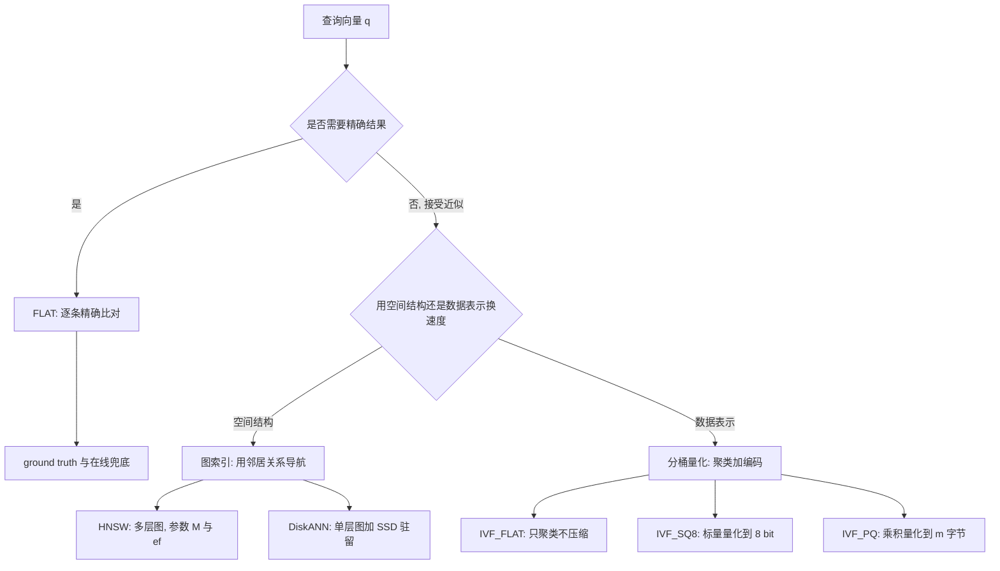
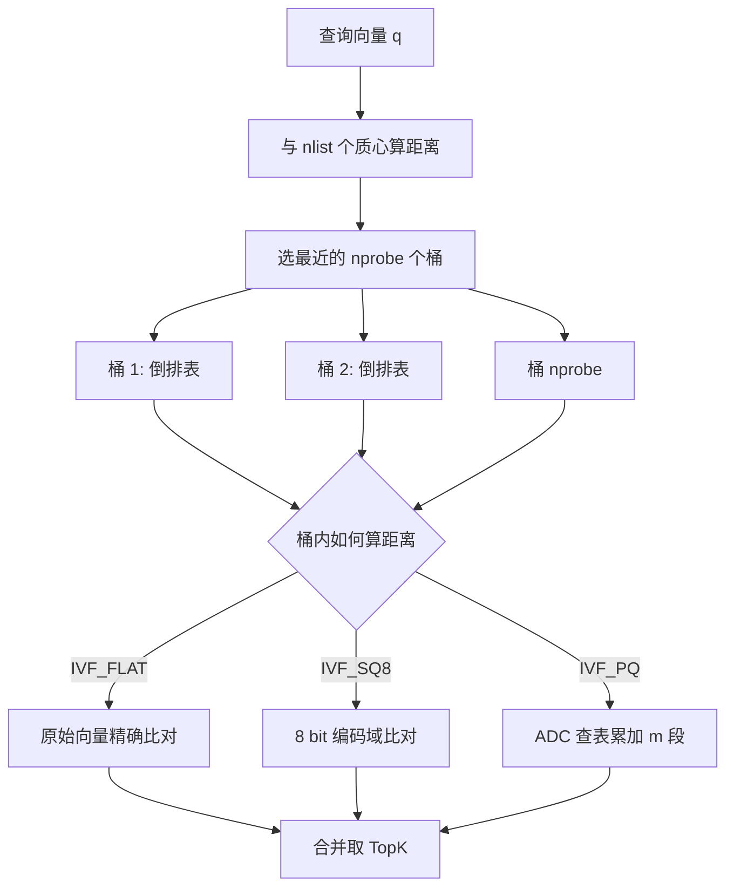
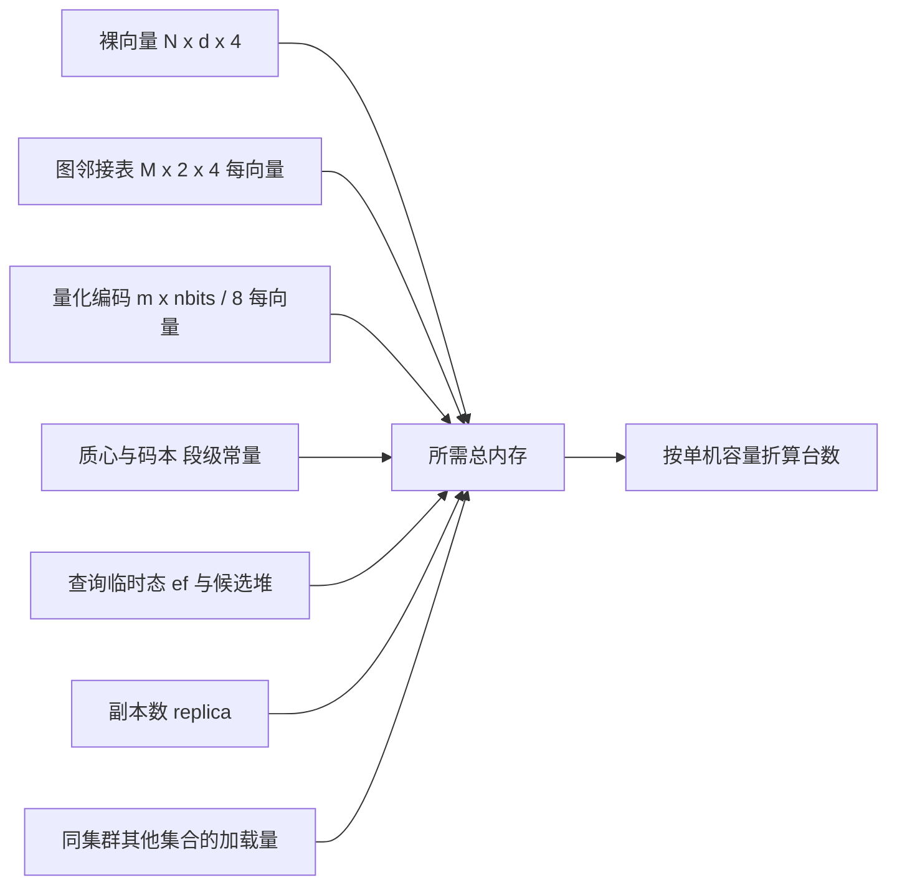
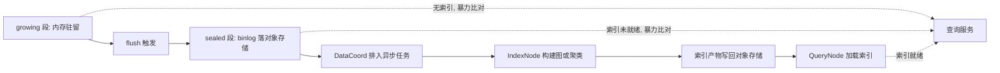
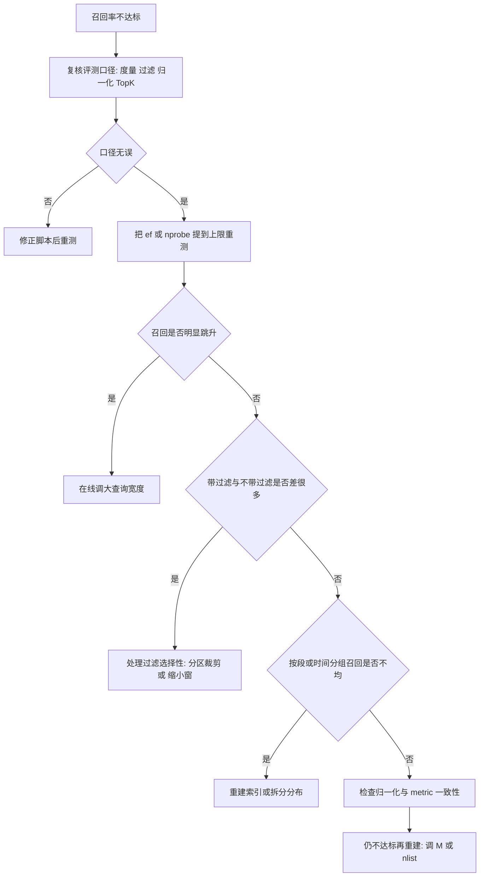

# 向量索引——从暴力搜索到 HNSW 与 IVF

**摘要：**

向量索引的参数表不长，十来个数字，但它们各自活在完全不同的生命周期里：`M` 与 `efConstruction` 在新索引建成的瞬间就固定下来，`ef` 与 `nprobe` 随每一次请求传入，而暴力搜索根本不靠参数，它是一把用来量别人准不准的尺子。本文从「索引参数换了，召回率为什么还是上不去」这个具体追问出发，先把 FLAT 摆回基线的位置，算清它精确但受内存带宽约束的物理成本，以及它不可替代的用途——为 ANN 提供地面真值；再沿着图索引与分桶量化两条路，拆开 HNSW 的 `M`、`efConstruction`、`ef` 与 IVF 系列的 `nlist`、`nprobe`、`m`、`nbits` 到底改变了什么；随后把三类索引在 1 亿与 768 维下的内存账逐项算出来，解释图的开销只占裸数据的百分之几、真正贵的是「必须全部驻留」这个前提，以及建索引为什么是一次**离线批处理**、它进行期间查询又如何靠暴力路径继续服务。最后归结到召回率偏低的五个成因、四类反例和一条调参判据：先动能在线上动的旋钮，再动需要重建索引的旋钮。

---

## 第 1 章 基线——暴力搜索留下的那把尺子

### 1.1 参数住在三个生命周期里

设想一个内容平台的图文检索库，最初只有 200 万条商品图与标题的联合向量，`HNSW` 用 `M=16`、`efConstruction=200` 建成，查询侧 `ef=64`，离线评测召回率 0.93，P99 延迟 12 毫秒，看上去一切正常。半年后库长到 4,000 万条，同一套参数下召回率掉到 0.86，运营侧反馈「搜出来的图越来越不像」，于是团队做了两件事：先把 `ef` 从 64 提到 128，召回回到 0.94，P99 涨到 19 毫秒；再把 `M` 从 16 提到 32 并重建索引，召回只多出 0.4 个百分点，重建却花了七个小时，期间同集群其他集合的查询尾延迟明显抖动。

这两次改动之所以代价悬殊，不是因为 `M` 比 `ef` 高贵，而是因为它们住在索引生命周期的不同层。把所有参数按「什么时候生效、改一次要付什么代价」摊开，大致是三层：

- 建模层：`index_type`、`metric_type`、向量维度、是否量化以及量化的编码方式（SQ8 的位宽、PQ 的 `m` 与 `nbits`）。这一层决定了内存的字节数与距离的近似方式，改一次就要把全量数据重新编码。
- 建索引层：HNSW 的 `M` 与 `efConstruction`、IVF 的 `nlist` 与 PQ 码本。它们在每个 sealed segment 建索引时生效，改一次要重建该集合的索引，代价随数据量线性放大。
- 查询层：`ef`、`nprobe`、`limit`、过滤表达式、一致性级别。它们随请求传入，改完下一个请求就生效，不需要动索引文件。

把参数按这三层摆好，一条判据就浮出来了：召回率不达标时，**先动查询层的旋钮**，因为它的试错成本接近零；只有把查询层推到上限仍然不够，才值得付重建索引的代价去动 `M`、`efConstruction` 和 `nlist`。这条判据在后面的召回排查里会反复出现，它不是经验之谈，而是由「哪些量已经烧进了索引文件」这个事实决定的。

### 1.2 暴力搜索的成本地板

暴力搜索在 Milvus 里叫 FLAT，名字本身就是「不建结构、原样平铺」的意思。查询时它把查询向量与集合里每一条向量都算一次距离，复杂度 O(N·d)，N 是向量条数，d 是维度。教科书到这个式子就停了，但真正决定它能不能上线的不是乘法次数，而是**内存带宽**。

先算字节数。float32 每维 4 字节，768 维一条向量 3,072 字节，200 万条约 6.1 GB（5.7 GiB），4,000 万条约 122.9 GB（114 GiB），1 亿条则是 307.2 GB（286 GiB）。再算带宽。一台两路服务器实测可持续的内存带宽大致在 100 到 200 GB/s 量级，按 200 GiB/s 量级做估算，扫完 114 GiB 需要至少 0.57 秒，扫完 286 GiB 需要至少 1.44 秒，这是单次查询的物理下限，与 CPU 核数几乎没有关系——加核只是把带宽分给更多线程，总吞吐受限于内存通道。

这两个数字有很直接的后果。在 200 万条规模上，FLAT 的时间下限约 29 毫秒，多线程分摊之后勉强能进「P99 几十毫秒」的在线口径，这也是不少团队在早期直接不开索引、用 FLAT 顶着跑的原因。到了 1 亿条，下限变成 1.4 秒，再怎么优化也只能得出「这条路不能用到线上」的结论。换句话说，FLAT 的适用范围不是由「数据量大不大」模糊决定的，而是由「裸向量的字节数除以内存带宽」这个除法决定的，而这个除法在维度和精度固定时是无解的。

计算量这边还有一层容易被忽略的账。1 亿 × 768 的乘加次数是 7.68×10¹⁰ 次，折算约 1.5×10¹¹ 次浮点运算；以单核 20 GFLOP/s 的有效算力估算，单核需要 7 秒以上，所以 1 亿规模的 FLAT 是计算受限的，多核确实能把它压下来。但 200 万条那档正好相反：乘加只有 1.5×10⁹ 次浮点运算，单核几十毫秒、十六核几毫秒就算完了，瓶颈回到内存带宽。一个查询先撞计算墙还是先撞带宽墙，取决于 N 与核数的比值，这也解释了为什么「加机器」在百万级 FLAT 上有效，在亿级 FLAT 上只能缓解而不能扭转。

### 1.3 尺子的三种用法

既然亿级数据用不了 FLAT，它还有存在的必要吗？有，而且不可替代——它是唯一能给出「正确答案」的东西。召回率不是一个能凭感觉判断的量：ANN 返回了 10 条结果，究竟漏掉了哪些真正的近邻，只有把全量数据精确算一遍才知道。FLAT 就是这个精确算一遍的载体，它的结果被称为**地面真值**（ground truth），召回率的定义式才有意义：

`recall@K = |ANN 返回的 TopK ∩ FLAT 算出的 TopK| / K`

这个式子看起来简单，却把三件事绑在一起：ANN 与 FLAT 必须使用同一个度量、同一套归一化、同一份过滤条件。任何一项不一致，算出来的就不是召回率，而是一个恰好落在 0 到 1 之间的数。工程上更常见的做法是先固定评测集：从真实流量里采样 1,000 到 10,000 条查询，离线用 FLAT 逐条算精确 TopK 并落盘，之后每次改索引参数都拿这份真值重算，成本就从「每次都要扫全量」降到「每次只扫采样集」。

FLAT 的第二种用法在查询路径上，只是平时不被注意。Milvus 里刚写入的数据落在 growing segment 里，这部分数据没有索引，查询时就是逐条比对；已经封段但索引还没建完的 sealed segment，同样会退到暴力比对。也就是说，FLAT 的能力一直挂在生产查询链路上，作为索引不可用时的兜底，后面第 6 章讲建索引进度时会再遇到它。

第三种用法是压测基准。想知道一个新索引在自家数据上到底快多少，最可靠的办法是同一批查询分别跑 FLAT 与 ANN，比延迟、比召回，而不是拿别人的 benchmark 数字往自己身上套——数据分布、维度、过滤条件任意一项不同，数字就不具备可比性。

### 1.4 标定一次要踩的六个坑

地面真值这件事听起来只是「跑一遍 FLAT」，实际执行时有六个地方会让结论失真，每一个都在真实项目里出现过。

第一是度量口径。建库时用 COSINE，评测脚本却用 L2 去算真值，两种度量对同一批向量的排序本来就不同，算出来的召回率反映的是度量差异，不是索引误差。第二是过滤条件。业务查询带 `expr="pub_date > 20250101 && category == 'tech'"`，真值却是在全量数据上算的，于是被过滤掉的向量全被算成「ANN 漏掉的近邻」，召回率凭空掉十几个点。第三是归一化。入库时对向量做了 L2 归一化，评测脚本直接读原始向量没归一化，或者反过来，都会让内积的排序整体偏移。第四是并列值。高维向量之间距离完全相等的概率不高，但在小数据集、低维或量化之后会明显上升，TopK 边界上的并列会让召回率抖动几个百分点，评测脚本应当固定并列时的排序规则（例如按主键升序），否则同一个参数跑两次会得出两个结果。第五是 TopK 口径。真值取 Top10，ANN 请求的 `limit` 是 20 却只截前 10 条比对，或者反过来把 20 条里去重后的结果当 10 条算，都会引入系统性偏差。第六是用建库数据当查询集。拿已经入库的向量去查自己，它的最近邻就是它自身，召回率必然接近满分，这种「自问自答」的评测在早期验证里非常常见，却几乎测不出任何问题。

对应的做法并不复杂：评测集从真实查询日志里采样、真值与 ANN 走同一份过滤表达式与同一份归一化结果、并列规则写进脚本、TopK 与 `limit` 严格对齐、查询向量与库内向量做去重。这些都属于工程卫生，但它们决定了后面所有调参结论是否可信。

### 1.5 度量：三种相似度的前提

度量不是索引参数，却决定了索引有没有意义。Milvus 在浮点向量上支持三种度量，它们的差别不在公式，而在前提。

| 度量 | 排序依据 | 前提 | 前提不成立时的症状 |
|---|---|---|---|
| L2 | 欧氏距离的平方（Milvus 只算到平方，省掉开方） | 关心绝对位置差异；向量未归一化时也成立 | 高维下距离普遍接近，区分度低 |
| IP | 内积，模长直接参与排序 | 向量必须已归一化 | Top1 往往不是查询自身；长向量被系统性偏好 |
| COSINE | 夹角余弦，只关心方向 | 只关心语义方向，接受归一化开销 | 与 IP 混用时同一批数据的排序会漂移 |

L2 那条括号值得展开一句：Milvus 在欧氏距离下只计算平方值，不做开方。因为开方是单调变换，不影响排序结果，省掉它只损失一个常数因子，却省下每条向量的一个 `sqrt`，在千万级扫描里是实打实的收益。这也提醒一件事：日志里看到的 L2 分数是平方值，跨数据集比较分数绝对值没有意义。

IP 的前提最容易被忽视。Milvus 文档的常见问题里专门写了一条：用内积做度量时，Top1 结果往往不是查询向量自身，原因就是没做归一化。内积把模长也算了进去，一段很长的文本 embedding 天然得分更高，于是「相似」被偷换成「又长又相似」。归一化之后内积等于余弦相似度，两种度量在数学上等价，这时选 IP 只是因为它比 COSINE 少一层运行时归一化。

COSINE 把归一化交给数据库处理，省事但把不变量藏起来了。一旦入库管道自己也做归一化、查询侧又忘了做，两边的尺度就对不上；更隐蔽的是更换 embedding 模型——新模型输出的向量没有归一化，旧数据已经归一化，同一个集合里混着两种尺度的向量，索引本身没坏，排序结果却已经不可解释。因此工程上更稳的约定是：**归一化定在入库管道里**，作为写路径的不变量；索引与查询一律按 IP 处理，让「归一化」这件事在系统中只存在一个位置。

---

## 第 2 章 两条路——图索引与分桶量化

### 2.1 从树到图，从空间划分到数据编码

高维近邻搜索的第一代解法是空间划分。1975 年提出的 KD 树按维度轮流切分空间，低维时查询接近对数复杂度；但随着维度升高，划分的有效性迅速崩塌——高维空间里大部分点都落在超平面附近，切分带来的剪枝收益趋近于零，查询退化成线性扫描。这个现象通常被概括为**维度灾难**，它的直接含义是：基于「空间分割」的方法在 d 大于几十之后基本失效。

第二代解法改换思路，接受近似。1998 年的局部敏感哈希（LSH）用一族随机投影把相近的点以较高概率映射到同一个桶里，代价是需要多张哈希表才能把召回做上去，空间放大严重。2003 年，Sivic 与 Zisserman 在视频检索里提出用聚类中心做「视觉词」，把每帧图像表示为词的直方图并建倒排表——这是倒排文件（IVF）在向量检索里的原型，它把「分区」这件事从切分空间变成了围绕聚类中心分组。2011 年，Jégou 等人把乘积量化（PQ）引入近邻搜索，用码本编号代替原始坐标，压缩比一下提升到几十倍，IVF 与 PQ 的组合成了此后十年里最常用的省内存方案。

图这条线出现得更晚。2014 年 Malkov 等人把「可导航小世界」引入近邻搜索：既然高维空间里的距离区分度差，那就不要依赖全局几何，而是依靠一张局部连接图做贪心游走。2016 年同一位作者把单层图改成多层图，得到 HNSW，在多数公开数据集上把召回与吞吐同时推高了一个档次。两条线的分野至此清晰：一条改造数据的表示，另一条改造数据的邻居关系。

### 2.2 图索引的直觉

把向量库想成一座城市，每个向量是一个地址，两个向量相近就是两条街离得近。暴力搜索相当于挨家挨户敲门问「你是不是离目标最近的」，图索引则相当于给每个地址配一份「邻居推荐名单」：从城郊的某个入口出发，每走一步都问「我的邻居里谁离目标更近」，朝那个方向移动，直到周围再没有更近的邻居。

单靠这份名单会遇到一个麻烦：如果每个人都只认识最近邻，那就没有跨越长距离的捷径，从城市一端走到另一端要经过几百个中转。HNSW 的解法是给地址分层，高层保留少量「枢纽」地址，它们的推荐名单里包含远距离连接，负责快速接近目标区域；越往下节点越密、连接越短，负责在局部精确定位。这套结构与跳表的多层索引思路同源，可以对照阅读 [[02 MemTable 与 SkipList]]：两者都用概率性的分层把「跨度大的少、跨度小的多」这件事编码进结构里。

### 2.3 分桶量化的直觉

分桶路线的比喻更像图书馆。管理员先把书架按主题分成若干区（聚类），每个区挂一块指示牌写着该区的「平均内容」（质心）；读者进门先看指示牌，判断自己要找的书大概在哪几个区，然后只在这几个区里翻。翻原文这个动作很贵，于是又引入第二层压缩：给每个区准备一本只有 256 页的小册子，每页是一种典型内容，每本书不再记录全文，只记录「你属于第几页」（编码）。查找时读者把需求也拆成若干段，逐段对照小册子估分，几段分数相加就是这本书的近似相关度。

这套两级结构对应的就是 IVF 与 PQ：`nlist` 个区是粗筛，`nprobe` 个区是实际要翻的书架，码本编号是书的摘要长度，`m` 与 `nbits` 决定摘要有多长、能把原文还原到多准。压缩越狠，摘要就越是「大意」而不是「原文」，估分误差随之上升——这是量化路线的固有代价，不是实现缺陷。

### 2.4 两条路的代价结构

两条路线在代价结构上完全不同，理解这一点比记住参数默认值更重要。

图索引的查询代价主要在「跳数 × 每跳邻居数」，与向量维度关系不大：一次查询走几十步、每步检查几十条边，评估的候选数由 `ef` 控制。它的内存由原始向量加邻接表构成，稠密度的变化会直接改变内存与建索引时间。它的失效模式是**图断了**：度数不足、剪枝过度、或者分布突变导致某些区域连接稀疏时，召回会突然掉下来，而延迟变化很小——这恰好是最难察觉的一种退化。

量化索引的查询代价主要在「探多少个桶 × 桶内条目数」，与数据总量近似成反比关系：`nlist` 越大桶越小，同样 `nprobe` 下扫描的条目越少。它的内存主要由编码位数决定，与稠密度无关。它的失效模式是「码本失真」：压缩比越高，估分误差越大，召回随压缩比单调下降，延迟却几乎不变——同样是「不报错但变差」的形态，只是原因不同。

用一张图把两条路线的分岔讲清楚：

图中的两条主线并非互斥，新版本里已经出现了把图与量化组合起来的索引类型（例如 HNSW 叠加标量量化或乘积量化的变体），组合的动机很直接：图的召回好但内存贵，量化省内存但召回差，两者叠加可以在中间取一个点。具体支持哪些组合、参数如何命名，以对应版本的文档为准。

---

## 第 3 章 HNSW 的四个参数，与它们真实改变的东西

### 3.1 图是怎么长出来的

HNSW 的建索引过程是逐点插入，每插入一个节点做四件事：给它抽一个最高层级、在上层做贪心定位、在它所属的各层里用候选集选边、边数超限时剪枝。

层级抽样的公式是 `l = floor(-ln(U) · mL)`，其中 `U` 是 0 到 1 之间的均匀随机数，`mL = 1/ln(M)`。这个分布让节点出现在第 `l` 层的概率随 `l` 指数衰减，于是高层节点极少、底层包含全部节点。`mL` 与 `M` 挂钩意味着 `M` 一变，整个层级分布也跟着变，这是 `M` 影响面比想象中大的原因之一。

选边发生在第 0 层到第 `l` 层。在每一层，算法先用 `efConstruction` 大小的候选集做一次近似搜索，找到一批候选邻居，再从中挑出最多 `M` 条边（第 0 层的上限通常放宽到 `2M`）。挑法不是简单取最近的 `M` 个，而是用**启发式剪枝**：一个候选只有在「它到新节点的距离」小于「它到已选邻居的距离」时才保留，这条规则让保留的边分散在不同方向上，避免所有边都指向同一片区域——如果只留最近的 `M` 条，图的局部会挤成一团，长程导航能力随之丧失。

这段机制解释了一个常见的困惑：为什么 `M` 既影响内存、又影响建索引时间、还影响查询。因为它同时决定了边的条数（内存）、建图时要评估与剪枝的候选规模（建索引时间）、以及每次查询每个节点能提供多少条可选路径（查询宽度）。

### 3.2 M：每层连接数

`M` 是索引层参数，写下就烧进索引文件。Milvus 2.x 早期文档给出的取值范围是 `[4, 64]`、默认 16；较新的文档把默认值改成了 30、范围放宽到 `[2, 2048]`，并建议落在 `[5, 100]`。两个版本的数字都要记住，因为老集群上的索引很可能是按 16 建的，直接拿新默认值去对比会得出错误结论。判断线上实际值的方法不复杂：`describe_index` 会返回建索引时用的参数。

调大 `M` 的直接收益是图更密，同一 `ef` 下可探索的路径更多，召回基线抬高；代价有三个：内存按 `M × 2 × 4` 字节每向量增长，`M` 从 16 到 32 就是每向量多出 128 字节；建索引时间上升，因为每个节点要评估与剪枝更多候选；查询时每跳要检查的邻居变多，延迟小幅上升。调小 `M` 则相反，省内存、建得快，但图更容易出现连通性不足，低 `ef` 下召回掉得更快，且对分布不均匀的数据更敏感。

一条实用的判断是：如果 `ef` 已经扫到 512、延迟还能接受，召回仍然差几个百分点，再考虑把 `M` 翻倍重建；如果 `ef` 在 64 到 128 之间就已经能压住延迟，多半不需要动 `M`。

### 3.3 efConstruction：只改建图质量

`efConstruction` 是建索引时每次插入使用的候选集大小，取值范围在新文档里是 `[1, int_max]`、默认 360，建议 `[50, 500]`；早期文档给的是 `[8, 512]`、默认 200。它**只作用于建图**：候选集越大，选出的边越接近「真实最近邻」，图的质量越高。

这里有个容易被忽略的约束：候选再多，最终留下的边数仍由 `M` 封顶。所以 `efConstruction` 提高的是「这 `M` 条边选得准不准」，而不是「边更多」。这解释了为什么 `efConstruction` 从 200 提到 400 通常带来一两个点的召回提升就趋于平缓——边的容量是硬上限。

它对查询层的影响是间接的：不改变查询时的候选堆大小，也不改变查询要评估的节点数上限，但更好的图会让同样的 `ef` 走出更短的路径、命中更准的邻居，于是同参数下召回更高、延迟略低。反过来说，`efConstruction` 调低不会立刻让查询变慢，而是让「召回天花板」下降，这种退化在参数表上看不出来，只能靠评测发现。

### 3.4 ef：唯一能在线上动的旋钮

`ef` 是查询参数，随请求传入，改完立刻生效，不需要重建索引——Milvus 文档明确写了这一点，它也是调参时**最该先动的东西**。

它的作用范围仅限图的第 0 层。查询从顶层入口开始贪心下降，到第 0 层后改为维护一个大小为 `ef` 的候选堆：不断从堆里取出最近的候选、检查它的邻居、把更近的邻居放进堆，直到堆里最小的候选都比结果集中最远的还远，搜索终止，结果集取前 `limit` 条。`ef` 越大，候选堆越宽，搜索愿意多绕几步，召回越高，延迟越大；但延迟增长是**次线性**的，因为候选堆变大以后，很多新增的候选只是在堆里排队而没有真正扩展，边际收益递减。

两个硬约束必须记住：`ef` 必须大于等于 `limit`，否则候选集装不下要返回的条数；默认值是 `max(limit, 16)`，范围搜索时是 512。文档给的建议区间是 `[K, 10K]`，工程上从 `2 × limit` 起步、按需翻倍，比一上来设 512 更容易找到拐点。还有一条版本差异：有的接口把 `search_list` 作为图索引查询宽度的通用名字（DiskANN 一直用这个名字），有的版本接受它作为 `ef` 的别名，两者语义相同但生效情况要以对应版本文档与实际返回为准。

### 3.5 同一个旋钮的四个名字

这个旋钮在不同系统里有不同叫法，混用是配置写错的常见来源。

| 名字 | 出处 | 语义 |
|---|---|---|
| `ef` | Milvus 的 HNSW | 第 0 层候选堆大小 |
| `search_list` | Milvus 的 DiskANN，部分版本兼容图索引 | 同上，候选列表长度 |
| `efSearch` | FAISS 的 HNSW | 同上 |
| `num_candidates` | Elasticsearch 的 kNN 检索 | 每个分片探测的候选数，语义对应但要乘以分片数 |
| `hnsw.ef_search` | pgvector | 同上 |

名字不同，语义都是「查询期评估的候选规模」，都属于**在线旋钮**。真正需要留意的差别在于作用域：Milvus 里索引是段级的，`ef` 是每个段各自生效的，一次查询的总评估量约等于「段数 × ef」；而 ES 的 `num_candidates` 是每个分片生效的，总评估量约等于「分片数 × num_candidates」。同样的数字在不同的架构下代表的成本并不相同。

### 3.6 四个参数的影响面

把 HNSW 的四类参数按「调大调小各自付什么代价」列成表，比读十页文档有效：

| 参数 | 生效阶段 | 调大的代价 | 调小的代价 | 是否需重建 |
|---|---|---|---|---|
| `M` | 建索引 | 内存每向量 +8 字节 × 2M；建索引时间上升；每跳邻居变多 | 图连通性变差，低 `ef` 下召回掉得快 | 是 |
| `efConstruction` | 建索引 | 建索引时间近似线性上升；建索引瞬时内存上升 | 图质量下降，召回天花板降低 | 是 |
| `ef` | 查询 | 延迟上升（次线性），吞吐下降 | 召回下降，且低 `ef` 时掉得比延迟快 | 否 |
| `limit`（TopK） | 查询 | 返回条数多，下游处理成本上升 | 候选不足，召回无法表达 | 否 |

最后一行虽然不是索引参数，但它与 `ef` 的耦合足以让一次调参失败：`limit` 一提，`ef` 没跟着提，结果就是召回下降而延迟几乎没变。

### 3.7 扫一遍 ef，看曲线形状

调参不该猜。做法是固定数据、度量、`limit` 与过滤条件，只让 `ef` 变化，记录召回、P50/P99 延迟与吞吐。下表是一组示例推算，用来说明曲线的形状而不是给出可直接抄的数字：数据是 768 维、单机 8 核、`topK=10`、`M=16`、`efConstruction=200`。

| `ef` | recall@10 | P50 延迟 | 单机 QPS | 边际变化 |
|---|---|---|---|---|
| 16 | 0.78 | 1.2 ms | 2,600 | 基线，候选堆几乎没有余量 |
| 32 | 0.88 | 1.5 ms | 2,100 | 召回 +10 点，延迟 +25% |
| 64 | 0.94 | 2.1 ms | 1,500 | 召回 +6 点，延迟 +40% |
| 128 | 0.975 | 3.2 ms | 950 | 召回 +3.5 点，延迟 +52% |
| 256 | 0.99 | 5.6 ms | 520 | 召回 +1.5 点，延迟 +75% |
| 512 | 0.996 | 10 ms | 280 | 召回 +0.6 点，延迟 +79% |

这张表的读法不是「选 128」，而是看边际收益在哪里断掉。从 32 到 64 每多花 0.6 毫秒换来 6 个点召回，从 256 到 512 每多花 4.4 毫秒只换来 0.6 个点，拐点大致在 128 附近。真实数据上的拐点位置取决于维度、分布与 `M`，但「先陡后平」的形状是稳定的，这也是为什么先扫 `ef` 比先猜 `M` 更划算。

---

## 第 4 章 IVF 系列——把数据装进更小的盒子

### 4.1 聚类与倒排

IVF 的建索引过程分两步。第一步用 k-means 把段内向量聚成 `nlist` 个簇，每个簇一个质心；第二步为每个簇维护一张倒排表，记录落在这个簇里的向量编号。查询时先算查询向量到 `nlist` 个质心的距离，挑出最近的 `nprobe` 个簇，只在这几个簇的倒排表里做精确或近似距离计算。

这里有个容易被跳过的前提：Milvus 的索引是段级构建的，`nlist` 个质心是在这一个段的数据上训练出来的，不是在全表上训练的。这个事实会影响所有经验公式的用法，第 4.2 节展开。

代价结构很直观：桶内平均条目数是 `N/nlist`，查询要扫的条目数约等于 `nprobe × N/nlist`。所以「快」来自两个比值的乘积：`nlist` 把大表切小，`nprobe` 决定切几块来扫。召回则取决于「真实近邻落在被探簇里的概率」，这个概率与 `nprobe/nlist` 正相关，但相关的方式不是线性的——查询向量落在簇边界附近时，真实近邻很可能在对面的相邻簇里，这时即使 `nprobe` 不小也可能整簇错过。

### 4.2 nlist 怎么取

经典的经验规则是 `nlist` 取 `4√N` 到 `16√N` 之间，其中 N 是被聚类的向量条数。把这句话直接套到「1 亿条数据」上会得到 `4√10⁸ ≈ 40,000`，而 Milvus 文档给的默认值是 128、建议区间是 `[32, 4096]`，两者差了一个数量级。差异的原因不在公式，而在 N 的口径。

按 Milvus 的**段级构建模型**，建索引时实际参与聚类的只是单个 sealed segment 里的向量。段的上限由配置决定（默认量级在 512 MB，以对应版本文档为准），768 维 float32 每条 3,072 字节，一个满段大约十几万条向量。把这个数代回公式：

| 段内向量数 | `4√N` | `16√N` | 桶内平均条目（`nlist=4√N`） |
|---|---|---|---|
| 5 万 | 894 | 3,578 | 56 |
| 17 万 | 1,650 | 6,598 | 103 |
| 50 万 | 2,828 | 11,314 | 177 |
| 1 亿（不分段假设） | 40,000 | 160,000 | 2,500 |

表格最后一行正是「把全表当 N」的错误用法，它算出的桶内条目仍有 2,500 条，看上去也说得通，但 Milvus 里根本不存在一个包含 1 亿条向量的段，按 40,000 建索引只会在每个十几万条的段上得到一百多个桶、每桶几十条，聚类开销白白翻倍而精度没有改善。

这也顺带解释了另一个现象：分片数、段大小、compaction 策略会改变实际召回。同样 `nlist=128`，在 17 万条的段上是每桶 1,300 条，在 compaction 后 50 万条的段上是每桶 3,900 条，`nprobe` 相同而扫描量差三倍。段与 compaction 的机制见 [[03 数据模型——Collection、Partition 与 Segment]]，容量规划见 [[06 Milvus 运维——集群部署、索引调优与容量规划]]。

### 4.3 IVF_FLAT

`IVF_FLAT` 是最朴素的一档：只做聚类，倒排表里存原始向量，查询时对桶内向量做精确距离计算。所以它的召回损失**只来自一件事**——真实近邻没落在被探的桶里；落在桶里的近邻不会因为量化而丢分。

这让它的参数语义变得很干净：`nprobe` 等于 `nlist` 时退化为全量精确搜索，召回 100%，延迟最差；`nprobe` 越小越快，漏掉的是「在相邻桶里」的那部分近邻。它也提供了一个好用的中间档：当 HNSW 的内存吃不下、PQ 的召回又不够时，`IVF_FLAT` 用「多探几个桶」换召回，代价只在延迟上，内存与裸数据相同。

### 4.4 IVF_SQ8

`IVF_SQ8` 在聚类之上加了一层标量量化：对每个维度，用段内该维的最小值与最大值把 `[min, max]` 均匀切成 256 份，每个分量从 4 字节的 float32 压成 1 字节的整数编号，距离在量化后的空间里计算。

效果是内存直接除以 4，768 维从每条 3,072 字节降到 768 字节，而召回只下降少量——量化的误差是每维 `(max-min)/256`，对 768 维向量累加之后仍然是有界的小扰动，通常不会把 Top10 的排序打乱太多。它的代价主要出现在分布不均的数据上：某一维的取值如果高度集中在一个窄区间，头部少数极值会把 `[min, max]` 拉得很开，其余点被压到很窄的量化区间里，区分度骤降。这种数据用 SQ8 会看到召回下降得比预期多，处理办法是增大 `nprobe` 补偿，或者改用 PQ。

### 4.5 IVF_PQ

`IVF_PQ` 把量化推到极限：把 d 维向量切成 `m` 段子向量，每段独立做 k-means 得到 `2^nbits` 个质心，每段子向量只记录它属于哪个质心的编号。存储量从 `d × 4` 字节降到 `m × nbits / 8` 字节，768 维、`m=64`、`nbits=8` 时是每条 64 字节，压缩 48 倍。

查询时不需要把编码解回原始向量，而是用非对称距离计算（ADC）：先把查询向量按同样的方式切成 `m` 段，预先算出每段与对应码本中全部 256 个质心的距离，得到 `m` 张各 256 项的距离查找表；之后对每个候选向量，按它的 `m` 个编号去表里查值并累加，就得到近似距离。这一步只需要 `m` 次查表相加，与维度无关，所以 PQ 的查询是内存访问密集而非计算密集——瓶颈在随机访存与 TLB，而不是浮点单元。

参数上有三条硬约束。`m` 必须整除维度，768 维可以是 32、48、64、96、192；`m` 越大压缩越轻、召回越好，建议区间文档给的是 `[d/8, d]`，常见取值是 `d/2` 或 `d/4`；`nbits` 决定码本大小，默认 8，文档给的取值范围是 `[1, 24]`、建议 `[1, 16]`，但超过 8 之后收益迅速变小而实现代价上升。召回损失的根本来源是**子空间独立假设**：PQ 假设各段子向量互不相关，而真实的 embedding 各维之间往往有相关性，切成段之后这部分信息被丢掉了，`m` 越小丢得越多。

### 4.6 三类 IVF 的取舍

| 索引 | 每向量内存 | 召回倾向 | 主要旋钮 | 适用条件 |
|---|---|---|---|---|
| IVF_FLAT | `d × 4` 字节 | 接近全精度，损失只来自漏桶 | `nlist`、`nprobe` | 内存够，需要高召回且能容忍比 HNSW 更高的延迟 |
| IVF_SQ8 | `d × 1` 字节 | 略低于 IVF_FLAT，通常几个点以内 | `nprobe` | 内存为裸数据的 1/4 仍嫌多 |
| IVF_PQ | `m × nbits / 8` 字节 | 明显低于前两者，靠 `nprobe` 补偿 | `nprobe`、`m`、`nbits` | 内存是硬约束，可接受召回换容量 |

三档的递进关系是**压缩率换召回**，而不是「新一代替代老一代」。判断该停在哪一档的算法很简单：算出裸数据的内存需求，再算「单机可用内存 ÷ 副本数 ÷ 集合数」，如果结果连裸数据都装不下，才往下一档走；如果装得下裸数据，就停在 IVF_FLAT，不要为了省内存主动引入量化误差。

把 IVF 的查询路径画成流程图，`nlist` 与 `nprobe` 的位置会更清楚：

---

## 第 5 章 内存账——1 亿 × 768 维到底要多少内存

### 5.1 裸数据

内存账的第一项永远是最简单的那项：`N × d × 4` 字节。1 亿条 768 维 float32 是 307.2 GB，换算成 GiB 是 286.1；如果维度是 1,536（部分新模型的输出维度），这个数直接翻倍到 614.4 GB。除此之外还要算上主键、标量字段、段元数据与索引文件的头部开销，工程上通常按裸数据的 10% 到 20% 追加余量。

### 5.2 图的开销

HNSW 在裸数据之外还要存邻接表。第 0 层每个节点的边数上限是 `2M`，其余层是 `M`，每条边存一个目标节点的编号（4 字节），所以每向量大致是 `M × 2 × 4` 字节的图开销：`M=16` 是 128 字节，`M=32` 是 256 字节。1 亿条向量时，`M=16` 约 12.8 GB，`M=32` 约 25.6 GB。

这个量级常被误判为「可以忽略」。它确实只占裸数据的 4% 到 8%，但在两个场景里会变得关键：一是维度偏低时，图开销相对于向量的占比会上升；二是内存已经卡在单机上限时，多出的十几 GB 正好决定要不要多开一台机器。此外 `M` 变大还会影响建索引的瞬时内存，因为构建过程要维护候选集与剪枝所需的临时结构。

### 5.3 编码的开销

量化索引的内存由编码位数决定，与维度只有间接关系：`IVF_SQ8` 是每维 1 字节，`IVF_PQ` 是每向量 `m × nbits / 8` 字节，另外每个段还要存 `nlist` 个质心与 PQ 码本（`m × 2^nbits × (d/m) × 4` 字节），这些是段级常量，在段数不多时相对整段数据可以忽略，但段数上千时需要单独核一遍。

### 5.4 三类的算例

把 1 亿条 768 维向量在各类索引下的内存算成一张表，按单机可用 256 GiB 折算所需台数。表中不含副本放大，副本数按需再乘。

| 索引与参数 | 每向量字节 | 1 亿条合计 | 相对裸数据 | 256 GiB 单机台数 |
|---|---|---|---|---|
| FLAT / IVF_FLAT | 3,072 + 元数据 | 307.2 GB（286 GiB） | 1.0× | 2 |
| IVF_SQ8 | 768 | 76.8 GB（71.5 GiB） | 0.25× | 1 |
| IVF_PQ，m=96 | 96 | 9.6 GB（8.9 GiB） | 0.031× | 1 |
| IVF_PQ，m=64 | 64 | 6.4 GB（6.0 GiB） | 0.021× | 1 |
| IVF_PQ，m=32 | 32 | 3.2 GB（3.0 GiB） | 0.010× | 1 |
| HNSW，M=16 | 3,072 + 128 | 320 GB（298 GiB） | 1.04× | 2 |
| HNSW，M=32 | 3,072 + 256 | 332.8 GB（310 GiB） | 1.08× | 2 |

这张表最有用的地方不是绝对值，而是几组比值。第一组：HNSW 与 FLAT 的内存几乎一样（多 4% 到 8%），所以「HNSW 费内存」这个说法不准确——它费的是**必须全部驻留**这个前提，而不是单条向量更贵。第二组：SQ8 把 286 GiB 压到 71.5 GiB，一台机器放得下，代价是召回少几个点。第三组：PQ 的 `m` 从 96 降到 32 只省 6.4 GB，却要多丢一截召回，在 1 亿规模上这点节省往往不值得。

再用一张图把内存账的分项叠加关系讲清楚：

图中右侧两个分项经常被漏算：副本数让内存直接翻倍，同集群其他集合共享 QueryNode 内存池则让「单集合算得下」不等于「集群放得下」。容量规划要按总加载量而不是单集合来做，这部分细节在 [[06 Milvus 运维——集群部署、索引调优与容量规划]] 里展开。

### 5.5 装不下时的两条岔路

内存账算出来放不下，有两条岔路。一条是把数据放到磁盘上由操作系统页缓存兜底，也就是 mmap 方式加载，好处是内存预算可以小于数据集，坏处是冷数据查询会退化成磁盘随机读，延迟由 IO 决定，且性能高度依赖「热集大小」与页缓存命中率。另一条是换磁盘驻留型索引，例如 DiskANN：它用单层图（Vamana）配合 PQ 编码常驻内存做粗筛，原始向量留在 SSD 上做精算，节点数据按扇区对齐打包，并用束搜索（beam search）把多个随机读并行发出去。这条路把「延迟换容量」的杠杆拉到最大，代价是延迟对 IO 质量敏感、建索引更慢。

### 5.6 内存账的三个修正项

算完表格还不能直接买机器，有三个修正项要把数字往上抬。

一是**加载峰值**。QueryNode 加载一个段时，索引数据从对象存储拉下来、反序列化、再放进内存，过程中可能有一段时间新旧两份同时在（例如热加载或重新加载），峰值内存高于稳态。二是副本。`replica_number` 每加一，内存就多一份，而副本的意义是可用性与吞吐，不是容量。三是其他集合。同一个 QueryNode 上可能挂着多个集合，各集合的 `load` 状态独立但内存池共享，规划时要按「总加载量 × 副本」来算，并且预留 compaction、建索引等操作的瞬时开销。

---

## 第 6 章 建索引的代价

### 6.1 索引在什么时候被建出来

Milvus 的索引进度落后于写入进度。新数据先进入 growing segment，驻留在内存里、没有索引，查询时逐条比对；当段达到大小阈值、停留时间超限或手动触发 flush 时，DataNode 把它封成 sealed segment，把 binlog 写到对象存储；随后 DataCoord 排入一个异步建索引任务，由 IndexNode 执行（standalone 或小规模部署里这份工作可能与别的 worker 合并），产物（图、质心、编码）同样写回对象存储；最后 QueryCoord 调度 QueryNode 把索引加载进来，查询才切换到索引路径。

这一串步骤意味着「建索引」不是一个可以顺手做的小动作，而是一次离线批处理：它读全段数据、占用大量 CPU 与临时内存、产出几份新文件、再触发一次加载。把这项工作放在异步队列里，正是为了不让它挡住写路径——写入只关心 binlog 落盘，索引什么时候建完是另一条时间线。

### 6.2 建索引期间查询还在服务

索引没建完的段并不会被摘出查询路径，它会退到暴力比对。这条兜底路径在 growing segment 上一直生效，在 sealed segment 上则一直生效到索引加载完成为止。所以「重建索引」期间服务不断，只是部分段的查询走的是慢路径，表现为尾延迟上升、平均延迟变化不大——如果集合里段数很多而重建的只是其中一部分，这个退化甚至很难被平均值掩盖。

真正需要警惕的不是慢，而是**建索引与查询抢资源**。IndexNode 默认与 QueryNode 分属不同角色，小规模部署里却常常挤在同一批机器上：建索引把 CPU 打满，同一节点的查询尾延迟跟着抖，而这类抖动在监控上表现为「偶发、找不到规律」。可行的做法是给建索引留出限流或时间窗，或者把 IndexNode 单独部署，这两件事属于运维侧，详见 [[06 Milvus 运维——集群部署、索引调优与容量规划]]。

### 6.3 时间量级

建索引的耗时大致正比于「向量条数 × 每次插入的候选评估数 × 维度」。HNSW 每次插入的候选评估数在 `efConstruction=200` 时约为 10³ 量级（候选集扩张 3 到 5 倍），一个 17 万条的段约 1.7×10⁸ 次距离计算，乘 768 维是 1.3×10¹¹ 次维度运算，8 线程下大致是分钟到十几分钟；1 亿条约 590 个这样的段，在多个 IndexNode 上并行，整体是小时级。这是量级判断，具体数字随 `M`、`efConstruction`、维度与机器差异很大，但它足以回答一个实际问题：为什么「重建索引」必须排进变更窗口，而不能随手触发。

`IVF` 系列的时间账不一样，它的主要成本在 k-means 迭代而不是逐点插入：`nlist` 越大、迭代轮数越多，聚类越慢，但与 `nprobe` 无关；`IVF_PQ` 还要为每个子空间训练码本，`m` 越大训练越久。所以在同样数据量下，IVF 建索引通常比 HNSW 快，这也是它在批量导入场景里仍被使用的原因之一。

### 6.4 变更索引类型的代价

`index_type` 不是可以热切换的配置。换类型、换 `M`、换 `nlist`、换量化的 `m` 与 `nbits`、换 `metric_type`，都意味着现有索引文件作废：要么删掉重建，要么在集合层面重新 `create_index`，然后重新 `load`。重建期间旧索引文件已经失效，各段退到暴力路径，直到新索引陆续建好——这是「调 `M` 很贵」这句话的完整含义，不只是耗时，还包括这段时间的性能退化。

有一条实践值得记住：把索引参数变更和 embedding 模型变更绑在一次变更里做。两者都会让索引必须重建，分开做等于付两次代价；而在重建窗口里，正好可以顺便把评测集跑一遍，用 1.3 节的方法确认新参数确实带来了召回提升，而不是只带来了更长的构建日志。

用一张流程图把段的状态与索引可用性对齐：

---

## 第 7 章 召回率低的五个成因

### 7.1 先怀疑评测，再怀疑索引

召回率掉下来，第一反应往往是调参数，但真实项目里相当一部分「召回低」最后被证明是评测脚本的问题：真值用了另一种度量、过滤条件没对齐、归一化只做了一边、TopK 口径不一致、或者查询集本身就是从库内向量里抽的。这些坑在第 1.4 节已经列过，这里要强调的不是复核流程，而是顺序——**先花二十分钟确认口径**，比花四小时重建索引往往更有效。

确认口径无误之后，五个成因基本能覆盖绝大多数情况：`ef` 或 `nprobe` 太小、TopK 超过 `ef`、数据分布与训练集不一致、归一化不一致、过滤条件与索引联合时的选择性。下面逐个给判据。

### 7.2 成因一：ef 与 nprobe 太小

这是最常见也最好修的一类。判据很直接：把 `ef` 提到 512（或把 `nprobe` 提到 `nlist/8`）重测同一批查询，如果召回明显跳升，就说明查询宽度不够，而不是索引质量不行。跳升多少算明显，取决于原来离目标差多远——从 0.86 跳到 0.95 是宽度问题，从 0.86 跳到 0.88 就不要再往这个方向找了。

注意区分「宽度不够」与「图质量不够」：前者调 `ef` 立刻见效且不需要重建，后者无论 `ef` 提到多少都只有微弱改善。区分方法就是这一步的对照实验。

### 7.3 成因二：TopK 大于 ef

`ef` 必须大于等于 `limit`，Milvus 对普通 kNN 搜索会做校验，多数版本会直接拒绝不满足条件的请求。所以这个成因很少以「报错」的形式出现，它以两种更隐蔽的方式出现：一是上游把 `limit` 动态放大（例如重排阶段取 100 条候选，而 `ef` 仍固定为 32），校验通过但候选集不足，结果被截断；二是范围搜索用了默认的 `ef` 而对返回条数没有预期，导致半径内的结果被候选堆大小限制。

判据是检查请求参数：把 `limit` 与 `ef` 一起打日志，看二者比值。工程上让 `ef` 至少是 `limit` 的 2 倍起步，是成本很低的一条保险。

### 7.4 成因三：数据分布与训练集不一致

这一条主要针对 IVF 系列，因为它的质心与码本是从数据里训练出来的。Milvus 的索引按段构建，每个段用自己的数据训练 `nlist` 个质心与 PQ 码本，这带来两个后果。

第一个后果是段内分布的纯度直接影响参数效果。如果一个段里混着图文、纯文本、多语言几种模态的向量，聚类中心会被平均成「谁也不像」的几个点，桶的边界模糊，同样的 `nprobe` 自然覆盖不到真实近邻；而如果按模态拆分集合或按业务分区（分区键的用法见 [[03 数据模型——Collection、Partition 与 Segment]]），每个段的分布更纯，同参数下召回会更好。第二个后果是时间上的不均匀：边灌数据边建索引时，早期段与晚期段的几何各不相同，同一套 `nprobe` 在不同段上的命中率不一样，表现为「有些段召回好、有些段召回差」，而这种差异在集合级的平均值里被抹平了。

判据：按写入时间或段分组统计召回，看差异是否显著；或者抽样检查被漏掉的真近邻落在哪些簇里，若大量落在「地理上相邻但未被探到」的簇，就是聚类几何的问题。处置是重建索引（让新分布参与训练）或者调整分区策略把分布拆纯。

### 7.5 成因四：归一化不一致

这条的破坏力与「不稳定」程度成正比。用内积做度量而向量未归一化时，排序会被模长主导，Top1 往往不是查询自身；入库时归一化、查询时忘了归一化，两边尺度差一个倍数，内积的绝对值整体偏移；更换 embedding 模型后，新模型输出未归一化而旧数据已归一化，同一个集合里混着两种尺度——索引没坏，结果不可解释。

判据：抽样若干个向量算一下范数分布（`np.linalg.norm`），看是否集中在 1 附近；再抽样同一批查询分别按 COSINE 与 IP 检索，若两者的 TopK 差异很大，说明归一化状态不一致在起作用。处置是把归一化写进入库管道作为硬约束，并在查询侧做同样的处理，同时用一条数据校验拦住「未归一化的向量」。

### 7.6 成因五：过滤与索引联合时的选择性

带标量过滤的向量检索是另一个失效面。过滤的合法集很小时，**图索引会退化**：从入口一路走到查询附近的节点，绝大多数候选被过滤器否决，`ef` 个候选里能剩下的寥寥无几，等价于在极稀疏的子图上搜索。这是「过滤 + 索引」耦合的固有问题，不是参数没调好。

判据：同一批查询分别在不带过滤与带过滤下测召回，若带过滤时显著下降，且下降幅度随过滤选择性（合法集占全量的比例）变陡，就确认是这个问题。处置有几种：增大 `ef` 让候选池在过滤前更宽、把过滤条件改写成分区或分区键以在更小的集合上搜索、缩小过滤范围（例如把时间窗从一年缩到一个月）、或者在合法集确实很小时改用暴力精确搜索——最后这条在 Milvus 里可以通过对小子集单独查询实现。Milvus 在不同版本里对前置过滤与后置过滤有自适应策略，细节见 [[04 查询引擎——混合检索与过滤]]。

| 成因 | 典型症状 | 一条判据 | 处置 |
|---|---|---|---|
| `ef`/`nprobe` 太小 | 召回整体偏低，延迟很漂亮 | 提到 512 / `nlist/8` 重测，召回跳升 | 线上调大，无需重建 |
| TopK > `ef` | 召回随 `limit` 变大而下降 | 日志里 `ef` 与 `limit` 的比值小于 2 | `ef` 提到 `limit` 的 2 倍以上 |
| 分布不一致 | 新数据召回差、老数据正常 | 按段或写入时间分组统计召回 | 重建索引或调整分区拆纯分布 |
| 归一化不一致 | Top1 不是查询自身，排序怪异 | 范数分布检查，COSINE 与 IP 结果对比 | 归一化写进入库管道 |
| 过滤选择性高 | 带过滤时召回骤降 | 带过滤与不带过滤对照 | 增大 `ef`、分区裁剪、缩小过滤窗 |

把五个成因串成一条排查路径，顺序按「验证成本从低到高」排列：

---

## 第 8 章 反例——五种把参数调反的做法

### 8.1 把 ef 设成 topK

最常见的错误是把 `ef` 设成与 `limit` 相等，理由是「反正只要 10 条」。候选堆只有 10 个位置时，搜索过程几乎没有回退余地：一旦某一步走进了错误的邻域，堆里没有多余空间容纳其他方向的候选，搜索会沿着一条链走下去，直到局部最优就停。此时图还是那张图，`M` 也没变，召回却明显偏低。正确做法是让 `ef` 显著大于 `limit`，从 2 倍起步，再按拐点决定。

### 8.2 按经验值定 nlist，不看数据量

`nlist=128` 是文档默认值，直接抄在 200 万条的集合上会得到每桶一万多条的桶，`nprobe=8` 要扫近十万条，延迟与 FLAT 差不多，白白引入了一层聚类；反过来，把 `nlist` 设成 16,384 用在只有几十万条的段上，每桶只有几十条，`nprobe` 再大也覆盖不到足够的近邻，召回反而更差。`nlist` 的正确用法是用段内向量数代入 `4√N` 到 `16√N` 的区间，再受文档建议区间约束。

### 8.3 用 IP 却不做归一化

这个错误的表现非常有欺骗性：检索不报错、延迟正常、返回结果也确实「相关」，只是排序不对——长向量被系统性偏好，短而精确匹配的向量排在后面。业务侧的反馈往往是「搜出来的东西好像有点道理但总差一点」，很难归因到度量上。处置如前所述：归一化进管道、索引按 IP、查询侧保持一致。

### 8.4 只看延迟，不看召回

把 `ef` 从 128 降到 16，延迟从 3.2 毫秒掉到 1.2 毫秒，监控面板一片绿色，召回从 0.98 掉到 0.78。这类改动的危险性在于延迟是实时指标而召回是**滞后指标**：下游可能几小时后才通过人工抽检或业务指标察觉到质量下降，此时已经很难把因果链拉回那次参数变更。可行的制度是让召回与延迟一起进入变更评审，任何影响查询宽度的改动都要附一份评测集上的召回数字。

### 8.5 换模型不重测参数

更换 embedding 模型时，维度变了必须重建索引，这一点通常不会被忘；容易被忘的是「维度没变但分布变了」的情况——同一维度、不同训练目标的模型，其向量空间的几何差异可能很大，`M` 的甜点、`ef` 的拐点、IVF 的 `nlist` 都会移动。把旧参数照搬过去，往往得到「能用但不如预期」的结果，而团队会误以为是新模型不行。

| 反例 | 现象 | 后果 | 正确做法 |
|---|---|---|---|
| `ef = topK` | 召回偏低，延迟很好看 | 图搜索退化为单链游走 | `ef` 取 `limit` 的 2 倍以上 |
| `nlist` 抄默认值 | 延迟接近暴力搜索，或召回上不去 | 聚类白做，或漏桶严重 | 按段内向量数代入 `4√N` 到 `16√N` |
| IP 不归一化 | 不报错，排序被模长主导 | 精度悄悄下降 | 归一化写进入库管道 |
| 只看延迟 | 变更后延迟骤降 | 召回滞后暴露，因果难追 | 召回与延迟一起评审 |
| 换模型不重测 | 维度不变，结果不如预期 | 参数与新分布不匹配 | 换模型即重跑评测集 |

---

## 结语

向量索引的参数表之所以让人头疼，是因为它把三种不同时间尺度的决策压在了同一张文档里：`M` 与 `efConstruction` 是一次性投资，写进索引文件就固定；`nlist`、`m`、`nbits` 决定了数据结构本身，把内存与召回绑在一起；只有 `ef`、`nprobe`、`limit` 能在线上自由伸缩。分不清这三层，就会在「改一个参数」和「重建一次索引」之间反复付学费。

而这一切的前提，是先有一把尺子。FLAT 在亿级数据上没有立足之地，可它给出的地面真值决定了所有 ANN 参数讨论是否有意义；没有真值的调参只是换着数字看延迟，直到某天业务侧告诉你结果变差了。把标定、评测、调参连成闭环，比对每一个具体参数的值更重要。

落到取舍上，图索引与分桶量化各有它的边界：内存放得下就优先图索引，把 `ef` 用作在线调节阀；内存是硬约束就往量化走，并接受召回与压缩比之间的兑换；两者都不行时才是磁盘驻留方案。参数永远是在某个规模、某种分布、某套 SLA 下的局部最优，换一个数据集就应当重新扫一遍曲线。由此可见，因地制宜地选索引、**量完再调**，才是这一层唯一可靠的做法。

延伸阅读的路由很短：存算分离与段模型见 [[01 Milvus 全局架构——存算分离与云原生设计]] 与 [[03 数据模型——Collection、Partition 与 Segment]]，过滤与混合检索见 [[04 查询引擎——混合检索与过滤]]，索引的变更与容量规划见 [[06 Milvus 运维——集群部署、索引调优与容量规划]]。Elasticsearch 侧也有 HNSW，它在 Lucene 段上建图、用 `num_candidates` 控制每分片候选数，架构取向与专用库不同，对照见 [[04 查询与相关性评分——BM25 与向量检索]]。

---

## 参考资料

1. Yu. A. Malkov, D. A. Yashunin. Efficient and Robust Approximate Nearest Neighbor Search Using Hierarchical Navigable Small World Graphs. arXiv:1603.09320. https://arxiv.org/abs/1603.09320
2. Yu. A. Malkov, A. Ponomarenko, A. Logvinov, V. Krylov. Approximate nearest neighbor algorithm based on navigable small world graphs. Information Systems, 2014. https://www.sciencedirect.com/science/article/abs/pii/S0306437913001300
3. H. Jégou, M. Douze, C. Schmid. Product Quantization for Nearest Neighbor Search. IEEE TPAMI, 2011. https://ieeexplore.ieee.org/document/5432202
4. J. Sivic, A. Zisserman. Video Google: A Text Retrieval Approach to Object Matching in Videos. ICCV, 2003. https://www.robots.ox.ac.uk/~vgg/publications/2003/Sivic03/
5. Milvus 文档. HNSW. https://milvus.io/docs/hnsw.md
6. Milvus 文档. IVF_PQ. https://milvus.io/docs/ivf-pq.md
7. Milvus 文档. Similarity Metrics. https://milvus.io/docs/metric.md
8. Milvus 文档. Index Explained. https://milvus.io/docs/index-explained.md
9. Milvus 文档. In-memory Index. https://milvus.io/docs/index.md
10. Milvus 文档. 索引选择提示. https://milvus.io/docs/zh/index_selection.md
11. FAISS Wiki. Guidelines to choose an index. https://github.com/facebookresearch/faiss/wiki/Guidelines-to-choose-an-index

---

> [!note] 思考题
> 1. 用 FLAT 算地面真值这件事本身也有成本。在 1 亿 × 768 维的数据上，标定 1,000 条查询需要多久？如果只在 1% 的采样数据上算「伪真值」，召回率会被高估还是低估，为什么？
> 2. 示例推算表显示 `ef` 从 32 到 512 时召回从 0.88 升到 0.996 而延迟涨了约七倍。如果把目标从 recall@10 换成 recall@100，这条曲线的拐点会往哪边移动？
> 3. Milvus 按段建索引，`nlist` 与 PQ 码本都只在这一个段的数据上训练。如果业务数据按时间持续写入，早段与晚段的聚类几何会不同，这会影响集合级召回吗？应该如何设计评测才能发现这种差异？
> 4. `m` 从 32 提到 96 会把 IVF_PQ 的召回拉回来一些，但内存也跟着涨。在 1 亿 × 768、单机 256 GiB、要求 recall@10 不低于 0.95 的约束下，你会怎么排这组参数的优先级？
> 5. 带高选择性过滤的查询会让图索引的候选被大量否决。除了增大 `ef` 与分区裁剪，还有哪些思路能把「过滤后的近邻搜索」做得更稳？这些思路各自的代价是什么？