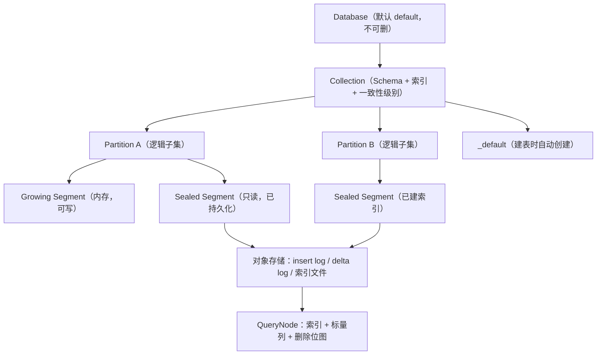
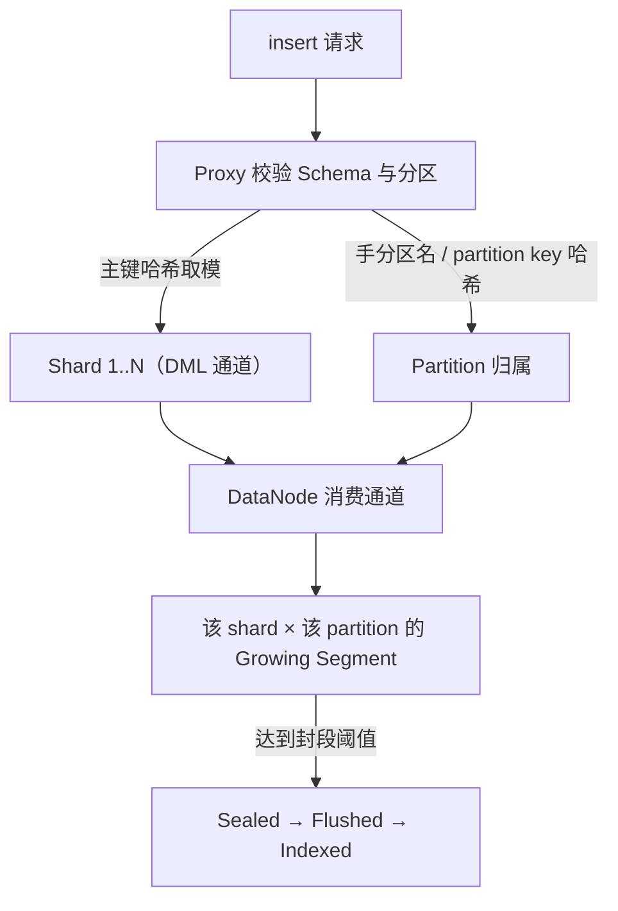
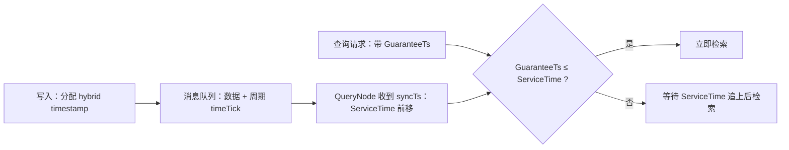
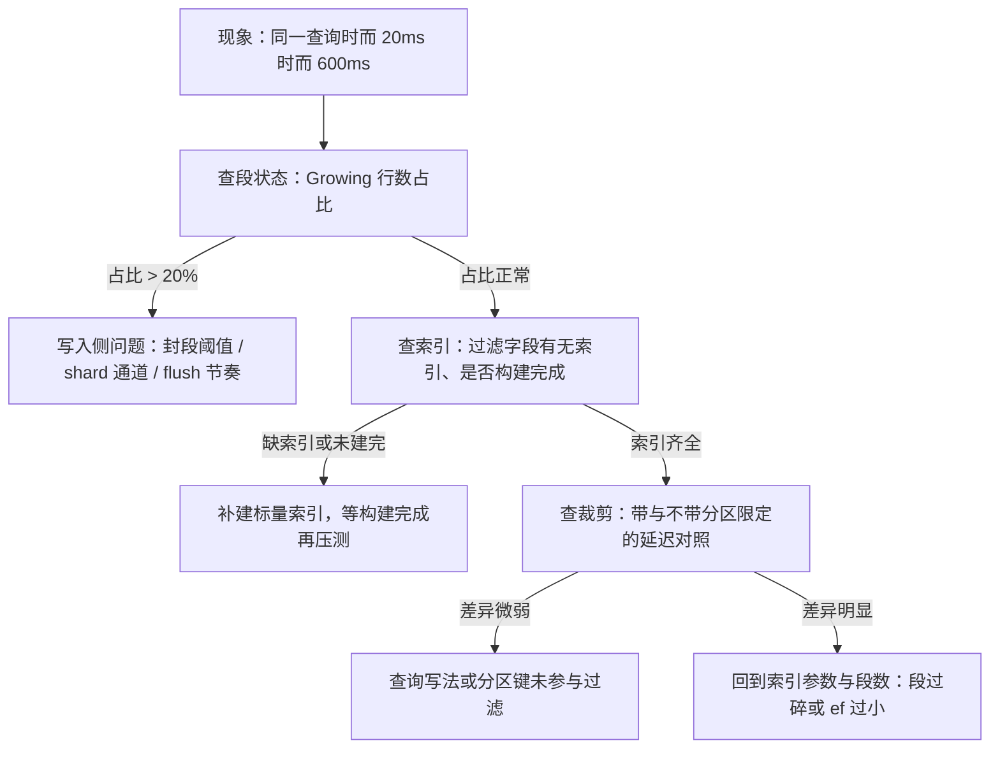

# 数据模型——Collection、Partition 与 Segment

**摘要：**

同一批向量、同一套索引参数，写入当天 P99 要 800 毫秒，一周之后同样的查询只要十几毫秒——差异不在算法，而在数据落在了哪一层、以什么形态存在。本文按 `Database → Collection → Partition → Segment` 四层逐个拆开 Milvus 的数据模型：Database 是命名空间与配额边界，Collection 是带 Schema 的表，Partition 是用户可定义、但只用于裁剪读范围的逻辑分区，Segment 则是系统自动切分、用户不能直接操作的物理存储单元。文章着力澄清一个最常见的误解——Partition 不是分片：分区只裁读，写入并行度由 shard 与 DML 通道按主键哈希决定，段落的切分则由 `dataCoord.segment.maxSize` 与 `sealProportion` 自动裁定，默认组合下一个段只装到约 123 MB 就会封存，而不是长满 1 GB。在此之上，文章讲透 `Partition Key` 的哈希路由与规模上限、Schema 中一次性决定的约束（主键策略、向量维度、`max_length`）、Segment 从 growing 到 loaded 的生命周期与封段参数、`consistency_level` 如何只影响可见性而不影响检索速度、删除与 upsert 的记账语义及 compaction 的结算成本，最后收敛到"过滤为什么慢"的三个成因、一张排查顺序表与四类反例，给出各层规模上限的量化对照。

---

## 第 1 章 四层对象，以及它们各自解决什么

### 1.1 从一个反直觉的现象说起

一套做相似检索的系统，上线第一天的监控面板很难看：批量灌入三百万条向量之后立刻做压测，P99 延迟在 800 毫秒上下浮动；运维同学怀疑索引参数选错，把 HNSW 的 `M` 从 16 调到 32，又把 `ef` 从 64 调到 128，延迟几乎没变。一周之后再压，同样的查询、同样的参数，P99 掉到十几毫秒。

参数没变，数据也没变多，变的是数据所处的形态。第一天那些向量还躺在内存里的可写段中，检索时只能一条条比；一周之后它们被刷到对象存储、建好索引、加载进查询节点，才真正进入"用索引换时间"的阶段。要解释这件事，必须先把 Milvus 的数据模型从逻辑层一路看到物理层，看清楚哪一层由用户决定、哪一层由系统自动决定。

`Database → Collection → Partition → Segment` 这四层并不是一次设计出来的。Milvus 2.0 重写时只暴露了 Collection 一层，Database 被藏在后面，用户直接写 Collection 名即可；直到 2.2.9 才把 Database 暴露给用户，同时给 Database 补上 RBAC 与配额能力（见参考资料中的 2.2.9 发布说明）。这个顺序本身就说明问题：分层不是抽象洁癖，而是规模与运维需求把某一层"逼"出来的。

### 1.2 四层各自的职责边界

Database 是命名空间与治理边界。它自己不存数据，管的是"谁能在里面建东西、能建多少、能占多少盘"。Milvus 2.5 文档给出的 Database 属性包括 `database.replica.number`（该库默认副本数）、`database.resource_groups`（绑定资源组）、`database.diskQuota.mb`（磁盘配额）、`database.max.collections`（Collection 数量上限）以及 `database.force.deny.writing` 与 `database.force.deny.reading` 两个总闸。默认库名为 `default`，不可删除；删库之前必须先清空库里的 Collection。默认单集群最多 64 个 Database，可通过 `maxDatabaseNum` 放宽。

Collection 是数据定义与生命周期的单位。它承载 Schema、索引定义、一致性级别、分区集合，是所有 DDL 的作用对象。文档给出的默认上限是单集群 65 536 个 Collection（`maxCollectionNum` 可调）。一个 Collection 内部的实体共享同一套字段定义，这个"共享"是后面很多取舍的根源。

Partition 是 Collection 内部的逻辑子集，共享父 Collection 的 Schema，只装一部分数据。它的存在价值只有一个：**只裁读**。查询时用 `partition_names` 把检索范围限定在其中几个分区，跳过其余分区的全部段落。单 Collection 最多 1 024 个分区。

Segment 是物理存储与计算调度的最小单位，由系统创建、封存、合并、回收，用户既不能建也不能删。单 Collection 在任一时刻通常有一到多个 growing 段承接写入，外加一批 sealed 段承载历史数据。真正决定一次查询要扫多少数据、要用多少内存的，**是这一层**。

| 层次 | 由谁创建 | 主要作用面 | 默认上限 | 用户能否直接删除 |
|---|---|---|---|---|
| Database | 用户 | 命名空间、RBAC、配额、资源组 | 64（`maxDatabaseNum`） | 可删，需先清空其中 Collection |
| Collection | 用户 | Schema、索引、一致性级别 | 65 536（`maxCollectionNum`） | 可删（drop collection） |
| Partition | 用户或 partition key 自动 | 读裁剪、冷热分段加载 | 1 024 / Collection | 可删，需先 release |
| Segment | 系统 | 存储布局、索引构建、查询调度 | 由段大小规则决定 | 不可直接操作，只能经由 compaction 间接影响 |

这张表里最容易被读漏的是最后一行。前面三层都是"用户可以点按钮"的对象，第四层不是。你能做的只是调整段大小的规则、触发一次 flush、等 compaction 跑完，然后观察结果。把 Segment 当成可以手工规划的对象，是后面大多数容量事故的起点。

### 1.3 与 Elasticsearch 的切分概念对照

做过全文检索的团队常常带着 ES 的直觉来读 Milvus 的数据模型，几组对照关系值得先摆清楚，后面的误解大多能在这张表里找到出处。

| 概念 | Elasticsearch | Milvus | 差异要点 |
|---|---|---|---|
| 表 | Index | Collection | 均可带 Schema；Milvus 的 Schema 更刚性 |
| 逻辑子集 | 无对应（靠 `routing` 或过滤） | Partition | ES 无分区对象，Milvus 的分区可裁剪读 |
| 写侧切分 | Primary Shard | Shard / DML 通道 | ES 分片数建索引时固定且不可改；Milvus 的 shard 数与主键哈希共同决定写入路由 |
| 物理段 | Lucene Segment | Segment | ES 段由 Lucene 自动合并；Milvus 段由 DataCoord 调度 |
| 删除语义 | 标记删除 + 段合并时清理 | delta log + compaction | 两者都是"记账后结算" |
| 一致可见性 | 近实时刷新（refresh） | `consistency_level` 四档 | 可见性机制的旋钮位置不同 |

对照的价值在于判据：ES 里"分片数建索引时定死、不能随便改"是众所周知的坑，Milvus 的 shard 数与段大小同样属于建模期决定、运行期只能间接影响的参数；而 Milvus 的 Partition 提供了 ES 没有的读裁剪对象，这是它把"逻辑分区"单独列为一层的原因。

### 1.4 从逻辑到物理的落点

把四层对象与实际存储位置对上，才能理解"改一个参数，动的是哪一层"。



图中有一条隐含的约束：Partition 与 Segment 是"一对多"且不完全对齐的关系。一个分区可以散落在多个段里，一个段也只会属于一个分区。正因为段是系统的私有变量，用户对分区的划分永远只能表达"我关心哪一部分数据"，而不能表达"请把这一部分数据放到哪台机器上"。后者属于 shard 的职责，而 shard 是 Collection 的属性，不在图里。

## 第 2 章 Collection 与 Schema——写下去就改不动的部分

### 2.1 主键不是自增列

Milvus 的主键字段只接受 `INT64` 或 `VARCHAR` 两种类型，一个 Collection 只能有一个主键。`auto_id` 这个参数必须显式指定，它决定主键由客户端带进来还是由服务端分配。

这里有两个常见误解。第一个是把 `auto_id` 当成关系数据库的自增列。Milvus 的自动主键由时间戳派生，全局唯一但不连续，也不保证单调递增；指望它做分页游标或者按顺序导出，会把数据顺序搞乱。第二个误解更危险：以为主键唯一就意味着数据唯一。Milvus 的术语表写得很直白——目前不支持主键去重，同一个 Collection 里可以存在重复主键。用 `insert` 重复写入同一个主键，得到的是两份都会被检索到的实体，而不是一次覆盖。要让主键具备"覆盖"语义，必须走 `upsert`，而 `upsert` 的内部实现是删除加插入，这一点放到第 6 章展开。

`auto_id` 与自定义主键混用是另一类事故。开关打开后，客户端带来的主键值会被自动生成的值替换，业务侧以为写进去的是自己的 ID，查询时按原 ID 找不到，或者更糟——在关闭 `auto_id` 的另一个 Collection 里按同一套 ID 逻辑操作，两边对不上账。Schema 一旦建成就不能改主键策略，只能新建 Collection 重灌数据，所以这个开关必须在设计阶段定死。

### 2.2 向量字段：`dim` 是一次性承诺

向量字段的类型决定了存储精度、索引可用范围和内存账。2.5 文档列出的可选类型有五类：`FLOAT_VECTOR`（32 位浮点）、`FLOAT16_VECTOR` 与 `BFLOAT16_VECTOR`（16 位，省内存与带宽）、`BINARY_VECTOR`（二值，适合图像指纹一类的紧凑特征）、`SPARSE_FLOAT_VECTOR`（稀疏，适合 BM25 这类词袋表示）。单 Collection 最多 4 个向量字段，由 `proxy.maxVectorFieldNum` 控制（取值范围 1 到 10）；向量维度的上限是 32 768，由 `proxy.maxDimension` 控制。

`dim` 与 `max_length` 的共同点是**创建即锁定**。维度写入后不可修改，因为维度决定了每个段落的定长布局、索引文件的矩阵形状、以及相似度计算的循环次数；字符串的 `max_length` 同理，它决定列存里每个值的槽位宽度。很多团队在 PoC 阶段用 1 536 维的嵌入模型建了表，上线换模型换成 1 024 维，才发现唯一出路是新建 Collection 再灌一遍。把"嵌入模型版本与维度"当成数据模型的一部分写进设计文档，比事后补救便宜得多。

`BINARY_VECTOR` 还有一个额外约束：维度按位计，需要是 8 的倍数，这样底层才能按字节对齐存储。用二进制向量做汉明距离检索时，把维度写成 100 这种数字会直接报错。

### 2.3 标量字段：过滤成本藏在内存里

标量字段承载元数据，作用是在向量检索之前或之后收窄候选集。`INT8` 到 `INT64`、`FLOAT`/`DOUBLE`、`BOOL`、`VARCHAR`、`JSON`、`ARRAY` 都在支持范围内。它们在 Schema 里看起来只是几列普通字段，实际上每一个可能被过滤的字段都是一个索引与一份内存开销。

2.5 的标量索引文档给了一组内存估算函数，正好用来做容量账。数值型按行数乘固定字节估算，`INT64` 与 `DOUBLE` 是每行 24 字节，其余数值型每行 12 字节；字符串按长度分档，8 字节以内每行 128 字节，128 字节以上按 `行数 × 长度 × 1.5` 估算。按这套系数，一千万行、平均长度 64 字节的 `VARCHAR` 字段，仅倒排索引就要 1 000 万 × 192 字节 ÷ 1024 ÷ 1024，约 1.8 GB。这些数字不是惩罚，而是"让过滤变快"必须付出的对价；问题只在于你有没有提前把它算进 QueryNode 的内存预算。

`max_length` 的设定还有一个常被忽略的连带影响：它不参与查询语义，却参与存储与索引估算。把 `VARCHAR` 一刀切成 65 535，等于告诉系统每一行都可能很长，字符串索引的估算系数会直接落到最高档。

| 字段类型 | 典型用途 | 关键约束 | 建表后可否修改 |
|---|---|---|---|
| `INT64` / `VARCHAR` 主键 | 实体标识 | 只能二者取一；须显式声明 `auto_id`；不去重 | 否 |
| `FLOAT_VECTOR` 等向量字段 | 语义检索 | `dim` 一次决定；单表最多 4 个向量字段 | 否 |
| `VARCHAR` | 标签、标题、来源 | `max_length` 一次决定，上限 65 535 | 否 |
| `JSON` / `ARRAY` | 半结构化属性 | 过滤需走路径表达式，成本高于独立字段 | 否（结构可容纳变化） |
| `$meta` 动态字段 | 未声明字段的兜底 | 需 `enable_dynamic_field`；值打包为 JSON | 随写入变化 |

### 2.4 动态字段 `$meta`：便利与代价同时到账

动态字段（Dynamic Field）在 2.2.9 随 JSON、Partition Key 一起引入，是三者中的"Schema 弹性"方案。开启 `enable_dynamic_field` 后，实体里那些 Schema 未声明的字段会被打包进一个名为 `$meta` 的保留 JSON 字段，过滤时可以用键名直接引用，语义上与显式字段无异。

它解决的是真实问题：属性不固定的业务，每加一个字段就要重建 Collection，代价不可接受。但它把成本从"建表时的一次性设计"转移到了"每次查询的运行时解析"。显式字段在段落里是独立列存，带自己的统计信息与倒排索引；`$meta` 里的键是混在一起的 JSON，过滤时要么逐行解析，要么依赖后续版本提供的 JSON 路径索引能力（2.5 文档已有对动态字段内标量建索引的章节，具体语法以对应版本文档为准），而无论哪种方式，它都缺少独立字段那份列存与统计信息的加持。

因此判断标准很朴素：这个字段会不会进入高频过滤条件？会，就声明成显式字段并建标量索引；不会，放进 `$meta` 换取演进自由。把租户 ID、状态、时间戳这类高频过滤字段塞进 `$meta`，是最常见的一种自伤。

```python
# 两处细节决定后面几年的运维成本：auto_id 与 max_length
schema = MilvusClient.create_schema(auto_id=False, enable_dynamic_field=True)
schema.add_field("doc_id", DataType.INT64, is_primary=True)      # 主键由业务给定，才能与源库对账
schema.add_field("embedding", DataType.FLOAT_VECTOR, dim=1024)   # 维度与嵌入模型绑定，换模型=重建表
schema.add_field("tenant", DataType.VARCHAR, max_length=64)      # 高频过滤字段必须是显式列，不能进 $meta
schema.add_field("doc_time", DataType.INT64)                     # 时间戳用于范围过滤与冷热分层
```

### 2.5 可空与默认值：让"字段缺失"变成一种显式契约

2.5 文档里多了一组此前没有的能力：标量字段可以声明为可空（nullable），也可以带默认值。它补的是这样一个缺口——写入方手里常常拿不到全部字段，比如刚入库的文档还没有摘要、抓取失败的记录没有发布时间。在没有可空语义的版本里，这类数据只能由写入方编一个哨兵值（空串、0、-1）塞进去，然后在所有查询里记得把这些哨兵排除掉；一旦某个查询忘了排除，统计口径就被污染。

可空与默认值把这种"约定"提升成"契约"：字段可以真的不写，读出来是空，过滤时也不会被误判成某个合法值。代价是写入侧要判断语义——空值参与 `==` 比较时结果如何、参与范围比较时是否被跳过、建倒排索引时空值占不占位，这些细节直接决定过滤结果是否符合预期，而它们属于版本相关行为，落地前必须在自己使用的版本上验证一遍。

更值得说的是它和 Schema 刚性的关系。可空、默认值、动态字段三者叠加，让 Milvus 的 Schema 在"字段集合"这一维度上宽松了不少，但**维度与类型不可改**这一条没有变。也就是说，Schema 的弹性集中在"有没有这个字段、这个字段有没有值"，而不是"这个字段是什么类型、向量多少维"。把弹性用对地方，才不会在真正需要换模型时被卡住。

## 第 3 章 Partition——逻辑分区，而不是分片

### 3.1 Partition 只裁读，不裁写

Partition 的语义非常窄：它是 Collection 内部的一个数据子集，共享父 Collection 的 Schema，作用是在查询时缩小扫描范围。建 Collection 时会自动生成一个 `_default` 分区；不额外建分区时，所有数据都进这个默认分区，所有查询也都在它里面执行。

按年月建分区、查询时只给最近三个月，是它最典型的用法：`partition_names=["news_2025_10", "news_2025_11"]` 一给，其余分区的全部段落根本不会进入查询计划。冷热分离也靠它——把不常查的历史分区 `release` 掉，内存立省；需要时再 `load` 回来。文档里有一个容易踩的细节：Collection 的加载状态是分区级的聚合，只要还有一个分区没加载，整个 Collection 就显示未加载完成。

但 Partition 对写入几乎没有帮助。写入一条实体，无论它进哪个分区，最终都要落到某个 shard 的通道里、由 DataCoord 分配到某个 growing 段。分区只是给这条数据打了一个标签，既不增加写入并行度，也不改变段落在磁盘上的组织方式。把 Partition 当成"把写入压力摊到多台机器"的手段，是本章要拆掉的第一个误解。

### 3.2 分片是另一件事：shard、DML 通道与主键哈希

Milvus 的写侧切分单位叫 shard。文档的定义很清楚：shard 是 Collection 的水平切片，每个 shard 对应一条数据输入通道（DML channel），写入请求按主键哈希落到不同通道，由不同 DataNode 消费，从而把写入吞吐摊到多台机器上。术语表里那句话值得抄下来——分区是为了通过指定分区名降低读负载，而分片是把写负载分散到多台服务器。

分片的可调空间也只有一半：**数量可调，映射不可调**。建 Collection 时可以给 `num_shards`（默认 1，上限由 `proxy.maxShardNum` 控制，默认 16），但你不能规定"租户 A 的数据去 1 号分片"——路由完全由主键哈希决定。文档给的经验值是：预期吞吐每增加 500 MB/s、或待写入数据量每增加 100 GB，考虑加一个 shard；这只是官方基于自身经验的建议，实际要按自己的压测结果调。

于是"Partition 不是分片"这句话可以讲得更准确一些：两者都叫"切分"，但切的是不同的维度、由不同的组件执行、影响不同的指标。分区切的是查询的候选集，分片切的是写入的通道；分区由用户在 Schema 之外手工声明，分片数量在建模时定下、映射由主键哈希自动决定；分区影响扫描量与内存占用，分片影响写吞吐与通道并行度。Milvus 没有"用户指定某条数据进某个分片"这种能力，也没有"手工指定段落"的能力。

| 对比维度 | Partition | Shard |
|---|---|---|
| 切分依据 | 用户按业务维度手工指定，或 partition key 哈希 | 主键哈希，用户不可指定映射 |
| 切分对象 | 读范围（查询候选集） | 写通道（DML channel / WAL 流） |
| 谁来决定 | 用户（建分区、写入时指定） | 系统（建表时定数量，运行时按主键路由） |
| 主要影响 | 扫描量、加载内存、冷热分层 | 写入并行度、通道级消费能力 |
| 数量上限 | 1 024 / Collection | `proxy.maxShardNum`，默认 16 |
| 与 Segment 的关系 | 一个分区散落在多个段中 | 每个 shard × 每个分区都会产生各自的段 |

### 3.3 Partition Key：把"建很多分区"换成"让系统分"

手工分区的规模上限是 1 024，这个数字对多租户场景远远不够。2.2.9 引入的 Partition Key 就是为这个上限准备的：把某个标量字段标记为 `is_partition_key=True`，写入时 Milvus 对该字段值取哈希、对 Collection 的 `partitions_num` 取模，决定实体进哪个内部分区。默认自动创建 16 个分区，建表时也可以指定数量。

它和手工分区的关键差别在于**谁来枚举分区**。手工分区要求你能提前列出所有分区值——按月、按地域可行，按用户 ID 不可行；Partition Key 不需要枚举，值域再大也只是哈希落桶。查询侧要享受到裁剪，过滤表达式里必须带上该字段：`tenant == "acme" && ...` 或 `tenant in [...]`。不带这个条件，哈希分区帮不上忙，扫描范围回到整个 Collection。

两个实现层面的细节值得记住。其一，分区键字段的值不允许为空，写入前要保证这个字段一定有值。其二，强烈建议在分区键字段上建标量索引——Partition Key 只把扫描收窄到若干分区，分区内部仍然有大量不同键值的实体，过滤条件仍要逐条求值；没有索引就是对该字段的一次全扫描。2.5 文档的推荐是 `INVERTED`，因为分区键过滤基本只用 `==` 与 `in`；取值极少的字段（经验阈值 500 个不同值以下）可以考虑 `BITMAP`，数值与字符串也可以用 `STL_SORT`。

```python
# 分区键 + 标量索引的组合，才是"大规模下减少扫描"的正确姿势
schema.add_field("tenant", DataType.VARCHAR, max_length=64, is_partition_key=True)
client.create_collection(
    collection_name="docs",
    schema=schema,
    num_partitions=64,      # 按租户量级选，别一步顶满；合法取值范围以对应版本文档为准
)
index_params.add_index("tenant", index_type="INVERTED")   # 缺这一步，裁剪只完成了一半
```

### 3.4 四档隔离，四种成本结构

Milvus 文档把多租户拆成四档，恰好是本文四层对象的另一种读法。这张表是全篇最有信息量的量化材料之一，它说明每个层级的规模上限差了一个数量级，而这个差距来自各层背后组件的成本结构。

| 维度 | Database 级 | Collection 级 | Partition 级 | Partition Key 级 |
|---|---|---|---|---|
| 默认租户上限 | 64 | 65 536 | 1 024 / Collection | 百万级 |
| 数据隔离 | 物理隔离 | 物理隔离 | 物理隔离 | 物理 + 逻辑 |
| Schema 灵活性 | 高 | 中 | 低（共享） | 低（共享） |
| RBAC | 支持 | 支持 | 不支持 | 不支持 |
| 跨租户检索 | 不支持 | 不支持 | 支持 | 支持 |
| 冷热分层（load/release） | 支持 | 支持 | 支持 | 不支持 |
| 检索性能 | 强 | 强 | 中 | 中 |

读这张表的方法是看每一档"贵在哪"。Database 与 Collection 的隔离是物理的、可授权、可配额，代价是元数据与资源开销大，数量上不去。Partition 的隔离也是物理的，但一个 Collection 内部的元数据要由 DataCoord 与 QueryCoord 共同维护，1 024 就是这套记账的舒适区上限；换来的是跨分区聚合查询与分区级冷热。Partition Key 把数量推到百万级，代价是隔离变弱、不能 RBAC、不能按租户 load/release，因为它本质上是哈希分桶，桶里住着多个租户。

这也解释了为什么"建 500 个手分区当多租户"是个坏方案：它在用第三种成本结构去做第四种规模的事。租户数上千，正确答案是 Database 或 Collection 级隔离，或者接受弱隔离改用 Partition Key。

### 3.5 写入时两层路由如何叠加

把 3.1 到 3.3 串起来，一次写入的路由是两层叠加的：主键哈希决定它进哪条 DML 通道（shard），分区标签或分区键哈希决定它归属哪个分区，两者交叉之后的格子对应一个 growing 段。



这张图解释了一个常见困惑：为什么建了很多分区，写入吞吐一点没涨。因为分区的标签作用发生在 DataNode 之后，通道并行度只由 shard 数决定。

## 第 4 章 Segment——用户看不见却决定一切

### 4.1 为什么必须把数据切成段

如果一批数据永远只增不改，最省事的做法是建一张大索引、整体加载、整体检索。真实系统做不到：写入是持续的、删除是持续的、内存是有限的、单机索引构建是会失败的。切段是同时应付这四件事的折中。

并行建索引：每个段独立构索引，IndexNode 可以并行处理多个段，也能在某个段构建失败时只重试该段。并行查询：一次检索被拆到多个段上执行、结果归并，段成为调度的最小粒度；副本机制也是以段为单位把 sealed 段分到多个 QueryNode 上。增量写入：新数据先进 growing 段（内存、无索引、可写），历史数据留在 sealed 段（只读、有索引），两套形态并存，才能既实时又高效。局部回收：删除与更新产生的陈旧数据以段为单位重写，compaction 的输入输出都是段。

代价也很清楚：段越多，元数据与调度开销越大，每段固定的内存结构（索引头部、标量列、删除位图）被重复支付；段越少，单段构建与加载越慢，新数据从写入到可被索引检索的延迟越长。第 4.3 节的参数表，本质就是在这两端之间选一个工作点。

### 4.2 从 growing 到 loaded 的生命周期

段的完整流转可以拆成五个阶段，每个阶段回答"数据在哪、能不能写、能不能搜、搜得快不快"。


growing 段活在 QueryNode 的内存里，同时接收写入与查询。它**没有 ANN 索引**，检索只能逐条算距离，这就是第 1 章那个现象的直接原因。封段的条件不止一条：段大小达到阈值、存活时间超过上限、空闲时间过长、binlog 文件数过多、或单 shard 的 growing 段总内存超限，任意一条命中就会封段。

sealed 之后不再接收写入，DataNode 负责把该段的数据写成 insert log（列存 binlog）落到对象存储，此时段进入 flushed 状态。紧接着 IndexNode 按该字段的索引参数构建索引；索引完成之后，段才具备被 ANN 检索的资格。最后 QueryNode 把段加载进来，建立内存中的索引结构、标量列与删除位图，段进入 loaded。这五步里，用户唯一能施加影响的是"促使封段"——调 `flush`，而 flush **只是请求**，它请求持久化，不保证索引马上建好、也不保证立刻可检索。

有一点需要说明：这几个阶段名在数据面与查询面的叫法不完全统一。数据面关心 growing/sealed/flushed 与索引元数据，查询面只看到"这段在不在我这儿、处于 growing 还是 sealed"。2.5 的 `get_query_segment_info` 返回的 `state` 就是查询面的视角，常见取值是 `Growing` 与 `Sealed`。

### 4.3 封段参数：一组互相牵制的旋钮

2.5 的 dataCoord 配置把封段规则摊得很开。这些参数的默认值不是随手取整，而是在"段不要太碎"与"新数据不要太晚可检索"之间找的平衡点。

| 参数 | 默认值 | 作用 | 调大的代价 | 调小的代价 |
|---|---|---|---|---|
| `dataCoord.segment.maxSize` | 1024 MB | 单段大小上限 | 单段构建/加载更慢，新数据可检索延迟变长 | 段变多，元数据与调度开销上升 |
| `dataCoord.segment.sealProportion` | 0.12 | 达到 maxSize 的多少比例即封段 | 实际封段阈值抬高，段更满 | 段更碎，随写随封 |
| `dataCoord.segment.sealProportionJitter` | 0.1 | 封段比例抖动 | 阈值离散度更大 | 大量段在同一时刻齐刷刷封段 |
| `dataCoord.segment.maxLife` | 86 400 s | 段最长存活时间 | 长尾小段更久才封 | 大段被过早切断 |
| `dataCoord.segment.maxIdleTime` | 600 s | 无写入多久后允许封段 | 冷段长期占内存 | 低写入业务段更碎 |
| `dataCoord.segment.maxBinlogFileNumber` | 32 | binlog 文件数上限 | 单段文件更多 | 频繁封段 |
| `dataCoord.sealPolicy.channel.growingSegmentsMemSize` | 4096 MB | 单 shard growing 段总内存阈值 | 内存水位更高，OOM 风险上升 | 写入稍多就封段 |

`maxSize` 与 `sealProportion` **必须一起读**。默认组合意味着一个段长到 1 024 MB × 12% ≈ 123 MB 就会被封（再叠加 10% 的抖动，实际落在 10.8% 到 12% 之间），并不是长满 1 024 MB 才封。这个细节解释了为什么很多集群的段数量比预期多一个数量级：以为每段装 1 GB，实际每段只装了一百多兆。

按这个阈值做一次推算（示例推算）：768 维 float32 向量，单条向量占 768 × 4 = 3 072 字节，约 3 KB；123 MB 的段大约装 4.1 万条向量。若数据规模是 1 亿条，粗略估计会有两千多个 sealed 段；若把 `maxSize` 调到 2 GB 并把 `sealProportion` 保持在 0.12，单段约 8.2 万条，段数减半，但每段的加载与索引构建时间也翻倍。这里没有最优解，只有与你数据规模和内存预算匹配的工作点。

### 4.4 三个接口回答三个不同的问题

排查段相关的性能问题，最常犯的错是拿一个接口的返回值去回答另一个接口才能回答的问题。

| 接口 | 能回答的问题 | 回答不了的问题 |
|---|---|---|
| `utility.get_query_segment_info` | 查询节点上有哪些段、多少行、`state` 是 Growing 还是 Sealed、落在哪些节点 | 索引建没建好、段是否已加载完成 |
| `utility.index_building_progress` | 索引构建进度、已建索引的段数 | 段内有多少行、查询节点分布 |
| `get_load_state`（Collection 或 Partition） | 加载是否完成、进度百分比 | 存不存在 growing 段、索引参数是否合理 |

`get_query_segment_info` 在 2.5 的 API 文档里被标注为接近废弃（Near Deprecation），替代路径是走 MilvusClient 或直接看控制台指标，但它在排查时依然好用，因为一次调用就能看到"Growing 段的 num_rows 占比"。这个占比是本篇最实用的一个判据：如果 Growing 段的行数占全量的 20% 以上，那么任何关于索引参数的调优都不会有明显效果，瓶颈在数据还没落段。

```python
# 判断"是不是还有大量数据躺在无索引的 growing 段里"
infos = utility.get_query_segment_info(collection_name="docs")
growing_rows = sum(i.num_rows for i in infos if str(i.state) == "State.Growing")
total_rows = sum(i.num_rows for i in infos)
print(growing_rows / total_rows)   # 占比高时，先等封段/建索引，而不是调 ef
```

### 4.5 "刚写入的数据搜得慢"到底慢在哪

把数据链路摊开看，一条新数据要依次穿过：写入 WAL、被 DataNode 消费、进入 growing 段、被 QueryNode 可见、达到封段条件、写 binlog、建索引、加载。前四步决定"能不能搜到"，后四步决定"**搜得快不快**"。`consistency_level` 只管前四步，管不了后四步——这是第 5 章要展开的话题。

growing 段的暴力检索代价可以粗略估一下（示例推算）：768 维、单精度，每条向量的距离计算是 768 次乘加；10 万条就是 7 680 万次乘加。现代 CPU 用 SIMD 并行处理，单核有效吞吐按每秒数十亿次乘加量级估计，一次全段扫描落在十几毫秒量级。这个数字放到单条查询上并不夸张，但要在多个 growing 段上各扫一遍、再叠加标量过滤与删除位图过滤、还要与 sealed 段的结果归并，尾延迟就会被放大。

真正的麻烦是它不可预测。sealed 段的检索延迟由索引参数与段数决定，基本稳定；growing 段的延迟随写入速率、段内行数、过滤条件的选择率一起漂移。写入高峰时尾延迟抖到几百毫秒，往往就是这个原因，而不是查询节点算力不够。

### 4.6 `flush` 能做什么，不能做什么

`flush` 是段管理的唯一手动入口，也是最容易被误用的一个。它的语义是"请求把当前 growing 段的数据持久化"：调用之后，DataCoord 会推动封段、DataNode 写 binlog，数据因此进入可持久状态并且能被后续的索引构建看见。它不做三件事：不保证索引立刻建好、不保证新段立刻加载、也不保证正在写入的数据全部落盘（调用时刻之后仍在写入的部分不在范围内）。

围绕它有三类误用。第一类是拿 `flush` 当"让数据可查"的手段——数据本来就在 growing 段里可查，flush 改变的是持久化形态；真正影响"查得到查不到"的是一致性级别。第二类是在写入循环里逐批 `flush`，把原本按 12% 阈值自然封段的节奏打断成大量小段，段碎之后查询要扫的段数和元数据开销一起上升，这是"越优化越慢"的典型。第三类是在大批量导入前后各调一次，然后立刻压测——索引还没建完，压测结果当然难看。

合理的用法只有少数几种：批量导入完成后触发一次，让数据尽快进入持久化与建索引队列；需要做快照式校验（比如对账某个时间点的数据量）前触发一次；以及在 compaction 或索引任务卡住时作为排查手段观察状态变化。其余场景下，段的自封机制比手动干预更合适。

## 第 5 章 可见性与一致性级别

### 5.1 ServiceTime、GuaranteeTs 与那次等待

Milvus 是存算分离系统，QueryNode 同时消费两条数据来源：已经落到对象存储的批量数据，以及还在消息队列里的流式数据。网络延迟让 QueryNode 手里的流式数据永远落后一点，直接用当前状态检索，会漏掉刚写入但尚未消费到的实体。

解法是时间戳。每条写入记录带时间戳，消息队列周期性发出同步时间戳（syncTs），QueryNode 收到后把 ServiceTime 推进到该点，表示"这一点之前的数据我都已经看到了"。查询请求携带一个保证时间戳（GuaranteeTs），QueryNode 比较两者：GuaranteeTs 不高于 ServiceTime，立即执行；否则等到 ServiceTime 追上来再执行。四个一致性级别，本质就是给 GuaranteeTs 取四种不同的值。



### 5.2 四档一致性的代价

| 级别 | GuaranteeTs 取值 | 可见性保证 | 代价 |
|---|---|---|---|
| `Strong` | 最新时间戳 | 能读到此前全部写入 | 等待同步，尾延迟随写入速率上升 |
| `Session` | 本客户端最后一次写入的时间点 | 至少能读到自己的写入 | 多客户端场景不保证读到别人的写入 |
| `Bounded`（默认） | 比最新时间戳更早的某个点 | 容忍一定程度的滞后 | 有秒级窗口内新数据不可见 |
| `Eventually` | 极小值（如 1） | 不做可见性等待 | 只保证最终可见，读到的可能是旧快照 |

`Bounded` 的滞后窗口来自 Proxy 侧的时标推进节奏：`proxy.timeTickInterval` 默认 200 毫秒，Proxy 按这个间隔同步一次时标，用它来推算可以给出的 GuaranteeTs。这套时标机制在集群架构里的位置，参见 [[01 Milvus 全局架构——存算分离与云原生设计]] 中 Proxy 与消息队列的时序说明。

这里要特别强调一个与本文主题直接相关的推论：把一致性级别改成 `Strong`，只能让刚写入的数据"出现"在结果里，**可见不等于快**。数据仍在 growing 段、仍走暴力检索，只是你不再因为看不见它而误判。实践中确实会出现"改成 Strong 之后延迟变差"的观感——那不是 Strong 让检索变慢，而是它把原本被跳过的那批 growing 段数据纳入了检索范围，代价被显式支付了。

### 5.3 写入速率如何反过来决定一致性代价

一致性级别是请求侧的参数，但它的代价由写入侧的节奏决定，二者通过 ServiceTime 的推进速度耦合在一起。写入越密集，消息队列产生的时间戳越连续，ServiceTime 追赶快，`Strong` 的等待就短；写入稀疏或消费滞后时，ServiceTime 可能长时间停在某个点，`Strong` 就得一直等，客户端看到的是延迟飙升甚至超时。

这个耦合解释了一个很常见的现象：同一套代码，白天压测时 `Strong` 完全可用，夜间低峰批量导数据时反而大面积超时——不是一致性级别坏了，而是那段时间的流式数据与批量数据在争同一份消费预算。反过来，把 `Bounded` 用在"刚写完就要读"的场景里，读到的很可能是几秒前的快照，业务侧表现为"刚提交的文档搜不到"。

因此选型时不该只问"业务能不能容忍延迟"，而要同时问"写入是不是连续、通道消费有没有积压"。前者是产品问题，后者是容量问题，两个答案合起来才决定一致性级别该定在哪一档。

## 第 6 章 删除、更新与 compaction——数据模型的账本

### 6.1 删除是记账，不是擦除

向量索引不支持原地删除。从 HNSW 图中摘掉一个节点会破坏其余节点的连通性，从 IVF 的倒排表里挖掉一条记录要移动整段内存。Milvus 的选择与 LSM 家族一致：写一条**删除标记**。

一次 `delete` 的完整路径是：客户端给出主键列表或过滤表达式，Proxy 把删除请求写进消息队列（带时间戳），DataNode 把它写成 delta log，QueryNode 在内存里维护删除位图（bitset），检索时把命中的已删除主键从结果里剔除。数据本身还在 insert log 里，一份没少。

这样做的好处是删除足够快、不打断索引；代价被推到后面：删除比例高的段，检索时要多走一次位图判断，位图本身也占内存；delta log 越积越多，compaction 的负担越重。所以文档建议删除时尽量带上分区或分区键限定，把删除操作收窄到少量段上，减少 compaction 阶段的写放大。

### 6.2 `upsert` 的本质是删除加插入

`upsert` 在 Milvus 里的实现路径写在文档的流程图里：先检查主键是否开启了 `auto_id`（开启则用自动生成的主键替换客户端给的值），然后按主键执行一次删除，再插入新实体。也就是说，一次 `upsert` 产生两条日志，一条 delta、一条 insert。

这个事实解释了两件事。其一，为什么高频 `upsert` 会显著加重 compaction 压力：每次更新都在制造删除标记与新的数据副本。其二，为什么 2.5 起引入的部分更新（`partial_update` / 合并模式）值得关注——它改变了"必须提供完整实体"的约束，但并没有改变底层"先删后插"的日志结构，只是让客户端不必重复提交未变化的字段。

还有一个与第 2 章呼应的点：`insert` 不去重，`upsert` 才有覆盖语义。因此在同一主键上混用 `insert` 与 `upsert`，会得到"一份被删除标记覆盖、一份正常返回"之外的第三种状态——两份都是有效数据，都会被检索到，只是其中一份是旧的。这种数据在结果里表现为同一实体出现两次、分数不同，排查时极难定位。

### 6.3 compaction 的三条路线

compaction 是把"记账"**结算**成"实际状态"的过程：合并小段、清理已删除数据、回收文件。2.5 的配置项里能看到三条并行的路线。

| 类型 | 主要职责 | 触发信号 | 典型代价 |
|---|---|---|---|
| Mix Compaction | 把多个小段合并成较大的段，顺带清理陈旧数据 | 段行数低于 `smallProportion`（0.5）的比例阈值，合并后不超过 `compactableProportion`（0.85）的行数 | 读旧段 + 写新段，对象存储 IO 翻倍；新段需重建索引 |
| L0 Compaction | 专门消化 delta log（删除记录），把删除标记下推到段 | 单 shard 的 L0 条目数或体积超阈值（`blockingL0EntryNum` 500 万、`blockingL0SizeInMB` 64 MB）触发封段与合并 | 删除密集时反复触发，写放大明显 |
| Clustering Compaction | 按聚簇键把数据物理重排，让大范围过滤能跳过无关段 | 手动或按策略触发 | 重排期间占用大量 IO 与算力，需在低峰期做 |

Mix Compaction 在各版本里的名字变过一次，早期文档称 Level Compaction，2.5 的配置项与文档里以 mix 命名并按"段大小层级"组织，读旧资料时要留意这层对应关系。`dataCoord.compaction.mix.triggerInterval` 默认 60 秒检查一次，L0 的检查间隔默认 10 秒；`dataCoord.compaction.gcInterval` 默认 1 800 秒做一次任务清理，`dropTolerance` 默认 86 400 秒，指 compaction 任务记录在被清理前保留的时长。

compaction 不是免费的。以一次 1 GB 段的 mix compaction 为例（示例推算）：需要读取输入段的 insert log 与 delta log、过滤已删除主键、写出新段、构建新索引，对象存储侧的读与写各约 1 GB，索引构建另算 CPU。所以它在后台跑的时候，集群的 IO 与 CPU 都会有可观测的抬升，这也是很多团队把大规模 compaction 安排在业务低峰的原因。

### 6.4 删除的成本要按"重写量"估

删除一条数据本身几乎不要钱，清理它要重写整个段。若一个 1 GB 的段里删掉了 10%，compaction 仍要读 1 GB、写约 0.9 GB；若是把 90% 的数据删掉，剩余数据可能已经小于 `smallProportion` 阈值，会被合并到别的段里，重写量更大。这解释了一个反直觉的现象：成批下线一个租户的数据，删除请求几秒钟返回，集群却可能忙上几个小时。工程上的应对是把它当成一次数据迁移来规划——挑低峰、盯着 compaction 任务队列、必要时用 partition 级操作（直接 drop 分区）代替逐条删除。对整个分区做 `drop_partition` 是元数据操作，不需要重写数据，这是分区存在的一个常被忽视的价值。

### 6.5 删除之后，磁盘为什么没有变小

删除与 compaction 都是"逻辑上已经清理、物理上稍后清理"。旧段文件被新段取代后不会立刻消失，元数据先标记、文件再由后台的垃圾回收按周期清理，具体时长由 `dataCoord.compaction.gcInterval`（默认 1 800 秒）等参数与对象存储的生命周期策略共同决定，实际以对应版本文档和集群配置为准。

这就带来两件容易被误读的事。其一，对象存储用量曲线是滞后指标：你昨天删掉一批数据，存储账单可能两三天后才下降；如果 GC 与生命周期策略没配好，陈旧文件甚至会长期留着。其二，用"对象存储占用"反推"有效数据量"会系统性偏高，尤其在频繁 `upsert` 的集群上——每轮更新都在制造新文件与删除标记，磁盘上同时躺着被标记的旧版本。

排查容量问题时，正确的口径是"有效行数 × 单行字节数"加上索引与副本开销，而不是直接看桶的大小；桶的大小只适合用来发现异常增长，不适合用来做容量规划。

## 第 7 章 "我的过滤很慢"的三个成因

### 7.1 成因一：没有标量索引

没有任何标量索引时，过滤条件的求值是逐行比较，行数越大越慢，且与向量检索串行叠加。2.5 的标量索引文档给了一组官方实验数据：100 万条记录上，倒排索引能让点查类表达式快最多 30 倍，数据量更大时收益更明显。

索引类型的选择要看表达式的形态。`INVERTED` 覆盖等值、范围、前缀、全文与 JSON 路径，是默认推荐；`BITMAP` 适合取值极少的字段（经验上 500 个不同值以下）；`STL_SORT` 面向数值与布尔；`Trie` 面向字符串前缀匹配。AUTOINDEX 在标量字段上并不总是替你选到最合适的类型，文档给的类型映射表也在演进，涉及关键过滤路径时显式指定类型更稳妥。

这里有个与本文主题强相关的次序问题：索引只能建在已封段的数据上，growing 段永远没有索引。所以"建了索引还是很慢"的第一检查项，不是换索引类型，而是看有没有大量数据还在 growing 段。字段级的索引配置与 bitset 过滤如何与向量检索协同，[[04 查询引擎——混合检索与过滤]] 讲得更细。

### 7.2 成因二：过滤落在 growing 段上

growing 段既没有向量索引，也**没有标量索引**。过滤与相似度计算都在原始数据上做，代价随段内行数线性增长，而且这部分成本不受任何索引参数影响。

判据很简单：用 `get_query_segment_info` 看 Growing 段的 `num_rows` 占全量的比例，或者看监控里 growing 段的行数曲线。若占比高于两成，先解决"数据为什么堆在 growing 段"，再谈优化。常见原因有三类：写入速率长期高于封段速度（阈值参数调得过大或单 shard 通道成为瓶颈）、频繁 flush 打断正常的封段节奏、或者业务本身就是大批量间歇写入，两次写入之间段被封但索引还没建完。

### 7.3 成因三：分区裁剪没有生效

这一条在线上最常见，也最容易被误判成"索引无效"。两种情况：其一，建了几百个手分区，查询时却没传 `partition_names`，于是所有分区都被扫；其二，用了 Partition Key，但过滤表达式里没带那个字段，哈希路由的信息在查询侧完全没用上。两种情况的共同特征是——分区的存在没有转化为扫描量的减少，反而多付了元数据与内存成本。

验证方法是对照压测：同一查询分别带与不带分区限定各跑一轮，看延迟与扫描行数的差异。如果差异微弱，说明裁剪没生效，问题在查询写法或表达式上，不在索引上。

| 症状 | 判据 | 处置方向 |
|---|---|---|
| 点查慢、扫描行数大 | `list_indexes` 中该字段无索引；`index_building_progress` 显示未建完 | 补建 `INVERTED` 等标量索引，等构建完成再压测 |
| 延迟随写入量抖动 | `get_query_segment_info` 中 Growing 段占比高 | 调整封段阈值或 shard 数，避免 flush 打断节奏 |
| 建了分区但延迟不变 | 对比带/不带 `partition_names` 的延迟，差异小于噪声 | 查询补上分区限定；改用 Partition Key 并带上过滤字段 |
| 更新后查询变慢 | delta log 体积增长，L0 条目数上升 | 检查 compaction 是否被关闭或积压，安排低峰重写 |

### 7.4 一次排查的实际顺序

把三个成因串成一条可执行的路径，比记住结论更有用。下面的顺序按"发现成本从低到高"排列：先看段状态（一个接口调用），再看索引（一个接口调用），最后看分区裁剪（要改查询做对照压测）。



这条路径里有一个容易被跳过的步骤：把"时而快时而慢"和"一直慢"分开。前者指向 growing 段与 compaction 这类时间相关的因素，后者指向索引缺失或裁剪失效这类结构性问题。混在一起查，通常会在索引参数上浪费掉最宝贵的排查时间。

## 第 8 章 反例与边界

### 8.1 反例：手工建几百个分区

把分区当"分表"用，按租户或按天建几百个分区，是最常见的容量事故来源。问题出在加载这一侧：查询要在某个分区上做 ANN 检索，该分区的段就必须被加载到 QueryNode；加载的段越多，内存占用越大，而每段都有一份**固定开销**：索引头部、标量列与删除位图。

做一个粗算（示例推算）：一个 100 万条、768 维的 Collection，向量数据本身约 3 GB；若被切成 500 个分区、每个分区约 2 000 条，段会非常碎，假设平均每段几十 MB，则段的总数可能到几百上千，仅段级元数据与索引头部就吃掉可观的固定开销。反过来，同样数据的 sealed 段若只有 30 个，固定开销几乎可以忽略。mmap 默认开启能把这些固定结构映射到磁盘、缓解内存压力，但文档也说明：数据量远超内存时检索速度会明显下降，这是把内存问题换成了 IO 问题，不是消灭。

正确的用量级是：分区服务于冷热分层与查询裁剪，几十到一百量级比较合理；租户数上千时换 Partition Key 或 Collection 级隔离。第 3.4 节那张表已经把每种选择的规模上限写清楚了。

### 8.2 反例：以为 Partition 是分片

建了 64 个分区、写入吞吐仍然上不去，于是怀疑 DataNode 不够——这是把读侧切分误当写侧切分的典型。写入并行度由 shard 数决定，而 shard 在多数部署里是 1 到 2。想提高写入吞吐，先看 shard 数、通道消费能力与 DataNode 数量，再看 WAL 侧的写入瓶颈；分区数量跟这件事没有因果关系。

反过来也成立：把 shard 数调大并不能让查询变快。查询的候选集由分区、过滤条件与段数决定，shard 只影响写入侧通道；shard 数增加还会让"每 shard × 每分区"的段数量成倍增加，段更碎，反而可能拖慢查询。两个旋钮各管一头，混着拧只会两头都不到位。

### 8.3 反例：`auto_id` 与自定义主键混用

同一条数据在两个 Collection 里用两套主键策略，是最难对账的一类错误。`auto_id` 打开后，客户端带来的主键会被替换，写入方以为拿到了自己的 ID，实际返回的是服务端生成的值；读侧按业务 ID 查不到，或者按业务 ID 查到了另一条语义不同的数据。

规避方式是把"主键由谁生成"写进**数据契约**：要么全部由业务给定（`auto_id=False`，主键来自源库），要么全部由服务端生成（`auto_id=True`，业务侧把返回的主键落库作为外键）。前者便于与源系统对账，后者的代价是多一次回写。两者都不选，就等着在数据一致性排查里花掉几周。

### 8.4 反例：用 `$meta` 做高频过滤

动态字段让"先上线再改 Schema"变得可能，于是很容易滑向另一个极端：把所有新属性都塞进 `$meta`，包括状态、租户、时间这些每天都要过滤的字段。这些字段没有独立列存、没有独立索引、没有统计信息，过滤时要逐行解析 JSON。当数据量到千万级，这条路径的代价会比"新建 Collection 重灌数据"高得多。

判断标准已经写过一次，这里换个角度重申：`$meta` 适合的是"偶发查询用得到、但不确定会不会长期存在"的属性。一个字段若是产品需求里写死的过滤维度，它就不该待在动态字段里。

### 8.5 边界：半精度向量的便宜与代价

`FLOAT16_VECTOR` 与 `BFLOAT16_VECTOR` 在 Schema 里只是换了个类型名，实际影响的是三笔账：单条向量占的字节数减半（768 维从 3 KB 降到 1.5 KB）、同样内存能装的段更多、距离计算的数据吞吐更高。对内存吃紧的集群，这是最省事的一次"扩容"。

代价在精度上，这是一次**精度换容量**的交易：半精度带来的误差会让距离的相对顺序在近邻边界上发生偏移，表现为召回率略微下降；而 growing 段的暴力检索本来就在精确计算，半精度化之后同样会引入误差，两处误差叠加时，压测里看到的召回差异未必能只归因于索引参数。所以换精度这件事，必须和召回评估一起做，单看延迟会得出过于乐观的结论。

另一个边界是兼容性：不同向量类型之间不能互相检索，一个 Collection 内的向量字段类型是固定的。想从单精度迁到半精度，路径仍然是新建 Collection 重灌数据，或者新增一个半精度字段、双写一段时间后切换——又回到了"Schema 一次性决定"这条主线。

### 8.6 边界：什么时候该换一层

四层对象各有各的舒适区，越过边界硬撑，症状会以很别扭的方式出现。租户数接近 1 024 且需要隔离，说明该用 Collection 级或 Database 级；需要按业务线隔离权限与配额，说明该用 Database；单 Collection 数据量到亿级、段数上千，说明该调 `maxSize` 与 shard；Schema 需要为不同业务定制，说明根本不该共用一个 Collection。

反过来，也有"不该拆"的判断：只为图省事把每个小业务拆成一个 Collection，会让元数据与加载开销成倍增加，65 536 的上限并不是鼓励你用满。分层的目标是让治理与性能各得其所，不是把对象树画得越深越好。

## 第 9 章 结语

四层对象的分工，说到底是一句话：用户决定"数据是什么、按什么维度被查询"，系统决定"数据放在哪、怎么切、什么时候建索引"。Database 与 Collection 是治理与定义的边界，Partition 是查询裁剪的抓手，Segment 是性能与内存的实际账本。把 Partition 当分片、把 Segment 当可规划对象、把 `$meta` 当万能字段，都是在把系统职责错配给用户，代价会以延迟、内存或对账困难的形式返还。

索引结构本身归 [[02 向量索引——从暴力搜索到 HNSW 与 IVF]]，运维侧的段管理、容量规划与升级归 [[06 Milvus 运维——集群部署、索引调优与容量规划]]；数据模型是这两者的共同坐标系，坐标定准了，后面的调优才有意义。至于某个具体业务该选 Database 级还是 Partition Key 级隔离，答案取决于你能接受多弱的隔离、多长的滞后、多少运维动作——这里只有选择，没有高下。

---

## 参考资料

1. Milvus 文档 v2.5.x《Schema Explained》：字段类型、主键约束、向量字段类型与 `dim`。https://milvus.io/docs/v2.5.x/schema.md
2. Milvus 文档 v2.5.x《Database》：Database 暴露、默认库、库级属性与配额。https://milvus.io/docs/v2.5.x/manage_databases.md
3. Milvus 文档 v2.5.x《Manage Partitions》：分区语义、`_default`、1 024 上限、分区级 load/release。https://milvus.io/docs/v2.5.x/manage-partitions.md
4. Milvus 文档 v2.5.x《Use Partition Key》：哈希路由、默认 16 个分区、`num_partitions`、分区键索引建议。https://milvus.io/docs/v2.5.x/use-partition-key.md
5. Milvus 文档 v2.5.x《Implement Multi-tenancy》：四档隔离的规模上限与取舍对照。https://milvus.io/docs/v2.5.x/multi_tenancy.md
6. Milvus 文档 v2.5.x《Create Collection》：shard 概念、`num_shards`、shard 数经验值。https://milvus.io/docs/v2.5.x/create-collection.md
7. Milvus 文档 v2.5.x《In-Memory Replica》：growing/sealed 段与 streaming/historical 副本、Proxy 段缓存。https://milvus.io/docs/v2.5.x/replica.md
8. Milvus 文档 v2.5.x《Consistency Level》：ServiceTime、GuaranteeTs 与四档一致性。https://milvus.io/docs/v2.5.x/consistency.md
9. Milvus 文档 v2.5.x《Dynamic Field》：`$meta` 保留字段与未声明字段的打包。https://milvus.io/docs/v2.5.x/enable-dynamic-field.md
10. Milvus 文档 v2.5.x《Scalar Index》：标量索引原理、类型映射、索引内存估算与 30 倍点查实验。https://milvus.io/docs/v2.5.x/scalar_index.md
11. Milvus 文档 v2.5.x《Index Scalar Fields》：`INVERTED`/`BITMAP`/`STL_SORT`/`Trie` 的用法与适用面。https://milvus.io/docs/v2.5.x/index-scalar-fields.md
12. Milvus 文档 v2.5.x《dataCoord-related Configurations》：`segment.maxSize`、`sealProportion`、`maxLife`、compaction 相关默认值。https://milvus.io/docs/v2.5.x/configure_datacoord.md
13. Milvus 文档 v2.5.x《proxy-related Configurations》：`proxy.timeTickInterval`、`maxShardNum`、`maxVectorFieldNum`、`maxDimension`。https://milvus.io/docs/v2.5.x/configure_proxy.md
14. Milvus 文档 v2.5.x《Upsert Entities》：upsert 的删除加插入流程。https://milvus.io/docs/v2.5.x/upsert-entities.md
15. Milvus 文档 v2.5.x《Delete Entities》：按主键或表达式删除、分区内删除。https://milvus.io/docs/v2.5.x/delete-entities.md
16. PyMilvus v2.5.x API《get_query_segment_info()》：返回字段与 `state` 示例。https://milvus.io/api-reference/pymilvus/v2.5.x/ORM/utility/get_query_segment_info.md
17. Zilliz 中文博客《Milvus 2.2.9：JSON、PartitionKey、Dynamic Schema》：三个特性的引入版本与设计动机。https://zilliz.com.cn/blog/milvus-feature-newrelease

---

> [!note] 思考题
> 1. 一个 1 亿条、每天约 5% 数据被 `upsert` 的知识库，你会把分区层用在哪一步？请结合"upsert 等于删除加插入"推断 compaction 的负载形态。
> 2. 分区上限是 1 024，Partition Key 的租户上限却能到百万级。这个差距来自哪几个组件的成本差异？如果把 Partition Key 的分区数也设成 1 024，会发生什么？
> 3. `Strong` 只解决"看不看得见"，不解决"搜得快不快"。若业务要求写入后立刻可检索且延迟稳定，除了调封段参数，还有哪些架构层面的手段？
> 4. `insert` 不去重、`upsert` 才有覆盖语义。那么在允许重复主键的前提下，你的数据对账与去重逻辑该放在哪一层？
> 5. 若要下线一个租户的全部数据，`drop_partition` 与 `delete` 表达式两条路径在存储成本与延迟上差在哪里？各自的风险是什么？