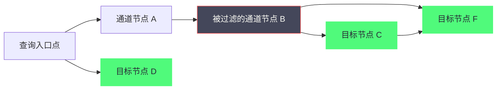
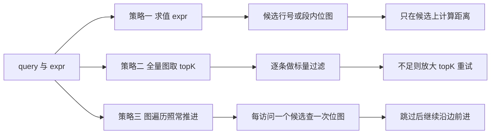
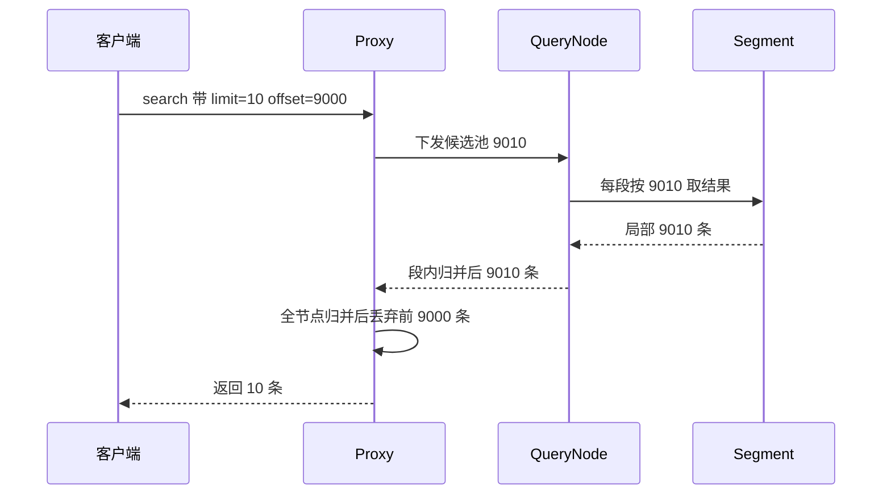
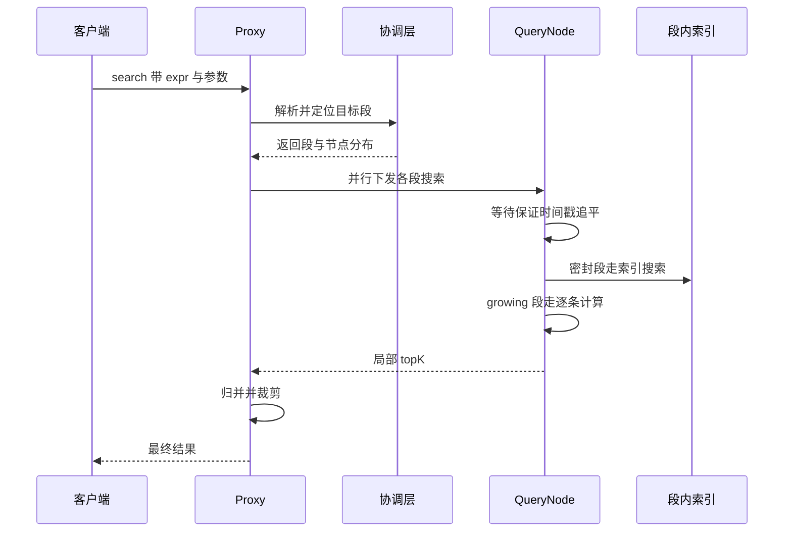
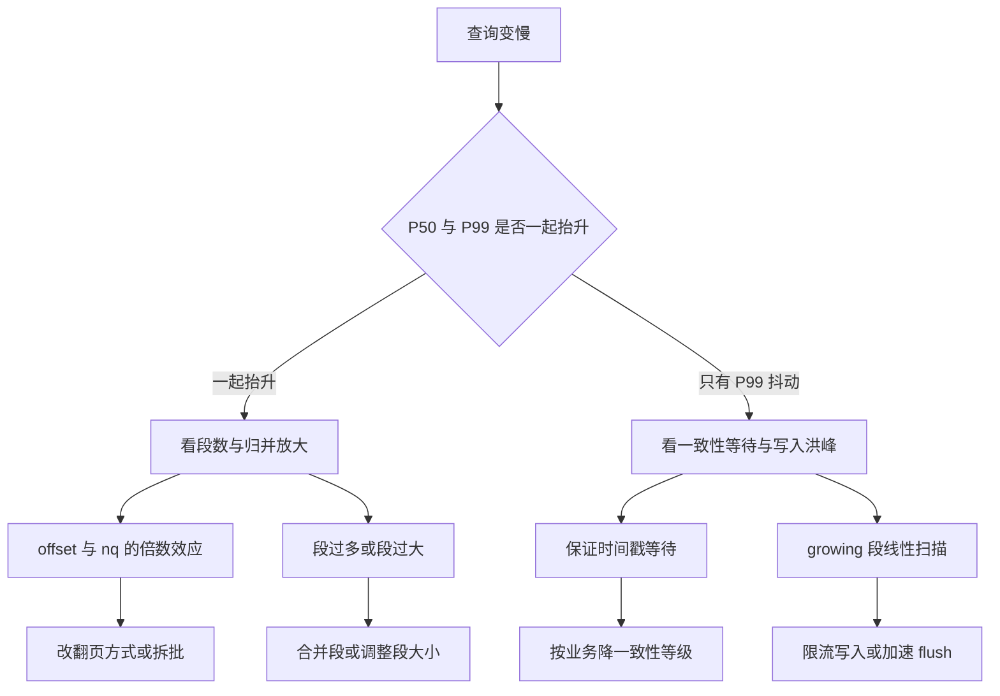

# 04 查询引擎——混合检索与过滤

**摘要：**

真实业务里的向量检索几乎都带过滤，而带过滤的检索之所以困难，在于它同时动摇了 ANN 索引赖以成立的两个前提：邻居可以在全空间里比较，查询的访问预算是定值。本文以企业文档库的租户隔离与状态过滤为主线，拆开三种执行策略的机制与失效面：先过滤再搜索会在候选子集上切断图的连通性，候选越少越容易返回不足；先搜索再过滤在通过率低时会陷入凑不满 K 条的反复放大，尾延迟由最坏情况决定；把过滤融进图遍历是当下的主流方向，但它要求谓词能在遍历内部以常数代价求值，也要求访问预算按通过率放大。在此之上讨论参数预算，包括 nq、topK 与 ef、nprobe 的相互约束，offset 深分页为什么比 SQL 更贵，range search 用半径表达阈值语义，以及稀疏与稠密两路召回的 RRF 与加权融合各自丢掉了什么。最后给出查询变慢的五层归因路径，并把一致性等级折算进延迟账本。读完应当能判断一条具体查询此刻落在哪种执行路径上，以及该换参数、换策略还是换数据组织方式。

---

## 第 1 章 一条查询的两种表现

### 1.1 一次租户投诉

某企业文档库用 Milvus 存了约四千万个文本块，字段除了向量之外还有租户标识、文档状态、发布时间和文档类型。检索服务对所有租户使用同一段代码，过滤条件由租户上下文拼接而成，形如 `tenant_id == 'T' and status == 'published' and pub_date >= 20240101`，最终取十条送给大模型做上下文。

上线三个月后，两个租户同时提了工单。大租户抱怨最近的检索结果开始跑偏，明明库里存着大量强相关的文档，返回的十条里却总有三四条只是勉强沾边；小租户的抱怨更直接——上周还能搜到的东西，这周干脆返回不到五条。运维先查了磁盘、内存和慢查询，没有发现异常；又把索引参数从 `ef=64` 调到 `ef=128`，大租户的召回略有好转，小租户几乎没变；再调到 `ef=256`，延迟翻倍，小租户仍然只有五条。

把两个租户的数据分布摊开看，问题就清楚了。大租户占全库约百分之六的文档，过滤之后还能有二百多万条候选；小租户只占万分之四，过滤之后不到两千条。同一条 SQL 意义上的查询模板，在大租户身上是"在全量图上做带噪声的搜索"，在小租户身上是"在一个几乎空掉的子集里找路"。`ef` 是图的访问预算，它对前一种情况有用，对后一种情况只是让一次注定走不通的遍历多走几步。

这段经历的结论并不复杂，但它推翻了绝大多数调优直觉：向量检索的**召回率**不是索引的固有属性，而是索引、过滤条件与数据分布三者共同决定的现场量。本章余下的篇幅都在解释这个现场量为什么会被误读。

> [!warning] 先记住这条
> 带过滤的向量检索里，"同一个查询有时准有时不准"通常不是系统不稳定，而是过滤选择性与执行策略的组合在数据分布漂移后落到了不同的执行路径上。

### 1.2 一次检索请求由什么构成

理解执行路径，先要看清一条请求在进入 Proxy 之前携带了哪些东西。客户端发起一次 search，实际下发的是一组相互制约的参数：`nq` 个查询向量、每路要交出的条数 `limit`、可能存在的 `offset`、标量过滤表达式 `expr`、目标向量字段 `anns_field`、索引侧的搜索参数（HNSW 的 `ef`、IVF 的 `nprobe`、DiskANN 的 `search_list`），以及一致性等级与分区范围。这些参数并不彼此独立，后面几章会反复看到同一个约束：交给下游的候选池大小，必须同时覆盖 `limit` 与过滤通过率，否则召回必然打折。

`topK` 与 `limit` 这两个词在 Milvus 文档与社区讨论里常被混用。从语义上说，`limit` 是最终结果的条数上限，而 `topK` 是它在内部各层的同义参数；真正决定搜索质量的是"每个执行单元被要求交出多少条"，这个数在归并链路上会被逐级放大，也会被过滤条件逐级消耗。把 `limit` 当成"我想看十条所以只算十条"，是后面所有误解的起点。

### 1.3 两个被混为一谈的混合

中文语境里，"混合检索"至少指两件不同的事，而它们在实现上是正交的。

一件是带过滤的向量检索（filtered vector search）：查询仍然只有一路向量，但附加了标量条件，系统要在满足条件的数据子集里找最近邻。另一件是混合检索（hybrid search）：一个集合里有多个向量字段，同一份数据既有稠密语义向量又有稀疏关键词向量（甚至图像向量），查询时同时发起多路 ANN，再按某种规则把多路结果融合成一个排名。前者的问题是"可达性"，后者的问题是"排名如何合并"。

两者会叠加使用——一次 hybrid search 里的每一路请求都可以带自己的 `expr`——但它们的失效模式完全不同。把两者统称为混合检索，会让人误以为调好融合权重就能解决过滤召回的问题。本章第 3 到第 5 章处理前者，第 6 章处理后者。

### 1.4 本文的边界

索引结构本身，包括 HNSW 的层次图、IVF 的倒排聚类、DiskANN 的磁盘布局与量化，属于 [[02 向量索引——从暴力搜索到 HNSW 与 IVF]] 的范围；Segment 的 Growing、Sealed、Flushed 状态机与 load 过程属于 [[03 数据模型——Collection、Partition 与 Segment]] 的范围；存算分离的四层架构与 Coordinator 的分工属于 [[01 Milvus 全局架构——存算分离与云原生设计]] 的范围。本文只讨论一件事：一条带过滤的查询，究竟在查询链路的哪一段、以什么方式被执行，以及它会在什么条件下失效。

---

## 第 2 章 过滤为什么会让 ANN 失效

### 2.1 ANN 的三个隐含前提

近似最近邻索引的整套效率，建立在三个很少被明说的前提上。

第一个前提是"邻居可比"：距离函数在整个向量空间里有意义，任何两条记录都可以计算距离，因此图或聚类可以为全量数据建立统一的邻接关系。第二个前提是"分布稳定"：索引是按建库那一刻的数据分布剪枝的，查询时的数据仍然服从同一分布，所以从入口点贪心下降能落到真实的近邻区域。第三个前提是查询**预算**是定值：一次查询访问多少个节点由 `ef` 或 `nprobe` 这类参数决定，与查询结果是否凑够条数无关。

标量过滤恰好同时咬住前两个前提。它把一个连续的空间切成两半——满足条件的和不满足条件的——而索引对此一无所知；它也让"访问预算"和"有效产出"脱钩，因为被访问的节点里有相当比例根本不参与结果。第三个前提没有被动摇，它反而是所有麻烦的来源：预算不会因为可用的点变少而自动变少。

### 2.2 门卫问题

HNSW 的边是在建索引时按距离连出来的，边上不携带任何标量属性。这意味着一个节点在图里同时扮演两种角色：它是候选结果，也是通往其他节点的**通道**。过滤条件一旦把这个节点排除，它的第一种角色消失，第二种角色是否保留，取决于实现。

图不动、遍历时跳过不合格节点的实现（Milvus 走的正是这条路，官方文档把这种形态称为标准过滤，语义上是"把搜索范围收缩到满足条件的实体"），通道还在，只是这个节点不产出候选。而先物化候选集、再在候选集上重建或复用子图的实现，通道直接被删掉，子图可能碎成若干互不可达的碎片。两种实现的差别，恰好对应后面两章要讲的策略分野。

过滤节点在图中造成两种后果：通道保留但空转，或者通道被删除导致路径断开。



被过滤的通道节点 B 本身不产出结果，但它是否还能被走过，决定了下方的 C 与 F 是否可达。

### 2.3 死胡同的比例

把"通道"这件事量化，会得到一个刺眼的数字。设图的平均出度为 R，过滤通过率为 p，并且假设过滤条件与向量分布无关（这一点很重要，下一节会讨论它不成立时的情形）。一个节点在过滤后仍然至少有一个可用邻居的概率是 1 减去全部邻居都被过滤的概率，即 1 − (1 − p)^R。

取 R=32、p=1%，则 (0.99)^32 ≈ 0.725，约百分之二十七的节点在过滤后是死胡同——每走三四步就会撞上一个无法继续前进的点。取 p=0.1%，死胡同比例降到约百分之三，看起来好转了，但真正的成本在另一头：要凑出十条合格结果，按均匀分布估算需要访问约 10 / p = 一万个节点。也就是说，死胡同只是症状，所需访问量随 p 反比增长才是病根。

> [!info] 为什么小租户调大 ef 没有用
> `ef` 控制的是"访问多少个节点"，不是"有效候选有多少个"。当 p=0.0004 时，访问一千个节点只能期望命中不到半个合格点，把 ef 从 64 调到 256 不过是从期望零点零二个合格点调到零点一个，仍然凑不出十条。要让期望命中数达到十条，访问量需要放大到两万五千个节点量级，而这已经超过该租户在整个 Segment 里的全部行数。

### 2.4 过滤与分布是否相关

上一节的估算依赖一个假设：合格点均匀散布在向量空间里。现实中这个假设常常不成立，而它成立与否，直接决定过滤检索是"难"还是"灾难"。

如果过滤条件与语义分布强相关，比如同一个租户的文档天然聚在语义空间的某个角落，那么过滤后的子集在空间上是连续的，图在这个区域内仍然稠密，贪心遍历可以在区域内正常下降，召回稳定。反过来，如果过滤条件与语义无关，比如 `status == 'published'` 或 `pub_date` 这类纯业务字段，合格点会像撒胡椒面一样随机散布，图在这个子集上几乎处处是死胡同，召回随 p 下降而崩塌。

这条区分解释了一个很常见的困惑：同样是"高选择性过滤"，按租户过滤往往比按状态过滤表现好得多。不是租户过滤的代码写得更对，而是它碰巧与数据分布相关。工程上能利用的结论是——把过滤条件尽量做成与语义分布相关的划分（租户、语种、领域），而不是纯随机的业务状态位。

### 2.5 IVF 的另一种失效形态

图索引的病是"路走不通"，IVF 的病是"簇找错了"。

IVF 用聚类把空间切成 `nlist` 个簇，查询时按 `nprobe` 选择最近的若干个簇，只在这些簇里算距离。标量过滤在这里不进任何环节：选簇依据的是查询向量与簇心的距离，与簇内记录是否满足条件毫无关系。当过滤通过率很低时，"最近的几个簇里恰好没有合格点"不是异常，而是常态。此时唯一的办法是扩大 `nprobe` 直到命中合格点，或者在命中不了时退化为全表扫描——本质和先搜索后过滤是同一种病，只是重试的粒度从"条"变成了"簇"。

### 2.6 三条路的由来

综上，过滤可以被安排在三个位置：搜索之前、搜索之后、搜索之中。位置的选择就是策略的选择，而每种位置都有明确的代价。第 3 章逐条展开。

---

## 第 3 章 三种执行策略与各自的失效面

### 3.1 先过滤再搜索

先过滤再搜索的思路最直白：先用标量条件求出一份候选名单，再只在名单上计算距离。它在实现上有两个差别很大的形态。

形态一是**物化候选集**。谓词经倒排索引或位图索引求值，得到一批行号，然后在行号上逐条计算距离，相当于对候选集做暴力搜索。形态二是不物化、只收缩范围：谓词求值的结果留在段内，以位图的形式随搜索请求一起进入索引遍历，遍历时遇到位置为假就跳过。

Milvus 文档里描述的过滤检索，语义上属于后一种——收到带过滤条件的请求后，把搜索范围限制在满足条件的实体上，再在范围内做 ANN。这个措辞容易被读成"先取子集再重建索引"，实际效果更接近"带着一张通行证名单逛完整的图"。

三种策略的差别首先体现在执行顺序上。



先过滤的失效面是"候选太少"。当候选集只有几百上千条时，图遍历的常数开销（跳表式的随机访存、堆维护、位图查询）会超过直接扫描候选集本身。更糟的是，如果实现真的在候选子集上重建邻接关系，子图会碎成孤岛，返回条数可能不足 `limit`。

反过来说，候选集太大时先过滤也会失效，只是失效方式温和一些：它退化成对全段做扫描，延迟随候选数线性上升，而 ANN 的存在意义恰好是避免这件事。

### 3.2 交叉点在哪里

先过滤与暴力搜索的交叉点可以用算术估一个量级。设向量维度为 768，候选集有 N 条。逐条计算一次内积需要约 768 次乘加，加载一条向量需要 768 × 4 字节，即 3 KB。

把候选集规模与扫描成本算成量级，就能看清暴力搜索的适用范围。

| 候选条数 | 乘加次数 | 向量数据量 | 估算耗时 |
| :--- | :--- | :--- | :--- |
| 1,000 | 约 7.7 × 10^5 | 约 3 MB | 亚毫秒 |
| 10,000 | 约 7.7 × 10^6 | 约 30 MB | 数毫秒 |
| 100,000 | 约 7.7 × 10^7 | 约 300 MB | 数十毫秒 |
| 1,000,000 | 约 7.7 × 10^8 | 约 3 GB | 百毫秒以上 |

按单核每秒数十亿次乘加的保守有效吞吐、内存带宽每秒数十 GB 估算，候选数在数千条以下时，遍历候选集比在图上找路更快，而且结果是精确的。这个交叉点也是"小候选集该直接暴力"这条经验的来源，它并不神秘，只是一道带宽与访存的算术题。

### 3.3 先搜索再过滤

先搜索再过滤把顺序颠倒：先在不受约束的全量图上取前 `topK` 条，再逐条检查标量条件，丢弃不合格的。凑不满 `limit` 时，扩大 `topK` 重新取，如此往复。

这条路保留了干净的**图遍历**——图上没有被过滤掉的死胡同，导航质量与纯向量检索一致——代价是把成本推给了**重试**。设过滤通过率为 p，要凑 K 条合格结果，期望需要候选 K / p 条。p=10% 时是一百条，p=1% 时是一千条，p=0.1% 时是一万条。这条曲线在 p 稍低的区间就会变得不可接受，因为每次放大都要重新跑一遍搜索，而尾延迟由最坏情况决定：P99 的延迟来自那些恰好落在稀疏区域、被迫重试四五次的查询。

Milvus 文档化的迭代过滤（iterative filtering）是这条路的工程实现：它不再一次性把 `topK` 放到极大，而是按批推进，每批结果逐条做标量过滤，直到凑满 `topK` 或迭代耗尽。官方文档自己在描述这个方法时也点了两个前提——它适合"表达式本身很复杂、逐个求值反而更省"的场景，以及它逐条处理、顺序推进，在被过滤的实体很多时会更慢。

先搜索后过滤的另一个隐患是结果的不精确性叠加：ANN 本身是近似的，后过滤又在近似结果上做减法，两层误差不做补偿。当业务能接受"结果少于 K 条"时这不是问题；当业务把"十条都相关"当成硬指标时，它就会周期性发作。

### 3.4 过滤与搜索融合

第三条路是让遍历本身感知过滤：图照常推进，每访问一个候选就用位图判断它是否合格，不合格的不进结果堆，但继续沿它的边前进。Milvus 段内的标准过滤在效果上属于这一类，位图是谓词的求值结果，随搜索参数传入索引层。

这条路既避免了先过滤的**子图孤岛**（图还是完整的图，通道没被删除），也避免了后过滤的重试（一次遍历就能保证产出都合格），因此在中等选择性区间几乎总是最优。但它有两个硬约束。

第一个约束是谓词求值必须是**常数代价**。遍历中每个节点都要问一次"你合格吗"，如果这个问题需要解析 JSON、扫描字符串前缀、调用用户自定义函数，单次求值就从几纳秒变成几百纳秒，而一次查询要问上万次，总的放大是灾难性的。这就是为什么"过滤条件必须能落到标量索引上"不是性能建议，而是这条路能不能走的前提。

第二个约束是预算。融合式过滤没有改变"访问量决定成本"的事实：合格率越低，为凑够 K 条所需访问的节点越多，`ef` 必须按 1/p 的量级放大。p=50% 时 `ef` 放大一倍就够；p=0.1% 时 `ef` 需要放大到上万，此时它已经退化成扫描，只是扫描的路径绕着图走，比顺序扫更慢。

同一个思路在别的系统里各有解法，把它们摆在一起看，能说明这不是某一家的实现瑕疵，而是一族问题。Qdrant 的做法是在建索引时为可过滤字段补边（filterable HNSW），让图在常见过滤字段的子集上仍然保持连通；Weaviate 引入 ACORN 的思路是谓词无关的图遍历强化，通过补充邻接来跨越不连通的空隙；pgvector 从 0.8 起提供迭代索引扫描，本质上是把后过滤的重试封装进索引层；Filtered-DiskANN 这类工作干脆主张过滤必须进入建索引阶段，只改搜索步骤是不够的。Elasticsearch 的 kNN 检索用 `num_candidates` 做过采样再过滤，是后过滤的改良版。这些方案各自的适用面不同，但方向一致：把过滤信息前移到索引构建，而不是留到查询时补救。

### 3.5 判据表

把上面的分析收成一张判据表，行是过滤通过率，列是数据规模，格子里是该场景下的主策略。

| 过滤通过率 | 十万级以下 | 十万到千万级 | 千万级以上 |
| :--- | :--- | :--- | :--- |
| 高于 50% | 直接全量暴力，最稳 | 融合式过滤，`ef` 略放大 | 融合式过滤，配合分区裁剪 |
| 5% 到 50% | 融合式过滤或暴力，差别不大 | 融合式过滤 | 融合式过滤，`ef` 按 1/p 放大 |
| 0.5% 到 5% | 先过滤加暴力 | 先过滤加暴力，或分区键抬高 p | 必须先把过滤变成裁剪 |
| 低于 0.5% | 先过滤加暴力，候选数万以内 | 先过滤加暴力，候选数万以内 | 风险最高，没有通用解 |

这张表最有用的一格是最右下角。当数据规模到千万级而过滤只通过万分之几时，任何搜索策略都在赌运气——要么赌过滤条件与语义分布相关，要么赌候选集恰好聚成一块。真正稳的做法只有一个：把过滤变成**裁剪**。按租户分集合、按租户做分区键、按时间做分区，让一次查询只面对它本来就应该面对的那一小部分数据，搜索在裁剪后的范围内自然恢复到健康状态。代价是分区数量有上限、跨分区查询要分别发起再归并、分区之间可能不均衡，这些代价是显式的、可预算的，远比召回率的隐性塌陷好管理。

> [!warning] 别用拉高 ef 掩盖策略错误
> 当召回不足的原因是 p 太低时，`ef` 的每一次放大都只是在为"访问空气"付费。先判断当前查询落在上面那张判据表的哪一格，再决定是放大参数、换策略，还是改数据组织方式。

---

## 第 4 章 参数预算与结果质量

### 4.1 nq 是批处理不是并发

`nq` 表示一次请求携带的查询向量条数，返回结果是一个 nq 行、每行 `limit` 条的矩阵。它在离线批量打分、批量去重、批量相似推荐时非常有用，因为一次往返就能完成成百上千条查询，省掉了网络与调度开销。

但它不提供并发能力。单条查询的延迟不会因为 nq 增大而下降，反而会上升：QueryNode 侧要做 nq 次独立的索引遍历，Proxy 侧要归并 nq 份结果，结果矩阵还要在网络上传一遍。nq=1000 配上 limit=100 意味着一百万条结果要经 Proxy 归并后再下行，其中绝大部分在客户端只会被丢弃。把 nq 当成"提高吞吐的手段"是可以的，前提是客户端确实需要全部结果；把它当成"合并请求的技巧"则常常换来长尾延迟。

### 4.2 topK 与 ef 的硬约束

`ef` 是 HNSW 搜索时候选池的大小，`limit` 是要从池子里交出的条数。候选池小于产出条数在语义上就是自相矛盾的——池子里所有的点都取出来也不够数。官方参数表里 `ef` 的取值下界直接写成了 `top_k`，这不是保守，而是定义使然。

带过滤时这条约束会变得更紧。候选池里的点要经过位图筛选才能进结果堆，于是有效产出约等于 `ef` 乘以 p。要保证 `limit` 条合格结果，`ef` 需要满足 `ef ≳ limit / p`。p=1% 而 limit=10 时，`ef` 要到一千的量级；这不是"调参调大了"，而是这条数学关系逼出来的。

关键参数各自的调整方向与代价可以并列比较。

| 参数 | 作用 | 调大的代价 | 调小的代价 |
| :--- | :--- | :--- | :--- |
| `limit` | 最终结果条数，也是各层裁剪的目标 | 归并与传输量线性上升 | 结果条数不足，业务侧要补逻辑 |
| `ef` | HNSW 候选池大小 | 访问节点数上升，延迟近线性增长 | 召回下降，过滤场景下可能凑不满条数 |
| `nprobe` | IVF 探测的簇数 | 扫描的簇与行数上升 | 召回落，过滤场景下命中概率骤降 |
| `search_list` | DiskANN 的候选列表长度 | 磁盘随机读次数上升 | 与 `ef` 同样的召回问题 |
| `nq` | 单请求查询向量条数 | 结果矩阵与归并量成倍增长 | 往返次数变多，吞吐下降 |
| `offset` | 跳过前若干条 | 下游候选池按 `offset + limit` 备料 | 无法翻页，只能靠游标方案 |

### 4.3 深分页为什么更贵

关系数据库里 `OFFSET 9000 LIMIT 10` 的代价是扫描并丢弃前九千行，优化器还能用覆盖索引把它压得比较低。向量检索没有这个余地，因为"前九千行"本身要靠 ANN 算出来。

一次带 `offset` 的检索，下游各段必须按 `offset + limit` 的规模准备候选，否则上游无法在丢弃前 `offset` 条之后还凑出 `limit` 条。这个放大发生在每一级：每个 Segment 要出 `offset + limit` 条，每个 QueryNode 归并自己持有的段之后再裁剪一次，Proxy 归并所有节点之后再裁剪一次。链路越长，重复计算越多。

深分页的放大不是一次性的，而是发生在归并链路的每一级。



按八个段的规模估算（示例推算）：每个段要交出九千零一十条，八个段合计七万二千余条候选进入归并；每条结果至少要带主键与距离，若再带输出字段，单条按一百字节算就是七兆字节的中间数据。更贵的是段内这一侧——`ef` 必须不小于九千零一十才能保证交出这么多条，而这已经逼近单个段的行数量级，等价于让 HNSW 退化为近似全扫。

Milvus 对 `offset` 与 `limit` 之和有**硬性上界**，超出会直接报错而不是悄悄变慢（具体阈值随版本调整，以对应版本文档为准）。真正需要翻大量结果时，正确的路径是迭代器：`query` 侧的迭代器与 `search` 侧的迭代器都按游标推进，每一批从上一批的结束位置继续，不需要反复丢弃前缀。另一条更朴素的路是把 `offset` 换成标量条件——翻页时记住上一页最后一条的发布时间或主键，下一页用 `pub_date < 上次值` 续接，让过滤承担分页的职责，`offset` 恒为零。

### 4.4 三级裁剪与精度的概率

分布式的归并链路是 Segment 到 QueryNode 再到 Proxy，每一级都用同一个 `limit` 做裁剪。候选池的大小是 `limit` 乘以段数再乘以节点数，看起来不小，但精度损失来自局部截断而非全局预算：某个段里的第 11 名，可能在全局排进前 10，可它在那一段的第 10 名被截掉之后就消失了。

把这个损失量化成概率更诚实：如果各段的名次在全局上近似随机交织，那么全局前 10 名全部落在某一段的局部前 10 名之外的概率很低，但只要有任意一条被漏掉，召回就掉一个点。提高 `limit` 能降低这个概率，但它不是精确解，只是把误差压到可接受区间。业务对精度有硬要求时，靠的是"每段多取一些"加"结果集在业务侧再校验"，而不是指望某一次参数恰好对上。

### 4.5 round_decimal 与结果体积

`round_decimal` 把距离或相似度按指定小数位截断。它的直接效果是压缩结果体积——浮点数尾部被抹掉之后，很多结果会在归并时被判为并列，实现可以只保留其中一部分，从而减少网络上行的数据量。代价是排序信息被削掉了一部分：本该在第十名和第十一名之间有明确区分的两条记录，被截断后并列，谁进前十变成实现细节。

它适合"只要大致排序、带宽紧张"的批处理场景，不适合"边界敏感"的场景。把它当成"提高精度"的开关是方向反了——它做的是有损压缩，不是精度增强。

### 4.6 group_by 这类结果塑形

除了过滤，查询引擎还提供结果塑形能力。分组检索（grouping search）按某个标量字段对结果分组，每组内最多保留若干条，适合"每个类目各要几条"这类需求。`limit` 与组内条数参数共同决定返回规模，不同版本对两个参数含义的约定略有差异，以对应版本文档为准。

它的价值在于避免用后过滤硬凑：如果业务需要"每个类目三条"，先取一百条再在应用层按类目去重，会得到极不均衡的分布——热门类目占满名额，冷门类目一条不剩。分组检索把去重放进引擎，名额分配才可控。这笔账在推荐与知识库场景里很常见，属于容易被忽略但收益明确的能力。

---

## 第 5 章 范围搜索：用半径替代 K

### 5.1 topK 的隐含承诺

每一次 topK 检索都在做一个隐含承诺：无论多远，我都给你 K 条。

这个承诺在大多数业务里无伤大雅，因为近邻总是存在的。但在阈值语义的场景里它会变成错误来源。业务说"找相似度超过 0.8 的文档"，topK 交回来的十条可能只有六条超过 0.8，剩下四条是相似度 0.71、0.68 的勉强凑数；业务说"找和当前图片不太像也不太不像的样本"，topK 根本无法表达"不太像"这个下界。把 K 当阈值用，等于用一个数量约束去表达一个质量约束，两者在数据分布变化时会分道扬镳。

### 5.2 radius 与 range_filter 的语义

**范围搜索**（range search，Milvus 2.4 起提供）放弃"一定给 K 条"的承诺，改成按距离或相似度的区间取数。它用两个参数画出两个同心圆：`radius` 是外圈，`range_filter` 是内圈，落在环带内的记录被返回。

方向随度量类型变化，这是最容易写反的地方。对 L2、JACCARD、HAMMING 这类"距离越小越相似"的度量，返回区间是 `range_filter <= 距离 < radius`；对 IP、COSINE 这类"值越大越相似"的度量，返回区间是 `radius < 相似度 <= range_filter`。把两个参数写反的直接后果是返回空集或返回全量，而报错往往不会出现，查询"成功"了但结果毫无意义。

区间方向随度量类型变化，列成表不容易记混。

| 度量类型 | 相似方向 | 期望区间 | 写反的后果 |
| :--- | :--- | :--- | :--- |
| L2 | 距离越小越相似 | `range_filter <= d < radius` | 条件恒假，返回空 |
| COSINE | 相似度越大越相似 | `radius < s <= range_filter` | 条件恒假或全量返回 |
| IP | 值越大越相似 | `radius < s <= range_filter` | 同 COSINE，取决于取值分布 |
| JACCARD | 距离越小越相似 | `range_filter <= d < radius` | 同 L2 |

内圈可以设为零或不设，表示"不排除最相似的那一端"。一个常见用法是相似度门限：COSINE 下把 `radius` 设为 0.8、内圈设为 1.0，得到的语义就是"相似度高于 0.8 的全部记录"。注意这仍然不是"全部"——引擎会在匹配集中按 `limit` 再取一轮，`limit` 依旧是条数上限，要拿到更多就得把 `limit` 设大，而它有上界。范围搜索改变的是"下限由谁决定"，不是"结果条数无上限"。

### 5.3 性能形状与 topK 相反

topK 检索的预算是固定的：`ef` 定好，访问多少节点大致定好，延迟与结果是否相关无关。范围搜索的预算不固定：半径张开多大，要扫多少记录就不确定，引擎必须遍历到确认"边界之外没有合格点"为止。

这带来两个反直觉的性能特征。一是半径越小不一定越快——收窄半径减少了合格点，但要证明"没有更多"，遍历仍要走完搜索预算；在某些实现里，小半径反而会因为频繁判定不满足而产生额外的比较开销。二是 `limit` 小不代表便宜——匹配集很大而 `limit=10` 时，引擎仍然要找出前十条而不是随便十条，代价由匹配集规模决定。

所以范围搜索适合"能给出业务上可解释的阈值"的场景，不适合"想省一次 topK 计算"的场景。阈值来自评测（相似度 0.8 对应人工判断的相关比例）、来自去重需求（高于 0.95 视为重复）、来自异常检测的先验（正常样本的相似度区间），这些阈值本身就是业务知识，用它做检索边界比用 K 更有意义。

> [!info] 为什么阈值场景不该用 topK 加应用层过滤
> 应用层做阈值过滤虽然也能筛，但它把三件事混在一起：召回被 K 截断、阈值判定被延后、深分页问题被叠加。数据分布一变，同一段代码的返回条数就在零到十之间漂移，业务侧无法区分"没有相似内容"和"有内容但被 K 挤掉了"。

---

## 第 6 章 混合检索：多路召回与融合

### 6.1 稀疏与稠密的分工

稠密向量擅长语义相近，弱在精确匹配。专有名词、产品型号、函数名、最新出现的缩写，都落在它的盲区里——embedding 模型的训练语料有截止时间，对训练后出现的新词只能给出含糊的邻近表示。稀疏向量恰好相反，BM25 这类算法按词频与逆文档频率打分，维度对应词表，一条文档只有寥寥几个维度非零，匹配是精确的。

Milvus 2.5 起把这套能力内置进了引擎：为文本字段声明分析器，再加一个 BM25 函数，引擎在写入时自动完成分词与权重计算，产出稀疏向量字段；查询时直接传原始文本即可。这省掉了在应用侧维护分词器与 BM25 计算的一致性负担，也让稀疏与稠密共用同一套过滤、分区与一致性机制。

两路召回的分数尺度天然不可比。余弦相似度落在负一到一之间，BM25 的分数是无上界的正数，IP 的分数取决于向量模长。这个不可比性正是融合算法要解决的核心问题。

### 6.2 RRF：只看名次

倒数排名融合（Reciprocal Rank Fusion，RRF）由 Cormack 等人在 2009 年提出，思路是把每路结果的名次取倒数再相加。公式是每路贡献 1 / (k + rank)，k 是平滑参数。

以 k=60、两路各取三条为例，把两路名次代入公式逐条算一遍。

| 文档 | 稠密路名次 | 稀疏路名次 | 融合得分 |
| :--- | :--- | :--- | :--- |
| d1 | 1 | 2 | 1/61 + 1/62 = 0.032522 |
| d3 | 3 | 1 | 1/63 + 1/61 = 0.032266 |
| d2 | 2 | 无 | 1/62 = 0.016129 |
| d4 | 无 | 3 | 1/63 = 0.015873 |

最终顺序是 d1、d3、d2、d4。这里的分水岭在于，d1 在两路都不算第一，却因为两路都靠前而胜出——这正是 RRF 的意图：奖励共识，而不是奖励某一路的极端高分。

k 的作用是把名次差异压平。k=60 时，第一名与第二名的得分差是 1/61 与 1/62 之差，相对差距不到百分之二；k 取 10 时差距放大到约百分之八，头部主导性更强。官方文档给的经验区间是 10 到 100，默认 60，取值范围零到 16384 之间且不含零。k 越小平缓度越低，越相信头部那一路的判断；k 越大越民主，越依赖两路共同认可。

RRF 的优点直接来自它的输入：它只读名次，不读分数，因此完全绕开了归一化问题。不同模型、不同度量、不同量纲的两路结果可以无摩擦地合并。它的缺点也来自同一个地方：它丢掉了分数信息。两路里一路把某个文档排第一且分数远超第二名，另一路把它排第三但分数很接近第二名，RRF 看不出这个差别。更要紧的是，RRF 的融合结果是一个无量纲的分数，不能用来做绝对阈值判断——"融合得分大于 0.03 才算相关"是没有业务含义的。

还有一个容易被忽略的边界：RRF 只能合并两路各自召回的结果，不能凭空造出两路都没召回的文档。如果每路只取 `limit=10`，融合的候选池就是两个十条的并集，最多二十条。融合的质量上限由每路候选池的重叠与覆盖决定，把每路 `limit` 调得太小，融合就退化成"把两路前十名混在一起重排"。

### 6.3 加权求和：分数显式介入

加权求和（Weighted Ranker）走另一条路：把每路分数归一化到同一尺度，再按业务权重加权相加。Milvus 的实现里，归一化默认用反正切函数把分数压到零到一之间，权重取值也在零到一之间，权重越大表示该路越重要。

在需要显式业务先验时，这条路更合适。比如商品检索里图片相似度对服饰类更重要、文本描述对数码类更重要，权重可以随类目调整；再比如多语言检索里主语言路的权重要高于辅助语言路。RRF 表达不了"这一路更重要"，加权求和可以。

但**归一化**只解决尺度，不解决分布。反正切是饱和函数，输入越大越平：BM25 分数从 12 到 15 经过反正切之后，差距被压到一两个百分点，两篇文档的区分度被吃掉；而稠密相似度从 0.90 到 0.95 的差别在归一化后同样被压缩。结果就是加权求和对"某文档的分数高多少"不敏感，对"某文档是否被某一路召进了候选池"极其敏感——这又绕回了候选池大小的问题。

还有两个现实约束。一是模型换代会让权重失效：换了 embedding 模型之后，分数的分布形状变了，原来调好的权重需要重新标定，而这一点在监控上几乎没有信号，只能靠离线评测发现。二是不同度量的方向不同，L2 距离越小越好、COSINE 越大越好，混合之前必须统一方向，否则权重在语义上是错的。

两种融合方式的选择可以按几条判据来分。

| 判据 | 选 RRF | 选加权求和 |
| :--- | :--- | :--- |
| 分数尺度是否可比 | 不可比，或跨模型 | 可比，或愿意接受归一化后近似可比 |
| 是否有明确的业务权重先验 | 没有，或希望两路平权 | 有，且能随场景调整 |
| 是否需要绝对阈值 | 不需要（RRF 分数无业务含义） | 需要（归一化分数可设门限） |
| 某一路明显更可靠 | 不适合，弱路会污染名次 | 适合，用权重压低弱路 |
| 运维成本 | 低，基本不用调 | 高，模型换代或数据漂移后要重标 |

### 6.4 多向量字段的查询形态

混合检索的前提是集合里有多个向量字段。Milvus 允许一个集合里存在多个向量字段（默认上限较小，可通过 `proxy.maxVectorFieldNum` 调到十个），每个字段各自建索引、各自指定度量类型。查询时用 `anns_field` 指定目标字段，用 `reqs` 传多路请求，用 `ranker` 指定融合方式。

下面这段代码的形状在 2.4 与 2.5 上是一致的：每一路请求自带 `data`、`anns_field`、`param`、`limit`，还可以带自己的 `expr`；最终 `hybrid_search` 的 `limit` 是输出条数，`ranker` 是融合器。注释标出的是容易踩的两处。

```python
from pymilvus import AnnSearchRequest, RRFRanker

# 每路 limit 决定候选池下限，不是最终条数：
# 两路各取 30，融合池最多 60 条，最终只交 10 条
dense_req = AnnSearchRequest(
    data=[query_dense],
    anns_field="dense",
    param={"metric_type": "COSINE", "params": {"ef": 128}},
    limit=30,
    expr="tenant_id == 'T42' and status == 'published'",
)

# 稀疏路可以用不同的 expr：过滤条件不必两路相同
sparse_req = AnnSearchRequest(
    data=[query_text],
    anns_field="sparse",
    param={"metric_type": "BM25", "params": {"drop_ratio_search": 0.2}},
    limit=30,
)

# 两路各自执行过滤，不共享候选集：
# 若某路的 expr 把它筛到只剩几十条，这一路的 ranker 贡献就会失真
res = client.hybrid_search(
    collection_name="atlas",
    reqs=[dense_req, sparse_req],
    ranker=RRFRanker(k=60),
    limit=10,
    output_fields=["doc_id", "title"],
)
```

这里有两处需要留意。一是两路过滤是各自执行的，引擎不会先求一次交集再共用候选集；如果两路的 `expr` 不同，融合结果的含义会变得难以解释，业务上更稳妥的做法是把公共过滤条件放在两路相同的位置。二是每路 `limit` 决定了该路在融合中的分辨率，取十和取五十的差别在于融合器能看到的候选范围，最终输出的十条质量并不只由 ranker 决定。

### 6.5 融合的前置条件

把融合算法调得再精细，也补不回没被召回的东西。要让 RRF 或加权求和真正起作用，两路的候选池必须各自覆盖足够多的相关文档，并且有一定重叠。

按经验（示例推算，非基准），每路 `limit` 取最终条数的三到五倍是一个合理的起点：要交十条就给每路三十到五十条。低于这个比例时，融合更多是在做并集而不是排序；高于这个比例时，融合的计算与传输成本上升，而收益递减。这个比例还要和过滤叠加考虑——某一路的过滤通过率只有百分之一时，它交出的 `limit` 条可能已经是在极大 `ef` 下勉强凑出来的，此时它的名次信息本来就不可信。

---

## 第 7 章 一致性等级：可见性也是延迟

### 7.1 四档语义

Milvus 提供四种一致性等级，默认是 Bounded Staleness。

强一致（Strong）要求读到最新版本的数据，查询节点必须等到能看见最新系统时间戳之前的全部数据才开始执行；有界过期（Bounded Staleness）允许一个容忍窗口，用略小于最新系统时间戳的值作为保证时间戳，查询在稍旧的数据视图上执行；会话一致（Session）用客户端最近一次写入的时间戳作为保证时间戳，保证"自己写的自己能读到"；最终一致（Eventually）把保证时间戳设得很小，跳过一致性检查，直接在现有视图上查。

### 7.2 等待点在哪里

这套机制的核心是**保证时间戳**：一个查询请求带着它下发到查询节点，节点检查自己消费到的服务时间是否已经越过它，没越过就等。

等待点落在查询节点的消费进度上，而不是落在某一把锁上，所以它的延迟特征很有特点：平时几乎无感，一旦写入侧出现积压——批量导入、消息队列堆积、索引构建抢占资源——读侧的等待时间就会跳起来，而且跳的是一个与查询本身无关的量。这就是"索引没换、参数没改、查询却从两毫秒变成几十毫秒"的典型来源。

一致性等级的代价与常见误用需要并排看。

| 等级 | 可见性保证 | 延迟代价 | 典型误用 |
| :--- | :--- | :--- | :--- |
| Strong | 读到最新写入 | 最高，等全部数据可见 | 在线主链路默认使用，写入洪峰时集体抬升 |
| Bounded Staleness | 容忍窗口内可能不可见 | 低，窗口内直接返回 | 误以为能看到刚写入的数据 |
| Session | 本会话写入立即可见 | 中，等本会话时间戳 | 多客户端场景下误当全局一致 |
| Eventually | 不保证可见性 | 最低 | 用于"写完立刻按条件校验"的业务 |

### 7.3 一个常见误判

把**可见性**问题误判成召回问题，是排查时最常见的分岔。表现是：写入之后立刻查询，结果条数不够或者查不到刚写入的记录；过几秒再查就正常了。此时如果去调 `ef`、去重建索引，全部无效——问题不在搜索质量，在数据还没进入查询节点的可见视图。

区分方法很直接：把一致性等级临时改成 Strong 再跑一次同样条件的查询。如果结果立刻齐了，问题就是可见性；如果仍然不足，才轮到第 3 章的过滤策略。这一步验证花不了多少时间，却能省掉一轮误调参数。

删除的可见性遵循同一套规则。删除在存储层是标记，查询时用主键集合或位图剔除，剔除同样受保证时间戳约束。所以"删了还能搜到"在 Bounded 或 Eventually 下是设计内行为，不是缺陷。

---

## 第 8 章 查询慢的五层判据

### 8.1 一次查询的旅程

一条 search 请求从进入 Proxy 到返回结果，会经过代理层的解析与路由、协调层的段定位、查询节点上的多段并行搜索、段内的索引遍历或暴力扫描，最后逐级归并。任何一层出现异常，表现都是"慢"，但处置手段完全不同。

一次检索请求在链路各段上的停留位置如下。



### 8.2 五层归因

第一层是**归并放大**。段数、节点数、`offset`、`nq` 四个因子在 Proxy 归并处相乘。段数过多是最常见的隐性问题：单个段行数不大，但一个集合被切成上千个段之后，即使每段只交出十条，归并侧也要处理上万条。段过多通常来自频繁的小批量写入与 flush，属于数据组织问题，不是查询参数问题。

第二层是查询节点上的段搜索。这一层的时间花在索引遍历与距离计算上，与段的大小、`ef`、并发查询数、内存带宽相关。段过大时单段搜索变慢，段过多时调度与归并开销上升，两者之间有一个由段大小配置决定的平衡点。

第三层是 growing 段。实时写入的数据先进入可增长的段，这部分数据通常以逐条计算的方式参与检索，代价随行数线性增长。写入洪峰期间 growing 段占比升高，同一查询会在"索引搜索"与"线性扫描"两种形态之间切换，延迟曲线出现台阶。段状态机与 flush 时机见 [[03 数据模型——Collection、Partition 与 Segment]]。

第四层是段未建索引。数据已落盘但索引构建任务还没跟上，或者构建失败后重试，这段时间内该段以暴力方式参与检索。表现为"数据量没变、查询突然变慢"，且延迟与新增数据量相关。索引构建的排队与资源竞争属于运维范畴，见 [[06 Milvus 运维——集群部署、索引调优与容量规划]]。

第五层是段未 load。查询只能看到已加载到查询节点的段，加载不完整时段会被跳过，表现是结果条数变少而不是变慢；如果整个集合未加载，则直接报错。这一层的问题在结果侧比在延迟侧更容易暴露。

五层之外还有第零层：一致性等待。它不计入索引搜索时间，却计入端到端延迟。

### 8.3 诊断表

把症状、判据与处置方向对齐，排查时不必每次从头推理。

| 症状 | 最可能的层 | 判据 | 处置方向 |
| :--- | :--- | :--- | :--- |
| 所有查询一起变慢，且与数据量同步 | 归并或段搜索 | 段数量、节点数、单请求耗时分解 | 合并小段，控制 flush 频率 |
| 只有带大 offset 的查询慢 | 归并放大 | 请求里的 offset 与段数乘积 | 改迭代器或键集翻页 |
| 延迟阶跃式上升，写入高峰同步 | growing 段 | growing 行数占比、写入速率 | 限流写入，加快 flush 与建索引 |
| 新导入数据查询慢，旧数据正常 | 段未建索引 | 索引构建任务积压、段状态 | 扩容索引节点，错峰导入 |
| 结果条数变少，延迟正常 | 段未 load 或可见性 | 加载进度、一致性等级 | 等待加载完成，核对保证时间戳 |
| 刚写入查不到，几秒后正常 | 一致性等待 | 换 Strong 复测 | 按业务选等级，写完读走 Session |

### 8.4 判定顺序

把上面的分层收成一条判定顺序。



先分 P50 与 P99，再分数据侧与参数侧，最后才轮到索引参数。这个顺序的价值在于避免"一慢就调 ef"——调 ef 只影响第二层，而真正的原因可能在第零层或第三层。

---

## 第 9 章 反例与参数配比

### 9.1 用 topK 做阈值过滤

最常见的反例。业务需要"相似度高于门限的都要"，代码写成取 `limit=100` 然后在应用层筛。三个后果同时发生：筛完之后条数不可控，可能一条都没有也可能有八十条；被 K 截断之外的相关文档永远拿不到；如果还带分页，`offset` 的代价继续叠加。

正确的表达是范围搜索。把门限写进 `radius`（对内积与余弦）或 `radius` 与 `range_filter` 的组合，让引擎在阈值区间内取数，条数交给数据说话。

### 9.2 高选择性下的后过滤加重试

第二种反例把顺序搞反了：过滤很严格，却仍然先搜索后过滤，靠"放大 topK 再试一次"来凑数。它在开发环境表现为偶发的空结果，在生产环境表现为尾延迟尖刺——因为凑满条数所需的候选数在低通过率下呈重尾分布，绝大多数查询一次就够，少数查询要反复放大，而 SLA 由后者决定。

判断方法很简单：把过滤条件单独跑一次 count 类查询，算出通过率。低于百分之一就不该走这条路；低于千分之一时，连融合式过滤都要谨慎，应该先考虑把过滤变成裁剪。

### 9.3 深分页用大 offset

第三种反例是照搬关系数据库的翻页习惯。`offset` 在向量检索里会被放大到每一段、每一级归并，而且 `offset + limit` 有硬上界，翻到一定深度直接报错。导出、全量扫描、离线评估这类需求应该走迭代器；面向用户的翻页应该走键集续接，把"第几页"换成"从哪条之后"。

### 9.4 混合检索不做归一化直接加权

第四种反例是把两路原始分数直接加权平均。余弦相似度落在零到一之间且彼此挨得很近，BM25 分数在十几到几十，加权之后稀疏路完全支配结果，稠密路等于没有参与。更隐蔽的变体是"做了归一化但忽略饱和"：反正切把高分区间压平之后，两路的区分度都被削弱，最终排序接近随机，而权重看起来仍然"调好了"。

判断依据是看融合前后的名次变化：如果某一路的权重从 0.5 调到 0.9，输出名次的变动几乎为零，说明这一路的信息已经被另一路淹没或已被归一化抹平。此时应改用 RRF，或者回到分数分布上做分位数归一化。

### 9.5 nq 与 limit 同时开大

第五种反例是 nq 与 limit 同时开大，一次请求带一千个查询向量、每个取一百条，然后只保留每条的第一名。传输与归并成本按乘积增长，而有效信息只占百分之一。批处理应该按"需要多少条结果"倒推参数，而不是用一次大请求覆盖所有需求。

### 9.6 参数配比的经验值

参数配比存在一个可以起步的经验区间。

| 场景 | 参数配比 | 说明 |
| :--- | :--- | :--- |
| 无过滤的常规检索 | `ef` 取 `limit` 的两到四倍 | 低于两倍时召回明显下滑 |
| 过滤通过率 50% 左右 | `ef` 再放大一倍 | 有效候选约折半 |
| 过滤通过率 1% 左右 | `ef` 取 `limit / p` 的量级 | 已接近全扫，考虑换策略 |
| IVF 索引 | `nprobe` 从 `nlist` 的百分之一起步 | 按召回曲线决定上调幅度 |
| 深分页 | `offset` 尽量为零 | 用迭代器或键集续接替代 |
| 混合检索 | 每路 `limit` 取最终条数的三到五倍 | 保证融合有分辨率 |
| 阈值场景 | 用 `radius` 而不是 `limit` | `limit` 只作条数上限 |

### 9.7 三种策略的量化对比

把三种策略放在同一组假设下比较，能看清它们各自的适用区间。假设单段一百万行、维度 768、最终要十条结果，把无过滤、`ef=64` 的延迟记为一点零。

| 过滤通过率 | 后过滤所需候选 | 后过滤相对延迟 | 融合过滤相对延迟 | 先过滤候选数 | 先过滤相对延迟 |
| :--- | :--- | :--- | :--- | :--- | :--- |
| 50% | 20 | 1.2 | 1.1 | 50 万 | 过高 |
| 5% | 200 | 2 到 3 | 1.3 | 5 万 | 十几倍 |
| 0.5% | 2,000 | 十几倍 | 4 到 6 | 5,000 | 2 到 3 |
| 0.05% | 20,000 | 百倍量级 | 数十倍 | 500 | 亚毫秒且精确 |

这张表的读法不是记住数字，而是记住形状：后过滤的成本随 1/p 线性上升且在低区间迅速失控，融合过滤的成本上升得更缓但在极低 p 处同样失效，先过滤的成本随候选数下降而线性下降，在候选数进入几千条以内时反超一切。三条曲线的交点，就是判据表里那几条分界线的由来。

召回这一侧的方向恰好相反。先过滤在候选集完整时是精确的，召回只取决于过滤本身是否正确；后过滤的召回随通过率下降而下降，因为放大 topK 只是在近似结果里多捞一点，捞不到的仍然捞不到；融合过滤在中等通过率区间召回最好，通过率极低时要维持召回就得把 `ef` 放大到与段规模同量级，此时延迟已经不可接受。三条策略没有一条能在全域占优，这正是需要判据而不是需要最佳实践的原因。

---

## 结语

带过滤的向量检索之所以是个难问题，根源在于它把两个互不相干的约束压进了同一次查询：一是"要找得准"的检索质量约束，二是"要够得着"的可达性约束。ANN 索引只对前者负责，对后者视而不见；标量过滤只对后者负责，对前者一无所知。三种执行策略就是在这两者之间分配的三种方式——把预算花在过滤上、花在图上、还是花在两者之间。

由此可以抽出三条可操作的判断。第一条，先算**选择性**再选策略：把过滤条件单独跑一次计数，得出通过率，对照判据表看当前落在哪一格，比凭经验调参可靠得多。第二条，选择性低到一定程度时，改数据组织比改查询参数有效：按租户、时间、语种做分区裁剪，把过滤变成集合划分，是唯一在大规模下依然稳的路子。第三条，用阈值表达阈值：范围搜索的存在意义就是让"相似度高于多少"由半径决定，而不是由 K 凑出来。

索引参数与召回曲线的细节留给 [[02 向量索引——从暴力搜索到 HNSW 与 IVF]]，段状态机与 load 过程留给 [[03 数据模型——Collection、Partition 与 Segment]]，把这套查询能力组织成 RAG 流水线的工程经验留给 [[05 Milvus 在 RAG 场景中的应用]]。到此为止，关于"这条查询为什么慢、为什么不准"，判据已经足够用了。

---

## 参考资料

1. Milvus 文档，Filtered Search（标准过滤与迭代过滤的语义与代价）：[https://milvus.io/docs/filtered-search.md](https://milvus.io/docs/filtered-search.md)
2. Milvus 文档，Range Search（radius 与 range_filter 的度量相关方向）：[https://milvus.io/docs/range-search.md](https://milvus.io/docs/range-search.md)
3. Milvus 文档，Multi-Vector Hybrid Search（多向量字段与融合流程）：[https://milvus.io/docs/multi-vector-search.md](https://milvus.io/docs/multi-vector-search.md)
4. Milvus 文档，RRF Ranker（k 的取值、默认值与权重形式）：[https://milvus.io/docs/rrf-ranker.md](https://milvus.io/docs/rrf-ranker.md)
5. Milvus 文档，Weighted Ranker（反正切归一化与权重约束）：[https://milvus.io/docs/weighted-ranker.md](https://milvus.io/docs/weighted-ranker.md)
6. Milvus 文档，Consistency（四档语义与保证时间戳）：[https://milvus.io/docs/consistency.md](https://milvus.io/docs/consistency.md)
7. Malkov, Yashunin. Efficient and Robust Approximate Nearest Neighbor Search Using Hierarchical Navigable Small World Graphs. IEEE TPAMI, 2018：[https://arxiv.org/abs/1603.09320](https://arxiv.org/abs/1603.09320)
8. Cormack, Clarke, Büttcher. Reciprocal Rank Fusion Outperforms Condorcet and Individual Rank Learning Methods. SIGIR 2009：[https://dl.acm.org/doi/10.1145/1571941.1572114](https://dl.acm.org/doi/10.1145/1571941.1572114)
9. Gollapudi 等. Filtered-DiskANN: Graph Algorithms for Approximate Nearest Neighbor Search with Filters. WWW 2023：[https://dl.acm.org/doi/10.1145/3543507.3583552](https://dl.acm.org/doi/10.1145/3543507.3583552)
10. Patel 等. ACORN: Performant and Predicate-Agnostic Search Over Vector Embeddings and Structured Data. SIGMOD 2024：[https://arxiv.org/abs/2403.04871](https://arxiv.org/abs/2403.04871)
11. pgvector 仓库（迭代索引扫描的说明）：[https://github.com/pgvector/pgvector](https://github.com/pgvector/pgvector)
12. Knowhere 向量搜索引擎仓库：[https://github.com/zilliztech/knowhere](https://github.com/zilliztech/knowhere)

---

> [!note] 思考题
> 1. 你负责的检索服务里，过滤条件的通过率是多少？如果从没算过，现在用一次计数查询算出来，对照第 3 章的判据表看看落在哪一格。
> 2. 当过滤通过率低于千分之一时，为什么"调大 ef"无法解决问题？请用访问节点数与合格点数的关系解释。
> 3. 如果一个集合的过滤条件与向量语义强相关（例如按领域划分），它的召回表现会与随机过滤有何不同？这种相关性可以被工程化利用吗？
> 4. 范围搜索为什么不能保证返回全部区间内的记录？`limit` 在其中的角色与 topK 检索有什么不同？
> 5. 在混合检索里，什么情况下 RRF 的表现会不如加权求和？反过来呢？请从分数分布的形态上说明。
> 6. 一次查询从两毫秒变成五十毫秒，你会按什么顺序排查？请写出你的前三个动作及其判据。