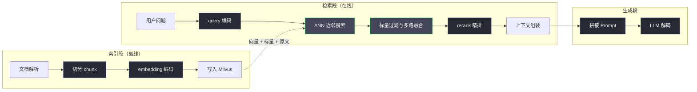
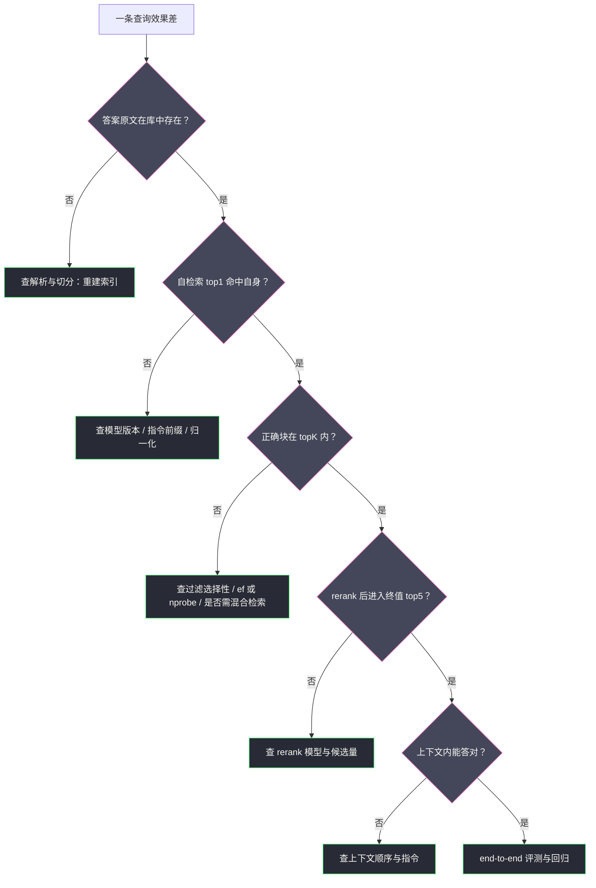
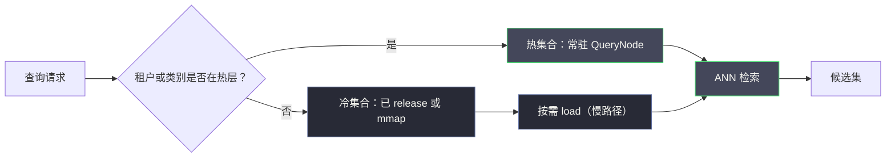
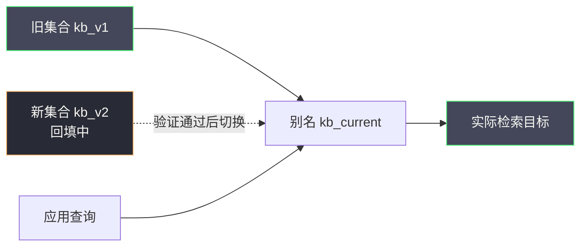

# Milvus 在 RAG 场景中的应用

**摘要：**

检索增强生成（Retrieval-Augmented Generation，RAG）的流水线可以切成索引、检索、生成三段，向量数据库只出现在第二段，而且只承担其中一步：给定一个查询向量，从海量向量里取出距离最近的若干条。切分策略、embedding 模型、重排模型、提示词构造都不在它的职责范围内，但检索质量的成败又常常被归到它头上，于是「调库」成了最常见也最无效的动作。本文按这条责任边界展开：先把三段流水线的输入输出对齐，说明索引段交到库里的只有「已经切好、已经编码好」的行，以及库能拒绝什么样的写入；再给出效果不达标时的归因顺序——分块、embedding、召回、重排、prompt，解释向量库为什么排在第三位，并把每一步的判据写成十分钟内能跑完的动作；随后把 Milvus 真正能动的三只旋钮逐一拆到机制与代价：`partition_key` 的租户路由、`hybrid_search` 的稠密稀疏混合、标量字段的元数据下推。稀疏向量的物理含义、rerank 与 `topK` 的配比、增量更新、多租户与冷热分层各占一节，最后落到四个把库当万能药的反例。

---

## 第 1 章 三段流水线与向量库的位置

把一张 RAG 架构图摊在桌面上，向量数据库那个方块的位置往往是含糊的：它有时候被画成「知识库」本身，有时候被画成「检索服务」，还有时候被当成一个能顺手塞进过滤、去重、排序逻辑的通用中间件。位置一含糊，责任就会漂移；检索不准的时候，所有人都会转过来问库为什么没查到，而真正出问题的地方可能在两段之外的切分脚本里。

要把它钉在正确的位置上，得先把流水线的输入输出对齐。一条完整的 RAG 链路可以切成三段，每段的边界由「它吃进什么、吐出什么」决定，而不是由部署图上的方框决定。

### 1.1 索引段：把文档变成可检索的数据

索引段位于离线侧，做的是解析、切分、编码、写入四件事：解析器把 PDF、Word、HTML、内部 Wiki 的导出物拆成带结构的文本；切分器按标题、段落、句子把文本切成块；embedding 模型把每个块编码成一个定长浮点数组；写库客户端把向量、块原文和一组标量字段一起灌进 Milvus。这一段的输出是一张表，每行对应一个块，列包括向量、原文、来源、页码、序号、租户、时间戳。

这一段的每一个决策都在改变「库里面到底是什么」，而库本身对此没有发言权。切分器决定一个向量代表多大的语义单元，embedding 模型决定这个单元被投影到哪个空间的哪个点，解析器决定页眉页脚、表格框线、代码块有没有被垃圾字符污染。库只负责把交到手上的行存下来，并按声明的索引把结构建好。

### 1.2 检索段：从问题到候选

检索段位于在线侧：用户的问题先被同一个 embedding 模型编码成查询向量；库在候选集上做近似最近邻搜索（Approximate Nearest Neighbor，ANN），按声明的度量返回距离最近的若干条；若查询带了过滤条件，过滤与搜索的先后顺序由库的查询引擎自行决定；多路召回的结果在库内融合；返回的主键与字段被拉到应用层，交给重排模型精排；最后按模板拼成上下文。

这一段里，库参与的只有中间那几步：ANN、过滤、融合。query 的编码不在它这里，重排不在它这里，上下文的拼接与截断也不在它这里。它看到的东西非常有限——两个浮点数组，加上一串标量条件。

### 1.3 生成段：只能在给定证据里组织语言

生成段只做一件事：把选出来的证据按某种顺序塞进提示词，连同指令一起交给模型解码。它决定了模型「看到什么、以什么顺序看到」，却无法决定「能不能看到」。上下文里没有的事实，模型要么承认不知道，要么用一个看起来合理的句子补上，而后者正是幻觉的常见来源。

三段的责任划分可以用一张表固定下来。

表 1-1 三段流水线的责任划分

| 环节 | 输入 | 输出 | 主要决策者 | 向量库的位置 |
| :--- | :--- | :--- | :--- | :--- |
| 索引 | 原始文档 | 向量 + 元数据行 | 解析器、切分器、embedding 模型 | 只做存储与建索引 |
| 检索 | 查询向量、过滤条件 | 候选主键与字段 | embedding 服务、库、重排模型 | ANN 与融合 |
| 生成 | 选中的证据 | 自然语言答案 | prompt 设计、LLM | 不参与 |

这张表最容易被忽略的是第三列：索引段的输出是检索段的输入，检索段的输出是生成段的输入，而向量库只承接了前一次交接，并没有承接决策。

### 1.4 库只拥有「近邻」这一件事

一个更锋利的说法是：向量库的全部能力，可以压缩成「在某个度量下，按给定的查询向量返回近似最近的 K 条」。过滤、融合、分组、聚合是围绕这句话做的加减法，目的都是让「最近的 K 条」更符合调用方的意图，但它们没有改变这句话本身。

这让人想到档案室的检索员：你把索书号交给他，他能在极短的时间里从几十万册里把最接近的十几本抱到你桌上。他极其称职，也极其无知——他不知道这些书是按什么规则编目的，不知道你要写的是哪篇论文，更不知道第十三本书的第三章才是答案。索书号是 embedding 模型给的，架位是索引算法排的，编目规则是切分策略定的，检索员只对「按号取书的速度与准确率」负责。

这个比喻要加一条技术限定：索引算法排出来的「架位」其实是高维空间里的图或者簇，不是线性的书架；所以在某些情况下，即使索书号给对了，书也可能被放在图的另一侧——这正是 ANN 的近似性，也是 `ef`、`nprobe` 这类参数存在的原因。但反过来，编目规则一旦错了，检索员只会更快地取回错误的书，这一点与比喻完全一致。

### 1.5 内置 Function 改变不了这条边界

Milvus 2.5 起可以在 schema 里声明一个 BM25 函数，写入时由库自动把原文转成稀疏向量，调用方不必再自己算权重。这看起来像库「接管了 embedding」，其实接管的只是确定性的文本转换：分词、词频统计、按语料计算的逆文档频率，一套没有可学习参数、可以逐项复算的过程。

稠密向量的编码仍然在库外，因为那需要模型权重与前向计算，而模型版本、指令前缀、归一化口径这些最容易出错的细节，库并不掌握。这个区分在归因时很关键：稀疏侧召回不好，多半是分词器与语料统计的问题；稠密侧召回不好，多半是模型与语料分布的问题。两边都归到「库」头上，就永远找不到真正的原因。

### 1.6 交接契约：库能拒绝什么

库虽然不判断内容，却对上游有四条硬性要求，这四条构成了索引段与库之间的契约。第一条是维度固定，`dim` 在建表时写死，不同维度的向量之间不存在可比的距离，换模型就等于换空间，只能新建集合并回填，不能就地修改。第二条是主键稳定，`auto_id` 用起来省事，但它无法支撑幂等更新——同一篇文档重复入库会产生副本，而 RAG 的增量更新恰恰要求「同一块写一百次只有一行」。

第三条是长度上限，`VARCHAR` 的 `max_length` 是硬限制，超长的值写入时直接报错而不是静默截断，所以切块预算必须留出余量，且要按实测的字节数而不是字数来估算，中文在 UTF-8 下占用更多字节。第四条是字段类型与过滤表达式的匹配，把权限、时间、来源做成标量字段，才能被下推；塞进 JSON 字段虽然灵活，但过滤代价明显更高。

这四条契约的价值在于，它们是库唯一能替上游「发现错误」的地方：切分脚本算出 9000 字的块，写入会失败；维度写成 768 而模型输出 1024，写入会失败；主键重复，可以得到一个明确的覆盖语义而不是悄悄产生副本。除此之外，库对内容的对错一无所知。

下面的流程图把三段串起来，并标出库实际参与的位置。



图里绿色的两个节点是库的领地，其余节点都在库外。这条边界定下来之后，「效果差先查哪」就有了一条可以照着走的顺序。

---

## 第 2 章 效果不达标，先查哪

### 2.1 下游补不回上游丢掉的信息

检索链路是一条有损管道，而且损失是单向的。重排只能在候选集里重排，候选里没有的文档永远不会出现在最终上下文里；prompt 只能在给定上下文里组织语言，上下文里没有的事实只能靠模型补。这个**单向性**决定了一件事：排查方向必须从上游往下游走，而不是从「手边能改的参数」开始。

反过来推也成立：如果一个问题在上游就被切坏了，那么把 ANN 参数调到极限，也只能在错误的空间里找到「最接近的错误答案」。这是本章要反复强调的一点。

这有点像看病：发烧只是症状，量体温只能确定「有问题」，真正的诊断要从最可能出错的器官查起，而且顺序必须按「上游决定下游」来排，不能按「哪台仪器手边有」来排。

### 2.2 五步判据

判断顺序是分块质量、embedding 一致性、检索召回、重排、prompt。每一步都要有一个能在十分钟内跑完的判据，否则它就会变成一句口号。

**分块质量**的判据最直接：拿一批答案已知的问题，人工确认答案所在的那段原文，然后绕过向量检索，按 `doc_id` 加关键词表达式直接查库。如果这段文字根本不在任何一个块里，后面四步全都不用查了。这一条能拦下相当比例的「检索不准」——譬如 PDF 双栏解析串行、表格被切成单字、代码块被按句号切开，都是它的常见成因。

**embedding 一致性**的判据是自检索：把某个块的原文直接当作查询去检索它自己，`top1` 若不是它本身，说明写入侧与查询侧的编码口径至少有一处不同，可能是模型版本、维度、指令前缀或者归一化方式。另一个判据看分数分布：正常检索的 `top1` 与 `top10` 应当有明显梯度，若整批查询的最高分都挤在很窄的区间里，通常是块向量被平均掉或者模型不适配这批语料。

**检索召回**的判据是命中集合：确认正确文档在不在 `topK` 里。在但排名靠后，问题在重排；不在，问题在 embedding、ANN 参数或过滤条件。这一步必须用离线查询集来算，单条查询的手工观察说服力不足。

**重排**的判据是开关对比：把 rerank 关掉与打开各跑一遍，比较终值 `top5` 的命中率。若两者几乎一样，说明候选里的排序本来就没问题，重排带来的只是延迟。

**prompt** 的判据是上下文内测试：手工把正确答案对应的块放进上下文再问一次。模型仍然答错，问题在指令设计、上下文顺序或者上下文过长导致的中段信息被忽略。

### 2.3 向量库为什么排在第三位

从顺序上看，向量库既不在最上游，也不在最下游：它前面有分块与 embedding 两层，后面有重排与 prompt 两层。它只对「给定向量集合，能否把最近的 K 条取准」负责，而对「这个向量集合是否值得检索」没有发言权。

真正让工程师一上来就调 `ef` 的，是**能见度偏差**。切分脚本在另一个仓库里，embedding 服务是别人的 API，重排模型还没接进来，prompt 由产品同学维护，只有搜索参数是眼前的一行配置。调它是唯一不需要跨团队协调的动作，于是它成了默认动作；一旦看到召回率涨了两三个点，沉没成本又会把人继续按在这条曲线上。

代价可以量化。下面这组数字是示例推算，用于说明量级，实际效果必须用离线评测集测：`ef` 从 64 提到 256，HNSW 的搜索宽度翻四倍，延迟大致随搜索宽度线性增长，而召回率往往只从 0.86 抬到 0.90 附近就开始饱和；把 1200 字的块改成 400 字、保留 10% 重叠，同样的查询集上召回率可能从 0.72 抬到 0.86。前者的收益有天花板，后者的收益来自重新划分了语义单元，天花板高得多。

这背后是一条更朴素的判断：ANN 参数调的是「搜索得够不够仔细」，而分块调的是「要搜索的东西对不对」。前者是效率问题，后者是正确性问题。

### 2.4 判据表与流程

表 2-1 五步归因的判据与修复成本

| 顺序 | 环节 | 典型症状 | 判据 | 修复成本 |
| :--- | :--- | :--- | :--- | :--- |
| 1 | 分块 | 答案在库里查不到、引用页码错位 | 按 `doc_id` 直查原文 | 高，需重建索引 |
| 2 | embedding | 全库相似度普遍偏低且无梯度 | 自检索 `top1` 是否为自身 | 高，需重新编码 |
| 3 | 召回 | 正确块不在 `topK` 内 | 离线命中集合比对 | 低，改参数或过滤 |
| 4 | 重排 | 正确块在候选里但排名靠后 | 开关 rerank 对比 | 中，接入模型 |
| 5 | prompt | 上下文有答案但回答错 | 手工注入正确上下文 | 低，改模板 |

把这张表画成决策路径，就是下面这张图。



这条路径的价值不在图上，而在于它把「调库」从默认动作降级成了第三种可能。

### 2.5 让判据成立的评测集

上面每一条判据都要求「用一批查询」而不是「用一条查询」，这意味着团队必须先有一个小规模的评测集。规模不必大，五十到两百条足够起步，但需要覆盖四类问题：高频的常规问句、带专有名词的问句、带时间或权限约束的问句、需要跨两篇文档才能回答的问句。每条标注正确答案所在的块，退一步至少标注文档。

有了这个集合，前面每一步都能算出一个数：分块是否覆盖了答案原文（用直查判定）、正确块是否在 `topK` 内（召回率）、正确块进入终值的比例（端到端命中率）。指标不必复杂，`Recall@K` 加上首个正确块排名的倒数取均值（MRR）就够支撑大多数决策；后者对「排得太靠后」这类问题更敏感。

维护成本是这个方案真正的门槛：文档更新后标注会漂移，过期的标注会让召回率虚高或虚低，所以每次全量重建索引之后，要抽样复核一遍标注。很多团队跳过这一步，于是所有关于效果好坏的说法都退回到了手感，而手感恰好最容易被「刚刚调了一个参数」的错觉左右。

生成侧的质量，譬如回答是否被上下文支撑、上下文是否覆盖了答案所需的信息，可以交给 RAGAS 这类框架自动打分，它用模型来评判而不是靠人工打分，省掉了标注答案的成本，前提仍然是那批带参考答案的问题。

### 2.6 召回不达标的六个成因

归因走到「检索召回」这一步之后，原因可以收敛成六类，多数事故落在其中两三类上。

表 2-2 检索召回不达标的六个成因

| 成因 | 典型症状 | 现场判据 | 修法 |
| :--- | :--- | :--- | :--- |
| 分块过大或过小 | 正确块在 `topK` 边缘，或候选里挤满近义碎片 | 改块长重建后对比 | 重切并调重叠 |
| 模型与语料不匹配 | 全库相似度没有梯度，专名检索几乎失效 | 换模型小样本重编对比 | 换模型或领域微调 |
| `ef` / `nprobe` 太小 | 一提高参数召回立刻上升 | 参数扫描曲线 | 提高搜索宽度 |
| 缺指令前缀 | 同一个模型，查询与文档的相似度整体偏低 | 加前缀后自检索是否恢复 | 按模型要求补前缀 |
| 归一化不一致 | IP 检索的分数与直觉相反 | 抽查两侧向量的模长 | 统一归一化或改用 COSINE |
| 过滤条件太严 | 命中数少于 `limit`，结果稀稀拉拉 | 去掉过滤重查 | 放宽条件或换分区键 |

指令前缀是最隐蔽的一条。E5 系列在训练时把查询与段落分别加上 `query: ` 与 `passage: ` 前缀，BGE 的中文 v1.5 要求在查询侧拼一句固定指令，nomic 系列用 `search_query:` 与 `search_document:`。漏掉前缀不会报任何错，只是把查询编码到了另一个子空间：症状是所有查询的相似度整体下移，而 `top1` 往往还「看起来相关」，很容易被误判成模型能力不够。判据仍然是自检索——补上前缀之后，用块原文检索它自己能否稳定命中。

归一化不一致属于另一类静默错误。写入时归一化、查询时忘了，或者两批数据用了不同的预处理，用 IP 检索时分数尺度就乱了，排序随之失真；Milvus 的 COSINE 会在库内做归一化，选它相当于把这件事交给库，选 IP 就必须自己保证两侧口径一致，且后续不能再混入未处理的向量。量化索引会再引入一层近似误差，比较不同索引的结果时要把这层误差记在账上。

过滤太严最常见于时间条件：把「最近三个月」写成硬过滤，而三个月内的语料只有几十个块，候选池被裁得比 `limit` 还小，返回结果自然稀稀拉拉。这类问题在日志里表现为命中数少于 `limit`，不需要看分数就能定位。

六类成因里，只有第三类真正落在向量库的参数范围内；其余五类要么在切分脚本，要么在编码服务，要么在查询封装里。这个比例本身就是「先调库通常无效」的证据。

---

## 第 3 章 分块：决定检索上限的那一层

### 3.1 块太大的两种失败

块太大时，最常见的描述是「噪声多」，这个描述并不准确。真正的机制是**语义被平均**：一个块里如果同时讲了索引构建、副本同步和监控告警三个主题，它的向量会是这三段语义的加权平均，落在三者之间的某个区域；而用户的查询只命中其中一个主题，查询向量靠近的是那个主题的「纯」区域，与这个平均点都有一段距离。结果就是正确块能排进 `topK`，但排不到前列，重排只能在这个不高的起点上做微调。

第二种失败是上下文占用。块越大，同样 `topK` 塞进提示词的字数越多，而模型的注意力在长上下文中分布并不均匀，中段信息被忽略的现象在长上下文研究里已经被反复验证（Liu 等人 2023 年的工作把这个现象命名为 lost in the middle）。一个 2000 字的块里只有 200 字是答案，模型未必能把那 200 字挑出来。

### 3.2 块太小的两种失败

块太小时，第一层损失是语义不完整。技术文档里大量句子依赖上文才能成立，「它的默认值是 512」这句话离开前一段就失去了指代对象，编码出来的向量是一个关于「默认值」的模糊方向，几乎对任何查询都不够近。

第二层损失是分布退化。块越小，块与块之间的语义差异越小，`topK` 里会挤满一批「都沾一点边」的块，模型拿到的是一堆碎片而不是证据。与此同时块数按比例膨胀，索引构建时间、内存占用、compaction 压力都随之上升——分块粒度的账，最终会记到向量库的成本上，但决策权在切分脚本里。

### 3.3 重叠的两面

**重叠**（overlap）常被解释成「保留上下文连贯性」，这个解释过于笼统。它实际起三个作用：保护边界处的句子不被腰斩，让跨块的连贯论述在两个块里都出现一次以提高召回概率，以及在结构性切分失效时给检索留一次兜底。

它也有两个明确的代价。其一，存储与索引成本按 `overlap / chunk_size` 的比例线性增长，10% 的重叠意味着 10% 的额外向量、额外索引构建时间与内存。其二，相邻块的向量高度相似，`topK` 里会出现同一个段落的两个版本，既浪费候选名额，也让引用定位出现歧义——同一个句子在两块里都有，引用该标哪一页。

重复候选的处理可以用分组搜索：按 `doc_id` 折叠（`group_by_field` 配 `group_size`），每个文档只返回最相似的若干个块，`topK` 的名额就不会被同一篇文档占满。它的代价是同一文档内其他相关的块被压掉，适合「先给每篇文档一个机会」的召回策略，不适合需要多块拼证据的场景。

分块粒度有点像地图的比例尺：城市级地图上看不到街道，街道级地图又拼不出省界；要回答「从哪里拐弯」就得放大，要回答「走哪条高速」就得缩小，而 RAG 的用户问题两种都有。

工程上的经验区间是块大小的 10% 到 20%，并且在天然边界（标题、段落、代码块）处切分时可以把重叠降到 0。这个区间的下限由句子长度决定，上限由存储预算决定，与向量库的索引类型无关。

### 3.4 必须落库的字段

块原文之外的字段不是「顺手存的元数据」，它们各自承担一个检索环节的职责。

表 3-1 RAG 场景下块表必须落库的字段

| 字段 | 类型 | 用途 | 不存会怎样 |
| :--- | :--- | :--- | :--- |
| `content` | `VARCHAR` | 直接拼进上下文 | 只能回源查对象存储，延迟翻倍 |
| `doc_id` | `VARCHAR` | 去重、更新、按文档分组 | 无法整篇替换，更新只能靠删全表 |
| `source` | `VARCHAR` | 引用链接、按来源过滤 | 答案无法溯源，审计不通过 |
| `page` / `section` | `INT32` / `VARCHAR` | 精确定位引用、按章节过滤 | 引用只能指到文档级，用户无法核对 |
| `chunk_index` | `INT32` | 取相邻块扩展上下文 | 无法还原块的顺序，只能靠相似度 |
| `version` | `INT64` | 更新时过滤半成品数据 | 查询可能读到新旧混合的块 |
| `tenant` | `VARCHAR` | 租户隔离与过滤下推 | 跨租户扫描，兼有越权风险 |
| `created_at` | `INT64` | 时间过滤、时效性加权 | 只能应用层过滤，候选被浪费 |

`chunk_index` 值得单独说。它是「用块检索、用更大范围回答」这个模式的物理基础：检索命中第 7 块，就把第 6 块和第 8 块一起取出来，拼成 1200 字的上下文，既保留了小块带来的检索精度，又给了模型足够的上下文。没有这个字段，就只能退回「用大块检索」或者「用父子两块双写」，前者精度差，后者存储翻倍。

### 3.5 邻块扩展的读写代价

邻块扩展的实现很朴素：一次 ANN 拿到 `topK`，再按 `(doc_id, chunk_index ± 1)` 批量取邻居。

```python
# 邻块扩展：一次 ANN 换一次批量标量查询，避免逐条回表
hits = client.search(
    collection_name="kb_chunks",
    data=[query_vec],
    anns_field="dense",
    search_params={"metric_type": "COSINE", "params": {"ef": 64}},
    limit=40,
    filter='tenant == "t-1024"',
    output_fields=["doc_id", "chunk_index", "content", "source", "page"],
)
# 用 in 列表一次取回所有需要的邻居，而不是对每个命中单独查一次
pairs = [(h["entity"]["doc_id"], h["entity"]["chunk_index"]) for h in hits[0]]
expr = " or ".join(
    f'(doc_id == "{d}" and chunk_index >= {i - 1} and chunk_index <= {i + 1})'
    for d, i in pairs
)
neighbors = client.query(
    collection_name="kb_chunks",
    filter=expr,
    output_fields=["doc_id", "chunk_index", "content"],
)
```

这段代码的代价在 `expr` 的长度上：`topK` 越大，拼出来的表达式越长，Proxy 解析开销与 QueryNode 的扫描范围都随之上升。规模大时更常见的做法是把扩展放在应用层的缓存里，或者在写入时就把邻块内容拼进 `content`（用存储换查询），两种做法的取舍见下表。

表 3-2 分块粒度与扩展策略的取舍

| 策略 | 检索精度 | 上下文完整性 | 存储成本 | 查询延迟 | 适用场景 |
| :--- | :--- | :--- | :--- | :--- | :--- |
| 大块（1000 字以上）直检 | 低 | 高 | 低 | 低 | 叙事型长文、法规条文 |
| 小块（300-500 字）直检 | 高 | 低 | 高 | 低 | 问答型知识库 |
| 小块 + 邻块扩展 | 高 | 高 | 中 | 中 | 技术文档、产品手册 |
| 小块 + 父块双写 | 高 | 高 | 高 | 低 | 上下文必须成段呈现 |

### 3.6 四种切法的分工

切分方法本身不是本文的主题，但它与向量库的交互方式值得说清楚，因为不同切法产生出来的块在长度分布上差别很大，而长度分布会直接影响检索的稳定性。

固定长度切分最简单，按 token 数一刀切，块长几乎相等，代价是边界随机，句子被腰斩以后编码出来的向量会带上一截无关语义。递归字符切分按分隔符优先级退让，先段落、再句子、最后逗号，边界自然得多，块长方差开始出现。结构感知切分按标题层级切，每个块对应一个逻辑单元，技术文档与规范书用这一种效果最好，但一个二级标题下面可能有八百字也可能有三十字，块长方差最大。语义分块按相邻句向量的相似度骤降处切断，边界最自然，代价是每句话都要过一次 embedding，而且阈值对语料敏感，换一批文档就得重调。

表 3-3 切分方法的块长特性与代价

| 方法 | 边界质量 | 块长方差 | 计算成本 | 主要风险 |
| :--- | :--- | :--- | :--- | :--- |
| 固定长度 | 低 | 极小 | 极低 | 语句被腰斩，向量夹带噪声 |
| 递归字符 | 中 | 小 | 低 | 长段落仍会被硬切 |
| 结构感知 | 高 | 大 | 低 | 超长章节需要二次切分 |
| 语义分块 | 最高 | 中 | 高 | 阈值不稳，跨文档不一致 |

块长方差大的时候，检索会出现一种不对称：长块因为语义被平均，与任何具体查询的距离都偏远，反而不容易被召回；短块信息量少，容易对一切查询都「差不多近」，挤占候选名额。所以结构感知切分通常要配一条二次约束——按标题切完，超长的章节再按句子切成若干段，并共享同一个 `section` 字段，让引用仍然指向章节。

---

## 第 4 章 Milvus 侧的三层优化

库能动的旋钮并不多，但有三个在 RAG 场景里几乎是必选项：按租户或文档类别做分区、把稠密与稀疏两路召回合起来、把元数据过滤下推到索引层。三者解决的是三个不同的问题——扫描范围、词汇匹配、候选质量。

### 4.1 用 partition_key 做租户路由

多租户 RAG 的第一版实现通常是「一张表存所有租户的块，查询时在 `expr` 里加 `tenant == "x"`」。这个做法在数据量小的时候没有问题，一旦块数到千万级，问题就暴露：过滤条件只是在候选集上做减法，ANN 索引本身仍然按全量数据构建，QueryNode 需要在所有分段上执行搜索再过滤，延迟随总数据量增长，而不是随租户的数据量增长。

`partition_key` 把这一步前移到了写入侧。建表时把某个标量字段标记为分区键，Milvus 在写入时对该字段值做哈希，把行路由到固定的若干个内部分区里，分区数在创建时通过 `num_partitions` 指定，不指定时默认创建 16 个。查询时只要表达式里带上该字段的等值条件，Proxy 就能把搜索裁剪到对应的分区上，效果与手工管理分区相同，但省掉了业务侧的写入路由与分区命名。这像图书馆先按分馆分流：读者报出要查的分馆，管理员就不必从总馆的目录开始翻。

```python
# 多租户块的 schema：分区键 + 两路向量 + 可过滤标量
schema = client.create_schema(auto_id=False, enable_dynamic_field=False)
schema.add_field("chunk_id", DataType.VARCHAR, is_primary=True, max_length=64)
schema.add_field("tenant", DataType.VARCHAR, max_length=64, is_partition_key=True)
schema.add_field("doc_id", DataType.VARCHAR, max_length=64)
schema.add_field("source", DataType.VARCHAR, max_length=512)
schema.add_field("page", DataType.INT32)
schema.add_field("chunk_index", DataType.INT32)
schema.add_field("version", DataType.INT64)
schema.add_field("content", DataType.VARCHAR, max_length=8192)
schema.add_field("dense", DataType.FLOAT_VECTOR, dim=1024)
schema.add_field("sparse", DataType.SPARSE_FLOAT_VECTOR)

index_params = client.prepare_index_params()
index_params.add_index("dense", index_type="HNSW", metric_type="COSINE",
                       params={"M": 16, "efConstruction": 200})
index_params.add_index("sparse", index_type="SPARSE_INVERTED_INDEX", metric_type="IP",
                       params={"drop_ratio_build": 0.2})
# 分区键字段仍要建标量索引：路由靠分区，过滤本身还要靠索引
index_params.add_index("tenant", index_type="INVERTED")

client.create_collection(
    collection_name="kb_chunks",
    schema=schema,
    index_params=index_params,
    num_partitions=64,   # 分区数在创建时固定，后期调整需要重建集合
)
```

这里有四个容易被忽略的细节。

第一，分区数一旦确定就不容易改。`num_partitions` 只对含分区键的集合有效，后期扩容通常要新建集合并迁移数据，规模大时这是一次不轻的变更，选值时应当按未来一到两年的租户数来估，而不是按当下。

第二，哈希路由意味着分区不是租户独占的。租户数远大于分区数时，多个租户会共享同一个分区，所谓「隔离」只是不跨分区扫描，而不是数据物理分开。真正需要物理隔离的合规场景，仍然要落到独立集合甚至独立实例。

第三，裁剪的前提是等值单值过滤。`tenant in [...]` 这种写法会让裁剪退化为多分区扫描，收益消失；如果确实需要一次查多个租户，就要接受延迟按分区数增长。

第四，Milvus 还提供了分区键隔离模式（`partitionkey.isolation`），开启后每个分区键值拥有独立的索引，查询被严格限制在单个键值内。它以只支持 HNSW 索引、过滤条件只能是一个值为代价。租户数量不大、且每个租户的数据量足以撑起独立索引时，这个模式比普通分区键更彻底。

### 4.2 用 hybrid_search 补上词汇匹配

纯稠密向量在专有名词上表现差，这不是实现缺陷，而是编码方式的必然：模型把一段文本压成一个定长数组，数组里没有为「某个具体字符串」保留位置。查询「ERR-4021」时，模型给出的向量更接近「错误码相关的一般语义」，而不是「字面包含 ERR-4021 的文档」。企业内部知识库里恰恰充斥着这类词——项目代号、工单号、接口名、版本号、人名，它们中的多数在模型训练语料里根本没出现过。

**稀疏向量**补的就是这一块。它的维度对应词表，一篇文档只有出现在其中的若干词权重非零，字面重合度直接反映在分数里。两路一起用，语义近似与字面精确就有了各自的通道。

```python
# 稠密 + 稀疏两路召回，在库内融合后返回候选，交给库外重排
dense_req = AnnSearchRequest(
    data=[query_dense],
    anns_field="dense",
    param={"metric_type": "COSINE", "params": {"ef": 64}},
    limit=40,
    expr='tenant == "t-1024" and version >= 7',   # 过滤条件两路都要带
)
sparse_req = AnnSearchRequest(
    data=[query_sparse],                          # 形如 {token_id: weight}
    anns_field="sparse",
    param={"metric_type": "IP", "params": {"drop_ratio_search": 0.2}},
    limit=40,
    expr='tenant == "t-1024" and version >= 7',   # 漏写一路就会引入越权候选
)
candidates = client.hybrid_search(
    collection_name="kb_chunks",
    reqs=[dense_req, sparse_req],
    ranker=RRFRanker(60),     # 倒数排名融合，k 默认 60
    limit=40,                 # 融合后的候选数，要大于重排后的终值
    output_fields=["doc_id", "chunk_index", "content", "source", "page"],
)
```

三个参数值得单独交代。倒数排名融合由 Cormack 等人在 2009 年提出，`RRFRanker` 的 `k` 是平滑常数，取值越大对头部排名的敏感度越低，默认 60 在多数场景可用；换成 `WeightedRanker` 时要小心两路分数不在同一尺度，余弦相似度落在 0 到 1 附近而 BM25 分数可以到十几，直接加权是没有意义的，只能先各自归一化。每路的 `limit` 与最终的 `limit` 是两个概念：前者是每路进入融合的候选数，后者是融合后返回的数量，前者应当明显大于后者，否则融合失去了可比较的样本。

把过滤条件写进每一路，是最容易漏的一步。只在稠密那一路加 `tenant` 过滤，稀疏那一路就会把其他租户的块带进候选，融合之后照样返回——这是越权，而不是性能问题。

### 4.3 把元数据过滤下推到索引层

第三层优化针对时间和来源。RAG 的典型查询带着隐含的时间与权限约束：只查最近半年的制度、只查当前用户有权限的文档、只查某个产品线的手册。这些条件如果在应用层做，就得先把 `topK` 拉大再筛，问题有三个：筛选后可能一条不剩；传输量按 `topK` 放大；以及无法保证「筛完还有 K 条」。

Milvus 的做法是把过滤条件交给查询引擎，由它决定先过滤还是先搜索。选择性高（过滤后剩得很少）时先过滤再搜索代价更低，选择性低时先搜索再过滤更划算，这个切换由引擎按过滤比例自适应，机制在 [[04 查询引擎——混合检索与过滤]] 里有完整拆解。对调用方来说，能做的事只有两件：给过滤字段建标量索引，以及把条件**下推**。

标量索引的选择按字段特征来：等值过滤多的类别字段用 `INVERTED`，范围过滤多的时间戳用 `STL_SORT`，前缀匹配的字符串用 `Trie`，低基数的状态字段用 `BITMAP`。创建索引时不指定 `index_type`，Milvus 会按字段类型自动选择，对大多数场景这已经够用；只有在过滤比例极高或极低的两端，手工指定才有明显收益。

权限过滤有一个额外的设计约束：不要把权限条件留到应用层裁剪。向量检索返回 10 条，应用层删掉 3 条没权限的，剩下 7 条里可能恰好缺了最关键的那条证据，而系统无从得知。正确做法是把权限位写成标量字段、把条件拼进 `expr`，让候选集在一开始就不含越权数据。

### 4.4 三层配置的代价

三层优化各自解决一个问题，也各自带来成本。

表 4-1 三层优化的配置、收益与代价

| 优化 | 关键配置 | 解决的问题 | 代价 | 适用前提 |
| :--- | :--- | :--- | :--- | :--- |
| 租户分区 | `is_partition_key`、`num_partitions` | 跨租户扫描 | 分区数固定、哈希碰撞、倾斜 | 租户维度稳定且查询必带该条件 |
| 混合检索 | 稀疏字段、`RRFRanker` | 专名与精确匹配 | 存储与编码成本翻倍、延迟上升 | 语料含大量内部专名 |
| 元数据下推 | 标量索引、`expr` | 候选污染与越权 | 索引内存、表达式解析开销 | 过滤字段基数适中 |

三层叠起来的检索路径可以画成这样。


图里绿框之内是库的职责，绿框之外的两次编码与一次重排都不在库内。这也是为什么「调库」不可能解决所有召回问题——它连查询向量都不是自己算的。

### 4.5 参数的两个方向都有代价

把本章涉及的参数排在一张表里，两侧的代价就清楚了。绝大多数调参事故不是「不知道该调哪个」，而是只看到了调大那一侧的收益，没算调小那一侧的损失，或者反过来。

表 4-2 关键参数调大与调小的代价

| 参数 | 作用 | 调大的代价 | 调小的代价 |
| :--- | :--- | :--- | :--- |
| HNSW `ef` | 搜索宽度 | 延迟随宽度上升，召回很快饱和 | 近似误差变大，`topK` 尾部不可信 |
| HNSW `M` | 每层邻居数 | 内存与建索引时间上升 | 图连通性变差，召回下降且难察觉 |
| IVF `nprobe` | 探测簇数 | 延迟上升，接近暴力搜索 | 漏簇，长尾查询直接召回不到 |
| `num_partitions` | 分区数量 | 元数据与协调开销上升，倾斜更细碎 | 裁剪粒度粗，单分区过大 |
| `drop_ratio_build` | 丢弃低权重词项 | 稀有词丢失，专名命中变差 | 索引体积大，加载慢 |
| RRF `k` | 融合平滑常数 | 对头部排名不敏感，长尾权重上升 | 头部两项垄断，第二路形同虚设 |
| `topK` | 重排候选池 | 重排延迟线性上升，上下文预算吃紧 | 重排无纠错空间，退化为直出 |

表里最容易被忽略的是 `M`。HNSW 的分层图结构（Malkov 与 Yashunin 在 2018 年的论文里给出了完整构造）决定了 `M` 与 `efConstruction` 只在建索引时生效，改它意味着重建整个索引，而收益在召回率上通常只体现一两个点；相比之下 `ef` 是查询期参数，改起来没有成本，所以它承担了大量本不属于它的期望。

---

## 第 5 章 稀疏向量：专名与精确匹配的补丁

### 5.1 物理含义

`SPARSE_FLOAT_VECTOR` 的「维度」是词表大小，可以是几万到几十万；但每篇文档只在实际出现的词上有非零值，其余位置是零。存储时只保留下标与权重，所以维度大并不意味着存储大——这与稠密向量正好相反，后者每个维度都必须存。

度量用内积（IP），因为权重非负，内积越高表示词面重合越强、且稀有词的贡献越大。这也解释了为什么稀疏检索对「生僻但关键」的词特别敏感：稀有词的逆文档频率高，权重被放大，譬如一个只在少数文档里出现的型号名，一旦命中就能把分数拉开。

打个比方，稠密向量像一段内容摘要，稀疏向量像一张关键词索引卡：摘要能读懂「这段话在讲什么」，索引卡能保证「这个型号确实出现过」。

### 5.2 两条产生途径

稀疏向量的权重有两条来源。一条是统计式的：BM25 按词频、逆文档频率、文档长度归一化三项算分，不需要模型，可解释、可增量维护，但依赖分词质量，且无法处理同义词。另一条是学习式的：SPLADE（Formal 等人 2021 年）通过掩码语言模型给词表上的每个词打分，能做一定程度的词项扩展，代价是需要一次前向推理，写入成本明显上升。BGE-M3（Chen 等人 2024 年）输出的 lexical weights 属于后一条路线，写库时以字典形式交给 Milvus 即可。

Milvus 2.4 引入稀疏向量字段，权重由调用方算好再写入；2.5 起可以把算法搬进库内，在 schema 里声明 BM25 函数，插入原文即可。

```python
# 2.5 起：声明 BM25 函数，写入原文，库内生成稀疏向量
schema.add_field("content", DataType.VARCHAR, max_length=8192)
schema.add_field("sparse", DataType.SPARSE_FLOAT_VECTOR)
schema.add_function(Function(
    name="content_bm25",
    function_type=FunctionType.BM25,
    input_field_names=["content"],
    output_field_names=["sparse"],
))
# 全文检索的度量类型是 BM25，不再是 IP
index_params.add_index("sparse", index_type="SPARSE_INVERTED_INDEX", metric_type="BM25",
                       params={"inverted_index_algo": "DAAT_MAXSCORE"})
```

库内 BM25 有一个必须知道的代价：逆文档频率需要全库统计，而流式写入的语料在持续变化，库内统计只能近似，与离线算好的权重会有细微差异。对检索排序的稳定性要求极高、且语料更新不频繁的场景，离线算好再写入反而更可控；语料天天更新、又不想维护一套独立的统计流水线，库内 BM25 更省事。

### 5.3 索引参数与失效场景

稀疏索引的参数只有几个，作用都很直接。`drop_ratio_build` 在构建时丢弃权重最低的那部分词项，压缩索引体积，代价是长尾词的信息损失；`drop_ratio_search` 在查询时忽略低权重词，加速检索。取值偏大时，索引小、查询快，但对「仅靠一个稀有词命中」的查询不利——这是稀疏检索最擅长的那类查询，所以这个参数不宜激进。

稀疏检索并非到处都该上。语料规模小、术语规范、查询以自然语言问句为主的场景，纯稠密已经够用，加一路稀疏只是把编码成本与延迟翻倍；分词器对中文支持不好的时候，BM25 的效果会明显打折，需要先确认所用版本的中文分词能力，再决定是否投入。Milvus 2.5 的分析器配置可以指定分词方式，具体的可用类型与参数以对应版本文档为准。

---

## 第 6 章 重排的位置与 topK 的配比

### 6.1 为什么重排不可能在库内

重排模型是 cross-encoder：它把查询与文档拼成一条序列，一起过一次前向，输出一个相关性分数。这个结构决定了它无法预计算——文档侧的表示依赖查询，查询变了整个表示就得重算。库内只有独立编码好的向量，没有「查询与文档联合编码」这条通路，所以重排只能在库外、在候选集上做。

这也解释了两者的分工：向量库负责从百万级里筛出几十条（召回），重排负责从几十条里挑出五条（精度）。前者要快、要能近似，后者要准、可以慢。

### 6.2 topK 应当比终值大多少

`topK` 决定了重排的**候选池**，池子太小，重排无从发挥；池子太大，重排的延迟与上下文预算都受不了。经验区间是终值的 3 到 10 倍，理由是两端各有一个约束。

这像招聘：人力先初筛出三十份简历，面试官再挑五个人。初筛只留五份，等于让面试官在五份里选，没有比较空间；初筛三百份，面试官看不过来，后面的人只能草草翻过。

下限来自排序噪声：ANN 是近似的，融合是启发式的，第 4 名与第 8 名的真实相关性顺序经常颠倒，池子至少要有几倍的冗余，重排才有纠错空间。上限来自两点：cross-encoder 的延迟随候选数近似线性增长，因为每个候选都要过一次前向；以及候选文本要截断到模型的输入长度（常见为 512 token），太长的候选会丢信息。

表 6-1 topK 与终值的配比（示例推算，须以实测延迟为准）

| 终值 | 建议 topK | 重排输入 token（每候选 400） | 上下文占用（终值 × 400） | 备注 |
| :--- | :--- | :--- | :--- | :--- |
| 3 | 15-30 | 6k-12k | 1.2k | 池子偏小，适合低延迟问答 |
| 5 | 20-50 | 8k-20k | 2k | 通用配置 |
| 8 | 30-80 | 12k-32k | 3.2k | 需要多证据的合成问答 |
| 5（不重排） | 5 | 0 | 2k | 候选噪声直接进 prompt |

最后一行的对照值得留意：把 `topK` 直接设为终值、跳过重排，省下的延迟会以答案质量的形式还回去，因为进入上下文的五条里可能有两三条与问题只沾边，模型被这些内容带偏的概率明显上升。反过来，把 `topK` 设成 100 又不做重排，则是把噪声放大十倍塞进上下文，两头都不讨好。

### 6.3 分数阈值不可跨查询复用

还有一个常被误用的做法：设一个固定阈值，比如「相似度低于 0.75 的丢掉」。余弦相似度的绝对值依赖模型、语料、块长与查询分布，同一批数据上不同查询的最高分可能相差很大，一个在周一调好的阈值到了周五就不适用。要过滤低质量候选，用重排模型的分数更稳，或者用相对阈值（取本批候选的分布分位数），而不是写死一个绝对值。

### 6.4 重排的三笔隐性成本

第一笔是输入截断。cross-encoder 的输入长度通常是 512 token 量级，超过的部分被丢弃，而丢弃的恰好可能是答案所在的后半段。这意味着块的长度必须与重排模型的输入预算匹配：块按 1000 字切，重排只能看前一半，最终进入上下文的是被截断过的判断。分块与重排的输入长度是一对耦合参数，不能各自独立拍板。

第二笔是批处理与填充浪费。把 `topK` 个候选拼成一个 batch 过模型，比逐条调用快一个量级，但候选长度参差，padding 到最长会把计算量抬高，短块多的时候浪费尤其明显。工程上的做法是按长度分桶，或者把候选截断到一个较紧的上限，再按 batch 组织。

第三笔是缓存与权限。同一批问题在客服、内部检索里高度重复，缓存终值结果能把平均延迟压下来，但缓存键必须包含租户与权限维度，否则会把 A 租户的答案返回给 B。这一条与第 7 章的多租户隔离是同一件事的两个面：检索侧的隔离如果只做在向量库里，缓存这一层会重新打开口子。

---

## 第 7 章 规模化之后的三个问题

### 7.1 增量更新

文档会更新，知识库要跟着变。Milvus 没有「原地修改向量」的语义，`upsert` 在实现上也是先删后插，删除以增量日志的形式记录下来，查询时过滤掉，物理清除要等 compaction 完成。这意味着更新会带来一段时间的存储放大与查询时的额外过滤开销，频率越高、块越大，压力越明显。

笔者见过的最省事的做法是整篇删除再整篇重写，看似干净，实际会给 compaction 制造大量待合并的小文件。正确的更新姿势是三件事一起做：用稳定的主键（`doc_id` 加 `chunk_index`，或者块内容的哈希），保证同一块重复写入不会产生副本；用 `version` 字段标记批次，查询时带上 `version` 条件，避免读到半更新的知识库；旧版本的块在 compaction 之前仍然占用空间，容量规划要按「峰值块数」而不是「当前块数」来算。删除与 compaction 的细节在 [[03 数据模型——Collection、Partition 与 Segment]] 里。

还有一个与一致性级别相关的细节：新写入的数据先进入可增长的段，查询能否立即看到取决于集合的 `consistency_level`。默认的 Bounded 级别在多数场景下已经够用，但「上传完立刻提问」的产品形态需要 Session 级（同一个客户端能看到自己的写入），代价是查询要多等一个时间戳。

### 7.2 多租户隔离

租户隔离的方案有三档，取舍的维度是隔离强度、成本与运维复杂度。

表 7-1 多租户隔离的三档方案

| 方案 | 隔离强度 | 成本 | 运维复杂度 | 适用规模 |
| :--- | :--- | :--- | :--- | :--- |
| 单集合 + 标量过滤 | 逻辑隔离 | 最低 | 低 | 租户少、数据量小 |
| 单集合 + `partition_key` | 分区隔离 | 低 | 中 | 租户多、单租户数据不均 |
| 每租户独立集合 | 物理隔离 | 最高 | 高 | 合规要求强、租户量少 |

先算一笔账，看分区为什么重要（示例推算）：二十万篇文档、平均四千字，按四百字一块切，约两百万个块；一千零二十四维 float32 每块四 KB，向量本身约八 GB，HNSW 的图结构通常还要再叠上五成到一倍，常驻内存就到了十几 GB 的量级。这个规模摊到六十四个分区上，单个分区约三万个块、几百 MB，分区裁剪把一次查询的扫描范围从两百万降到三万，差距是数量级的；如果没有分区，每次查询都要在全量分段上搜索再过滤，延迟自然随总数据量增长。

第二档是多数产品的落点，但它有两个规模化的副作用。一是倾斜：大租户的数据量可能是小租户的上千倍，哈希到不同分区后，热点分区会成为瓶颈，靠加 QueryNode 无法缓解单个分区的压力，只能靠把大租户单独拆出去。二是跨租户统计：运营侧想看全平台的文档量、命中率，这类查询要扫全部分区，不能走在线路径，应该走离线导出。

### 7.3 冷热分层

冷热分层的道理与仓库的常用货架、后方库房一样：九成的出库发生在货架上，剩下的从库房调，调一次慢一些，但不必为它常备空间。知识库的访问分布通常极不均匀，半年前的历史文档可能只占查询量的百分之几，却占了一半的存储与内存。Milvus 提供了几个层次的**冷热分层**手段：按集合或分区执行 `load` 与 `release`，把不常用的数据从 QueryNode 内存里换出去；开启 mmap 让部分数据以内存映射的方式访问，用磁盘换内存；对超大规模数据换用 DiskANN 这类磁盘索引。索引选型的内存账在 [[02 向量索引——从暴力搜索到 HNSW 与 IVF]] 里有详细测算。

分层的难点不在配置，而在路由与降级。数据被 `release` 之后查询会直接报错，应用层必须先知道哪些租户或哪些类别是热的，把查询路由到对应的集合，并在冷数据被访问时有一条「现场 load」的慢路径。没有这条慢路径，分层就会变成间歇性故障的来源。



容量规划、监控指标与扩缩容的具体做法在 [[06 Milvus 运维——集群部署、索引调优与容量规划]] 里展开，本章只保留与 RAG 检索路径直接相关的部分。

### 7.4 换模型时的原子切换

第 1 章说过维度是 schema 的一部分，换 embedding 模型无法就地修改，只能新建集合重新编码。这件事在规模化之后就不再是一个技术细节，而是一次必须编排的变更：几十万篇文档重新编码要按天计，期间旧集合还得继续服务。

Milvus 的集合别名（alias）为这件事提供了原子切换的能力。查询始终通过别名而不是物理集合名发起，新集合回填完成、双跑验证通过之后，把别名指向新集合，切换是一次元数据操作，应用侧无感知。



切换本身是原子的，但它周围的几样东西不是：客户端的 schema 缓存、连接池里持有的集合句柄、应用层的检索结果缓存，都可能在切换后仍然指向旧集合。稳妥的做法是在切换后主动刷新一次客户端元数据，并把缓存整体失效，否则会出现「一部分请求查新库、一部分查旧库」的短暂不一致，排查起来非常费时。

回填期间的成本也要提前算：新旧两套向量同时在线，存储翻倍，编码算力翻倍，若再叠加双跑对比的影子流量，QueryNode 的负载也会上升。这些成本在规划时应当与业务方对齐，否则很容易在回填到一半时被迫回滚。

---

## 第 8 章 四个反例

下面四个错误都不是配置写错，而是把责任的边界放错了位置：本该在上游解决的问题被推给了库，或者本该由库承担的工作被留给了应用层。它们的共同点是短期内看不出问题，规模与查询形态一变就开始持续失血。

### 8.1 把分块设置当向量库参数调

症状是召回率卡在某个水平上不去，于是 `ef` 从 64 调到 128、256、512，曲线在 128 之后就平了。原因在第 2 章已经说过：参数调的是搜索宽度，而块本身的语义粒度没有变。判据很简单——把块从 1200 字切到 400 字重建一版索引，用同一批查询对比，若召回率跳升十几个点，说明瓶颈从来不在参数上。

### 8.2 用纯向量做精确 ID 查询

「查一下工单 TK-88213 的处理记录」这类查询，交给稠密向量是不合适的：模型会把工单号编码成一个语义方向，返回一批「看起来像工单」的文档。正确做法是把工单号作为标量字段建索引，用等值表达式直查；如果工单号是正文的一部分，就上混合检索，让稀疏那一路负责字面命中。用向量库做**精确匹配**，等于用模糊的方法解决一个本该确定的问题。

### 8.3 多租户共用一个集合却不分区

第一版实现往往如此，数据量小时看不出问题。规模上来之后，两个风险同时出现：延迟随总数据量增长，因为每次查询都要在全量分段上搜索再过滤；以及越权，只要某条代码路径漏了 `tenant` 条件，返回的就是其他租户的数据。后者的严重性远高于前者。正确的做法是把租户条件收拢到统一的查询封装里，配合 `partition_key` 做裁剪，让「漏写条件」在类型或框架层面就不可能发生。

### 8.4 topK=3 直接给 LLM

这是最省事也最常见的一种。三条候选里只要有一条不相关，模型被带偏的概率就不低；而当三条都不相关时，模型通常不会说「我不知道」，而是用常识补出一个通顺的答案。代价换来的是几十毫秒量级的延迟节省，收益却是负的。稳妥的配置是 `topK` 取终值的数倍、过一遍重排、再取五条进上下文，多出来的延迟通常在一百毫秒量级（量级判断，须实测），换来的是答案可溯源。

还有一个变体值得提一句：把整篇文档当成一个块存进 `content` 字段。`VARCHAR` 有长度上限，超长文档要么写不进去，要么被切碎成多行；即便塞进去了，单行的大字段也会拖慢查询时的数据搬运。正确的分层是把原文放对象存储、库里只存块文本与指针，需要全文时按 `doc_id` 回源。

---

## 第 9 章 结语

把向量库放回它在流水线里的位置，很多争论会自动消解。它不负责判断一段文字该不该被切成两块，不负责决定查询要不要加指令前缀，也不负责在候选之间做精细的相关性判断；它负责的是在一堆已经编码好的向量里，用毫秒级的时间把最接近的若干条找出来，并且在这个过程中不发生越权、不扫无关数据、不因为过滤条件写错而返回错误集合。

这条边界的实践意义在于归因顺序：分块、embedding、召回、重排、prompt，向量库排在第三位，而且只占第三位的一部分。上游的错误无法被下游修复，这是有损管道的单向性决定的；反过来，把库的参数调到极致也只能在既有的语义空间里做更仔细的搜索，空间本身错了，仔细没有用。

库这一侧真正值得投入的是三件事：让扫描范围与租户边界对齐，让词汇匹配与语义匹配各有一条通道，让元数据过滤在索引层完成而不是在应用层补救。这三件事都不改变模型，也不改变语料，只是在既有的数据上把「取数」这一步做对。

责任边界同时也是变更边界。改一次切分要重建索引，换一个 embedding 模型要回填整个集合，而调一次 `ef` 只需要改一行查询参数——三类变更的成本差着几个数量级，团队协作里的审批与预案也应该按这个梯度来分，否则最便宜的那个参数会承担最多的期待。

架构即权衡这句话在这里有具体的形状：向量库把「更快地找到近邻」做到了极致，代价是对语义一无所知；RAG 把判断语义的责任交给了切分与模型，代价是链路上任何一环出错都会表现为「检索不准」。看清这条分工，力气才知道该往哪里花。

---

## 参考资料

1. Milvus 文档. 使用 Partition Key. <https://milvus.io/docs/zh/use-partition-key.md>
2. Milvus 文档. 多向量混合搜索. <https://milvus.io/docs/zh/multi-vector-search.md>
3. Milvus 文档. 全文搜索（BM25）. <https://milvus.io/docs/zh/full-text-search.md>
4. Milvus 文档. 标量索引. <https://milvus.io/docs/zh/scalar_index.md>
5. Milvus 文档. 分组搜索. <https://milvus.io/docs/zh/grouping-search.md>
6. Milvus 文档. 支持 MMap 的数据存储. <https://milvus.io/docs/zh/mmap.md>
7. Malkov Y A, Yashunin D A. Efficient and Robust Approximate Nearest Neighbor Search Using Hierarchical Navigable Small World Graphs. IEEE TPAMI, 2018. <https://arxiv.org/abs/1603.09320>
8. Cormack G V, Clarke C L A, Büttcher S. Reciprocal Rank Fusion Outperforms Condorcet and Individual Rank Learning Methods. SIGIR, 2009. doi:10.1145/1571941.1572114
9. Chen J, Xiao S, Zhang P, et al. BGE M3-Embedding: Multi-Lingual, Multi-Functionality, Multi-Granularity Text Embeddings Through Self-Knowledge Distillation. 2024. <https://arxiv.org/abs/2402.03216>
10. Formal T, Piwowarski B, Clinchant S. SPLADE: Sparse Lexical and Expansion Model for First Stage Ranking. SIGIR, 2021. <https://arxiv.org/abs/2107.05720>
11. Liu N F, Lin K, Hewitt J, et al. Lost in the Middle: How Language Models Use Long Contexts. 2023. <https://arxiv.org/abs/2307.03172>
12. Es S, James J, Espinosa-Anke L, et al. RAGAS: Automated Evaluation of Retrieval Augmented Generation. 2023. <https://arxiv.org/abs/2309.15217>
13. Wang L, Yang N, Huang X, et al. Text Embeddings by Weakly-Supervised Contrastive Pre-training. 2022. <https://arxiv.org/abs/2212.03533>

---

> [!note] 思考题
> 1. 检索召回不达标时，如何用最小的实验成本区分「分块问题」与「ANN 参数问题」？你需要准备什么样的查询集才能让结论站得住？
> 2. 多租户场景下，`partition_key`、独立集合、独立实例三档方案的分界线应该画在哪里？租户数据量相差三个数量级时你会怎么处理倾斜？
> 3. 混合检索引入稀疏向量之后，中文分词质量对召回的影响如何量化？你有没有办法在不改模型的前提下判断是分词问题还是权重问题？
> 4. 在固定的延迟预算内，`topK` 与重排模型的规模如何配比？如果预算只够做一样，你选扩大候选还是换更准的重排模型？
> 5. 文档更新时如何保证查询不会读到新旧混合的知识库？`version` 字段、一致性级别、compaction 三者各自能覆盖哪一段窗口？
> 6. 冷热分层把数据 `release` 之后，如何在应用层设计一条可靠的慢路径，避免分层变成间歇性故障？