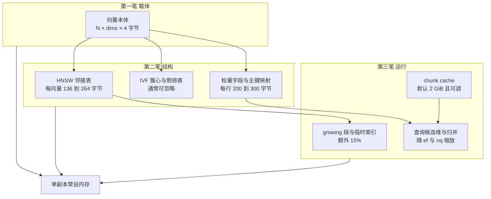
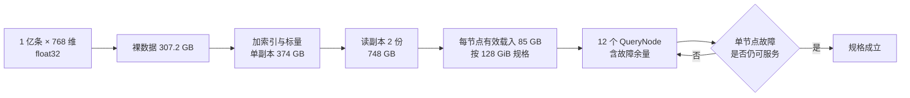
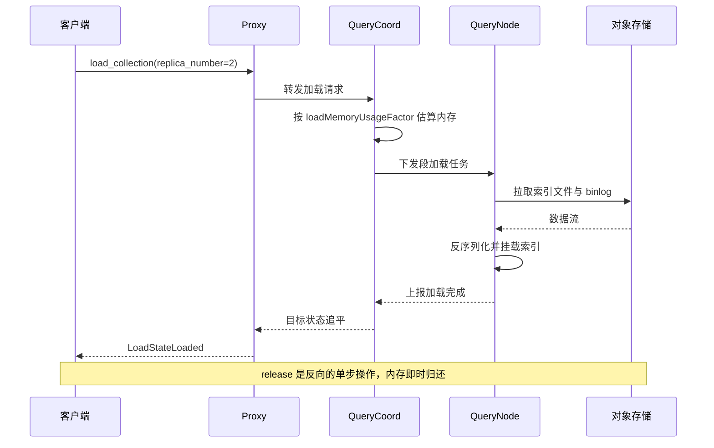
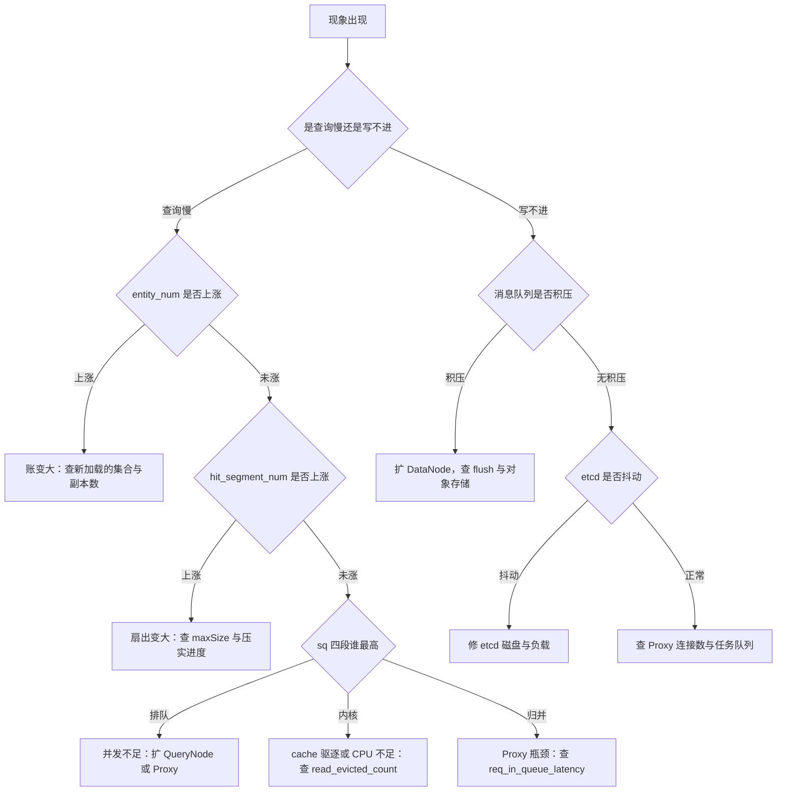

# Milvus 运维——集群部署、索引调优与容量规划

**摘要：**

Milvus 的存算分离把计算与存储拆开了，却把一件旧事原样留了下来：一段数据要被查询，就必须整段躺在 QueryNode 的内存里。这条约束不像 CPU 那样能靠限流与排队吸收，也不像对象存储那样能靠加桶扩容，它是一条物理上限，越过它的后果只有三种——节点被 OOM 杀掉、load 请求被拒、或者没被杀但每一次查询都在等磁盘。本文把这条约束拆成可算的账，再顺着账推出运维真正要做的三件事。第一件是算账：向量本体、索引结构、运行时开销三笔加总，用 1 亿条 768 维向量走一遍完整算例，从 307 GB 裸数据推到 12 个 QueryNode、每节点 128 GiB 的规格。第二件是管开关：load 与 release 是内存的唯一出入口，读副本买的是并发而不是速度，扩容不见效有五个可判定的原因。第三件是回收：compaction 把墓碑变成可删的段，垃圾回收再把段变成可回收的对象存储文件，每一环都有一个等待窗口。末章用一张容量复算表与一张故障判据表收束，因为运维真正的产物从来不是配置，而是能在半夜三分钟内定位到哪一笔账超了。

---

## 第 1 章 唯一不能弹性的资源

### 1.1 三种弹性，一个上限

设问先摆在这里：一台 QueryNode 的内存装不下它负责的段，会发生什么？答案是三种不同量级的故障，变慢只是其中最轻的一种，后文会逐个展开。要理解为什么会有三种，得先看 Milvus 把弹性做在了哪几层。

存算分离的初衷，是把计算与存储各自的扩缩容节奏解耦：写入量涨了加 DataNode，检索 QPS 涨了加 Proxy 或 QueryNode，数据量涨了扩对象存储的桶，三类资源按各自的曲线增长，互不牵连。这个设计在日志、数仓、对象网关那一类系统里成立得很好，因为那些系统的计算过程是流式的，算完即走。向量检索不是流式的。它的算法前提是索引必须可以被随机访问：HNSW 的图要在每一层跳着走，IVF 的倒排表要随手翻，连标量过滤用的倒排索引也假定整张表在内存里。于是"算"这一层的扩缩容自由度，被内存容量反向锁住了。

打个不严密的比方。一个开架阅览室，书可以无限采购（对象存储），管理员可以随客流增加（Proxy 与 CPU），座位数却是固定的；`load` 就是把某个书架搬进阅览区，`release` 是把它搬回库房。读者能不能查到，取决于书在不在阅览区，而不取决于库房里有没有这本书。座位不够时的处理，要么拒绝搬入，要么把已经搬进来的书挪出去一部分，两种选择的代价截然不同。

这里有一条容易忽略的分野。Elasticsearch 的检索内存是 JVM 堆，堆不够时的第一反应是频繁 GC、第二次才是 OOM，中间有很长一段可以靠调大堆或者调优 GC 参数拖过去；Milvus 的 QueryNode 由 Go 写编排层、C++ 写 segcore 内核，已加载的段既不在 Go 的堆里、也不受任何 GC 管理，只有 `release` 能把它还回去。换句话说，这条账**只进不出**，除非人主动按开关。

### 1.2 内存不足的三种表现

第一种是 OOMKilled。Kubernetes 的 memory limit 一旦被击穿，内核直接杀进程，Pod 重启，该节点上原本加载的段全部作废，queryCoord 要在别的节点上重新分配并重新 load。故障现场的形态很有迷惑性：监控上先是若干 Pod 的 restart 计数跳变，随后是整个集群的查询 P99 抬升，再过几分钟才轮到 load 任务堆积——因果顺序和症状出现的顺序恰好相反，按症状顺推很容易归错因。

第二种是 load 请求被拒。queryCoord 在下发任务前会按 `queryNode.loadMemoryUsageFactor` 估算这次加载要占多少内存，估算下来放不下，任务就挂在 Pending 上，客户端拿到的 `get_load_state` 一直停在 `LoadStateLoading`，而节点本身既不 OOM 也不报错。这种故障最难解释，因为它看上去一切正常：CPU 不高、内存不高、日志没有异常级别，只有业务侧在超时。

第三种是既不 OOM 也不拒绝，但每次查询都在等磁盘。内存紧张时，chunk cache 会被驱逐，对象存储的读放大；开了 mmap 的实例会反复经历页换入换出；growing 段的临时索引（interim index）被压缩后重建。此时的指标特征是查询延迟的 P99 上身而 QPS 不动，`QueryNode` 的 CPU 里 I/O wait 占比升高，而 `entity_num` 并不见涨。

**三种表现对应三种处置**：加内存、调账、关掉一部分负载。选错方向的结果都很糟，譬如把"load 被拒"当成"节点内存不足"去扩容，扩完之后任务仍然 Pending，因为真正的问题在估算系数或者副本数，不在物理容量。

### 1.3 三件事与四条边界

顺着这条约束往下推，运维要做的事其实只有三件：把账算清、把开关管好、把垃圾收掉。这三件事分别对应本章之后的三组章节，每一组都会给出可复算的算术和可判定的判据。

| 要理解的东西 | 位置 | 与本篇的关系 |
| :--- | :--- | :--- |
| 四层架构与各 Coordinator 的分工 | [[01 Milvus 全局架构——存算分离与云原生设计]] | load 任务由 queryCoord 调度、元数据由 rootCoord 落在 etcd |
| HNSW 的图结构与 IVF 的倒排结构 | [[02 向量索引——从暴力搜索到 HNSW 与 IVF]] | 决定第二笔账每向量要付多少字节 |
| Segment 的状态机与 Compaction 策略 | [[03 数据模型——Collection、Partition 与 Segment]] | 决定小段何时出现、垃圾何时可删 |
| 查询在多个段与多个节点上的执行 | [[04 查询引擎——混合检索与过滤]] | 决定第三笔账里查询临时内存与扇出的量级 |

把载荷的完整链路画出来，能看清 `load` 到底卡在哪一段上。


图里有一条容易被低估的边：QueryNode 与对象存储之间的虚线。它标的是 chunk cache 未命中时的回读，也是第三种内存不足表现的来源。设计良好的实例上这条边几乎不出现流量，一旦它开始有持续带宽，就说明内存账已经算错了，只是还没到 OOM 那一步。

---

## 第 2 章 内存的三笔账

### 2.1 第一笔：向量本体

向量本体是最容易算的一笔，因为它是乘法：实体数乘以维度，再乘以单精度浮点的四字节。1 亿条 768 维的 float32 向量，裸数据是 `10^8 × 768 × 4 = 3.072 × 10^11` 字节，即 307.2 GB。

这个数字里藏着第一个陷阱：单位。307.2 GB 是按十进制算的，而 Kubernetes 的 `memory` 与 `kubectl top` 报的是 GiB，换算过来是 `307.2 / 1.0737 ≈ 286 GiB`。差出来的 21 GiB 不是舍入误差，它足以让一台按 307 GB 而不是 286 GiB 去配 limit 的节点，在压测最后一天 OOM。凡是要与 K8s limit 对账的地方，一律先把十进制 GB 换成 GiB 再比。

第二个陷阱是精度。维度定了，每维占几字节由数据类型决定：float32 是 4 字节，float16 是 2 字节，int8 量化是 1 字节，二值化（binary）是 1 比特。同一批 1 亿条 768 维数据，float16 只要 153.6 GB，int8 只要 76.8 GB。Milvus 支持的向量类型与各类型的存储宽度以对应版本文档为准，但换算关系是死的：精度每降一档，第一笔账等比缩小，代价是召回与距离度量的稳定性。

第三个陷阱是增长。这笔账不是静态的，向量库通常每天新增一批数据，且很少删除历史。按每天新增 50 万条 768 维 float32 计算，一天的增量是 `5 × 10^5 × 768 × 4 ≈ 1.5 GB`，一年 550 GB——一年之后第一笔账会涨到原来的近三倍。容量规划里如果只按当前存量算，第二年的扩容就是一次事故。

### 2.2 第二笔：索引结构

索引结构的开销取决于选哪个索引，这也是索引选型在运维视角下的真实含义：它不只是一道召回与延迟的选择题，还是一道内存预算的选择题。

HNSW 的内存由两部分组成：向量本体，加上每个节点的邻接表。邻接表的大小可以自己算：第 0 层每个节点保留 `2M` 个邻居槽位，往上每层保留 `M` 个，槽位里存的是 4 字节的整型偏移；一个节点出现在第 l 层以上的概率按 `M^-l` 衰减，所以上层摊下来的期望槽位只有个位数。取 M=16，总计约 34 个槽位，合 136 字节每向量；1 亿条就是 13.6 GB，相当于本体的 4.4%。取 M=32，槽位约 66 个，涨到 26 GB，约本体的 8.6%，换来的通常是高召回场景下更稳的邻居质量。

IVF 系列的账本形状完全不同。IVF_FLAT 除了簇心表就是原始向量，簇心数量 `nlist` 通常是实体数平方根的量级，1 亿条对应一万量级的簇心，`10^4 × 768 × 4 ≈ 30 MB`，可以忽略，于是第二笔账几乎为零，第一笔账全在。IVF_PQ 走另一端：每个向量被压成 `m` 个字节，m=32 时 1 亿条只要 3.2 GB，加上簇心与码本仍是 GB 量级；也就是说同样的数据量，内存需求从 300 GB 级掉到 10 GB 级，代价是召回率与距离精度。这中间的选择没有高下，只有账本形状的差别。

标量字段与主键的开销常被忽略，但它并不小。Milvus 在 `load` 时默认把全部向量字段的索引与全部标量字段的数据读进内存，只有当集合被显式声明为部分加载（partial load，2.4 标为 Public Preview）时才可以排除部分字段。以一个每行 256 字节 VARCHAR 加两个 INT64 的 schema 为例，每行约 280 字节，1 亿行就是 28 GB，接近第一笔账的十分之一。如果业务上这些标量只在少数查询里用到，把它们排除出加载范围，等于凭空多出一台节点的容量。

### 2.3 第三笔：growing segment、cache 与查询临时内存

前两笔账是静态的，第三笔是动态的，也是所有容量事故里最容易算漏的一笔。

growing segment 是尚未封段、尚未建索引的新数据。它在 QueryNode 上以行式结构常驻，查询时走暴力扫描；为了缓解暴力扫描的延迟，Milvus 会给 growing 段建临时索引，`queryNode.segcore.interimIndex.memExpansionRate` 的默认值 1.15 就是在说这件事：建临时索引需要额外 15% 的内存。写入越猛，这部分越大，而且它与 compaction 的节奏耦合——压实跟不上，growing 段就会长时间停在内存里。

chunk cache 是第二块动态开销。2.2 里这个预算叫 `queryNode.cacheSize`，默认 32 GB，给的是一个相当宽松的总量；从 2.3 起键名改为 `queryNode.cache.memoryLimit`，默认 2 GiB，语义收窄成只缓存从对象存储读回的原始 chunk。它看似不大，但它是硬预留的：这个值设得越大，能留给"已加载段"的空间就越小，两者在同一个 cgroup 里争抢同一个 limit。

第三块是查询自身的临时内存。一次检索要在每个段上维护一个大小为 `ef` 的候选堆，多查询向量（nq）时这个堆按 nq 复制，Proxy 端还要再做一次全局归并。`ef` 从 64 提到 256，单位查询的临时内存翻四倍，而归并结果的 top-k 也要占空间。这部分内存的生命周期只有一次请求那么长，但它与已加载段共享同一个物理上限，峰值时刻的冲突正是很多"平时没事、大促 OOM"的根因。

### 2.4 为什么要一起算

三笔账分开看都不大，**合起来才是真账**。下面这张图把三笔账的结构摊开。



账面之外还有一层估算偏差，它是 `queryNode.loadMemoryUsageFactor` 这个参数存在的理由。默认值为 1，含义是"按段的实际字节数估算内存占用"；把它调成 1.5，queryCoord 就按实际大小的 1.5 倍来估算，从而提前拒绝那些看起来放得下、跑起来会打满的 load。这个参数在 2.2 的默认值是 3，2.3 之后改为 1，版本间的差异说明一件事：估算系数是对保守与浪费之间那条线的集体经验，而不是物理常数。

---

## 第 3 章 可复算的容量算例

### 3.1 从 1 亿条 768 维开始

把三笔账代入同一批数据，得到的是可以直接用来订机器的数字。下面每一步都可复算，读者可以把自己的 N 与 dims 代进去。

| 步骤 | 算式 | 结果 |
| :--- | :--- | :--- |
| 第一笔 向量本体 | `10^8 × 768 × 4 B` | 307.2 GB（286 GiB） |
| 第二笔 HNSW 图，M=32 | 每向量 66 槽位 × 4 B × `10^8` | 26.4 GB |
| 第二笔 主键与行偏移 | `10^8 × 8 B` | 0.8 GB |
| 第二笔 删除位图 | `10^8 / 8 B` | 0.0125 GB |
| 第二笔 标量字段 | `10^8 × 280 B`，256 字节 VARCHAR 加两个 INT64 | 28 GB |
| 第三笔 growing 与临时索引 | 按存量的 3% 计，含 1.15 的临时索引放大 | 约 11 GB |
| 单副本合计 | 上述五项相加 | 约 374 GB |

374 GB 落在 350 到 400 GB 这个量级里，与本节开头的经验区间一致。这里要强调一点：把 HNSW 图笼统算成"本体的 5%"是常见的简化，它只在 M=16 时接近（4.4%）；若按高召回场景取 M=32，图的开销接近本体的 8.6%，再叠上 280 字节的标量字段（约 9%）与 growing 余量，总账就从本体的 1.0 倍爬到 1.22 倍。也就是说 350 到 400 GB 不是拍出来的区间，而是 M 与标量宽度的取值域决定的。

### 3.2 副本数把这笔账乘以副本个数

`replica_number` 是读副本数，**不是数据副本数**：每个副本都要装全量数据，副本之间只是分担查询流量与故障域。所以单副本 374 GB 的数据，加载两个副本就是 748 GB，三个副本就是 1122 GB。这条乘法关系是 Milvus 内存规划里最容易被忽略的一步，很多人把"我们有 3 副本所以能扛住坏一个节点"理解成"3 份数据分摊到 3 组机器"，实际上三份各自都是全量。

| 副本数 | 总常驻内存 | 买到什么 | 不买什么 |
| :--- | :--- | :--- | :--- |
| 1 | 374 GB | 最低成本，可查询 | 节点故障期间该段不可查，重建期间延迟抬升 |
| 2 | 748 GB | 查询并发翻倍，单节点故障时仍有副本可服务 | 单次查询延迟不变，内存翻倍 |
| 3 | 1122 GB | 更高的读并发与更细的故障域 | 边际收益递减，内存线性上涨 |

把 748 GB 换算成 GiB 是 `748 / 1.0737 ≈ 697 GiB`，这个数字要记住，下一节的节点数就是按它推的。

### 3.3 推出节点数与规格

QueryNode 的规格选择有一个反直觉的结论：在总内存固定的前提下，节点数越多，浪费越大。原因是每台节点都要预留一批与容量无关的开销——chunk cache 的 2 GiB、Go 运行时的堆、C++ 分配器的碎片、查询临时内存的峰值水位、以及 k8s 里各类 sidecar。这些开销按节点计，不按数据量计，节点数翻倍，固定开销也翻倍。

按 128 GiB 的节点规格算一遍。128 GiB 折合 137.4 GB，先扣掉 10% 给操作系统、kubelet 与 sidecar，剩 123.7 GB；再按 62% 的可用比例留给已加载段（其余给 chunk cache、临时内存峰值与分配器碎片），得到每节点约 85 GB 的"有效载入容量"。

- 单副本 374 GB 除以 85 GB，向上取整得 5 个节点；
- 两个副本需要 10 个节点，总有效容量 850 GB，对 748 GB 的负载余量 14%；
- 单节点故障时，故障节点的 75 GB 段要迁到其余 9 个节点，每台多背 8.3 GB，仍在余量之内，但已经贴边，所以再补 2 个节点，取 12 个。

12 台的方案总有效容量 1022 GB，对 748 GB 的负载有 36% 的余量，这个余量是留给写入增长与查询峰值的，不是浪费。三种规格的对比见下表。

| 方案 | 单节点规格 | 单节点有效载入 | 节点数 | 总有效容量 | 评价 |
| :--- | :--- | :--- | :--- | :--- | :--- |
| A 大节点 | 128 GiB / 16 核 | 85 GB | 12 | 1022 GB | 固定开销占比低，单查询扇出小，扩容粒度粗 |
| B 小节点 | 64 GiB / 8 核 | 39 GB | 22 | 858 GB | 总量略省，Pod 数与固定开销翻倍，扇出更大 |
| C 量化索引 | 64 GiB / 8 核 | 39 GB | 2 | 78 GB | IVF_PQ 把本体压到 GB 级，代价是召回下降 |

方案 C 值得单独说一句：它不是在同样的召回下省内存，而是用召回换内存。m=32 的 IVF_PQ 把第二笔账从 26 GB 压到 3.2 GB、把第一笔账从 307 GB 压到 3.2 GB，于是同样的 1 亿条数据两台机器就装得下；但 top-k 的稳定性、过滤后的召回、以及后续做重排的输入质量都会变差。选择它的前提是业务能接受"先粗召回再精排"的两段式架构。

把这条推导链画成图，就是一个从数据量单向走到规格的过程，中间任何一步改参数，右边全变。



### 3.4 换一种索引，账本换一种形状

同一批数据换成 IVF_PQ（m=32，nbits=8），第一笔账变成压缩码 `10^8 × 32 B = 3.2 GB`，第二笔账是簇心与码本，`nlist` 取 65536 时 `65536 × 768 × 4 ≈ 201 MB`，第三笔账的量级与之前相当，因为 growing 段仍然存在。单副本约 7 GB，两个副本 14 GB，两台 64 GiB 的节点就能吃下，甚至可以把它们合并到同一台机器上做资源组隔离而不是分机。

DiskANN 是第三种形状：向量本体与图都落在本地 NVMe 上，内存里只驻留一套 PQ 压缩码与入口点，内存需求约是本体的 5% 量级，磁盘需求约是本体的 1.2 倍。它把第二笔账从内存挪到了磁盘，代价是查询路径上多了随机读，对 SSD 的 IOPS 与稳定性提出硬要求，延迟对磁盘状态的敏感度远高于 HNSW。

三种形状摆在一起，可以看出索引选型的运维含义：选 HNSW 是把钱花在内存上，选 IVF_PQ 是把钱花在精度上，选 DiskANN 是把钱花在磁盘 IOPS 上。三种都有明确的适用边界，没有一种能在三个维度上同时最优。

---

## 第 4 章 load 与 release：内存的唯一出入口

### 4.1 语义：不 load 不能查，load 了才占内存

官方文档把这件事说得很直白：加载集合的过程，是把集合的索引文件读进内存；释放集合的过程，是把索引文件从内存里卸下；在做检索之前，必须确认集合已经加载。这句话反过来读同样成立，而且更接近运维现实：只有被加载的集合才占内存，没被加载的集合在对象存储里躺着，占的是存储费而不是内存费。

`get_load_state` 返回的状态只有三种值得关心：`LoadStateNotLoad`、`LoadStateLoading`、`LoadStateLoaded`。三种状态构成一条单行道：从 NotLoad 到 Loading 要等，Loading 到 Loaded 还要等，而 Loaded 回到 NotLoad 只需要一次 `release_collection`，几乎瞬时。这条不对称很关键——加载是按 GB 付费的慢操作，释放是瞬时的快操作，所以任何"先加载再说"的习惯，都会在三个月后变成一台永远不够用的集群。

在代码层面，加载与释放的接口都很小，参数才是关键。

```python
from pymilvus import MilvusClient

client = MilvusClient(uri="http://milvus:19530")

# replica_number 决定这份数据在 QueryNode 上复制几份，每一份都装全量
client.load_collection(
    collection_name="knowledge_base",
    replica_number=2,            # 读副本数，不是数据冗余
    load_fields=["id", "vector", "doc_id"],  # 部分加载可排除用不到的标量字段
)

state = client.get_load_state(collection_name="knowledge_base")

# 释放之后内存才真正归还；不释放的旧集合会一直占着
client.release_collection(collection_name="legacy_kb_v1")
```

### 4.2 load 的耗时由四段构成

一次 load 的耗时不是一个数字，而是**四段相加**：从对象存储拉取索引文件与 binlog、反序列化并挂载索引结构、为 growing 段建临时索引、以及可选的 chunk cache 预热。四段的量级差别很大，观测手段也不同。

| 阶段 | 主要开销 | 观测指标 | 可调参数 |
| :--- | :--- | :--- | :--- |
| 拉取文件 | 对象存储带宽与并发连接数 | `milvus_querynode_load_segment_latency` 的上升段 | 网络带宽、并发度 |
| 挂载索引 | CPU 与内存分配 | `milvus_querynode_load_index_latency` | 节点 CPU、`loadMemoryUsageFactor` |
| 建临时索引 | CPU 与额外 15% 内存 | growing 段数量与查询延迟 | compaction 与封段节奏 |
| cache 预热 | 对象存储读放大 | `milvus_querynode_segment_access_wait_cache_duration` | `queryNode.cache.warmup` |

给一个示例推算。假设单副本 374 GB，五个节点平摊，每节点要拉 75 GB 的索引文件；按每节点 800 MB/s 的有效下载带宽计，`75 × 1024 / 800 ≈ 96` 秒；两个副本 12 个节点并发，总下载量 748 GB，若对象存储出口总带宽 2 GB/s，`748 × 1024 / 2000 ≈ 383` 秒。也就是说一次全量 load 的下载段在 6 到 7 分钟量级，再叠加挂载与预热的 CPU 时间，10 分钟量级是一个合理的预期。这个数字只用于估算窗口，真实值取决于对象存储的并发能力与本地 CPU，不能当作承诺。

这里有一个运维上的推论：load 是把对象存储的带宽集中消耗的动作，它和 compaction 后的大量写入、以及 DataNode 的 flush 会互相抢带宽。把大批集合的 load 安排在业务低峰，或者分批 load，收益往往比调任何参数都大。

### 4.3 并发与限流

load 的并发上限由 queryCoord 控制。2.4 与 2.5 的默认配置里，`queryCoord.taskExecutionCap` 是 256，含义是同时执行的加载/释放任务上限；`queryCoord.balanceIntervalSeconds` 是 60，含义是均衡器每 60 秒检查一次段分布。这两个值共同决定了"新加一个节点后多久能看到段被搬过去"。

关于并发，有一处需要澄清。社区资料里常出现 `queryNode.segmentLoadThreadPoolSize` 这个参数名，笔者核对了 2.2.16、2.3.16、2.4.15、2.5.4 四个版本仓库里的 `configs/milvus.yaml`，都没有找到这个键。真正限制 load 并发的，是 queryCoord 的任务并发上限加上 QueryNode 侧的网络与反序列化能力，而不是一个专门的线程池参数。若所在发行版的配置文件里确实有这一项，按实例的 `milvus.yaml` 与实际文档为准，不要照抄社区的参数名。

并发调大的收益有明确的天花板。把 256 调到 1024 不会让下载更快，因为瓶颈在对象存储侧的并发连接与出口带宽；反而会让更多 load 任务同时争用内存，把估算阶段还能通过的请求挤到失败。这是一个典型的"调大没有收益、只有代价"的参数，除非现场确认瓶颈在任务排队。

### 4.4 release 的时机与代价

release 的**收益立刻、代价延迟**。收益是内存当场归还，集群立刻有空间加载别的集合；代价是下次要用时得重新走一遍四段式的 load，而且如果那次 load 正好撞上业务高峰，延迟抬升比不释放更难看。所以 release 不能做成定时任务式的机械动作，而要按访问模式决策。

三种情况应当 release：一是历史集合已经确认不再查询，二是灰度期间的双写双读已经收敛到新集合，三是临时用于比对的实验集合。这三种情况的共同点是"短期内不会再查"，判断依据在业务侧而不在集群侧，这也是为什么 release 往往需要人来拍而不是交给自动策略。

三类情况不应 release：频繁在几个集合之间轮询的检索场景，release 之后 load 的耗时会被用户感知；被用作冷备的集合，它的价值就在于随时可查；以及正在被 compaction 或索引重建的集合，这类集合的段分布正在变化，反复 load/release 会把任务队列搅乱。

还有一个与 release 强绑定的操作：修改集合的 mmap 属性。Milvus 要求先把集合 release 掉，才能改它的内存映射开关。这意味着"把索引从内存换成 mmap"这个动作的实际代价是一次完整的卸载与重新加载窗口，在容量紧张时它救不了急，只能提前做。把一次加载的参与者与顺序摊开，能看清哪一步最耗时、哪一步最容易失败。



图中的"目标状态追平"对应 `milvus_querycoord_current_target_checkpoint_unix_seconds` 这个指标：它记录当前副本已追平的目标版本时间戳，与集合的加载目标比较，就能判断一次 load 是完成了还是卡在某个节点上。

---

## 第 5 章 读副本：两个 replica 不是一回事

### 5.1 部署层的副本数与加载层的副本数

Milvus 里有两个都叫 replica 的东西，混用它们的代价是直接多付一倍内存的预算，却以为买到了两倍能力。

第一个是部署层的 `queryNode.replicas`，它决定集群里起几个 QueryNode 进程（在 Helm 与 Operator 的语境下就是几个 Pod）。这个数字决定的是内存总量的上限：五个 128 GiB 的 Pod，最多能装下五份配置好的容量，再多的 load 请求只能排队。第二个是加载层的 `replica_number`，在调用 `load_collection` 时指定，含义是这批数据在 QueryNode 上被复制成几份内存副本，每一份都包含全量数据。官方文档给的上限很明确：单机部署（Standalone）下 `replica_number` 最大为 1，集群部署下不应超过配置里的 `queryNode.replicas`。

两个数字的乘法关系就是内存账：总常驻内存等于单副本账乘以 `replica_number`，而可用上限等于 `queryNode.replicas` 乘以单节点容量。一加一减之间，就是"能不能扩"的判定式。

### 5.2 副本买到什么，买不到什么

副本买到的是并发与故障域。一个副本内，一次检索要被拆到该副本的所有 QueryNode 上执行，各节点算各自的段，结果在 Proxy 归并；两个副本意味着同时能有两倍的检索在被服务，且坏掉一个副本的部分节点时，另一个副本仍能覆盖全量数据。这就是"读副本"这个词的由来，它**复制的是读能力**，不是写入冗余——写入永远只有一份，落在消息队列与对象存储里。

副本**买不到单次查询的延迟**。原因在查询的执行结构里：一次检索必须覆盖全量段，数据复制两份不会让某一次检索只算一半的段。它只是让两次检索能分别落到两个副本上。指望把 `replica_number` 从 1 改到 2 来降低单查询延迟，等于指望复印一本书能让自己读得更快。

同样的道理适用于另一种常见误解：副本不是备份。对象存储里的 binlog 与索引文件才是唯一的数据副本，QueryNode 上的内存只是它的一个投影；对象存储出了问题，几个内存副本一起消失。

### 5.3 为什么扩容之后查询没变快

这是运维现场最常见的一句反馈。它有五个可判定的原因，逐个排查比凭感觉调参快得多。

第一个原因是只加了 Pod 没加副本。把 QueryNode 从 5 个扩到 8 个，段被均衡到 8 个节点上，一次查询的扇出从 5 涨到 8，单节点工作量下降但归并轮数上升，端到端延迟基本不变，P99 甚至可能变差。判定方法是看 `querynode_num` 涨了、而集合的副本数没变，且 `search_hit_segment_num` 的分布变得更高更散。

第二个原因是段没有重新分布。均衡器默认开启（`queryCoord.autoBalance` 为 true，策略为 `ScoreBasedBalancer`），但它是周期性的，`balanceIntervalSeconds` 默认 60 秒才检查一次；而且有容忍带，两个节点的负载差在 5% 以内就不搬。刚扩容完的几分钟里，新节点通常是空的，此时查询性能当然不会改善。判定方法是按 Pod 比较 `milvus_querynode_entity_num`，如果新节点的这个值显著低于老节点，就是没搬完。

第三个原因是段数比节点数还少。压缩做得好、写入又不频繁的集合，可能只有几十个段，八个节点分下来有些节点一个段都没有。判定方法是把 `milvus_datacoord_segment_num` 与节点数作比较，段数小于节点数时扩容没有任何意义。

第四个原因是瓶颈根本不在 QueryNode。检索请求在 Proxy 上要排队（`proxy.maxTaskNum` 默认 1024）、要归并、要解码；在 etcd 上要分配时间戳；在客户端侧还有连接池与超时设置。判定方法是看 Proxy 侧的 `req_in_queue_latency` 与 `sq_reduce_result_latency` 在总延迟里的占比，占比高说明要扩的是 Proxy 而不是 QueryNode。

第五个原因是尾延迟的放大效应。扇出越多，单次查询里"撞上一个慢段"的概率越高，而端到端延迟由最慢的那一路决定。这一条与 QueryNode 的数量正相关，也是扩容在某些负载下反而变慢的机制性解释。

| 现象 | 首个判据 | 结论 | 处置 |
| :--- | :--- | :--- | :--- |
| 扩容后 P99 不变 | `querynode_num` 涨、副本数不变 | 只加了算力没加读副本 | 提高 `replica_number`，或接受扩容只增容量 |
| 新 Pod 的 `entity_num` 接近零 | 各节点 `entity_num` 方差大 | 段未重排 | 等均衡周期，或检查均衡是否被内存余量卡住 |
| 段数小于节点数 | `segment_num` 与 `querynode_num` 对比 | 无处可放 | 缩小节点规格而不是增加节点 |
| 延迟集中在归并段 | `sq_reduce_result_latency` 占比高 | 瓶颈在 Proxy | 扩 Proxy，降低单请求 top-k 与 nq |
| 扩容后 P99 反而上升 | `search_hit_segment_num` 上升 | 扇出放大尾延迟 | 减少段数（调大 `maxSize`）或减少节点数 |

### 5.4 资源组：把内存账分给业务

多业务共用一个 Milvus 集群时，最危险的不是内存不够，而是"谁都能把别人的内存挤掉"。资源组（resource group）机制允许把 QueryNode 划成若干组，把数据库或集合绑定到指定组上，这样 A 业务的 `load` 只能落在 A 组的节点上，B 业务的内存账不会因为 A 的扩张而失控。它的代价是资源碎片：每个组都要按自己的峰值配容量，组越多，整体的平均利用率越低。

一个实用的折分方式是按生命周期而不是按业务拆分：需要长期在线、被高频查询的集合放一组；每天批量重建、只在固定时段可查的集合放另一组。后者的 load 与 release 可以完全不打扰前者，这是单组模式下做不到的。

---

## 第 6 章 compaction 与垃圾回收：删除为什么不等于释放

### 6.1 小段是从哪里来的

段的大小不是由数据总量决定的，而是由写入节奏决定的，这一点常被误解成"数据少所以段少"。

一个段在写入过程中不断增长，直到满足某个封段条件。2.4 与 2.5 的默认配置里有四条这样的条件：段内 binlog 文件数达到 `maxBinlogFileNumber`（默认 32）；段空闲超过 `maxIdleTime`（默认 600 秒）且体积大于 `minSizeFromIdleToSealed`（默认 16 MB）；段存活超过 `maxLife`（默认 86400 秒，即 24 小时）；以及段大小达到 `maxSize × sealProportion`。最后一条里的 `sealProportion` 在 2.4 的默认值是 0.12，含义是达到 `maxSize` 的 12% 就可以封段——按 `maxSize` 默认 1024 MB 计算，约 123 MB 就可能被封。

于是同一份 300 GB 的数据，可能表现为 300 个段（每段约 1 GB，压实充分），也可能表现为 2400 个段（每段约 125 MB，写入节奏碎）。两种形态占用的内存是一样的，但查询扇出相差八倍，这正是第 5 章最后一条原因的物理来源。

关于 `maxSize` 的默认值还有一处文档与代码的分歧值得记住：社区的性能 FAQ 里写的是 512 MB，而 2.4.15 与 2.5.4 仓库中的 `configs/milvus.yaml` 里写的是 1024 MB。以部署实例的配置文件为准，别照抄文档里的数字去算段数。

### 6.2 compact 做了什么

压实（compaction）的职责有两个：把多个小段合并成一个较大的段，以及把墓碑（tombstone）落成物理删除。

合并小段的判定是一组比例：`smallProportion` 默认 0.5，行数少于 `maxSize` 对应行数一半的段算小段；`compactableProportion` 默认 0.85，合并之后行数要超过 `maxSize` 对应行数的 85% 才值得做，否则合了也没收益。这两个值决定了压实的"性价比阈值"，也解释了为什么大量小段在写入停止后才会被合起来——写入进行时，合并出来的段很快又被新段稀释了。譬如同样的删除比例落在三个 1 GB 的段上，比落在三百个 100 MB 的段上更容易被压实捡起来，因为后者的任务数多、单个收益小，排队时间成了主要成本。

墓碑的处理走另一条路，叫 L0 压实。删除操作先在消息队列里生成 delta log，里面记录的是被删主键与时间戳，而不是去改原段；这些 delta log 累积到一定量后触发 L0 压实，把墓碑应用到目标段上并写出新段。触发的阈值在配置里有两组：按大小的 `levelzero.forceTrigger.minSize`（默认 8 MB）与 `maxSize`（默认 64 MB），按文件数的 `deltalogMinNum`（默认 10）与 `deltalogMaxNum`（默认 30）。

第三种是聚类压实（clustering compaction），按某个标量字段的聚类把数据重排，让同一簇的行在物理上相邻，从而提升带该字段过滤的查询的裁剪率。它在 2.4 里默认关闭（`autoEnable` 为 false），需要按查询模式手动开启，代价是显著的写入放大。

### 6.3 删除何时变成真正的删除

一条数据从"**逻辑删除**"到"磁盘空间被回收"，要走过四个阶段，每个阶段都有一个等待窗口。理解这条时间线，才能回答"我删了 30% 的数据，为什么磁盘没变"。

| 阶段 | 发生了什么 | 等待窗口 | 判据 |
| :--- | :--- | :--- | :--- |
| 写入墓碑 | 生成 delta log，原段不动 | 秒级 | `milvus_querynode_level_zero_size` 上升 |
| 查询过滤 | 查询时按墓碑位图过滤结果 | 立即生效 | 业务侧已查不到被删数据 |
| 压实重写 | L0 压实把墓碑落到新段，旧段标记 Dropped | 分钟到小时，取决于触发阈值 | `compaction_task_num` 与 `compacted_segment_size` |
| 垃圾回收 | 删除 Dropped 段的 binlog 与索引文件 | `dropTolerance` 默认 3 小时，另有 `gc.interval` 默认 1 小时 | `gc_run_count`、对象存储实际用量 |

四个窗口叠加起来，从"业务删完"到"磁盘下降"通常要几个小时量级。这段时间里查询已经看不到数据，但存储账单还没变——这是完全正常的状态，不是故障。反过来，如果一天之后磁盘还没降，那就是某个窗口卡住了，按 6.5 节排查。

### 6.4 GC 的周期与保留参数

垃圾回收是 dataCoord 里的一个周期性任务，默认配置在 2.4 与 2.5 里是这样一组值：`dataCoord.enableGarbageCollection` 为 true；`gc.interval` 为 3600 秒，即每小时跑一轮；`gc.missingTolerance` 为 86400 秒，含义是对象存储里有、但元数据里没有登记的 binlog 要保留一天才允许删，这个宽容期是为了避免误删刚落盘还没登记的新文件；`gc.dropTolerance` 为 10800 秒，含义是已删除段的文件要等三小时才真正删除；`gc.scanInterval` 为 168 小时，即孤儿文件的全量扫描一周一次；`gc.removeConcurrent` 为 32，控制删除并发。

关于 `common.retentionDuration`，需要一处版本层面的澄清，因为很多资料把它当成"删除数据的保留期"。在 2.2 的 `configs/milvus.yaml` 里，这个键的注释写的是时间旅行（Time Travel）的保留时长，默认值是 0，含义是关闭，删掉的数据不必等就能被清理。从 2.3 起，官方配置里已经没有这个键，删除的时效改由压实节奏与 `gc` 那一组参数决定。也就是说，指望改 `common.retentionDuration` 来延长已删数据的可查时间，在 2.4 与 2.5 上不会生效；需要时间旅行能力，应当依赖集合级别的一致性读与快照机制，具体以对应版本文档为准。

### 6.5 空间不回收的五种原因

第一种是压实被关掉或长期积压。`dataCoord.enableCompaction` 或 `compaction.enableAutoCompaction` 被设为 false，或者 `compaction_task_num` 长期维持在几十以上，都会让墓碑永远停留在 delta log 里。

第二种是压实收益不足。被删数据只占段的一小部分时，`compactableProportion` 与 `smallProportion` 的判定会让这个段不进压实队列——它不符合"小段"的定义，也不值得为了 2% 的删除去重写 1 GB。此时磁盘不降是设计如此，要等删除比例升上去。

第三种是 GC 没在跑。`enableGarbageCollection` 被关掉、dataCoord 没拿到对象存储的删除权限、或者对象存储侧配置了版本化与对象锁，都会让"删除"变成软删除。

第四种是对象存储的生命周期策略在另一条时间线上工作。S3 的版本化与非当前版本过期规则、MinIO 的桶策略，都可能让实际占用比 Milvus 侧统计的要大，这属于存储侧而不是数据库侧的问题。

第五种是压实与写入互相追逐。持续高速写入时，新段不断产生，压实资源被小段合并占满，L0 压实排不上队，墓碑越堆越多。判定方法是看 `level_zero_size` 是否持续上涨、`deltalog` 文件数是否逼近 `deltalogMaxNum`——逼近而不触发，通常意味着压实槽位不够。

---

## 第 7 章 容量规划三步：从数据量到节点规格

### 7.1 第一步：把数据量算成一个带增长率的数

数据量不是当前存量，而是规划期末的存量。写成算式：`N_end = N_now × (1 + r)^m`，r 是月增长率，m 是规划月数。按 5% 的月增长、规划 12 个月，期末是当前的 1.8 倍；按 10% 则是 3.1 倍。这个系数比任何参数调优都更能决定预算，而它通常只需要业务侧一句话就能问出来。

同时要问清保留策略。向量库的删除往往是"逻辑删除 + 压实回收"，磁盘不会立刻下降，但内存账上是真的下降（段被重写后行数变少）。如果业务只是把数据标记为过期而从不真正删除，那么 N_end 就该按全量累积算，这笔账会非常可观。

### 7.2 第二步：从数据量算内存

把第 2 章的三笔账写成一条可以贴在墙上的公式：

`总内存 = 副本数 × [ N × dims × 字节宽度 × (1 + 图开销比) + N × 标量字节 + N × 映射字节 + growing 与查询余量 ]`

其中图开销比按索引类型取：HNSW 在 M=16 时约 4.5%、M=32 时约 8.6%，IVF_FLAT 接近 0，IVF_PQ 为负（它是压缩），DiskANN 只留 5% 量级的压缩码。growing 与查询余量按 10% 到 20% 取，写入越猛取越大。最后乘一个 1.2 的安全系数，这个系数覆盖的是内存分配器的碎片与指标统计口径的差异，不是覆盖估算错误——估算错误应该靠把每一项都算清来消除。

### 7.3 第三步：从内存算节点数与规格

节点数的算式是 `ceil(总内存 / 单节点有效载入容量) + 故障余量`。单节点有效载入容量等于 `单节点 limit × 扣减比例`，扣减比例按 0.6 到 0.7 取，理由在第 3 章算过：chunk cache、运行时、临时内存峰值都要从这里出。

故障余量的取法有一条硬标准：余量**不少于一个节点的量**。理由是单节点故障后，它负责的段要迁到其余节点上，如果余量小于一个节点的量，迁移期间必然有段无处可去，表现为部分查询报段未加载。一个节点的量按总内存除以节点数算，再乘 1.2 的迁移抖动系数，就是该留的余量。

CPU 的配比不适合用固定比例，因为它与 `ef`、维度、段大小、是否带过滤强相关。可用的做法是在目标数据量上跑一次压测，测出单核的 QPS，再反推核数；这个数字每换一次索引或 `ef` 就要重测。把别人压测出来的单核 QPS 数字直接抄过来，是容量规划里最常见的错误来源。

### 7.4 对象存储容量

对象存储要装的东西比内存多：原始 binlog（向量与标量）、索引文件（HNSW 图或 IVF 的倒排与码本）、delta log，以及在压实窗口内同时存在的旧段与新段。

| 组成 | 相对单副本本体的比例 | 说明 |
| :--- | :--- | :--- |
| 原始 binlog | 1.0（含标量约 1.1） | 写入即落盘，是唯一的数据副本 |
| 索引文件 | 1.05 到 1.15 | HNSW 图另存一份，DiskANN 另有磁盘索引 |
| delta log | 0.001 到 0.01 | 与删除频率相关，长期不压实会升高 |
| 压实峰值 | 叠加 1.25 到 1.5 | `expansionRate` 默认 1.25，旧段在 `dropTolerance` 内共存 |
| 安全余量 | 1.2 | 覆盖 GC 滞后与误删保护窗口 |

按 1 亿条 768 维的例子算：本体 307 GB，标量 28 GB，索引文件 340 GB，稳态合计约 675 GB，加压实峰值与安全余量后在 1 TB 上下。规划时按 1.2 TB 起步是合理的，因为对象存储的单价远低于内存，这里省下来的钱不值得用一次扩容事故去换。

### 7.5 消息队列的保留量

消息队列是写入路径的缓冲，它的保留时长决定了两件事：DataNode 停摆多久之内不丢数据，以及磁盘要多大。算式很直接：`保留容量 = 写入速率 × 保留时长`。

按每秒 1 万条、每条 4 KB 算，写入速率是 40 MB/s。保留 2 小时需要 288 GB；保留 24 小时需要 3.4 TB。这个对比说明为什么不能把消息队列的保留时长设成一天以上：它**不是免费的可靠性**，而是按写入速率线性增长的成本。合理的取值是"最长消费延迟的 2 倍"，而最长消费延迟取决于 DataNode 的消费能力、flush 的对象存储延迟、以及故障恢复的时间。

Pulsar 与 Kafka 两边的配置项名字不同（保留时间与保留大小分别设置），具体键名以部署版本的 MQ 文档为准。有一条通用的判据：如果消息队列的磁盘使用率在高水位附近反复徘徊，说明保留时长与写入速率不匹配，先看消费延迟再看保留时长，不要反过来。

---

## 第 8 章 关键配置与代价

### 8.1 一张带代价的配置表

配置项的默认值只是起点，真正要记住的是调大与调小各自把成本挪到哪里。下表的默认值取自 2.4 与 2.5 的 `configs/milvus.yaml`，与部分早期版本的默认值不同者已在备注里标出。

| 配置项 | 默认值 | 调大的代价 | 调小的代价 |
| :--- | :--- | :--- | :--- |
| `queryNode.cache.memoryLimit` | 2 GiB | 与已加载段争抢同一个 limit，压缩可用容量 | chunk cache 命中率下降，回读对象存储增多 |
| `queryNode.cache.warmup` | disable | 设为 sync 会拉长 load 时间并抬高内存峰值 | 保持 disable 则首次查询要等 cache 填充 |
| `queryNode.loadMemoryUsageFactor` | 1（2.2 为 3） | 估高导致 load 被误拒，容量闲置 | 估低导致 load 通过后内存打满，OOM 风险 |
| `dataCoord.segment.maxSize` | 1024 MB | 段变大，压实与重建耗时变长，单段故障影响面变大 | 段数量爆炸，查询扇出上升，元数据压力上升 |
| `dataCoord.segment.sealProportion` | 0.12 | 段要长得更大才封，growing 段停留更久 | 段更早封出，小段更多，压实压力变大 |
| `queryNode.gracefulStopTimeout` | 30 秒 | 滚动升级变慢，容量空窗期拉长 | 强制终止时正在执行的查询被中断 |
| `common.gracefulStopTimeout` | 1800 秒 | 整个进程退出等待更久，发布窗口变长 | 未完成的 RPC 被硬切，可能出现半完成状态 |
| `queryNode.mmap.vectorIndex` | false | 内存占用下降，但查询随机读增多、延迟对磁盘敏感 | 索引全驻内存，容量受限但延迟稳定 |
| `queryNode.lazyload.enabled` | false | 首次查询要等段加载，延迟尖峰明显 | 全部预加载，内存需求回到全量 |
| `queryCoord.taskExecutionCap` | 256 | 更多并发 load 争抢内存与带宽，失败率上升 | 加载与迁移排队变长，扩容生效变慢 |
| `queryCoord.balanceIntervalSeconds` | 60 | 均衡滞后，扩容后长时间看不到改善 | 频繁搬迁段，后台 I/O 与 CPU 抖动 |
| `proxy.maxConnectionNum` | 10000 | 更多客户端连接，Proxy 内存与文件描述符上升 | 建连被拒，客户端侧表现为连不上而不是慢 |
| `proxy.maxTaskNum` | 1024 | 排队更深，过载时延迟无上限地上涨 | 过载时快速拒绝，错误率上升但延迟有界 |
| `dataNode.dataSync.flowGraph.maxQueueLength` | 16 | 写入缓冲更深，内存与积压风险上升 | 写入容易阻塞，`msgstream_obj_num` 上升 |
| `dataCoord.sealPolicy.channel.growingSegmentsMemSize` | 4096 MB | growing 段留得更久，内存占用上升 | 封段更频繁，小段与压实任务增多 |

### 8.2 三个最容易改错的参数

第一个是 `dataCoord.segment.maxSize`。把它调小看起来能让压实更"轻"，实际效果是把段数按比例放大：1024 MB 调成 256 MB，同样数据量的段数变成四倍，查询扇出与元数据条目同步放大。**段数一旦上千**，QueryNode 的调度开销与 Proxy 的归并开销都会变得显眼，而此时控制台里各项资源指标可能都不高，故障表现为"没有瓶颈但就是慢"。

第二个是 chunk cache 的上限。这个值的历史形态容易误导人：2.2 里叫 `queryNode.cacheSize`，默认 32 GB，是一个相当宽裕的缓存预算；从 2.3 起它被改名为 `queryNode.cache.memoryLimit`，默认 2 GiB，语义收窄成"只缓存 chunk"。把一个 2.2 时代的 32 GB 配置直接搬到 2.4 上，等于让 chunk cache 吃掉四分之一的节点内存，已加载段的空间被压缩，load 请求开始被拒。

第三个是 `gracefulStopTimeout`。它决定进程收到停止信号后等多久再强制退出。调大能让正在执行的查询跑完，代价是发布与扩缩容的每一步都变慢；滚动升级时这个等待会叠加到每个 Pod 上，一个十节点的集群可能因此多出十分钟的容量空窗。调小则相反，发布快了，但长查询会被切断，客户端看到的是零星的超时而不是整体变慢。

### 8.3 动态配置的边界

Milvus 支持一部分参数在运行时修改，改完通过协调层下发到各节点，不需要重启进程；另一部分只在启动时读取，改了必须重启。这条界线很重要，因为它决定了"改一个参数"在运维上是一次热更新还是一次发布。

判据是：与路径、端口、存储类型、身份认证相关的参数基本都在启动期读取；与调度节奏、缓存大小、并发上限相关的参数多数可以热更新。具体到某一个键，以对应版本的动态配置文档为准，不要在没核实的情况下按"应该能热改"去操作。更稳妥的做法是先在测试集群上改一次，观察是否生效——热更新失败的表现通常是不报错但行为不变，这种沉默的失败比报错更难发现。

---

## 第 9 章 监控与六个故障形态

### 9.1 四类指标，一条主线

Milvus 暴露的指标很多，但运维真正要盯的只有一条主线：内存账有没有变大。围绕这条主线，四类指标各有分工。

QueryNode 的指标是账本本身。`milvus_querynode_entity_num` 记录该节点已加载的实体数，这是三笔账里第一笔的即时值；`entity_size` 给出实体占用的字节量级；`segment_num` 与 `level_zero_size` 分别对应段数量与墓碑量；`load_segment_latency` 与 `load_segment_concurrency` 反映加载的排队与耗时。延迟方面，Milvus 把一次检索拆成四段上报：`sq_queue_latency` 是排队、`sq_core_latency` 是内核计算、`sq_reduce_latency` 是归并、`sq_req_latency` 是合计。这个拆分极有用，因为它把"慢"分成了"等"和"算"两类完全不同的故障。

Proxy 的指标是入口的压力面。`req_latency` 与 `req_count` 是端到端的延迟与吞吐，`search_vectors_count` 是检索承载的向量数，`req_in_queue_latency` 是入口排队，`executing_total_nq` 是正在执行的查询向量总数，`msgstream_obj_num` 是写入侧的积压。`slow_query_count` 可以直接作为慢查询告警的数据源。

协调层与存储侧的指标回答"账为什么会变大"。rootCoord 的 `entity_num` 与 `indexed_entity_num` 给出全集群的行数与已建索引的行数，两者之差就是尚未索引的数据；`ddl_req_latency` 与 `time_tick_delay` 反映元数据面是否健康。dataCoord 的 `segment_num`、`stored_binlog_size`、`stored_index_files_size` 是对象存储侧的账，`compaction_task_num` 与 `gc_run_count` 是回收链路的健康度。queryCoord 的 `querynode_num`、`load_latency`、`current_target_checkpoint_unix_seconds` 则是加载链路的健康度。

依赖组件的指标不能省。etcd 要看写入延迟与 leader 变更次数，对象存储要看 5xx 比例与响应 P99，消息队列要看消费滞后与 backlog 容量。这三者中任何一个抖动，在 Milvus 侧都会表现为协调失败、flush 变慢或写入卡住，而 Milvus 自己的指标全都正常。

| 指标 | 回答什么问题 | 告警量级判断 |
| :--- | :--- | :--- |
| `milvus_querynode_entity_num` | 每个节点装了多少行 | 基线上升即账变大，先于延迟变化 |
| `milvus_querynode_search_hit_segment_num` | 一次检索命中多少段 | 持续上升说明扇出变大 |
| `milvus_querynode_sq_reduce_latency` | 归并占了多少延迟 | 占比高说明瓶颈在 Proxy 或网络 |
| `milvus_querynode_read_evicted_count` | chunk cache 是否被驱逐 | 非零且持续说明内存吃紧 |
| `milvus_querycoord_current_target_checkpoint_unix_seconds` | 加载是否追平目标 | 与目标差距持续扩大说明 load 卡住 |
| `milvus_datacoord_compaction_task_num` | 压实是否积压 | 长期高位说明压实资源不足 |
| `milvus_rootcoord_time_tick_delay` | 时间戳推进是否正常 | 抬升说明 etcd 或 Proxy 侧异常 |
| `etcd_disk_wal_fsync_duration_seconds` | etcd 落盘延迟 | P99 抬升是协调层故障的前兆 |

### 9.2 查询变慢的第一眼判据

有一条经验值得写在值班手册第一页：查询变慢时先看 `entity_num` 是不是涨了，而不是先看 CPU 和内存使用率。理由是这条曲线能一次性区分**三类完全不同的原因**。

`entity_num` 明显上涨，说明账本变大了：可能是新集合被 load、可能是某个集合加了副本、也可能是写入持续增长把段填满。此时 CPU 与内存可能都不报警，因为架构本身还有余量，只是每台机器要多扫一些数据。`entity_num` 没涨但 `search_hit_segment_num` 涨了，说明段变多了，账没变而扇出变了，方向应当调 `maxSize` 与压实。两者都没涨而延迟涨了，就去拆 `sq_*` 四段：排队涨说明并发不够，内核涨说明 CPU 或 cache 出了问题，归并涨说明 Proxy 或者网络是瓶颈。

这三步走完，绝大多数"查询变慢"都能落到一个具体动作上，剩下的才是真正的疑难杂症。

### 9.3 六个故障形态与判据

下表把运维现场最常见的六种故障整理成症状、判据、根因与处置四列。判据列里的指标与配置项都是可以在控制台或配置文件里直接查到的，不需要登机器。

| 故障形态 | 症状 | 判据 | 根因 | 处置 |
| :--- | :--- | :--- | :--- | :--- |
| 查询超时 | 客户端大量超时，Proxy P99 抬升 | `entity_num` 上涨或 `search_hit_segment_num` 上涨；`sq_core_latency` 占比高 | 内存不足导致 cache 驱逐，或段太多导致扇出 | 降低同时加载的集合；调大 `maxSize` 减少段数；按账扩容 |
| load 失败 | `get_load_state` 长期停在 Loading，客户端报加载超时 | queryCoord 侧 `load_latency` 持续上涨、目标 checkpoint 追不平；节点内存接近 limit | 估算后内存不足，任务排队或被拒 | 降低 `replica_number`；排除不用的标量字段；开 mmap；扩节点 |
| 写入卡住 | 插入超时或持续报错，写入吞吐掉零 | `msgstream_obj_num` 上涨、消费滞后扩大、growing 段数量增多 | DataNode 追不上，或对象存储 flush 慢，或队列容量打满 | 扩 DataNode；查对象存储 P99；检查 `flowGraph.maxQueueLength` |
| etcd 慢导致协调失败 | DDL 与 load 请求超时，元数据操作失败 | etcd 的 WAL fsync P99 抬升、leader 变更次数增加；`ddl_req_latency` 抬升 | etcd 磁盘 IO 抖动或负载过高 | 给 etcd 独立 SSD；减少不必要 DDL；检查 `session.ttl` 与租约续期 |
| 对象存储慢导致 flush 慢 | 写入延迟升高，段迟迟不出现 | `segment_flush_duration` 抬升、DataNode 写出耗时上升、对象存储 5xx 增加 | 桶带宽或请求数被打满，或跨区访问 | 加大分片并发；换同区桶；必要时降写入速率 |
| Proxy 连接数打满 | 新连接建不上，客户端报连接失败而非慢 | `maxConnectionNum`（默认 10000）被打满；Proxy 任务队列满 | 客户端连接未复用或突发流量 | 客户端侧连接池化；扩 Proxy；调整 `maxTaskNum` |

六个形态里，前两个是内存账的直接后果，中间两个是内存账的间接后果（回收不及时导致积压），后两个是周边资源的问题。这个分类决定了排查顺序：先确认账本，再确认回收，最后才怀疑基础设施。

把这条排查顺序画成决策树，就是值班时的操作路径。



---

## 第 10 章 变更与升级的判据

### 10.1 哪些改动要重建，哪些不用

变更的代价差别极大，判据是"这次改的是元数据、是索引、还是数据本身"。

| 变更类型 | 是否重建 | 内存影响 | 注意点 |
| :--- | :--- | :--- | :--- |
| 改 `index_type` | 必须删索引并重建 | 重建后按新索引重算三笔账，可能差一个数量级 | 重建期间查询走旧索引或暴力扫描，延迟抬升 |
| 改 `dim` | 只能重建集合 | 整份账重算 | Schema 不可变，必须重算 embedding 并重灌数据 |
| 改 mmap 属性 | 必须先 release | 释放后按新策略加载 | release 窗口内不可查 |
| 增 partition | 不需要 | 无 | 写入路由变化，段分布随之变化 |
| 删 partition | 不需要，但回收有延迟 | 释放对应段的内存 | 对象存储回收要等压实与 GC |
| 改 `segment.maxSize` | 不需要 | 无直接影响 | 只影响新段，旧段不会被自动重写 |
| 改 `replica_number` | 重新 load | 内存按副本数成倍变化 | 只能通过重新 load 生效 |
| 升级版本 | 否，但必须停写入 | 索引引擎版本可能变化 | 见 10.2 |

表里最容易误判的是两条。第一条是改 `maxSize`：很多人改完就期待段数立刻下降，实际上已存在的段不会被重写，只有新写入的段按新尺寸生成，段数的下降要等压实把旧段合掉，时间尺度是天。第二条是改 `index_type`：重建索引期间旧索引还在，查询不会中断，但内存占用会短暂叠加——旧索引与新索引同时存在，这是重建阶段 OOM 的常见原因。

### 10.2 为什么升级前必须停写入

Milvus 的滚动升级可以把停机压到接近零，但那是指查询侧。写入侧在升级窗口内必须停，理由有三条。

第一条是消息队列与元数据的兼容。升级过程中组件的新旧版本会同时在跑，写入路径上的消息格式与元数据字段由各组件共同解释，旧版本写出的段在新版本能否正确读入取决于版本差异，这段兼容性由官方保证的边界决定，不是运维可以赌的。

第二条是索引引擎的版本。段上记录的索引版本与新版本的索引引擎可能不一致，`dataCoord.autoUpgradeSegmentIndex` 的默认值是 false，含义是不会自动升级已有段的索引版本。升级期间如果还在持续写入并触发索引构建，就可能出现新段用新引擎建索引、旧段保留旧版本的混合状态，查询侧同时要处理两种格式。

第三条是协调层的单活约束。rootCoord、dataCoord、queryCoord 在多数部署形态下是主备或单实例，升级窗口里有一段时间协调层不可写或不稳定，此时仍在写入的客户端会收到元数据操作失败，表现为插入报错而不是变慢。停止写入让这段时间只影响查询，不影响数据一致性。

实践上的顺序是：**先停写入**并确认消息队列消费到低水位，再升级，再恢复写入。查询可以在升级期间继续，只要接受短暂的协调抖动。

### 10.3 反例清单

下面六条是本篇主题上最常见的错误做法，每一条都对应前文某个具体机制。

- 不 release 旧集合，指望它自己消失。内存只在 release 时归还，没有别的机制会替你回收已加载的段。
- 把 `segment.maxSize` 设得很小，以为能减轻压实负担。结果是段数爆炸、扇出上升、元数据压力上升，系统在各项资源都不高的情况下整体变慢。
- 只看 QPS 不看 `entity_num`。QPS 是结果，`entity_num` 是原因；调优时盯结果会一直在症状上打转。
- 把 `replica_number` 当数据副本。它是读副本，每个副本都装全量，内存按副本数成倍付账，而数据安全始终只由对象存储承担。
- 升级期间不停写入。省下的是几小时的写入窗口，赌上的是索引版本与元数据的一致性。
- 把 load 当成免费动作，随手在多个集合上轮流 load。每次 load 都是一次按 GB 计费的下载与一次内存占用，轮询式加载的代价远超收益。

---

## 第 11 章 容量复算与故障判据速查

### 11.1 一页复算

把全文的算术收拢成一张表，拿到新业务时我们不妨把它当成一张表单逐行填数，填不满的行就是还没弄清楚的地方。

| 步骤 | 算式 | 判据与注意 |
| :--- | :--- | :--- |
| 期末实体数 | `N_now × (1 + r)^m` | r 问业务，m 按规划期，别用当前存量 |
| 第一笔 向量本体 | `N × dims × 字节宽度` | float32 为 4，float16 为 2，int8 为 1 |
| 第二笔 索引结构 | 本体乘图开销比，加标量字节与映射字节 | HNSW 按 M 取 4.5% 到 9%，标量按 schema 实算 |
| 第三笔 运行时余量 | 前三项之和的 10% 到 20% | 写入越猛取越大 |
| 单副本账 | 三笔相加 | 例子中为 374 GB，换算 GiB 除 1.0737 |
| 总内存 | 单副本账 × `replica_number` × 1.2 | 副本是乘数不是除数 |
| 节点数 | `ceil(总内存 / 单节点有效载入) + 故障余量` | 余量至少一个节点的载入量 |
| 对象存储 | 本体 1.1 + 索引 1.1，叠压实峰值与安全余量 | 例子中按 1.2 TB 起步 |
| 消息队列 | `写入速率 × 保留时长` | 保留取最长消费延迟的 2 倍 |

### 11.2 判据速查

| 症状 | 先看哪个指标 | 阈值量级 | 动作 |
| :--- | :--- | :--- | :--- |
| 查询整体变慢 | `entity_num` | 相对基线上涨 | 确认新加载集合与副本数，按账扩容 |
| 查询 P99 抖动 | `search_hit_segment_num` | 扇出翻倍 | 调大 `maxSize`，等压实收敛 |
| 偶发超时 | `read_evicted_count` | 非零且持续 | 提高单节点内存，或收窄 chunk cache |
| load 卡住 | `current_target_checkpoint_unix_seconds` | 与目标差距扩大 | 查 queryCoord 任务、内存估算与网络 |
| 写入变慢 | `msgstream_obj_num` | 持续上升 | 扩 DataNode，查对象存储 flush 延迟 |
| 删除后磁盘不降 | `compaction_task_num`、`gc_run_count` | 压实长时间高位、GC 计数不动 | 查压实开关与对象存储删除权限 |
| 建连失败 | `maxConnectionNum` 相关的连接统计 | 逼近 10000 | 客户端连接池化，扩 Proxy |

### 11.3 三种买法

内存不够时只有**三种买法**，每一种都在别处付账。

加钱买内存，是最直接也最贵的一种：把 128 GiB 的节点换成 256 GiB，单节点有效载入从 85 GB 涨到 170 GB，节点数减半，固定开销摊薄。代价是单点故障的影响面变大，一台机器坏掉要迁走的数据更多。

降精度买内存，是把第一笔账按精度等比缩小：float16 省一半，int8 省四分之三，二值化省到三十二分之一。代价是召回与距离度量的稳定性，而且这种损失在换索引类型之后还会叠加。

慢一点买内存，是把常驻内存换成按需读取：开 mmap、开 lazyload、把索引换成 DiskANN。代价是延迟对磁盘状态的敏感度陡增，一次磁盘抖动就会穿透到 P99。

三种买法没有优劣，只有前提。业务能容忍改规格带来的单点风险，就加钱；能容忍召回略降并且有重排兜底，就降精度；能接受尾延迟变差并且磁盘是本地 NVMe，就慢一点。判断依据永远在业务侧，不在数据库侧——这也是为什么容量规划不能只由运维一个角色完成。

---

## 参考资料

1. Milvus 官方仓库 2.4 默认配置 `configs/milvus.yaml`（`queryNode`、`dataCoord`、`dataCoord.gc`、`proxy` 各段默认值取自此处）. https://github.com/milvus-io/milvus/blob/v2.4.15/configs/milvus.yaml
2. Milvus 官方仓库 2.2 默认配置（`queryNode.cacheSize` 与 `common.retentionDuration` 的历史形态）. https://github.com/milvus-io/milvus/blob/v2.2.16/configs/milvus.yaml
3. Milvus 文档：Manage Collections（load 与 release 的语义、`replica_number` 上限、部分加载）. https://milvus.io/docs/manage-collections.md
4. Milvus 文档：Performance FAQ（段大小与索引构建阈值、压实与垃圾回收的关系）. https://milvus.io/docs/performance_faq.md
5. Milvus 文档：System Configurations. https://milvus.io/docs/system_configuration.md
6. Milvus 文档：Configure Memory Mapping（mmap 属性需先 release 才能修改）. https://milvus.io/docs/mmap.md
7. Milvus 源码指标定义 `pkg/metrics/querynode_metrics.go` 与 `proxy_metrics.go`（本文所用指标名均出自此处）. https://github.com/milvus-io/milvus/blob/v2.4.15/pkg/metrics/querynode_metrics.go
8. Malkov, Y. A., & Yashunin, D. A. (2018). Efficient and robust approximate nearest neighbor search using Hierarchical Navigable Small World graphs. arXiv:1603.09320.（HNSW 邻接表结构的原始来源）
9. Milvus Sizing Tool. https://milvus.io/tools/sizing
10. 站内交叉阅读：[[08 ES 生产运维——监控、容量规划与版本升级]]（对照理解 JVM 堆与 QueryNode 常驻内存在扩容判据上的差异）

---

> [!note] 思考题
> 1. 三笔账里哪一笔最容易在规划时被漏掉？如果只能用一个指标验证它有没有被漏掉，你会选哪个？
> 2. 扩容后查询没变快有五个原因，能否只用 `entity_num` 与 `search_hit_segment_num` 两个指标就把前三个原因区分开？
> 3. `release` 是瞬时操作而 `load` 是按 GB 计费的慢操作，这个不对称会诱导出哪些错误的使用习惯？
> 4. 一条数据从删除到对象存储空间下降要经过四个等待窗口，如果业务要求一小时内回收，你会动哪一个，代价落在谁身上？
> 5. 升级前必须停写入的三条理由里，哪一条最可能随版本演进消失，哪一条最难消失？
> 6. 预算只能加在内存或 CPU 其中一处时，你会用什么办法在压测之前先做出判断？
