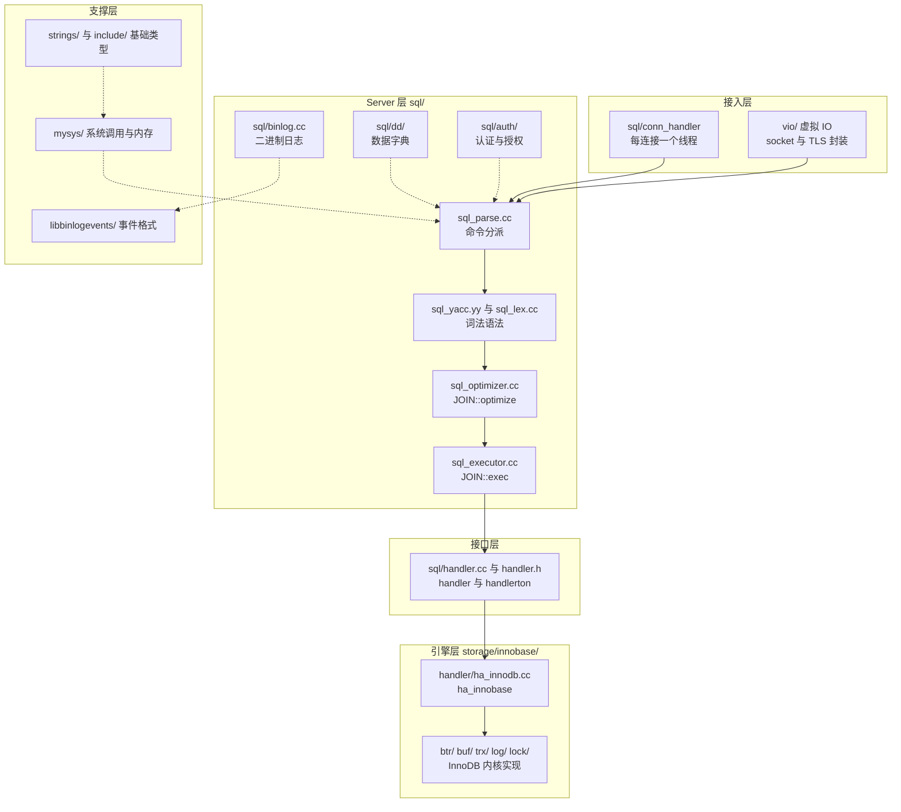
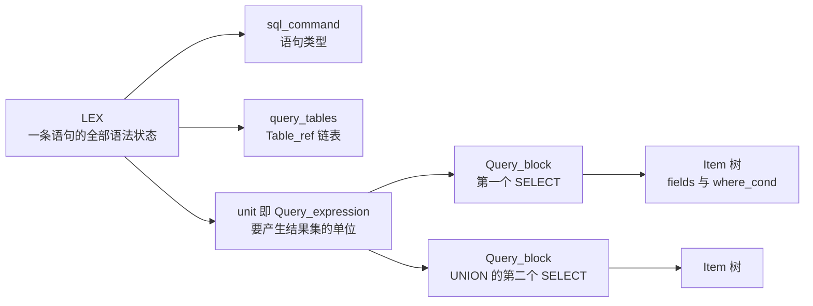
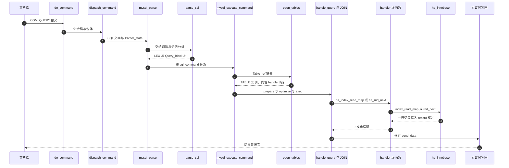
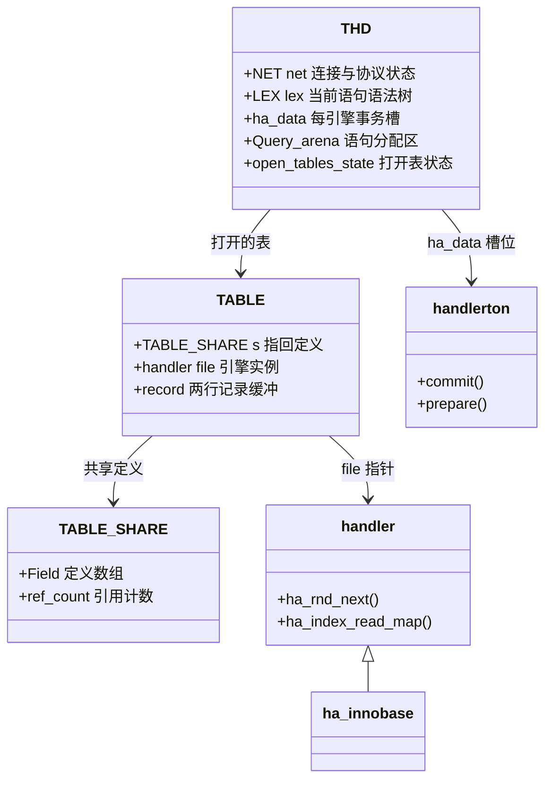
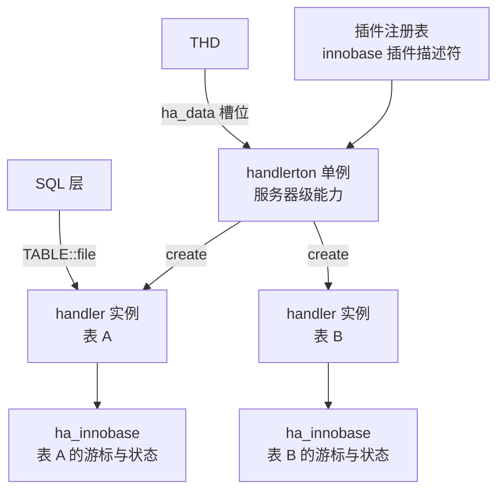
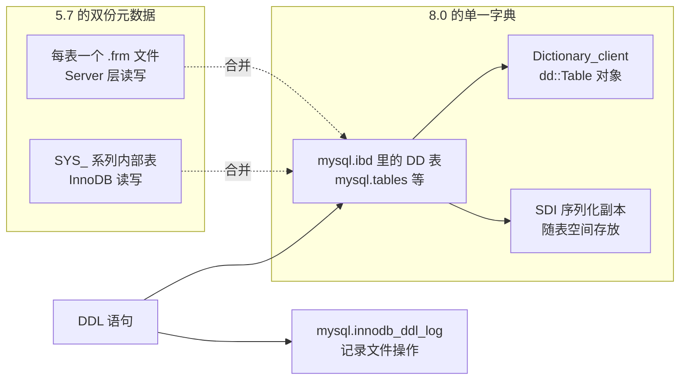

# 第1章 MySQL 内核简介

**摘要：**

一条 `SELECT` 从网卡上的字节流变成 InnoDB 里的一次 B+ 树定位，中间要穿过二十来个函数和三条明确的边界。本章不谈安装、不谈参数调优，只谈代码：MySQL 的源码树按什么原则切分模块，`sql/` 下几个关键文件各自负责语句生命周期的哪一段，一条 SQL 在内核里按什么顺序被调用，以及 SQL 层凭什么能在完全不知道底层是 InnoDB 还是 MyISAM 的前提下把活干完。全文沿五个骨架推进：代码模块的完整划分、一条 SQL 的函数调用链、引擎接口的方法表、8.0 的三处结构性演进、`MEM_ROOT` 的内存模型；每一层都给出"拿到什么、产出什么"，便于在栈上对照。顺带交代三件读源码时必然撞上的事：`THD` 里到底装着什么、`TABLE` 与 `TABLE_SHARE` 为什么要拆成两个对象、`MEM_ROOT` 为什么取代了大部分场景下的 `malloc`。8.0 相对 5.7 在这条链路上的三处变动——数据字典迁入 `mysql.ibd`、原子 DDL、`sdi`——也一并给出结论与源码入口。读完应当能在一条慢 SQL 的栈上指出它停在哪一层、这一层的上一跳与下一跳分别是谁。

---

本篇只写代码结构，也就是目录、模块、函数与调用链；总体架构的插件化设计见 [[中间件/MySQL/读书笔记-Mysql内核架构/01. MySQL总体架构：Server层与存储引擎的插件化设计|读书笔记 01]]，运行期的判据与容量视角见 [[中间件/MySQL/MySQL架构与底层原理/01 MySQL 全局架构——一条 SQL 的完整生命周期|架构列 01]]，应用层该怎么写 SQL 见 [[中间件/MySQL/MySQL进阶使用/00 专栏导览|MySQL 进阶使用]]。本篇回答的问题只有一个：想在哪个文件里改到它。

## 1.1 从 TcX 的报表引擎说起

MySQL 的起点并不是一个数据库，而是一个报表工具。1979 年，Monty Widenius 在瑞典 TcX 公司写了一个名叫 UNIREG 的报表引擎，用它把业务数据拼成报表；到 1990 年，有客户提出"这个报表引擎能不能直接吃 SQL"，于是他才动手写 SQL 层。这段历史的痕迹至今留在代码里：UNIREG 是独立的报表引擎，SQL 是后来加上去的一层，"先有数据存取、后有 SQL 表达"的顺序，正好解释了 MySQL 为什么能接受"**SQL 层与引擎层分离**"这条路，而不是像同时代的商业数据库那样把两者焊成紧耦合的单一内核。

对外的时间线大致是这样：1995 年 MySQL AB 公司在瑞典成立，同年发布 1.0 供内部客户使用；1996 年 10 月推出 3.11 版本，年底有了第一个 Linux 版本；1998 年加入多线程与多语言 API，才算真正具备商用形态。

2000 年前后是引擎层格局成型的关键几年。MySQL 在 2001 年同时接入了两个第三方引擎：Sleepycat 公司的 Berkeley DB（代码里叫 BDB）与 Innobase Oy 公司的 InnoDB。这两个引擎都支持事务，也都实现了当时刚定下来的引擎接口，但来路完全不同——BDB 是嵌入式键值库的改造成果，InnoDB 则是为 MySQL 从零设计的行式引擎。Oracle 在 2005 年收购的是 Innobase Oy，而不是 Berkeley DB；后者要等 Oracle 收购 Sleepycat 之后才易主。把 BDB 当作 InnoDB 前身的说法流传很广，但只要看两个引擎的数据文件格式与事务实现，就知道它们没有血缘关系。

随后是公司层面的三次转手：2008 年 Sun Microsystems 收购 MySQL AB，2009 年 Oracle 宣布收购 Sun，交易在 2010 年初完成。这几次收购在工程上留下的最直接后果，是 MySQL 的版本节奏从"跟着引擎走"变成"跟着发行序列走"：5.5 把 InnoDB 定为默认引擎，5.6 补上在线 DDL、索引条件下推（Index Condition Pushdown，ICP）与多范围读取（Multi-Range Read，MRR），5.7 交出组复制（MySQL Group Replication，MGR）与多源复制，8.0 则把整个数据字典推倒重来，顺带带来原子 DDL、Hash Join、窗口函数与公共表表达式（Common Table Expression，CTE）。2024 年发布的 9.0 加入了用 JavaScript 写存储程序的能力、`VECTOR` 向量类型，并移除了 `mysql_native_password` 认证插件。

> [!note] 版本节奏的变化
> 5.7 之后新增的功能数量明显收敛，重心从"加特性"转向"提性能、还技术债"。8.0 最大的工作量并不在用户可见的语法上，而在数据字典与 DDL 原子性这类看不见的地方——这恰恰是本章后半段要拆开讲的代码结构变动。

## 1.2 分支与衍生版本

MySQL 的授权模式（核心 GPL、部分组件商业许可）催生了一批分支，它们在代码结构上与官方版本高度同源，差异主要集中在两处：一是线程模型与调度，二是引擎层的增强。

MariaDB 由 Monty 离开 Sun 之后主导维护，命名来自他的女儿。它在优化器与连接算法上走得更早，Hash Join、半连接（Semi Join）的改写策略比官方版本落地得早若干年。为了不重蹈过度商业化的覆辙，Monty 把项目交给他创立的基金会管理，资金来源是会员赞助，代码保持全开源。Percona 走的是另一条路：它从咨询与周边工具（XtraBackup、Percona Toolkit）起家，分支的重点是维护与诊断能力，加了大量可观测项、参数与控制选项，另外独立维护过基于 InnoDB 改造的 XtraDB 引擎。

对读源码的人来说，分支的差异可以归成一句话：`sql/` 部分基本同构，`storage/` 与线程池部分各有各的补丁集。所以从官方源码上建立的调用链认知，迁到 Percona 或 MariaDB 上仍然成立，只是断点位置要按分支的 patch 挪动。国内还有一批基于 MySQL 定制开发的发行版，改动面通常更深，涉及存储引擎替换与 SQL 层扩展，这部分不在本章讨论范围内。

## 1.3 版本号与发行模型

MySQL 的版本号是"主版本.发行级别.系列内序号"三段式：首位在主版本跃迁时变动（5.x 到 8.x 跳过了 6、7，那是被取消的两个发行序列），第二位代表一个功能发行序列，第三位是序列内的补丁号。一个功能序列内部会经历三个阶段：里程碑（Milestone）阶段只求功能跑通，譬如 5.7.1 到 5.7.6；候选发布（Release Candidate，RC）阶段做稳定性收敛，如 5.7.7、5.7.8；正式可用（General Availability，GA）阶段才允许上生产，5.7.9 是 5.7 系列的 GA 起点。

8.0 之后发行模型改成了双轨：创新版（Innovation）以较快的节奏加入新特性，首个是 8.1；长期支持版（Long-Term Support，LTS）只收修复与安全补丁，8.4 是 8.0 之后的第一个 LTS。这个改动的实质是把"要不要尝鲜"的决策从运维手里挪到了用户手里——选创新版就要接受每个小版本都可能带行为变化，选 LTS 就要接受功能落后一两年。至于 8.0 这个序列本身的支持截止时间，官方调整过不止一次，具体日期以官方生命周期公告为准，代码分支上则可以从 `MYSQL_VERSION` 文件读出当前序列与补丁号。

## 1.4 代码的层次与模块边界

### 1.4.1 目录按依赖方向切，不按功能切

第一次翻开 MySQL 源码树的人常有同一个困惑：目录名看起来是按功能起的——`sql`、`storage`、`vio`、`mysys`——但把文件逐个看下去会发现，功能视角解释不了这些边界的画法。真正在起作用的规则是**依赖方向**：越靠上的目录越懂 SQL，越靠下的目录越懂磁盘与套接字，而且依赖只允许从上往下，不允许反过来。

这条规则有两个可以直接验证的判据。其一，`sql/` 下的文件可以 include `mysys/` 与 `include/` 的头文件，反过来不行——`mysys/my_alloc.cc` 里没有任何一行引用 `sql/` 的符号，它只认 `my_sys.h`、`my_alloc.h` 这类基础头。其二，`storage/innobase/handler/ha_innodb.cc` 会 include `sql/handler.h`、`sql/table.h`，但 `sql/` 目录下找不到对 `ha_innodb.h` 的引用；SQL 层拿到的只是一个 `handler *` 指针。正是第二条判据让"换引擎不动 SQL 层"从口号变成了编译期事实。

把整个树自上而下摊开，会看到五个层次，如图所示。

### 1.4.2 顶层目录一览

以 8.0 的代码树为准，登得上台面的目录只有十几个，其余都是构建、测试与打包的脚手架。与本篇主题相关的整理如下，最后一列标注了相对 5.7 的变动，方便对照书稿原始版本去翻代码。

| 目录 | 一句话职责 | 相对 5.7 的变动 |
| :--- | :--- | :--- |
| `sql/` | Server 层全部实现，从连接认证到查询执行、数据字典、复制协调都在这里 | 新增 `sql/dd/`、`sql/iterators/`、`sql/auth/` 拆分细化 |
| `storage/innobase/` | InnoDB 的全部实现，含 `handler/` 子目录下的引擎适配器 | 基本稳定，`handler/ha_innodb.cc` 体量继续增大 |
| `mysys/` | 跨平台系统调用封装：文件、目录、线程、定时器、内存分配 | 内存分配实现从 C 迁到 C++（`my_alloc.cc`） |
| `vio/` | 虚拟 IO 层，把 socket、非阻塞读写、TLS 握手包成统一接口 | 基本稳定 |
| `sql-common/` | 客户端与服务端共用代码，例如字符集转换、客户端插件接口 | 基本稳定 |
| `include/` | 公共头文件，`my_sys.h`、`my_alloc.h`、`mysql_com.h` 都在这里 | 基本稳定 |
| `libbinlogevents/` | binlog 各种事件的结构定义与解析代码，客户端工具也复用它 | 基本稳定 |
| `plugin/` | 可加载插件：半同步复制、审计、密码校验、X Plugin、组复制 | MGR 从 `rapid/` 迁到 `plugin/group_replication` |
| `components/` | 组件化框架下的组件实现，走服务（service）接口而非插件接口 | 8.0 新增 |
| `client/` | 命令行客户端、`mysqldump`、`mysqlbinlog` 等工具 | 基本稳定 |
| `mysql-test/` | 完整测试集，改内核代码后必须跑的回归套件 | 基本稳定 |
| `utilities/` | 独立小工具，例如从表空间抽取字典信息的 `ibd2sdi` | 8.0 新增 |
| `libchangestreams/` | 变更流（change stream）的读取框架 | 8.0 新增 |
| `extra/`、`scripts/`、`man/`、`packaging/`、`cmake/` | 工具、脚本、手册、打包、构建配置 | 基本稳定 |

`libmysqld`（嵌入式服务端库）在 5.7 已标记废弃，8.0 整目录移除；`rapid`（MGR 的旧位置）、`regex`、`zlib`、`dbug` 在 8.0 的顶层目录里也不再单独出现，相关能力并入了 `plugin/`、`extra/` 与第三方依赖。这类"目录消失"是读旧资料时最容易踩空的地方。

### 1.4.3 六个核心模块：职责与被谁调用

顶层目录只是粗分。真正承担一条 SQL 生命周期的模块有六个，每个模块的边界都可以用两句话描述清楚：它自己负责什么，以及谁会调它。

| 模块 | 一句话职责 | 被谁调用 |
| :--- | :--- | :--- |
| `sql/` | 把 SQL 文本变成"对某张表的若干次行操作"，并负责权限、事务边界、结果集组装 | 由连接线程（`sql/conn_handler`）进入，向下调用 `handler` 层 |
| `sql/handler.cc` 与 `sql/handler.h` | 定义 `handler`（每表实例）与 `handlerton`（每引擎单例）两套接口，并实现引擎无关的公共逻辑 | 由 `sql/` 各语句实现调用；由 `storage/` 下各引擎实现 |
| `storage/innobase/` | 提供行级读写、事务、MVCC、索引、日志与崩溃恢复，对上层只暴露 `ha_innobase` 与 `innobase_hton` | 只被 `handler` 层的虚函数调用链进来 |
| `mysys/` | 屏蔽平台差异：文件路径、目录遍历、线程与互斥量、定时器、`MEM_ROOT` 内存分配 | 被以上所有模块调用，自身不依赖任何上层 |
| `vio/` | 把一次网络读写成"从 `Vio` 上读满 n 字节"，并把 TLS、压缩、超时藏在这一层 | 被 `sql/net_serv.cc` 调用 |
| `sql/auth/` | 认证插件调度、账号与权限校验、角色与动态权限展开 | 由连接建立阶段与每条语句的权限检查调用 |

关于 `handler` 这一行，有一处容易误解的地方需要点明：它并不是一个独立目录。MySQL 8.0 的顶层目录里没有 `handler/`，`hton`（`handlerton` 的实例）与 SDI 相关的接口分散在 `sql/handler.h`（`handler` 类与 `handlerton` 结构体声明）、`sql/handler.cc`（引擎无关的公共实现与 `ha_*` 自由函数）与 `sql/dd/`（SDI 序列化）里。很多资料按"handler 层"来称呼它，指的是逻辑分层，不是目录。到源码里按目录找会扑空。

`sql/auth/` 从 5.7 的文件堆里独立成目录，是 8.0 的一次整理：`sql_authentication.cc` 负责认证插件与密码交换，`sql_authorization.cc` 负责权限判定，`acl_cache` 与 `role` 相关代码也在这里。之所以值得单独拎出来，是因为权限检查是每条语句都要过的路径，它挂在 `mysql_execute_command` 的最前面，与解析、优化完全解耦——这也是"认证失败"与"权限不足"在日志里表现不同的根源。

复制相关的代码分布在两处：`libbinlogevents/` 只定义事件格式（`Log_event` 的子类、字段布局、序列化），不含任何服务端策略；`sql/binlog.cc`、`sql/rpl_*.cc` 才是写 binlog、读 relay log、调度复制的策略层。这种"格式与策略分离"让 `mysqlbinlog` 这类客户端工具可以只链接 `libbinlogevents` 就完成解析。协议细节见 [[中间件/MySQL/MySQL内核设计与实现/3.0 第3章 客户端和服务端交互协议|本列 3.0]]，复制内核见本书第 9 章。

### 1.4.4 sql/ 里的关键文件

`sql/` 目录有上千个文件，但一条查询真正会经过的只有十几个。其中五个文件构成了主干，值得先记住它们的名字。

| 文件 | 职责 | 版本备注 |
| :--- | :--- | :--- |
| `sql_parse.cc` | 命令分派与 `mysql_execute_command` 的总入口 | 两版都在，主干稳定；语句实现逐步迁到 `Sql_cmd_*` 子类 |
| `sql_lex.cc` | 手写词法分析器 `MYSQLlex()`，维护 `LEX` 的成员 | `LEX`、`Query_block`、`Query_expression` 集中在 `sql_lex.h`，8.0 改了类名 |
| `sql_yacc.yy` | bison 语法源文件，语义动作在此构造 `Item` 与表引用 | 生成物 `sql_yacc.cc` 不入库，随版本补充新语法 |
| `sql_optimizer.cc` | 优化器主体，`JOIN::optimize`、连接顺序与代价计算 | 5.7 里已从 `sql_select.cc` 拆出，8.0 继续演进 |
| `sql_executor.cc` | 执行器主体，`JOIN::exec`、`do_select` 与行读取函数族 | 5.7 里已独立成文件，8.0 主执行路径改为迭代器树 |
| `sql_select.cc` | 5.6 时代"优化器加执行器"的巨无霸 | 5.7 起被逐步掏空，8.0 只剩 `JOIN` 生命周期管理与清理 |

除主干之外，几个配套文件在定位问题时高频出现：`sql_class.cc` 是 `THD` 的实现，`table.cc` 管 `TABLE` 与 `TABLE_SHARE` 的打开与缓存，`handler.cc` 是引擎接口的公共实现，`sql_cmd.h` 声明各语句的命令类，`sql_prepare.cc` 处理预处理语句的解析与参数绑定，`sql_derived.cc` 处理派生表物化，`sql_tmp_table.cc` 管临时表，`sql_show.cc` 实现 `SHOW` 系列，`sql_explain.cc` 负责执行计划输出，`sql_resolver.cc` 是 8.0 新增的名字解析器。

结构上最重要的一次手术，是把 `sql_select.cc` 拆开，而这场手术跨了两个版本才做完。5.6 时代这个文件超过一万行，把名字解析、条件重写、连接顺序选择、代价估算、行读取与结果发送全塞在一起，任何一处改动都要重新理解整个文件；5.7 先把优化器拆成 `sql_optimizer.cc`、把执行器拆成 `sql_executor.cc`，`sql_select.cc` 开始变薄；8.0 又把名字解析与 `fix_fields` 拆到 `sql_resolver.cc`，`sql_select.cc` 最后只剩 `JOIN` 对象的创建、销毁与清理。这样**按职责切成四块**之后，优化器与执行器可以分别演进，Hash Join 才有可能在 8.0.18 之后作为一种新的执行方式接进来。

第二处结构性变动发生在执行模型上。5.7 的行读取是一条由 `sub_select()` 递归驱动、配合 `join_read_*` 函数族完成定位的控制流；8.0 改成迭代器树：每个 `RowIterator` 子类只负责"给我下一行"，连接、排序、聚合、窗口全部变成可组合的迭代器节点，实现在 `sql/iterators/` 目录下。`basic_row_iterators.cc` 是全表扫描与索引扫描，`ref_row_iterators.cc` 是等值引用定位，`composite_iterators.cc` 是嵌套循环与物化，`hash_join_iterator.cc` 与 `hash_join_chunk.cc` 是 8.0 新增的哈希连接，`bka_iterator.cc` 是批量键访问，`sorting_iterator.cc` 与 `window_iterators.cc` 分别管排序与窗口函数，`timing_iterator.cc` 负责把每个节点的耗时记进 `performance_schema`。这套结构带来的直接好处是执行计划在代码里可以"看"出来——`EXPLAIN` 输出的树与迭代器树基本同构，调试时在 `RowIterator::Read` 上下断点比在 `sub_select` 里翻栈要轻松得多。

### 1.4.5 mysys 与 include：为什么不直接用标准库

MySQL 的代码里有大量看起来毫无必要的封装：`my_malloc` 而不是 `malloc`，`my_open` 而不是 `open`，`my_stat` 而不是 `stat`，字符串处理走 `strings/` 里的实现而不是 `<cstring>`。这些封装全部落在 `mysys/` 与 `strings/`，理由有两条：跨平台与可替换性。

跨平台的部分来自历史的重量。MySQL 要同时支持 Windows 与各种 Unix，早期还要处理目录遍历的差异、文件锁语义的差异、大文件偏移的差异；把这些差异收敛进 `mysys/` 之后，上层代码里不再出现条件编译。可替换性则是为了给测试与追踪留抓手：`my_malloc` 可以被带内存追踪的版本替换，`my_open` 可以记录打开过的文件，`my_error` 可以被测试框架截获。如果直接调标准库，这些能力就只能散落在各处重写。

`include/` 与 `sql-common/` 的分工遵循同一条原则。`include/` 放所有模块都要用的定义：`my_sys.h`、`my_alloc.h`、`mysql_com.h` 里的协议常量、编译器与平台适配的 `my_global.h`。`sql-common/` 放客户端与服务端都要用的实现：客户端插件接口、字符集转换、预处理语句的客户端侧逻辑。判断一个文件该放哪，只要问一句"客户端链接它吗"——链接就进 `sql-common/`，不链接就进 `sql/`。

## 1.5 一条 SQL 的完整调用链

### 1.5.1 从网络包到语法树

调用链的起点在连接线程里。`sql/conn_handler` 为每个连接起一个线程，线程函数循环调用 `do_command(THD *)`：先从 `THD::net` 上读满一个完整的命令包（`my_net_read`，底层落到 `vio_read`），把包体与包长记进 `THD`，然后把控制权交给 `dispatch_command()`。

`dispatch_command` 的职责是按协议里的命令字节分派：`COM_QUERY` 走文本 SQL 路径，`COM_STMT_PREPARE` 走预处理路径，`COM_FIELD_LIST`、`COM_PING`、`COM_QUIT` 各有分支。所有分支最终都要回到同一个收尾路径，做三件事：审计通知、`thd->set_query(NULL, 0)` 清掉当前语句、把语句级 arena 还给 `MEM_ROOT`。

`COM_QUERY` 分支进入 `mysql_parse()`，它先构造一个 `Parser_state` 把"这次解析的输入、位置、词法状态"打包，再调用 `parse_sql()`。`parse_sql` 是真正调动解析器的地方：词法由 `sql_lex.cc` 的 `MYSQLlex()` 提供，语法由 bison 生成的 `yyparse()` 驱动（源文件是 `sql_yacc.yy`），归约时执行语义动作。语义动作做三件事：设置 `LEX::sql_command` 标明语句类型，用 `add_table_to_list()` 把 `FROM`、`JOIN`、`UPDATE` 里出现的表挂到 `LEX::query_tables` 链表，用 `new (thd->mem_root) Item_xxx(...)` 在语句 arena 上构造表达式树。

到这里，一条 SQL 已经有了内核能理解的三样东西：语句类型、涉及的表、条件与投影的表达式树。它们分别挂在 `LEX` 的不同成员上，如图所示。

图中的 `Query_expression` 与 `Query_block` 在 5.7 里分别叫 `SELECT_LEX_UNIT` 与 `SELECT_LEX`，8.0 改了名字，语义没变。这个改名值得单独记一笔：网上大量基于 5.7 的源码笔记直接沿用旧名，在 8.0 的代码里搜 `SELECT_LEX` 会一无所获，读者很容易误以为自己找错了版本。

### 1.5.2 从语法树到一次行读取

`parse_sql` 返回成功之后，`mysql_parse` 调用 `mysql_execute_command()`。这个函数是 Server 层的总闸门，长年是一个巨大的 `switch (lex->sql_command)`：`SQLCOM_SELECT` 走查询路径，`SQLCOM_INSERT` 走 `mysql_insert`，`SQLCOM_UPDATE` 走 `mysql_update`，`SQLCOM_CREATE_TABLE` 走 `mysql_create_table`。8.0 的方向是把每个分支的实现搬进 `Sql_cmd` 子类的 `execute()` 方法（`Sql_cmd_select`、`Sql_cmd_insert`、`Sql_cmd_dml` 等），`switch` 里只剩"取到命令对象、做通用前置检查、调用 `execute`"。

无论走哪条分支，DML 都绕不开 `open_tables()`。它遍历 `LEX::query_tables` 里的每个 `Table_ref`，逐个调用 `open_table()`：先向表定义缓存（`table_def_cache`）申请该表的 `TABLE_SHARE`，同时在元数据锁（Metadata Lock，MDL）子系统上拿到对应的锁；再以 `TABLE_SHARE` 为模板调用 `open_table_from_share()` 生成一个 `TABLE` 实例。`TABLE` 的构造过程里最关键的几步是：分配 `Field` 对象数组、分配两行记录缓冲 `record[0]` 与 `record[1]`、用 `get_new_handler()` 通过插件框架向该表的存储引擎要一个 `handler` 实例，最后调用 `ha_open` 让引擎把文件或表空间打开。`open_tables` 返回时，`Table_ref::table` 已经指向一个"可读可写"的 `TABLE`。

接下来是查询路径。8.0 把这三步拆给了两级调用：`Sql_cmd_dml::execute()` 先依次跑 `prepare`（名字解析、`fix_fields`、条件与投影的语义检查）与 `optimize`（进入 `JOIN::optimize`，选连接顺序、选访问方法、算代价），然后把 `Query_expression` 交给 `Sql_cmd_select::execute()`，后者调到 `handle_query()` 完成最后的执行编排，也就是 `JOIN::exec`。`JOIN::exec` 的首要工作是 `create_iterator()`，把执行计划翻译成迭代器树；随后对根迭代器反复 `Init()` 与 `Read()`。

行读取落到最底层时，调用形态已经非常简单：迭代器节点的 `Read()` 里调 `table->file->ha_index_read_map(...)` 或 `table->file->ha_rnd_next(...)`，`table->file` 是 `handler *`，**虚函数派发**到 `ha_innobase::index_read_map()`，再往里就是 InnoDB 的 `row_search_mvcc()`。结果集则反向流出：`Query_result_send::send_data()` 把 `record[0]` 里的行交给协议层，`Protocol_classic` 组装成结果集报文写进 `NET` 缓冲，最终由 `vio_write` 落到 socket。整条链路如图所示。

### 1.5.3 每一层拿到什么、产出什么

把上面这段叙述压成表格，会更容易在调试时对照栈帧。

| 层 | 拿到什么 | 产出什么 |
| :--- | :--- | :--- |
| `do_command` | 一个完整命令包与包长 | 命令字节码，包体指针，`THD` 上的语句上下文 |
| `dispatch_command` | 命令字节码 | 按 `COM_*` 分流；`COM_QUERY` 时交出 SQL 文本 |
| `mysql_parse` | SQL 文本与 `Parser_state` | 解析成功或失败；失败时 `THD` 的诊断区已有错误码 |
| `parse_sql` | 词法状态机与 bison 语法表 | `LEX`、`Query_expression`、`Query_block`、`Item` 树 |
| `mysql_execute_command` | `LEX::sql_command` 与命令对象 | 前置检查（权限、只读、MDL 意向）；把语句交给命令对象 |
| `open_tables` | `Table_ref` 链表 | `TABLE` 实例（含 `handler`）、`TABLE_SHARE` 引用计数、MDL 锁 |
| `handle_query` | 已准备好语义的 `Query_block` | 优化后的执行计划（代价、连接顺序、访问方法） |
| `JOIN::exec` | 执行计划 | 迭代器树，逐行读出 `record[0]` |
| `handler::ha_*` | 表实例、索引号、查找条件 | 一行记录或错误码；`record[0]` 被填充 |
| `ha_innobase` | 游标、索引、查找模式 | InnoDB 内部的记录与锁，向上只回状态码 |
| `trans_commit` 系列 | 语句或事务边界 | 引擎提交、binlog 落盘、`server_status` 更新 |

### 1.5.4 THD：一次会话的全部上下文

`THD` 定义在 `sql/sql_class.h`，实现于 `sql/sql_class.cc`，它在代码里的存在感强到几乎每个函数签名里都有它。原因是 MySQL 没有把"会话状态"做成显式传递的参数对象，而是把一切挂在 `THD` 上，用**隐式上下文**换函数签名的简洁。读源码时，只要盯住下面五样东西，绝大多数"这个值从哪来"的问题都能回答。

第一样是连接与协议状态：`NET net` 保存读写缓冲与包序号，`thread_id` 标识会话，`vio` 指针直通 `vio/` 层，`charset` 与 `collation` 决定字节与字符的换算规则。

第二样是当前语句的语法树：`LEX *lex`。一条语句解析完成到执行结束之间，`thd->lex` 一直指向这棵树；语句结束时它被置空，树所占的内存随 arena 一起释放。

第三样是事务与引擎上下文：`ha_data[]` 数组按引擎槽位（`handlerton::slot`）存放每引擎的私有数据，InnoDB 的事务对象 `trx_t` 就挂在自己的槽位里；`Transaction_ctx` 记录事务状态、保存点与 XA 信息，`server_status` 里的 `SERVER_STATUS_IN_TRANS` 位决定提交时要不要真的走两阶段提交。

第四样是内存：`Query_arena mem_root` 是当前语句的分配区，`stmt_arena` 指向预备语句级别的分配区，`Query_arena::free_list` 复用已释放的 `Item` 对象。这三者共同构成"按语句批量分配、按语句批量释放"的基础。

第五样是打开的表与锁：`open_tables_state` 里挂着 `TABLE *open_tables` 链表与 `TABLE_SHARE` 的引用，`MDL_context mdl_context` 记录本会话持有的元数据锁，`Security_context` 记录当前生效的账号与角色。权限检查读的是 `Security_context`，MDL 等待读的是 `mdl_context`，两者都不在 `LEX` 里。

> [!info] 一个反直觉的判据
> 如果一个问题涉及"这个会话现在在干什么"，答案多半在 `THD`；如果涉及"这条语句想干什么"，答案在 `LEX`；如果涉及"这张表的定义是什么"，答案在 `TABLE_SHARE`。三者的分工比它们的大小更重要。

### 1.5.5 TABLE 与 TABLE_SHARE：一个定义，多个打开

`TABLE` 与 `TABLE_SHARE` 是 MySQL 里最容易被混为一谈的一对对象，因为它们的名字都像"表"。区别在于生命周期与共享范围：`TABLE_SHARE` 是**被共享的表定义**，来自表定义缓存，被所有打开该表的会话共享，只读；`TABLE` 是**每次打开产生的实例**，归属于某个 `THD`，包含可变的运行时状态。

`TABLE_SHARE` 里装的是"定义"：字段描述数组、索引定义、字符集与排序规则、表选项、`ref_count` 引用计数、版本号。它由 `tdc_acquire_share()` 从 `table_def_cache` 里取，取不到就从数据字典里读一次再放进去；引用计数归零之后不一定立刻释放，而是留在缓存里等着被复用或被淘汰。`TABLE` 里装的是"这一次打开"：`TABLE_SHARE *s` 指回定义，`handler *file` 是引擎实例，`record[0]` 与 `record[1]` 是两行缓冲（一行给当前行、一行给更新前后的对照），`Field` 对象数组是按定义现造的，`Key_map keys_in_use` 记录本次查询会用到哪些索引。

两者是典型的一对多关系：一个 `TABLE_SHARE` 对应 N 个 `TABLE`，N 就是同时打开这张表的会话数。这也解释了为什么 `table_definition_cache` 与 `table_open_cache` 是两个不同的参数——前者限制定义缓存里能放多少个 `TABLE_SHARE`，后者限制服务端同时能打开多少个 `TABLE`。

两个缓存的大小不是越大越好，代价落在内存与元数据锁上。

| 参数 | 调大的代价 | 调小的代价 |
| :--- | :--- | :--- |
| `table_definition_cache` | 每个 `TABLE_SHARE` 都按字段数与索引数占内存，几万个小表时元数据可占数百 MB 量级 | 缓存命中率下降，每次打开表都要读数据字典，DDL 与查询都会变慢 |
| `table_open_cache` | 每个打开的表都要一个 `TABLE` 实例与 `handler`，InnoDB 还要按实例准备游标与预读上下文 | 高并发下频繁开关表，`Opened_tables` 飙升，`table_open_cache_misses` 增长 |
| `open_files_limit` | 受操作系统句柄上限约束，调大可能触碰内核参数 | InnoDB 打不开表空间文件，报错集中在打开表阶段 |

### 1.5.6 写路径：UPDATE 与 INSERT 差在哪

读路径的骨架在写路径上大体复用，但有三处不同，读代码时容易卡住。

第一处是入口。`UPDATE` 与 `DELETE` 并不从 `handle_query` 进，而是由 `mysql_update` 与 `mysql_delete` 直接驱动：先 `open_tables`，再为 `WHERE` 条件建一个迭代器（8.0 里是 `UpdateRowsIterator` 与 `DeleteRowsIterator`，都在 `sql/iterators/` 下），然后循环取行。`INSERT` 更短，`mysql_insert` 走 `write_record`，后者按语句形态分了多个枝（单行、多行、`INSERT ... SELECT`、`ON DUPLICATE KEY UPDATE`），最终都落到 `ha_write_row`。

第二处是行缓冲的语义。读路径只关心 `record[0]`；写路径必须维护两份，`record[0]` 放新值、`record[1]` 放旧值，`ha_update_row(old_data, new_data)` 的两个参数就来自这两个缓冲。InnoDB 依据旧值里的主键定位记录，再写入新值；如果表上没有主键、只有二级索引，定位成本会明显上升，这是"表上必须有主键"这条经验在代码层面的依据。

第三处是提交。写语句在语句结束时触发一次语句级提交（`trans_commit_stmt`），在事务结束时触发一次事务级提交（`trans_commit`）；后者是整条链路上唯一需要协调多个引擎与 binlog 的地方，走的是内部两阶段提交：先让各引擎 `prepare`，再把 binlog 落盘，最后让各引擎 `commit`。这段编排的函数名是 `ha_commit_trans`，它在 `sql/handler.cc` 里，遍历 `THD` 上的引擎槽位，不针对任何一张表。

| 语句 | 入口函数 | 取行方式 | 引擎调用 |
| :--- | :--- | :--- | :--- |
| SELECT | `handle_query` | 迭代器树逐行 `Read` | `ha_index_read_map`、`ha_rnd_next` |
| UPDATE | `mysql_update` | `UpdateRowsIterator` | `ha_update_row` |
| DELETE | `mysql_delete` | `DeleteRowsIterator` | `ha_delete_row` |
| INSERT | `mysql_insert` 到 `write_record` | 不取行，直接写 | `ha_write_row` |
| 提交 | `trans_commit_stmt`、`trans_commit` | 不涉及 | `ha_start_stmt`、`ha_commit_trans` |

## 1.6 SQL 层与存储引擎的接口

### 1.6.1 handler 的方法表

引擎接口在 `sql/handler.h` 里被定义成一个 C++ 抽象类 `handler`，成员函数分成两类：一类带 `ha_` 前缀，是引擎无关的包装，处理统计、检查与错误注入；另一类没有前缀，是纯虚函数，由具体引擎实现。`ha_innobase` 继承 `handler` 并实现后者。真正需要引擎实现的**纯虚函数只有十几个**，把它们列出来，整条引擎接口的规模就清楚了。

| 包装方法 | 实际落点 | 一行语义 |
| :--- | :--- | :--- |
| `ha_open` | `open()` | 打开表：拿到表空间或数据文件句柄 |
| `ha_close` | `close()` | 关闭表：释放句柄与游标 |
| `ha_rnd_init` | `rnd_init()` | 准备全表扫描，可指定是否顺序扫描 |
| `ha_rnd_next` | `rnd_next()` | 取下一条记录到 `record[0]` |
| `ha_index_init` | `index_init()` | 选定索引，准备索引扫描 |
| `ha_index_read_map` | `index_read_map()` | 按索引键定位第一条匹配记录 |
| `ha_index_next` | `index_next()` | 沿索引顺序取下一行 |
| `ha_write_row` | `write_row()` | 插入一行 |
| `ha_update_row` | `update_row()` | 按旧行定位并更新为新行 |
| `ha_delete_row` | `delete_row()` | 按行内容删除 |
| `ha_start_stmt` | `handlerton::start_stmt` | 语句开始，逐引擎通知（这是 `handler.cc` 里的自由函数，遍历 `THD` 上的引擎槽位） |
| `ha_commit_trans` | `handlerton::prepare/commit` | 事务提交，编排引擎提交、binlog 落盘与内部两阶段提交 |

最后两行值得特别注意：它们不是 `handler` 的实例方法，而是 `sql/handler.cc` 里的自由函数，作用于引擎单例而不是某张表。这个细节是"把 `ha_*` 统一当成表级操作"这种印象的来源，也是把 `handler` 与 `handlerton` 混用的起点。

包装层做的工作比名字暗示的要多。以 `ha_index_read_map` 为例，它在调用虚函数前后会维护 `ha_read_*` 状态计数、检查 `thd->killed` 以支持 `KILL`、在 `DBUG_EXECUTE_IF` 打开时注入模拟错误、更新 `performance_schema` 的引擎等待统计。这些事与引擎无关，所以放在包装层；如果让每个引擎自己实现，就会出现"某个引擎的统计项永远为零"这类问题。

### 1.6.2 SQL 层不知道引擎是什么

判断分层是否真的成立，不看文档怎么写，而看代码里有没有绕过接口的地方。在 MySQL 里可以找到四组证据。

第一组在调用点上。所有对引擎的调用都写成 `table->file->ha_xxx()` 或形如 `handler *file` 的局部变量，`storage/innobase/` 下的符号在 `sql/` 里不出现。在 `sql/` 目录里搜 `ha_innobase` 一条都搜不到，引擎名字只以字符串形式出现在 `storage/innobase/` 的插件描述符里。

第二组在实例化路径上。`open_table_from_share` 里调用 `get_new_handler(TABLE_SHARE *share, MEM_ROOT *mem_root)`，这个函数先通过插件框架锁定该表的引擎插件，再调用 `handlerton::create()` 返回 `handler *`。返回值的静态类型是基类指针，`open_table` 不知道也不需要知道具体类型。

第三组在能力声明上。引擎支持哪些能力写在 `handlerton` 的函数指针里：`commit`、`prepare`、`rollback`、`start_consistent_snapshot`、`savepoint_set`、`create`、`drop_table` 等等。SQL 层的判断方式非常朴素——**指针为空就是不支持**。`SAVEPOINT` 在 MyISAM 表上报错，实现上就是查了 `hton->savepoint_set == nullptr`，而不是写了一段"如果是 MyISAM 则拒绝"的代码。

第四组在注册机制上。每个引擎在源码里用 `mysql_declare_plugin` 宏导出自己的插件描述符，InnoDB 的写在 `ha_innodb.cc` 里，描述符里包含 `innobase_hton` 的地址；启动时 `plugin_register_builtin` 把它填进 `engines[]` 注册表，`SHOW ENGINES` 从这张表读，`INSTALL PLUGIN` 与动态加载插件共用同一套注册逻辑。所以"引擎"在 MySQL 里是一种插件类型，与全文索引、审计插件没有本质区别，只是它实现的是 `handler` 接口而不是其他接口。

### 1.6.3 handlerton 与 handler 的分工

这两个名字只差几个字母，责任却完全不同。`handlerton` 是引擎在服务器里的单例，代表"这个引擎作为一种能力"；`handler` 是每张打开的表对应一个的实例，代表"这张表怎么读写"。前者的方法大多与具体表无关，涉及事务、DDL、一致性快照、复制；后者的方法全部与某张表绑定。

| 维度 | `handlerton` | `handler` |
| :--- | :--- | :--- |
| 粒度 | 每个引擎一个，进程内单例 | 每张打开的表一个 |
| 生命周期 | 插件加载到卸载，随服务器存在 | `ha_open` 到 `ha_close`，随查询或表缓存存在 |
| 主要方法 | `commit`、`prepare`、`rollback`、`start_consistent_snapshot`、`savepoint_*`、`create`、`drop_table` | `rnd_*`、`index_*`、`write_row`、`update_row`、`delete_row` |
| 在 `THD` 上的体现 | `ha_data[slot]`，`slot` 由引擎注册时分配 | 通过 `TABLE::file` 访问，不在 `THD` 里直接持有 |
| 注册方式 | `mysql_declare_plugin` 宏导出描述符 | 由 `get_new_handler` 调 `create()` 动态生成 |
| 典型误用 | 想用 `handlerton` 存"当前表"的状态 | 想用 `handler` 做"整个引擎"级别的配置 |

把两者混用的后果很具体：在 `handler` 里存引擎级的全局状态，会在同一张表被多个会话同时打开时互相污染；在 `handlerton` 里存表级状态，会在多表连接时被覆盖，表现为"两个表的游标互相串位"这类难以复现的错乱。它们的对象数量与生命周期不同，所以能存的东西也不同。

### 1.6.4 接口上的三次妥协

`handler` 接口不是一次设计成型的，它现在的样子是三次妥协的结果，每一次都能在代码里看到痕迹。

第一次妥协来自"要兼容不支持事务的引擎"。接口必须允许一个引擎声明自己没有事务，于是 `handlerton` 的函数指针允许为空，SQL 层用指针是否为空来判能力。这个设计让 MyISAM 以极低成本接入了同一套接口，代价是 SQL 层到处是能力判断，两阶段提交也要处理"某个引擎根本没参与"的情况。

第二次妥协来自分区表。分区在逻辑上是一张表，物理上是多个表空间，于是出现了 `ha_innopart` 这层适配：它继承 `ha_innobase`，把一次 `ha_index_read_map` 拆成"先算分区号、再路由到对应分区的引擎实例"。接口没有为分区做任何扩展，分区完全在引擎侧消化，这是"接口保持稳定、复杂性下推"的一次典型取舍。

第三次妥协来自 8.0 的原子 DDL。元数据要进事务，意味着字典的存储也必须走引擎接口，于是 `handlerton` 上多了一组与字典存储相关的方法，由 InnoDB 以字典数据存储引擎的身份实现。这一改动把"引擎"的概念从存用户数据扩到了存元数据，也解释了为什么 8.0 的 `mysql.ibd` 一旦损坏，整个实例就起不来。

## 1.7 8.0 的三处架构演进

8.0 被官方称为"重构版"，重构的核心不在语法而在元数据。三处变动彼此关联，可以用一句话串起来：先把分散在两个地方的字典合并成一个事务性字典，再让 DDL 借助事务获得原子性，最后把字典序列化一份放进表空间，使元数据可以脱离实例存在。

第一处是数据字典的迁移。5.7 的元数据有两份：Server 层为每张表维护一个 `.frm` 文件，记录字段与索引定义；InnoDB 自己又在系统表空间里维护 `SYS_TABLES`、`SYS_COLUMNS`、`SYS_INDEXES`、`SYS_FIELDS` 等内部表。两份元数据由两套代码写，DDL 一旦在中途崩溃，两者就可能不一致——这是原子 DDL 要偿还的技术债。8.0 把字典统一成 `mysql.ibd` 里的一组 DD 表（`mysql.tables`、`mysql.columns`、`mysql.indexes`、`mysql.schemata`、`mysql.tablespaces` 等），Server 层通过 `dd::Table` 这类对象模型与 `Dictionary_client` 访问，InnoDB 则作为字典数据的存储引擎（DDSE）参与提交。`.frm` 文件整体消失，`INFORMATION_SCHEMA` 相当一部分视图变成字典表之上的视图。完整机制见 [[中间件/MySQL/读书笔记-Mysql内核架构/03. 数据字典：.frm 的葬礼与原子 DDL 的二十年偿债|读书笔记 03]]。

第二处是原子 DDL。既然字典在事务性引擎里，DDL 的元数据变更就可以与引擎侧的空间操作放进同一个事务：**要么都提交，要么都回滚**，崩溃后不会留下"字典里有表、磁盘上没有文件"或相反的残局。麻烦在于 DDL 中间有大量文件系统操作（建表空间、删表空间、重命名文件），这些操作本身不在事务语义里，于是 InnoDB 增加了一张内部日志表 `mysql.innodb_ddl_log`，把 DDL 期间的文件操作逐条记下来，崩溃恢复时按日志重放或回滚。原子性就这样从"元数据"扩张到了**元数据加文件**。推导过程见 [[中间件/MySQL/读书笔记-Mysql内核架构/16. MySQL 8.0 原子 DDL：二十年技术债的清偿还|读书笔记 16]]。

第三处是 SDI（Serialized Dictionary Information）。8.0 把表与表空间的字典信息序列化成 JSON 格式，作为一份副本随表空间一起存放，官方提供的 `ibd2sdi` 工具可以直接从 `.ibd` 文件里把它抽出来。这件事的意义在于元数据第一次可以脱离运行实例存在：实例起不来时仍能读出表结构，逻辑备份不必依赖实例，跨版本核对也有了一个中立格式。三处变动的关系可以用一张图概括。

| 机制 | 5.7 的做法 | 8.0 的做法 | 结论 |
| :--- | :--- | :--- | :--- |
| 数据字典 | `.frm` 加 InnoDB 内部表，两套代码 | `mysql.ibd` 里的 DD 表，单一访问层 | 一致性从"靠约定"变成"靠事务" |
| 原子 DDL | 元数据与文件操作分开提交，中途崩溃会残留 | 元数据与引擎操作同事务，文件操作记入 DDL 日志 | DDL 从"尽力而为"变成"要么全成要么全败" |
| SDI | 无，元数据只存在于实例内 | 字典信息序列化进表空间，可用 `ibd2sdi` 离线读取 | 元数据获得脱离实例的存在形式 |

## 1.8 MEM_ROOT 与内存管理

MySQL 里最常被调用的分配函数不是 `malloc`，而是 `alloc_root`；最常被调用的释放函数不是 `free`，而是 `free_root`。这套以 `MEM_ROOT` 为中心的分配器是理解 MySQL 内存行为的入口，它的设计目标只有一条：让"一批同时产生、同时失效的对象"用一次释放动作全部回收。

机制本身很朴素。`MEM_ROOT` 维护一条 `Block` 链表，每个块带一个 bump 指针（空闲起点）与块尾，分配时把指针向前推进并按 `ALIGN_SIZE` 对齐，块不够了就新开一块。8.0 的实现里有两个细节值得记住：新块的大小比上一块大 50%，源码注释明确写着这样能让总 `malloc` 次数保持 O(1)；释放时 `Clear()` 把整条链还给系统，`ClearForReuse()` 只保留最后一块（通常也是最大的一块）供下一轮复用。此外还有 `m_max_capacity` 与 `m_error_for_capacity_exceeded` 两个开关，容量超限时触发 `EE_CAPACITY_EXCEEDED` 错误，源码注释说明这里不会立刻返回，而是让查询在下一个安全点中止。

`MEM_ROOT` 的使用者主要是语句级对象：`LEX`、`Query_block`、`Item` 树、`String` 缓冲、临时表的字段描述，全部在 `THD` 的语句 arena 上分配。语句结束，`free_root` 一次回收，不需要逐个跟踪。`Query_arena` 是这套机制的包装：它持有 `MEM_ROOT *mem_root`、一个 `Item *free_list`（已释放的 `Item` 对象供复用）与一个指向上一层的指针，构成 arena 的栈；进出一条嵌套语句或一次存储过程调用时，用换栈的方式切换分配区，退出时整层释放。

为什么 MySQL 不走"每个对象 `malloc`、`free`"的常规路线，可以从四个方面回答。

其一是分配成本。解析一条几百字符的 SQL，会构造几十到上百个 `Item`、若干个 `String`、一张表引用链表，用 `malloc` 意味着同等数量的分配与释放，每次都要走 size class 查找、可能撞上分配器锁、并维护空闲块的元数据；arena 用指针推进，代价只有一次对齐与一次加法。

其二是生命周期同构。语句级对象的存活区间几乎完全重合，**一起生、一起死**。既然释放时机一致，就没有必要让每个对象自己记着释放——把 N 次 `free` 收敛成一次 `free_root`，既省了调用开销，也省掉了"漏释放"这类错误的空间。

其三是失败语义。arena 分配失败意味着这条语句整体失败，`MEM_ROOT` 返回空指针，上层用 `my_error` 记下错误码，再沿 `goto err` 清理标签一路退栈，不会有"一半对象已建、一半没建"的中间态。这种"要么全有要么全无"的语义与 SQL 语句的原子性要求是对齐的。

其四是可预测性。arena 已分配字节数是一个可以直接读出的数字，配合 `max_capacity` 就能给解析阶段设一个硬上限，防止一条异常长的 SQL 或一个病态的表达式把服务端内存吃光。

代价同样明确。第一，arena 不能单独释放某个对象，一个大排序用的缓冲要等到语句结束才归还，峰值内存往往由语句中最费内存的那一步决定，而不是平均占用。第二，arena 释放之后其中的指针立即失效，跨语句持有 `Item` 指针是典型的悬垂来源；`free_list` 复用 `Item` 对象时，必须确保 reuse 前把对象状态重置干净。第三，不是所有对象都适合挂在语句 arena 上：`TABLE_SHARE` 要活得比语句长，预备语句的元数据要活到 `DEALLOCATE PREPARE`，它们走的是 `my_malloc` 或更长期的对象管理；`Query_arena` 的 `stmt_arena` 就是为"EXECUTE 之间复用同一块内存"而设的。第四，InnoDB 内部不用 `MEM_ROOT`，用的是思路相同但释放粒度更细的 `mem_heap_t`（按 mini-transaction 的生命周期释放），8.0 起还在把内部对象逐步迁到带内存追踪与服务统计的 `ut::` 分配器上。

关于 `MEM_ROOT` 还有一层容易被忽略的结构：它是分层的。`THD` 上至少有语句级与预备语句级两层（`mem_root` 与 `stmt_arena`），解析过程中还会为嵌套的存储过程调用、触发器、`PREPARE` 内部再压入新的 `Query_arena`。层次的意义在于释放粒度：最内层的一次 `free_root` 只回收这一层分配的对象，外层的 `LEX` 与表引用仍然有效。读源码时若发现某个对象在语句结束后还在被使用，多半是它被分配到了外层 arena——这类"分配错层"的错误在 MySQL 的缺陷记录里并不罕见，症状是随机的内存踩踏，而不是稳定的崩溃。

## 1.9 三个读源码时的认知障碍

第一个障碍是 `LEX` 与 `Query_block` 的嵌套关系。初学者常把 `LEX` 当成"一条 SELECT"，于是在子查询里找 `LEX` 就找不到东西。正确的模型是：一条语句一个 `LEX`，`LEX` 里挂着表引用链表与一个 `Query_expression`；`Query_expression` 是需要产生结果集的单位，它下面挂一到多个 `Query_block`（`UNION` 的每个分支、每个子查询、每个派生表都是一个 `Query_block`）；`Query_block` 下面才是 `Item` 树。所以"当前在哪个 SELECT 里"这个问题的答案是 `Query_block`，不是 `LEX`；`thd->lex->unit->first_query_block()` 是遍历的起点，`Query_expression::next_query_block()` 沿着兄弟链走。

第二个障碍是错误处理不走异常。MySQL 用 C 风格错误码：`my_error(ER_xxx, MYF(0), ...)` 把错误写进 `THD` 的诊断区，函数返回 `true` 表示失败，调用者用 `if (...) goto err;` 跳到清理标签，处理完再 `DBUG_RETURN(true)` 把失败继续往上抛。这套写法意味着三件事：不能指望析构函数自动回滚状态，清理必须手写并且要覆盖每条失败路径；函数返回值的 `true` 绝大多数情况下是"失败"，与日常直觉相反；错误信息在诊断区里而不在返回值里，想知道具体原因得看 `thd->get_stmt_da()`。`my_error` 最终落到 `my_message_sql`，这个函数可以被 `error_handler_hook` 替换，所以某些分支版本能改写错误上报方式。

第三个障碍是 `sql_yacc.cc` 不在仓库里。`sql/sql_yacc.yy` 只是 bison 的输入，构建时由 `bison` 生成 `sql_yacc.cc` 与 `sql_yacc.h`。于是会出现两种典型的挫败：在仓库里搜 `yyparse` 的实现搜不到；在生成的 `.cc` 里下的断点，行号与 `.yy` 源文件对不上（生成代码用 `#line` 指令把行号映射回 `.yy`，调试器显示的是后者）。可行的做法是把自己关心的语义动作直接打在 `.yy` 文件上，或者干脆在生成目录里读生成的代码，但要接受它是"机器写给人看的中间产物"这一事实。bison 版本对生成结果有影响，构建脚本会检查版本，这解释了为什么同一个 `.yy` 在不同环境生成的结果可能不一致。

## 1.10 编译与调试环境

本节保留书稿原始版本的实操部分，但按 8.0 的代码结构做了校准：书稿以 5.7.19 为主，本章前面讨论的目录差异（`sql/dd/`、`sql/iterators/`、`plugin/group_replication`）都是 8.0 才有的，读者应挑一个版本作为主线，另一个作为对照。

编译的第一步是拿到带依赖的源码包。官方下载页（<https://dev.mysql.com/downloads/>）选 `MySQL Community Server`，进 `Archives`，操作系统选 `Source Code`，平台选 `All Operating Systems (Generic)`，下载带 Boost 的压缩包，解压后进入源码根目录。依赖是常规的四件套：`cmake`、`ncurses-devel`、`bison`、`gcc-c++`；`bison` 不是可选项，它决定了 `sql_yacc.cc` 能否生成。

调试要用 `-DWITH_DEBUG=1`，它的作用不是"打开日志"，而是让构建走 Debug 分支：编译选项变成 `-O0 -g`，`DBUG` 宏不被裁掉，断言与 `DBUG_EXECUTE_IF` 生效。这一步与后面"变量显示 `optimized out`"直接相关——只有在开启优化时才会出现变量被优化掉的问题，`-O0` 从根上避免了它。几个关键参数如下。

| 编译参数 | 作用 | 注意 |
| :--- | :--- | :--- |
| `CMAKE_INSTALL_PREFIX` | 安装目录 | 调试环境建议单独一个目录，避免污染系统安装 |
| `MYSQL_UNIX_ADDR` | 默认 Unix 套接字路径 | 与 `MYSQL_TCP_PORT` 一并改，便于同机多实例 |
| `MYSQL_TCP_PORT` | 默认端口 | 同上 |
| `MYSQL_DATADIR` | 默认数据目录 | 需提前创建并授权给运行用户 |
| `DEFAULT_CHARSET` 与 `DEFAULT_COLLATION` | 默认字符集与排序规则 | 两者必须匹配，否则初始化会报错 |
| `WITH_INNOBASE_STORAGE_ENGINE` | 编入 InnoDB | 现代版本默认编入，显式指定更稳妥 |
| `WITH_DEBUG` | Debug 构建 | 仅调试环境使用，性能与体积都不适合生产 |
| `WITH_BOOST` 与 `DOWNLOAD_BOOST` | Boost 路径或允许自动下载 | 离线环境用 `WITH_BOOST` 指向本地目录 |

编译产物装好之后，初始化要调用 `mysqld` 而不是 `mysqld_safe`：`mysqld --initialize --defaults-file=/path/my.cnf` 会创建数据目录、写临时 root 密码到错误日志；`mysqld_safe` 是启动包装脚本，会把参数透传给 `mysqld`，看起来也能跑，但它同时会做进程守护与重启，返回值与日志位置都不适合脚本化判断。这一步在书稿原版里被写成了 `mysqld_safe --initialize`，能跑通是**参数透传**的结果，不是推荐用法。

断点的放置顺序建议按调用链来：`mysqld_main` 看启动，`do_command` 看命令入口，`mysql_execute_command` 看语句分派，`JOIN::exec` 看执行计划落地，`ha_innobase::index_read_map` 或 `row_search_mvcc` 看引擎入口。断在 `row_search_mvcc` 是书稿给新手的建议，它确实是"从 SQL 层跨到引擎层"的最佳观察点，但前提是已经知道查询会走哪条访问路径。

多线程调试有两种情况。线程跑不同代码时，`info thread` 加 `thread N` 切换即可；线程跑同一段代码时，一个断点会被多个工作线程命中，用 `set scheduler-locking on` 让调试器只放行当前线程，代价是其他线程被冻结，遇到需要并发才能复现的问题时反而要关掉它。分布式场景（例如 MGR）单点断点容易导致集群成员被踢，优先用日志定位。

崩溃分析靠 core dump：`ulimit -c unlimited` 打开上限，`[mysqld]` 下加 `core_file`，`echo 2 > /proc/sys/fs/suid_dumpable` 允许 suid 进程转储，再用 `kernel.core_pattern` 指定落盘路径，最后用 `kill -SEGV` 模拟一次崩溃验证配置生效。拿到 core 文件之后 `gdb /path/to/mysqld core.NNNN` 看栈。活着的进程则用 `pstack` 看所有线程的栈——书稿给的示例里能看到 `io_handler_thread` 停在 `fil_aio_wait`，这类栈能直接说明"InnoDB 的 I/O 线程正在等异步 I/O 完成"，是判断进程卡在哪一层的快捷手段。`pstack` 会短暂阻塞目标进程，线程多时有风险，生产环境慎用。

## 1.11 量级判断与常见误判

讨论"哪一层最耗时"，只能给量级、不能给数字——下面的占比是量级判断，不是基准测试结果。不同硬件、不同语句、不同缓存状态下的分布差异极大，任何精确百分比都会误导人。就公开的性能分析所反映的普遍形态而言，可以把一条 OLTP 点查的耗时粗分成四段。

| 层 | 量级占比 | 主要变量 |
| :--- | :--- | :--- |
| 网络与协议 | 个位数百分比 | 往返次数、结果集大小、是否压缩 |
| 解析与词法 | 百分之五到十 | SQL 长度、字面量数量、是否预处理语句 |
| 优化 | 百分之五到十五 | 表数量、连接顺序空间、是否走代价模型回退 |
| 执行与引擎 | 七成以上 | 索引命中、缓冲池命中率、锁等待、磁盘 IO |

这张表能推出的结论只有一条：优化器再聪明，也救不了没有索引的查询；反过来，一条索引良好的点查，把优化器耗时压到零也提升有限。这也解释了 MySQL 的许多设计取向——把力气花在引擎的缓冲池与索引上，而不是把优化器做成一个更复杂的专家系统。

常见的误判有四个。第一，以为 SQL 层会直接调用 InnoDB 的函数。实际上所有调用都经过 `handler` 的虚函数，`sql/` 下没有任何一处引用 `ha_innobase`，连引擎名字都只以字符串形式出现在插件注册处；认为"SQL 层知道引擎"的人，通常在 `handler` 的包装层与虚函数之间迷路。第二，把 `handler` 与 `handlerton` 混用。前者每表一个、有游标有记录缓冲，后者每引擎一个、管事务与 DDL；混用的症状是多表连接时状态串位，或者多会话并发时互相污染。第三，以为 `sql_select.cc` 还是优化器加执行器的主体。5.6 时代是，5.7 起被逐步拆空；在 8.0 里找 `sub_select` 那套递归调用多半什么也找不到，主路径已经换成 `sql/iterators/` 下的迭代器树。第四，以为 `TABLE` 就是表定义。表定义在 `TABLE_SHARE` 里且被所有会话共享，`TABLE` 只是某次打开；把 `TABLE` 当成缓存对象去改字段定义，会影响所有打开这张表的会话。

定位层次最快的办法是**看栈帧里的参数类型**。栈上出现 `THD *` 与 `LEX *`，说明还在 Server 层；出现 `TABLE *` 与 `Item *`，已经接近执行器；出现 `handler *` 或 `ha_innobase::` 这样的帧，说明刚跨过引擎边界；出现 `mtr_t`、`buf_block_t`、`dict_index_t`、`btr_cur_t`，说明已经进到 InnoDB 内部。同一条栈上如果同时出现 `sql/` 与 `storage/innobase/` 的帧，交界处就是 `ha_*` 那一层——排障时想知道"慢在 SQL 层还是引擎层"，看一眼栈上哪一侧的帧更多、更靠上，比翻日志快得多。

> [!warning] 读代码时的一条纪律
> 遇到"这个函数属于哪一层"的问题，先看它拿到的是 `THD`、`TABLE` 还是 `handler *`：拿到 `THD` 的在 Server 层，拿到 `TABLE` 的在接口层附近，拿到 `handler *` 的已经到引擎边界，拿到 `mtr_t`、`buf_block_t`、`dict_index_t` 的已经在 InnoDB 内部。

想顺着某条线索继续，可以按下表分流。

| 想读什么 | 去哪篇 |
| :--- | :--- |
| 插件化设计、两层分界线的来龙去脉 | [[中间件/MySQL/读书笔记-Mysql内核架构/01. MySQL总体架构：Server层与存储引擎的插件化设计|读书笔记 01]] |
| 数据字典与原子 DDL 的完整推导 | [[中间件/MySQL/读书笔记-Mysql内核架构/03. 数据字典：.frm 的葬礼与原子 DDL 的二十年偿债|读书笔记 03]]、[[中间件/MySQL/读书笔记-Mysql内核架构/16. MySQL 8.0 原子 DDL：二十年技术债的清偿还|读书笔记 16]] |
| 运行期判据：连接数、表缓存、容量的取舍 | [[中间件/MySQL/MySQL架构与底层原理/01 MySQL 全局架构——一条 SQL 的完整生命周期|架构列 01]] |
| 本列的整体架构与启动流程 | [[中间件/MySQL/MySQL内核设计与实现/2.0 第2章 MySQL内核整体架构|本列 2.0]] |
| 握手、认证与 `COM_*` 报文的字节布局 | [[中间件/MySQL/MySQL内核设计与实现/3.0 第3章 客户端和服务端交互协议|本列 3.0]] |
| 引擎内部怎么把一次 `index_read_map` 变成 B+ 树定位 | [[中间件/MySQL/MySQL内核设计与实现/7.0 第7章 InnoDB索引的实现|本列 7.0]] |

## 1.12 总结

回看这一章的路线，会发现 MySQL 的代码结构并不是一次设计出来的，而是四十年里一层层叠出来的化石：最下面是不懂 SQL 的引擎，最上面是不懂磁盘的 SQL 层，中间靠一组虚函数隔开。这条分界线让引擎可以插拔、让 SQL 层可以独立演进，代价是接口必须足够通用，通用就意味着有些信息过不去、有些语义要跨层维护——原子 DDL 就是为了补上"元数据与数据分属两层"留下的缝。读源码时抓住三个锚点就够了：调用链从 `do_command` 到 `ha_*`，对象关系从 `THD` 到 `TABLE` 到 `TABLE_SHARE`，内存从 `MEM_ROOT` 的块链到语句结束时的 `free_root`。其余的细节都可以在需要时沿着这三个锚点展开。

## 参考资料

1. MySQL Server 8.0 源码树，<https://github.com/mysql/mysql-server/tree/8.0>
2. MySQL 8.0 源码 Doxygen 文档，<https://dev.mysql.com/doc/dev/mysql-server/latest/>
3. MySQL 8.0 Reference Manual，Data Dictionary，<https://dev.mysql.com/doc/refman/8.0/en/data-dictionary.html>
4. MySQL 8.0 Reference Manual，Atomic Data Definition Statement Support，<https://dev.mysql.com/doc/refman/8.0/en/atomic-ddl.html>
5. MySQL 8.0 Reference Manual，Online DDL Operations，<https://dev.mysql.com/doc/refman/8.0/en/innodb-online-ddl-operations.html>
6. `mysys/my_alloc.cc`（`MEM_ROOT` 实现），<https://github.com/mysql/mysql-server/blob/8.0/mysys/my_alloc.cc>
7. `sql/handler.h`（`handler` 与 `handlerton` 声明），<https://github.com/mysql/mysql-server/blob/8.0/sql/handler.h>
8. `sql/iterators/`（8.0 迭代器执行器），<https://github.com/mysql/mysql-server/tree/8.0/sql/iterators>
9. MySQL WorkLog 索引，<https://dev.mysql.com/worklog/>

---

> [!note] 思考题
> 1. 如果要在不改动 `sql/` 一行代码的前提下新增一个只读存储引擎，最少需要实现 `handler` 的哪几个方法，又需要在 `handlerton` 里声明什么
> 2. `TABLE_SHARE` 被所有会话共享且只读，那么会话级的字段计算（例如 `Field::val_str` 需要的字符集转换缓冲）应该放在哪里
> 3. 一个语句级 arena 要等到语句结束才整块释放，这对一条包含大排序的查询意味着什么，有没有办法把峰值压下来
> 4. 原子 DDL 把文件操作记进 `mysql.innodb_ddl_log`，如果崩溃发生在日志记录与文件操作之间，恢复路径会怎么处理
> 5. 8.0 用迭代器树替换了 `sub_select` 的递归控制流，这个替换对 `EXPLAIN` 输出与 `performance_schema` 统计有什么影响
